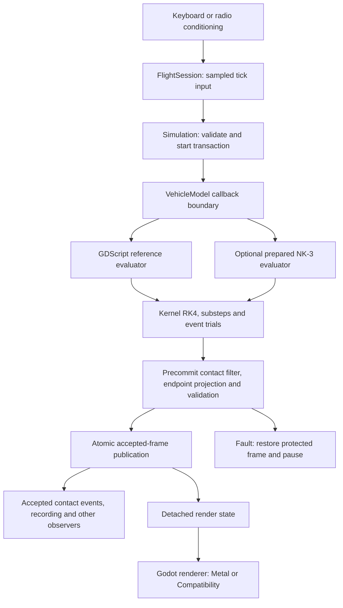
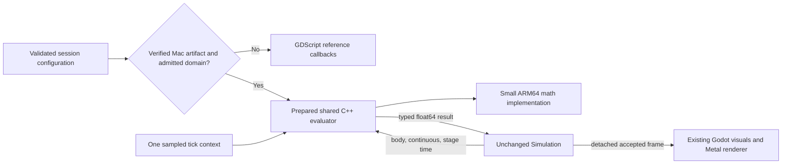

# Apple Silicon Native Kernel Implementation Plan

**Research date:** 2026-11-12

**Repository assessed:** `0cdb3cfd2cb4fca6d71cf508555501c153e15f37`; working tree initially clean.

**Status:** implementation specification with bounded M1 primitive experiments in section 3.9; no production native-evaluator implementation or qualification.

**Owners:** DT/PT for Mac delivery and measurement; SF/NK/FL for evaluator semantics, admission and replay; each vehicle owner retains its validation gates.

This document supplies the detailed feasibility assessment and implementation specification for **DT-MAC-04n1–04n4** in [the Apple Silicon master plan, phase 10](docs/plans/apple-silicon-performance.md#13-phase-10--conditional-nk-3-arm64-project). The master plan remains authoritative for cross-track priority, current status and promotion. [STACK](docs/STACK.md#boundaries-and-data-flow), [SF-08](docs/research/simulation-foundation/README.md#6-backend-policy-sf-08) and the [native evaluator guide](research/native-kernel/README.md) remain authoritative contracts. This investigation neither changes those policies nor records an adopted implementation decision.

## 1. Executive summary

**Recommendation: retain the current Mac GDScript reference and existing Metal renderer; conditionally port the existing NK-3 C++ evaluator to native macOS ARM64. Do not replace the shared simulation kernel or introduce a Metal flight solver.**

The project already has a float64, vehicle-independent simulation kernel and a substantial C++ GDExtension evaluator. Linux x86_64 release admission and Windows x86_64 source/debug admission exist. macOS ARM64 native evaluator admission does not. The appropriate project is a tightly bounded portability and qualification effort, rather than a new solver architecture.

The architecture supports this evaluator port without major kernel refactoring. The difficult work is reproducing the pinned ARM64 engine's arithmetic, malformed-input behavior, library identity and lifecycle contracts. The existing math shim explicitly requires x86_64/SSE2; it cannot be rebuilt unchanged for ARM64. Strict compiler flags alone do not prove equivalence.

Ordinary Metal compute cannot implement the current float64 evaluator directly: Apple's Metal Shading Language specification excludes `double`. Converting physics to float32 or emulating doubles would create a separate numerical research project and would not satisfy current adoption policy by assumption. CPU ARM64, NEON and selected Accelerate routines are credible candidates, subject to exactness and complete-workload measurements. [Metal language specification, §2.1](https://developer.apple.com/metal/Metal-Shading-Language-Specification.pdf?changes=_6).

There is **no measured Apple Silicon native-evaluator speedup in this assessment**. Historical Intel results establish opportunity, not a Mac forecast. Retained M1 rendering evidence also supplies a strong counterexample to prioritizing a CPU port: one dated scale sweep indicated a GPU bottleneck. Reprofile the actual candidate before spending the port budget.

The first decision is whether an optimized representative M1 reference workload still exceeds the existing 500 µs tick budget, whether evaluator work materially causes that miss, and whether SF/NK owners select the port. If these conditions are absent, finish the baseline report and defer the remaining phases. Conditional execution is a successful research outcome.

## 2. Existing architecture assessment

### 2.1 Inspection method and evidence classes

Code discovery used the existing `C-DEVELOPMENT-OpenRCsimulator` knowledge graph, symbol search, call tracing and snippets. The index contains stale function ranges: for example, its `Simulation.step` and `FlightSession._physics_process` snippets resolve to unrelated current lines. Current source and graph-assisted text search were therefore checked directly. Graph complexity and call edges are navigation aids, not measured performance evidence.

The following labels apply throughout:

| Label | Meaning |
| --- | --- |
| Confirmed implementation | Verified in the source/configuration at the assessed commit |
| Retained measurement | An existing report for its stated source, host, engine and workload; not rerun here |
| Proposed | Interface refinement, experiment, target or task requiring future implementation and verification |
| Unknown | Native hardware observation or compatibility evidence still required |

The original architecture assessment did not connect to a Mac or compile/benchmark code. The separately identified follow-up in section 3.9 now supplies isolated M1 primitive measurements at a newer source pin; it does not refresh the whole architecture audit or qualify an evaluator. No production code changed. Estimates in section 12 are engineering effort, not predicted speedups.

### 2.2 Runtime, dependencies and delivery

| Area | Confirmed implementation and consequence |
| --- | --- |
| Engine | [get-godot.sh](app/get-godot.sh) pins official Godot **4.8-beta2**, `4.8.beta2.official.cafc17a19`, with archive/executable integrity checks. Reuse the native ARM64 executable; do not introduce an engine upgrade into this experiment. |
| Physics clock | [project.godot](app/project.godot) sets **240 Hz** and at most **12 catch-up steps per rendered frame**. The nominal tick interval is about 4.167 ms; this is not the 500 µs CPU budget. At 60 fps there are four nominal physics ticks, giving a 2 ms allocation at 500 µs each. |
| Simulation | [simulation.gd](app/sim/simulation.gd), [vehicle_model.gd](app/sim/vehicle_model.gd), [integrator.gd](app/physics/integrator.gd), event and rigid-body helpers implement the shared transaction and RK4 integration. Godot rigid-body nodes do not solve flight. |
| Numeric representation | Thirteen rigid-body float64 values, followed by optional continuous blocks. Sampled auxiliary arrays and discrete modes have separate ownership. NED position, FRD body axes, body-to-NED attitude; rendering converts at [frames.gd](app/render/frames.gd). |
| Native flight evaluator | [native_stage.gd](app/sim/native_stage.gd), family adapters in `app/sim/native/`, and [nk_kernel.cpp](research/native-kernel/src/nk_kernel.cpp) implement the existing ABI-2 evaluator path. Unsupported/missing/stale artifacts select reference at admission. |
| Platform admission | `_source_platform()` currently admits Linux/Windows x86_64. `_load_library()` permits native release packages only on Linux. ARM64 macOS returns reference fallback. Windows source/debug NK-4 support is newer than some summary prose. |
| C++ dependencies | [toolchain-lock.json](research/native-kernel/toolchain-lock.json) pins godot-cpp **10.0.0-stable**, commit `507ed9d840c01a3c5b2a39af8bb4000bfac30bf5`, extension API **4.7**, and SCons **4.10.1**. Simulation doubles do not require changing Godot's `real_t` build precision. |
| Build orchestration | [build.py](research/native-kernel/build.py), [build_windows.py](research/native-kernel/build_windows.py), [run.py](research/native-kernel/run.py) and [devtools.py](research/native-kernel/devtools.py) already manage source-bound builds, oracles, mutants, installation and diagnostics. Extend these owners; do not build a parallel toolchain framework. |
| Rendering | Compatibility is the generic configuration; `rendering_method.arm64="mobile"` selects the existing native Metal route, with [renderer recovery](app/app_state/renderer_guard.gd). A C++ CPU evaluator is independent of that renderer choice. |
| Packages | [export.sh](app/export.sh) supports desktop exports; [native_package.gd](app/app_state/native_package.gd) and the [release tools](tools/release/README.md) own identity. A universal Mac application does not establish a qualified universal native evaluator. |

The ground-vehicle native evaluator is a separate optional implementation with its own build and qualification; do not port or promote it implicitly. Fixed-wing, helicopter, ground vehicle, blimp and multirotor share the kernel but do not share all laws, protocols or evidence. The multirotor's `framed-sampled-v1` controller protocol is not covered by the proposed fixed-wing port.

### 2.3 Execution pipeline and ownership

The fixed-wing session conditions input once per tick in `FlightSession._physics_process()` and performs session health/crash checks. `Simulation._physics_process()` calls `step()` when allowed. The tick validates the current frame and configuration, advances sampled state, evaluates the model at RK stage times, applies the declared integration/event/substep policy and precommit body/contact filter, validates the endpoint and publishes the accepted frame. Faults recover the protected state. Accepted contact-event publication, signals and session observers add synchronous work beyond the evaluator. Collision handling therefore spans both transaction-owned filtering and session observation; it is not all a postcommit observer.

The arrows represent ownership and data flow; RK4 repeatedly invokes the same evaluator boundary. Four evaluations are only the simplest RK4 case. Contact substeps, event bracketing and reset preparation can add calls. Never budget a production tick by multiplying a single initial-state stage timer by four alone.

Current `VehicleModel.stage(body, continuous, t)` returns `loads: float64[6]`, `derivative: float64[continuous_size]`, and `rotor_momentum: float64[3]`, with qualified optional `body_derivative: float64[13]` and `stage_context: Dictionary`. A body-only model instead uses `loads` and sampled rotor momentum. The current validator checks the numeric arrays' shapes/finiteness; it checks only the Dictionary type of `stage_context`, whose opaque contents remain vehicle-law-owned and reach `substeps_joint` through k1. An Apple port must preserve both routes, key types, ordering where observed, failure sentinels and optional fields.

### 2.4 CPU/GPU workloads and bottleneck evidence

CPU work includes branch-heavy aerodynamic loads, strip/local-flow calculations, wake, propulsion, battery/fuel laws, weather, gear/hull/water queries, RK trials and transactional validation. Input shaping, collision, recording, statistics and audio/render observers remain additional consumers. GPU work is primarily scenery, terrain/cloud shaders, lighting, shadows, water, particles and reconstruction through Godot.

| Retained evidence | What it supports | Limits |
| --- | --- | --- |
| [NK-3 Linux release campaign](docs/research/native-kernel/NK-3/README.md#expanded-linux-qualification-2026-10-29): Intel i5-10500, 60 completed probes/30 pairs, 3,000 ticks each; median paired mean tick-cost ratios 1.65×–2.76×, overall median 2.11× | Replacing this evaluator can materially reduce detached production-session cost on that host | Excludes rendering, audio, OS input and presentation; neither ARM64 forecast nor Gate P/1080p qualification |
| [NK-4 Windows source/debug evidence](docs/research/native-kernel/NK-4/README.md#measured-cost): research-adapter timing medians 2.3×–2.8×; separate belly-slide session about 2,022–2,215 → 1,255–1,371 µs | Windows arithmetic portability and real native execution were achievable | Shared loaded host, editor/research timing; not a Mac or release-package result; substantial work remains outside the evaluator |
| [H15 GDScript optimization](docs/research/simulation-state/H15/README.md): historical P-51 stall 457–461 µs median, versus an earlier native-slipstream experiment at 510–520 µs | Exact script optimization can beat a narrower native experiment; native is not inherently the next best change | Older source/engine, Intel KVM and concurrent renderer; batch p95 is not per-tick p95 |
| [Apple R4 attribution](docs/plans/apple-silicon-performance.md#next-campaign-dt-mac-00-r4): dated M1 scale sweep FPS(0.5)/FPS(1.0)=2.34, main thread waiting for GPU in 57% of samples | A concrete reason to prioritize rendering for that circuit | Historical selected circuit, not every current aircraft or scene and not proof that CPU work is free |
| [Retained M1 campaigns](docs/research/desktop-delivery-investigations/DT-MAC-02/README.md) and [current campaign status](docs/plans/apple-silicon-performance.md) | Native reference replay, rendered measurements and measurement limitations already have owners and artifacts | No qualified ARM64 NK-3 result; logical, drawable, internal and physical display dimensions must remain distinct |

**Unknown:** current optimized Mac complete-tick distribution, evaluator fraction, allocation rate, CPU/GPU overlap, incremental native memory and sustained energy cost for the assessed commit. Source inspection identifies candidates, not their current rank.

## 3. Technical research and references

Primary documentation was consulted on 2026-11-12. API availability must still be checked against the SDK, deployment target, engine build and physical device selected for implementation. Current documentation is not a reason to update pinned dependencies.

### 3.1 What “kernel” means here

| Interpretation | Applicability |
| --- | --- |
| Operating-system kernel/extension | Inapplicable. This application needs no privileged scheduler, driver, kernel extension, SIP change or DriverKit service. Keep work in the ordinary application process. |
| Simulation kernel | The existing vehicle-independent tick transaction. Preserve its ownership and public contracts. |
| CPU computational kernel | Relevant: a small native ARM64 implementation of the existing pure evaluation boundary inside a GDExtension. |
| GPU compute kernel | A Metal shader dispatch. Potentially useful for independent large batches or visual work; incompatible with the present direct float64 flight-evaluator requirement. |

### 3.2 CPU architecture, NEON and scheduling

Apple Silicon is an ARM64 target with architecture-dependent scheduling and memory behavior. Apple advises profiling on actual Apple and Intel hardware rather than inferring efficiency from source or an architecture name. Use meaningful QoS for separately scheduled work, avoid spin waiting, and let the OS distribute runnable work; do not assume a fixed performance-core count or force affinity. The initial port runs synchronously on the existing caller and adds no thread pool. [Apple performance tuning](https://developer.apple.com/documentation/apple-silicon/tuning-your-code-s-performance-for-apple-silicon).

AArch64 Advanced SIMD/NEON supports 128-bit vector operations, including two-lane float64 arithmetic. This makes independent pairs of scalar operations plausible vectorization candidates. It does not imply two-times solver throughput, free lane packing or identical reduction behavior. Start with scalar parity, then inspect generated code before adding intrinsics. [Arm Advanced SIMD intrinsics](https://developer.arm.com/documentation/101028/0009/Advanced-SIMD--Neon--intrinsics).

Weak memory ordering makes unsynchronized cross-thread publication unsafe. Any later worker design needs immutable inputs, explicit synchronization and stable ownership; `volatile` is not a substitute. Platform-specific casts, alignment and pointer assumptions also need audit. [Apple architectural differences](https://developer.apple.com/documentation/apple-silicon/addressing-architectural-differences-in-your-macos-code).

### 3.3 Floating-point semantics

The source already demonstrates numerical portability hazards: SSE2 operand order for NaNs, literal-parser rounding, operation grouping, `pow` constant folding, platform `sqrt` behavior, helper NaN/signed-zero semantics and engine-specific `lerp` order. Linux's glibc assumptions are not Darwin assumptions.

Use an ARM64-specific oracle against the **same pinned native Godot executable**. Determine actual scalar instruction behavior, NaN propagation/default-NaN behavior, subnormal handling, FP control state, transcendental resolution and builtin transformations. Record FP control state; never change the host's floating-point environment globally to make the port pass.

Require `-fno-fast-math` and explicit `-ffp-contract=off`, with effective compile/link flag verification and disassembly of sensitive primitives. Clang documents that disabling fast math can still leave within-expression contraction enabled; “strict enough” source appearance is insufficient. Verify the selected Apple Clang version rather than assuming upstream defaults are identical. [Clang floating-point controls](https://clang.llvm.org/docs/UsersManual.html#controlling-floating-point-behavior).

Extend the existing oracle with observable witnesses, not flag checks alone. With runtime operands under verified round-to-nearest, `(1+2^-27)*(1-2^-27)-1` distinguishes separate binary64 operations (`+0`) from FMA (`-2^-54`). Observe the engine first: use the opposite evaluation as the detector mutant, and resolve an unexpected fused reference against the strict-FP design before continuing. Retain effective settings per translation unit and inspect the final linked candidate, including relevant pragmas/LTO. Verify calling-thread FPCR controls across prepare/stage/refusal without assuming FPSR exception-status preservation. Add adjacent representable values around actual literals/thresholds and bind math qualification to the tested OS/toolchain tuple. Signaling-NaN transport/coverage remains an explicit scope question, not an inferred success. [I01–I02 findings and controls](docs/research/native-kernel/apple-silicon-plan-reinforcement-2026-11-12.md#i01).

### 3.4 Accelerate and Apple SIMD libraries

Accelerate supplies CPU vector processing, vDSP array arithmetic, vForce vector transcendental functions, and BLAS/LAPACK. Apple's `simd` facilities address small vectors/matrices. Reuse those implementations where a matching workload and numeric policy exist; avoid writing a replacement BLAS, FFT or general solver. [Accelerate overview](https://developer.apple.com/accelerate/).

vForce includes double-precision vector functions, but matching precision is not a byte-identity guarantee against scalar engine math. Treat vector transcendental substitution as an independently gated numerical candidate. [vForce documentation](https://developer.apple.com/documentation/accelerate/vforce).

The simulator's tiny vectors, branchy laws and ordered sums make function-call overhead and reduction order material questions. This is a workload inference requiring measurement, not a limitation claimed for Accelerate. Keep scalar operations for three-component quantities until an experiment shows otherwise. Evaluate larger offline linear algebra separately from authoritative live-flight evaluation.

The first SIMD experiment should target independent lanes, such as the final six-component `fade` multiply in `nk_wake.hpp`, preserving preceding reduction order. Test the comparison shim's quiet-NaN and signed-zero operand behavior before replacing any min/max helper. For a public vDSP candidate, freeze actual/neighboring lengths, legal aliases, stride, tails, symbol availability and deployment floor; include packing/scratch/call costs and complete-stage timing. No private matrix instruction dependency or universal size crossover is assumed. [NEON investigation](docs/research/native-kernel/apple-silicon-plan-reinforcement-2026-11-12.md#i03), [Accelerate investigation](docs/research/native-kernel/apple-silicon-plan-reinforcement-2026-11-12.md#i04).

Permute special values through every vector lane and scalar tail at each actual length. The M1 follow-up found that a 289-pair matrix could pass while a changed odd-tail position exposed a NaN-payload difference in both disposable NEON and vDSP candidates. Those candidates are not generally byte-equivalent. Compare ordinary compiler vectorization as well as explicit intrinsics; manual NEON was not always the fastest observed primitive.

### 3.5 Metal, MPS and unified memory

Metal compute provides GPU dispatch and resource control; MPS provides tuned data-parallel primitives for supported image/matrix and other GPU workloads. Neither supplies a ready-made RK4 aircraft law or removes the need for numerical qualification. Prefer an existing MPS primitive to a custom shader only when the actual operation matches. [MPS overview](https://developer.apple.com/documentation/metalperformanceshaders).

The current language specification has no `double` scalar type. Consequently, ordinary Metal/MPS execution does not provide a direct float64 implementation of this evaluator. Float32 and software-emulated double proposals are excluded from the recommended path; a separately authorized research project would need its own numerical contract, implementation and complete-cost evidence. [Metal language specification, §2.1](https://developer.apple.com/metal/Metal-Shading-Language-Specification.pdf?changes=_6).

Unified memory permits shared CPU/GPU access to suitable resources, reducing the need for some explicit copies. It does not eliminate encoding, scheduling, synchronization, cache traffic, layout conversion or contention with rendering. Apple recommends shared storage for CPU-populated resources and private storage for GPU-owned resources; memoryless storage is for transient textures, not persistent physics state. [Apple GPU storage modes](https://developer.apple.com/documentation/metal/choosing-a-resource-storage-mode-for-apple-gpus).

CPU and GPU must not access changing shared contents concurrently. Publish CPU input before submission; read GPU output only after completion and avoid reuse until ownership returns. A hypothetical live RK evaluator would put command completion on a dependent path repeatedly. Asynchronous buffering cannot conceal that dependency without changing when the authoritative state is available. [CPU/GPU synchronization](https://developer.apple.com/documentation/metal/synchronizing-cpu-and-gpu-work), [shared resource responsibilities](https://developer.apple.com/documentation/metal/mtlstoragemode/shared).

GPU features require device/OS capability checks, not chip-name heuristics. Do not promise Metal 4 behavior from an OS label or port this engine to a new Metal submission model as part of the CPU work. [Metal feature inspection](https://developer.apple.com/documentation/metal/device-inspection), [feature tables](https://developer.apple.com/metal/Metal-Feature-Set-Tables.pdf).

### 3.6 C++, Objective-C++ and Swift interoperability

C++ already fits the GDExtension boundary and existing laws. Use C++ for the evaluator and keep Apple-specific code at the math/build/platform edge. If a future Metal experiment requires Cocoa/Metal ownership, place that small host adapter in Objective-C++ behind an ordinary C++ interface. No Swift bridge is needed for the initial port.

Swift supports bidirectional C++ interoperability, with documented type, exception and toolchain constraints. Introducing it would add another ABI/build/runtime surface without removing the existing C++ integration. If a future native UI or tool needs Swift, use an explicitly versioned ownership boundary and prevent exceptions from crossing it; make that a separate change. [Swift C++ interoperability constraints](https://www.swift.org/documentation/cxx-interop/status/).

Godot supports GDExtension C++ bindings and custom API descriptions. The repository's locked API/binding choice takes precedence over current upstream examples; do not copy newer SCons options blindly into the locked version. [Official godot-cpp guidance](https://github.com/godotengine/godot-cpp#compatibility).

### 3.7 Comparable projects and measured benefits

The [2026-11-12 comparable-project review](docs/research/native-kernel/apple-silicon-comparables-2026-11-12.md) adds primary measurements from MATLAB, AppleAccelerate.jl, elastic-wave simulation, Blender, neutron transport and OpenMM, plus MuJoCo and Dolphin architecture/numerical counterexamples. It records hardware, workload, precision, baseline, measurement scope and missing evidence. CPU-library, GPU-grid, rendering, energy and batch results are kept distinct. No external ratio is an OpenRC Mac forecast; the review maps each useful finding to DT-MAC-04n1–n4 and illustrates how evaluator savings are diluted in complete ticks and frames.

### 3.8 Twelve investigations reinforcing the implementation gates

The [twelve-investigation review, 2026-11-12](docs/research/native-kernel/apple-silicon-plan-reinforcement-2026-11-12.md) checks numerical controls, library semantics, timing/statistics, thermal/energy tooling, ownership, ABI, distribution, replay and CI against primary sources and targeted current source at `40751b55188226e69143881c7c58f16bc0a3cfff`. Its desk research is complete, with a subsequent bounded hardware follow-up below. Its controls are integrated into the architecture, six phases, benchmark protocol, qualification matrix and checklist. It does not refresh every claim of the original architecture audit or change the conditional entry/promotion policy.

### 3.9 Bounded M1 experiments and a rejected naive optimization

The [M1 experiment report, 2026-11-12](docs/research/native-kernel/apple-silicon-m1-experiments-2026-11-12.md) records successful strict SSH access to ANGELA_AIR, checked Godot math tests (20 checks, zero failures), a standalone ARM64/Accelerate build, runtime FMA witnesses and two short-vector timing repetitions. The build required an explicit path to libc++ headers already present in SDK 27.0; path discovery alone had not established compiler readiness.

Seventeen scalar/packed-double fixtures retained their bits. An initial 289-pair multiplication corpus matched Godot, but moving a quiet NaN into the odd tail produced one byte mismatch each for the disposable NEON and vDSP candidates. `std::fmax` also differed from Godot `maxf` in 33/289 cases. These observations make lane/tail permutations and helper controls concrete requirements. They do not qualify the native extension, all arithmetic or any aircraft.

Small-length timings varied substantially between processes. Ordinary C++ beat explicit NEON at eight elements in both runs, while vDSP had lower observed cost at 64/256; none establishes a stable crossover or complete-workload benefit. Preserve the reference backend and conditional entry gate. No implementation phase, 500 µs budget, energy, package or 1080p qualification was completed.

## 4. Feasibility analysis

**Architectural feasibility: high for an evaluator-only CPU port. Numerical feasibility: unproven on ARM64. Product benefit: unproven and workload-dependent.**

Already reusable: model/session boundaries, prepared immutable coefficients, pure stage methods, per-tick context, capability admission, exactness oracles, native coverage counters, source-bound receipts, checkpoint/replay identity, fallback, fleet campaigns and detached production timing. No new vehicle-specific branch belongs in `Simulation`.

Required portability work is substantial but bounded: replace the x86-only math primitives with an empirically matched ARM64 implementation; qualify Apple Clang/libSystem behavior; support Mach-O/dylib inspection and identity; extend source/package admission; and run native target-hardware gates. Most law implementations should remain shared.

No measured Apple advantage can yet be concluded. Use Amdahl's law to screen the proposal:

`complete_workload_speedup = 1 / ((1 - f) + f / s)`

Here `f` is the measured fraction of the selected complete CPU workload spent in the replaced evaluator and `s` is its measured acceleration. For illustration only, `f=0.2, s=2` gives 1.11×; `f=0.6, s=2` gives 1.43×. These are arithmetic scenarios, **not forecasts**. Whole-frame results also depend on CPU/GPU overlap, VSync and contention and cannot be derived from this formula alone.

The stop conditions are explicit:

1. No qualifying target-host budget miss or material evaluator attribution: defer native implementation.
2. Same-host byte identity cannot be achieved within the bounded math spike: retain reference; document the failing primitive and alternatives.
3. Exact native code improves a microbenchmark but fails practical complete-workload benefit or regresses required cases: do not promote.
4. Package, crash recovery or fallback is unreliable: keep Mac native admission disabled regardless of raw speed.

## 5. Comparison of implementation alternatives

“Expected performance” below describes a hypothesis and overhead shape, not a measured Mac result.

| Approach | Feasibility / expected performance | Complexity and integration | Memory, compatibility and sustainability | Decision |
| --- | --- | --- | --- | --- |
| Existing GDScript, targeted exact optimization | Fully available; benefits the actual hot path without a new crossing | Lowest; use existing oracles and source pipelines | Portable, no new artifact; optimize allocation only where measured | Baseline and first response |
| Scalar ARM64 C++ NK-3 port | Fits the existing boundary; possible interpreter/dispatch reduction, magnitude unknown | Medium/high: math semantics, build, loader, package and evidence | Small prepared CPU working set; shared law sources; Mac artifact qualification required | Recommended conditional implementation |
| CPU auto-vectorization / NEON | Real float64 support; potential independent-lane gains, packing/branch costs unknown | Medium after scalar parity; isolated candidates, ordered sums retained | Little extra memory if existing layout suffices; guarded ARM64 code, scalar rollback | Optimize only measured loops |
| Accelerate/vDSP/vForce/BLAS | Strong fit for matching larger arrays/matrices; unclear benefit for tiny branched stages | Medium; new call/reduction semantics and framework link | System framework; avoid extra buffers, thread oversubscription and reliance on undocumented hardware units | Selective experiment; reject unequal math |
| Parallel independent CPU simulations | Plausible throughput gain for offline sweeps; does not shorten dependent ticks automatically | Medium/high; isolated contexts, bounded workers and deterministic ordering | Working set scales with instances; keep threads out of live single-flight critical path initially | Separate demand-driven batch work |
| Metal compute authoritative flight | No direct float64 route; dispatch/wait cost competes with small dependent stages | Very high if precision policy changes; new synchronization/numerical project | Shared DRAM still contends with rendering; Apple-specific code and tooling | Reject for current contract |
| Metal/MPS independent nonauthoritative batches or visual work | Potential only with a large measured data-parallel consumer | Medium/high; capability checks, resources, CPU comparison and error handling | Persistent pipelines/buffers consume unified memory; existing Godot facilities preferred | Separate future research, no mandatory implementation |
| Swift rewrite or engine-native solver module | Technically possible software projects; no evidence they remove the actual limiter | High; duplicates laws or adds build/release/engine maintenance | More platform coupling and qualification surfaces | Do not pursue |
| macOS kernel/system extension | No relevant simulation advantage | Highest operational/security cost; wrong execution domain | Privileges and distribution burden without an application need | Reject |

All native CPU alternatives need malformed-input, exact trajectory, lifecycle, source/ABI and package tests; SIMD/library candidates additionally require differential numerical and tail-cost checks. Threaded alternatives require race/lifetime tests. GPU alternatives would additionally need resource ownership, device-loss/error and full CPU/GPU latency tests. Ordinary in-process C++ uses the app's permissions; native memory safety and signed-library loading remain real engineering obligations.

## 6. Recommended architecture and technical justification

### 6.1 Execution model and host communication

Keep **one prepared evaluator instance per admitted session**. The recommended initial native path is synchronous CPU execution on the existing tick caller. Do not move RK4, event location, checkpoint ownership, input sampling or accepted-frame publication into native code.

Reuse the current contract:

| Boundary | Required behavior |
| --- | --- |
| `prepare_stage(config)` | Decode the validated model, layout, laws, field/weather/contact configuration and resource budgets once. Refuse unsupported input before installing callbacks. |
| `set_tick_context(aux, inputs, deflections, time_now)` | Copy/prepare the exact sampled context once per tick; retain the session's current deflection policy. Never advance random state or controls in stage calls. |
| `stage(body, continuous, t)` | Read-only float64 evaluation at the provided stage time, returning the current typed dictionary contract. No hidden state progression, publication, engine scene access or cross-stage cache with physical history. |
| Body-only `loads` / `rotor_momentum` | Preserve the existing paired callback installation and restoration; do not route empty continuous state through an incompatible joint-stage ABI. |
| Backend identity | Preserve current session/checkpoint fields: backend, backend version, ABI, binary/source/lock hashes. The verified receipt/package evidence additionally binds platform/architecture, engine, mirrored sources and toolchain; these are not all existing checkpoint fields. Preserve current refusal behavior and version any identity migration. |

These are representative common fixed-wing calls, not the complete family ABI. Preserve existing `set_power_context`, `set_glow_context` and `set_preview_context` handoffs, including accepted-state/substep preview semantics and reset/restore priming. Helicopter preparation/context uses its separate `prepare_heli_stage` and `set_heli_tick_context` route and needs independent qualification if later included. Do not replace these handoffs with only the common four-argument tick call.

Keep ABI 2 if only its implementation and platform receipt support change. If any public data shape or meaning must change, version it explicitly with paired old/new rejection tests; do not silently stretch ABI 2. A new general host-to-device message layer is unnecessary.

**Experimental admission must be explicit.** Main and helicopter routes already request `native` by default; removing the current Mac platform refusal would therefore enable product admission immediately. Before promotion, require a dedicated opt-in gate for source/debug and packaged qualification (proposed `--experimental-native-macos`, propagated through session setup), alongside the native request and verified artifacts. Leave it off for ordinary Home/direct-flight launches. The exact final packaged executable must support explicit opt-in for its prepromotion tests; do not rebuild or patch receipts to enable those tests. Enforce the qualified fixed-wing family/domain allowlist in the runtime helper and reject helicopter/other unqualified families even if they share the loader. Test both explicit opt-in and ordinary default routes. Only DT-MAC-04n4 promotion may remove that Mac opt-in requirement for the adopted surface; any resulting artifact change invalidates its affected qualification gates.

### 6.2 Allocation and memory management

Prepare immutable coefficient tables and validated configuration outside the tick. Bound all table sizes and retained diagnostics using existing resource budgets. Reuse internal scratch only when it cannot alias returned arrays or a concurrent call. Preserve detached result ownership: later evaluations must not mutate a previous result retained by a caller or observer.

Treat GDExtension packed-array pointers as scoped views. Do not retain raw pointers into a temporary, resized or copy-on-write Godot container beyond the synchronous call. Use explicit internal ownership for prepared data and stable lengths for state vectors. Do not promise zero allocations: measure result dictionaries, packed arrays and crossing costs, then optimize only safe internal work.

The thirteen-double rigid body occupies 104 payload bytes; additional blocks and object/container overhead must be measured. There is no reason to allocate Metal buffers or upload CPU physics state in the recommended design. Keep graphics allocations and visual settings independent of the simulation's representation and numerical behavior.

Prefer the existing prepared layout initially. Consider structure-of-arrays only for a measured loop/batch benefit; include transposition and unused-lane costs. Use alignment guaranteed by the chosen allocation API, and verify it before any aligned intrinsic access. Avoid padding every small vector or keeping duplicate CPU/GPU copies without evidence.

Ownership tests must retain an output across later calls, mutate an independent caller copy, replace/resize temporary inputs and interleave two evaluator instances. Measure warm lifecycle retention separately from allocator/library caches. A future no-copy Metal consumer cannot wrap arbitrary Godot array pointers: it must prove eligible allocation/alignment, one-region ownership and lifetime through completion. Reference/refusal paths must avoid candidate-only scratch/GPU allocations. The initial CPU evaluator needs no Metal buffer. [I08 ownership findings](docs/research/native-kernel/apple-silicon-plan-reinforcement-2026-11-12.md#i08).

### 6.3 Threading and synchronization

Live flight remains serial at the current evaluator boundary. RK stages and subsequent ticks depend on earlier results. Parallelizing those dependencies is not a free implementation detail. Fine-grained task scheduling may cost more than these small computations; measure before adding workers.

A later offline batch implementation may distribute independent simulations across a bounded existing worker mechanism, with one evaluator/scratch/context per worker. It must freeze input tapes, preserve within-instance operation order, return results by deterministic instance ID and honor cancellation at safe boundaries. No worker may mutate live scene resources or session state. Avoid nested parallel library work that oversubscribes cores.

If a separate GPU batch is ever justified, prepare pipelines once, bound in-flight buffers, transfer ownership at submission/completion, and propagate errors outside the authoritative flight path. Record encode, queue, execution, wait and readback times separately. Do not implement this branch as part of the initial CPU port.

### 6.4 Platform abstraction and arithmetic

Keep `nk::R` and shared laws as the narrow compatibility boundary. Separate platform primitives only where necessary: existing x86 behavior remains unchanged; ARM64 operations match that host engine's observations. Prefer plain C++ with verified strict semantics; introduce architecture intrinsics or assembly only for a demonstrated mismatch/performance need. Do not scatter `__APPLE__` branches through each aerodynamic law.

Preserve operand order, signed-zero scrubs, helper comparisons, literal values and transcendental call semantics. Audit `pow`'s x86 register constraint and compiler barrier explicitly. Darwin symbol inspection must replace Linux `readelf`/glibc assumptions; symbol presence alone does not establish identical results. FP64 state remains scalars/packed arrays across the GDScript boundary.

### 6.5 Errors, diagnostics and fallback

At setup, missing/invalid receipt, wrong engine, wrong architecture, wrong ABI, stale source, unsupported capability, exceeded resource budget or library-load refusal selects reference with a bounded reason. Build the candidate before replacing existing callbacks; rejected reset/reload/restore must preserve the accepted session and recorder.

After native admission, a configuration mutation that bypasses an accepted reconfiguration boundary, or a malformed/nonfinite stage result, follows the existing fault/rollback/pause policy. **Do not silently switch solver inside an active tick.** Preserve the session's existing accepted-boundary reprepare/detach behavior: supported setters can rebuild the helper and select reference on preparation refusal without necessarily resetting the flight. A recording must detect that backend identity change and become incomplete; it must never continue as one exact-backend recording. Explicit new session/reset recovery remains available. Exact replay must refuse a missing native identity; candidate replay is separately marked `solver_changed`.

Retain existing native stage/context counters and bounded rejection diagnostics. Logs should name platform, ABI, receipt/library hash and refusal category without per-stage console output. Keep diagnostics disabled or bounded in normal flight. A caught preparation failure can fall back; an in-process native memory fault can terminate the app and cannot be presented as recoverable GDScript rollback. Sanitizers, crash symbols and package tests address that risk.

### 6.6 Build and deployment

Extend the existing builder with a native Mac ARM64 route and a pinned macOS toolchain record. Recheck the chosen host's Apple Clang, SDK path/version, deployment target, Python, SCons and native engine hash. The M1 guide records installed command-line tools on a named host, not an already qualified NK-3 Mac compiler.

Build the locked godot-cpp/API configuration, preserve the engine-matching binding precision, emit a compilation database and inspect final effective FP flags. Initially disable unqualified LTO or other transformations; evaluate each later toolchain change independently. Produce a dylib, descriptor, source/toolchain receipt and matching dSYM/UUID in fresh ignored output directories. No runtime compiler or downloaded code is needed by players.

Before family/fleet work, prove scalar and packed float64 round trips through the actual late-loaded extension, using signed zero and values that expose float32 narrowing. Record the API JSON hash/origin and selected API/override, engine/binding precision, per-slice architecture/load commands/dependencies and delivered minimum OS. Simulation float64 does not justify selecting double `real_t` bindings against a single-precision engine. Inspect the exact editor/release host's signatures, entitlements and Team ID, then prove that it loads the candidate under its actual library-validation policy; an official signed editor is not an automatic loading pass. [I09 binding gate](docs/research/native-kernel/apple-silicon-plan-reinforcement-2026-11-12.md#i09), [I10 distribution gate](docs/research/native-kernel/apple-silicon-plan-reinforcement-2026-11-12.md#i10).

Proposed source/debug installation names are `openrc_native_kernel_macos.gdextension` and `build-receipt-macos.json`, alongside the existing platform files, with an explicit `macos`/`arm64` receipt row and architecture-matched dylib mapping. Keep Mac paths separate from Linux/Windows and preserve the current guarded manual-loading policy. These names and the associated runner flags do not exist as a qualified Mac route today.

An ARM64 dylib cannot serve an x86_64 process. The first Mac native deliverable may qualify only ARM64 while Intel/Rosetta explicitly retains reference. Alternatively build separate validated slices before assembling a universal library; `lipo` assembly alone does not qualify either slice. Apple's universal-binary guidance requires architecture-compatible components. [Apple Silicon porting guidance](https://developer.apple.com/documentation/apple-silicon/porting-your-macos-apps-to-apple-silicon).

Reuse the existing receipt/release mechanisms as a starting point, preserving the reference-only identity and defining a separately versioned native identity rather than embedding a self-referential hash. Finalize dylib slices/install names and sign the library, then run its oracles/fleet gates and generate the native qualification receipt. Embed that receipt/manifest into the PCK and verify that packaging and outer signing preserve the qualified dylib bytes. For a notarized ZIP route, finish nested/app signing, submit the staging archive, inspect acceptance/logs, staple and validate the app/items, then generate the final external bundle receipt and seal the distribution ZIP. ZIPs cannot themselves be stapled. Re-signing or changing the dylib invalidates its binary-bound proofs; do not rewrite an unsigned precursor's hash. Keep submitted and final archive hashes distinct and qualify the final package bytes. No byte-changing operation follows final receipt/package qualification. [Apple notarization workflow](https://developer.apple.com/documentation/security/customizing-the-notarization-workflow).

Prove receipt-location feasibility early: the current sibling receipt may become inaccessible when a quarantined app is translocated. Test downloaded Finder launch, offline launch, the supported installation route and moving the app alone. No quarantine stripping, library-validation bypass or unsupported recovery of an original path qualifies the design. If a supported launch cannot access required identity, resolve a reviewed installation/identity design and usable reference behavior before fleet work; preserve explicit recording/replay refusal where identity is unavailable. A custom product engine or new trust architecture requires a scope/effort reassessment. [I10 evidence and stop condition](docs/research/native-kernel/apple-silicon-plan-reinforcement-2026-11-12.md#i10).

The current native package verifier is Linux-only, while `mac_reference_identity()` deliberately identifies a reference-only Mac bundle. Add a separately versioned Mac native bundle identity or an explicitly reviewed schema extension through those existing owners; do not reinterpret the reference-only kind as native qualification or weaken the Linux allowlist. Bind the final signed bundle/PCK, native descriptor/library, toolchain/oracle receipt and embedded diagnostic sources without a circular receipt hash.

Propagate that new identity through the existing recording, player/CLI replay, native qualification and benchmark consumers. Their current allowlists reject unknown kinds or native use under the Mac reference kind. Preserve those rejections and separately admit the new native kind with proof that its selected dylib cannot change unnoticed during recording or measurement. Package production and loading alone cannot complete this migration.

Public notarized distribution requires the appropriate Developer ID signing and Hardened Runtime requirements; local ad-hoc development evidence is a different claim. Prefer compatible same-team signed native code and normal library validation. Do not add broad validation-disabling entitlements merely to make a dylib load. [Apple notarization requirements](https://developer.apple.com/documentation/security/notarizing-macos-software-before-distribution), [Hardened Runtime](https://developer.apple.com/documentation/security/hardened-runtime).

## 7. Detailed phased implementation roadmap

All implementation phases below remain **pending**. Section 3.9 supplies partial primitive evidence, not a completed phase. The six phases expand the existing four DT-MAC native substeps; they do not create a new track. Estimates are person-days for experienced engineers with access to the required hardware, excluding procurement and prolonged external service delays.

### Phase 1 — Research and baseline

**Owner/step:** DT/PT with SF/NK; prerequisite to DT-MAC-04n1. **Effort:** 3–5 days. **Dependencies:** current source/engine snapshot, host ownership and measurement tooling.

Tasks:

- Reconcile current source, retained evidence and intended fixed-wing domain; freeze hardware, OS, renderer, model/data, controls, observers and package/editor identity.
- Follow the [M1 workflow](docs/tools/macos-m1.md), preserve existing keys/frozen campaigns, verify an attribute-aware checkout and isolate user settings/cache/output. Reserve any enrolled shared host through its owning queue/session handle.
- Run the existing reference complete-session probes and selected live rendered cases. Collect per-tick and batch distributions separately, setup cost, allocation/memory evidence, CPU stacks and GPU attribution.
- Confirm the 500 µs regime/statistic definition with SF/NK. Identify the evaluator fraction and test a small exact GDScript fix first if profiling identifies one.
- Freeze practical benefit, regression, memory and sustained-run criteria before testing candidates. Record unknown channels as unknown.
- Freeze A/A/observer controls, pair/block ordering, primary metrics, exclusions and a sample cap. Preflight the actual Mac tool/channel matrix and inspect host signatures/receipt-location assumptions before committing to expensive integration.

**Deliverables:** source-bound baseline manifest, raw reports, attribution table, benchmark protocol and go/defer decision. **Risks:** noisy host, wrong pixels, observer overhead, stale inputs. **Acceptance:** completed comparable reference workloads and attribution justify the port under SF-08, or a documented deferral. Do not infer the trigger from historical Linux results.

### Phase 2 — Proof of concept

**Owner/step:** SF/NK, DT-MAC-04n1. **Effort:** 5–10 days. **Dependencies:** phase-1 port selection; pinned ARM64 engine/compiler/SDK.

Tasks:

- Build an isolated math/literal probe using the existing oracle infrastructure outside `app/`.
- Characterize scalar finite arithmetic, two-NaN operand selection, signed zero, subnormal/overflow/underflow behavior, comparisons/clamps, conversions and transcendental/literal semantics against native GDScript.
- Implement only the minimal platform primitives needed to compile one representative existing stage; retain shared laws and the x86 implementation.
- Verify effective strict FP flags, library dependencies and dSYM identity. Run a deliberate numerical mutation that fails the expected comparison.
- Execute FMA/control-state, literal-neighbor and double-transport witnesses through the exact late-loading seam; characterize quiet/signaling-NaN coverage explicitly. Prove minimal signed-host loading and the intended receipt/installation route before fleet work.
- Measure a small end-to-end crossing as a feasibility screen; do not use its cost as the production benefit claim.

**Deliverables:** reproducible research dylib/probe receipts, primitive compatibility table, exactness failures and stop/go report. **Risks:** engine/libm mismatch, default-NaN behavior, compiler folding and unbounded shim complexity. **Acceptance:** required same-host math semantics and minimal stage equivalence achievable without changing physics/tolerances; negative control fails for the intended cause. Otherwise stop with reference intact.

### Phase 3 — Native integration

**Owner/step:** SF/NK/FL and DT, DT-MAC-04n2 then -04n3. **Effort:** 7–12 days. **Dependencies:** successful phase-2 primitive gate and a bounded declared domain.

Tasks:

- Extend builder/runner/devtools for Mach-O, Apple toolchain receipts, separate Mac descriptor/install paths, scoped environments and current exact-engine checks.
- Qualify existing family adapters incrementally. Start with one representative fixed-wing family; reference fallback outside a narrowed qualified surface must be enforced in runtime admission.
- Extend loader/platform/package identity through existing owners, preserving `.gdignore`, guarded explicit loading, source freshness and already-loaded refusal.
- Keep Mac source/debug and packaged-qualification admission behind explicit experimental opt-in until promotion. Enforce the qualified fixed-wing domain and helicopter exclusion; the existing default `native` request alone must not enable Mac execution.
- Extend recording/replay, native qualification and benchmark identity allowlists for the separately versioned Mac native kind, retaining all reference-kind/native refusals.
- Execute the admission/replay route matrix in section 10.4 as one coordinated migration; bind the supported OS/software scope and preserve historical reference recordings.
- Exercise prepare/context/stage, body-only callbacks, reset/reload/restore, mutation refusal and checkpoint/log identity.
- Add native-success markers and validate actual stage/context coverage. An oracle that falls back to reference cannot qualify Mac native code.

**Deliverables:** tested Mac source/debug integration, exact target artifacts/receipts, explicit admission matrix and fallback tests. **Risks:** stale configuration, identity migration, callback aliasing, accidental Linux/Windows changes. **Acceptance:** source-bound native branch and fallback/lifecycle tests pass; no `Simulation` vehicle/platform branch, no altered physics, reference defaults retained until promotion.

### Phase 4 — Performance optimization

**Owner/step:** PT/SF/NK, experiments supporting DT-MAC-04n2/-04n4. **Effort:** 4–8 days. **Dependencies:** correct scalar implementation and repeatable phase-1 workloads.

Tasks:

- Profile the scalar port, including preparation, dictionaries, packed-array crossings, tick context, transaction and observers. Compare with optimized reference.
- Inspect compiler output. Test one change at a time: safe scratch reuse, data locality, independent-lane NEON, then a matching Accelerate primitive if warranted.
- Include lane packing, data conversion and library overhead; preserve each reduction's order and test malformed inputs after vectorization.
- Start with one independent-lane candidate and a legal short-length/stride/alias matrix, permuting special values into every lane/tail position. Compare compiler vectorization and reject helper substitutions, operand reordering or fusion that change required behavior. Confirm selected gains on fresh runs rather than selecting and accepting on the same samples.
- Compare independent offline CPU batch scaling only if a real consumer needs it. Keep the live flight serial.
- Record a paper feasibility result for Metal/MPS under the unchanged float64 contract. A GPU prototype is not required to rediscover the `double` restriction; any separate visual/batch experiment needs its own authorized consumer and budget.

**Deliverables:** scalar-versus-candidate comparison, accepted/rejected optimization records and resource deltas. **Risks:** theoretical gains lost at the boundary, arithmetic divergence, thermal regressions, oversubscription. **Acceptance:** retain only exact candidates with practical complete-workload gains beyond uncertainty; otherwise ship no additional optimization.

### Phase 5 — Validation and testing

**Owner/step:** SF/NK/FL, vehicle owners and DT/PT, DT-MAC-04n3/-04n4. **Effort:** 6–10 days. **Dependencies:** stable native candidate, declared admission surface and matching harness/source identity.

Tasks:

- Compare at least 10,000 actual stage states including malformed inputs across air, ground and hull domains; execute every applicable component/family/weather/source installer gate and mutation control.
- Complete the five trajectory cases under existing verifier rules, fault/restore/pending-weather prerequisite tapes and native coverage checks.
- Run current-source fleet cases with exact row-union accounting and explicit completed/refused/terminal classification. Narrow claims if rows remain excluded; historical X8 reports do not qualify a different current aircraft.
- Run native loader/session/replay, source/config mutation, absent/stale/corrupt/wrong-ABI/wrong-slice/already-loaded, callback aliasing and resource-limit tests.
- Use isolated supported sanitizers and positive controls. Verify required Linux/Windows consumers after shared math/build changes and required CI on the stable candidate.
- Prove detector activation through the actual loader, preflight macOS CI resources and require native-success markers; a diagnostic engine or VM timing never replaces product-engine or real-display evidence.
- Execute native complete-session A/B timing and final live 1080p/thermal cases with the exact candidate artifacts.

**Deliverables:** verification matrix, source-bound reports, coverage/refusal manifest, regression results and performance verdict. **Risks:** false native coverage, truncated tapes, cross-platform golden confusion, incomplete fleet or display proof. **Acceptance:** section-13 gates pass for the exact claimed surface; unknown or failed gates remain open, not waived.

### Phase 6 — Production readiness

**Owner/step:** DT/GDU with SF/NK/FL/PT, DT-MAC-04n4. **Effort:** 4–7 days. **Dependencies:** phase-5 candidate and delivery/signing prerequisites.

Tasks:

- Package the verified ARM64 artifact through existing exporters/receipts, document Intel/Rosetta reference fallback and validate exact final signed bytes.
- Follow the finalization sequence in section 6.6, preserving submitted/final ZIP identities and testing the final stapled app with its external receipt. Do not silently rebind unsigned-library proof to a signed library.
- Test downloaded/quarantined installation, native selection, missing/tampered sidecar, replay refusal, crash diagnostics and explicit recovery.
- Run final product-route checks including Home/Fly/pause/reset/reload/audio/input transitions and sustained paired trials. A source-editor pass does not qualify the ZIP.
- Update canonical build/admission/troubleshooting docs and evidence; record an adopted promotion decision only after owner selection and passed gates.
- Assign toolchain/OS upgrade ownership, retain previous qualified artifacts and default/reference recovery, and define the requalification matrix for each changed input.

**Deliverables:** reproducible package, support matrix, release evidence, rollback procedure and owner promotion/defer decision. **Risks:** signature/receipt invalidation, external signing prerequisites and artifact drift. **Acceptance:** final artifact proves functionality, integrity, recovery and practical benefit; automatic Mac admission changes only in the explicitly adopted release scope.

## 8. Proposed project structure and integration points

These are proposed edits, **not files created by this investigation**, except this plan and its pointer in the master plan. Prefer extending existing files; add a platform helper only when it keeps Apple details out of shared laws.

| Existing or proposed path | Planned responsibility / owner |
| --- | --- |
| `research/native-kernel/src/nk_math.hpp` | Dispatch to verified architecture primitives while preserving existing x86 behavior; SF/NK |
| Proposed `research/native-kernel/src/nk_math_arm64.hpp` | Small ARM64 primitive implementation only if a separate header improves reviewability; no duplicated aircraft laws |
| `research/native-kernel/src/nk_kernel.cpp` and existing shared law sources | Preserve ABI and evaluation behavior; small portability fixes only |
| `research/native-kernel/toolchain-lock.json` | Add a fully specified Mac build identity without upgrading Linux/Windows pins |
| Proposed `research/native-kernel/build_macos.py` | Thin native platform entry point analogous to Windows, sharing verification policy; alternatively extend `build.py` if simpler |
| `research/native-kernel/run.py`, `devtools.py`, existing oracles/verifiers | Darwin environment, library inspection, supported sanitizer modes, target identity and evidence verification |
| `app/sim/native_stage.gd`, `app/sim/native/`, `app/main.gd` and session setup | Explicit experimental Mac opt-in, qualified-domain/vehicle admission and descriptor mapping; retain normal reference defaults until promotion and existing accepted-boundary refresh semantics |
| `app/app_state/native_package.gd`, `research/native-kernel/package.py`, `tools/release/macos_reference_receipt.py`, `app/export.sh` and existing export helpers | Separately versioned Mac native bundle identity, sidecar, signing order and guarded loading; preserve reference-only identity semantics |
| `app/sim/flight_log.gd`, `app/tools/flight_log_cli.gd`, `tools/flight_log/flight_log.py`, `app/tools/native_qualification.gd`, `research/performance/session_probe.gd` and their existing tests | Versioned identity admission for recordings, exact/candidate replay, packaged diagnostics and timing; bind the selected library and retain old-kind refusal |
| `research/performance/session_baseline.py` and existing Mac collectors | Replace platform-specific Linux `.so`/package assumptions where necessary; keep complete-call timing and exact inputs |
| `app/tests/test_native_*.gd`, native Python policy/install tests | Extend existing families with Mac identities and failure cases; do not invent a parallel harness |
| `.github/workflows/ci.yml` | Future bounded macOS build/correctness/package job, pinned inputs and native-success requirements; hosted timing remains diagnostic |
| `tmp/native-kernel-macos/<unique-run>/` | Ignored binaries, dSYM, raw logs/profiles and disposable mutants; no screenshots or binaries committed unnecessarily |
| `docs/research/native-kernel/<owning-step>/` | Lightweight retained result/manifest links under existing NK/DT-MAC ownership; exact location assigned before implementation |

`app/sim/simulation.gd` and `app/sim/vehicle_model.gd` are invariants to verify, not expected edit targets. A requested interface change must be justified separately with affected vehicle owners. Any new path/ignore/export rule must be verified from a fresh checkout per repository policy.

## 9. Performance benchmarking methodology

### 9.1 Freeze and qualify inputs

Use [the existing performance workflows](research/performance/README.md#complete-callback-cpu-probe), [native tools](research/native-kernel/README.md#c-development-tools-nk-3), [Mac host guide](docs/tools/macos-m1.md) and [flight-log workflow](docs/FLIGHT-LOGGING.md). Command authorities remain those guides; proposed Mac build/admission commands must not be presented as already working.

Record commit plus dirty-file hashes, exact checkout bytes/attributes, engine/executable/template hashes, C++/mirrored-source/data/harness hashes, ABI/backend/library/receipt, compiler/SDK/flags, OS/hardware/RAM, power/thermal state, process architecture, renderer/settings and actual viewport/drawable/internal/output pixels. Isolate user preferences and warm imports before timing. Run one owned CPU/GPU campaign at a time with no concurrent build/import/test workload.

Use native ARM64 processes for the main comparison. Rosetta is a compatibility/fallback case, not a native baseline. Test the retained M1/8 GiB floor and at least one newer available Apple Silicon Mac before broad family claims; label every actual chassis/OS separately. The documented M1 hosts and tool inventory are dated observations, not guarantees of current availability.

### 9.2 Comparison ladder and workloads

Compare A: optimized GDScript reference, B: strict scalar ARM64 C++, C: one exact CPU optimization. Keep engine, model, input tape, world and settings identical. Metal/MPS would be a separate independent-workload comparison, not a float64 equivalent in this ladder.

Measure at three levels: primitive/stage microbenchmarks for attribution; complete detached production callbacks including context/guards/observers for CPU cost; and the normal rendered packaged application for product impact. The existing `trajectory.gd` timing measures a research adapter and excludes production checks/context handoff; it cannot establish complete-session native benefit.

Cover legacy prescribed RPM, coupled electric, finite glow, liquid combustion and turbine families when claimed. Include trim, bounded manoeuvre, powered high-load/stall, supported runway/contact, takeoff, lake, weather and lifecycle cases using the owning existing harness. Respect fixture limitations: `session_baseline.py` has no general takeoff/stall case and rejects unsupported runway starts, including its current P-51 runway route. Add a missing discriminating case to its owner only when necessary; do not rename idle runway cost as takeoff cost. Helicopter needs its own session/evidence; blimp, multirotor and ground vehicle are outside initial admission.

### 9.3 Protocol and statistics

Use a smoke run to validate identity/completion, then fixed warmup and sample lengths for all candidates. Existing complete-session defaults are 2,400 warmup/14,400 measured ticks, representing simulated time rather than wall-time pacing. Use at least five alternating reference/native pairs for promotion screening, retaining pair order and raw per-run distributions. Run shortened screens only as diagnostics.

Require matching typed trajectory fingerprints and exact requested tick counts, effective inputs, configuration and actual native context/stage coverage for each comparable pair. Failed/paused/crashed work cannot be shortened into a successful throughput sample. Hash/counter work outside a stopwatch can perturb subsequent samples; retain observer-on/off controls and never subtract a noisy estimate from individual ticks.

Report per-case paired ratios and absolute differences with run variation and observer uncertainty. Do not pool different aircraft/regimes into a single acceptance percentile. Use the existing nearest-rank definition for compatibility. Report uncertainty honestly; five pairs are a screen, not population confidence. If sign or practical size is unstable, collect a bounded additional set under improved controls before deciding.

For finalists, run at least three 30-minute trials per role on the final named configuration, including warm lifecycle/product routes as required by the master plan. Compare early and final-five-minute behavior, thermal state and memory growth. Maintain separate uncapped throughput and VSync/paced latency experiments. Never add overlapping CPU/GPU durations to invent frame time.

Before the first candidate, freeze a campaign contract: per-case primary metric and practical threshold, warmup/sample windows, seeded or balanced pair/block order, environmental eligibility/exclusions, uncertainty method and maximum extra pairs. Use same-binary A/A and observer-on/off controls. Preserve time order and analyze uncertainty over paired runs/appropriate blocks; adjacent evolving ticks are not automatically independent samples. Keep all outcomes, including candidate-induced heating and regressions. Accept only demonstrated practical benefit beyond A/A/observer variation and the other gates; reject a sufficiently precise regression or result that rules out the practical threshold. If uncertainty still permits conflicting decisions at the declared sample cap, report inconclusive and improve controls or defer. Do not extend the cap until a favorable result appears. Five pairs remain a screen. Confirm selected finalists on fresh runs. [I06 statistical design](docs/research/native-kernel/apple-silicon-plan-reinforcement-2026-11-12.md#i06).

Separate setup/first-use, tick-context, inclusive stage, complete callback and product-frame cost. Retain actual stage/context counts and contact/event regime in diagnostic evidence without assuming four calls describe every accepted tick. Minimum native coverage is not complete cost attribution. Preserve the inclusive production callback metric for adoption; profiling work and nonoverlapping timings cannot be silently substituted or subtracted. [I05 timing boundary](docs/research/native-kernel/apple-silicon-plan-reinforcement-2026-11-12.md#i05).

### 9.4 Metrics and instruments

| Metric | Method and reporting requirement |
| --- | --- |
| Execution latency | Stage and complete-callback µs; individual-tick p50/p95/p99/max, batch summaries separately; preparation and first-use cost separately |
| Throughput | Accepted ticks/s and simulated seconds/wall second from completed fixed work; independent batch instances/s only for batch experiments |
| CPU utilization | Process/thread CPU and native Time Profiler/`sample` stacks; correlate runnable/waiting time with evaluator and observer costs |
| GPU utilization | Existing frame tooling, Metal System Trace/HUD/counters where available; distinguish queue wait, execution and presentation |
| Memory | Process footprint/RSS, allocations, prepared tables/scratch, Metal resources, compression/swap/pressure and lifecycle retention; do not sum overlapping unified-memory figures as separate RAM+VRAM |
| Bandwidth | Supported hardware counters and resource/byte traffic estimates with explicit scope; no claim that application bytes/time measures peak DRAM bandwidth; mark unavailable counters unknown |
| Frame consistency | Actual 1920×1080 output first; p50/p95/p99, >50 ms hitches, missed pacing, sim/wall and input responsiveness; distinguish first-use from warm hitches |
| Energy | Matched completed work and sustained wall interval with supported energy/power tools; average power, energy per accepted tick/simulated second, thermal/power-mode/battery context and uncertainty |
| Numerical accuracy | Byte differential, mismatch counts/ULP diagnostics, event/mode equality, exact replay; toleranced cross-platform and physical evidence separately |
| Scalability | Law/strip/contact/weather complexity within admitted limits; independent batches N=1,2,4,… until measured saturation/memory limits, without asserting multi-live-vehicle support |

Use Apple Instruments/Game Performance for combined CPU/thread/thermal/Metal evidence and GPU counters for attribution when the selected hardware/tools support them. Counter captures can perturb or serialize work; repeat acceptance timing without heavy instrumentation. No replacement profiler is needed. [Apple Metal performance analysis](https://developer.apple.com/documentation/xcode/analyzing-the-performance-of-your-metal-app/), [GPU counter limitations](https://developer.apple.com/documentation/xcode/analyzing-apple-gpu-performance-using-counter-statistics).

Command Line Tools do not imply full Instruments/`xctrace` availability. Recheck tools and recording permissions before scheduling. Use existing nonprivileged collectors first; optional privileged power diagnostics require an explicitly arranged host session and are not a reason to escalate automatically. Where only proxy energy data is available, label it a proxy rather than joules.

Preflight concrete availability rather than requiring a generic “latest profiler”: M1 uses Time Profiler/`sample` and supported counters; Processor Trace recording is an optional supported-newer-device channel, not an M1 prerequisite. Current Power Profiler documentation describes iPhone/iPad support, so do not assume a Mac energy channel. Retain available/estimated/relative/unsupported/unknown status, units, measured domain and clock/coverage for each channel. When a watt series exists, integrate `sum(P_i * delta_t_i)` over the declared interval and divide by completed ticks or simulated time; distinguish whole-system estimates from app-only energy and keep any idle-subtracted estimate separately labelled. Thermal nominal/absent pressure events do not establish reliable awareness or zero pressure. No physics-rate reduction is allowed to pass thermal tests. [I07 availability and energy scope](docs/research/native-kernel/apple-silicon-plan-reinforcement-2026-11-12.md#i07).

**Resolution policy:** 1080p is primary; higher output resolutions are secondary; 720p is fallback last. A Retina run with 1080p-class internal pixels cannot establish actual 1080p output/presentation qualification. If the available display cannot produce the required mode, retain its useful named evidence and leave that acceptance gate open.

## 10. Testing and validation strategy

### 10.1 Numerical and functional requirements

Same-host reference/native adoption requires **byte-identical comparison**, including malformed inputs under the existing oracle policy. Use at least 10,000 compared states with confirmed domain coverage, not just requested/generated case counts. Include finite extremes, signed zeros, distinct NaNs, infinities, subnormals, invalid dimensions/configuration, resource limits, stalls, contact, zero/near-zero speed/RPM and event boundaries. Compare typed container/key behavior and explicit refusals as well as arithmetic outputs.

Run existing family/weather/source oracles for every admitted feature. For the five trajectory cases require at least 960 actual accepted ticks per current gate: trim/runway/manoeuvre finish the requested tape without pause/fault/crash; takeoff/lake may end only in a matching classified crash after the minimum. Fault injection, checkpoint/restore and pending-weather tapes must execute their complete prerequisite and comparison phases. Do not change tolerances or re-record goldens to pass.

Use current fleet declarations and exact expected case unions. Completed flights, startup refusals, runtime refusals and terminal prefixes are different outcomes. Unclassified failure or missing rows fail qualification. Preserve helicopter lake/weather refusal boundaries and every vehicle's own gates. Historical library/fleet receipts cannot be relabelled for current sources.

### 10.2 Replay, lifecycle and negative tests

- Preserve a baseline `.orfl`; verify its exact replay first. Native recordings must exactly replay with their pinned backend on the qualified host/artifact.
- Replay across backends only as a candidate: require `solver_changed` and `complete`, the same aircraft/weather/field/input tape, and separately recorded source/backend/configuration hashes. Backend-pinned configuration identities legitimately differ; preserve and verify the candidate restore's explicit rewrite rather than requiring identical checkpoint strings. A candidate is not exact replay even when state bytes match.
- Verify rejected setup/reset/reload/restore preserves the old accepted flight and observer ownership; accepted observer faults retain the existing postcommit semantics.
- Test missing/stale/corrupt descriptors/receipts/binaries, wrong CPU slice, engine/toolchain/source mismatch, unsupported capabilities, accidental autoload and already-loaded libraries in disposable copies.
- Mutate a numerical primitive and an identity/coverage/completion condition separately; each detector must fail for the intended reason, not a timeout, loader crash or missing output.
- Test retained returned arrays across subsequent calls, separate session instances, callback detach/rebind and post-admission configuration mutation.

The current fixed-wing candidate CLI forces the reference backend and its Python front end requires a candidate aircraft JSON. After the Mac native path exists, its supported cross-backend direction is therefore a native baseline to a reference candidate using the same aircraft and tape. A reference-baseline-to-native-candidate route would first need an explicit candidate backend-selection extension in the existing CLI, with identity/restore safety tests; it is not an already available command. Keep same-backend exact replay for both recordings independently.

### 10.3 Software correctness, portability and physical validity

Run focused parsing and native policy/installation/session/replay tests while editing; use the checked runner and inspect engine diagnostics even on exit zero. Broaden to affected shared consumers and required CI after the candidate stabilizes. This planning-only change requires documentation checks, not simulation execution.

Use isolated ASan/UBSan modes supported by the actual engine/loader/toolchain; prove each diagnostic channel with a deliberate positive control. Do not copy Linux preload/`RTLD_DEEPBIND` assumptions to macOS. Run TSan only if actual shared threading is added. Keep optimized unsanitized timing separate from diagnostic builds; retain dSYM/UUID/source mapping for crashes.

Cross-platform byte identity is **not assumed**. Preserve the existing H9/cross-platform numerical budgets where applicable and exact same-backend replay rules; never weaken same-host native parity into a toleranced test. An OS/math-library update can change observed numerical behavior: rerun the relevant evidence and keep unqualified combinations on reference.

Byte agreement proves software equivalence to the current reference, not RC physical realism. Existing analytic/refinement/law-property checks and independent flight validation remain separate. An intended change of laws, timestep, event policy or numerical precision is outside this port.

### 10.4 Qualification tuple, route coverage and invalidation

Before automatic Mac admission, define the supported qualification tuple: actual product/editor engine and API JSON hashes/origin, binding commit/precision, compiler/SDK/effective flags, exact OS build and evidenced runtime scope, ABI/law/domain, mirrored data/source/harness hashes, final native artifact/slices and final bundle identity. Record loaded math-image identity where public tools expose it. Specify runtime rejection/requalification for stale or unqualified combinations; do not add surprise launch-time stress tests. Tooling records broader evidence than the existing six-field checkpoint backend identity: keep that identity stable unless a separately versioned migration is required.

| Route / condition | Required verdict before promotion |
| --- | --- |
| Ordinary Home/direct flight before adoption; explicit reference | Reference; existing default native requests do not bypass the experimental Mac gate |
| Explicit native + experimental opt-in + qualified tuple/fixed-wing domain | Actual native calls and identity, with exactness/lifecycle proof |
| Missing opt-in, unsupported family/helicopter, wrong slice/API/precision or stale tuple | Bounded refusal/reference; no native-success credit |
| Historical reference Mac kind and reference log | Existing exact replay behavior; native use under that kind stays refused |
| New native Mac identity, matching final artifacts | Separate exact native recording/replay; all GDScript/Python/player/benchmark consumers agree |
| Different backend, missing identity, changed library/backend during recording | Exact replay refuses incompatibility; affected recording becomes incomplete; no hidden solver substitution |
| Cross-backend candidate | Marked `solver_changed`, complete same tape and explicit configuration rewrite; preserve current supported native-baseline-to-reference direction unless the inverse is separately implemented |
| Downloaded/quarantined/offline/moved app | Supported identity/launch behavior or documented bounded reference/refusal; no security bypass credited |

The same-loader sanitizer control must demonstrate its marker and expected diagnostic. An instrumented diagnostic host, if needed, is separately identified and never substitutes for the exact product engine's oracle. Keep sanitizer dependencies out of releases. A macOS CI job must preflight actual architecture/image/disk/RAM/tools and require positive native markers in the existing required/export chain. Resource refusal or a skipped native branch is not a green qualification. Hosted correctness does not qualify sustained M1/1080p performance. [I09–I12 integration findings](docs/research/native-kernel/apple-silicon-plan-reinforcement-2026-11-12.md#i09).

| Changed input | Required scope to refresh |
| --- | --- |
| Arithmetic shim, compiler/FP flags/LTO, SDK, OS/math runtime | Primitive/transport and applicable stage oracles, trajectory/fleet consumers and target cost; re-establish supported tuple |
| Engine executable, API JSON, binding commit/precision | Loader/binding and exactness gates, affected sessions/replay/package identities and required cross-platform consumers |
| Aircraft/data/domain/admission or identity schema | Applicable family/fleet union, refusal/reset/restore/recording routes and every changed identity consumer |
| Mach-O slices, signing, stapling, bundle layout or receipt | Trace final artifact identities; rerun every invalidated binary-bound gate under existing verifier rules, plus final load/signature/quarantine/offline/package replay checks; never rewrite old proof hashes |
| Instrumentation, reducer or workload/tape | Detector/reducer controls, comparable baseline and affected timing/coverage reports; old sample statistics do not qualify the changed method |

This matrix selects checks by changed inputs and dependencies. It does not require unrelated full-suite reruns after each local edit; stable shared candidates still satisfy required CI and owning gates.

## 11. Risks, dependencies and mitigations

| Risk / dependency | Consequence | Mitigation and decision boundary |
| --- | --- | --- |
| Unattributed current bottleneck | Spend weeks accelerating work that does not limit flight | Phase-1 complete-session/renderer attribution and SF-08 entry gate; defer without trigger |
| ARM64 NaN/FMA/subnormal/libm/literal mismatch | Oracle or trajectory divergence | Primitive probe first, explicit contraction control, same-host engine oracle, no policy relaxation |
| SIMD/Accelerate reduction or transcendental differences | Small local changes grow into divergent events | Scalar qualification first; exact differential tests and negative controls per candidate |
| Metal has no direct double support | Float32 GPU port violates current numerical contract | Keep authoritative evaluation on CPU; no implicit precision downgrade/emulation project |
| GPU dispatch/synchronization | Queue/wait overhead exceeds saved arithmetic | Separate independent consumer only; time complete encode-to-result cost and CPU control |
| Unified memory contention / floor-host pressure | Rendering/native buffers compete; swap/thermal slowdown | Avoid GPU physics buffers, bound prepared memory, measure incremental footprint and pressure on M1/8 GiB |
| Native memory/lifetime fault | In-process crash despite GDScript rollback | Scoped array views, owned prepared data, sanitizer positive controls, bounded input and dSYM crash triage |
| Race/order changes | Stale context or nondeterministic publication | Initial serial execution; one instance per worker if later batching; synchronization/lifetime tests |
| Snapshot/receipt drift | False exactness or timing result | Attribute-aware source manifest, hashes before/after, exact engine/binary/harness identity and immutable accepted artifacts |
| Narrow or obsolete fleet evidence | Unsupported combinations silently run native | Enforce qualified runtime surface, enumerate exact current case union and classified refusals |
| Universal packaging / Rosetta | Wrong-architecture dylib load or accidental native claim | Explicit process-architecture mapping, separately qualified slices or reference fallback |
| Signing/library validation/quarantine | Works locally, fails on downloaded package | DT-owned final artifact signing, receipts, trust and launch checks; preserve normal security protections |
| API/OS/hardware generation variation | Newer SDK examples break floor support | Runtime capability/availability checks for optional APIs, pinned builds and actual floor/newer-device tests |
| Inadequate profiler/energy access | Unsupported bandwidth/energy claims | Tool preflight, declare missing channels, retain nonprivileged evidence without inventing values |
| Competing tracks/shared host | Input drift and invalid timing | One writer per path, coordinate owners; serialize heavy work and use owning session handles |
| Maintenance duplication | Diverging Apple and portable physics laws | Shared law implementation and small platform shim; no engine fork/Swift rewrite without a separate need |

External dependencies include native host access, adequate scratch storage, full Xcode only for tooling that requires it, deployment-floor selection, delivery signing/notarization credentials for that release route, and native CI availability. This plan requests no credential changes or installations during research.

## 12. Estimated engineering effort

| Phase | Person-days | Principal uncertainty |
| --- | ---: | --- |
| 1. Baseline and decision | 3–5 | Host/tool readiness and reproducible workloads |
| 2. Math and minimal-stage proof | 5–10 | Pinned ARM64 arithmetic/libm equivalence |
| 3. Source/debug integration | 7–12 | Existing verifier/loader/package portability assumptions |
| 4. CPU optimization experiments | 4–8 | Whether exact useful optimizations exist |
| 5. Verification and native qualification | 6–10 | Current admitted fleet, hardware availability and stable candidate |
| 6. Production delivery | 4–7 | Signed package, downloaded behavior and final sustained runs |
| **Conditional total** | **29–52** | Not a commitment or measured development history |

Phase 1 can end the project at 3–5 days. Phase 2 creates a further bounded stop point. For the full scoped fixed-wing ARM64 path, plan roughly 6–11 focused engineer-weeks of effort; schedule around a systems/numerics lead plus part-time DT/PT/FL review and serialized hardware access. Parallel preparation can reduce elapsed time, but dependent exactness/integration gates cannot be skipped. Device/signing acquisition and prolonged compiler/engine defects are excluded.

Broader helicopter/ground/multirotor admission, a Swift or engine rewrite, a general parallel simulation service, and GPU double emulation are **not included**. Estimate separately only after a new consumer and scope decision. Budget an extra 5–10 person-days only if phase 4 identifies a justified deeper SIMD/Accelerate/batch experiment; do not spend it automatically. If arithmetic parity needs a substantial math library, stop and reassess rather than quietly extending the estimate.

The twelve-investigation follow-up keeps the 29–52 day total scoped to this route and moves host-loading/receipt feasibility earlier. It does not absorb a custom product engine, a redesigned trust scheme or unavailable CI/device infrastructure into the estimate. If any is necessary, stop before fleet investment and issue a revised scope/estimate. Diagnostic-only instrumentation is separately identified; it cannot become a product dependency implicitly.

## 13. Acceptance criteria and success metrics

These are gates/targets, not achieved results. Preserve stricter requirements from the canonical owners.

| Gate | Required evidence |
| --- | --- |
| Entry | Optimized target reference still misses the owning 500 µs budget for a representative regime; material evaluator attribution; explicit SF/NK selection of the port |
| Architecture | No vehicle/platform branch in `Simulation`; unchanged 240 Hz/RK4/state layout/transaction semantics; scalar float64 throughout authoritative state |
| Same-host equivalence | ≥10,000 actual malformed-inclusive stage comparisons, exact qualified trajectories/fleet/lifecycle and working mutation controls; no widened tolerance/golden rewrite |
| Observable numerics and binding | FMA/control-state, threshold-neighbor and float64 transport witnesses through the real loader; exact coverage/exclusions stated; scalar controls and applicable controls for each SIMD/library candidate actually attempted are detected |
| Identity and coverage | Exact final engine/source/toolchain/library/harness receipts, actual native calls, complete case unions; fallback never counted as native coverage |
| Comparable experiment | Frozen campaign contract, A/A and observer controls, run-level uncertainty, complete tapes and bounded sample selection; unresolved variation/instrumentation is inconclusive |
| Performance | p50/p95 reported under the original Gate P/H15 regime/statistic definition and ≤500 µs target assessed as such; individual complete-tick p50/p95/p99 reported separately. A batch mean or stage timer cannot close a tail gate. |
| Practical benefit | Predeclared screen: ≥5% reduction in the affected complete-session workload beyond observed run/observer variation, or removal of a named reproducible gate failure/hitch; no unexplained >5% required-case regression. This is a proposed application of the master plan's adoption screen, not a promise of gain. |
| Live behavior | Unpaused simulation/wall ratio 0.99–1.01 and unchanged input/lifecycle behavior; a headless throughput result alone cannot satisfy this |
| Display qualification | Actual 1920×1080 first, unchanged rendering/settings, paced and uncapped evidence plus sustained thermal/product-route checks under the master plan; higher/720p coverage labelled separately |
| Memory and energy | Phase-1 justified floor-host memory ceiling met; no candidate-attributable pressure/swap or unexplained retained growth. Report energy/tick and thermal drift where measurable; do not claim energy efficiency when unavailable. |
| Compatibility | Qualified ARM64 Mac configurations pass, unsupported Mac/Intel/Rosetta paths retain usable reference, and shared changes preserve required Linux/Windows tests/CI |
| Delivery and recovery | Exact final signed/stapled/downloaded package and receipt work on supported Finder/offline/installation routes; required identity remains accessible or yields bounded reference/refusal; incompatible exact replay and explicit recovery remain correct |
| Promotion | Owner records adopted scope and evidence in canonical status/decision homes; no catalog vehicle requires the native backend |

A CPU benefit can justify a scoped evaluator improvement without improving a GPU-limited FPS result, provided that is the declared objective. Conversely, this does not permit a whole-product FPS claim or a claim that the full Apple performance plan is complete. Separate software parity, tick-budget, package, display, energy and physical-validation verdicts.

## 14. Final recommendation

Proceed with the research/baseline decision in the existing Apple/SF/NK workstream. **Do not start an Apple-specific solver rewrite.** If new target measurements justify a port, implement the smallest strict scalar ARM64 version of the existing evaluator, qualify it against the pinned native GDScript engine, then consider exact CPU optimizations and final package admission.

Keep Metal focused on the existing rendering pipeline. NEON and Accelerate are optional techniques, not architecture goals. MPS/Metal batches require a separate suitable consumer; they do not solve the float64 constraint. The deliverable that matters is a measured, supportable improvement with unchanged simulation behavior and dependable reference recovery. Until that evidence exists, macOS reference remains the correct production fallback.

## 15. Actionable engineering task checklist

All boxes below denote future implementation work. Completion of this planning document does not complete them.

- [ ] **Baseline / DT/PT:** freeze current checkout, engine, data, harness, hardware/tool and display identities; isolate the host/settings and reserve ownership.
- [ ] **Baseline / SF/NK:** run reference complete-session and live attribution; retain raw distributions, observer controls and Gate P statistic definition.
- [ ] **Entry decision / SF/NK:** demonstrate optimized target budget miss and evaluator cause, or record deferral.
- [ ] **DT-MAC-04n1:** pin Apple Clang/SDK/deployment target and verify locked bindings/API without dependency upgrades.
- [ ] **DT-MAC-04n1:** characterize ARM64 math/literals/NaNs/subnormals/libm and FP control state against the exact native engine.
- [ ] **DT-MAC-04n1:** compile one isolated existing stage, prove numerical mutation detection and stop if exactness is infeasible.
- [ ] **DT-MAC-04n2:** extend current builder/runner/devtools for dylib/Mach-O/dSYM and fresh target-bound receipts.
- [ ] **DT-MAC-04n2:** qualify shared scalar laws and context/result ownership; retain x86 behavior.
- [ ] **DT-MAC-04n2:** execute ≥10,000 malformed-inclusive stage comparisons and full applicable trajectory/family prerequisite tapes.
- [ ] **DT-MAC-04n3:** extend guarded Mac admission and enforce the actual qualified capability/domain surface.
- [ ] **DT-MAC-04n3:** verify reset/reload/restore/recording identity, absence/corruption/wrong-slice/staleness and no midflight solver change.
- [ ] **DT-MAC-04n3:** complete current-source fleet accounting and actual native coverage; retain refusals and terminals distinctly.
- [ ] **Optimization / PT/NK:** measure complete scalar cost, trial one exact memory/SIMD/Accelerate candidate at a time and reject unsupported gains.
- [ ] **Validation / SF/NK:** run sanitizer positive controls, focused consumers and required cross-platform CI on the stable candidate.
- [ ] **DT-MAC-04n4:** collect at least five paired complete-session comparisons and final sustained named-hardware trials without competing work.
- [ ] **DT-MAC-04n4 / DT:** prepare signed final package/receipt, qualify ARM64 and Intel/Rosetta reference behavior, and test downloaded quarantine/sidecar access.
- [ ] **DT-MAC-04n4 / FL:** prove exact backend-pinned replay and complete, marked candidate replay on the same tape.
- [ ] **DT-MAC-04n4 / PT/VQ:** retain actual 1080p-first product pacing/memory/thermal evidence; leave unavailable display/energy gates explicitly open.
- [ ] **Promotion / owners:** adopt or defer based on measured criteria, update canonical docs/decision, retain rollback artifacts and assign maintenance/requalification ownership.
- [ ] **I01–I04 / SF/NK:** extend existing numerical oracles with FMA/FP controls, threshold neighbors and quiet-NaN/zero helper mutations; freeze legal short-vector/stride/alias cases for any SIMD/library optimization actually attempted.
- [ ] **I05–I08 / PT/DT/NK:** freeze inclusive timing, A/A/observer/sample-cap design, actual tool/thermal/energy channels and ownership/lifecycle controls.
- [ ] **I09–I10 / GDU/DT/NK:** prove binding precision, floor/slices/dependencies, signed-host loading and receipt accessibility early; sign/qualify the dylib before its embedded native receipt, then sign/notarize/staple the app before the final external bundle receipt.
- [ ] **I11–I12 / SF/FL/DT:** complete the admission/replay consumer matrix, same-loader diagnostic controls, required native CI markers and change-based requalification policy.
