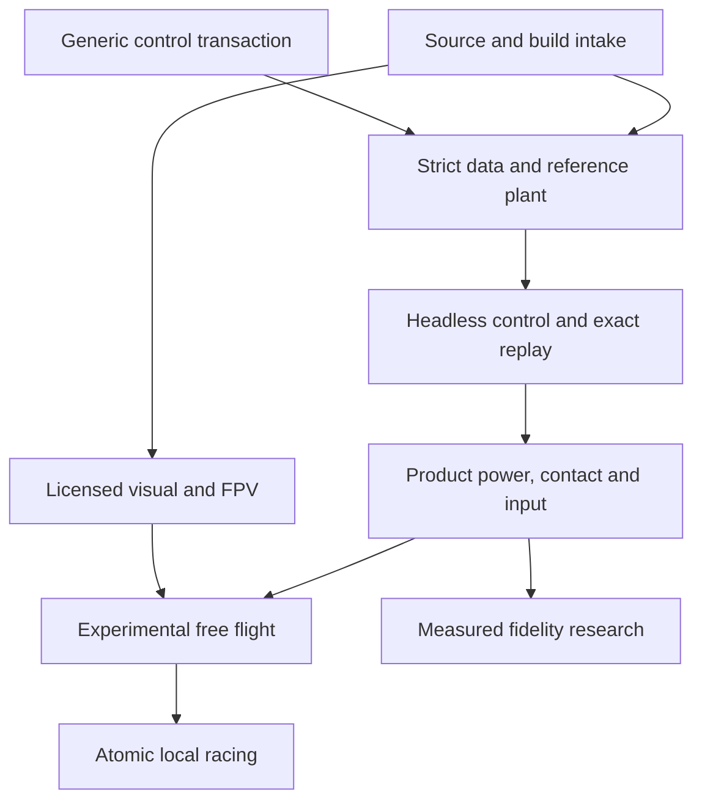

# FPV racer — advanced implementation plan

**Version:** proposed revision, 11 November 2026. **Baseline:** OpenRC commit `7bff78490f9af5c1664f47c8ba865a92b3430920`. **Owning track:** DR-00…41. **Parent:** the existing `docs/plans/drone-racing.md`. **Entry point:** [00_START_HERE.md](00_START_HERE.md).

## 1. Outcome

A player selects an experimental 5-inch-class quad-X on Home, chooses a supported field, verifies a calibrated radio/gamepad profile, starts disarmed on a pad, explicitly arms at low throttle, flies in Acro through a rigid onboard camera, lands/disarms, and resets without stale controller, camera or race state. Angle training is available as an explicit mode. A complete command-tape recording can reproduce the accepted simulation and support a controlled controller comparison. After free flight qualifies, the same vehicle can complete a locally scored three-lap course with swept gates and reproducible results.

The feature must coexist with fixed-wing, helicopter, ground and airship activities. The flight solver stays in the shared custom kernel; physics uses scalar float64 and packed float64 arrays. Godot scene nodes display detached results. For the same accepted tick/input tape, visual quality settings, FPV aspect ratio, prop blur and audio cannot change physical state, gate scoring or tick-derived simulation time. Expensive rendering can still slow wall-clock progress when the catch-up cap binds; measure that ratio separately. These boundaries follow the current repository requirements; see the [source audit](06_SOURCE_AUDIT_AND_EVIDENCE.md).

### Scope boundaries

| Required for experimental free flight | Added for local racing | Later capability |
| --- | --- | --- |
| One explicit build and strict loader; sourced visual; Acro and Angle; explicit arm/disarm; one battery and four motors; qualified contacts; FPV; calibration/rates; minimal telemetry/audio; full checkpoint/replay; Home/CLI routes; 1080p evidence | One data-defined course, countdown, ordered directed gates, three valid laps, missed-gate retry within a lap, crash/reset abort of the attempt, exact results replay, bounded result storage | More builds, tracks, ghosts, track editor, multiplayer, online rankings, turtle/reverse thrust, GPS rescue, Horizon, RF/video artifacts, detailed structural damage and separately validated propwash |

Do not make advanced unsteady inflow a dependency of the first experimental flight. Equally, do not describe that first flight as validated racing aerodynamics, Betaflight equivalence or an accurate replica of a named commercial quad.

## 2. What changes relative to the existing plan

The October plan already establishes valuable scope, mathematical principles and DR ownership. This revision keeps those foundations and resolves underspecified implementation choices.

| Earlier statement/gap | Concrete advance here | Implementation implication |
| --- | --- | --- |
| Add body-aware controller sampling | Define a pure accepted-frame sample callback and stage context across **tick, reset and restore**; reproduce the present hidden-cache failure | DR-16a is first on the critical path; adding PID directly to `Plant.duties` is inadmissible |
| Keep race and physics atomic | Put bounded race state into the composite model's endpoint transaction | Scoring cannot be an authoritative `stepped` listener |
| Sweep gates | Define accepted path pieces, directed half-open crossing, strict aperture edges, uncertainty and total ordering with physical events | An endpoint chord alone needs an explicit validity bound; abandoned RK trials never score |
| Add a quad to catalog | Audit the binary airplane/helicopter assumptions, trim prefetch, preview, Workshop and CLI consumers | A new `vehicle` string alone routes incorrectly |
| Reuse input | Preserve calibrated pre-expo axes and distinguish device readiness from motor arm | Prevent compounded gamepad expo and implicit arming |
| Import rates | Pin one firmware mathematical target, profile/default rules, units, caps and complete test vectors | Newer/unknown versions and unsupported fields receive a truthful import result |
| Couple four motors to battery | Specify a common-bus active-set solve, power identities and numerical oracle | Four calls to a single-motor pack solve are not a four-motor battery |
| Include rotor inertia | Specify locked-rotor inertia, coupled shaft/body acceleration and kinetic-energy cross term | Sign checks are retained, but conservation/work tests become required |
| Use current recorders | Recognize the new airship `.orfl` precedent and its limited restart assumptions | Reuse bounded container primitives with a new full multirotor envelope |
| Qualify performance | Separate unsmoothed whole-step cost, native frame pacing and physical latency | Overlay smoothing and headless timing cannot qualify FPV performance |
| Offer familiar racing-drone settings | Add 34 source-backed BF/INAV investigations, typed profile/default/unit handling and explicit capability states | A familiar name does not establish equivalent algorithms, units, sampling or active behavior |
| Import a firmware diff/preset | Define bounded data parsing, per-family scopes/index bases, reset invalidation, explicit partial imports and atomic Apply/reset | No CLI execution, stale defaults, implicit hot switching or unreported unsupported controls |
| Reuse open drone software | Audit 25 projects at exact revisions, with literal grants, source paths, lineage and dependency/asset exceptions | Use existing analysis tools and separate reference runs; no silent foreign-plant replacement or blanket asset license |
| Add actual flight firmware | Specify optional P26 sensor/RC/time/state handshake and transaction feasibility | A fast firmware loop, manual step or seed cannot substitute for fresh feedback, full restore or selected-build validation |

Source links and the executed evidence are centralized in [06](06_SOURCE_AUDIT_AND_EVIDENCE.md); detailed contracts are in [02](02_ENGINEERING_CONTRACTS.md), [03](03_FLIGHT_DYNAMICS_AND_RESEARCH.md) and [04](04_FPV_RACING_INPUT_AND_PRESENTATION.md).

## 3. Milestones and exit conditions

### M0 — preparation and transaction proof

Close DR-02's initial source/asset intake and DR-03's numerical reference scope. Implement and review DR-16a's generic contract. The existing failed-k2/reset reproduction becomes a passing regression for the new path. A restored controller context produces the same next stage, command, event and accepted state as a fresh session from the same checkpoint. Existing models retain their previous callback order and numeric results.

**Exit:** accepted generic ABI; legacy-parity evidence; full-frame reset/restore/rollback tests; explicit schema/build research decision log. A final physical build is not required to establish this software contract.

### M1 — headless closed-loop multirotor

Install a strict, identified research configuration through the proposed `MultirotorFlightSession`; keep the historical raw-duty fixture as a separate reference. Apply calibrated synthetic pilot commands, versioned rates and explicit arm/mode requests at fixed ticks. Run Acro/Angle, bounded allocation and complete recording/replay. Do not expose the lab fixture as a product aircraft.

**Exit:** DR-06/07/09a/10/11/13/16b/17 pass; unit/sign/controller tests have independent oracles; a complete recording replays with controller memory, arm state and every accepted tick byte-identical under the declared same-build/platform conditions. Numerical plant refinement holds controller sample times fixed. Presentation is unnecessary for this gate.

### M2 — experimental FPV free flight

Freeze one product assembly and its acknowledged estimates; integrate shared electrical loading, physical contacts, motor stop/depletion events, qualified pad start, crash/reset, device actions and rates. Use a licensed downloaded visual, four distinct rotor presentations, a rigid FPV camera, truthful OSD/basic sound, capability-aware Home/CLI and fresh-package resources. Retune and qualify the controller on this product powertrain.

**Exit:** DR-05/09b/12/14/15/18…22/29…31/35/36a/37 pass; a native 1080p end-to-end journey succeeds on each admitted platform/device configuration; full required CI and affected fleet gates pass. The feature is labeled **Experimental** with model limits. Pilot review is recorded before promoting handling claims; physical validation remains DR-40.

P22 in [11](11_FPV_PRODUCT_DECISIONS_AND_EXPERIMENTS.md) makes this journey concrete. Complete the implemented P13 route candidate, then the relevant P21 integration and P22 M2-only campaign, then admit M2. Course/race-schema checks and physical-flight comparison are explicitly later branches; M2 does not depend on P14/P15 or PHYS-05/06.

### M3 — deterministic local racing

Add one course on a collision-qualified landscape. Prefer upright rectangular gates so current world geometry can be reused after alignment/sweep tests. Add track/rule identity, accepted-path output, atomic race state, ordered crossings, finish/results and replay. Course selection uses the actual selected landscape and combined collision-world identity.

**Exit:** DR-23…26/32/36b pass; checkpoints resume inside a gate approach; identical tapes yield identical ordered laps/validity; high-speed, multiple crossing, crash ties, body-filter and capacity-limit tests pass. Native captures establish gate visibility and correct colliders. Race mode does not invalidate free-flight gates.

### M4 — measured fidelity promotion

DR-04/38…40 compare advanced prop/inflow laws against withheld data and then the selected physical assembly. Keep external research-aircraft reproduction separate from product validation. Publish the supported maneuver/flow/voltage envelope and uncertainty; unsupported descent, propwash, reverse flow or RPM regimes remain explicit.

**Exit:** independent selected-build evidence supports the claimed response and operating envelope. A pilot's preference, matched lap time or a successful software suite cannot by itself close this gate.

## 4. Proposed technical decisions

### D-DR-A: one pure control transaction

Adopt the opt-in framed sampling/stage protocol in [02](02_ENGINEERING_CONTRACTS.md). It receives accepted body/continuous/sampled/discrete state, returns candidate controller/arming state, and supplies that candidate snapshot explicitly to every RK/policy evaluation. PID state never advances during a derivative evaluation. Reset evaluation uses a prepared reset context; restore does not depend on a previous session's cache. The kernel remains vehicle-agnostic.

### D-DR-B: qualify the 240 Hz loop

Keep the existing outer tick and first controller sample at 240 Hz. Quantify zero-order-hold phase and end-to-end control delay. Compare a sufficiently refined plant under 240/960 Hz controllers, with 1920 Hz as a reference-refinement check when needed. If response or stability fails the predeclared gates, implement a generic transactional sampled-event scheduler with SF ownership before M2. Extra plant RK substeps do not increase closed-loop feedback rate.

### D-DR-C: a sourced product distinct from all research fixtures

Retain three identities: historical software fixture, exact published research-aircraft reproduction, and the selected product build. The old 152 mm diagonal fixture yields about 107.48 mm adjacent hub spacing; coplanar 127 mm props overlap. For a square X, zero-clearance diagonal minimum is `sqrt(2)*D`, before an engineering clearance margin. No generator may turn that fixture into a catalog 5-inch racer unchanged. See [03](03_FLIGHT_DYNAMICS_AND_RESEARCH.md) for the 5.0/5.1-inch distinction and intake checklist.

Use `openrc-fpv5` as a proposed family ID. The shipped variant ID must distinguish the actual frame/prop/motor/pack assembly and law revision; do not silently replace one assembly under an unchanged physical hash. M2 can carry explicitly borrowed/estimated parameters with uncertainty and experimental labeling. A fully named manufacturer build is admitted only after the manifest and compatibility checks actually close.

### D-DR-D: transparent baseline energy before richer BAT

The preferred initial implementation extends the current one-quadrant EL algebra to four loads on one bus and one pack, under a new identified law. Include charge, terminal energy and pack-loss integrals where needed for accounting. If the team selects the richer current BAT equivalent-circuit model, factor/adapt its pack port and supervisor rather than invoking its single-motor API four times; freeze its different continuous-state layout. Active braking, dynamic idle, thermal realism and regeneration require separate supported laws. M2 does not inherit them merely from an ESC marketing description.

### D-DR-E: explicit motor-arming and device policies

`RcInput.armed` remains device readiness. Drone motor arm is separate. Low throttle and an OFF-observed → fresh ON transition are required after connection/start/reset/recovery. Holds freeze simulation, controller, pack, virtual throttle and race time. Preserve device discovery/calibration; rate conversion consumes the declared pre-expo signal. Any transmitter-side shaping is a recorded input limitation.

### D-DR-F: race inside the accepted endpoint

A race-mode wrapper adds fixed race aux/modes to a versioned model layout and composes physical endpoint transitions with a pure director. Choose one source of canonical chronological events. With the current concatenating kernel, the new race policy can put physical events in its validated receipt and return no direct policy events; the endpoint then emits the complete sorted list. Validate that choice against all consumers. If it cannot preserve required contracts, SF must qualify a narrow generic ordering extension. Never let observer execution order determine a lap result.

### D-DR-G: a rigid, honest FPV view

Compute one interpolated render pose, then apply the camera mount offset and tilt. Use full body roll, no hidden stabilization, no extra default video latency, and explicit horizontal FOV. `40°` tilt and `120°` horizontal FOV remain adjustable product starting points, not a camera calibration. At 4:3 use the actual 4:3 content area for projection. Keep optional lens distortion/visual effects observational and deferred.

### D-DR-H: versioned settings with truthful support

Adopt [07](07_BETAFLIGHT_INAV_SETTINGS_RESEARCH.md) and [08](08_SETTINGS_SCHEMA_IMPORT_AND_TESTS.md) for the settings workspace. Preserve BF 4.5.2 Actual-rate math as the initial target; BF 2026.6.2 and INAV 9.1.0 are explicitly pinned comparison sources, not automatic compatibility upgrades. Distinguish supported math, simulator-owned behavior, inert metadata and blocking requests. Raw firmware PID integers never become SI torque gains by assignment.

Use typed units, source/default provenance, profile collections and separately resolved active selections. Applying input/control/physical changes initially requires an explicit held reset/replacement with a disarmed candidate, retained old attempt result and fresh arm evidence. An armed settings hold needs a distinctly labeled Reset to pad and apply action; polling ARM OFF cannot fabricate a committed disarm. Settings are staged data, never executed firmware CLI.

P17–21 extend the backlog without making every investigated advanced feature a first-flight dependency. If P06/NUM-02 rejects the 240 Hz loop, conditional P19a gives SF/DR an unblocked generic faster-sampled-event path before P11; P19b's later advanced-filter harness is separate. M0 includes schema/defaults/adapter decisions; M1 needs the chosen pilot subset and truthful reporting; M2 adds the full settings journey. See [09](09_SETTINGS_EVIDENCE_AND_REFERENCE_PROBE.md) for the new source audit and extracted throttle observation.

### D-DR-I: dependable practice informed by simulator/user research

Use the [28 simulator approach investigations](10_FPV_SIMULATOR_APPROACHES.md) and [dated evidence ledger](12_SIMULATOR_EVIDENCE_LEDGER.md) to prioritize observable radio setup, a readable field, complete reset/recovery, compatible local results and useful practice feedback. The qualitative sample is deliberately selected and does not rank physical accuracy or market preference. More advertised settings, a large world or actual embedded firmware cannot substitute for validation of this selected build.

Adopt [11](11_FPV_PRODUCT_DECISIONS_AND_EXPERIMENTS.md) as the home for product journeys, result-comparison policy, 12 proposed experiments and 13 proposed cases. Preserve four independent result axes: committed attempt validity, recording completeness, persistence and comparison compatibility. A postcommit recording failure cannot erase a valid finish. Compare records using course/collision-world/rules/class and initial-condition policy, retaining full identities even where pilot rates or camera preferences are allowed to vary.

P22 qualifies M2 usability through existing paths; P23 adds local ghost/inspection/optional drills after M3; P24 adds validated local course authoring after the course contracts are stable. Firmware-loop integration, micro vehicles, cinematic chase, XR/mobile, online services and AI opponents remain separately admitted optional capabilities. Keep the generic transaction first, M2 experimental, M3 local and M4 physically measured.

### D-DR-J: source-pinned reuse with one simulation authority

Use [13](13_OPEN_SOURCE_FPV_AND_DRONE_APPROACHES.md) and [15](15_OPEN_SOURCE_LICENSE_SOURCE_AND_USER_EVIDENCE.md) for 25 open-source code approaches, exact grants/source pins and 19 qualitative discussion records. Adopt [14](14_OPEN_SOURCE_REUSE_AND_INTEGRATION_PLAN.md) for the proposed reuse matrix, optional P25/P26 and 21 future cases. Numerical references, firmware execution, physical parameters, collision worlds and hardware/input fidelity remain separate claims.

Preserve the owned float64 kernel and repair DR-16a before extending control. SimITL/libfpv own a separate plant; Open FPV Sim has another scheduler/integrator. Their results may inform an identified comparison session, but cannot silently drive the same craft alongside OpenRC physics or award OpenRC race events. Manual stepping does not establish complete checkpoint/restore. A future controller bridge must specify both RC and sensor inputs, causal sample timing, exact clock representation, duplicate/stale-message behavior and full candidate-state rejection/restore before production admission.

P25 prepares matched-subset numerical comparisons; source preparation may run in parallel and closed-loop experiments follow a stable P07/M1 candidate. P26 starts as separate firmware research; any production bridge is optional after M2, and broader PX4/ArduPilot/MAVLink integration remains after M3. Neither package is a new M1/M2 release prerequisite. Preserve the BF 2026.6.2/INAV 9.1.0 settings pins in 09; development HEADs in 15 are discovery snapshots. Apply code, data, font, audio, scan and dependency terms separately before adopting a component.

## 5. Ownership and integration map

| Owner | Exclusive new work | Shared files/interfaces requiring coordinated review |
| --- | --- | --- |
| DR | `physics/multirotor/` new laws/controller/allocator; proposed strict multirotor loader, session/activity/input adapter, schemas/generators, drone tests, track/race data/director, drone adapter | SF model/kernel; EL/BAT supply ports; GP/CR contacts; UI/input; CAM/HUD/AUD; landscape/collision ownership |
| SF | Generic sample/stage contract and transaction guards | `sim/vehicle_model.gd`, `sim/simulation.gd`, kernel tests and v1/v2 checkpoint compatibility |
| EL/BAT | Four-load bus and battery semantics review | Existing electric motor/supply and pack/supervisor APIs, state layout, stop/depletion policy |
| UI/input | Calibrated pre-expo signal, actions, profiles and readiness integration | `rc_input.gd`, `controller_profile.gd`, shell/catalog/Home/Workshop consumers |
| CAM/HUD/AUD | FPV mount and preferences; observational telemetry and licensed sound | Camera routing/interpolation/history, listener policy, localization |
| GP/CR + LU/SC | Pad support, solid collisions, rotor sweeps and course world identity | Whole-tick integration policy, crash event times, collision primitives and caches |

Use the exact current source map in [06](06_SOURCE_AUDIT_AND_EVIDENCE.md). New path names in this pack are proposals; check the current ownership registry and source before creating them. Keep one writer per shared path, one owner for any live app/radio/benchmark session, and isolated profiles/evidence outputs.

## 6. DR traceability and dependency order

| Existing IDs | Proposed execution slice | Prerequisites | Exit evidence |
| --- | --- | --- | --- |
| 00/01 | Refresh status, source audit and documented decisions | Frozen commit | Current-state map and this source-backed handoff |
| 02/03 | Build/assets/data shortlist; independent references | 01 | Manifest candidates, open measurement ledger, known-answer harness |
| 16a | Sample/stage/reset/restore transaction | 03, SF review | Failing-then-fixed cache probe, alias/fault tests, legacy parity |
| 10/11/13 | Strict sibling contract and research generator | 02, 16a layout decision | Malformed-data refusal, deterministic generation, quantity/source checks |
| 06/07/08/09a | Momentum audit, controller/allocator/rates, simple-plant refinement | 03, 10, 16a | Independent oracles and controller/sample-rate reports |
| 16b/17 | Headless session, identity, checkpoint and recording | Previous row | **M1** complete exact closed-loop replay |
| 05/09b/12 | Four-load pack, product generator, composed stop/contact policy | 02, 06, 10, EL/BAT + GP | Energy/domain/coincident-event proof; bounded work |
| 14/15/18…22 | Input/lifecycle, pad/contact/crash, product tuning/endurance | 16b/17, product powertrain | Human-input flow; frozen-input repeatability; product controller and endurance |
| 29…31/35/37 | Download/import visual, four rotors, FPV, OSD/basic audio/restart | Asset intake, 16b, 18…20 | Native view/camera/telemetry/asset proof |
| 36a | Capability-aware Home/CLI/export | M2 rows | **M2** full user journey and fresh-package smoke |
| 23…26/32/36b | First track, accepted-path director, results/race route | M2, accepted-path policy | **M3** exact lap/validity replay and crossing/contact tests |
| 04/38…40 | Prop/inflow refinement, held-out and physical/pilot work | Stable identified laws/build | **M4** scoped physical-fidelity claims |
| 27/28/33/34/41 | Ghosts, more courses, rich sound/effects, capability expansion | Explicit future revision | Separate gates; no dependency added to first flight |

Retain historical DR-04a…06a as the laboratory foundation. New suffixes subdivide existing IDs; do not renumber them or mark a parent done because one suffix passed. See [05](05_VALIDATION_AND_IMPLEMENTATION_BACKLOG.md) for PR-sized packages and checks.

## 7. Development workflow and practical sequencing

Begin with four bounded changes: (1) check in a dated evidence note and independent oracles; (2) reproduce and fix the generic transaction seam; (3) add strict data plus headless session/controller; (4) add full recording/replay. This gives every later physics/control change a reliable comparison baseline.

In parallel, complete downloaded-asset intake and the exact product data inventory. Once the powertrain/pack and contact laws are fixed, qualify controller gains, not before. Route/UI and FPV work can develop against a deterministic fixture, but the catalog's flyable entry stays unavailable until the M2 configuration and release gates pass. Race implementation follows a usable drone and a qualified accepted-path policy.

Local checks follow actual behavior and dependencies. For pure documentation, verify references and content. For the generic kernel change, use focused regressions while iterating and broad affected-session/fleet checks on the stable candidate; required CI remains mandatory. Record baseline flights and never refresh golden outputs merely to make new routing pass. The existing checked Godot runner catches script errors that a process exit alone can miss.

### Planning estimates

Commit to evidence-defined work packages rather than calendar dates before DR-16a and assembly intake close. The uncertain costs are the generic transaction extension, bounded contact/stop policy, collision clearance, source/asset completeness and controller-rate qualification. After those spikes, estimate each PR from actual touched interfaces and test cost, reserve separate native hardware/pilot sessions, and keep hardware procurement/measurement lead time outside the software-only forecast. Adding invented week counts would not improve precision.

## 8. Risks and explicit stop conditions

| Risk | Detection | Required response |
| --- | --- | --- |
| Controller cache survives rejection/reset | Fault/restore probe changes next loads or state | Stop DR-07 integration; close DR-16a first |
| Fixture or mixed data becomes product truth | Prop overlap, missing source, inconsistent build identity | Reject product data; keep it as an explicitly named research fixture |
| Dynamics exceed controller sampling | Higher-rate/refined reference fails response/stability screen | No M2 promotion; qualify a generic faster sampled schedule |
| Electrical model creates energy or wrong sag | Work/power residual or active-set inconsistency | Reject stage/law; do not compensate with PID tuning |
| Contacts/rotor stops evaluate outside model domain | Negative stages, event count/cost overflow | Refine under a bounded qualified policy or fault safely; never silently clamp after integration |
| Racing reads unaccepted or stale state | Listener-order, failed-tick or body-filter test changes lap outcome | Keep race state in endpoint; refuse incomplete path evidence |
| Catalog type falls into airplane-only flow | Trim, schema, preview or Workshop called for quad | Fix explicit capabilities and all affected consumers before exposing entry |
| Average FPS hides bad FPV response | Native pacing/latency capture shows misses/hitches/extra frames | Optimize measured bottleneck; preserve physics and retest affected host |
| Legal/source identity remains uncertain | Missing per-asset license/version/source | Keep asset out of shipped package; continue software work with lawful laboratory resources |
| Foreign firmware/plant escapes accepted-state ownership | Duplicate tick, hidden controller history, unbounded wait or failed restore | Keep the bridge in separate research; no production admission or race authority until the complete lifecycle is qualified |

## 9. Definition of completion for this planning handoff

The implementation has a pinned source baseline, concrete first PR, mathematical reference values, proposed state/API contracts, explicit data and hardware gaps, preserved DR ownership, bounded race algorithms, and testable milestone exits. The supporting evidence is reproducible. The remaining developer decisions are narrow and named; no UI, physical or hardware qualification is represented as already achieved.
