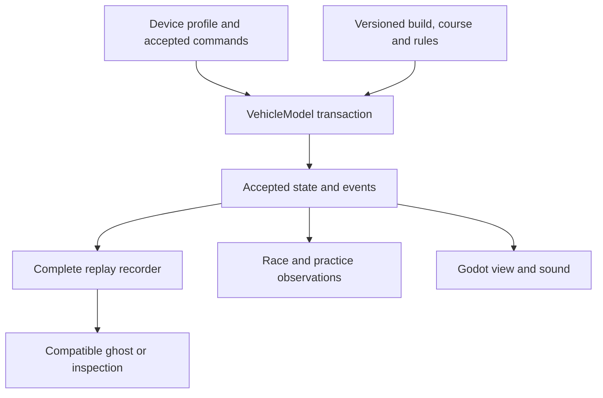

# FPV simulator research — product decisions and validation work

**Date:** 11 November 2026. **Status:** proposed implementation and research work; no competitor was flown or benchmarked during this study. **Baseline:** OpenRC `7bff78490f9af5c1664f47c8ba865a92b3430920`. Read the [28 approaches](10_FPV_SIMULATOR_APPROACHES.md) and their [product/user evidence](12_SIMULATOR_EVIDENCE_LEDGER.md). Existing engineering contracts in 02–04 and settings contracts in 07–09 remain authoritative.

## 1. Product direction

Build a dependable, radio-first FPV practice activity that can become a credible local racing tool. The differentiator should be understandable aircraft data, repeatable control, useful practice and inspectable evidence. A large environment library, a firmware-themed settings screen or an impressive renderer cannot establish those properties by itself.

The research supports a focused combination: a racing practice loop, a readable freestyle area, progressive setup, and reproducible simulation. This is a design inference from documented products and the deliberately selected community reports, not a measured market-share finding. The decision does not require reproducing every commercial feature in [10](10_FPV_SIMULATOR_APPROACHES.md).

| Delivery boundary | Research-informed scope | Explicitly separate work |
| --- | --- | --- |
| M0/M1 — transactional headless flight | Keep DR-16a first; qualify controller sampling and exact complete replay; record effective settings and physical-model identities | Neither a creator tool nor a commercial firmware controller replaces this seam |
| M2 — experimental free flight | One honest 5-inch-class build, Acro and bounded Angle, supported radio/gamepad setup, one useful field, rigid FPV, clean crash/reset/reconnect, native 1080p evidence | Estimated parameters remain marked; M4 physical validation is not moved into M2 |
| M3 — local three-lap racing | Existing countdown, ordered directed gates, explicit attempt validity, compatible local records and useful next-gate feedback | No claim of FAI/MultiGP rule compliance; no online dependency |
| After M3 | Local ghost, replay inspection, short optional drills; later validated track authoring | These can ship independently of new physical classes or online competition |
| M4 and separate research branches | Selected-build measurements, stronger aerodynamic laws, optional log identification and firmware-loop comparisons | Micro drones, cinematic chase, XR/mobile, live multiplayer and autonomy each need their own admission decision |

Preserve a sandbox that does not require completing a career. Keep learning goals available without making them gates to previously accessible free flight. A forum report about blocked access motivates testing this choice, rather than proving that every user rejects progression. [U06](12_SIMULATOR_EVIDENCE_LEDGER.md#u06)

## 2. Three journeys the first release must make understandable

### First-time radio pilot

Home → select the supported experimental quad → inspect the detected device → move each stick and verify the displayed roll/pitch/yaw/throttle → calibrate and bind essential actions → choose Acro or Angle → enter a fresh disarmed pad state → complete the explicit low-throttle/fresh-arm sequence → take off → land/disarm or reset.

Show a preview of the effective rate curve and maximum commanded angular speed per axis. Keep physical aircraft parameters, firmware-style rate conventions, device calibration and camera preferences distinguishable. For a gamepad, disclose the spring-centered throttle policy in the setup flow. Do not silently apply a second expo or reuse an unrelated vehicle's interpretation of an axis. See SET-01…04/23–25 and P10/P18.

If the OS never reports an AUX switch, the app should show that observation and provide a usable keyboard binding. It must not say a switch is supported merely because a known radio model name appears. Calibration/mapping failures and update recovery appear in U09–U11/U23, but their individual causes were not established by this study.

### Returning pilot with ten minutes available

Offer the last valid aircraft, field and pilot profile through the existing Home/session preparation path. The previous vehicle identity can be a preference; a previous armed in-flight state is not a startup preference. Validate missing assets, profile migration and unsupported settings before making a fresh disarmed candidate available.

Make reset discoverable on both a supported controller action and keyboard. In free flight it restores the complete accepted starting configuration and camera history. In a race it ends the old attempt and starts a separate attempt under the existing countdown/arm rules. Speed up preparation and presentation without bypassing state preparation, fresh arm evidence or terminal-result retention. The reset request in U12 received a developer reply explaining an already-existing binding: discoverability deserves its own check.

### Pilot diagnosing an unsatisfying feel

Offer a small read-only diagnostic view: normalized inputs, commanded versus achieved body rates, throttle command, actual motor response where modeled, battery state, accepted simulation rate and renderer performance. Let the pilot save a complete recording and settings identity before changing one parameter group.

Use questions that identify an observable maneuver: excessive coast after a chop, low-throttle control difficulty, slow initial roll response, overshoot after reversal, or contact that appears to stick. Do not provide a universal “realism” slider. Keep gravity as a sourced physical quantity in the physical model; a deliberately nonphysical experiment, if ever added, needs its own labeled configuration and incompatible race classification. Contradictory reports in U01–U03 support diagnosis by maneuver, not a universal tuning recipe.

## 3. Keep simulation, training, recording and presentation distinct

This diagram shows ownership, not a replacement for 02's callback ordering. Race authority remains inside the composed accepted endpoint; the observation box cannot award a lap. A lesson may observe a validated event and update its own explicitly defined state, but it cannot infer an authoritative collision or gate passage from a rendered mesh. A ghost is a read-only playback actor with no thrust, contact or race-authority effect on the current vehicle.

All runtime state follows the project's float64 NED/FRD contract. A Godot `RigidBody3D`, scene transform, browser animation clock or external firmware process must not become an unacknowledged second source of aircraft motion. Research frameworks in 10 suggest experiments and architectural comparisons; they do not authorize replacing the shared kernel.

### Four recording products with different guarantees

| Artifact | Required meaning | Unsupported inference |
| --- | --- | --- |
| Complete input/checkpoint replay | Reproduce accepted simulation under its exact supported identities and replay contract | A recording from another build/platform is automatically exact |
| Pose/telemetry playback | Display saved observations with declared sample rate and interpolation | Pose interpolation reproduces forces or controller internals |
| Competitive ghost | Show a compatible completed run, its class and provenance; no physical interference | A file hash proves authenticity or prevents cheating |
| Video export | Render a recording for review or sharing with explicit camera/quality | A smooth exported video establishes live input latency |

Do not reduce the complete recorder to a downsampled visual ghost stream. Diagnostic decimation is separately admitted by P21. A failed/incomplete recording cannot be promoted to an exact replay or a valid competitive reference.

## 4. Results and versioning: equality is not one hash

The Physics 6.0 release of Liftoff separated earlier leaderboard records, providing a concrete product example of physics revisions affecting comparison. OpenRC should record identity before online rankings exist. [S02](12_SIMULATOR_EVIDENCE_LEDGER.md#s02)

| Identity | Contents and purpose |
| --- | --- |
| `run_identity` | Complete source/build, law/controller/scheduler, effective parameters, commands, start state, environment, course/rules and recording-completeness references. Used for reproduction and audit. |
| `competition_class_identity` | Rules-defined equivalence: physics/controller implementation, admitted vehicle/build constraints, clock/race policy, environment and assist policy. The rules explicitly decide which pilot preferences may vary. |
| `pilot_profile_identity` | Device normalization, rates/expo/throttle interpretation, input timing and action mappings needed to understand the run. Preserved even when some values are permitted to vary within a class. |
| `presentation_identity` | Actual content viewport/aspect/FOV/tilt, effects, quality, refresh and latency configuration for perceptual comparisons. Generally not physical-class parameters unless the rules explicitly constrain them. |

Do not split a leaderboard for every rate or FOV setting by accident. Conversely, do not accept arbitrary mass, thrust, controller dynamics, assists or wind as a cosmetic preference. Keep full identities even when a comparison policy deliberately ignores permitted differences. A version migration must not silently recompute old times using new physics.

Define a versioned **comparison predicate/key** in addition to those identities: admitted course definition, collision-world identity, race/rules identity and competition class, plus explicit permitted environment and initial-condition policies. Include initial pack charge and spawn conditions in that policy; storing them only in a run record is insufficient. Two different gate layouts must never become comparable merely because they use the same aircraft class. A policy may permit specified rate/FOV differences without permitting arbitrary course or start-energy differences.

Track four independent axes: **committed attempt validity, recording completeness, persistence status and comparison compatibility**. A valid committed finish can coexist with an incomplete recording or an unsaved result after an observer failure. Preserve that finish, pause under the existing failure policy and explain what was not saved; do not rewind it or call it an exact replay. An incomplete record is ineligible as an exact competitive ghost. Keep the existing distinctions for paused practice, reset/crash abort, wrong order and unresolved event geometry. A future authoritative online service needs a separate threat and networking model; it is not supplied by this schema.

## 5. Proposed research and qualification experiments

**None of EXP-01…12 was executed in this simulator-comparison study.** They convert the evidence into bounded work. Existing numerical, physical and native gates in 05 remain the authority; these experiments supplement or specialize them. Before any campaign, freeze the hypothesis, candidate, host/device, task, measurement boundary, exclusions and success rule. Do not invent comparative performance numbers from store specifications.

| ID | Question and procedure | Evidence and decision |
| --- | --- | --- |
| EXP-01 — setup | First-time users discover a supported radio, map four axes and essential actions, enter free flight and explain the current mode. Include a missing AUX channel and reversed throttle fixture. | Task time, help requests, mistaken axis/mode, raw device reports and successful recovery. Every supported deterministic mapping/reconnect case must pass; pilot completion estimates remain exploratory. Owns UX-01/02. |
| EXP-02 — repeat practice | Repeated crash/reset and fresh launch with saved preferences, missing field, migrated profile and armed settings hold. M2 qualifies free-flight cases; race-specific cases are added at M3. | Hold/cancel preserves the frozen accepted state. Only an accepted explicit pad reset/replacement installs the declared disarmed start, controller/camera state and initial pack charge; M3 also verifies race restart and retained terminal outcome. Measure recovery time and fresh arm. Reuse TX/INPUT/REPLAY gates; owns UX-03/04. |
| EXP-03 — presentation cost | M2: same accepted flight tape and field at 1920×1080 across declared render presets on named native hosts. M3: add the admitted course and race workload. Separately measure real input-to-display trials. | PERF-01…03: raw p50/p95/p99/max, hitches, uncertainty and simulation/wall-time ratio. Rendering changes must leave accepted physics unchanged for the same tape; at M3 also compare race output. |
| EXP-04 — maneuver-specific feel | Pair baseline and one candidate, matching all non-treatment conditions: radio normalization, rates, throttle mapping, camera and model as applicable. Record the intended differing field; a rate/throttle experiment must retain that difference and use the same calibrated pilot-command tape. Include hover, roll reversal, punch/chop, turn, descent and landing. **M2 arm:** software traces and formative usability feedback. **M4 arm:** identified physical aircraft, independent motion/flight data and PHYS-05/06. | Record order/build and commanded-versus-achieved responses; separate ratings for thrust, rotation, momentum and contact. M2 feedback establishes usability observations, not physical agreement. The physical arm is nonblocking for M2/M3; no universal realism score. |
| EXP-05 — learning sequence | Keep the same FPV camera, tasks and practice duration; assign an Acro-first path or an Angle→Acro path under the study design below. Camera is held constant while assistance order is the treatment. Outside the study, mode choice remains optional. Make instructions repeatable and skippable. | Time to complete each task, control confusions, help requests and later retention task. Record allocation/exposure; self-selected paths support descriptive workflow feedback only. Small usability samples cannot prove real-world training transfer. Owns UX-05. |
| EXP-06 — course readability | First-time pilots identify next gate/approach direction and interpret only supported committed diagnostics on the M3 course at native 1080p; compare minimal cue options. | Wrong-gate attempts, recovery time and occlusion complaints. Test no-event and unresolved cases without inventing reasons. Authoritative RACE cases decide passage; cues never alter gate geometry. Owns UX-06. |
| EXP-07 — useful replay | Compare results-only with personal ghost plus per-gate/sector review after a complete compatible run. Distinguish performance improvement from simple familiarization. | Matched attempts, line changes, perceived usefulness and replay compatibility. A pose ghost must never affect current simulation; owns PRACTICE-01…03. |
| EXP-08 — content authoring | Recreate one dimensioned local course from permitted assets; validate spawn, gate orientation, clearance, collisions and results before/after serialization. | Numeric placement errors and identical admitted course identity. Editor success includes a valid flown/replayed result, not just saving a scene. Owns AUTHOR-01…03. |
| EXP-09 — micro class feasibility | Only after a separate micro build is sourced: measure room/obstacle scale, hover/throttle, low-speed response and light contact. Compare several physical configurations if claiming class-wide behavior. | Dataset with physical configuration and uncertainties; no mesh scaling shortcut. Reuse M4 methodology; not an M2/M3 dependency. |
| EXP-10 — log identification | Audit Blackbox fields, motor ordering, timing/decimation, units and independent motion data; fit selected parameters on whole training flights and validate on held-out maneuvers. | Identifiability report, fit/holdout residuals and parameter uncertainty. Logs missing the needed excitation/measurements produce an insufficient-evidence result, not a faithful-clone claim. |
| EXP-11 — firmware loop | Compare the simulator-owned controller with a pinned firmware process in a separate harness, using one explicit plant authority and sample/actuator clocks. | Transport/schema audit, dropped/late sample behavior, scheduling and full state/reset limits. It can inform parity; process I/O alone cannot satisfy deterministic rollback. |
| EXP-12 — content/upgrade continuity | M2: exercise profile versions, installed-field availability, optional-content absence and disconnected start after setup. M3/P14: add course/rule schema migration and downgrade fixtures. | Readable migration or unsupported-downgrade refusal, preserved user data and working admitted local core. Do not require backward conversion when no truthful conversion exists. Do not conflate offline operation with absence of licensing/installation requirements in other products. Owns UX-07. |

### Pilot and comparator design

Start with a formative cohort of **12 proposed participants**: four new Acro learners, four active 5-inch race/freestyle pilots and four indoor-micro pilots. Record actual hours, aircraft and hardware instead of treating self-description as a certified skill level. This is a recruitment proposal for finding usability problems, not a powered effectiveness study or a promise of participant availability. Analyze cohorts separately; do not average a whoop complaint into a 5-inch tuning constant.

For an initial two-candidate handling/usability comparison, counterbalance order within each cohort, keep practice duration equal and record familiarization, fatigue and exposure. A rest period cannot erase learned flight skills or knowledge of a course. For EXP-05/07 learning comparisons, use balanced between-person assignments or predeclared matched novel tasks/courses, retaining exposure order and baseline ability. The small formative cohort supports problem discovery, not a causal estimate of learning improvement. Remove candidate names where practical, while acknowledging that recognizable graphics and handling may prevent blinding. Use anonymized OpenRC candidate labels; do not claim commercial titles were blinded if recognizable. Predeclare the intended treatment, all controlled conditions and what cannot be matched.

When a licensed comparator is available, choose it for the task: a race-focused workflow, a freestyle map workflow, a micro workflow, or a cinematic scenario. Commercial closed systems may not expose identical physics/input tapes; a human comparison there measures the configured experience rather than equal-equation accuracy. Keep product, version/branch, aircraft, settings, OS, radio, refresh and course geometry with each session. No purchases or participant contact were made for this research.

Use a fixed wording for each maneuver: “What did you expect after this input, what happened, and in which part of the maneuver?” Collect the response before revealing telemetry. Report disagreement and individual setup differences. A future transfer study needs a defined real-world outcome, suitable supervision, controls for prior skill and its own sample-size plan; the 12-person formative study does not substitute for it.

## 6. Metrics that avoid misleading conclusions

| Metric | Definition and caveat |
| --- | --- |
| Time to first controlled flight | Wall time from a declared starting boundary to a declared successful task, including failed setup attempts; report cold-install and returning-session boundaries separately. |
| Restart cost | Wall time from reset request to an accepted, fresh, correctly armed controllable flight; show preparation, countdown and pilot-arm components separately. Do not optimize by bypassing the race rules. |
| Useful practice time | Wall time actively engaged in the stated drill divided by total session wall time; also report accepted simulation seconds. A slowed simulation cannot count as equivalent real-time practice. |
| Consistency | Valid-lap or maneuver distributions for an identified setup, alongside failed/aborted attempts. Best lap alone hides reliability and learning difficulties. |
| Responsiveness | Physical input-to-observed-scene response with method uncertainty, plus frame pacing and input sampling measurements. A 240 Hz loop is not a measured 4.167 ms end-to-end latency. |
| Physical agreement | Errors by measured variable and maneuver, with ground-truth uncertainty, held-out data and envelope. A pilot preference or stored replay hash is not physical validation. |
| Retention/usefulness | Completed follow-up tasks and voluntary return intent in the observed cohort; avoid claims of commercial retention or market preference from a convenience sample. |

No new universal numerical latency/FPS/accuracy threshold is invented here. Apply 05's declared proposals and measure on the intended hardware. Product acceptance must still refuse undefined configuration and invalid race outcomes regardless of pilot preference.

## 7. Backlog additions and ownership

| Package | Scope and existing DR ownership | Dependencies and exit |
| --- | --- | --- |
| P22 — practice usability qualification | DR-14/15/29/36a with UI/CAM: implement or repair the M2 journey through existing input/Home/settings/reset paths; no second configuration system. | P10/P12/P18/P21 and the implemented P13 route candidate, before final M2 admission. Only M2 portions of UX-01…04/07 and EXP-01…04/12; existing native/input/lifecycle gates. No P14/P15 course/race or PHYS-05/06 dependency. |
| P23 — local practice feedback | DR-27/28/30/36b: compatible personal ghost, read-only inspection, useful results and optional short drills. Stage ghost, review and lesson UI as separate reviewable changes. | Complete P07/P15/P21; M3 timing valid. PRACTICE-01…03 and UX-05/06 for the admitted feature. Does not delay first local race. |
| P24 — validated course authoring | DR-23/24/32 plus SC/LU: build local authoring on P14's strict course data and existing permitted assets; authoring is separate from cloud distribution. | M3 course/geometry stability. AUTHOR-01…03 and EXP-08; malformed imports refuse cleanly and exported definitions retain identity. Optional after M3. |

### Proposed acceptance cases

Ordering clarification for 05: complete P13's implementation and route qualification, then P21's relevant integration and P22's M2 campaign, then admit M2. P21 depends on that implemented P13 candidate, not an already-admitted M2 release. Race/course branches of shared experiments become required only at M3 or the later owning package. P23/P24 never feed back as prerequisites of P13/P22.

| ID | Required observation |
| --- | --- |
| UX-01 | Four raw/mapped channels, reversal/endpoints/deadband and effective rate curve explain the live result; no hidden double shaping. |
| UX-02 | Missing switch, device reconnect and device-ID/profile migration lead to explicit diagnosis/recovery; a fresh arm is still required. |
| UX-03 | M2: accepted free-flight reset installs the declared prepared controller/plant/pack/camera start state and initial charge; hold/cancel preserves accepted state. M3 adds race restart, retained terminal outcome and the current countdown policy. |
| UX-04 | A returning launch validates saved content and starts disarmed; armed settings entry/apply follows 08's held reset transaction including observer failure. |
| UX-05 | Every admitted lesson can be repeated/skipped; camera and assistance changes are explicit and don't silently alter a live scored attempt. |
| UX-06 | At 1080p, pilots can identify the next required directed gate without relying only on color. Explain only bounded committed diagnostics the race policy supports; otherwise show 'no required crossing registered' or 'unresolved' as appropriate. Never infer passage/contact/rejection reasons from a rendered mesh. |
| UX-07 | M2: local core remains usable after defined offline setup, optional-field/content absence and profile migration/refusal; preserve data. M3/P14 separately adds course/rule schema compatibility cases. |
| PRACTICE-01 | A ghost from an incompatible course/model/class or incomplete run is refused or clearly labeled noncompetitive; a compatible ghost has no simulation side effects. |
| PRACTICE-02 | Complete replay, sampled playback and video export are labeled according to their actual guarantee; inspection cannot overwrite current attempt state. |
| PRACTICE-03 | Results show failures/aborts and compatible history alongside best time; sector boundaries use accepted events. Test differing track/collision world/start-energy policy with equal class; refuse comparison. A committed finish followed by recorder or persistence failure retains validity while showing incomplete/unsaved state; retry cannot duplicate the result. |
| AUTHOR-01 | Serialized spawn/gate/rule data round-trips without semantic change; units, direction, version and declared bounds remain explicit. |
| AUTHOR-02 | Reversed, overlapping, unsupported, unreachable or excessive-cost content is rejected or flagged under a defined validation policy before a valid result can be claimed. Reachability is not promised from a syntax check. |
| AUTHOR-03 | Visual, solid collision and scoring geometry reference one admitted definition; the exported package includes source/license references and required content identities. |

These 13 cases and 12 experiments are proposals, not passed tests. Adopt their normative definitions here and link from 05 rather than copying conflicting versions into multiple plans.

## 8. Deferred decisions with concrete entry criteria

**Live multiplayer:** enter design after compatible local replay/rules are stable. Decide authority, late-input handling, synchronization, disconnect/host migration and spectating. Rendering remote poses does not prove synchronized race authority. Multiplayer is not prerequisite to a useful personal ghost.

**Firmware process integration:** enter only with a versioned sensor/actuator protocol, exact time ownership and a plan for firmware internal state/reset/checkpointing. HIL adds hardware timing and transport questions beyond SITL. Keep an external comparison harness until those questions close.

**Micro, cinewhoop and heavier vehicles:** admit separate sourced assemblies and class-specific contact/aerodynamics. A configurable mesh or weight slider is insufficient evidence for those classes. Keep the first experimental racer focused.

**Mobile/browser/XR:** first qualify native desktop 1080p. Evaluate input reachability, frame pacing, foreground/background behavior, power and camera comfort on each actual platform. Head tracking is not an implicit change to the rigid drone camera.

**Large worlds and autonomous agents:** require a distinct user goal and measured resource budget. Headless training frameworks, synthetic sensors and photoreal rendering can be valuable research tools without becoming the consumer FPV product architecture.

**AI opponents:** a rendered ghost and a controller-driven aircraft have different costs and guarantees. Start with the ghost. If interactive opponents become useful, budget additional vehicle/controller/collision instances and define whether collisions can affect the human attempt before adding a count slider.

## 9. What this research advanced, and what is still unmeasured

The added work identifies 28 concrete approaches, connects documented implementations to 23 deliberately selected discussion threads, resolves several current-versus-historical feature conflicts, and produces specific OpenRC decisions, three bounded work packages and an executable campaign specification in prose. It preserves the earlier 34 firmware settings investigations and transaction/fidelity gates.

No simulator ranking by physical accuracy, market share or user satisfaction was measured. No commercial software was purchased, installed or flown; no new radio/GPU/real-quad/pilot campaign was executed. Product behavior is documented or reported, and OpenRC adoption is proposed. The previous executed OpenRC/kernel and extracted-firmware probes retain only their original scope in 06 and 09.
