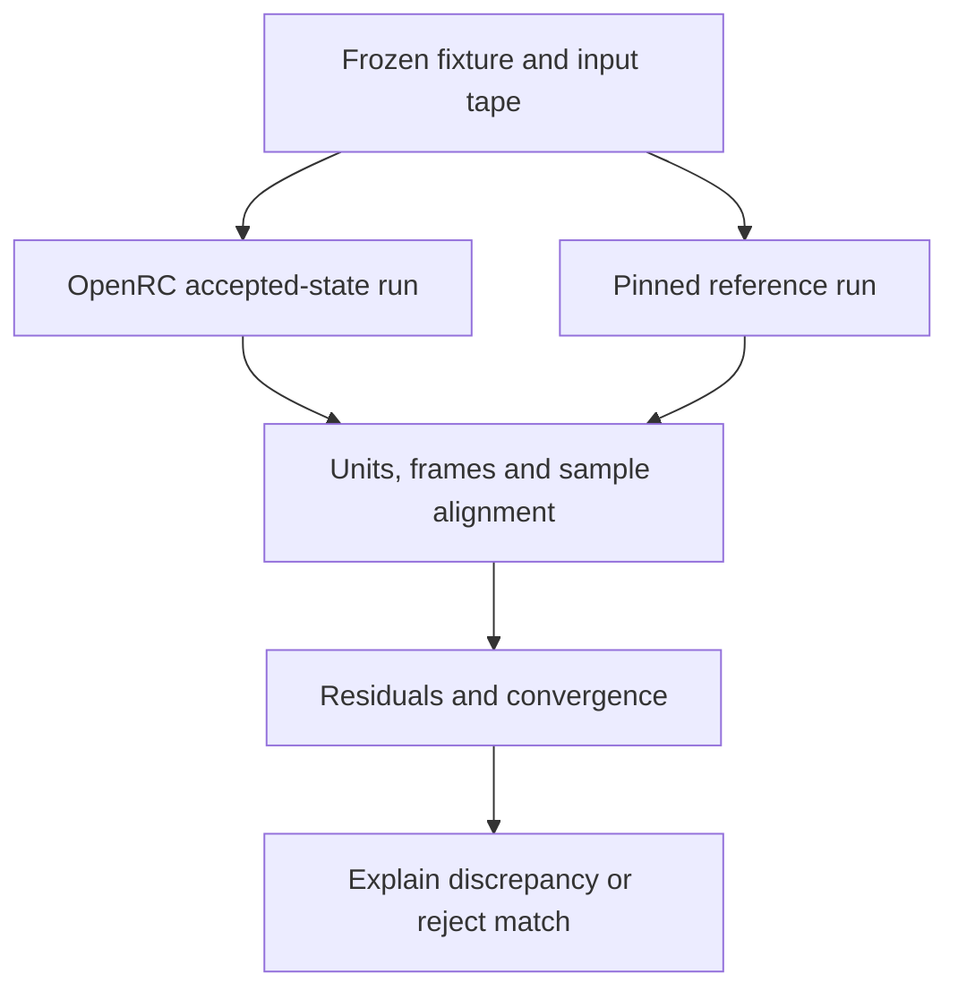

# Open-source reuse and integration plan

**Date:** 11 November 2026. **Status:** proposed engineering work informed by source inspection; no external simulator was built, benchmarked or integrated in this investigation. **Baseline:** OpenRC `7bff78490f9af5c1664f47c8ba865a92b3430920`. Read [13](13_OPEN_SOURCE_FPV_AND_DRONE_APPROACHES.md) for the 25 approaches and [15](15_OPEN_SOURCE_LICENSE_SOURCE_AND_USER_EVIDENCE.md) for exact code, license and user evidence. The existing [02 contracts](02_ENGINEERING_CONTRACTS.md) remain authoritative for the proposed OpenRC runtime.

## 1. Decision

Keep OpenRC's float64 NED/FRD `VehicleModel`, 240 Hz RK4 baseline and existing accepted-frame boundary; implement the complete proposed transaction/rollback contract before extending control. The current private-duty cache gap in 06 remains unresolved runtime work. Use open projects first as independently versioned comparison tools, implementation references and existing analysis utilities. Adopt a dependency only after identifying the precise capability it contributes, its license and dependency scope, and the states and clocks it would own.

The source research does **not** support replacing the kernel with a simulator library simply because it runs Betaflight. SimITL advances its own plant; libfpv wraps that simulation and exposes manual as well as threaded timing; Open FPV Sim owns another float64 plant with different numerical integration. Their useful comparison value does not establish compatibility with OpenRC's reset, rejected-tick rollback, race or replay contracts. See OSS-05–08 in [15](15_OPEN_SOURCE_LICENSE_SOURCE_AND_USER_EVIDENCE.md).

The concrete additions are two optional research packages, P25 and P26. Improve the existing P22 input journey and P23 inspection design using the observed user needs; avoid creating competing implementations of those features. Scanned environments remain an optional extension of P24 and the scenery track after the initial M3 course is stable. Learned aerodynamic residuals remain within P16/M4.

## 2. Reuse decisions by capability

| Capability | First references/tools | Proposed use | Dependency boundary and admission |
| --- | --- | --- | --- |
| Motor response, rotor-local drag and body wrench | RotorPy; multicopterDynamicsSim; Flightmare flightlib | P25 offline numerical comparisons of a matched, deliberately limited model | No Python/C++ simulation dependency in the shipped Godot runtime; selected source and parameters pinned |
| Control/plant clock separation | gym-pybullet-drones; Gazebo Sim | Fixed control samples, held actuator commands, independent plant refinement | Preserve existing NUM-01/02; a faster external loop does not repair OpenRC automatically |
| Firmware behavior | Betaflight; INAV | Versioned mathematical/source references now; P26 optional SITL experiment later | Firmware state is not owned by OpenRC until full lifecycle and rollback are demonstrated |
| Complete alternative FPV backend | SimITL; libfpv; Open FPV Sim | Separate comparison executable or research session | Never run two authoritative plants for one vehicle; results have a distinct solver identity |
| Radio calibration and channels | QGroundControl; EdgeTX; ShramkoGSFPV | P10/P18/P22 UI and diagnostic requirements | Native Godot input remains the adapter; transmitter firmware and WebHID are not new runtime requirements |
| Link impairment experiments | ExpressLRS; timestamped input queues in WebFPVSimulator | Later bounded synthetic delivery model with recorded impairment seed and profile | Do not describe synthetic drop/jitter as measured RF propagation; pristine input stays available |
| Logs and tuning analysis | Betaflight Blackbox Explorer and existing free plotting tools | P23 read-only inspection and aligned CSV exports; real Blackbox files when actually generated by firmware | OpenRC `.orfl` remains its authoritative recorder; no invented Blackbox binary compatibility |
| Telemetry automation | MAVLink; MAVSDK; PX4/ArduPilot simulation interfaces | Optional experiment/control boundary with explicit field and lifecycle mappings | No GCS, network transport or ROS dependency for local M2/M3 play |
| Scene authoring and collisions | ShramkoGSFPV; Gazebo/Webots model separation | P24 optional sourced scene with metric scale, collision identity and license ledger | Visual scans, collision geometry and course scoring must agree; downloaded scenes need their own rights |
| Automated test flights | RPG Quadrotor Control; data_driven_mpc | Later scripted reference trajectories and identification research | A trajectory controller is a separate pilot/controller capability, not the manual Acro controller |

**Default implementation preference:** use existing tools for inspection and offline analysis; implement small OpenRC-specific adapters where the contracts require them. This follows the repository's reuse guidance while preserving its shared vehicle architecture. A new graphics engine, robotics stack or telemetry stack must solve a demonstrated problem before becoming a product dependency.

## 3. Architecture decisions to record

### ADR-OSS-01 — One authoritative plant per session

The normal session uses OpenRC's accepted physical state. An external program may observe exported data or run a separate reference trajectory. If a future experimental session uses a foreign plant, that is a distinct capability with a distinct solver/data identity and its own acceptance gates; it is not silently installed under an OpenRC-qualified vehicle label.

Do not read a SimITL/libfpv position and simultaneously apply OpenRC motor forces to the same craft. Do not use foreign collision impulses while retaining an unrelated OpenRC gate path. If an external experiment produces poses only, it cannot create authoritative OpenRC lap results. Its comparison record remains separate.

### ADR-OSS-02 — Separate firmware compatibility from vehicle fidelity

Use four independent declarations: **input/rate semantics**, **controller implementation**, **plant/parameters**, and **sensor/transport behavior**. A Betaflight build can establish which firmware executed; it does not validate drag, propeller response, pack sag, collision geometry or device latency. Agreement between two models is software evidence; selected-build measurements remain M4 evidence.

Preserve the settings pins in [09](09_SETTINGS_EVIDENCE_AND_REFERENCE_PROBE.md): Betaflight **2026.6.2** and INAV **9.1.0** are the existing settings-research targets. The newer development HEADs audited in 15 are discovery snapshots, not an automatic settings migration. SimITL's bundled firmware and WebFPVSimulator's 4.5.1 target also require their own identities. Do not compare or import their profiles as if they shared one default set.

### ADR-OSS-03 — The clock belongs to the experiment/session

Use accepted simulation time for integration, controller scheduling, input application and race events. Rendering and wall-clock pacing consume or schedule work; they cannot change the committed tick sequence. A manual `step()` API is helpful but does not establish snapshot/restore or absence of hidden wall-clock state.

Represent time exactly as an integer tick plus a rational period or an integer timebase that exactly represents every admitted frequency and phase, retaining a rational remainder where needed. A 240 Hz tick is **not** an exact integer number of microseconds. Avoid cumulative rounding of `4166.667 µs`, especially at a boundary with 1 kHz or 8 kHz firmware. For those three frequencies, a 24,000-tick/s research timebase gives periods of 100, 24 and 3 ticks; this example does not require changing OpenRC's clock. Define when a sample at an exact boundary takes effect and how a held input is sampled by each experiment.

### ADR-OSS-04 — Research adapters do not weaken transactions

A process that has already advanced firmware cannot be rolled back merely by rejecting OpenRC's plant candidate. Integrals, filters, mode latches, clocks, sensor histories and configuration storage may have changed. The full state owner must be identified before a bridge can enter the production controller path.

Use external firmware as an **offline/separate reference** until one of these mechanisms is qualified: complete deterministic checkpoint/restore of all participating state, or a proved reconstruction from a known initial image plus an exact accepted input/sensor tape. Reconstruction cost and all state not covered by the tape must be measured. Do not put a blocking network exchange or mutable foreign singleton inside the proposed pure sample callback.

### ADR-OSS-05 — License scope follows the copied component

OpenRC's pinned root project code is MIT. Preserve its current license boundary. Evaluate code, embedded firmware, generated protocol output, fonts, audio, meshes, scans, datasets and model weights separately. A root GPL/MIT badge does not settle all of them. In particular, MAVLink generator terms differ from its generated output; QGroundControl documents a license choice and Qt packaging conditions; several FPV projects exclude particular assets. Exact evidence is in 15.

A subprocess or IPC boundary is an architectural choice, not an automatic license conclusion. Before distributing a combined artifact, identify the actual copied/linked components and their obligations. Do not copy GPL code into an MIT-only source file by translating its language. Source study and independently specified mathematical behavior still require truthful provenance; calling something a reimplementation is not a compatibility certification.

## 4. P25 — Source-pinned comparison harness

**Ownership:** DR-04 research with SF/flight-dynamics review; reuse existing logging and validation tools from [05](05_VALIDATION_AND_IMPLEMENTATION_BACKLOG.md). **Status:** proposed; this investigation supplies the source map and comparison design, not executed comparison results.

Start with RotorPy and multicopterDynamicsSim as two independently implemented, permissively licensed dynamics references. Flightmare's motor response is a useful third isolated check. These are intentionally limited references: ground clamping, world-box constraints, Bullet contacts, ODE contacts and OpenRC's planned hybrid contact policy are different models and must not be pooled as equivalent evidence.



### 4.1 Freeze the experiment before running it

Retain exact OpenRC/reference commits, dependency versions, build options, scalar precision, integrator, time schedule, initial state, source parameter files, input tape and configuration hashes. Record disabled effects explicitly. Pin seed and generator state when randomness is enabled; begin with noise disabled. Treat missing physical coefficients as missing or estimated, not as manufacturer measurements.

A proposed research manifest should contain these fields; this is an envelope for the harness, not a replacement for the runtime vehicle schema:

```yaml
schema: openrc-reference-run/v1
run_kind: matched_subset
openrc_commit: 7bff78490f9af5c1664f47c8ba865a92b3430920
reference_project: rotorpy
reference_commit: 40b09697a6a1596d404a67f459941d46a39eedd3
comparison_status: not_run
world_frame: NED
body_frame: FRD
quaternion_contract: body_to_world_wxyz
time:
  openrc_tick_period: {numerator: 1, denominator: 240, unit: s}
  control_schedule: explicitly_frozen_in_fixture
  input_hold: previous_sample_until_next_timestamp
  boundary_policy: explicitly_frozen_in_fixture
physics:
  contact: disabled
  noise: disabled
  wind: zero
  matched_effects: [gravity, rotor_thrust, declared_motor_response]
provenance:
  vehicle_parameters: required_before_run
  input_tape: required_before_run
  reference_environment_lock: required_before_run
```

The placeholder values above deliberately make the example **unrunnable** until the concrete fixture is supplied. A loader must reject incomplete manifests rather than infer vehicle parameters or timing. No reference result may be promoted from `not_run` by documentation editing alone.

### 4.2 Prove the coordinate and actuator boundary first

For each adapter, write the actual world/body bases, quaternion component order and rotation direction, motor locations, rotor spin convention, thrust sign, torque sign and angular-speed units. Do not assume every z-up simulator uses ENU or that its x-axis is geographic east.

For a source body known to be **FLU**, the vector basis change to FRD is `diag(1, −1, −1)`. For a source world explicitly declared **ENU**, the NED coordinate map is `(N,E,D) = (source_y, source_x, −source_z)`. These are conditional mathematical maps, not automatic declarations about every audited project. For **body-to-world** attitudes, use `R_target = C_world R_source C_body⁻¹`, where `C_world` maps source-world components to target-world components and `C_body` maps source-body components to target-body components. Convert a world-to-body representation to this direction first, or derive the inverse map explicitly. Do not swap quaternion components ad hoc. Transform angular velocity, moments, hub positions and the inertia tensor consistently.

Convert RPM to rad/s using `ω = RPM × 2π/60`; a coefficient multiplying RPM squared must also be converted. Preserve the complete signed motor map rather than sorting motors by index. Excite each motor separately and verify force, roll, pitch and yaw signs before a closed-loop flight. A correct hover sum can conceal a swapped motor pair.

### 4.3 Compare in an order that localizes errors

1. **Static mappings:** gravity, basis transforms, one-motor force and moment, collective sum, rotor-spin torque and units. No controller or collision.
2. **Actuator dynamics:** prescribed command and initial rotor speed; compare a declared first-order law against its analytical step. Do not stack an extra empirical lag on OpenRC's later identified electromechanical motor model.
3. **Body mechanics:** free fall, no-torque angular momentum, asymmetric rotor changes and wind-relative drag. Match inertia convention and disabled terms explicitly.
4. **Numerical integration:** fixed control samples and a shared held-command tape; refine the plant intervals independently. Compare residuals against a converged reference and declared tolerances, not bitwise equality between different methods.
5. **Closed-loop behavior:** only after controller semantics and sampling are separately matched. Different firmware versions, PID units, filtering, estimator or saturation policies are comparison treatments, not unexplained noise.
6. **Contact and racing:** separate experiments with known geometry/materials/event policies; retain event-time and position uncertainty. A foreign reset-on-impact rule cannot validate OpenRC's collision response or accepted gate receipt.

Use existing NUM-01/02 for the distinction between plant refinement and controller sample-rate qualification. More RK stages do not create fresh gyro observations. The conditional P19a scheduler repair remains required if the 240 Hz feedback hypothesis fails; P25 cannot waive it.

### 4.4 Minimum retained output

Export aligned simulation time, accepted tick, position, attitude, body rates, input sample identity, commanded and actual rotor speeds, requested/allocated/produced wrench where available, voltage/current/charge where modeled, and event records. Retain each source's native trace alongside the normalized trace. Mark unavailable channels; do not fill them with plausible synthetic measurements.

Report units, absolute/relative tolerances frozen before viewing candidate output, alignment policy, interpolation, skipped samples, invalid intervals and per-regime residuals. Retain no-contact numerical residuals separately from physical calibration residuals. A contact time is an interval with declared uncertainty when the locator cannot justify a point estimate.

## 5. P26 — Optional firmware bridge feasibility

**Purpose:** determine whether a pinned firmware controller can be studied against OpenRC-generated sensor traces without corrupting clock, reset or recording semantics. Start outside the shipped application. Begin engineering only after the pure sampled-control and replay contracts have concrete implementation; a production experiment is optional after M2 and cannot block its admission.

### 5.1 Choose the boundary deliberately

| Candidate boundary | What the external side owns | Appropriate use |
| --- | --- | --- |
| Source-vector reference | Selected rate/mapping functions only | Existing settings probes and low-cost compatibility checks |
| Controller-only SITL | Firmware sensor processing, controller/mixer and internal state | Optional P26 experiment after state/time/motor interface inspection |
| SimITL/libfpv complete backend | Firmware plus its plant and associated state | Separate comparison run; do not feed its poses into OpenRC's plant |
| Open FPV Sim full session | Its scheduler, plant, firmware bridge and record model | Independent reference experiment with aligned declared parameters |

Do not describe INAV's simulated receiver source alone as a complete supported Godot/SITL integration. Likewise, an external tool that can pause, reset or step has not thereby demonstrated recovery to an arbitrary earlier firmware state.

### 5.2 Proposed research protocol

The following is a **design for an adapter**, not a claim that any audited backend implements it. It requires an adapter or upstream change where capabilities are absent.

- **Handshake:** protocol/schema versions; project/firmware/dependency commits; executable/configuration hashes; frame/unit contracts; motor count/order/spin; sensor schedule; supported state operations; maximum packet sizes and work limits. Refuse mismatches explicitly.
- **Session identity:** a unique run epoch plus monotonically increasing sample sequence. A restart creates a new epoch. Late packets from a previous epoch cannot arm or advance the current run.
- **Step request:** exact simulation-time interval; accepted input identity; both timestamped pilot/RC channels and the required simulated sensor samples; noise seed/state identity; expected predecessor digest. Explicitly identify any frozen/default channels. Declare separate RC and sensor sample schedules, holds and delivery phases. A prescribed sensor-tape experiment also supplies an identified RC tape or declared fixed RC input.
- **Step response:** matching epoch/sequence, consumed input identities, time actually advanced, firmware tick count, motor outputs with units, arm/failsafe status, and available diagnostic/state digest. Pose output is not a controller-only response.
- **Error handling:** timeout, malformed/nonfinite data, impossible motor values, wrong motor count, unexpected clock advance and stale response terminate or hold the research run explicitly. Never silently reuse stale output and call it a fresh control update.
- **Retry policy:** do not resend a state-advancing request unless idempotence has been implemented and tested. A duplicate packet must produce a cached response or a clear refusal without another firmware step. Open FPV Sim's audited first-datagram resend warning is a concrete reason for this requirement.
- **Configuration:** apply to a detached, identified firmware session. Preserve raw configuration and the bounded import/support report. Use an explicit reset boundary; do not execute pasted CLI text inside the OpenRC importer.
- **Restore claim:** declare `none`, `restart_from_initial`, or `complete_checkpoint` with a versioned state schema and demonstrated coverage. This is a capability report, not a UI checkbox inferred from the existence of a reset command.

For a controller-only physics loop, accelerometer input must specify proper acceleration/specific force, frame, sign, units and sample location. In NED, an ideal level stationary accelerometer in FRD measures specific force opposite gravity; passing world gravitational acceleration as an IMU sample is wrong. Define a causal sample at `t_k` from accepted physical state and a declared previous/left-limit force evaluation or explicitly delayed measurement. It must not require the new controller output that this same sample is being used to compute. A rigid sensor offset from the CG also needs tangential and centripetal acceleration terms; those terms vanish for a CG-collocated sensor. Include alignment, quantization/noise and latency only when modeled and versioned.

Running firmware several times inside a 240 Hz OpenRC interval requires an explicit interpretation. Repeating one accepted sensor sample is held feedback, not fresh 1 kHz/8 kHz feedback. Replaying a prerecorded sensor tape is an offline firmware comparison, not closed-loop coupling. Fresh intra-interval feedback requires qualified plant/controller interleaving and transactional event scheduling under P19a or an equivalent explicitly reviewed protocol. At the baseline outer boundary, the sensor reads accepted state; at a qualified P19a internal event, it reads causally advanced **detached candidate state**, with all internal plant, controller and sensor updates committed or rolled back with the outer transaction. That scheduling and the causal sensor sample are part of the experiment identity.

### 5.3 Stop conditions

Keep the bridge outside production if it cannot account for hidden firmware state after a rejected candidate, cannot distinguish duplicate/stale responses, uses unbounded waits in a physics path, cannot expose its actual time advance, or cannot reproduce reset/configuration from an identified initial state. Keep full-backend comparisons separate if the backend only exposes pose and cannot relinquish plant authority.

Manual stepping, float64 arithmetic, a seed, or byte-identical output from one reported example does not prove these properties. This investigation verified source paths; it did not run a firmware checkpoint test.

## 6. Requirements strengthened by user evidence

The coded issue sample in [15](15_OPEN_SOURCE_LICENSE_SOURCE_AND_USER_EVIDENCE.md) is purposive and historical. It reveals failure modes and requested capabilities, not their prevalence or the current status of every project.

### P22: make calibration observable

Show raw axis/channel values, detected range and center, mapped function, reversal, normalized output and connection freshness before arm admission. Test asymmetric ranges, throttle whose center is not zero, logical-axis reordering and reconnect. Distinguish the selected device from another connected gamepad. Preserve one mapping/expo stage. Let the user record known transmitter-side shaping as user-declared information, or leave it unknown; generic USB HID does not expose the radio's internal curve. Do not auto-detect or compensate for an unobserved curve.

QGroundControl's reported half-range throttle and EdgeTX's channel-mismatch report motivate discriminating cases. They do not establish that every Zorro, EdgeTX release or HID stack is broken. Real-device calibration remains part of the existing native input campaign.

### P23: make comparisons understandable

Use a read-only diagnostic view with explicit units, selectable fixed/shared axes, aligned event markers and visible time offsets. Keep raw log values accessible. A small-amplitude trace auto-expanded to fill a graph must not look like more noise than a larger-amplitude trace shown on another scale. Blackbox Explorer's graph-scale request is direct user evidence for this requirement.

Prefer exporting to existing free tools before implementing an entire signal-analysis application. For real firmware experiments, preserve the actual Blackbox file and firmware build. For OpenRC runs, export truthful CSV plus `.orfl` identity and completeness. Do not label OpenRC's own controller output as Betaflight Blackbox data unless a qualified encoder/consumer contract actually exists.

### P14/P15: make geometry and results explainable

Provide metric gate aperture and collision-envelope views in development diagnostics. Flightmare users' uncertainty about drone/gate dimensions supports this. RotorHazard's historical timing report supports retaining event evidence and comparing live/recomputed outcomes; its current license exception does not change that reported need.

Retain OpenRC's accepted-path receipt and pure endpoint race authority. A diagnostic UI may explain only information actually committed by that policy. Preserve validity, recording completeness, persistence and comparison compatibility as separate result axes. No external race-timing server or replay viewer may retroactively rewrite the authoritative three-lap attempt.

## 7. Scanned worlds, richer aerodynamics and autonomy

### Scanned worlds: an optional post-M3 experiment

ShramkoGSFPV shows concrete code for uniform scene transforms, voxel sweeps and timestamped replay. The transferable requirement is a **joint visual/collision/scale provenance contract**. For an OpenRC experiment, retain the scan source/license, metric scale and its evidence, collision-generation settings, generated collision hash, transforms, occlusion/empty-space limitations and performance measurements at 1080p.

Do not obtain course scoring geometry from visual splat density. Define gates and solids in the validated course schema. Treat collision edits, voxel cleanup, changing scale or changing the world as a new identity; reset the attempt through the existing transaction. Requalify rotational clearance, swept hull/prop bounds and locator uncertainty. The audited foreign sphere sweep does not prove OpenRC's rotating-prop sweep.

### Richer aerodynamics: promote only with evidence

RotorPy's local flow terms, Webots' axial velocity dependence and data_driven_mpc's residual approach offer different hypotheses. Choose one missing effect at a time. Compare a declared baseline, a richer analytic candidate and any residual candidate using selected-build measurements. Split data by whole flight/maneuver/build before fitting; do not let adjacent samples from one flight leak into both training and evaluation.

Freeze units, frames, synchronization, filtering and out-of-domain behavior. Reject a learned model that merely compensates for a motor-map sign error or time offset. Uncertainty, passivity/domain checks and residual structure matter more than a lower pooled error number. Missing data/weight redistribution rights remain separate from the code license.

### Autonomy: use it as a test pilot, then admit separately

Trajectory controllers and MAVSDK automation can make reproducible excitation experiments easier. They do not establish manual racing skill transfer or need to ship with M2/M3. Use a clearly identified input/controller source, preserve normal arm/hold/reset rules and ensure an automated script cannot bypass a refused preparation or race rule. No model-training feature or network service is part of the baseline deliverable.

## 8. Proposed work and acceptance ledger

The cases below are **proposed and not executed**. They complement existing TX/NUM/INPUT/REPLAY/RACE/IMP cases rather than replacing them.

| ID | Discriminating case | Required result / owner |
| --- | --- | --- |
| OSS-REF-01 | Exact commits, code/asset notices, submodule identities and environment lock | Reproducible source manifest; unavailable components explicitly excluded; P25 |
| OSS-REF-02 | Known world/body basis and quaternion-direction fixtures | Correct gravity, thrust, angular velocity and inertia transforms; P25 |
| OSS-REF-03 | Each motor alone, plus asymmetric pairs | Correct index, spin, roll/pitch/yaw signs and RPM/rad/s conversion; P25 |
| OSS-REF-04 | First-order motor step with matched limits and initial speed | Convergence to independent analytical response; no extra lag; P25 |
| OSS-REF-05 | Same held controls with refined plant intervals | Declared residual convergence, without changing feedback times; P25 + NUM-01 |
| OSS-REF-06 | Change feedback rate/phase separately | Explain closed-loop differences; follow NUM-02/P19a on failure |
| OSS-REF-07 | Rotor/body drag in known wind and no-wind cases | Correct relative-airflow signs and no duplicate modeled term; P25 |
| OSS-REF-08 | Compare ground clamp, reset-on-impact and true contact scenarios | Different policies labeled; no pooled false equivalence; P25 |
| OSS-BRIDGE-01 | Wrong handshake/config/frame/schema identity | Refuse before stepping; P26 |
| OSS-BRIDGE-02 | Duplicate, delayed and previous-epoch packets | No duplicate step or stale arming/output; P26 |
| OSS-BRIDGE-03 | Timeout, NaN output, invalid motor count or clock jump | Bounded failure with last accepted OpenRC state preserved; foreign state quarantined/reconstructed before reuse |
| OSS-BRIDGE-04 | Reject a candidate after foreign controller advancement | Complete qualified restoration or explicit refusal to join the production transaction |
| OSS-BRIDGE-05 | Reset/configuration change with an old packet in flight | Fresh identified session, declared initial state and explicit rearm policy |
| OSS-BRIDGE-06 | Same sensor/input tape across pacing/render changes | Same declared firmware tick consumption and admissible state result; limits documented |
| OSS-BRIDGE-07 | Level-rest FRD specific force `[0,0,−g]`, near-zero free fall, tilted attitude and a rotating off-CG sensor; reject a later candidate stage | Correct units/sign/frame and lever-arm terms at the declared causal phase; sensor/filter history rolls back with the transaction; distinguish held samples from fresh internal-event samples |
| OSS-UX-01 | Half-range/asymmetric throttle; swapped channel; reconnect | Visible diagnosis, correct normalized mapping and existing safe arm gate; P22 |
| OSS-UX-02 | Two logs with different noise amplitude and automatic scaling | Shared/fixed scale plus units makes the comparison truthful; P23 |
| OSS-UX-03 | Replay/logging observer fails after valid finish | Validity retained, completeness/persistence separately reported; P15/P23 |
| OSS-WORLD-01 | Scale or collision content changes after recording | New identity, no incompatible ghost/result comparison; P24 |
| OSS-WORLD-02 | Known thin wall, high-speed path and rotating clearance | Bounded collision/path uncertainty and matching visible diagnostics; P24 + EVENT/RACE |
| OSS-DATA-01 | Whole-flight held-out residual evaluation and bad time alignment control | No leakage; expose sensitivity and domain limits; P16/M4 |

### Package sequence

**P25 — reference harness:** prepare pins/manifests in parallel with existing source research; execute plant cases on a stable identified candidate and closed-loop cases after P07/M1. Complete a report that either explains differences or rejects the proposed match. Cross-simulator agreement is not an M1 release dependency and cannot waive existing gates.

**P26 — firmware feasibility:** inspect protocol/state ownership after the existing sampled-control/replay implementation is concrete; begin with a separate research run. Only propose a production bridge after M2 and a successful lifecycle/clock/state review. Failure to qualify the bridge leaves the owned OpenRC controller route intact.

The main route remains **P02/P03 transaction → P05/P06 control/numerics → P07 replay → P13 route candidate → relevant P21 integration → P22 M2 campaign → M2 → P14/P15 M3**. P23/P24, optional external bridges and M4 physical claims remain separately admitted work.

## 9. What this investigation has advanced

Completed: 25 project-level code/license investigations, exact source pins, implementation distinctions, a separately coded user-evidence ledger, excluded/qualified candidates, a reuse decision matrix, two bounded optional packages, an experiment-envelope proposal and 21 discriminating future cases. The source audit identified integration traps before a dependency was selected: complete foreign plants mistaken for controllers, manual stepping mistaken for restoration, shared aerodynamic lineage mistaken for independent validation, and assets mistaken for project-code licensing.

Not executed: third-party builds, flight benchmarks, radio tests, numerical cross-simulator comparisons, imported firmware equivalence, complete foreign-state rollback, new runtime code or physical calibration. These are explicit next experiments, not results inferred from an upstream README or test count.
