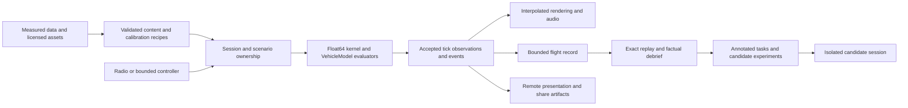

# OpenRC Moonshot: the flying club that learns with you

2026-10-28 · Twelve-month transformation proposal. **Ambition is approved for investigation; future features and targets below are not implemented or qualified merely by appearing here.** Current behavior remains owned by [STACK](docs/STACK.md), source/configuration, and the [track registry](docs/README.md#tracks-plans-and-step-ids). Main-line release gates remain in [ROADMAP](ROADMAP.md#execution-order-and-release-gates).

## The destination

Build a simulator where a pilot can bring their own transmitter, aircraft setup and local field; learn through an instructor that can explain a particular flight; rewind a mistake and explore another response; and fly with a club whose shared challenges remain reproducible. Make it feel immediate, readable and alive at **1920×1080 first**, then qualify higher resolutions and VR separately. Make credible model behavior and a satisfying ten-minute session equally central.

The defensible advantage is the connection between **measured aircraft, an inspectable flight history, useful instruction, a responsive game and an open creator community**. A larger aircraft catalog or an expensive rendering engine alone cannot produce that connection. The aspirational “10×” is a new capability—going from “that landing felt wrong” to a reproducible explanation, practice task and comparison—not a claimed benchmark multiplier.

With virtually unlimited resources, fund parallel specialist teams, real aircraft instrumentation, target machines, accessibility testing, asset intake and multiplayer operations. Do not assume that money removes data-collection time, causal uncertainty, numerical compatibility or human learning. Plan a complete product in twelve months and keep speculative research off its critical path.

## 1. Current project assessment

### Scope and method

This review starts from commit `96287766296b3fef6a37dcd4cc3847d7efbe9f19` and the working tree on 2026-10-28. Existing CI/export, F4U and truck-native edits were outside the implementation scope; additional concurrent edits are preserved. Three independent specialist investigations covered engine/world, physics/AI and product/platform. The lead inspected the simulation/session contracts, logging tools, performance tooling, native research, tests, CI and ownership guides. This is a cross-system assessment, not an assertion that every file or every old report has been revalidated.

Primary-source findings and limitations are retained in [engine/world research](docs/research/moonshot/engine-world-2026-10-28.md), [physics/AI research](docs/research/moonshot/physics-ai-2026-10-28.md), and [product/platform research](docs/research/moonshot/product-platform-2026-10-28.md). Historical measurements below remain tied to their original build, host and workload. This task's new engineering evidence belongs to [FL-05](docs/research/flight-logging/FL-05/README.md).

### What is already valuable

| Area | Observed foundation | Constraint or opportunity |
| --- | --- | --- |
| Engine and delivery | Production is Godot/GDScript; [engine pin](app/get-godot.sh) is official `4.8.beta1.official.4d10419ca`. Desktop exports, build identities and checked execution exist. Compatibility is the default, and an optional High/Forward+ path is already under investigation. | A beta pin and successful exports do not qualify every GPU, radio or platform. The historical 720p viewport is not the product target. |
| Shared simulation | [Simulation](app/sim/simulation.gd) owns float64 fixed 240 Hz stepping, RK integration, events, checkpoints and atomic publication; [VehicleModel](app/sim/vehicle_model.gd) supplies laws/layout. Fixed-wing, helicopter and truck sessions use it. | Preserve this deep module. A render-engine migration would still have to port its GDScript implementation and prove numerical/lifecycle compatibility. Multirotor groundwork is not a playable racing activity. |
| Aircraft and components | Unit/source-tagged v2 data, strict admission, local aerodynamics, trim/linearization, propulsion, servos, finite fuel, batteries, contact and failures exist. Generated artifacts have source pipelines. | Many parameters and full-envelope behaviors remain estimates. Internal consistency and exact replay cannot establish measured RC realism. Calibrate installations, not just airframe names. |
| Replay and experiments | `.orfl` records complete starting context, conditioned inputs, events and accepted samples. Exact and explicit candidate replay, the flight-test card, AI pilot matrices and physical measurement reducers already exist. | Candidate replay is open loop; it does not model pilot adaptation. There is no need for another general campaign runner. User markers currently need a useful analysis consumer; FL-05 supplies the first one. |
| Player shell | Home, Practice, Workshop, calibration/remapping, controller profiles, localization, statistics, Natural Random and emergency practice are substantial implemented features. | They need a coherent learning/play loop, user testing, accessibility qualification and consistently fast transitions. Screen-reader and physical-radio coverage remain separate gates. |
| World and immersion | Two registered landscapes, time of day, physical atmosphere/wind, scenery, vegetation, clouds, lights, smoke, aircraft cameras and layered powertrain/environment audio exist. | Physical weather and appearance have separate responsibilities; coherent cues need integration. More vegetation or effects can hurt aircraft visibility and frame time. Headless images and attractive captures do not qualify a sustained game. |
| AI | Companions already fly ordinary Stik sessions with a bounded circuit/avoidance controller, seeded inputs and strict admission. | They are neither a general instructor nor an all-envelope autonomous pilot. [Current limits](docs/AI-FLIGHT-COMPANIONS.md#current-limits) include narrow weather/field scope, no aircraft-to-aircraft contact and unresolved scale/performance gates. |
| Creator foundation | Workshop bundles have strict data-only decoding, dependency identities and bounded inputs; landscape and aircraft authoring contracts exist. | A public creator distribution system, moderation, compatibility policy and trustworthy community scores are additional work. |
| Engineering | Golden trajectories, law properties, hostile-input tests, debug bridge, lifecycle probes, Perfetto-compatible traces, native frame reducers and CI partitions provide unusually strong observability. | Tool/version drift and many track-specific evidence formats impede reuse. Keep useful specialized tools; integrate around their outputs and fix demonstrated friction. |

### Debt and bottlenecks that should influence the architecture

1. **Orchestration concentration.** At the inspected snapshot, `flight_session.gd` has 5,774 lines, `main.gd` 3,458 and `ui/home.gd` 1,802. Size alone is not a defect. Their many lifecycle, input, environment, presentation and observer responsibilities make interface changes expensive and concurrent edits risky. Extract only around demonstrated consumers: session preparation, accepted observation publication, activity/scenario lifecycle. Keep reset/restore fault semantics intact.
2. **Physical evidence is the scarce dependency.** The main-line owner circuit, installed-aircraft measurements and held-out flight validation remain open. Sophisticated algorithms can fit the wrong assumptions more convincingly. Every claimed improvement needs an aircraft, configuration, regime and independent reference.
3. **Fleet simulation competes with the frame.** A retained Windows companion workload reports p95 frame times of 8.186/17.175/52.017 ms for one/two/three companions; its own gate passes only one. This is [historical AFC evidence](docs/research/ai-companions/AFC-00-R4/README.md), not a fresh 1080p or current-tree qualification. A crowded club needs explicit simulation budgets and networking representations rather than full local physics for every distant participant.
4. **Native work is already real.** [NK-3](docs/research/native-kernel/NK-3/README.md) reports an electric-Stik stage port with 12,000 contexts, 49,553 exact trajectory ticks and 2.0–3.8× paired tick speedups on its debug Linux VM. It also finds 96–97% of the remaining tick in GDScript. These are powerful scoping results, not fleet, release-template or cross-platform wins. The [optional helper](app/sim/native_stage.gd) exists; at this review's source snapshot it is not called by `FlightSession`. Do not claim broad native production flight, or propose NK-3 as if it has not begun.
5. **Graphics quality has unclosed costs.** The engine study found a retained RTX 3090/Windows 1080p pair around 17.396 ms Standard versus 18.302 ms High p95, plus a final-source High run at 18.375 ms. The scoped High path also has a seven-Texture-RID-per-world leak finding on beta1. These runs neither rank engines nor prove sustained 1080p60. Use the exact source reports linked in [engine research](docs/research/moonshot/engine-world-2026-10-28.md).
6. **Loading and evidence drift are product problems.** Native Home→Fly investigations document multi-second transitions. Some diagnostic entry points retain older engine assumptions: `research/performance/session_baseline.py` still hard-checks 4.7.2 while the app is pinned to 4.8-beta1. Old evidence must remain reproducible; current qualification needs a deliberately versioned producer/consumer contract, not a silently relaxed guard.
7. **Source truth can outrun the guides.** Some guides were checked on October 19; native work and engine changes continued later. Link current implementation and dated evidence separately, and review contradictions at each release. Do not turn a planning inventory into another competing status source.

### Competitive bar and lessons from modern games

These are advertised capabilities, not independently measured handling or popularity rankings. The [product survey](docs/research/moonshot/product-platform-2026-10-28.md#competitor-patterns-official-sources-feature-claims-only) retains exact links and applicability limits.

| Reference | What OpenRC must take seriously | Where to aim beyond feature parity |
| --- | --- | --- |
| [RealFlight Evolution](https://www.realflight.com/product/realflight-evolution-rc-flight-simulator-software-only/RFL2001.html) | Aircraft/sites, instruction, challenges, editing and multiplayer form a complete product. | Explain performance against a reproducible flight and an explicitly calibrated setup. |
| [aerofly RC 10](https://www.aeroflyrc.com/) | Transmitter access, assisted training, contests, editing, shared flying and VR. | Smooth setup and legible pilot-view flying with traceable adaptation and a strong offline experience. |
| [AccuRC](https://accurcsimulator.com/) | Configurable aircraft components and several vehicle classes. | Distinguish measured, estimated and experimental setup behavior, with transferable test dossiers. |
| [PicaSim](https://www.rowlhouse.co.uk/PicaSim/) | A focused free simulator can have a memorable soaring/wind identity. | A small field whose air and cues are coherent, with reusable community scenarios. Its download does not grant unrestricted code/asset reuse. |
| [VelociDrone](https://www.velocidrone.com/features), [Liftoff](https://steamcommunity.com/app/410340/workshop/) | Tracks, challenges, creators and ghosts provide reasons to return. | Apply that loop to fixed-wing orientation, precision, soaring and club airshows; do not assume FPV audiences or scoring transfer unchanged. |
| [Microsoft Flight Simulator 2024](https://www.flightsimulator.com/microsoft-flight-simulator-2024/) | Aviation activities, a living world and recurring community flying put the aircraft in a meaningful context. | Concentrate that density in RC-scale fields and short activities. Recreating an entire planet is not needed to make the local field feel real. |

## 2. Eight major transformations

Labels: **Established technique** means there is primary evidence for the method somewhere; **engineering hypothesis** means its OpenRC benefit is unproved; **speculative** means the capability itself is uncertain. None of these labels means shipped here.

### T1 — Your actual airplane, with a measured confidence envelope

**Problem and breakthrough.** A visually correct model can still teach the wrong handling. Replace the binary “realistic” label with a calibrated digital twin of one installed configuration, showing where evidence is strong and where it is absent. A change of propeller, battery, throws or CG becomes a reproducible setup experiment.

**Technical design and technologies.** Keep interpretable laws as the prior. Intake mass/CG/inertia, actuator timing, thrust/RPM and synchronized flight telemetry through the existing reducers; fit identifiable parameters offline using established numerical tooling. Reserve flights by sortie before fitting. Generate v2 data through the owning pipeline with parameter uncertainty, covariance where identifiable, validity envelopes and source provenance. Use sensitivity analysis to choose the next informative measurement. NASA's [multisine identification research](https://ntrs.nasa.gov/citations/20205003364) and ArduPilot's [system identification workflow](https://ardupilot.org/plane/docs/common-systemid-mode.html) are references to reuse, not evidence that OpenRC aircraft are calibrated.

**Player experience.** “Match my Stik” produces a configuration dossier, a comparison against measured response and a useful setup tradeoff, rather than a magic realism slider. Workshop can expose sensitivity and uncertainty while keeping free flight simple.

**Risks and maturity.** Identification is established; automated consumer calibration is an engineering hypothesis. Sparse data cannot uniquely separate wind, sensor delay, servo lag and aero errors. Model-scale low-Re stall cannot be borrowed from a full-size airplane. Learned residuals are conditional research: bounded, offline, versioned, disabled outside measured support; no silent adaptation during ordinary play. Arbitrary-aircraft post-stall identification from a phone video is speculative.

**Breakthrough gate.** Qualify one attached-flow installation first, then three distinct fixed-wing configurations and a stretch goal of six. Reserve sorties before fitting. The initial attached-flight primary metric is the equally weighted mean of per-sortie normalized RMSE for body rates `p/q/r` and TAS, normalized by each reference channel's standard deviation with a floor of three times its measured sensor uncertainty. Freeze alignment, maneuver windows, filtering and nuisance-parameter treatment before evaluating held-out data. Target at least 30% lower aggregate error against the current model, with no individual channel worsening by more than 10% and all absolute tolerances independently set from measurement/application needs. If baseline error is already below the measurement floor, report that rather than claiming a percentage win. Publish every sortie, including failures, and compare simpler fits. Keep pilot preference and predictive accuracy separate.

### T2 — A replay-backed instructor and counterfactual flight laboratory

**Problem and breakthrough.** A reset erases the learning opportunity after a mistake. Make a flight an inspectable object: mark a moment, review what happened, try another control response from a checkpoint, and practice the specific weakness. The same evidence supports lessons, controller development and aircraft comparison.

**Technical design and technologies.** Start with FL-05 factual marker windows over exact `.orfl` replay. Add expert annotations and versioned maneuver definitions next. A later branch operation restores a complete checkpoint in an isolated session, replays to the branch tick, applies one explicit intervention and emits a separately identified candidate. Present several alternatives with uncertainty rather than a single alleged cause. Reuse existing flight-test and companion runners. An offline adapter to [Gymnasium's reset/step contract](https://gymnasium.farama.org/api/env/) can expose task observations, bounded actions, seeds and termination versus time-limit truncation once two real controller consumers justify it. Never put a training framework or LLM into RK stages.

**Player experience.** A learner can see the elevator command, servo response and speed during a marked turn, then watch a qualified reference ghost and retry. Advanced pilots can compare precision patterns, energy management and emergency responses. Optional language generation renders already-validated facts and instructor-approved advice; raw metrics remain accessible.

**Risks and maturity.** Replay, descriptive metrics and conventional guidance are established techniques. Whether adaptive instruction improves learning is a product hypothesis. A counterfactual is a model prediction, not proof of what would have happened to the real airplane. End-to-end RL across arbitrary aircraft/stalls is speculative; reward exploitation and model errors are major risks. Begin with trim-relative controllers, bounded shadow policies and the existing external-input seam at a measured decision cadence.

**Breakthrough gate.** Every debrief number resolves to source identity, tick and units. Unchanged branches reproduce the accepted reference before interventions are allowed. Benchmark assistants against non-ML controllers on held-out seeds/configurations, including refusals and failures. For teaching, preregister a novice study with an active control, instructor-blinded assessment and a delayed retention test. Before recruitment, instructors must choose one primary task outcome and a minimum meaningful effect; the initial study proposal is a 20% reduction in approach-path error on an unseen next-day scenario, with completion/abort rate as a non-regression guard. Determine sample size from pilot-study variance and report confidence intervals and attrition. A simulated retention result supports only that task; real-RC transfer requires a separate supervised real-flight study.

### T3 — A latency-first execution platform with interchangeable presentation

**Problem and breakthrough.** Correct average FPS can hide hitches, stale controls and a CPU-bound fleet. Give the player a reliably responsive simulator while supporting many independent sessions for research and social activity.

**Technical design and technologies.** Preserve the authoritative float64 `VehicleModel` kernel. Continue the prepared native-stage work only where its complete callback benefit survives release builds and platform tests. Separate simulation ownership from scene mutation: accepted immutable observations feed interpolation, audio, HUD, recording and network representations at their needed cadence. Expensive preparation runs in cancellable jobs with immutable inputs and main-thread commit; a simulation worker, if justified, uses bounded command queues and explicit snapshot ownership. Godot warns that the active [SceneTree is not thread-safe](https://docs.godotengine.org/en/stable/tutorials/performance/thread_safe_apis.html). A thread toggle is not this architecture.

**Player experience.** Controls respond consistently; entering flight, changing activities and flying with others stop producing unexplained stalls. Quality profiles fit a named hardware tier without secretly reducing physical simulation fidelity.

**Risks and maturity.** These execution techniques are established. Their value here must be measured: synchronization, queue latency, duplicated memory and observer work can erase a native or threaded gain. Cross-platform floating-point identity is not assumed. Whole-tick native replacement would require an explicit contract/policy change and proof; this plan does not authorize it by implication.

**Breakthrough gate.** Sustain the product metrics in §5 at 1080p with actual physics advancement, including loading, contact, propulsion events and admitted companions. Measure physical stick-to-photon latency with the existing video workflow. Compare end-to-end p95/p99, not just one native function. An engine swap must beat this path in a matched playable slice before migration starts.

### T4 — Fields with coherent, learnable air

**Problem and breakthrough.** Weather is much more useful when pilots can read it. Turn each field into a local aerodynamic place: thermal sources, slope lift, obstacle shelter, gust fronts and surface effects that agree with smoke, trees, flags and sound.

**Technical design and technologies.** Build on `SimEnvironment` position/time queries and the existing wind/atmosphere work. Precompute difficult terrain-flow cases offline with freely available [OpenFOAM](https://openfoam.org/) or other suitable research tools, reduce them to bounded fields, then combine with seeded temporal models and declared applicability. Test interpolation continuity and gradients; render cues sample the same underlying field with suitable temporal filtering. Hold large cloud visuals separate from near-ground aerodynamic truth. Spatial coefficients and thermals are configuration data with identities.

**Player experience.** Soaring becomes a readable skill. A crosswind approach has consistent cues; pilots can practice a known adverse-weather scenario, share it, and repeat it exactly. A field's geography changes strategy, not merely its backdrop.

**Risks and maturity.** Offline CFD and reduced models are established; validated RC-field flow at interactive cost is a hypothesis. Grid aliasing, poor turbulence spectra and invented obstacle effects can be worse than a simple model. Live weather feeds are broad boundary conditions, not accurate instantaneous club-field turbulence. Interactive full-resolution CFD around every moving airplane remains speculative and off the release path.

**Breakthrough gate.** Sample wind independently at surveyed field positions/heights; compare mean, variance, spectra and spatial correlation with uncertainty. Check two locations with different terrain/obstacle profiles. All visual cues must agree on wind direction, while physics queries pass continuity and replay tests. Include active-wake/spatial-weather costs in the complete callback and 1080p frame campaign.

### T5 — A living club: asynchronous challenges to shared airshows

**Problem and breakthrough.** Solo practice lacks social context; synchronous multiplayer alone has a cold-start problem. Let a club exist across time, with weekly conditions, personal-best ghosts, shared practice and later live instruction/airshows.

**Technical design and technologies.** Share a resolved scenario/content digest, not a seed alone. First distribute small challenge packs and compatible replay ghosts. Casual rooms exchange the bounded tick-stamped pose/status needed for remote presentation through session/network adapters. Input sharing is an explicit opt-in instructor feature, not default room telemetry. Keep the local pilot authoritative in casual mode and interpolate remote presentation; do not simulate every remote plane with full local dynamics. Competitive scores need a server-owned scenario and verification on a pinned executable, or must be labeled unverified. Use [Godot's existing networking](https://docs.godotengine.org/en/stable/tutorials/networking/high_level_multiplayer.html) first; adopt an existing relay/lobby system rather than inventing a transport.

**Player experience.** Fly the same wind challenge as friends without arranging a time, join a small local club, rehearse a synchronized airshow, or observe an instructor's inputs. Activities remain usable offline and private.

**Risks and maturity.** Ghosts, snapshot interpolation and small rooms are established game techniques. Exact replay currently does not establish cross-machine deterministic lockstep. Ranked multi-aircraft contact, authoritative recovery and realistic formation wake add major scope and remain conditional. Public services need identity, abuse reporting, mute/block, content withdrawal and operating ownership before launch.

**Breakthrough gate.** First show repeat use of asynchronous challenges in playtests. Then qualify an eight-pilot casual room and spectators at 150 ms RTT, 30 ms jitter and 2% loss, including late joins, malicious packets and disconnects. Require no corruption of local simulation and bounded remote memory/CPU. Initially disable inter-aircraft contact. Ranked verification must reject altered configuration and incompatible versions in adversarial tests.

### T6 — A creator commons that can verify what it distributes

**Problem and breakthrough.** Closed catalogs bottleneck variety; unqualified mods undermine realism, compatibility and safety. Make a shared plane, field or lesson carry its construction provenance, license, capabilities and evidence.

**Technical design and technologies.** Extend the existing Workshop/data contracts into versioned data-only packs and deterministic build recipes. Begin with scenario cards and existing assets. Package compiler, dependencies, hashes, validation results and redistribution rights together; imported code, arbitrary resource paths and native libraries remain outside ordinary packs. Use existing Blender/glTF/asset-validation tools, and search licensed free downloads before commissioning equivalents. Field capture can reuse [COLMAP](https://colmap.github.io/) reconstruction and [Open3D](https://github.com/isl-org/Open3D) processing; measured terrain/collision geometry stays authoritative even if a research renderer uses Gaussian splats for backgrounds.

**Player experience.** A club can recreate its flying site and publish practice conditions. Builders can share a configuration with a visible distinction between “loads successfully,” “software verified” and “physically measured.” Players know which dependencies a download needs before accepting it.

**Risks and maturity.** Data packages and asset compilation are established. A one-click accurate field from arbitrary photos is speculative: scale, coverage, vegetation motion, permissions and collision reconstruction are hard. Generative imagery can suggest art direction but cannot supply trusted geometry or aero data. Free-to-download assets do not necessarily allow redistribution. Automated checks do not certify lawful ownership.

**Breakthrough gate.** Two external creators publish compatible packs using the documented workflow without core code edits. Malformed, oversized and path-traversal packs fail safely. A clean checkout rebuilds the declared outputs. At least one imported field has surveyed scale/contact landmarks and achieves the selected 1080p budget; store large source media outside Git with hashes and acquisition recipes.

### T7 — An RC game with a reason to return

**Problem and breakthrough.** Technical depth can overwhelm a beginner and give an expert no goal. Build a game director around real RC activities and a short practice→feedback→retry loop.

**Technical design and technologies.** Evolve the existing Practice and resolved-scenario modules into versioned activity definitions: objective, eligible configuration, start, events, completion and optional scoring. Progression reflects practiced skills and chosen goals; free flight and aircraft access stay immediate. Initial activities: orientation school, precision circuits/landings, thermal hunts, emergency decisions, formation choreography and club airshow planning. Broader drone racing remains with DR's own gates. Scenario generation chooses from validated templates and bounds, then freezes the resolved result for sharing.

**Player experience.** The first session yields a controllable flight and an understandable next step. Experts get meaningful precision/creative challenges, clubs get events, and casual pilots can explore without grades. Radio-first setup, keyboard/gamepad navigation, readable text, non-color-only cues, subtitles and localization are core game production work.

**Risks and maturity.** Activity systems are established; retention and educational benefit are hypotheses. Avoid grind that obstructs hobby practice, opaque difficulty scaling and hidden flight-model changes. A failure exercise must describe the simulated mechanism and its limits. Curriculum and translations need domain experts and real users.

**Breakthrough gate.** At least 8/10 first-time playtesters reach and control a flight without facilitation within ten minutes, and 8/10 can explain one useful next action after a practice card. Measure week-two return and voluntary retries against the current shell in a consented pilot; set final retention targets after the initial baseline. Complete core flows using keyboard and controller at enlarged text, and conduct screen-reader review before an accessibility claim.

### T8 — Perception-first audiovisual presence and an optional virtual flight line

**Problem and breakthrough.** RC flying depends on orientation at distance, not close-up screenshots. Make the aircraft easy to read in a beautiful world, then let a pilot stand at a convincing virtual flight line with their own transmitter.

**Technical design and technologies.** Co-design aircraft silhouette/contrast, camera response, lighting, atmospheric perspective, temporal filtering and sound. Continue the Standard/High renderer comparison with measured visibility targets. Pre-bake suitable scenery, use existing LOD/instancing tools and licensed recording banks, and add physically motivated acoustic propagation only where it is audible and affordable. Optional [OpenXR](https://www.khronos.org/openxr/) work follows the desktop slice: tracked view, surveyed field scale, seated/standing calibration and transmitter visibility, with its own stereo/per-eye budgets. Investigate reconstruction and foveation per supported platform rather than promising a universal switch.

**Player experience.** A small model remains readable against clouds and trees; sound communicates energy, distance and mechanical events; VR makes depth and the pilot's position meaningful. Spectators get cinematic views without changing the pilot's authoritative camera or physics.

**Risks and maturity.** Modern rendering/audio/XR are established techniques. Their effect on RC orientation and learning needs measurement. Temporal reconstruction can smear a tiny aircraft; headsets can hide the physical transmitter and cause discomfort. A more expensive renderer can reduce responsiveness. Gaussian-splat or neural scene experiments remain optional visual research, never collision or weather truth.

**Breakthrough gate.** Compare orientation recognition at 50/100/200 m across matched sky/ground backgrounds with RC pilots, plus camera/input latency and temporal artifacts. Ship Standard only after desktop acceptance; qualify High and then VR on named GPU/headset combinations. A VR target of 90 Hz needs an 11.1 ms stereo frame budget and comfort testing, not a desktop FPS extrapolation.

## 3. Architectural choices and alternatives

### Engine decision: compete on a playable slice before committing

| Option | Best argument | Cost/risk | Decision and falsifier |
| --- | --- | --- | --- |
| Evolve Godot with prepared evaluators and explicit observations | Existing kernel, content, controls, tools and all platform work remain useful; native-stage evidence already exists. | Main-thread orchestration, beta renderer issues and platform qualification still need work. | Preferred initial production path. Reconsider if the matched slice cannot satisfy frame/latency/lifecycle targets after attributed fixes. |
| Unreal presentation with an OpenRC physics module | Strong rendering, tooling and world-production systems could accelerate high-end art. | GDScript does not run there; kernel/adapter port, build size, licensing, input/camera/UI conversion and numerical validation are substantial. Engine feature lists do not prove RC visibility or performance. | Fund a time-boxed M1–M2 presentation/latency prototype using the same licensed field and prescribed flight tape. Migrate only with a decisive measured advantage and a complete transition cost. |
| Unity or a custom engine | Another runtime may offer a suitable ecosystem or tighter control. | Rebuild working integrations; a custom editor/content pipeline is especially expensive even with unlimited staff. | Research challengers, not parallel production ports. No evidence here supports displacing Godot with them. |
| Engine-independent native simulation service | Headless batches, external controllers, server verification and alternate frontends share the same laws. | ABI/data lifetime, numerical identity, fallback, debugging and duplicate implementation burden. | Grow from proven `VehicleModel` evaluators and real consumers. A whole-tick service is conditional on NK/SF policy and measured benefit. |

The [engine study](docs/research/moonshot/engine-world-2026-10-28.md) links official renderer/capability sources and license considerations. A technology may be available without being appropriate. Do not freeze an untested migration because the roadmap says “moonshot.”

The challenger has two gates: tape playback first compares presentation cost, temporal quality and visibility only. A migration decision additionally requires one live aircraft adapter exercising real controls, accepted ticks, reset/restore and loading on both hosts, with an explicit numerical-comparison policy. Playback cannot measure the missing solver or stick-to-photon path. If the live adapter and its validation do not fit the Month 2 time box, retain Godot; do not interpret a fast cinematic playback as a qualified engine replacement.

### Current versus proposed organization

| Concern | Current organization | Proposed evolution |
| --- | --- | --- |
| Session execution | Godot session orchestration configures a shared float64 kernel; many synchronous consumers. | Preserve the kernel; separate preparation, accepted observations and activity lifecycle behind narrow interfaces proven by two consumers. |
| Physical models | Validated generated configurations with estimates and per-track evidence. | Versioned measurement/calibration dossiers and uncertainty envelopes attached to the same authoring contract. |
| Presentation | Godot scene nodes and update hooks consume flight/session data. | Immutable tick-stamped observations, cadence-specific consumers and interpolated render poses; authoritative state never reconstructed from visuals. |
| Intelligence | Offline traces/tests, seeded companion control, diagnostic markers. | Exact replay → factual debrief → expert task annotation → isolated candidate branches → qualified shadow/assist policies. |
| Activities | Separate existing play/practice routes and resolved Natural Random scenarios. | A small shared activity lifecycle for eligible existing routes, with versioned objectives and explicit scoring policy. |
| Social | No established public multiplayer/community service in the reviewed runtime. | Offline ghosts first, then small casual rooms; separate competitive verification and moderation services. |
| Creation | Strict Workshop bundles, generators and registered landscapes. | Reviewed data-only content packs with build receipts, compatibility and provenance. |
| Verification | Strong specialized tests and dated per-track campaigns. | Retain them; publish machine-readable receipts and versioned workload definitions for releases, content and AI candidates. No replacement test framework. |

The arrows specify ownership, not an instruction to introduce a message bus everywhere. Simulation controls and model changes enter through session transactions. Observers are read-only. A network pose cannot mutate the local accepted state. Restore, cancellation and observer-fault handling must retain the existing contracts. Durable content and replay identity include engine, backend/law, configuration, scenario and schema; compatibility is explicit rather than inferred from matching array sizes.

## 4. Twelve-month transformation roadmap

Month numbers are relative to project kickoff. There are six sequential integration phases; specialist teams work concurrently within each phase. Existing track owners keep their namespaces and paths. T1–T8 are strategy references, not new competing implementation IDs. FL-05 is the first assigned implementation step. New live-service/activity namespaces must be registered before coding.

| Phase | Objectives and engineering investment | Dependencies | Measurable exit criteria and playable result |
| --- | --- | --- | --- |
| **1 · Months 1–2: establish the vertical slice** | Ship factual debrief; instrument representative target hosts and control latency; fix first-session blockers; select an instrumented aircraft; create matched Godot/Unreal presentation prototypes. Teams: simulation/data, performance, UX, field instrumentation, rendering challenger. | Existing SF/FL, UI/controller, NK/VQ/PT tools; pilot recruitment and measurement access begin immediately. | FL-05 integrity gates pass. Publish complete baseline receipts on three named desktop configurations at 1080p. At least ten first-session observations identify failures. Select engine direction using same content/view/inputs and lifecycle criteria. A beginner can launch, fly, mark and inspect one supported aircraft. |
| **2 · Months 3–4: build the trusted flight loop** | Identify first installation's attached-flow/actuator response; implement three instructor-reviewed practice cards; connect debrief to the shell; qualify preparation/cancellation and observer cadence. Continue native evaluator/platform work only against the measured bottleneck. | Phase 1 telemetry alignment, reference scenarios, engine choice and user-flow findings. | Held-out physical comparison and uncertainty report for one configuration; a failed fit remains a failed gate. All three cards replay and expose source-linked results. Meet baseline 1080p frame and warm restart targets on the selected tier. Complete keyboard/controller first-session study. |
| **3 · Months 5–6: branch, coach and read the air** | Add isolated replay branching and shadow controller experiments; build a second measured field-flow case; finish perceptual lighting/audio and asynchronous ghosts. Publish a versioned lesson/content contract. | Phase 2 factual layer, qualified aircraft band, observation lifecycle and performance headroom. | Unchanged branches reproduce reference, intentional intervention produces labeled candidates. Shadow policies pass deterministic/refusal tests and cost budget. Two field conditions have cue/flow comparisons. Players can complete a shared ghost challenge without a live server. |
| **4 · Months 7–8: creators and small live clubs** | Release reviewed scenario/field pack workflow; qualify an eight-pilot casual room and instructor spectator mode; expand calibrated configurations to three and practice activities to six. Keep platform and malformed-content testing continuous. | Phase 3 versioned scenarios, content identity, network observation contract, offline usefulness and operating owner. | Two outside creators publish usable packs; malformed packs/RPCs fail safely; room network stress gates pass. No regression of offline play or local tick pacing. A club can host one repeatable shared event. |
| **5 · Months 9–10: prove the complete experience** | Run retention/learning trials; qualify advanced weather/emergency activities and optional assist; expand field/content quality; test 1440p/4K after 1080p. Build VR slice only if the desktop product passes. | Phase 4 stable sessions, teaching references, source-identified content and staffing for user research. | Preregistered study reports effect and uncertainty, including negative results. At least eight polished activities, three calibrated configurations; six is a stretch. High/VR either pass their separate gates or remain experimental. Platform/radio/accessibility matrices have actual evidence. |
| **6 · Months 11–12: qualification and release** | Freeze schemas/physics for a candidate cycle; complete package/install/update, endurance, abuse/rollback and performance qualification; close content/license dossiers; run public opt-in club events with support. | Prior phase exit receipts; qualified dependency versions and reproducible release pipeline. | §5 release scorecard passes for the advertised scope. Every download is launch-tested on its actual OS; measured failures are excluded or labeled. Release a complete offline simulator plus qualified optional social features. Publish remaining uncertainties and supported content/engine combinations. |

**Critical path:** instrumented data → identifiable model → held-out validation → meaningful task references → claimed teaching benefit. In parallel: target-host baseline → execution/renderer decision → perception and scene budgets → multiplayer/XR qualification. Neither path can be shortened by generating more unmeasured content.

**Integration model:** one writer per shared path, specialist-owned modules, weekly playable builds and phase-ending pilot reviews. Parallel agents propose alternatives and inspect evidence; they do not generate independent incompatible kernels. Reserve dedicated benchmark machines so CI/training cannot contaminate timings. Maintain a reference release throughout; migrate one seam behind explicit selection/fallback and retire the old path only after its replacement passes.

**Scope controls:** if physical data are insufficient by Month 4, ship descriptive practice and disclose experimental handling; suspend calibration claims. If the engine challenger has no decisive end-to-end advantage by Month 2, close the migration experiment. If social demand is weak, improve asynchronous activities before adding server complexity. If the release gate slips, cut speculative residual models, generated worlds and VR before cutting radio usability, frame pacing or correctness.

## 5. Outcomes, risks and validation

### Proposed product scorecard

Numbers here are acceptance targets, **not current results**. Phase 1 fixes exact minimum/reference hardware and freezes benchmark scenes; Windows, Linux and Apple Silicon require separate receipts. Do not average away a failing machine, aircraft or regime.

| Outcome | Proposed target and measurement |
| --- | --- |
| Smooth primary product | Actual 1920×1080 native viewport, agreed Standard scene/aircraft roster: three or more runs with ≥10 s warmup and ≥60 s active sample; p95 frame ≤16.7 ms, p99 ≤20 ms, simulation/wall ratio 0.99–1.01. Record all hitches, especially >50 ms. This is a 60 Hz product target, not a claim of an absolutely locked frame rate. Repeat a 30-minute thermal run. |
| Performance discipline | Retain existing 500 µs per-240-Hz-tick target on accepted hardware for declared aircraft/regimes, using complete callbacks and p50/p95; report observer cost separately. A GPU win cannot hide stalled physics. Compare release templates with release templates. |
| Responsive control | Initial target physical stick-to-visible-response p95 ≤50 ms on qualified 1080p setups; film at adequate temporal resolution, record radio/USB/display and uncertainty. Do not substitute USB polling or CPU event duration. A later 120 Hz tier has its own budget. |
| Quick iteration for players | Warm retry ≤1 s and warm Home→controllable flight p95 ≤3 s on selected target hosts; cold start separately measured with cache state. Loading cover must not count as flight readiness. |
| Stability | No unhandled errors, simulation faults or monotonically retained per-cycle resources in a 100-transition test and two-hour mixed-activity soak. A voluntary beta target is ≥99.5% crash-free sessions with denominator and reporting uncertainty disclosed. |
| Flight credibility | Three measured installed configurations minimum, six stretch; held-out errors and uncertainty by regime, raw measurement provenance, pilot review and explicit unqualified cases. No fleet-wide “realistic” score. |
| Learning and enjoyment | ≥8/10 unassisted first-session successes; instrument time to first controllable flight and understandable feedback. For efficacy claims, controlled instructor-blinded pre/post and retention assessment. Measure repeat play with consent; baseline-dependent target set at Phase 1. |
| Social and creators | Eight-pilot casual room stress-tested under the declared network envelope; two independent creators successfully publish data-only packs; all distributed content has compatible identities and provenance. |
| Visual quality | Pilot orientation tests at 50/100/200 m, motion/aliasing review, native 1080p readable UI and audio listening checks. Qualify 1440p/4K second, 720p fallback last; desktop checks do not qualify VR. |
| Engineering throughput | Track time from a reproduced report to a verified candidate and from a source asset to an admitted pack. Seek ≥2× median reduction after establishing a baseline, without weakening gates; do not count generated lines or number of agents as productivity. |

### Risk register and explicit kill criteria

| Risk | Discriminating validation | Action if it fails |
| --- | --- | --- |
| Neural residual/controller exploits model errors | Hold out airframes/regimes, compare to classical controller, test energy/limit properties and out-of-distribution refusal. | Keep physics/classical baseline; ship factual debrief. |
| Native work is fast locally but breaks replay or delivery | Oracle states including malformed inputs, exact trajectory coverage per admitted platform, backend-pinned replays, packaged launch tests. | Reference fallback; no silent tolerance change or golden re-record. |
| Threading causes races or input latency | Ownership audit, stress/cancel/restore tests, deterministic traces, queue-age and stick-to-photon measurements. | Keep serial ownership and optimize attributed work. |
| High-end visuals impair orientation or frame pacing | Matched pilot visibility trials and 1080p sustained native measurements, with leaks and missing ticks treated as failures. | Retain Standard; simplify effects or close the renderer experiment. |
| Calibration is not identifiable | Sensitivity/conditioning, independent sensors, flight-held-out error and nuisance-parameter checks. | Request a better measurement; publish uncertainty instead of a fitted certainty. |
| Generated/reconstructed fields have wrong scale or collisions | Surveyed references, topology/contact checks, permission/license records and repeatable build. | Use reviewed meshes/heightfields and licensed existing assets. |
| Community creates a security or moderation burden | Malformed-pack/RPC fuzzing, resource limits, account/report/withdrawal tests and cost measurement. | Keep reviewed static packs/private rooms; defer open uploads/rankings. |
| More features obscure first use | Observe novices, keyboard/controller users and accessibility users in the actual product. | Simplify the practice path; keep advanced detail in Workshop/debrief. |
| Ambition fragments shared modules | Ownership reviews, consumer-driven interfaces, required integration evidence and phase ending playable builds. | Stop parallel rewrites; consolidate around the accepted seam. |

### Reuse before building

Use existing free tools where suitable: the repository's debug bridge, checked runner, flight-test card and replay tooling; PlotJuggler for plots; Perfetto for supported traces; Blender and existing licensed assets for content; COLMAP/Open3D for reconstruction; existing CFD/identification tools for offline research; Gymnasium for a future task adapter; Godot networking before a custom transport. Exact dependency releases, hashes and licenses must be pinned when adopted—research links to current documentation are not dependency pins. Asset licensing, service operation and distribution rights are separate from free downloads. No new charting app, CFD engine, photogrammetry engine or general agent framework is justified here.

## 6. First engineering transformation: flight intelligence from verified flight records

**Choose T2 first.** It joins the existing physics investment to a player benefit and creates useful inputs for T1 calibration, T5 ghosts and T7 practice. It can start without an engine migration, a trained model, new assets or unproved physical scores. FL-05 is enabling offline infrastructure. The first player-visible milestone is Phase 2's in-app practice→debrief→retry loop, and it has separate UI and pilot gates. The transformation is this sequence, not the number of lines changed today.

| Step and owner | Practical implementation | Acceptance / status |
| --- | --- | --- |
| **FL-05 · flight logging** | Add `debrief` to the existing Python flight-log tool. Run the existing exact replay into fresh output, then summarize F11-delimited state/command windows with metadata and artifact hashes. | Implemented and verified in this change; authoritative results and reproducible commands: [FL-05 evidence](docs/research/flight-logging/FL-05/README.md). No runtime physics, UI, generated data or golden changes. |
| **Follow-on under FL/UI/HUD owners** | Present the same factual results in the existing Practice/debrief flow with file/marker selection and retry. Keep analysis separate from live recording. | Pending: parser/identity/timeout handling, actual 1080p UI and accessibility checks, novice comprehension. The offline tool does not count as this UI. |
| **Follow-on under FL/SF/AFC** | Isolated complete-checkpoint branch with one explicit control intervention; reuse the accepted session and controller seams. | Pending: unchanged branch exactness, source/law compatibility, no statistics credit, pause/fault/reset isolation, candidate identity and runtime cost. |
| **Follow-on under activity/physics owners** | Add instructor-reviewed task annotations and deterministic task metrics; retain expert references and held-out cases. | Pending: counterexamples, marker ambiguity, aircraft envelope and user comprehension. No automatic skill score until its interpretation is validated. |
| **Follow-on under AFC/performance owners** | Compare a classical shadow assistant with a learned candidate through existing scenario tools; add a Gymnasium adapter only for an actual training consumer. | Pending: reproducibility, bounds/refusal, held-out performance, inference budget and teacher/pilot trials. Active assistance is a separate acceptance decision. |

FL-05 treats state samples on `[start_tick, end_tick]` as accepted endpoints, so adjacent windows share a boundary state. Commands at `k` drove `k−1→k`; command summaries therefore use `(start_tick, end_tick]`. A marker labels an interval for inspection, not an automatically recognized maneuver. Source/configuration identity and exact numerical replay support traceability; they do not establish physical accuracy, causation or pilot competence. Operating commands and output semantics live in the [flight logging manual](docs/FLIGHT-LOGGING.md).

## 7. Strategic quick wins

| Action | Why it accelerates the transformation | Owner / proof |
| --- | --- | --- |
| Ship FL-05 and test its results with pilots | Gives existing F11 markers a useful analysis consumer and exposes interpretation problems early. | FL; source-linked windows and exact replay, then UI/pilot study separately. |
| Record first-use setup and warm-loading baselines | Targets a barrier to every future mode, including a technically perfect flight model. | UI/DT; ten observed first sessions and native loading probe receipts. |
| Establish one dedicated 1080p benchmark lane | Makes renderer, native, weather and companion experiments comparable. | VQ/PT/DT; named host, release binary, active tick pacing and immutable workload. |
| Align an existing flag's direction with the existing physical wind seam | Tests coherent weather cues using current assets before a spatial-weather overhaul. | SC/M5; paired north/east/calm views plus unchanged physics and a native frame budget. Follow the shader/frame analysis in engine research. |
| Instrument one known aircraft before adding more models | Starts the slowest dependency for credible calibration and teaching. | VAL/aircraft owners; mass/CG/inertia, installed propulsion and aligned telemetry dossiers. |
| Publish one frozen first-party weekly challenge manually | Tests the social/content loop before building lobbies, accounts or a marketplace. | NR/UI and a future registered activity owner; compatible resolved scenario, consented repeat-play observations. |
| Intake suitable free models, sounds and field sources through existing license checks | Spends production effort on integration, readability and validation rather than recreating available assets. | Model/AUD/LU owners; provenance, redistribution rights and performance evidence. |

The twelve-month release should stand on three independently demonstrated outcomes: a pilot enjoys the whole product, a declared aircraft/configuration behaves credibly within its measured envelope, and the app meets its advertised hardware/latency limits. Research can exceed that release scope without being mistaken for delivered capability.
