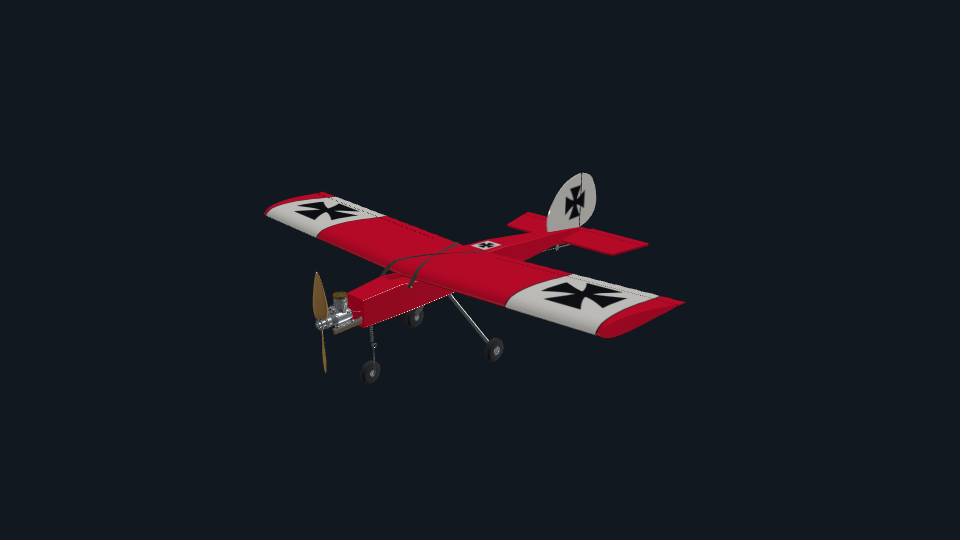
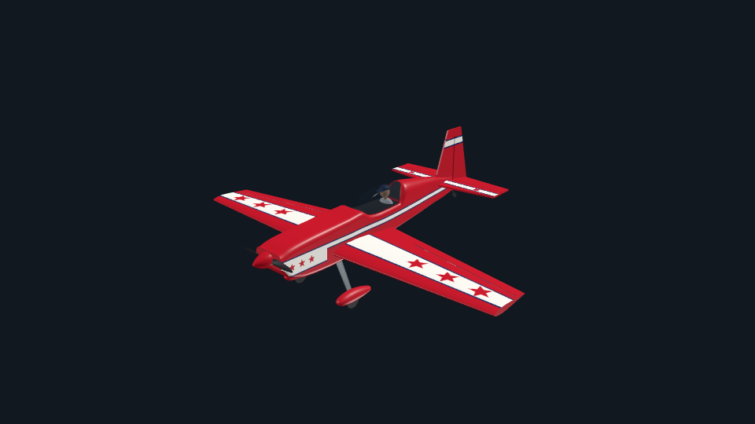
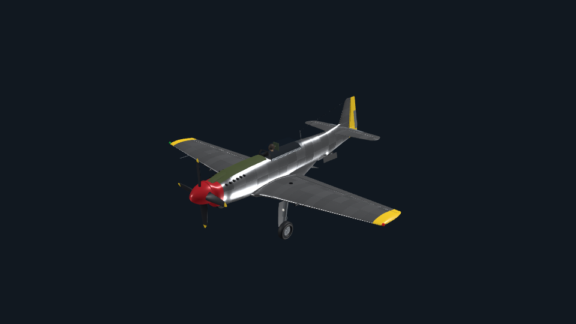
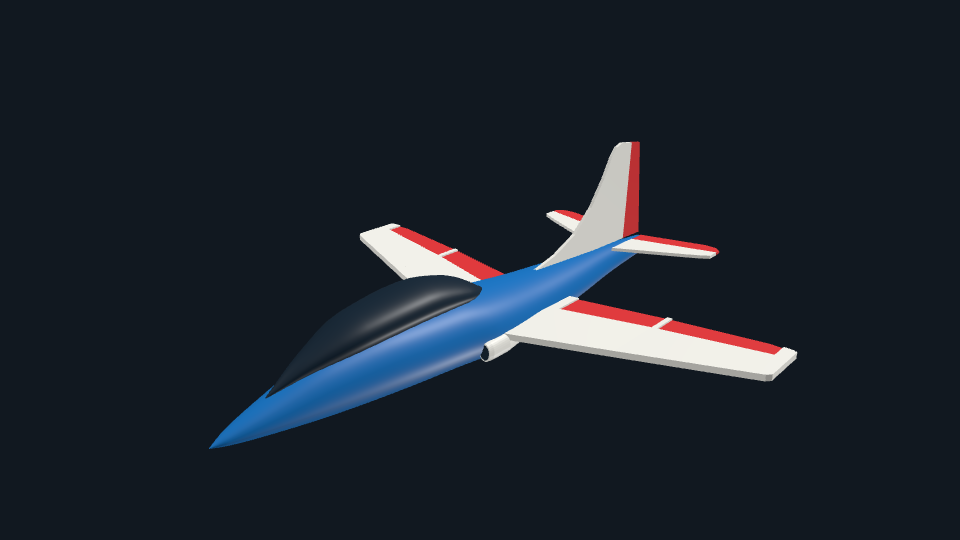

<h1 align="center">OpenRC Simulator</h1>

<p align="center"><strong>Practice RC flying from the pilot’s point of view.</strong><br>
An open-source airplane simulator for your USB radio, gamepad or keyboard.</p>

<p align="center"><strong>Windows · macOS · Linux</strong> &nbsp; | &nbsp; English · Español<br>
<sub>Early alpha. Flight models are still under evaluation.</sub></p>

<p align="center">
  <a href="#your-first-flight">First flight</a> · <a href="#aircraft-hangar">Aircraft</a> ·
  <a href="#help-shape-the-flight-model">Pilot feedback</a> · <a href="#for-developers-and-contributors">Develop & contribute</a>
</p>

## Download and fly

**Published alpha: [v0.1.0-rc6](https://github.com/bultodepapas/OpenRCsimulator/releases/tag/v0.1.0-rc6).** Pick your computer below. The ZIP contains the simulator; you do not need to install Godot or build anything.

<p align="center">
  <a href="https://github.com/bultodepapas/OpenRCsimulator/releases/download/v0.1.0-rc6/openrc-simulator-v0.1.0-rc6-windows-x86_64.zip"></a>
  <a href="https://github.com/bultodepapas/OpenRCsimulator/releases/download/v0.1.0-rc6/openrc-simulator-v0.1.0-rc6-macos-universal.zip"></a>
  <a href="https://github.com/bultodepapas/OpenRCsimulator/releases/download/v0.1.0-rc6/openrc-simulator-v0.1.0-rc6-linux-x86_64.zip"></a>
</p>

[All releases & release notes](https://github.com/bultodepapas/OpenRCsimulator/releases) · [First-launch help](docs/FIRST-LAUNCH.md#2-first-launch) · [SHA256 checksums](https://github.com/bultodepapas/OpenRCsimulator/releases/download/v0.1.0-rc6/SHA256SUMS)

These are unsigned test builds. If your operating system blocks the first launch, follow the platform instructions in the [first-launch guide](docs/FIRST-LAUNCH.md). Linux needs OpenGL 3.3 graphics; its executable is `openrc-simulator.x86_64`.

<p align="center">
  
  <br><sub>Actual simulator capture. Fly from the flight line or switch to the close-up camera.</sub>
</p>

## Your first flight

1. **Extract and launch** the download for your computer: `OpenRC Simulator.exe` on Windows, `OpenRC Simulator.app` on macOS, or `openrc-simulator.x86_64` on Linux (make it executable first).
2. **Choose the Ugly Stik** on Home and press **Fly**. It starts in the air, trimmed for level flight, so you can get comfortable with the controls.
3. **Fly a few gentle circuits.** Press **C** to switch camera, **Z** to toggle auto-zoom and **Esc** to pause. **R** starts a fresh flight.

Home and Help support **English and Spanish**. Menus use the keyboard or mouse, including when a radio is connected.

### Fly with your RC radio

Connect your transmitter in **USB joystick mode** before flying, with its RF modules off. Move the throttle stick to low to arm. If channels or directions are wrong, press **K** and follow the calibration steps with **Enter**. After calibration, move the throttle away from low and back to low to arm again. Unplugging the radio pauses the simulator.

For EdgeTX/OpenTX, start with USB Joystick **Advanced**, Interface **Joystick**, and at most eight axes. On Linux, Classic mode also exposes the radio as a gamepad. Mapping and calibration depend on your device; see the [radio setup guide](docs/FIRST-LAUNCH.md#3-fly).

<details>
<summary><strong>Keyboard controls</strong> — fly without a radio</summary>

Keyboard letters refer to physical QWERTY positions. In-game Help shows labels for your keyboard layout.

| Key | Action |
| --- | --- |
| ← / → | Aileron / roll |
| ↓ / ↑ | Elevator / pitch; ↓ pulls the stick back |
| A / D | Rudder |
| W / S | Increase / decrease throttle |
| Esc | Pause menu; cancel calibration |
| R | Restart flight |
| C | Pilot view / close-up camera |
| Z | Toggle auto-zoom |
| V | Ground shadow: sun / vertical / off |
| K · Enter | Start radio calibration · advance a step |
| P | Resume after a radio failsafe |
| T | Start / save a flight trace |
| F3 | Show / hide performance numbers |

</details>

## Aircraft hangar

<table>
  <tr>
    <td width="50%" align="center">
      <a href="docs/UGLY-STIK-PLAN.md"></a>
      <br><strong>Jensen Das Ugly Stik 60</strong>
      <br>High-wing sport trainer · 1.52 m · .61 glow
      <br><strong>Start here</strong> · Flight model under evaluation
    </td>
    <td width="50%" align="center">
      <a href="docs/EXTRA-300-PLAN.md"></a>
      <br><strong>Great Planes Extra 300S .60</strong>
      <br>Low-wing aerobat · 1.63 m · .61 glow
      <br><strong>Experimental</strong> · Physics estimated from plans
    </td>
  </tr>
  <tr>
    <td width="50%" align="center">
      <a href="docs/P51-PLAN.md"></a>
      <br><strong>P-51D Mustang 1/4</strong>
      <br>Giant-scale warbird · 2.82 m · 120 cc gasoline
      <br><strong>Experimental</strong> · Physics scaled from full size
    </td>
    <td width="50%" align="center">
      <a href="docs/AVANTI-S-PLAN.md"></a>
      <br><strong>SebArt Avanti S</strong>
      <br>Sport jet · 2.00 m · JetCat P100-RX
      <br><strong>Experimental</strong> · Airborne start, flaps & gear up
    </td>
  </tr>
</table>

The models have automated software checks; they have **not been validated against real RC flight**. [Aircraft sources and image provenance](docs/media/README.md).

<details>
<summary><strong>Watch the aircraft tour</strong></summary>

<p align="center">
  
  <br><sub>Godot studio renders of the four aircraft. This camera tour does not show flown maneuvers.</sub>
</p>

</details>

## What you can try

The alpha includes six-axis flight, stalls and spins, propeller torque, gyroscopic effects, servos, engine sound, wheel contact and experimental landings. Pilot view, auto-zoom and the ground-shadow aid help you follow the airplane. A hull strike or numerical fault triggers crash recovery; trees and field props remain visual scenery without collisions.

**Coming in rc7 / available from source:** an experimental Stik runway start, adjustable wind and gusts, seeded turbulence, temperature/pressure/humidity settings, and selectable daylight, dusk and night. Home’s **Weather** and **Time of day** controls let you change the conditions; **Evening, time passing** advances the visual sky during flight. Night flying adds moonlight, stars, field lamps and an experimental aircraft light kit. The default is airborne flight in Day with calm/reference weather.

Practice presets are authored conditions, not measured weather at your club. Takeoff/landing behavior, night readability and real-hardware performance still need pilot testing. See the [release notes](docs/releases/) for exactly what is included in each download.

## Help shape the flight model

**RC pilots are especially welcome.** Start with the Stik and compare a circuit, roll, loop, stall or spin recovery with an aircraft you know. Tell us which maneuver you flew, what you commanded and what felt different. A short, specific observation is useful.

- **Handling:** aircraft, build version, radio/controller, maneuver and real RC model used for comparison. Press **T** to record a trace if you can.
- **Visibility:** screenshot, screen resolution, approximate distance and whether auto-zoom (**Z**) was on.
- **Setup or performance:** operating system, radio/firmware/USB mode, graphics hardware and symptoms. [Diagnostic instructions](docs/FIRST-LAUNCH.md#5-measure-frame-times-for-the-landscape-work) cover frame times and controller reports.

[**Send RC pilot feedback**](https://github.com/bultodepapas/OpenRCsimulator/issues/new?template=pilot_feedback.md) · [Report a bug](https://github.com/bultodepapas/OpenRCsimulator/issues/new?template=bug_report.md) · [Contribution guide](CONTRIBUTING.md)

---

## For developers and contributors

The simulator is the **Godot 4.7.2 app in `app/`**. Simulation runs at a fixed 240 Hz with 64-bit scalar state; rendering converts at the boundary. Aircraft data carries units, evidence kind and source. The three.js prototype is archived.

<p><a href="https://github.com/bultodepapas/OpenRCsimulator/actions/workflows/ci.yml"></a></p>

### Run from source

On Linux, with Git, Python 3, curl and unzip:

```sh
git clone https://github.com/bultodepapas/OpenRCsimulator.git
cd OpenRCsimulator
app/get-godot.sh
"$(app/get-godot.sh)" --headless --path app --import
"$(app/get-godot.sh)" --path app
```

The helper downloads the pinned, SHA-512-verified engine into `.tools/`; the final command needs a display. On Windows or macOS, open `app/project.godot` with **Godot 4.7.2** and run the project.

| Task | Command |
| --- | --- |
| Full headless app checks | `app/test.sh` |
| Offline measurement-tool regressions | `research/test-tools.sh` |
| Rendered captures; requires Xvfb/Mesa | `app/capture.sh` |
| Three-second flight trace | `"$(app/get-godot.sh)" --headless --path app -- --trace=/tmp/flight.csv --t=3` |
| Windows, Linux and macOS packages | `app/export.sh` |

Exports go to `dist/`, with `SHA256SUMS` and a `git describe` build identity. The first export downloads about 1.28 GB of verified templates. [Tool workflows](docs/TOOLS.md) list the complete commands and prerequisites.

### Make a useful contribution

Pick a small step in the [roadmap](ROADMAP.md), read the [contribution guide](CONTRIBUTING.md) and follow the ownership rules in [AGENTS.md](AGENTS.md). Reproducible fixes, aircraft measurements, licensed references, controller reports and native-platform testing all help. Preserve sources, label estimates and include the proof for your change. Development is AI-assisted; sources, review and evidence are still required.

| Explore | What you will find |
| --- | --- |
| [`app/`](app/) | Flight physics, aircraft data, controls, UI, rendering and tests |
| [`assets/`](assets/) | Aircraft source data, generators and asset provenance |
| [Documentation map](docs/README.md) | Plans, ownership and evidence navigation |
| [`research/`](research/) · [`tools/`](tools/) | Reproducible experiments, measurements and asset tools |
| [Research index](docs/research/README.md) | Findings and sources retained for future work |

[Roadmap](ROADMAP.md) · [Architecture decisions](DECISIONS.md) · [Stack](STACK.md) · [Practical lessons](LEARNINGS.md)

## License

Project code is [MIT licensed](LICENSE). Third-party assets retain their own licenses; see [landscape provenance](assets/landscape/PROVENANCE.json) and the [bundled tree license](app/assets/landscape/trees/LICENSE.txt). Locally retained reference plans/scans with unclear redistribution rights are not bundled.
