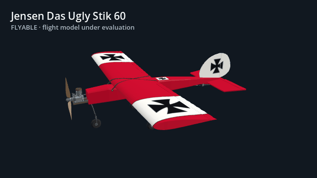
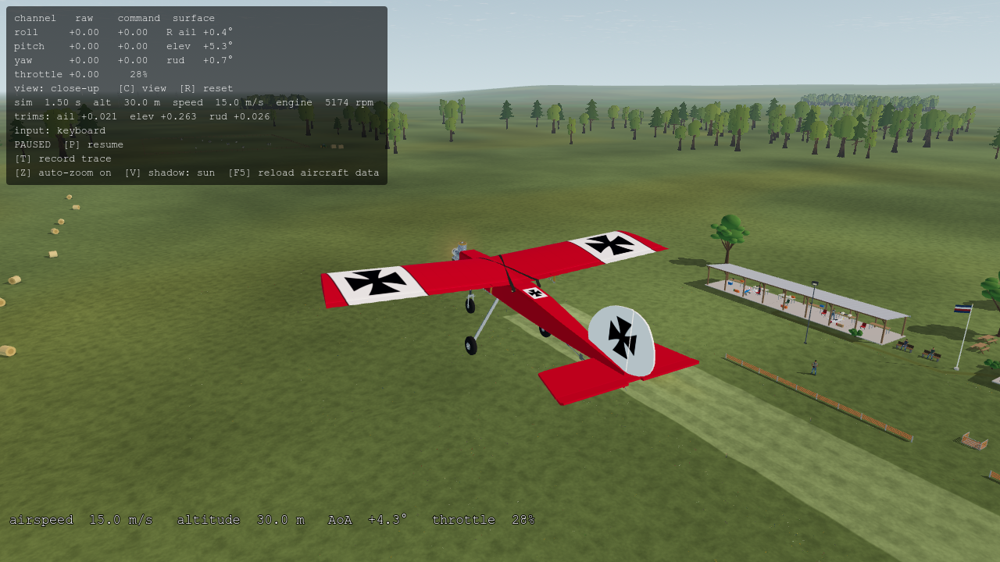
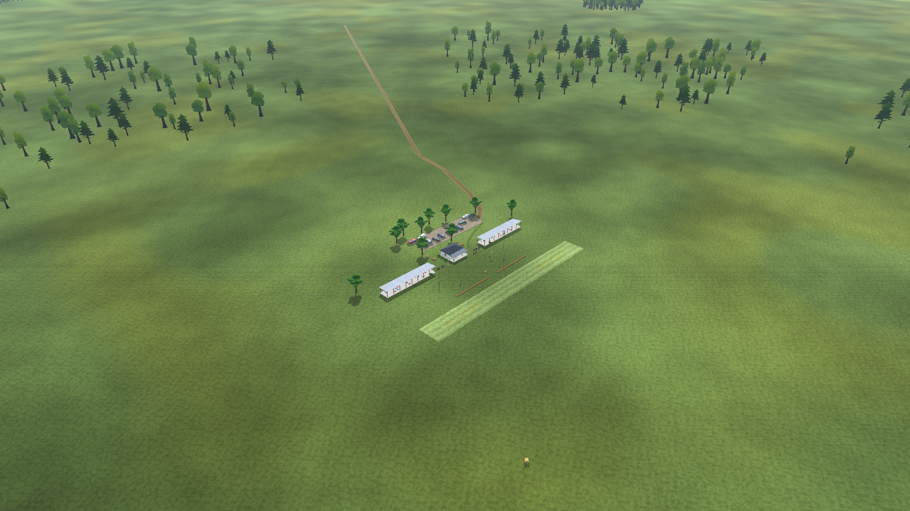
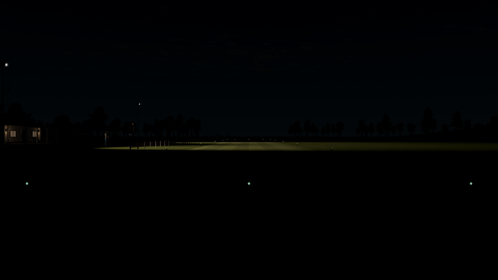

# OpenRC Simulator

> [!NOTE]
> **Thank you, OpenAI, for supporting open source.**
>
> I'm grateful to [OpenAI](https://openai.com/) for providing a **ChatGPT Pro subscription** to support my open-source projects, including OpenRC Simulator. That support gives me more room to build, experiment and share this work with the RC community.
>
> **AI development contributor:** [Codex by OpenAI](https://openai.com/codex/).

An open-source RC airplane simulator for a USB transmitter, gamepad or keyboard. Fly from the pilot's position on the field, or use chase, orbit and close-up views. **Early alpha:** automated checks verify the software; flight models still need independent RC measurements and pilot validation.

The five aircraft shown from changing angles. [Still views and render provenance](docs/media/README.md#aircraft-stills).

## Download and fly

[Download v0.1.0, the first official release](https://github.com/bultodepapas/OpenRCsimulator/releases/tag/v0.1.0) for Windows, Linux or macOS. Extract the ZIP and launch the executable. Godot is not required for a downloaded build. Packages are unsigned; see the [first-launch guide](docs/FIRST-LAUNCH.md) for platform setup, controls, radio calibration and diagnostics.

**First flight:** new Home preferences start on the Stik runway with gentle wind and passing evening; saved choices take precedence. Select **Airborne**, **Calm** and **Day** for trimmed airborne practice. [Player guide and controls](docs/FIRST-LAUNCH.md).

The downloads contain the **v0.1.0 snapshot**, an official early-development release. The features and aircraft below describe current source and may include later changes. See the [v0.1.0 release notes](docs/releases/v0.1.0.md) for the packaged build.

## Aircraft

| Aircraft | Configuration | Status |
| --- | --- | --- |
| [Jensen Das Ugly Stik 60](docs/UGLY-STIK-PLAN.md) | 1.52 m, .61 glow, tricycle gear | Reference model under evaluation; Home offers airborne or experimental runway start |
| [Great Planes Extra 300S .60](docs/EXTRA-300-PLAN.md) | 1.63 m, .61 glow, taildragger | Experimental |
| [P-51D Mustang 1/4](docs/P51-PLAN.md) | 2.82 m, 120 cc gasoline, taildragger | Experimental |
| [Ventage Jet](docs/AVANTI-S-PLAN.md) | 2.00 m, JetCat P100-RX turbine | Experimental; airborne, flaps and gear up |
| [Turbo Lumber Evolution](docs/TIMBER-INTEGRATION-PLAN.md) | 1.55 m, 800 Kv, 4S electric, fixed wheels | Experimental; airborne or runway start; flaps up, assists off |
| [RC Helicopter Research Trainer](docs/HELICOPTER.md) | X-Cell .60 SE flight reference with an HX-700 visual surrogate | Experimental; integrated hover trainer, physical validation remains open |

The five fixed-wing aircraft have flight data in current source. The helicopter uses a separate generated reference dataset and session. Ventage Jet starts airborne with its flaps and gear up. Turbo Lumber Evolution has an articulated imported model and its own electric sound; its motor losses and two-blade propeller map are estimated or borrowed, and its prescribed 4S bus does not model battery depletion.

## Current features

| Area | Available in current source |
| --- | --- |
| Flight physics | Fixed-wing aircraft use a custom float64 six-degree-of-freedom solver at 240 Hz, with trim, local aerodynamic loads, stalls/spins and servo dynamics. The experimental helicopter has a separate float64 body/rotor/wake session. Recent fixed-wing work includes [wing/tail pitching corrections](docs/research/aero-consistency/E0a2c/README.md) and [Stik ground effect](docs/research/ground-effect/M5-GE-1/README.md). [Aircraft contract](AIRCRAFT_CONTRACT.md) · [Helicopter limits](docs/HELICOPTER.md) |
| Propulsion | Glow and gasoline propellers, coupled electric motor/ESC/battery models, and a spooling turbine. Torque, gyroscopic effects, P-factor and propwash are enabled by aircraft data where configured. [Propulsion](docs/PROPULSION-CORE-PLAN.md) · [Electric models](docs/ELECTRIC-PROPULSION-PLAN.md) |
| Ground handling | Airplane gear models per-wheel spin, suspension, steering, rolling resistance and tire slip/grip over maintained and rough grass. Home offers experimental runway starts for the Stik and Turbo Lumber Evolution. [Ground model](docs/research/ground-physics/GP-05/README.md) |
| Controls | USB radio/gamepad input, saved calibration, throttle arming and disconnection failsafe. Keyboard/gamepad sticks use aircraft-specific normal rates and expo; radios retain their own settings. [Controls and radio setup](docs/FIRST-LAUNCH.md#3-fly) |
| Cameras | Ground pilot, chase, mouse-controlled orbit and close-up views, manual zoom, auto-zoom and a ground-shadow aid. **C / Shift+C** cycle views; right-drag rotates the orbit camera. [View controls](docs/FIRST-LAUNCH.md#3-fly) |
| Flight overlays | Separate flight data, transmitter sticks/trims, warnings, wind, telemetry, diagnostics and performance panels. **F2** cycles presets; Pause → Flight overlays selects panels, units and transmitter Mode 1/2. [Overlay guide](docs/plans/flight-overlays.md) |
| Weather and sky | Editable physical wind, repeating gusts, seeded turbulence, field elevation, temperature, QNH and humidity. Separate sky profiles add cloud motion and electrical-storm presentation; they do not add spatial storm forces. Restart repeats selected flight conditions. [Wind](docs/WIND-PLAN.md) · [Atmosphere](docs/ATMOSPHERE-PLAN.md) · [Field world](docs/FIELD-WORLD-PLAN.md#sky-and-cloud-controls) |
| Lighting | Day, dawn, dusk, night and passing evening, with editable time/date/location. Soft Club/Airfield/Off field lighting, a separate optional campfire, stars and moonlight support night practice. Visual time remains separate from physical weather. [Time of day](docs/TIME-OF-DAY-PLAN.md) · [Field world](docs/FIELD-WORLD-PLAN.md#night-field-and-campfire) |
| Field and scenery | Detailed turf and near grass, imported vegetation, a finite lake, trees and horizon, club buildings, parked aircraft, textured vehicles, people, birds, sun glare and night lighting. Contacts and terrain remain engineering models; water impacts do not simulate buoyancy. [Landscape status and evidence](docs/LANDSCAPE-PLAN.md#landscape-integration) |
| Audio | Positional combustion, electric and turbine voices, propeller/airframe sound, wind, foliage and wildlife. Doppler follows aircraft and listener motion; PCM loop continuity has been repaired. [Audio](docs/AUDIO-PLAN.md) · [Recent audio work](docs/plans/audio-realism.md) |
| Smoke | Faint Stik glow exhaust plus an optional white smoke trail, drifting with the configured wind. **H** toggles the pump on keyboard; **J** assigns a radio AUX control. [Smoke feature](docs/SMOKE-PLAN.md) |
| Collisions and crashes | Approximate tree/prop/building collision proxies, severity-dependent wrecks, debris, marks, fire/smoke and crash audio. Lightweight scenery and fence pieces can break; major structures remain. The aftermath persists until Restart. [Crash scope](docs/CRASH-DAMAGE-PLAN.md) |
| Menus and settings | English/Spanish Home and Help, saved aircraft/weather/lighting choices, pause on focus loss, Aircraft Workshop trials, Natural Random briefings and optional fixed-wing emergency practice. [Player guide](docs/FIRST-LAUNCH.md) · [Workshop](docs/AIRCRAFT-WORKSHOP.md) · [Natural Random](docs/plans/natural-random-flight.md) · [Failure practice](docs/plans/failure-mode.md) |
| Recording and diagnostics | Fixed-wing and helicopter traces/checkpoints, experimental RC truck recording, controller reports, frame-time/physics benchmarks, a filmed-latency marker and deterministic captures. [Tools and commands](docs/TOOLS.md) |

Takeoff/landing calibration, controller compatibility, target-machine performance and pilot readability still require acceptance. Collision proxies, damage thresholds and wreck deformation are engineering estimates; flyable aircraft structural damage remains unimplemented. The [roadmap](ROADMAP.md) records the remaining gates.

| Field by day | Runway at night |
| --- | --- |
|  |  |

These are unedited Godot captures from the [landscape verification](docs/research/landscape-upgrade/LU-21/README.md).

## Other experimental activities

- **RC monster truck:** an experimental Bisonte MT8 garage and driving course are integrated, with separate vehicle physics and replay. Physical accuracy and target-machine performance remain unqualified. [Operating and research guide](research/rc-monster-truck/README.md)
- **FPV drone racing:** vehicle, controller and race-mode design/research are underway using the shared rotor foundations. A flyable drone and race mode are not yet implemented. [Drone track](docs/plans/drone-racing.md)
- Further aircraft, camera, audio, menu and desktop qualification remains in the [documentation map](docs/README.md#tracks-plans-and-step-ids).

## Develop and contribute

The simulator lives in `app/`, using pinned **Godot 4.7.2**, GDScript and the Compatibility renderer. Its own float64 flight solver runs at 240 Hz. `prototypes/stage0/three/` is the frozen platform bake-off.

Aircraft use the strict `openrc-aircraft v2` contract: quantities include units, evidence and sources, and invalid configurations are refused. Geometry and physics data are rebuilt through their source generators. Headless regression tests, golden flights, schema/trace checks, rendered captures and export smoke checks support incremental changes.

- [Setup, commands, tests and exports](docs/TOOLS.md)
- [Architecture and stack](STACK.md)
- [Documentation and ownership map](docs/README.md)
- [Contributing](CONTRIBUTING.md) · [Repository guidance](AGENTS.md)
- [Roadmap and acceptance gates](ROADMAP.md) · [Decisions](DECISIONS.md) · [Lessons](LEARNINGS.md)

For feedback, include build identity, aircraft, operating system and controller, then describe the maneuver or failure. [Pilot feedback](https://github.com/bultodepapas/OpenRCsimulator/issues/new?template=pilot_feedback.md) · [Bug report](https://github.com/bultodepapas/OpenRCsimulator/issues/new?template=bug_report.md).

## License

Project code is [MIT](LICENSE). Third-party assets retain their licenses; [landscape provenance](assets/landscape/PROVENANCE.json), [scenery provenance](assets/scenery/PROVENANCE.json), [field asset credits](app/assets/landscape/UPGRADE_CREDITS.md), [tree license](app/assets/landscape/trees/LICENSE.txt) and [media provenance](docs/media/README.md) identify retained sources. Reference scans with unclear redistribution rights are not bundled.
