

  <a href="https://openai.com/">
    <picture>
      <source media="(prefers-color-scheme: dark)" srcset="site/assets/brands/openai/OAI_OpenAI_Wordmark_White.svg">
      
    </picture>
  </a>

  <strong>Thank you, OpenAI, for supporting open source.</strong> 
  OpenAI provides a <strong>ChatGPT Pro subscription</strong> to support the maintainer's open-source projects, including OpenRC Simulator. 
  This in-kind support helps us build, experiment and share with the RC community. 
  <strong>AI development contributor: <a href="https://openai.com/codex/">Codex by OpenAI</a>.</strong>

---

  <a href="https://bultodepapas.github.io/OpenRCsimulator/?utm_source=github&utm_medium=referral&utm_campaign=readme&utm_content=hero">
    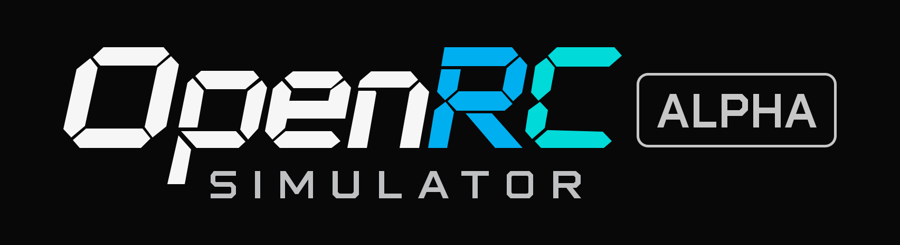
  </a>

# OpenRC Simulator

**An open-source flying field for RC pilots.** Connect your USB transmitter, pick an airplane and fly from the pilot's position. A gamepad or keyboard works too. Explore sport flying, warbirds, electric models and jets, with external cameras when you want a closer look.

**[Download and fly](#download-and-fly)** · **[Aircraft](#aircraft)** · **[Player guide](docs/FIRST-LAUNCH.md)** · **[Project website](https://bultodepapas.github.io/OpenRCsimulator/?utm_source=github&utm_medium=referral&utm_campaign=readme&utm_content=website)** · **[Supporters](#sponsors-and-supporters)** · **[For developers](#develop-and-contribute)**

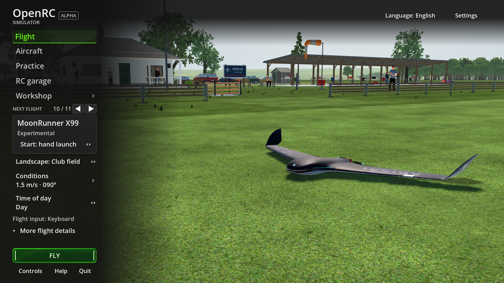

*Home with MoonRunner X99 under its former working name. All game images below were captured from the development build on **28 October 2026**, at **1920×1080**. [Capture details](docs/media/README.md#readme-gallery).*

> **Early alpha.** The simulator is being built with the RC community. Flight models still need independent measurements and pilot evaluation; automated tests do not establish real-aircraft accuracy.

## Download and fly

**Latest published release: [v0.1.8](https://github.com/bultodepapas/OpenRCsimulator/releases/tag/v0.1.8).** Download your ZIP, extract it and launch. You do **not** need to install Godot or compile anything.

| Platform | Download and launch |
| --- | --- |
| **Windows · x86_64** | [Download ZIP](https://bultodepapas.github.io/OpenRCsimulator/en.html?download=windows&release=v0.1.8&utm_source=github&utm_medium=referral&utm_campaign=readme&utm_content=download_windows#download) Open `OpenRC Simulator.exe`. |
| **Linux · x86_64** | [Download ZIP](https://bultodepapas.github.io/OpenRCsimulator/en.html?download=linux&release=v0.1.8&utm_source=github&utm_medium=referral&utm_campaign=readme&utm_content=download_linux#download) Run `openrc-simulator.x86_64`. |
| **macOS · Apple Silicon / Intel** | [Download ZIP](https://bultodepapas.github.io/OpenRCsimulator/en.html?download=macos&release=v0.1.8&utm_source=github&utm_medium=referral&utm_campaign=readme&utm_content=download_macos#download) Open `OpenRC Simulator.app`. |

[Checksums](https://github.com/bultodepapas/OpenRCsimulator/releases/download/v0.1.8/SHA256SUMS) · [Installation guide for this release](https://github.com/bultodepapas/OpenRCsimulator/blob/v0.1.8/docs/FIRST-LAUNCH.md) · [Release notes](docs/releases/v0.1.8.md). Archives are unsigned; the macOS app is ad-hoc signed, not notarized. The installation guide covers platform launch permissions. If a download does not start, use the [direct release assets](https://github.com/bultodepapas/OpenRCsimulator/releases/tag/v0.1.8).

**For your first flight:**

1. Select **Ugly Stick** and **Club field**.
2. Choose **Start: in the air**, **Calm** and **Day** for an uncomplicated start, or **Start: runway** to explore takeoffs and landings.
3. Check your controls, then press **Fly**. **Esc** pauses, **R** restarts and **C / Shift+C** changes the view.

### Bring your transmitter

| Controls | Getting ready |
| --- | --- |
| **USB RC transmitter** | Connect in USB joystick mode with RF modules off. Select the radio profile and calibrate using the guide for your build. After saving calibration, move throttle away from low and back to low to arm. Transmitter rates and curves remain yours. |
| **Gamepad** | Mapped pads have a Mode 2 starting layout. Check the displayed bindings and remap buttons as needed. |
| **Keyboard** | Arrow keys: pitch/roll; **A / D**: rudder; **W / S**: throttle. **Down** pulls back on the elevator. |

[v0.1.8 radio setup](https://github.com/bultodepapas/OpenRCsimulator/blob/v0.1.8/docs/FIRST-LAUNCH.md#radio-setup) starts calibration from Pause or **K** during flight; [current source](docs/FIRST-LAUNCH.md#radio-setup) also offers calibration from Home. [Controls, rates, trims and equipment](docs/FIRST-LAUNCH.md#3-fly). Controller compatibility depends on the device, firmware and operating system.

**The hangar and features below describe current source.** The published ZIP can lag behind: notably, **MoonRunner X99 is not in v0.1.8**. Use the release notes for what your download includes.

## Aircraft

Current source has **seven fixed-wing airframes and ten airplane configurations**. The Ugly Stik is the reference model; the other configurations are experimental. Click an aircraft for its guide, controls and modeling limits.

### MoonRunner X99

**2.12 m · 6S electric pusher · elevons · hand launch or airborne start.** MoonRunner X99 joins the current-source hangar as an experimental flying wing, with no landing gear. [Aircraft guide and asset terms](docs/X8-PLAN.md).

| MoonRunner X99 over Club field | MoonRunner X99 model close-up |
| --- | --- |
| 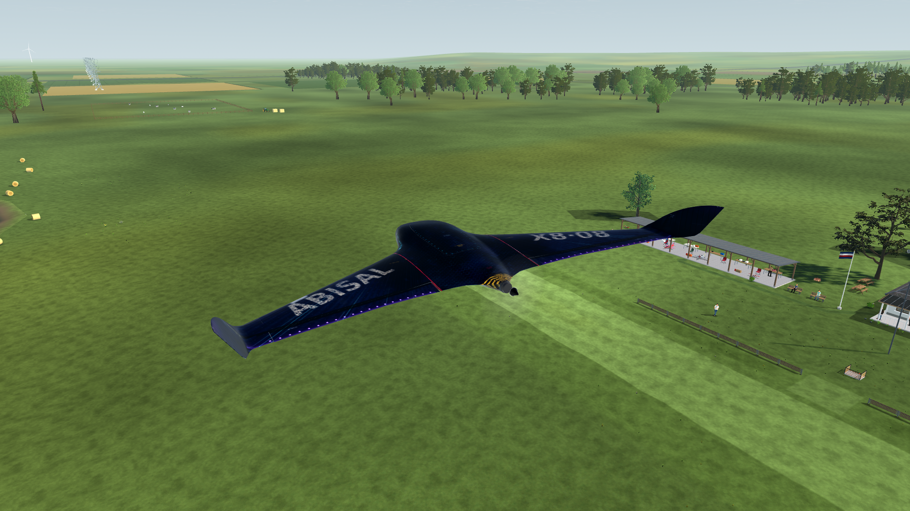 | 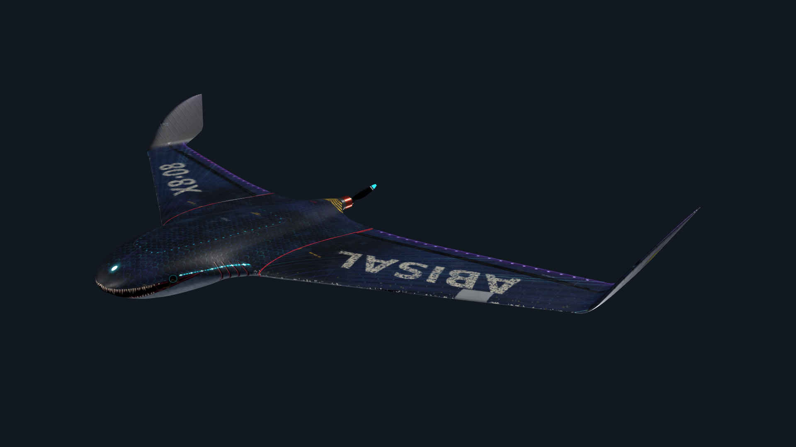 |

### Sport models, warbirds and jet

<table>
  <tr>
    <td width="33%" align="center" valign="top">
      <a href="docs/UGLY-STIK-PLAN.md">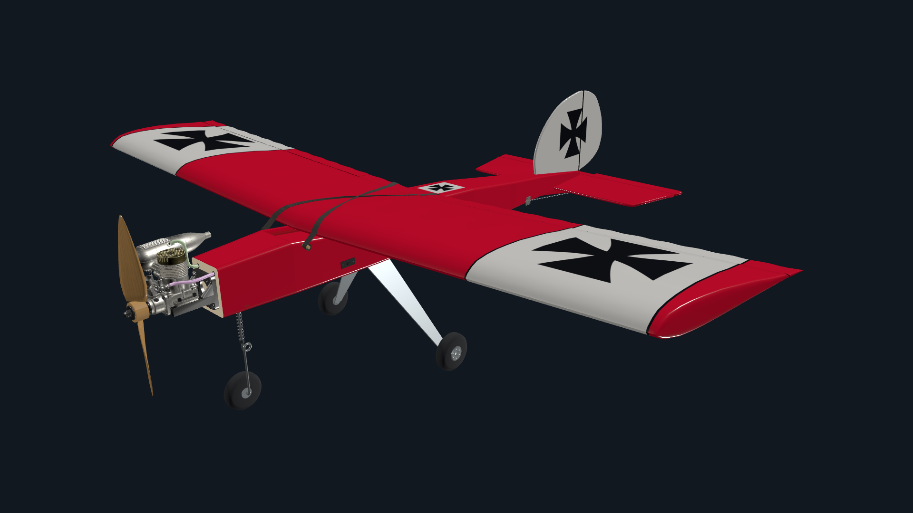</a> 
      <a href="docs/UGLY-STIK-PLAN.md"><strong>Jensen Das Ugly Stik 60</strong></a> 
      1.52 m · .61 glow · tricycle gear 
      The reference sport model.
    </td>
    <td width="33%" align="center" valign="top">
      <a href="docs/EXTRA-300-PLAN.md">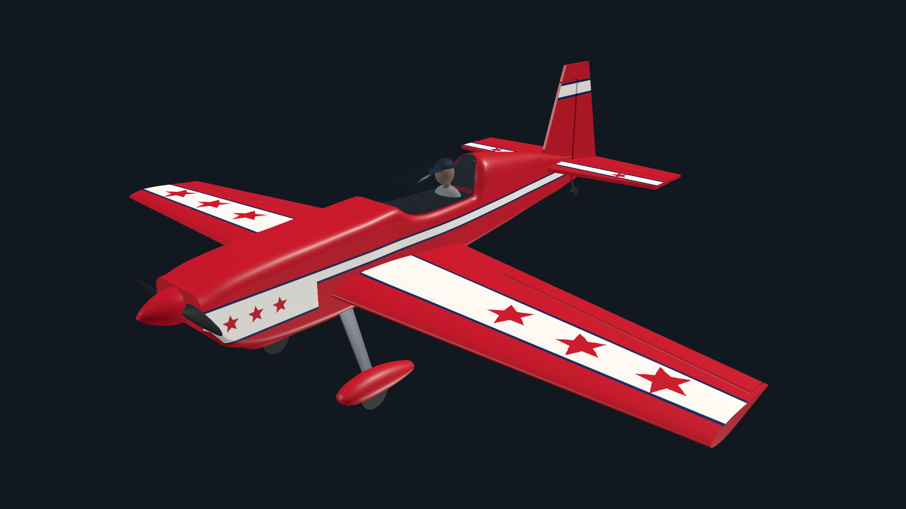</a> 
      <a href="docs/EXTRA-300-PLAN.md"><strong>Extra 300S .60</strong></a> 
      1.63 m · .61 glow · taildragger 
      An aerobatic airframe with finite fuel.
    </td>
    <td width="33%" align="center" valign="top">
      <a href="docs/TIMBER-INTEGRATION-PLAN.md">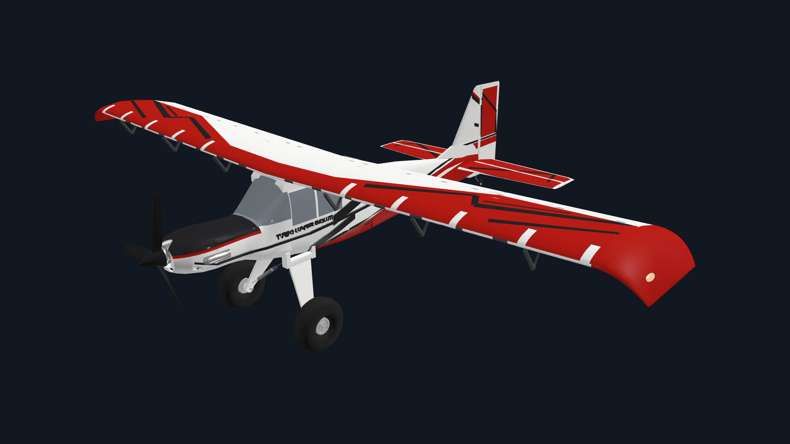</a> 
      <a href="docs/TIMBER-INTEGRATION-PLAN.md"><strong>Turbo Lumber Evolution</strong></a> 
      1.55 m · 4S electric · fixed wheels 
      Finite battery or optional ideal supply.
    </td>
  </tr>
  <tr>
    <td align="center" valign="top">
      <a href="docs/P51-PLAN.md">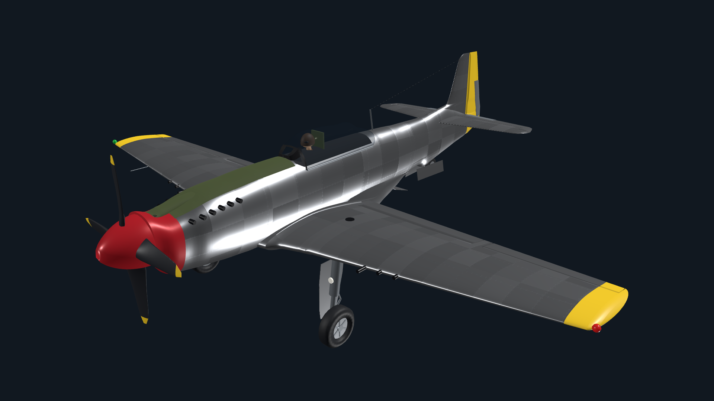</a> 
      <a href="docs/P51-PLAN.md"><strong>P-51D Mustang 1/4</strong></a> 
      2.82 m · 120 cc gasoline 
      Flaps and retractable taildragger gear.
    </td>
    <td align="center" valign="top">
      <a href="docs/F4U-PLAN.md">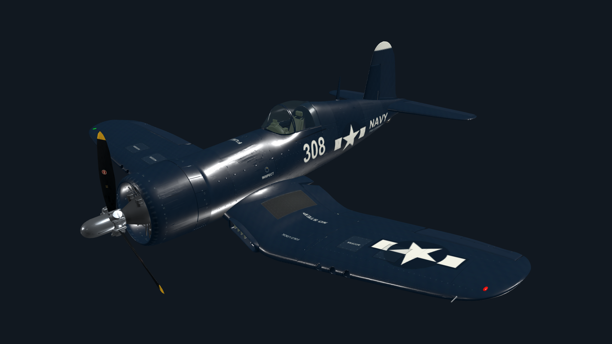</a> 
      <a href="docs/F4U-PLAN.md"><strong>F4U-1D Corsair 1/4.5</strong></a> 
      2.78 m · Moki S250 radial 
      Flaps, retracts, folding wings and 13 paint schemes.
    </td>
    <td align="center" valign="top">
      <a href="docs/AVANTI-S-PLAN.md">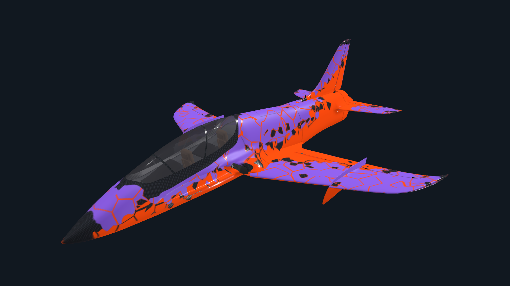</a> 
      <a href="docs/AVANTI-S-PLAN.md"><strong>Vantage Jet</strong></a> 
      2.00 m · JetCat P100-RX turbine 
      Spooling turbine, flaps and retracts.
    </td>
  </tr>
</table>

**More ways to fly the Stik:** three additional [O.S. glow installations](docs/GLOW-ENGINES.md) — MAX-61FX, MAX-55AX and FS-64V — share its airframe, with finite fuel and engine start, cut and mixture controls.

At **Club field**, geared airplanes offer runway or airborne starts. At **Green paradise**, they start airborne; MoonRunner X99 retains its hand-launch option. Aircraft equipment varies: use the in-game control guide for the selected model.

[Full-size model views and capture details](docs/media/README.md#aircraft-stills). Studio views show the current models; the MoonRunner X99 flight image comes from the running simulator.

## Current features

| For the pilot | What you can explore |
| --- | --- |
| **Fly from the flightline** | Ground-pilot, chase, fly-by, orbit and close-up cameras; manual/automatic zoom and a ground-shadow aid. |
| **Set up your controls** | Radio calibration, remapping, rates, trim, device-aware help and low-throttle arming. Disconnection pauses the flight for recovery. |
| **Manage the model** | Aircraft-specific flaps, retracts, brakes, glow-engine controls, fuel and electric batteries. Source/configuration determines which equipment is available. |
| **Change the conditions** | Wind, gusts, turbulence and atmosphere settings; separate day, dusk and night lighting. Restart repeats the selected conditions. |
| **Practice and review** | Optional trim and emergency practice, local flight statistics, flight overlays, and fixed-wing logs: **F10** records, **F11** marks a maneuver. [Flight logging](docs/FLIGHT-LOGGING.md) |
| **Hear and see the aircraft** | Positional engine/propeller sounds, field ambience, aircraft lights and supported exhaust/show-smoke effects. |
| **Choose the graphics** | Standard and optional High/Forward+ modes. Current source also has a separate [Windows NVIDIA build](tools/graphics/native/README.md) with DLSS, DLAA and Reflex; it is not the v0.1.8 download. |

The current interface offers **English, Español, 简体中文, Português (Brasil), Deutsch, Français, Italiano, Русский and 日本語**. The v0.1.8 download offers English and Spanish.

### Make a model your own

The experimental **Aircraft Workshop** lets you save local builds, adjust supported setup parameters, customize supported paint/smoke/lighting options and launch test flights. You can compare changes and export/import builds. Available adjustments depend on the aircraft.

| Appearance | Flight setup |
| --- | --- |
| 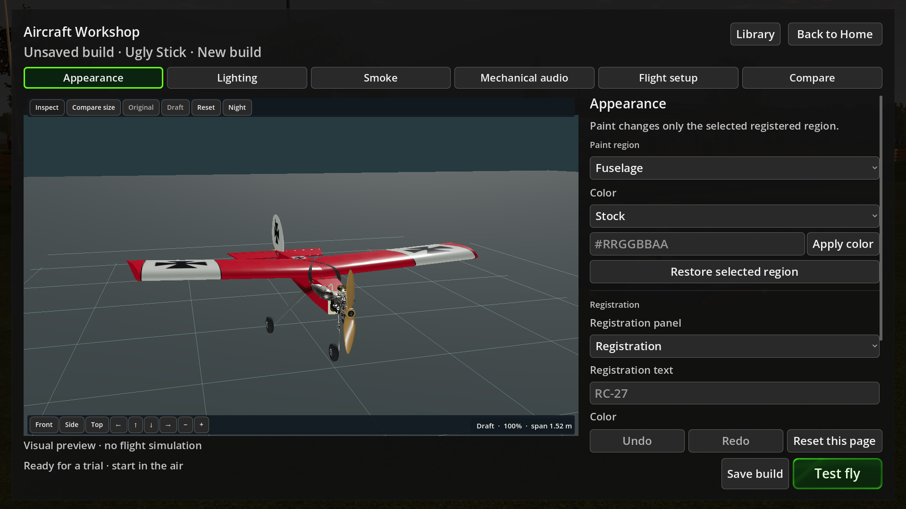 | 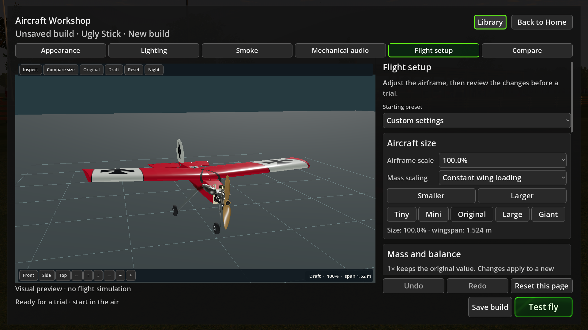 |

[Workshop guide](docs/AIRCRAFT-WORKSHOP.md) · [Supported adjustments](docs/AIRCRAFT-WORKSHOP.md#supported-adjustments). These tools explore simulated configurations; they do not certify a real build.

## Landscapes

**Club field** has the runway, flightline, vegetation, lake, buildings and night fixtures. **Green paradise** offers an open, flat grass surface without scenery obstacles or a lake. Select the landscape on Home; to change it after flying, return to Home first.

| Club field | Green paradise |
| --- | --- |
| 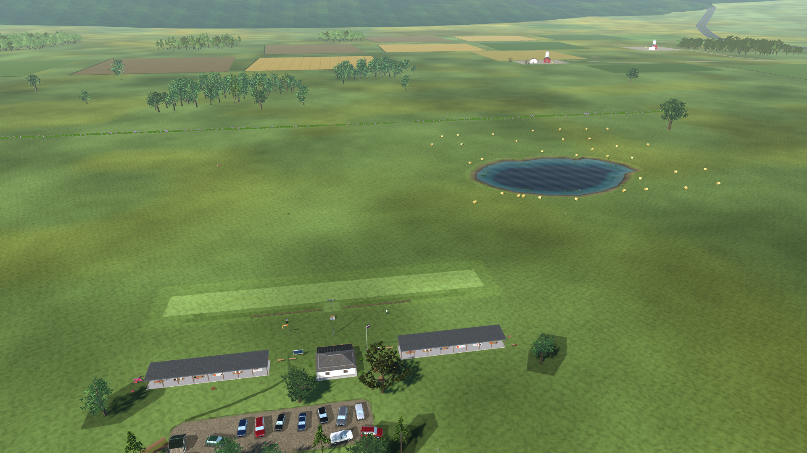 | 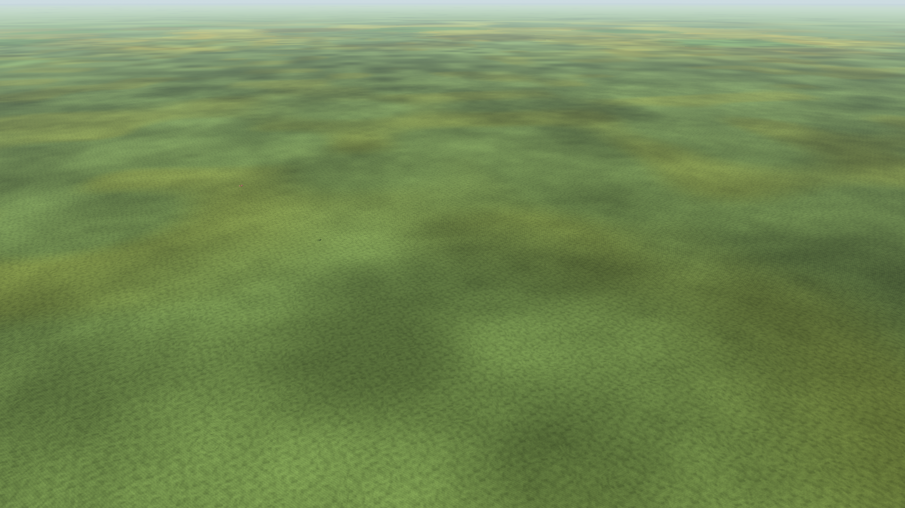 |

*Matching elevated views captured in the running simulator. Green paradise intentionally has no scenery obstacles.*

[Landscape guide](docs/LANDSCAPES.md) · [Weather](docs/WIND-PLAN.md) · [Time of day](docs/TIME-OF-DAY-PLAN.md). Natural Random briefings use Club field; RC-car courses are separate.

### Display targets

**1920×1080 is the primary development target** for clarity, visual quality and performance. Higher resolutions, including 1440p and 4K, come next; 720p is the fallback priority. These are targets, not a hardware-performance guarantee. [Resolution policy](AGENTS.md#display-resolution-priorities).

### Help shape the flight model

RC experience is especially valuable here. Tell us the build, aircraft, controller and operating system, then describe the maneuver, your inputs, expected response and observed response. A flight log with a maneuver marker makes feedback easier to investigate.

**[Send pilot feedback](https://github.com/bultodepapas/OpenRCsimulator/issues/new?template=pilot_feedback.md)** · **[Report a bug](https://github.com/bultodepapas/OpenRCsimulator/issues/new?template=bug_report.md)** · [How pilots can contribute](CONTRIBUTING.md#help-as-a-pilot).

Handling, takeoffs/landings, controller compatibility and target-machine performance still need evaluation. Collision and repair-cost models are estimates, and flyable structural damage remains unfinished. [Roadmap](ROADMAP.md).

## Other experimental activities

<table>
  <tr>
    <td width="33%" align="center" valign="top">
      <a href="docs/HELICOPTER.md">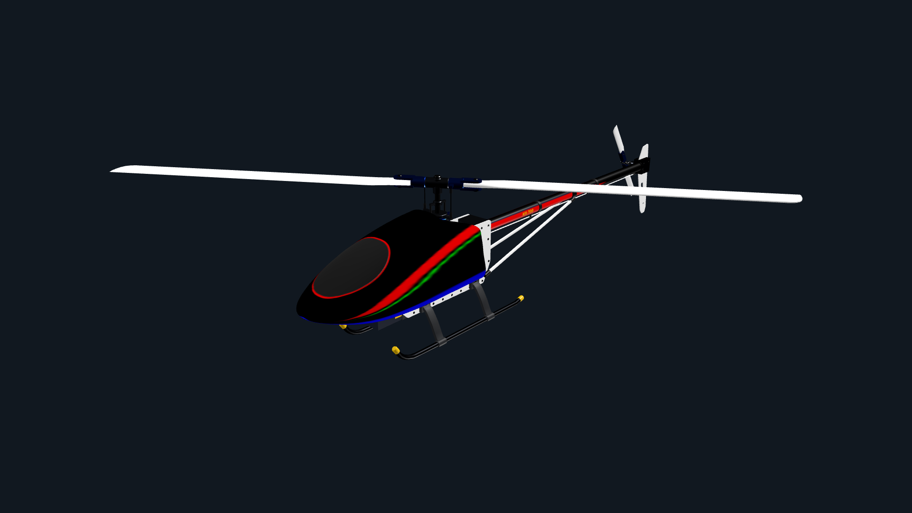</a> 
      <a href="docs/HELICOPTER.md"><strong>RC Helicopter Research Trainer</strong></a> 
      X-Cell .60 reference physics with HX-700 surrogate visuals. Ground-pad or hover starts.
    </td>
    <td width="33%" align="center" valign="top">
      <a href="research/rc-monster-truck/README.md">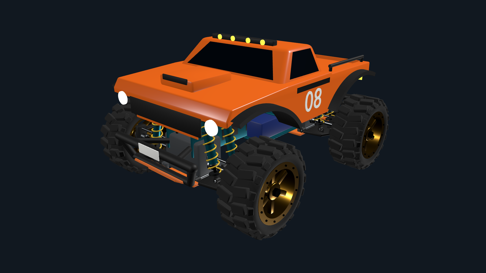</a> 
      <a href="research/rc-monster-truck/README.md"><strong>Bisonte MT8</strong></a> 
      A separate RC garage and driving course, with keyboard or gamepad controls.
    </td>
    <td width="33%" align="center" valign="top">
      <a href="research/rc-monster-truck/README.md">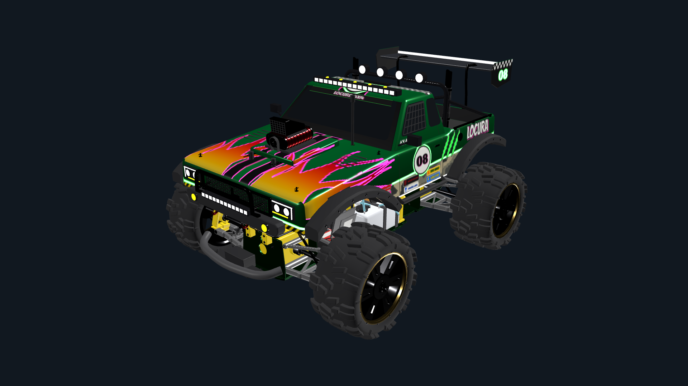</a> 
      <a href="research/rc-monster-truck/README.md"><strong>MONSTER CAR 2</strong></a> 
      The second truck adds nitro propulsion and fuel state.
    </td>
  </tr>
</table>

The advanced HX-700 helicopter candidate remains a laboratory project. [FPV drone racing](docs/plans/drone-racing.md) is also a research track; a playable drone and race mode are not yet available.

## Sponsors and supporters

[OpenAI's development support](#development-support) helps sustain this work. The acknowledgments below describe each manufacturer's or community partner's contribution.

### Partners

Thank you to the manufacturers who have granted permission for product representations. Their permissions have specific scopes; integration may still be pending.

| Savox | SonicModell |
| --- | --- |
| <a href="https://www.teamsavox.com/"><picture><source media="(prefers-color-scheme: dark)" srcset="site/assets/brands/savox/TeamSavox-Logo-Mono-White.png"></picture></a> |  |
| Product representations authorized; [servo catalogue integration planned](docs/plans/savox-servos.md). | Appearance, names and branding for the covered models, including Skyhunter models; integration pending. |

| Hitec RCD | FLYWING |
| --- | --- |
|  |  |
| Published servo products may be featured with official product links; integration pending. | Names, simplified exterior models and real color schemes within the agreed terms; models pending. |

Further permissions cover **[GEMFAN](https://www.gemfanhobby.com/)** propeller names/representations and **[KONTRONIK](https://www.kontronik.com/)** independently recreated product models. **[Leomotion Drives](https://www.leomotiondrives.com/)** permits selected representations with render approval before publication. These integrations are pending.

Manufacturer permissions do not imply financial sponsorship or validation of the flight models. [Permission scopes, conditions and logo sources](site/BRANDS.md) remain authoritative.

### Community support

Thank you to **REVOC Custom** for its community-supporter acknowledgment and to **[Aloft Hobbies](https://alofthobbies.com/)** for sharing the project and offering knowledge and feedback. These acknowledgments do not promise funding, hardware or product-representation rights.

Pilot reports, real-world measurements, translations, licensed assets and development time all help. [Ways to contribute](CONTRIBUTING.md).

---

## Develop and contribute

The production application is in **`app/`**. Start with [developer setup](docs/TOOLS.md#developer-setup), then choose the relevant [tool and verification workflow](docs/tools/README.md). The documentation map and source define what is implemented; plans describe remaining work.

### Technologies

| Layer | Current source |
| --- | --- |
| **Engine and application** | Pinned official **Godot 4.8-beta1** prerelease; **GDScript** for the application and reference simulation. This differs from the engine in v0.1.8. |
| **Flight dynamics** | Custom **float64**, six-degree-of-freedom rigid-body kernel, **RK4** and fixed **240 Hz** ticks. Vehicle-specific laws enter through `VehicleModel`. |
| **Native evaluation** | In-house **C++ / GDExtension** backends with GDScript reference/fallback paths. [NK-3 selection and qualification](research/native-kernel/README.md#normal-flight-backend-selection) |
| **Rendering** | Godot Compatibility/OpenGL and optional Forward+; [graphics modes](tools/graphics/README.md) own reconstruction options and platform limits. |
| **Aircraft and assets** | Validated `openrc-aircraft v2` data with units, evidence and sources; **Python** source generators and **Blender / glTF** asset pipelines. |
| **Verification and delivery** | Headless tests, golden flights, exact replay, schema/trace checks, rendered captures and **GitHub Actions** package checks for Windows, Linux and macOS. |

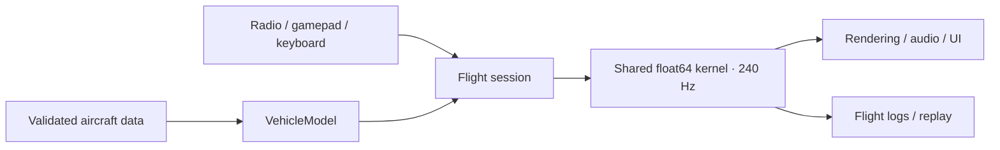

[Architecture and boundaries](docs/STACK.md) · [Aircraft authoring contract](docs/AIRCRAFT_CONTRACT.md). Simulation state stays separate from rendering, and generated data is rebuilt through its owning pipeline.

| I want to… | Start here |
| --- | --- |
| Fix a bug or improve a feature | [Contributing](CONTRIBUTING.md) · [Repository guidance](AGENTS.md) |
| Add or refine an aircraft | [Aircraft contract](docs/AIRCRAFT_CONTRACT.md) · [Asset sources](assets/source-deliveries/README.md) |
| Create a landscape | [Landscape authoring](docs/LANDSCAPES.md) |
| Run tests, captures or exports | [Tool index](docs/tools/README.md) · [Release workflow](docs/TOOLS.md#release-sequence) |
| Find a track or understand a decision | [Documentation map](docs/README.md) · [Roadmap](ROADMAP.md) · [Decisions](docs/DECISIONS.md) · [Lessons](docs/LEARNINGS.md) |

The three.js experiment in `prototypes/stage0/three/` is a frozen platform comparison; it is not the production simulator.

## License

Project code is [MIT](LICENSE). Models, recordings, brand marks and other assets keep their own terms: [aircraft permissions](docs/AIRCRAFT-LICENSING.md), [landscape provenance](assets/landscape/PROVENANCE.json), [scenery provenance](assets/scenery/PROVENANCE.json), [field credits](app/assets/landscape/UPGRADE_CREDITS.md), [tree license](app/assets/landscape/trees/LICENSE.txt) and [media provenance](docs/media/README.md). Reference scans with unclear redistribution rights are not bundled.
