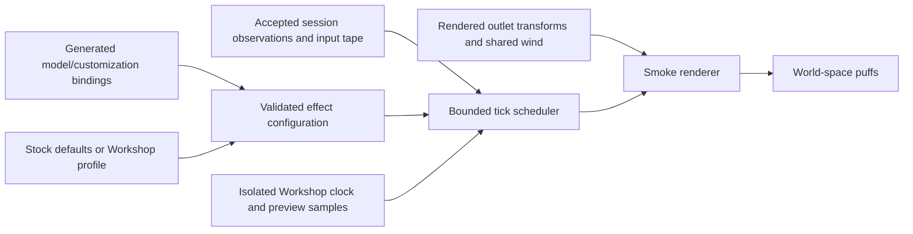

# Aircraft smoke system master plan

**Date:** 2026-10-20 (America/Bogota). **Status:** implementation authorized by the user and core overhaul delivered; rollout qualification remains open. **Owner:** SM, with AS (aircraft bindings), AE (Workshop), M5 (weather), VQ/DT (rendering/performance), aircraft owners and propulsion owners. **Work packages:** SM-16–SM-25. See the implementation status below; the original investigation and acceptance targets remain the baseline.

## Implementation status — 2026-10-20

Current behavior is documented in [SMOKE.md](docs/SMOKE.md). [SM-16–23 evidence](docs/research/smoke-investigations/SM-16-23/README.md) records source receipts, checks, captures and measurement limits. No physics solver or aircraft flight data was changed for smoke.

| Phase | Delivered implementation | Remaining acceptance |
| --- | --- | --- |
| SM-16 | Pre-change source receipt, 62 legacy checks, 36 profile checks and 27 native capture checks retained. | Target hardware and complete visual-budget qualification. |
| SM-17 | V2 profiles, v3 bindings, stable engine/outlet IDs, strict readers and ten-path source proofs; shared-engine/multiple-outlet fixtures. | Every supported package and fresh checkout. |
| SM-18 | Shared stock/Workshop runtime, accepted source/load tapes, fractional displayed-pose clock, explicit empty precedence and lifecycle gates. | Fleet native visual review; legacy comparison remains available. |
| SM-19 | Existing lit soft billboards retained; v2 expansion/dilution and current-buffer lifetime ordering improve dissipation and outlet attachment without a new draw pass or asset dependency. | Dense overlap, night/water intersections and full visual preference review. No atlas benefit is claimed. |
| SM-20 | Bounded coherent world curl, exponential entrainment, independent jet/wash, safe direction sweep, smooth birth colors and scaled bore. | Broader 3D/wind/fast-pass visual matrix and cost attribution for accepted-tick wash sampling. |
| SM-21 | Demand allocation, four active emitters/768 slots, reused event buffers, cached mounts, residual sleep and LOD hysteresis. Six historical paired timing runs retained; final-source timing was blocked by storage exhaustion. | Repeat on an isolated host, attribute measured cost, then qualify worst-case projected overdraw and full scene budget. |
| SM-22 | Existing Workshop controls extended, color picker/hex, palette transitions/offset, per-emitter copy, Stop/Pause/Restart, residual framing, EN/ES labels. | 200% text scale and independent user task review. |
| SM-23 | Eight fixed-wing configurations resolve shared outlet contracts; Stik/P-51 stock migrate to common renderer; helicopter reports explicit unavailable capability. V1 migration proposes a new revision with a report. | Extra exhaust authoring; HX-700/X-Cell engine/outlet pairing; stale saved builds require their original companion and explicit migration. |
| SM-24 | Focused software and native Compatibility checks retained; 50 isolated native lifecycle cycles passed with stable post-release object/node/resource counts. | 50 complete Home/flight cycles, 30-minute soak, complete platform/controller/hardware and pilot acceptance; remove legacy only afterward. |
| SM-25 | Canonical authoring/onboarding and reproducible smoke tools updated. | Fresh-checkout onboarding and final consolidation after qualification. |

## 1. Outcome, scope and evidence

Evolve the existing GPU puff renderer into one reusable, bounded aircraft smoke service. Stock exhaust, optional airshow smoke and Workshop profiles must use the same authored outlets, accepted source observations, scheduler, motion model and renderer. Improve plume structure, coherent movement, dissipation and controllability without replacing the flight solver, renderer or Workshop.

The intended result is convincing RC exhaust and expressive game effects: independent emitter colors, continuous or stepped palettes, pulses, broad clouds, narrow trails and unusual color combinations. Engine-derived effects must remain credible for the actual installation. Decorative effects must be clearly identified as show smoke. Neither is a smoke-fluid simulation.

The original planning audit was grounded in the working tree, including existing uncommitted work, at Git HEAD `51ad43579850b1890fc21e0f5559ef8e67976899`. HEAD alone does **not** identify the reviewed source. That baseline already contained edits to `main.gd`, customization bindings, Workshop files and smoke documentation, plus untracked stock-profile work. The retained baseline source receipt identifies those bytes separately from the implementation and measurement receipts.

Repository graph discovery was attempted first; the indexed graph did not cover the current smoke implementation. Current files were then inspected directly. The local executable reports **`4.7.2.stable.official.ed1daf0bf`** with `--version`. [The downloader](app/get-godot.sh) pins 4.7.2-stable and its Linux archive SHA-512. [Project settings](app/project.godot) select **`gl_compatibility`**, 1280×720 and 4× MSAA. Official 4.7 documentation and the 4.7.2 GLES3 source were checked; see the dated investigations in §10. Do not substitute Forward+ examples or silently upgrade Godot.

The original planning review inspected existing captures, code and recorded evidence; implementation checks are recorded separately in the evidence linked above. Every numerical acceptance target below is a requirement, not a claimed result. Existing screenshots show a readable thin flight trail and faint close exhaust, but still images cannot establish turbulence quality or frame pacing.

Keep [SMOKE.md](docs/SMOKE.md) authoritative for current behavior, [SMOKE-PLAN.md](docs/SMOKE-PLAN.md) for existing SM-00–15 acceptance, and [AIRCRAFT-WORKSHOP.md](docs/AIRCRAFT-WORKSHOP.md) for current editor behavior. This file owns the proposed overhaul sequence. SM-16 must register its link and new IDs in the [ownership registry](docs/README.md#tracks-plans-and-step-ids), coordinating edits with current owners; do not duplicate delivered-step status. When the overhaul finishes, consolidate its operating contract and evidence links into those guides and remove superseded planning material under the repository conventions.

## 2. Baseline implementation audit: retain, repair, extend

| Evidence in current code | What exists | Consequence for this plan |
| --- | --- | --- |
| [exhaust.gd](app/render/smoke/exhaust.gd), `valid_anchor`, `operating_levels`, `advance` | One `glow_prop` outlet; 96 exhaust + 768 pump slots; 1.25/6 s lifetimes; RPM/throttle approximation; prop-wash input | Adapt the legacy outlet and defaults into the shared service. Replace its source-running proxy, preserve its useful wash input, and eliminate the duplicate pool after parity review. |
| [main.gd](app/main.gd), `_update_smoke` versus `_sample_profile_smoke` / `_update_profile_smoke` | Legacy running flag is crash/fault validity; profile sources read `session.propulsion_source_running()`. Profile events are sampled after accepted steps. | Use accepted source state for every source-coupled effect. Preserve event ingestion at the accepted-step boundary and rendering outside simulation. |
| [profile_smoke.gd](app/render/smoke/profile_smoke.gd), `configure`, `_allocate_emitters`, `_update_emitter` | 768 slots shared equally across enabled entries; at most four profile entries, three show and one source; one GPUParticles3D per enabled entry | Reuse the renderer. Replace arbitrary equal allocation with demand-aware allocation inside the same total cap; permit several authored outlets of the same accepted engine. |
| [profile_smoke_schedule.gd](app/render/smoke/profile_smoke_schedule.gd) | Pure 240 Hz hold/burst/pulse and stepped palettes; 24-tick intervals, 25 input changes, 32 events/emitter; overflow faults rather than truncates | Extend this scheduler instead of adding AnimationPlayer tracks, timers or a second timeline. Preserve bounded event ordering. |
| [profile_process.gdshader](app/render/smoke/profile_process.gdshader) and [process.gdshader](app/render/smoke/process.gdshader) | Swept fractional births; world-space puffs; exponential velocity relaxation; square-root growth; age fades; per-puff sinusoidal eddies | Retain swept births and stable relaxation. Replace visibly repetitive independent eddies with a spatially coherent, bounded detail field. Centralize duplicated parameters and laws. |
| `profile_smoke.gd::_make_emitter` | StandardMaterial3D, alpha billboards, field lighting, view-depth sorting, no cast shadows, 0.12 m proximity fade, generated 64² mask | Keep the material baseline for comparison. Try a licensed free smoke atlas before creating new artwork. Make new draw-shader complexity conditional on demonstrated visual benefit. |
| `profile_smoke.gd::_update_emitter` / `_update_bounds` | New 32-entry packed arrays each interval; common conservative history bounds; camera distance changes birth probability, not capacity | Preallocate buffers; cache immutable validation and mount resolution; measure bounds and true processing cost. Do not describe reduced births as reduced allocation. |
| [aircraft_customization.gd](app/render/aircraft_customization.gd), `smoke_transforms`, `_resolve_endpoint` | Show mounts use authored node/local coordinates; sources hard-code `exhausts[0]`, `propulsion.id`, `propulsion.kind` | Replace the positional source selector with stable outlet IDs through an explicit adapter. Keep datum/CG conversion in the model root. Resolve references once, update transforms thereafter. |
| [presentation.gd](app/workshop/presentation.gd), `validate`, `_validate_smoke_entry` | Profile v1, companion v2; strict keys, sRGB colors, eight palette steps, 0.1–8 s puff lifetimes, source proofs and size limits | New fields require explicit version readers/migration, including portable bundles and proof hashes. Do not add permissive dictionaries that bypass this validation. |
| [workshop_customization.gd](app/ui/workshop_customization.gd), [workshop_preview.gd](app/ui/workshop_preview.gd) | Smoke page, emitter selection, presets, custom hex colors, advanced timing, shared history; isolated 240 Hz preview, stationary/six-second pass | Extend these controls and preview. Reuse Save/Test fly/recovery/copy flows; no second smoke editor. |
| [stock_profile.gd](app/render/smoke/stock_profile.gd) | Vantage-specific white tailpipe preset: 768 slots, 3 s lifetime; starts OFF and uses accepted turbine state | Preserve this recent feature. Move stock selection into validated presentation data when the common contract is ready. Do not turn it into continuous turbine soot. |
| [environment.gd](app/sim/environment.gd), `wind`; [flight_session.gd](app/sim/flight_session.gd), `wind_at`; `main.gd::_render_wind` | Shared time-dependent NED wind plus committed turbulence, converted for rendering; no spatial wind query in this contract | Use this wind for every plume. Spatial smoke detail is a presentation approximation, not a new physical weather field. |

### 2.1 Behavior differences to settle before migration

1. A nonempty custom profile suppresses legacy smoke. An empty profile can fall through to the legacy branch on aircraft with a legacy outlet; Vantage's empty-profile test only covers the stock jet path. Specify and test absence, empty, all-disabled and invalid profiles separately.
2. Custom **show** schedules are intentionally independent of engine state. Stock Vantage show smoke is source-gated. Preserve the distinction through explicit activation policy, rather than guessing from the mount name.
3. Current source profiles receive running/kind with `level=1.0`; they do not reproduce the legacy RPM-dependent intensity or wash. Unification must carry sufficient accepted observations to retain those behaviors where appropriate.
4. Existing `amount` combines birth acceptance with other opacity factors; it is not a measured density, mass flow or independent emission rate. New controls need separate meanings and a documented v1 visual migration.
5. Profile reset recreates GPU pools because `restart()` could retain a rendered frame on Compatibility. Do not remove this workaround merely to reduce allocations; replace it only after equivalent native reset evidence.
6. A linear interpolation of opposite outlet directions can approach zero. Swept direction interpolation, missing mounts and pose discontinuities need explicit finite fallbacks and tests.

## 3. Technical direction and exclusions

| Choice | Decision and rationale |
| --- | --- |
| Primary renderer | Retain GPUParticles3D + a custom particle process shader, one bounded batch per active emitter. The current manual **processing** requests work on the pinned backend; manual **particle emission** is a different API and is not supported there. [R01–R03] |
| Motion | Advect bounded world-space puffs using shared wind, decaying initial jet/wash momentum, restrained rise and coherent curl detail. This builds on existing stable relaxation, with much less scope than a grid fluid solver. [R15–R18] |
| Appearance | First compare existing lit soft cards with a small free licensed smoke atlas, varied orientation and restrained age-dependent texture evolution. Preserve readable aircraft silhouettes and night lighting. [R05–R07, R19, R23] |
| Sorting | Implementation decision: use current-buffer lifetime ordering for v2. Exact Compatibility source and native moving-outlet comparison exposed history-buffer latency with view-depth sorting. V1 retains its historical path. Dense crossings and camera-dependent alpha order remain explicit visual gates. [R05, R10, R29] |
| Conditional fallback | Only if required crossing plumes fail that gate, prototype a single CPU-sorted MultiMesh puff batch at the same capacity. Bulk-upload data and measure total CPU/GPU cost. Adopt it only if the complete workload passes; otherwise narrow the qualified overlap envelope and retain the GPU baseline. Do not maintain two production backends without a demonstrated need. [R10–R12] |
| Dependencies/assets | Use Godot's existing APIs, existing project tools, free RenderDoc and licensed downloadable assets. Record license, source URL, version/hash and import settings. No paid VFX addon, new native extension or generated replacement artwork when a suitable free asset exists. [R13, R23–R24] |
| Out of scope | Renderer migration, volumetric fog/3D fluid grids, SDF collision, built-in ribbon trails, subemitters, heat-haze refraction, soot chemistry, fluid endurance, aerodynamic smoke feedback and crash-fire overhaul. These have separate renderer/physics/cost requirements. [R02–R04, R20–R22] |

“Ribbon” remains a plume shape made from puffs, not a promise to use RibbonTrailMesh. No additively glowing smoke by default. Black, cyan, pink or rainbow smoke are allowed as artistic palettes; they must not imply a failure, chemical species or luminous gas. A source-derived effect may be color-styled while retaining its engine gate. Optional show emission remains available to an electric aircraft only through authored show mounts.

## 4. One reusable contract

Keep three responsibilities separate inside the existing presentation system: **authored outlet**, **accepted operating sample**, **user appearance/schedule**. These are layers of one contract, not three new asset databases.



There is no arrow back to the simulation. Flight and preview instantiate the same service with different observation providers. Preview samples remain labeled illustrative; they do not instantiate a second FlightSession.

### 4.1 Authored outlet and installation

Extend [customization-bindings.json](assets/aircraft/customization-bindings.json) and its existing [generator](research/aircraft-standardization/build_customization.py). Generate the registry and package proofs; never hand-edit [aircraft_customization.json](app/data/aircraft_customization.json).

| Proposed field/concept | Required semantics |
| --- | --- |
| Stable outlet `id`, label, `kind`, `role`, pair | Keep existing slot IDs. `kind=source/show` describes purpose; role describes location. A tail surface, tail-end show mount and turbine tailpipe are distinct. |
| Authored attachment | Existing node path plus local position in metres, normalized direction and outlet radius. Source mounts reference a stable authored exhaust-anchor ID, not array index 0. One legacy adapter maps existing `exhausts[0]` to that ID. |
| Source binding | Accepted propulsion installation ID for source-coupled effects; multiple outlets may reference one engine. Do not infer chemistry from `glow_prop`, aircraft name or decorative mesh stacks. |
| Emissions preset | Explicit presentation family such as glow two-stroke, glow four-stroke, gasoline two-stroke, turbine show, or independent show; identify estimated parameters and supporting installation evidence. Preset identity is separate from the solver law. |
| Activation policy | Source exhaust follows accepted running/load. An engine-heated show outlet requires both a show request and its bound source running. Independent show follows the request. Crash/fault/reset policies are explicit and shared. |
| Provenance and availability | Source geometry/binding hash, authored/measured/estimated status and applicable installation capabilities. Missing/mismatched outlets produce a diagnostic and no births, never an origin fallback. |

Initially retain **four simultaneously active emitters and 768 total slots**. Remove the arbitrary one-source/three-show split only after validation and allocation tests: two physical exhaust outlets of one engine must be representable. Allow a bounded authored menu of up to eight outlets in the new companion version, with at most four enabled; the UI explains the simultaneous limit. This is a proposed authoring bound, not permission to allocate eight pools. Larger future aircraft require a separately measured capacity decision.

Do not introduce multi-engine dynamics to support smoke. The current fixed-wing session has one propulsion installation. The observation interface can be keyed by source ID now; a future session must publish multiple accepted observations before multiple independent engines become available.

The contract acceptance fixture must bind **two distinct outlet IDs to one source ID**, resolve different transforms and stop both on one accepted cut/depletion event without duplicating engine state. Keep the accepted solver kind unchanged while resolving a separate emissions family: a gasoline P-51 remains `glow_prop` to its existing solver.

### 4.2 Transform and placement rules

- Use [frames.gd](app/render/frames.gd) and the already accepted aircraft root transform, including datum/CG and Workshop scale. Never apply CG or scale twice. Keep `airplane`, `propeller` and hinge names stable.
- Resolve node/anchor references at configuration; validate their identities then. Cache handles and immutable profile data. Recompute world transforms for moving/articulated outlets without hashing files or validating the entire companion every frame.
- Births lie on the authored outlet disk, with a small authored outward clearance when required. The bore radius affects the initial cross-section; user plume width must not move the outlet or inflate its physical aperture.
- Derive carrier velocity from the outlet's motion, including rotation about the aircraft datum. Keep initial jet/wash velocity separate from shared ambient wind; otherwise air-relative velocity can count wind twice.
- At 10%, 100% and 500% model scale, outlet-position error must be within the larger of 2 mm or 5% of authored outlet diameter, scaled with the aircraft; direction error ≤1°. Also inspect a close rendered view for emission inside opaque geometry.
- Test yaw/pitch/roll, inverted flight, asymmetric outlets, changed fuel CG and generated models. For unsupported non-rigid attachment transforms, fail validation; do not normalize away arbitrary shear.

### 4.3 Accepted observation and lifecycle

Publish a detached presentation sample per accepted tick: source ID, availability, running state, normalized load/RPM where supported, throttle/request facts, and optional already available wake/jet descriptors. Source-off has priority over a pending source burst. No new random draws, physical events, force evaluations with side effects, or mutable references are allowed in the renderer.

Align each presented interval's outlet poses, source events and weather timestamps. If poses use interpolation between accepted states, do not label that pose with a later source tick. Reconstruct matching interval endpoints and retain exact tick transitions; test the relationship at 144 FPS as well as 30 FPS. Render vectors are allowed here; `app/sim/` and `app/physics/` retain float64 scalars/arrays and no Godot vector simulation state.

Reuse `propulsion_source_running()`, glow/turbine/electric observations and existing read-only propulsion helpers. Missing optional temperature/mixture data chooses a conservative estimated preset; it must not invent startup smoke or report measured exhaust temperature. Reuse finite-fuel and failure state instead of adding another depletion latch.

| Event | Required result |
| --- | --- |
| No explicit Workshop profile | Use validated stock defaults; normal source exhaust and optional show requests share the service. |
| Explicit empty/all-disabled Workshop selection | No smoke, including legacy fallthrough. Migrate historical empty-profile semantics explicitly; do not silently reinterpret immutable saves. |
| `--smoke=off` | No smoke service/pools in that activity, regardless of preset or profile. |
| Engine stop, cut, depletion, windmilling | Stop source and source-required show births at the accepted tick. Independent show retains its explicit policy. No RPM-only resurrection. |
| Show OFF | Hold/pulse stop new births; an already triggered burst follows documented burst semantics. Provide a distinct Stop preview action that stops all births and lets residuals expire. |
| Crash or simulation fault | Stop all aircraft smoke births, including pending custom show bursts. Residuals may drift/fade using the last valid presentation inputs; crash VFX remains owned by CR. |
| Pause / retained paused flight | Freeze smoke age, schedules and palette phase. A separately active Workshop preview cannot advance retained-flight smoke. |
| Reset, reload, checkpoint restore, rewind | Clear requests, history and puffs; re-prime the outlet. Restore is not smoke replay. |
| Interval >24 ticks or explicit teleport | Clear/re-prime; never draw a bridge across the jump or replay unbounded missed emission. |
| OFF-camera / birth LOD zero | Existing puffs still receive bounded age/wind updates until expired. Then stop GPU processing until needed. |
| Invalid setup / failed trial | Preserve accepted aircraft/draft/retained session; report unavailable smoke without silently substituting another outlet. Invalid authored profiles fail before activation. |

Keep keyboard H, semantic gamepad actions and radio AUX/reconnection behavior. Capture the same accepted request tape for scheduler tests. Global suppression and source/crash gates override artistic scheduling; UI parameters cannot override those facts.

### 4.4 Implementation file boundaries

| Path | Planned responsibility |
| --- | --- |
| Proposed `app/render/smoke/smoke_system.gd` | Thin activity-owned service: configuration, accepted observation adaptation, stock/profile precedence and shared lifecycle. Main/preview supply detached inputs. No aircraft-name dispatch. |
| Proposed `app/render/smoke/smoke_contract.gd` | Pure normalization/validation of resolved outlet/profile renderer inputs; reused by Workshop and rendering to reduce duplicate allowlists. Keep persistent-version reading in `workshop/presentation.gd`. |
| Existing `profile_smoke.gd`, `profile_smoke_schedule.gd`, `profile_process.gdshader` | Renderer/allocation/bounds, pure schedule, and puff evolution respectively; evolve in place. A draw shader is added only if SM-19 demonstrates value. |
| Existing customization source/generator and `aircraft_customization.gd` | Authored stable mounts, stock preset selection data, cached binding resolution and generated identity. Aircraft model owners publish source anchors. |
| Existing Workshop/UI/presentation-proof files | Profile v2, explicit migration, controls, preview and package receipts. Coordinate shared files with AE/AS instead of cloning their persistence or UI logic. |

These are proposed file boundaries, not a requirement for a generic effects framework. Keep small helpers in existing files where that is clearer; do not introduce plugin/provider registries for one renderer.

## 5. Motion, dispersion and rendering design

### 5.1 Stable motion with coherent detail

Retain the current exponential integration for a locally constant target velocity:

```text
u = shared_wind(t) + rise(age) * world_up + detail_velocity(x, t)
q = exp(-h / entrainment_time)
x_next = x + u*h + (v-u)*entrainment_time*(1-q)
v_next = u + (v-u)*q
v_birth = outlet_world_velocity + outlet_direction*jet_speed + qualified_near_wake
```

This equation already underlies the shaders. It is stable relaxation, not a Navier–Stokes solution. Shared wind includes the session's turbulence; do not replace it or multiply the entire ambient wind by an artistic slider. [R15–R17]

Replace independent age-only sinusoidal offsets with **one low-frequency, world-space, seeded curl field**, evaluated consistently by neighboring puffs. Start with a small analytic vector potential with two or three bounded spatial modes; its analytic curl avoids six expensive noise evaluations per particle. Use the paper's divergence-free principle, not a claim that this reduced field reproduces measured turbulence. Phase comes from presented session time, never shader `TIME`. Do not reseed on a draw, camera turn or LOD change. [R08, R16]

Keep high-frequency detail subordinate to large plume motion. Limit the field's amplitude and spatial derivatives; near-outlet turbulence ramps in rather than immediately making a fuzzy ball. Entrainment removes carrier/jet momentum quickly, while an age-dependent rise speed decays as the plume cools. “Rise” is a visual drift parameter, not a thermodynamic temperature calculation. Reuse the existing prop-wash direction/strength where an installation qualifies; do not invent wingtip vortices, rotor wakes or recirculation from aircraft speed alone.

Glow telemetry may inform slowly varying intensity, but do not emit one puff per combustion event: engine firing rates would alias against frame presentation and waste capacity. Two-/four-stroke distinctions start with conservative source presets and accepted load/firing summaries, then require installation-specific visual evidence.

For changing fields, sample a consistent interval midpoint. Compare 30/60/144 FPS before adding bounded shader substeps. Only if the centroid/width gate fails, add at most four substeps over the supported 0.1 s interval, with explicit cost and numerical comparison. Do not multiply GPU requests within one draw to simulate substeps: queued uniforms can overwrite one another.

### 5.2 Growth and dissipation

Use an authored initial radius and a smooth diffusion-inspired growth law, for example `r² = r0² + 2*K*age`, with positive bounded `K` and a cap derived from the qualified profile. Treat it as an artistic dispersion model. Attach shape controls to the initial cross-section/jet spread and growth anisotropy; avoid changing the outlet position to simulate a fan. [R17–R19]

Separate optical density from birth rate. A candidate opacity law uses an optical-depth proxy proportional to `density * (r0/r)²`, multiplied by smooth onset, age dissipation and the texture mask; map it through `alpha = 1-exp(-optical_depth)`. This approximates projected dilution of a fixed puff and avoids opacity increasing as its card grows. It does **not** conserve physical aerosol mass or model multiple scattering. Compare against the current fade before adoption; avoid an excessively transparent trail by tuning the preset, not removing all bounds. [R19]

### 5.3 Birth continuity and cost limits

Preserve fractional swept births between presented outlet poses. Verify short fast passes, turns and rolls as well as straight flight. Interpolate orientation safely and use a bounded curve/extra pose sample only if high angular-rate clips demonstrate a visible corner; a full trajectory history per puff is unnecessary.

For emitter `i`, capacity `C_i` and lifetime `T_i` imply a nominal maximum opportunity rate near `C_i/T_i`. For a requested effective rate `r_i`, estimate occupancy as `r_i*T_i`; enforce `sum(C_i) ≤ 768` and bound `r_i` to its allocation. The current four-emitter/eight-second case leaves roughly 24 birth opportunities/s per equally allocated emitter: it cannot promise an arbitrarily narrow continuous fast trail. Swept placement fixes frame clumps; it does not create missing samples. [R01, R18]

Allocate capacity once at configuration from enabled emitters' requested rates, lifetimes and priority, with a small source-exhaust reservation where needed. Use deterministic tie-breaking. Show the resolved limit in Workshop when a combination saturates. Do not reallocate or shrink live pools while residuals exist. Preserve the v1 rate/amount policy in migration fixtures; a v2 policy may deliberately look different only after review.

### 5.4 Draw material, texture and transparency

1. Keep the current lit StandardMaterial3D as the reference. Trial one small licensed grayscale smoke atlas, with transparent padding, mipmaps and appropriate filtering, versus the existing mask. Static randomized cells/rotation are the first experiment; add a short age flipbook only if still-visible repetition warrants it. Share immutable textures and meshes, isolate mutable emitter parameters. [R06–R07, R23]
2. Retain depth test, no cast shadows and soft intersections. Proximity fade is already present. If a custom draw shader is justified, reconstruct scene depth using Godot 4.7's Compatibility conventions and inverse projection; test perspective/orthographic preview and resized SubViewports. Do not copy a Forward+ depth expression. [R06–R07]
3. Use ordinary alpha blending initially. Additive blending washes out dark colors and changes the meaning of black smoke; alpha scissor/hash and depth-prepass are not free substitutes for soft overlapping smoke. Avoid opaque depth-writing cards that occlude later puffs. [R05]
4. Test plume/plume ordering, transparent canopy, water, clouds, grass and terrain. Per-emitter view-depth sorting does not globally sort all emitters. A fixed sorting offset cannot repair arbitrary crossings. [R05, R10]
5. Fade extreme camera-near coverage and bound maximum projected card area. Tune against propeller/airframe occlusion without changing the actual aircraft material, camera or flight visibility rules.
6. Preserve field lighting and fog behavior. Color controls store sRGB swatches; smooth palette interpolation occurs in linear RGB and is converted exactly once at the chosen shader/material boundary. Compatibility output encoding must be checked with a color-ramp fixture. Alpha remains linear. [R25–R26]

## 6. Workshop controls, profile versions and playful effects

### 6.1 Extend the existing Smoke page

Keep emitter selection, shared Undo/Redo, preview Play/Pause/Restart, presets, save revisions, compatible-profile copy, recovery and Test fly. Add a Godot color picker beside the existing accessible swatches/hex entry, with pending-edit Apply/Cancel behavior. Pair controls copy settings to a second authored emitter as one history transaction; do not silently couple them thereafter.

| Control | Player meaning / proposed v2 range | Implementation requirement |
| --- | --- | --- |
| Color and palette | Any valid sRGB color/alpha; up to eight swatches | Preserve birth color. Existing smoke does not globally recolor when the emission palette advances. |
| Density | Optical fullness, 0–1 | Separate from puff count; alpha-zero must produce no visible smoke and should avoid needless births. |
| Emission rate | Sparse–Full, 0–1 of the resolved emitter rate; advanced readout in puffs/s | Budget resolver supplies actual rate. Never label this fuel or smoke-fluid flow. |
| Puff lifetime | Existing 0.1–8 s | Lifetime affects occupancy and bounds. Retain its distinction from burst duration and approximate trail length. |
| Plume width | Existing 0.01–2 m reference width | Separate from outlet bore. Define model-relative versus absolute scaling explicitly; preserve v1 metres on migration. |
| Emission mode | Hold, burst, pulse | Reuse existing tick scheduler and 0.05–8 s timing bounds, with validated duty. |
| Motion preset | Calm trail, normal exhaust, soft cloud, lively show | Presets map to bounded coefficients; none changes physical weather. |
| More options: turbulence, spread, rise, entrainment | Normalized bounded modifiers, initially 0–1 for turbulence/spread, 0–2× preset rise and 0.5–2× preset entrainment | Source presets have narrower qualified ranges; map to finite SI renderer coefficients once. Freeze exact limits in SM-17 and verify extremes in SM-20/23. |
| Palette transition | Existing steps plus smooth transitions; 0.05–8 s step duration | Interpolate within the bounded event representation at birth time. Avoid a CPU event for every intermediate color value. |
| Palette phase / emitter pair offset | Independent or synchronized, with a bounded tick offset within one palette cycle | Supports alternating tips, tricolor and rainbow waves using the same scheduler. |

Presets should include the existing Clear Trainer, Classic Exhaust, Twin Ribbons, Tricolor, Tail Comet and Rainbow Burst. Add only a few useful combinations such as pastel cloud, alternating two-color tips and monochrome dark smoke. These are data combinations of the same motion/renderer, not separate effect scripts. Default source exhaust stays conservative. Preview-only playful wind settings never change Test fly weather.

Basic controls should remain compact; retain More options for motion/timing/palette. Explain unavailable outlets and rate limits in plain language. Use EN/ES strings, keyboard/controller focus, existing text scale, and one undo item per drag, preset or pair-copy. No raw JSON, shader code or arbitrary mount coordinates in the player UI.

### 6.2 Palette and time semantics

Use the existing integer-tick schedule as authority. Color is sampled at a puff's birth and retained in particle state; global emission-palette changes affect subsequent births. Dissipation changes alpha with age. A separate color-over-age feature is optional and requires an explicit frozen per-puff rule; do not implement it by recoloring every particle through a live global uniform.

Smooth emission palettes need an interval record containing start/end color, phase and interpolation mode. Preserve ordering when pulse edges, OFF and palette boundaries share a tick. Derive the required maximum records for 24 ticks and prove it fits the existing 32-event cap or propose a measured bounded replacement. Do not issue several GPU process requests and expect each to retain its earlier uniforms. CPU schedule logs are exact across frame rates; GPU trajectories and images use stated tolerances. [R01–R03, R25]

### 6.3 Preview and persistence

Add **Stop emission** (residuals continue), separate from Pause (all time freezes) and Restart (history clears). Fit the complete bounded plume as an explicit preview option; keep inspect-camera control stable while editing. Show the outlet markers/directions only in an author/debug inspection mode. The existing six-second straight pass remains illustrative. Defer a scrubber: exact GPU rewind would require bounded reset/replay and adds little before reliable controls, fitting and performance are complete.

Introduce presentation profile **v2** and a new companion version for stable outlets/activation metadata. Keep explicit v1 readers, strict key allowlists, 64 KiB/depth/node limits unless evidence justifies a change. Update the generator, runtime validator and renderer contract together; centralize shared normalization to prevent their current duplicated checks drifting apart.

Preserve immutable saved records and their original bytes. A migration produces a reviewed new revision with an old→new slot/preset/settings report. Unknown IDs, stale model/renderer pins and unsupported versions remain readable but cannot silently fly or rebind. No automatic rewrite on library browse. Extend bundle validation, recovery, thumbnails, copy review and frozen trial identity. The presentation proof currently pins seven source files and engine version: include any new shaders, preset data and texture dependencies, regenerate proofs, and test packaged resources. Do not change physical recipe identity just for colors.

Persist an observable stock-versus-custom discriminator in the v2 presentation selection (or an equally explicit enclosing trial field). A missing profile requests stock; a present custom profile with `smoke=[]` requests no smoke. Readers must not collapse both through `Presentation.defaults()`. Round-trip, bundle and frozen-trial tests must retain the distinction, including Stik/P-51 production paths and all-disabled equivalents. Historical v1 empty records retain their recorded interpretation until reviewed migration.

The current [presentation proof reader](app/render/presentation_sources.gd) accepts exactly seven ordered **text** paths and normalizes line endings. `slots_sha256` also covers these pins and the model/engine identity, so changing a shared smoke source re-pins all five companions. Version this proof contract deliberately: keep text canonicalization, add a closed **raw-byte asset digest manifest** for atlas/preset dependencies plus license receipts, and verify imported resources resolve in exported packs. Never run binary image bytes through the text hash helper. Read old v1 profiles without treating their old hashes as current; only the reviewed new revision receives new pins.

## 7. Profiling and verification requirements

### 7.1 Evidence protocol and budgets

Follow the existing [global performance gates](docs/plans/global-performance-visual-quality.md#gates-to-freeze-in-vq-01c) and [AE budget](docs/plans/aircraft-editor.md#58-performance-and-evidence-gates). The **+0.5 ms frame-p95 allowance is for all new visual work combined**, not smoke alone. SM-16 must record available shared headroom with VQ before adopting additional visual cost. Do not reserve that entire allowance independently.

- Qualify 1280×720/4× MSAA at 60 Hz: p95 ≤18 ms, p99 ≤25 ms and simulation/wall 0.99–1.01. Compare 1080p separately; 4K is a stress test unless separately qualified. Preserve the 500 µs physics-tick gate and existing golden flights.
- Record CPU scheduler/adapter/upload time, GPU particle update/draw time where measurable, frame p50/p95/p99, >50 ms intervals, draw calls, active/allocated slots, event counts, node/RID counts and attributable texture/buffer memory. Do not call a wall-frame delta a GPU measurement.
- Run at least three alternating baseline/candidate pairs, each 10 s warmup + 60 s sample on one idle host. Compare smoke OFF, old smoke ON and candidate ON with identical flight/input/weather/camera/settings. Use both normal pacing and uncapped diagnosis; exclude capture readback from timings. Record noise and reject unrepeatable gains. [R12–R14]
- Keep allocation ≤768 slots per active aircraft/preview, ≤4 active emitter batches, one draw pass per batch and no smoke shadow pass. A retained paused flight plus active Workshop preview is a two-world memory case, not permission for unbounded pools. Future AI aircraft require a scene-wide budget before smoke is enabled on them.
- Reuse/update packed event buffers instead of allocating three arrays per emitter each frame. Stop update requests after last birth + maximum lifetime + one interval; retain residual updates before then. No disk access, source hashing or texture generation in the steady update path.
- Low-cost quality settings may lower configured capacity at a safe reset, simplify texture/motion and reduce large screen coverage. Birth thinning alone does not reduce allocated processing cost. Add hysteresis to distance/projected-size LOD, and never freeze old puffs just because the aircraft is offscreen. [R01, R09]
- Soak: no unexplained post-warmup node/RID growth over 20 development cycles; release qualification requires the existing 50 Home/flight cycles and 30-minute native soak. Compare memory trend to smoke-OFF baseline; bounded caches and retained reports must be itemized.

Use Godot script profiling for CPU attribution, existing frame samples for complete-session pacing and RenderDoc for draw/texture/overdraw inspection on supported hosts. Godot 4.7's Visual Profiler supports Compatibility, with renderer-dependent categories; **Compatibility on macOS is the documented exception**. Probe the useful GPU timings on each target and explicitly report unavailable metrics. GLES3 view-depth particle sorting also performs CPU work, so GPU particles are not a zero-CPU-cost path. One RTX 3090 result is not qualification of integrated GPUs, AMD, Linux Mesa or macOS. [R02, R12–R14]

### 7.2 Required test matrix

| Layer | Concrete cases | Passing criterion |
| --- | --- | --- |
| Contract/validation | NaN/Inf, zero direction, duplicate/missing IDs, nonexistent nodes, chemistry mismatch, invalid version/pins, >4 active emitters, malformed colors, overflow | Reject before activation; no origin fallback, partial replacement or physics change. Valid legacy fixtures still resolve through explicit adapters. |
| Source behavior | Idle/full load, cut/windmilling, finite-fuel exhaustion, restart, rejected simulation tick, crash/fault, electric conversion | Birth gate changes at the accepted tick; no rejected-state emission, false electric exhaust or RPM-only source resurrection. |
| Scheduling | Same 240 Hz tape rendered at 30/60/144 FPS; edges inside one draw, burst release, pulse duty, palette wrap/offset and smooth transition | Exact CPU event ticks/values/order across render rates. Capacity overflow faults deterministically; no silently dropped event. |
| Lifecycle | Pause all owners, OFF/residual expiry, hidden preview, return from trial, failed trial, reset/restore, teleport, 24/25 tick intervals | Pause remains unchanged; reset has zero pre-reset smoke; residual empty by lifetime + one supported interval; old offscreen puffs cannot reappear. |
| Transforms | Every fleet configuration, 0.1/1/5 scale, roll/inverted/turning, fuel-CG shift, source/show pairs | Placement and direction tolerances in §4.2; finite carrier velocity; no double scale/CG offset or bridge across discontinuity. |
| Motion oracle | Constant wind with detail/rise disabled; change wind direction; coherent field neighbors; 30/60/144 FPS | Constant-target CPU reference matches analytic solution within 1e-6 m; GPU diagnostic centroid within 0.05 m. Dynamic 5 s centroid drift across rates ≤max(0.1 m, 5% plume width); document sampling method. |
| Continuity | 0/20/40/80 m/s controlled fixtures plus actual fastest qualified aircraft; turns/rolls, short/long lifetime, all emitters | For qualified standard trail presets, ≥90% smoke-mask coverage of the expected centerline after onset; no visible periodic bead chain in native review. Extreme unsupported combinations report budget limitation rather than claim this guarantee. |
| Appearance | Sky/cloud/tree/ground; day/dusk/moonlit/moonless; canopy/water; red/blue crossings; black/pastel/white palettes; camera inside cloud | No square borders, near-plane flashes, opaque card occlusion or repeatable disruptive ordering flips. Same-backend fixed-seed regression masks use calibrated tolerance. Human clip review remains mandatory. |
| Workshop | Per-emitter edits; pending color; pair-copy; undo/redo; save/load/migrate; import/export; recovery; return trial; isolated thumbnail | One transaction per action; no physical recipe change or lost draft; copied compatible settings and skipped settings reported; identical accepted profile after round trip. |
| Physics isolation | Smoke OFF/default/custom/extreme profile with same accepted controls/weather at every compared tick | Physical state, input, loads, fuel and solver identity remain exact; presentation metadata may differ. No new golden flights. Use existing .orfl exact-replay workflow where available and label synthetic fixtures. |
| Package/platform | Fresh Windows/Linux/macOS exports, supported OpenGL drivers, smoke assets/proof package | No script/shader/resource errors, valid source proofs and correct textures; platform results recorded separately. |

The numerical motion/coverage limits are initial engineering acceptance proposals. Freeze their fixtures and measurement method in SM-16, before evaluating candidates. If a limit proves inappropriate, record the reason and owner decision rather than silently loosening it after a failure. GPU masks are not required to be byte-identical across vendors.

For the analytical fixture, disable turbulence/rise/growth randomness, use one isolated pulse with known spawn positions/velocities and constant wind, and compare at fixed accepted timestamps over five seconds. Capture orthographic side and top smoke masks with recorded pixels-per-metre; isolate non-overlapping diagnostic puffs so image centroids can be compared with projected analytical positions. Use exact same-backend seeded repeats to establish the image-error floor; do not infer hidden 3D particle positions from an ordinary lit screenshot. For trail coverage, define the projected expected swept path, onset exclusion, alpha-mask threshold and sample spacing in the fixture manifest, then reuse them unchanged for A/B. SM-16 delivers the camera transforms, readback/reducer method and reference output before either number becomes an adoption gate.

Extend existing tests instead of starting another harness: [test_engine_smoke.gd](app/tests/test_engine_smoke.gd), [test_smoke_profiles.gd](app/tests/test_smoke_profiles.gd), [test_avanti_smoke.gd](app/tests/test_avanti_smoke.gd), [test_aircraft_customization.gd](app/tests/test_aircraft_customization.gd), [test_workshop_presentation.gd](app/tests/test_workshop_presentation.gd), [test_workshop_smoke.gd](app/tests/test_workshop_smoke.gd), [test_workshop_smoke_preview.gd](app/tests/test_workshop_smoke_preview.gd), [test_presentation_sources.gd](app/tests/test_presentation_sources.gd), AUX/controller suites, Workshop persistence suites and [generator tests](research/aircraft-standardization/test_customization.py). Use [tools/smoke](tools/smoke/README.md) for native probes/captures and [TOOLS](docs/TOOLS.md) for canonical commands. Run new scripts outside `app/` until they parse, then focused checks and required full `app/test.sh`/package gates. Use [run_checked.py](tools/godot/run_checked.py) so exit code zero cannot conceal engine errors.

## 8. Implementation phases and handoff milestones

Each phase is independently reviewable. Commit proof with the change and retain failed attempts under `docs/research/smoke-investigations/` in the owning step's evidence directory. These directories are future deliverables. Do not combine physics tuning with smoke rendering changes.

| Phase | Owner / dependencies | Concrete work and deliverables | Milestone and measurable exit |
| --- | --- | --- | --- |
| **SM-16 — freeze baseline and constraints** | SM + VQ/DT + AE; none | Re-read dirty tree; capture source/preset/asset/binary hashes; register this plan; audit profile precedence and source/show semantics; capture existing fleet outlets and representative clips; extend current harness only where measurements are missing; freeze hardware, noise, headroom and proposed tolerances | Reproducible OFF/legacy/profile baselines, three paired timing runs, all missing platform gates listed; no unnamed source revision or assumed GPU headroom. |
| **SM-17 — versioned outlet/profile contract** | AS + SM + AE; SM-16 | Define companion/profile versions, stable source outlet IDs, source-ID observation map, explicit activation policy, v2 controls/bounds and resource proofs; implement strict readers and an explicit legacy adapter; add multi-outlet/single-engine fixtures | Generator/runtime validators agree; every current valid binding resolves; malformed/unknown data fails atomically; all v1 saved fixtures remain readable; four-emitter/768 limits enforced before allocation. |
| **SM-18 — common source and lifecycle service** | SM + propulsion + main integrator; SM-17 | Wrap current profile renderer behind one session-owned service; migrate source running/load/wash observations; implement precedence, stock defaults, input tapes, stop/pause/reset and crash rules; keep old renderer as temporary comparison path only | No simultaneous legacy/profile pools; exact physical parity; all stop/depletion/windmill/restart and 24/25-tick tests pass; stock Vantage and existing Stik/P-51 behaviors have reviewed comparisons. |
| **SM-19 — rendering/asset improvement** | SM + VQ; SM-18 | Compare existing mask with one licensed free atlas; tune lighting, soft edges, size variation and dilution; test color encoding, dense overlap and screen coverage; implement custom draw shader only when justified | Native A/B clips show selected improvement at fixed motion/camera; no borders/intersection regression; licensed asset/proof package passes; total visual headroom holds. Record retain-baseline if the asset/shader candidate loses. |
| **SM-20 — coherent motion and continuity** | SM + M5 + propulsion; SM-18, stable SM-19 material | Add shared-world coherent detail, qualified near wake, age rise/dispersion and safe swept orientations; configure per-preset bounds; run analytical and FPS comparisons; add bounded substeps only if needed | Motion oracle and drift/continuity tests in §7 pass; calm, crosswind and gust clips reviewed; offscreen aging/bounds include worst allowed motion; no physical weather or solver changes. |
| **SM-21 — efficient allocation and quality policy** | SM + VQ/DT; SM-19/20 | Cache validated endpoints; reuse event buffers/resources; demand-aware fixed allocation; residual sleep; bounded quality and hysteresis; attribute update/draw/overdraw costs; investigate sorted MultiMesh only if overlap gate fails | ≤768 allocated slots, ≤4 batches; no unexplained steady resource churn; complete frame/physics gates hold. Any optimization beats paired-run variation and meets the owning VQ adoption rule, or is rejected. |
| **SM-22 — Workshop v2 controls and preview** | AE + SM + UI; SM-17/18, qualified SM-20/21 parameter limits | Add separate density/rate and bounded motion controls, picker, smooth/offset palettes, pair-copy and resolved-rate feedback; integrate shared history/recovery/bundles; add Stop emission and plume framing; retain isolated clock | EN/ES at 720p/1080p and 100%/200% text scale: no blocked control; per-emitter isolation and round trips pass; exact scheduling at 30/60/144; paused/hidden preview does no ongoing render work after the required redraw. |
| **SM-23 — migrate fleet and saved builds** | Aircraft owners + AS + AE + SM + HELI; SM-18–22 | Apply §9 family checklist; inspect every configured outlet; add the helicopter activity adapter/capability record; migrate old settings by reviewed new revision; regenerate bindings/proofs/descriptors through source pipelines; test stock, empty, disabled and custom profiles | All eight fixed-wing configurations and the existing helicopter have explicit capability results under the same contract; qualified outlets resolve correctly; no fabricated exhaust; saved fixtures preserve originals; package and generator checks pass in a fresh checkout. Missing required outlet authoring remains an open fleet gate. |
| **SM-24 — native acceptance and rollout** | SM + VQ/DT + AE; SM-23 | Execute full §7 matrix, 50 cycles/30 min soak, supported platform packages, real controller paths and user/pilot clip review; compare dense, fast and night cases; remove legacy runtime after reference evidence is retained | Required frame/physics/resource gates pass on named targets; no critical visual/data-loss defect; three-user Workshop review targets ≥90% unassisted task completion with small-sample limits stated; untested hardware remains unqualified. |
| **SM-25 — authoring standard and maintenance** | SM + AS + AE; SM-24 | Publish canonical outlet/preset/onboarding guide, package/version rules and reproducible examples; add future-aircraft conformance checklist; consolidate guides and retire superseded plan sections; record chosen decisions in DECISIONS | A developer on a fresh checkout can add a second-outlet fixture and a new supported family by authored data/generator updates, without editing renderer/scheduler/kernel dispatch. All links/proofs resolve and remaining external gates have owners. |

Recommended PR boundaries: contract fixtures → source observation adapter → lifecycle unification → one appearance experiment → one motion change → allocation/caching → Workshop controls → per-family migration → removal/documentation. Shared `main.gd`, customization and Workshop edits have one integrator at a time. Re-read status before each integration; no blanket staging or overwriting another track's files.

Do not remove the legacy comparison route until SM-23 equivalence and visual review exist. A rollout fallback selects the prior validated presentation implementation/configuration as a whole; it cannot mix stale profiles with new shader/proof versions. After acceptance, retain historical evidence and explicit data readers, not a permanent duplicate runtime.

## 9. Fleet migration and future-aircraft onboarding

### 9.1 Existing fleet

The catalog has eight fixed-wing configurations sharing five visual families. Current runtime bindings outrank dated guide tables: the recently added Vantage `show_tailpipe` is already present in source even where older tables list only tips/tail.

| Family/configurations | Current facts to preserve | Required migration |
| --- | --- | --- |
| Stik base and finite-glow variants | Shared authored muffler outlet, legacy faint exhaust and optional pump; several configurations share the same geometry | Give the outlet one stable ID; bind each installed propulsion/fuel profile explicitly; distinguish two-/four-stroke presets only where actual installation data supports them. Check physical/model surrogate limitations rather than inventing different mufflers. |
| Extra 300S .60 | Show tips/tail exist; no authored legacy RC exhaust outlet | Author and verify the actual installed RC engine outlet from its model/source evidence before enabling source exhaust. Until then, expose show smoke and an honest unavailable source state. Do not use the model origin or borrow the Stik mouth. |
| P-51D Mustang 1/4 | Estimated RC canister outlet at radiator exit; `glow_prop` solver family actually serves a gasoline installation | Preserve the RC outlet estimate/provenance; use gasoline-specific restrained normal exhaust and explicit show injection. Decorative full-size stacks remain inactive unless a separately authored installation justifies them. |
| Vantage / Vantage Jet | Turbine; stock optional white show smoke at `show_tailpipe`; AV-31 outlet `[0, 0.07992, 1.28196]` m points aft | Preserve tailpipe mount from [Blender geometry](assets/aircraft/avanti-s-a200/blender-geometry.json), its source-running gate and OFF default. Healthy turbine has no persistent visible source smoke by default. Keep tail-end/tip show mounts distinct. |
| Turbo Lumber Evolution / Lumber | Electric, with authored show tips/tail; no combustion exhaust | No normal engine smoke. Preserve optional independent show effects and conversion-safe source gating. No battery-failure inference: that belongs to CR/EM. |

The exact configuration matrix from [aircraft_catalog.gd](app/app_state/aircraft_catalog.gd) is:

| Catalog ID | Accepted source / migration-specific check |
| --- | --- |
| `jensen-das-ugly-stik-60` | MAX-61FX prescribed-fuel base; legacy running state, no finite-glow chemistry. Preserve authored shared muffler. |
| `stik-glow-61fx-2t` | Finite MAX-61FX glow installation; accepted glow latch, load and depletion tests. |
| `stik-glow-55ax-2t` | Finite MAX-55AX glow installation; same visual family, separately identified engine preset. |
| `stik-glow-fs64v-4t` | Finite FS-64V four-stroke glow; shared model geometry remains a declared surrogate where applicable. |
| `gp-extra-300s-60` | Finite MAX-61FX glow; author its own exhaust anchor before source migration closes. |
| `p51d-mustang-120` | Estimated DA-120/DLE-120-class gasoline installation, finite liquid fuel; accepted source latch with estimated gasoline presentation. |
| `sebart-avanti-s-a200-p100rx` | Finite-fuel P100-RX turbine; keep source-required tailpipe show and independent decorative mounts distinct. |
| `turbo-lumber-evolution` | Electric fixed-voltage and pack-ECM configurations; neither has combustion exhaust. |

SM-16 refreshes this inventory; SM-23 reports every configuration, not merely one representative per family. Include synthetic electric conversions and scaled Workshop builds in negative-source tests.

The base Stik has prescribed fuel and no installed finite-glow chemistry model. Its three finite-glow variants and the Extra can supply `glow_state()` telemetry; P-51 uses the accepted `gasoline_bsfc_v1` fuel path, and Vantage supplies `turbine_state()`. Available mixture, firing or fuel-flow observations may shape a documented visual estimate, but do not establish a measured emissions law. Authoring a verified Extra outlet is required to close its source-exhaust migration; an unavailable placeholder keeps the application honest while that work is pending.

The ninth aircraft catalog entry, `xcell-60-research`, uses the separate [helicopter activity](app/helicopter_main.gd), [helicopter session](app/sim/helicopter_flight_session.gd) and HX-700 visual route, sharing the Simulation/VehicleModel kernel. SM-23 must add its activity adapter and capability record to the same presentation interface. HELI must reconcile the X-Cell reference propulsion with the HX-700 surrogate geometry before authoring a source outlet and supplying accepted source observations; rotor RPM alone is insufficient. Until that evidence exists, its explicit empty/unavailable effect set must remain safe and testable. Do not close its source-exhaust gate by borrowing a fixed-wing mount or by calling the surrogate physically validated. Authored show mounts can qualify independently. Rotor wash coupling requires HELI qualification. Ground vehicles and the not-yet-playable multirotor remain outside aircraft rollout; future reuse is through the same presentation contract, never vehicle branches in Simulation.

### 9.2 Required onboarding checklist

1. Identify the accepted propulsion installation and fuel/energy family; document whether normal visible exhaust or a show device is supported. An empty source capability is valid.
2. Author stable outlet IDs in the owning model/binding pipeline, with node/local pose, direction, bore radius, source ID and provenance. Several outlets may share a source; distinct engines require actual session observations.
3. Select an existing emissions/motion preset and stock activation policy. Add a new preset only for a demonstrated physical or gameplay difference; never add aircraft-name branching in the renderer.
4. Regenerate model/customization/Workshop outputs with the existing pipelines. Pin new texture/shader/data dependencies in the presentation proof package; retain original asset licenses.
5. Pass contract validation, transformed-placement and source-stop tests, including scale/CG/rotation and absent/malformed outlets. Capture an outlet overlay and real plume from at least two views.
6. Run stock/custom/disabled profiles through Workshop preview, saved build and Test fly; verify source/show semantics and controller OFF/reconnect.
7. Profile inside the shared scene budget with all intended emitters. Declare any limits on narrow fast trails, very long lifetimes or dense overlaps.
8. Add the family/configuration to the generated conformance inventory and evidence matrix. Software acceptance, native visual acceptance and measured physical emissions remain separate claims.

## 10. Dated internet investigation ledger

Research date: **2026-10-20**. Each entry records a distinct question investigated, a primary source, its finding and the decision it supports. The recommendations elsewhere are engineering applications of these findings, not claims that an external source validates this simulator's smoke. Godot references target 4.7 and engine implementation references target 4.7.2; broader graphics papers supply methods, not Godot API guarantees.

**29 targeted investigations were completed:** the initial 28 plus the implementation-time Compatibility latency investigation R29. The following ledger includes decisions to retain existing mechanisms and reject unnecessary alternatives, as well as proposed improvements.

| ID / targeted question | Verified primary-source finding | Application and limits |
| --- | --- | --- |
| **R01 — Does a lower particle amount ratio save GPU work?** | The [Godot 4.7 GPUParticles3D API](https://docs.godotengine.org/en/4.7/classes/class_gpuparticles3d.html) distinguishes allocation (`amount`) from emission ratio; reducing the ratio does not reduce allocated processing, while changing amount restarts the system. | Use fixed configured budgets and residual-safe transitions. Treat current density LOD as appearance thinning; measure actual savings separately. |
| **R02 — What does the exact GLES3 backend implement?** | [Godot 4.7.2 particle storage](https://github.com/godotengine/godot/blob/4.7.2-stable/drivers/gles3/storage/particles_storage.cpp) uses transform-feedback particle processing, rejects manual emission/subemitters, and performs view-depth sorting on the CPU using delayed buffer data. | Retain current GPU processing requests. Profile CPU sorting and rapid camera changes. An API existing in the class does not prove backend support; the current native probes remain required after modifications. |
| **R03 — Where can per-puff state and birth color live?** | The [4.7 particle shader reference](https://docs.godotengine.org/en/4.7/tutorials/shaders/shader_reference/particle_shader.html) separates `start()`/`process()` from drawing and retains particle state across updates, including custom/color/velocity state. | Preserve existing age/seed/birth-color state and explicitly document any new channel packing. A process shader cannot replace the spatial draw material or use unlimited per-puff metadata. |
| **R04 — Can built-in trails, volumetrics or SDF collisions be the baseline?** | [Trails](https://docs.godotengine.org/en/4.7/tutorials/3d/particles/trails.html) and [SDF particle collision](https://docs.godotengine.org/en/4.7/tutorials/3d/particles/collision.html) exclude Compatibility. The [renderer matrix](https://docs.godotengine.org/en/4.7/tutorials/rendering/renderers.html) distinguishes OpenGL Compatibility from RenderingDevice/compute features. | Keep puff trails and depth-softened intersections. No built-in ribbon, compute-fluid or volumetric dependency. This does not claim that every simple particle collider is unavailable; none is required here. |
| **R05 — Does depth sorting solve overlapping smoke?** | [Godot's 4.7 rendering limitations](https://docs.godotengine.org/en/4.7/tutorials/3d/3d_rendering_limitations.html) describe object-level transparent sorting and its limitations; it does not provide general order-independent transparency. | Require crossings/canopy/terrain tests. Keep alpha blending; fixed render priorities and per-emitter sorting cannot guarantee correct arbitrary overlap. A global sorting fallback remains conditional. |
| **R06 — Is the existing soft-card material a useful baseline?** | [StandardMaterial3D guidance](https://docs.godotengine.org/en/4.7/tutorials/3d/standard_material_3d.html) covers particle billboards, alpha blending and proximity fading, while warning about transparent overlap cost/sorting. | Preserve current lit billboards and proximity fade for A/B. Alpha scissor trades softness for binary coverage; do not substitute it simply because it is faster. |
| **R07 — How should soft particles reconstruct depth on this renderer?** | [Advanced post-processing](https://docs.godotengine.org/en/4.7/tutorials/shaders/advanced_postprocessing.html) requires Compatibility's OpenGL NDC range `[-1,1]`, inverse projection and the current viewport's depth texture. | Use renderer-aware depth reconstruction only if adding a custom material. Test preview cameras and near/far surfaces. Opaque scene depth cannot repair smoke-versus-smoke ordering. |
| **R08 — Is built-in turbulence the cheapest improvement?** | [Godot 4.7 turbulence documentation](https://docs.godotengine.org/en/4.7/tutorials/3d/particles/turbulence.html) warns that its 3D noise has substantial GPU cost. [GLES3 storage declarations](https://github.com/godotengine/godot/blob/4.7.2-stable/drivers/gles3/storage/particles_storage.h) separately restrict texture-backed flow/collision features. | Prefer a small bounded custom field suited to the existing shader. Procedural turbulence support is not settled merely by texture restrictions; any built-in alternative needs a pinned-binary feature/cost probe. Do not promise a checkbox replacement. |
| **R09 — Why do bounds and offscreen processing matter?** | [Particle system properties](https://docs.godotengine.org/en/4.7/tutorials/3d/particles/properties.html) identify visibility bounds as controlling the system's rendering/activation region. | Derive bounds from retained outlet history, maximum wind/carrier travel, growth and lifetime. Test offscreen expiry and returning views. Keep explicit residual processing from the repository rather than assuming ordinary emitting/culling behavior ages particles correctly. |
| **R10 — Can one MultiMesh resolve cross-emitter sorting cheaply?** | The [4.7 MultiMesh API](https://docs.godotengine.org/en/4.7/classes/class_multimesh.html) supports instance colors/custom data, packs these to 16-bit components in Compatibility, and treats the collection as one visibility object. | A CPU-sorted bulk batch is a feasible fallback experiment, not automatic optimization. Check packing precision, sorting/upload cost, material lighting and bounds; it does not solve per-fragment intersections. |
| **R11 — Would CPUParticles3D be an equivalent replacement?** | The [Godot 4.7 particle overview](https://docs.godotengine.org/en/4.7/tutorials/3d/particles/index.html) distinguishes CPU/GPU simulation and their flexibility/performance tradeoffs; particle process shaders belong to GPU nodes. | Reject an unconditional CPU-particle rewrite. It would lose the current custom motion/event path and require equivalent lifecycle evidence; small-count compatibility fallbacks are a separate measured need. |
| **R12 — Which Godot profiling tools work on Compatibility?** | The [4.7 debugger/Visual Profiler guide](https://docs.godotengine.org/en/4.7/tutorials/scripting/debug/debugger_panel.html) supports all renderers, except Compatibility on macOS. [Performance monitors](https://docs.godotengine.org/en/4.7/classes/class_performance.html) expose timing/resource counters; [RenderingServer](https://docs.godotengine.org/en/4.7/classes/class_renderingserver.html) documents measured viewport time and clock-state caveats. | Combine whole-session timing with attribution. Probe available counters per platform; separate smoke CPU time, viewport GPU time and wall-frame time. An unavailable RenderingDevice is not proof that all OpenGL GPU profiling is unavailable. |
| **R13 — Can a free tool identify expensive smoke draws?** | Official RenderDoc [frame-capture instructions](https://github.com/baldurk/renderdoc/blob/v1.x/docs/how/how_capture_frame.rst) and [performance-counter viewer](https://github.com/baldurk/renderdoc/blob/v1.x/docs/window/performance_counter_viewer.rst) describe event inspection and counter export; availability depends on GPU/API. | Inspect matched plume frames, draw state and resource bindings on supported hosts. Frame capture is diagnostic and may perturb execution; use uncaptured runs for acceptance pacing and a platform-appropriate tool on unsupported hosts. |
| **R14 — Is transparent fill rate more important than puff count?** | NVIDIA's [High-Speed, Off-Screen Particles](https://developer.nvidia.com/gpugems/gpugems3/part-iv-image-effects/chapter-23-high-speed-screen-particles) explains overlap/fill cost and reduced-resolution particle rendering with reconstruction tradeoffs. | Measure screen coverage and overlap as well as counts. Do not add a reduced-resolution composite pass at 768 slots without evidence that fill dominates; defer its extra depth/upscaling complexity. |
| **R15 — Which physical visual cues matter most?** | Fedkiw, Stam and Jensen's [Visual Simulation of Smoke](https://www.graphics.stanford.edu/papers/smoke/) uses advected flow and vorticity confinement to preserve characteristic rolling structures. | Prioritize transported, curling structure over random jitter. This motivates the visual target, not adoption of its grid solver or a claim that our particle coefficients are physically measured. |
| **R16 — Why use coherent curl rather than unrelated noise vectors?** | Bridson, Hourihan and Nordenstam's [Curl-Noise for Procedural Fluid Flow](https://www.cs.ubc.ca/~rbridson/docs/bridson-siggraph2007-curlnoise.pdf) derives divergence-free velocity from a vector potential and discusses controllable spatial detail. | Compare a small analytic curl field with today's eddies. The reduced implementation is our engineering proposal; it does not inherit the paper's obstacle handling or validate an aircraft wake. |
| **R17 — Should advection, dispersion and buoyancy be one parameter?** | NVIDIA's [Fast Fluid Dynamics Simulation on the GPU](https://developer.nvidia.com/gpugems/gpugems/part-vi-beyond-triangles/chapter-38-fast-fluid-dynamics-simulation-gpu) separates advection, diffusion, forcing and projection, and explains buoyancy/convection. | Keep wind transport, width growth and visual rise independently meaningful. The proposed square-root growth and exponential relaxation are bounded approximations, not this full fluid algorithm; no pressure solve is needed for the chosen scope. |
| **R18 — How do fast motion and long lifetimes affect birth spacing?** | The [4.7 GPUParticles3D reference](https://docs.godotengine.org/en/4.7/classes/class_gpuparticles3d.html) documents lifetime/rate coupling, fractional delta and process requests. | Combine those mechanics with the existing swept-birth code and explicit capacity arithmetic. Test fast curved passes; simply increasing particle update FPS cannot overcome an insufficient birth budget. |
| **R19 — How should expansion affect opacity?** | [pbrt's transmittance chapter](https://pbr-book.org/4ed/Volume_Scattering/Transmittance) expresses attenuation through integrated extinction. | Use optical depth as a visual control and test an exponential alpha mapping with projected-area dilution. Billboard alpha remains a heuristic; no multiple scattering, aerosol mass conservation or physical density units are implied. |
| **R20 — What distinguishes glow exhaust from generic combustion smoke?** | The [O.S. glow-engine manual](https://www.os-engines.co.jp/english/line_up/engine/air/aircraft/manual/15_25la_eg.pdf) describes methanol/lubricant/nitromethane fuel, establishing a different fuel family from gasoline. | Bind glow-specific visual estimates to accepted installations. This manual is a family-level reference, not the installed 61FX/55AX/FS64V calibration or evidence of a particular opacity; use the repository's exact installation dossiers for those details. |
| **R21 — Can the P-51's `glow_prop` label identify emissions?** | Desert Aircraft's [DA-120 page](https://www.desertaircraft.com/products/da-120) documents its engine/exhaust options; its [manufacturer FAQ](https://www.desertaircraft.com/pages/faq) specifies lubricating-oil use for its gasoline engines. | Confirm that engine installation/fuel identity must outrank a historical solver-family label. Neither source identifies this model's estimated radiator-exit canister nor supplies visible-emission measurements; retain that provenance distinction. |
| **R22 — Is a turbine/show smoke pump normal engine exhaust?** | [JetCat's P100-RX-BL information](https://www.jetcat.de/en/productdetails/produkte/jetcat/produkte/RC%20ENGINES/Engines/p100_rx-bl) identifies optional smoker pumping separately from kerosene operation. [Sullivan SkyWriter](https://sullivanproducts.com/products/s753-skywriter-smoke-pump) likewise describes a controlled smoke system. | Keep requested show effects separate from normal source exhaust and fluid inventory. The RX-BL product is supporting family evidence, not a claim that this simulator's P100-RX has every listed component or measured plume behavior. |
| **R23 — Is suitable smoke artwork freely downloadable?** | Kenney's [Smoke Particles](https://kenney.nl/assets/smoke-particles) offers 70 files under CC0. | Inspect a small suitable subset before authoring textures. Preserve the source/license receipt, pin bytes and compare visual fit; the listing is not proof that every sprite or an animation sequence fits this renderer. |
| **R24 — Which texture import choices affect smoke quality/cost?** | [Godot 4.7 image importing](https://docs.godotengine.org/en/4.7/tutorials/assets_pipeline/importing_images.html) explains mipmap bandwidth/quality benefits, added memory and alpha-border processing. | Pin import settings, inspect distant trails and filtered atlas borders, and account for texture memory. Do not enable premultiplied import without a matching blend path or regenerate an atlas at runtime. |
| **R25 — How should animated colors interpolate?** | The [Godot 4.7 Color API](https://docs.godotengine.org/en/4.7/classes/class_color.html) distinguishes nonlinear sRGB RGB values from linear calculations and supplies conversion methods; alpha is linear. | Store current hex swatches, interpolate smooth palette segments in linear RGB, and test conversion once at the render boundary. Palette colors are artistic choices, not chemistry. |
| **R26 — Can shader TIME or generic color/depth assumptions be reused?** | The [4.7 spatial shader reference](https://docs.godotengine.org/en/4.7/tutorials/shaders/shader_reference/spatial_shader.html) says `TIME` does not stop with pause and identifies Compatibility through `OUTPUT_IS_SRGB`/renderer-dependent conventions. | Pass the presentation clock explicitly and test color ramps on the actual material/backend. Avoid wall-time motion and double gamma conversion in a custom shader. |
| **R27 — Should an electric aircraft emit normal engine smoke?** | The manufacturer lists a brushless motor, ESC and LiPo supply for [E-flite Turbo Timber Evolution](https://www.horizonhobby.com/product/turbo-timber-evolution-1.5m-pnp-includes-floats/EFL105275.html). | Together with the actual runtime data, this supports a no-combustion-exhaust policy. The real inspiration is not a calibration of the fictional Turbo Lumber Evolution; authored show smoke remains a separate game capability. |
| **R28 — How can resources be shared without recoloring other emitters?** | The [Godot 4.7 Resource API](https://docs.godotengine.org/en/4.7/classes/class_resource.html) explains path-based caching and resource duplication/localization. | Share immutable atlases/meshes; own mutable process/draw parameters per emitter or batch. Test two aircraft/preview instances with different palettes. A cached Resource reference is shared state unless explicitly isolated. |

| **R29 — Why is smoke detached from a fast outlet despite correct transforms?** | The [exact 4.7.2 GLES3 source](https://github.com/godotengine/godot/blob/4.7.2-stable/drivers/gles3/storage/particles_storage.cpp#L734-L778) depth-sorts historical particle data; plain lifetime ordering uses the current buffer. The native moving-outlet comparison independently reproduces the delay. | Use lifetime ordering for v2 and keep v1 behavior explicit. Require an un-drained, same-draw outlet test; settled stills cannot establish live attachment. Accept alpha ordering as a separate qualification gate. |

### Compatibility conclusion

The selected baseline is compatible in API/architecture with **Godot 4.7.2 / OpenGL Compatibility**: the repository already exercises GPUParticles3D processing, custom process shaders, world-space billboards, depth sorting and proximity fading. No selected requirement depends on compute, built-in trails, manual `emit_particle`, SDF collision or Forward+-only buffers. New coherent-field math, atlas packing, smooth-palette payloads and any custom depth shader still need the exact binary/platform probes defined above. Documentation/source compatibility is not a new native-performance certification.

## 11. Completion and remaining uncertainty

The overhaul is complete only when one runtime service covers the accepted fleet, source/show contracts and Workshop flows; the motion/appearance tests and native budgets pass; migration preserves old records; and another developer can onboard an aircraft without a renderer/kernel fork. Visual preference and target-hardware acceptance require recorded review. Passing a smoke test does not establish measured aerosol physics, real smoke-fluid consumption or aircraft flight validation.

The largest risks are transparent overdraw/ordering, lifetime-versus-density capacity, source-proof invalidation of saved builds, and stale worktree assumptions during concurrent development. They are addressed first by a frozen baseline, then explicit contract migration, bounded GPU work, targeted visual comparisons and fresh-package checks. The first implementation action is **SM-16**, not a shader rewrite.
