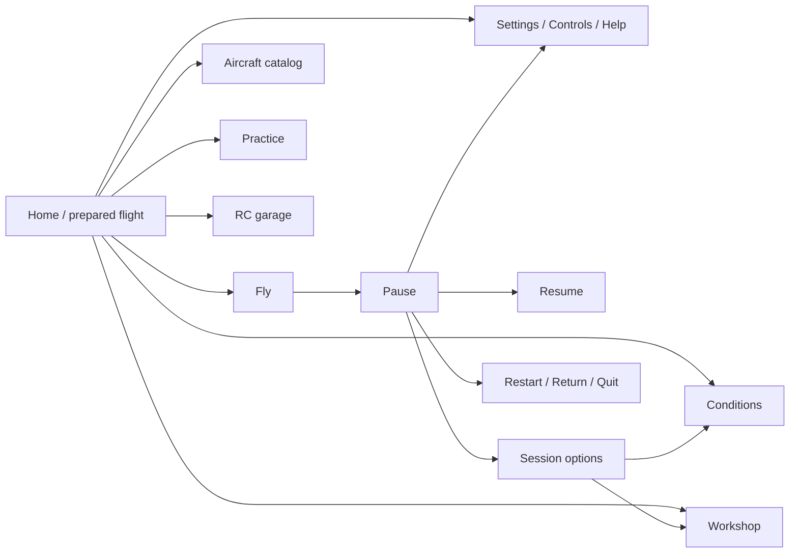

# OpenRC Simulator — cinematic menu and experience redesign

**Revision 5 · 2026-10-15 · Owner: product shell · UI-20…29.**

**Status: detailed implementation plan.** The earlier shell/scaling implementation and Home/Settings repairs exist in source, but the owner rejected their aesthetic result. This revision replaces the previous visual direction and delivery sequence. The new composition, camera, materials and scaling policy below are **proposed**, not implemented.

Build an aircraft-led RC club experience: a believable field, a well-lit model, a clear route to flight and a restrained interface that leaves the world visible. The [dated visual/resource investigation](research/menu-investigations/UI-20-R2/README.md) owns the current-screen diagnosis, reference analysis, Godot/GitHub research and source licenses.

## 1. Outcome, scope and retained work

The first screen must immediately communicate **which aircraft is selected, where the session takes place and how to start**. It must work at native 1080p and fullscreen 4K without a page scrollbar at normal text size. Aircraft, runway and club must share a convincing space; the menu must not consume a third of the image simply because the screen is large.

UI owns `app/app_root.*`, `app/ui/`, shell preferences/localization, UI tests and proposed UI assets. Coordinate field/scenery/material work with [SC](SCENERY-PLAN.md), [L/LU](LANDSCAPE-PLAN.md), [FW](FIELD-WORLD-PLAN.md), [TOD](TIME-OF-DAY-PLAN.md) and [VQ](plans/global-performance-visual-quality.md); controllers with [D6-GP](plans/controller-support.md), Workshop with AE, failures with EM, garage with RCV, overlays with HUD and display/export with DT. [Ownership registry](README.md#tracks-plans-and-step-ids).

Preserve these implemented foundations:

- `Screen`, `ScreenStack` and widgets: top-screen input isolation, focus restoration, named session holds and held-input release. [UI-21 proof](research/menu-investigations/UI-21/README.md).
- Catalog validation, latest-request preview ownership, bounded model cache and selected-resource loading. [UI-05-R2](research/menu-investigations/UI-05-R2/README.md), [UI-05-R3](research/menu-investigations/UI-05-R3/README.md), [remaining loading work](research/menu-investigations/26-menu-responsiveness-loading.md).
- Native fullscreen Keep/Revert with a 15-second wall-clock deadline, separate display/accessibility preferences, live language, opaque panels and reduced motion. Retain `Window` state-machine recovery; do not return to manually resizing a borderless window. [Implementation/recovery evidence](research/menu-investigations/UI-22-26-R1/README.md).
- Existing controller/radio setup, Natural Random, failure practice, Workshop trials, car activity, Help, recording recovery and technical CLI routes. These are real features to reorganize, not future placeholder tiles.
- Home sectioning and compact Settings repairs as functional baselines. Their [native captures](research/menu-investigations/UI-22-26-R1/README.md) do not close visual acceptance.

No flight-model tuning, aircraft-geometry edits, new gameplay modes, recording changes or golden-flight rerecording belongs to this redesign. Presentation poses never change accepted simulation state. Close-up assets, if justified, come from existing or freely downloadable licensed sources and their documented pipelines.

## 2. Diagnosis and design thesis

| Current finding | Required response |
| --- | --- |
| 440 logical pixels of sidebar in a 1280-wide design; approximately 1320 physical pixels at 4K | Separate readable type scale from panel proportions; substantially narrow and bound navigation. |
| Fixed 12° vertical FOV, airborne pose, distant background | Compose a ground-level view with foreground, aircraft, runway and recognizable club buildings. Adjust position, aim and lens together. |
| Dark aircraft in the reviewed sunset capture | Establish exposure and material separation before adding effects. Canopy, wings and fuselage must remain readable. |
| Repeated boxes, wide controls and persistent bottom slab | Use quiet rows, compact actions and less surface area. Give space to the scene. |
| Long weather/time descriptions on Home | Show an operational summary; put specifications, limitations and advanced controls in explicit destinations. Keep blocking reasons visible. |
| Layout tests pass while the owner rejects the result | Require native visual review with concrete composition gates, separately from functional verification. |

**Visual thesis:** a believable RC club photographed with care, framed by charcoal translucent surfaces, warm white type and a restrained amber selection/action accent.

**Content plan:** world and aircraft first; compact activity navigation; selected aircraft and next-flight summary; one primary action; detail on request.

**Interaction thesis:** immediate focus feedback, a short panel transition and a deliberate camera move when changing presentation context. Motion settles and never delays input. Reduced motion uses the same final compositions without camera travel.

Use the supplied airfield direction discussed around references 7–8 as the preferred composition; the wider concept around reference 6 informs horizontal organization with fewer lower-screen modules. Use Forza's grounded vehicle/space relationship, Cyberpunk's identity/focus hierarchy, MSFS's aircraft thumbnails and GT7's concise pause principle. [Reference inspection and limits](research/menu-investigations/UI-20-R2/README.md#reference-interpretation).

Avoid literal neon-city/fantasy dressing, airline-scale terminals that make RC models look full-size, marketplace panels, decorative telemetry, mirror-like dry pavement and copied commercial branding. This is an October 2026 design synthesis, not a claim that a universal trend requires glass or animation.

## 3. Home composition

### Desktop arrangement

At the 1920×1080 reference composition, start with a 48-pixel safe inset, a **304–340-pixel navigation column**, and a dominant open scene. Numbers in this plan are prototype targets until measured. Controls should occupy no more than approximately 25% of image area; the readability scrim may extend beyond them.

```text
┌───────────────────────────────────────────────────────────────────────┐
│ OPENRC SIMULATOR                                 Language · Settings   │
│                                                                       │
│ Flight                                                                │
│ Aircraft                 CLUB / SHELTERS        DISTANT LANDSCAPE       │
│ Practice                                                              │
│ Workshop                           SELECTED AIRCRAFT                   │
│ RC garage                          on apron / suitable stand           │
│                                   ╱                                   │
│                          RUNWAY / FIELD EDGE                          │
│                                                                       │
│ Aircraft name             Start · Conditions · Input status            │
│ [ FLY ]                   concise editable session summary            │
│                                                                       │
│ Help · Quit                                        Select / Back      │
└───────────────────────────────────────────────────────────────────────┘
```

This is a spatial wireframe, not a full-width bottom card. Keep the summary in one bounded strip or two short rows. Keep the aircraft clear of navigation, summary and safe margins. The wordmark is recognizable without consuming the top quarter. Full build identity belongs in About; a small Alpha/experimental indication remains where relevant.

Five real destinations: Flight, Aircraft, Practice, Workshop and RC garage. Flight presents the prepared session and Fly without a mandatory wizard. Settings/language/Help are quieter but easy to find. Quit stays explicit and keyboard/controller reachable.

| Visible item | Budget and behavior |
| --- | --- |
| Aircraft name | One or two lines; full name accessible without widening the whole menu. |
| Aircraft status | One short status plus Details for complete limitations. Blocking reasons remain next to Fly. |
| Start | Compact labeled selector/edit row; only supported launch methods. |
| Conditions | Short wind/time summary; advanced turbulence/atmosphere behind Conditions. |
| Input | Device/profile and actionable readiness; no duplicate full control legend. |
| Primary action | One Fly button, initially 220–280×56–64 reference pixels; grow/reflow for language/text needs. No full-sidebar red slab. |
| Utility prompts | Quiet edge row; no opaque full-width footer by default. Essential prompt labels remain readable. |

Aircraft selection is one action from Home. Fly launches the accepted configuration without another confirmation when there is no loss or unresolved validation. Enter/Accept activates the focused control; typing or changing a selector never launches.

### Compact arrangement

Below approximately 1500×850 available logical pixels, reduce gaps, move the summary below navigation and move nonessential description behind Details. Use measured content fit for final breakpoints. Preserve selected aircraft, Start, Conditions and Fly.

At 720p choose fewer simultaneous rows over smaller text. At 200% text use section pages and bounded detail scrolling; primary actions and exits remain reachable. Catalog/help/dense settings may scroll inside their body. **Home and Pause at default text must fit without page scrolling**, including fullscreen 4K.

## 4. Scene, camera and materials

### Compose the field before decorating the menu

Reuse the real field. [Existing postcards](research/scenery-implementation/SC-03/README.md) and `app/scenery/postcards.gd` provide club/pavilion/pits viewpoints. Show a runway diagonal leading into the scene and a recognizable shelter/pavilion in the middle distance. Trees and distant terrain provide depth rather than a wall directly behind the aircraft.

The first experiment compares three shots:

| Shot | Purpose | Starting parameters and checks |
| --- | --- | --- |
| A — runway and club | Recommended default Home | Three-quarter aircraft view; camera roughly 0.5–1.2 m above local ground; test 36–46° vertical FOV. Runway diagonal and club landmark visible. |
| B — pits presentation | Aircraft/Workshop context | Existing shelter/table/stand setting; test 32–42° FOV. Familiar objects establish RC scale without obscuring the model. |
| C — club overview | Optional field preview | Start from existing 38° club postcard. Use only if useful for context; not default when the selected aircraft becomes too small. |

Test the reported jet, a trainer and helicopter before generalizing. A single fixed camera transform that fits one model is insufficient.

### Framing contract

- Target approximately **38–48% screen width** for the aircraft at 16:9, centered around 65–72% of width. Retain nose/wing/tail/rotor clearance; verify actual bounds for the catalog.
- Project presentation geometry bounds into the free scene rectangle after reserving UI. Fit by camera position/aim/lens, never by changing model scale.
- Reframe on aircraft, aspect or UI-layout changes. Cache bounds; no per-frame complete mesh traversal. Preserve preview cancellation and cache limits.
- Keep contact, runway and a club landmark visible. Avoid sun, trunks or building edges behind labels or crossing the aircraft silhouette.
- Start with `Camera3D.KEEP_HEIGHT` for landscape aspect; verify 16:10/21:9. Wider screens reveal more world, not wider paragraphs. [Camera3D](https://docs.godotengine.org/en/4.7/classes/class_camera3d.html).
- Respect authored origins, CG mapping, gear and rotor extents. Do not change hinge names or model geometry to solve framing.

### Grounding and truthful preview

Prefer a parked pose where current bindings support it. Derive wheel/skid contact from visual/gear metadata with the model owner; a mesh bounding-box minimum is insufficient when a propeller or rotor defines it. Shadows follow the actual pose/light.

For unsupported parked visuals, use a suitable existing/free display stand or an intentional separate in-flight presentation. Never invent operational gear or imply ground capability from a display pose. The preview remains observational: no physics ticks, random incidents or input-driven motion. Display pose and session launch selection remain separate.

### Lighting and material priorities

Start with clear daytime/late-afternoon studies. Preserve chosen flight conditions; distinguish a fixed catalog presentation-light preset from next-flight weather/time if both exist.

Prioritize ground contact, restrained roughness/specular separation, readable canopy, coherent sun/sky and building depth. Fix exposure before bloom. Inspect wing/glass/foliage edges at actual 4K size, not just reduced thumbnails.

Inventory existing close-up assets first. Improve only surfaces proven weak in the chosen shot: apron/runway edge, one pavilion/shelter, aircraft highlights and nearby vegetation. Source free compatible PBR materials when needed. Keep texel scale, color, normal strength and roughness coherent. No wholesale scenery replacement is required.

### Renderer policy

Keep Compatibility as baseline. Godot 4.7 documents support for reflection probes, fog, SSAO, glow and tonemapping; DOF, volumetric fog, SSR and CompositorEffects have different support. [Renderer comparison](https://docs.godotengine.org/en/4.7/tutorials/rendering/renderers.html).

A bounded reflection-probe experiment must account for the existing lake and two-slot atlas. Measure update cost and memory before changing atlas capacity. Do not add another full-resolution world viewport solely for glass. Any Forward+ comparison is an isolated VQ/FW experiment with flight-material, sky, water, shadow and export regressions; it cannot silently change production rendering.

## 5. Visual system

### Color and surfaces

Prototype charcoal `#111A20`, warm white `#F3F1EB`, secondary gray `#B8C4C9` and amber `#EABF66`. These are candidate tokens, not certified contrast pairs. Reserve red for destructive/error states; normal Fly/Resume no longer uses a large danger-colored area.

Use local scrims and limited translucent surfaces. Start opacity near 0.86–0.94, increasing it where measured contrast requires; opaque mode is 1.0. Start with quiet 1-pixel edges and 6–8-pixel radii. Avoid borders around every row and nested cards. Focus uses an outline/shape as well as color and remains distinguishable from selection.

### Type, spacing and controls

Compare existing type with Atkinson Hyperlegible Next in real EN/ES screenshots. Prefer one readable family; verify accents, long names, units, numerals and prompts. Pin/download only after comparison and retain its license. [Resource matrix](research/menu-investigations/UI-20-R2/README.md#free-resources-and-github-candidates).

At the 1920×1080 reference scale, begin with brand 42–48, title 34–40, navigation 28–30, body/control 26 and supporting text 22–24. Measure rendered glyphs; nominal font size is not the legibility result. Supporting type cannot carry essential actions if its ink is too small. Body text honors user scaling independently of decorative titles.

Spacing: 4/8/12/16/24/32/48. Base rows 48–56 high; primary actions 56–64, growing for wrapping. Dense pages use aligned labels and bounded values. Settings selectors initially 240–320 wide, adapted to translated values and available space; switches are compact controls in labeled rows.

Theme normal/hover/pressed/focused/disabled/selected states of buttons, selectors/popups, sliders, spin boxes, fields, switches, tabs, scrollbars, tooltips and errors. Disabled reasons work with keyboard focus. Tooltips supplement visible labels.

### Glass and motion

Prototype one shared scene-blur pass below menu content. Keep text/focus sharp; include blur padding, intentional back-buffer ordering and nested-dialog/canopy tests. No separate screen-copy shader per row. [Screen-reading shaders](https://docs.godotengine.org/en/4.7/tutorials/shaders/screen-reading_shaders.html).

Start focus feedback at 100–140 ms, panel transitions at 160–220 ms, optional camera changes at 500–700 ms. Camera movement settles; no constant orbit or mouse parallax is required. Input isolation changes immediately, and animation never delays Fly, Back or errors.

Reduced motion removes camera travel/movement reveals. Opaque mode remains equally coherent. If blur exceeds budget, retain the composed scrim/opaque treatment; effects are optional, composition is not.

## 6. Resolution and localization contract

### A desktop composition with real compact reflow

The present 1280×720 canvas becomes 3× at 4K and preserves its oversized proportions. Test a **1920×1080 desktop composition**, with a compact layout below that size. This is a proposed policy, not a direct constant substitution.

```text
s = max(1.0, min(physical_width / 1920, physical_height / 1080))
available_logical_size = physical_size / s
```

Apply the result once through Godot native canvas scaling; test rounding, resize and pointer alignment. Text scaling stays separate at 100–200%. Do not multiply by Windows DPI again. Keep native 3D resolution independent. [Godot resolution guidance](https://docs.godotengine.org/en/4.7/tutorials/rendering/multiple_resolutions.html).

| Physical output | Candidate factor | Logical area | Navigation width, physical pixels |
| --- | --- | --- | --- |
| 1280×720 | 1.0 | 1280×720 compact | 280–304, summary reflows |
| 1920×1080 | 1.0 | 1920×1080 | 304–340 |
| 2560×1440 | 1.333… | 1920×1080 | approximately 405–453 |
| 3840×2160 | 2.0 | 1920×1080 | 608–680; present sidebar approximately 1320 |
| 3440×1440 | 1.333… | 2580×1080 | Same bounded navigation; more world |

At 1024×576 use a recovery layout with less simultaneous content; document limits. Choose breakpoints from content fit. Audit all CanvasLayers, popups, Help, Workshop, HUD and ground-vehicle screens before adopting a root-window policy; Home must not break flight UI.

Use the PC reading-distance baseline in [XAG 101](https://learn.microsoft.com/en-us/xbox/accessibility/xbox-accessibility-guidelines/101): essential rendered character height approximately 18 px at 1080p and 36 at 4K, with larger type available. Project target at 720p: at least 17 px. Measure ink, including prompt labels. A couch/TV presentation requires larger text and separate assessment.

### English, Spanish and text growth

Test EN/ES and 30–40% pseudolocalization, long aircraft/device names, units, degree/percent signs, punctuation and errors. Live switching preserves focus, draft and selection. Numeric editing retains current units/validation.

Use `Fly / Volar`, `Resume / Continuar`, `Aircraft / Aeronaves`, `Practice / Práctica`, `Workshop / Taller`, `RC garage / Garaje RC`, `Conditions / Condiciones`, `Settings / Ajustes`, `Return to Home / Volver al inicio`, `Quit to desktop / Salir al escritorio`. Keep `Language / Idioma` discoverable with its value spelled out.

At 150–200%, stack labels/values, narrow page scope, wrap buttons and scroll only detail bodies with pinned actions. Do not promise that all dense content fits without scrolling at 200%; require complete operability. Default-text no-scroll Home/Pause is a separate hard gate.

## 7. Screen flows and behavior



| Screen | Composition and required behavior |
| --- | --- |
| Aircraft catalog | Native-model thumbnails, bounded list/grid and one main preview. Generate thumbnails from accepted models, not stock photos. Show current catalog without empty categories; filters only when useful. Selection/name/focus update immediately, loading separately. Preserve latest-request-wins/cache; preview failure and flight validity stay distinct. Keep experimental/surrogate limits and supported starts accessible. |
| Practice | Natural Random and failure practice with existing briefing/reroll/repeat/availability. No invented career or achievements. |
| Conditions | Presets/summary first; Wind, Atmosphere, Time/Sky, Advanced with units. Home edits mean next flight; paused lighting retains explicit current-session semantics. Physical-weather staging remains owner-coordinated work. Cancel preserves accepted state; edits cannot silently reroll active failures. |
| Workshop | Preview, stock/variant identity, undo/redo, pinned trial action and return. Two columns only when useful; AE owns validation. No overwriting stock data. |
| RC garage | Clear activity identity and accepted vehicle selection; preserve its dedicated session/controls. Do not imply airplane actions apply to cars. |
| Help | First flight, input, recovery, limits, About; launch-aware instructions from shared references. Pinned header and readable body. |
| Overlays | Preserve live preview/autosave semantics and avoid obscuring the edited overlay. HUD owns behavior. |
| Reports/errors | Preserve incident/economic uncertainty and source identity. Long errors stay recoverable; styling cannot turn estimates into confirmed facts. Nonblocking updates never cover Fly or steal focus. |

### Pause

Keep the real frozen pilot view; do not replace it with Home or move the flight camera. Use a controlled scrim and compact panel with session identity. Resume is dominant; Restart, Session options, Settings and Help are secondary. A separated exit group contains Home/Quit. Default Pause fits without scrolling.

Readiness/disconnection reasons are visible and actionable. Preserve current radio/gamepad differences; do not reintroduce obsolete gamepad arming gestures. Transmitter axes never navigate menus. Children retain named holds; Esc/Back closes only the top layer. Focus loss never resumes automatically.

Confirm restart/exit only for real loss, such as active recording/trial. Preserve trace-save failure recovery and explicit discard. During a trial, the return destination says Workshop. Resume needs no decorative confirmation.

### Settings and Controls

Use a bounded workspace with category navigation and one readable editing column: Display, Audio when supported, Accessibility, Controls, Language, About. Existing nested destinations are valid where their stores/transactions require them. No dummy sliders.

Default Display/Accessibility fits at 1080p/4K without scrolling; longer bodies scroll independently with title, Back and Keep/Revert pinned. Retain 15-second real-time display recovery, including while paused. Persist display changes only after Keep.

Controls retain Devices/Profile/Axes/AUX/Buttons, calibration and Save/Cancel. Put live channel feedback next to edited channels. Preserve capture/profile ownership; consistent visuals do not mean combining unrelated stores.

All popups/confirmations fit safe bounds and restore focus. Loading states respond immediately and expose Back when cancellation is supported. Enter/Accept never leaks through a modal into Fly/Resume.

## 8. Implementation seams and resources

| Area | Existing seam | Planned change and boundary |
| --- | --- | --- |
| Home | `app/ui/home.gd` | Build explicit navigation/summary/action regions directly; avoid accumulating reparenting patches. Preserve public signals/routes. |
| Presentation | `app/ui/home_scene.gd`, postcards | Authored shot data, render-only pose and projected-bounds framing; reuse builders/cache. Prefer a small helper/resource over a new framework. |
| Theme | `app/ui/ui_theme.gd` | Central type/color/spacing/states and named variations; avoid scattered one-off overrides. |
| Scaling | `app/ui/ui_scale.gd`, `app_root.gd` | One scale, measured breakpoints, resize-safe focus/popups; technical route/native 3D preserved. |
| Lifecycle | Screen/ScreenStack | Preserve holds, cancellation, input and focus; add only needed presentation hooks. |
| World context | Shared World presentation state | Building Home can mutate shared state. Do not create another active world in Pause; preserve/restore context across retained Home/trial/error paths. |
| Evidence | UI driver/capture tooling | Native composition cases, meaningful bounds/input checks, actual mode/size/build/renderer records. |

Preferred resources: native Controls/Camera3D/Tween, existing Kenney prompts, a small Lucide SVG subset if needed, one tested font family. Phantom Camera is optional if shot authoring outgrows the native solution. Maaack's Menus Template is a reference; replacing OpenRC's loading/settings/input architecture is not proposed. [Primary sources, licenses and decisions](research/menu-investigations/UI-20-R2/README.md#free-resources-and-github-candidates).

Download only identified missing free assets. Pin exact version/commit/hash, retain license and record transforms/import settings. Existing scenery/provenance comes first; Poly Haven/ambientCG are material candidates. Commercial reference screenshots never become runtime assets. Do not generate replacements for suitable downloadable fonts/icons/textures/props.

## 9. Phased implementation

Each phase leaves a working, reviewable app. Do not style all screens before Home's scene and density are convincing. Visual review means assessing a concrete native result; it is not an extra permission requirement to prepare that result.

| Phase / step | Delivery | Exit evidence | Status |
| --- | --- | --- | --- |
| 0 · UI-20-R2 | Diagnosis, references/resources, revised plan | Dated report, real baseline, source-linked choices and limits | Research/plan delivered; new runtime work pending |
| 1 · UI-25-R2a | Three scene studies: runway/club, pits, overview | Same jet/trainer/helicopter at 1080p/4K; UI-off captures plus overlay masks; grounding/landmarks visible | Pending |
| 2 · UI-22-R2 / UI-23-R2 | One complete slice: selected scene + Home + tokens + scale | Native EN/ES 720/1080/1440/4K; old/new comparison; no default scroll; panel/type/model bounds and click alignment | Pending; after phase 1 |
| 3 · UI-25-R2b | Catalog, prepared-flight summary, Practice/garage entry | All catalog capabilities; rapid selection/loading/error; mouse/keyboard/pad route to flight | Pending; after phase 2 |
| 4 · UI-26-R2a | Pause and nested session navigation | Frozen tick/camera, Resume/Restart/Home/Quit, trial return, device loss and recording/save failure | Pending; after phase 2 |
| 5 · UI-24-R2 / UI-26-R2b | Settings/Controls/Conditions/Help/dense screens | Every tab EN/ES 100/200%; display recovery, drafts/focus/persistence, long labels | Pending; shared phase 2 foundation |
| 6 · UI-28-R2 | Optional glass, settled camera transitions, loading/sound polish | Reduced-motion/opaque parity; same-host GPU/CPU/memory evidence; immediate input/holds | Pending; after composition passes |
| 7 · UI-29-R2 | Acceptance matrix, fresh exports, operating docs | Native Windows 4K package flows/captures; explicit other-platform status; user tasks and visual review | Pending |

**Next task: phase 1.** Its useful result is a substantially better native scene, not another palette on the existing 12° airborne view. Phase 2 is the first end-to-end visual milestone. Fix the shot before expanding the styling to secondary screens.

Prior work remains in [UI-20-R1](research/menu-investigations/UI-20-R1/README.md), [UI-21](research/menu-investigations/UI-21/README.md) and [UI-22–26-R1](research/menu-investigations/UI-22-26-R1/README.md). UI-27 functionality belongs to [HUD](plans/flight-overlays.md). Audio/safe-margin settings, paused-weather staging and loading performance remain explicit open tasks, not implicitly completed by this plan.

## 10. Acceptance and completion

### Visual gates

1. Home/Pause default text has **no page scrollbar** at 720p/1080p/1440p/true fullscreen 4K. Selected model, primary action and exit/back remain visible.
2. Bounded navigation at 1080p/4K replaces the one-third-screen sidebar and full-width utility slab. Full EN/ES action labels remain visible.
3. Aircraft is completely framed and grounded in the chosen presentation; runway and club landmark are identifiable with UI visible. No wing/rotor/tail intersects a panel or screen edge.
4. Day/sunset/night retain readable canopy/fuselage/wings. No black silhouette, excessive bloom, broken transparency or floating shadows.
5. One dominant action and coherent spacing/type remain with opaque panels/reduced motion. Routine settings do not become nested boxes.
6. Review full frames, 100% crops and a navigation recording at actual display size/normal distance. Code checks cannot substitute for this assessment.

### Behavior, accessibility and coverage

Measure contrast on the composited scene: target ≥4.5:1 text and ≥3:1 focus/essential boundaries, with state communicated beyond color. Apply [XAG 102](https://learn.microsoft.com/en-us/xbox/accessibility/xbox-accessibility-guidelines/102) as guidance, not a certification claim. Include bright clouds, vegetation, sunset/night, dropdowns and disabled states.

| Axis | Required cases |
| --- | --- |
| Resolution/aspect | 1280×720, 1920×1080, 2560×1440, actual 3840×2160; 1280×800/1920×1200; 2560×1080/3440×1440; 1024×576 recovery |
| Window/scale | Window, maximize/restore, fullscreen/revert, live resize; text 100/125/150/200%; Windows DPI 100/125/150/200%, monitor movement where available |
| Language | EN/ES, 30–40% pseudo-locale, live switching, long identifiers/errors, accents/units |
| Screens | Home/catalog, Pause branches, Settings/Controls/Conditions tabs, Practice, Workshop/trial, garage entry, Help, overlays, reports/errors |
| Input | Mouse, keyboard only, selected Xbox/DualSense; text/slider/popup capture; hot-plug/focus loss; radio isolation |
| State | Whole current catalog, helicopter surrogate, ground activity; pending/failed preview, unsupported capability, dirty draft, recording/save failure, crash, disconnected controller |

Every screen at 720p/4K in EN/ES; densest pages also at 200%. Pairwise coverage elsewhere, retaining 720p+ES+200% and 4K+ES+200%. Log actual pixels/mode/logical size/UI and text scales/DPI/renderer/GPU/source identity/isolated preferences. A requested 4K window clamped by Windows is not a pass.

Exercise Home → aircraft → conditions → Fly → Pause → Settings → Resume → Home using keyboard and menu pad. Check paused ticks, focus and accepted weather/profile/recording/trial state. Reuse relevant UI/controller/session/Workshop tests. No physics baseline regeneration.

### Performance and release

Measure baseline/candidate alone on the same host/scene/resolution: warm median/p95 frame time, cold/warm selection stalls, time to first feedback, peak memory and steady cache. Use ≥300 warm frames and separate shader warmup/loading. Target ≤1 ms p95 **incremental effect** cost for optional glass/motion; assess total scene cost separately against the agreed desktop frame budget. These are proposed gates, not measured results.

Do not rebuild the field on selection or Pause. Bound retained resources. Headless CPU timing does not establish native GPU cost. Quality reductions preserve composition and interaction.

Run relevant [TOOLS](TOOLS.md) checks, inspect engine errors and exit status, then verify a fresh Windows export at native 4K. Other OSes and physical controllers stay explicit until tested. Isolate preferences and run native display experiments sequentially.

Formative tasks: select aircraft, edit conditions, find Controls, change language, return from Pause. Record assistance/wrong turns/failures with at least three first-time users; target ≥90% unassisted completion across recorded tasks and zero critical loss/resume errors. This is formative evidence, not population validation.

Completion requires both native visual acceptance and behavior gates. Consolidate operating instructions into [MENU-PLAN](MENU-PLAN.md), retain dated evidence/provenance, and remove this active plan when complete under the [documentation conventions](README.md#conventions-for-documents).
