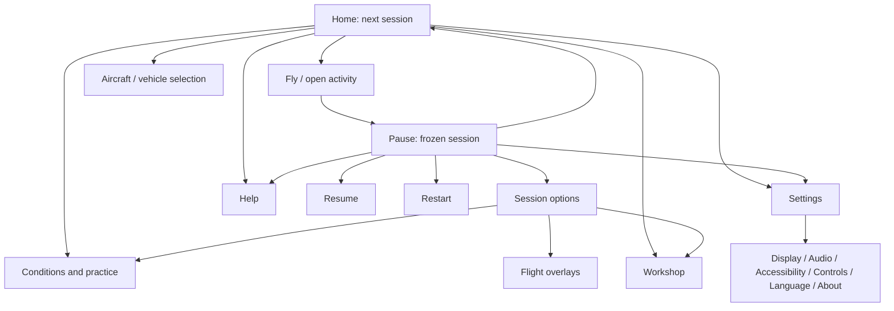

# OpenRC Simulator — menu and shell redesign

**Revision 4 · 2026-10-15 · Owner: product shell · UI-20…29.** UI-20/21 and UI-20-R1 are delivered. The first implementation of UI-22…26/28 is in source; release qualification and the remaining work below are open. [Implementation evidence](research/menu-investigations/UI-22-26-R1/README.md). The [UI-20-R1 report](research/menu-investigations/UI-20-R1/README.md) owns dated observations, screenshots, sources and limitations.

Build a clear, attractive game interface that works from 720p to native 4K in English and Spanish. Prioritize readable scale and a short route to flight, then visual polish. Reuse the aircraft, field, screen stack, controller support and free licensed resources already available.

## 1. Scope and foundation

Owns `app/app_root.*`, `app/ui/`, `app/app_state/`, `app/i18n/`, UI tests/captures and proposed `app/assets/ui/`. Coordinate display settings with DT, weather with M5, sky/lighting with TOD/FW, Workshop with AE, failures with EM, controllers with the [controller track](plans/controller-support.md), overlays with [HUD](plans/flight-overlays.md), and garage with RCV. No simulation-kernel or aircraft-data changes. [Ownership registry](README.md#tracks-plans-and-step-ids).

Preserve `Screen`, `ScreenStack` and `Widgets`: named session holds, top-screen input isolation, focus restoration, held-input release rules, validation before flight and trace-save recovery. Preserve the technical CLI route. [UI-21 proof](research/menu-investigations/UI-21/README.md).

The October 11 audit is historical. Current source already includes controller configuration/menu routing, Workshop, Natural Random, failure settings, garage entry, sky/cloud tabs and configurable flight overlays. Do not schedule these features as absent. General Settings and coherent display/UI scaling remain pending. Physical controller qualification stays with its owner.

Retain delivered maintenance: [UI-05-R1 legend reuse](research/menu-investigations/UI-05-R1/README.md), [UI-05-R2 preview cache](research/menu-investigations/UI-05-R2/README.md), [UI-05-R3 selected-resource loading](research/menu-investigations/UI-05-R3/README.md), [UI-06d-R2 launch captions](research/menu-investigations/UI-06d-R2/README.md), and [UI-16 update notices](research/menu-investigations/UI-16/README.md). Loading follow-ups remain in [investigation 26](research/menu-investigations/26-menu-responsiveness-loading.md).

## Current implementation milestone

- Interactive Home uses native `canvas_items` scaling with a 1280×720 logical base and expanded aspect ratio: 1×/1.5×/2×/3× at 720p/1080p/1440p/4K. Technical CLI launches retain their existing route.
- Home pins Fly and language/help/quit/controls/settings; setup, Workshop, practice and the integrated RC-car activity scroll with visible overflow. Full labels wrap. Existing aircraft preview and launch contracts remain.
- Pause has Session options and Exit options disclosures, plus Settings and Help. Back collapses an open disclosure before resuming; child pages return to Pause without advancing simulation ticks. Readiness and recording recovery messages remain in the scrollable pause content.
- Settings previews window/borderless mode with a 15-second real-time Keep/Revert deadline, themed text at 100–200%, opaque panels and reduced motion. Language applies immediately through the existing store; display/accessibility preferences are separate. Controls and Help/About are nested destinations.
- The shared theme covers selectors, fields, popups and tabs; panels use 0.94 opacity or an opaque fallback. Pages replace lower navigation chrome and fade in for 140 ms unless reduced motion is selected. Help has a pinned Close header and correct runway/airborne guidance.

The accessibility adjustment currently enlarges **themed text**, not the entire logical viewport; this avoids shrinking legacy modal space. Local font overrides and glyph ink bounds still need the complete typography audit. Native evidence covers representative dense pages at 200%, not every advanced tab, pseudo-locale or platform. Audio controls, safe-margin controls, a thumbnail catalog, staged paused weather, full page-by-page refinement, timing budgets and formative user testing remain open. Do not treat this milestone as completion of UI-29.

## 2. Audit findings that determine priority

Native Windows evidence comprises **78 captures**: Home/Pause at 1280×720, 1920×1080, 2560×1440 and 3840×2160 in EN/ES; dense screens also at 720p, 1080p and 4K. The actual monitor is 3840×2160; Godot 4.7.2 uses Compatibility on RTX 3090. [Complete gallery](research/menu-investigations/UI-20-R1/GALLERY.md).

| Priority | Observed problem | Required response |
| --- | --- | --- |
| P0 | Home stays 440 physical pixels wide at every resolution; utility text stays 16/19 px | Automatic scaling. At 4K the sidebar occupies 11.5% of width and navigation is tiny. UI-23 |
| P0 | Language and Controls truncate in both languages at every tested size | Full labels and reflow; extra screen area must reach the content. UI-22/25 |
| P1 | Ten pause actions form one long list; End/Quit are below the initial 720p viewport | Compact action groups and a discoverable exit route. UI-26 |
| P1 | Weather competes with Fly; Workshop and a mode share a row; garage sits in the opposite corner | Distinguish activity, setup, tools and preferences. UI-25 |
| P1 | Conditions, Controls, Workshop and Help differ in density, tabs and footer treatment | Shared page structure, bounded reading width and predictable scrolling. UI-24/26 |
| P1 | Home/pause expose different environment controls; some changes affect a later flight | Explicit current-flight/next-flight scope before Apply. UI-26 |
| P1 | Help says the flight starts in the air while default Home selects runway | Review dynamic claims and capability-aware help, not just translated strings. UI-26 |
| P2 | Nearly opaque sidebar, many boxed controls and mixed widget styling | Cohesive material, typography, fewer boxes and restrained motion. UI-22/28 |

Existing Home layout tests pass for the catalog at 720p/1080p. They do not detect clipped labels or establish 4K readability. The audit's 50 sampled flow records passed using the existing event driver; native physical input, all tabs and accessibility scaling remain qualification work. [Evidence and limits](research/menu-investigations/UI-20-R1/README.md).

## 3. Art direction: a modern flying field

**Visual thesis:** an aircraft-led, calm flight interface with dark translucent instrument surfaces, warm readable text, restrained red emphasis and precise amber focus.

**Content hierarchy:** aircraft/field as the visual anchor; current activity and next-session summary; one dominant Fly/Drive/Resume action; secondary tools/preferences. Each page answers one question.

**Interaction thesis:** immediate focus/selection feedback, a short fade and 6–8 logical-pixel translation between screens, and contextual detail revealed on focus. Keep a still background by default. Animation never delays input isolation or simulation holds.

| Visual reference | Adopt | Avoid |
| --- | --- | --- |
| [Cyberpunk 2077 menus](https://interfaceingame.com/games/cyberpunk-2077/) | Strong identity, short lateral navigation, atmosphere and consistent input prompts | Tiny red text, glitch effects and copied branding |
| [Microsoft Flight Simulator 2024 menu](https://www.helisimmer.com/articles/initial-impressions-msfs-2024-not-impressed) | World as protagonist and distinct activities | Marketplace-sized tile density for a small RC simulator |
| [Forza Horizon 6, 2026 accessibility review](https://caniplaythat.com/2026/06/03/forza-horizon-6-accessibility-review/) | Vehicle context, unmistakable selection and adjustable presentation; [official feature description](https://forza.net/news/forza-horizon-6-radio) | Promotional badges and many equally loud destinations |
| [Gran Turismo 7 pause](https://www.gran-turismo.com/us/gt7/manual/race/05) | Brief action hierarchy over a frozen dimmed scene | Rigid horizontal navigation when Spanish/large text needs vertical reflow |

These are specific references, not proof of a universal “2026 trend.” Established Cyberpunk/GT7 examples complement FH6 and current guidance. [Image links, dates and observations](research/menu-investigations/UI-20-R1/README.md#external-visual-references).

### Material and visual system

- Keep charcoal/blue-green surfaces, cream text, red primary actions and amber focus. Error/warning/success also need words or symbols. Prefer quiet rows/dividers; use cards for aircraft selection or genuinely grouped information.
- Prototype panel opacity **0.90–0.96**, with **1.0** as the high-contrast option. This range is proposed, not a measured guarantee. Protect text with a controlled scrim; test noon sky, clouds, vegetation, sunset and night. Do not lower today's 0.97 opacity globally without proof. Optional local blur follows a measured Compatibility experiment; crisp translucency is the baseline.
- Atkinson Hyperlegible Next 400/700 remains the proposed free OFL font; compare against bundled Open Sans. Reuse existing Kenney controller glyphs and keycaps. Add only necessary labelled Lucide icons, recording source/version/hash/licence. Do not draw replacements for suitable free assets.
- At the 720p design size, prototype title 32–36, section 24–28, body/control 22–24 and secondary 18–20 nominal font sizes. Select final values from **rendered glyph measurements**. Smaller metadata must not be necessary to operate the screen.
- Use 4/8/12/16/24/32/48 spacing, modest 6–10 radii, 1 px quiet borders and a distinct focus outline. Start with 48–56 logical-pixel controls, 64 px primary actions and 8 px separation. Increase height for wrapping/large text.
- Theme buttons, selectors/popups, tabs, sliders, spin boxes, text fields, checks, scrollbars, tooltips and errors in every state. Explain disabled actions on focus as well as hover.
- Start with 120–180 ms transitions and 80–120 ms hover feedback. Provide reduced motion; persistent recovery messages must not disappear as toasts. Update notices never steal focus.

Target text contrast ≥4.5:1, focus/essential boundaries ≥3:1 and inactive text ≥3:1 over the **composited background**, not only token pairs. [XAG 102](https://learn.microsoft.com/en-us/xbox/accessibility/xbox-accessibility-guidelines/102). These are project gates, not accessibility certification.

## 4. Resolution, scaling and localization contract

### One automatic scale plus user adjustment

Prototype `canvas_items`, a 1280×720 design area and `expand` aspect. Keep 3D rendering at the selected native window size; do not stretch a 720p render texture to 4K. Audit every CanvasLayer/overlay. [Godot resolution guidance](https://docs.godotengine.org/en/stable/tutorials/rendering/multiple_resolutions.html); verify behavior on the pinned engine.

| Output | Nominal automatic factor, 16:9 | 400–440 logical-pixel column becomes | Main gate |
| --- | --- | --- | --- |
| 1280×720 | 1.0 | 400–440 physical px | Compact layout, Spanish strings, reachable actions |
| 1920×1080 | 1.5 | 600–660 px | Main composition and reading distance |
| 2560×1440 | 2.0 | 800–880 px | Intermediate/fractional styling |
| 3840×2160 | 3.0 | 1200–1320 px | Native 4K, including dialogs/popups |

This is a prototype target. A 100–200% **accessibility adjustment** is separate; “200% maximum” must not cap 4K automatic scale at 2×. Do not multiply by Windows DPI again and scale twice. Define effective scale once and log it. The audit measured 144 DPI but `screen_get_scale()` returned 1.0 on Windows; that getter alone is insufficient.

At default scale target rendered body-letter height ≥17 px at 720p, 26 at 1080p, 35 at 1440p and 52 at 4K. These deliberately favor game/controller reading distance. [XAG 101](https://learn.microsoft.com/en-us/xbox/accessibility/xbox-accessibility-guidelines/101) distinguishes console 26/52 from PC 18/36 at 1080p/4K; 720p/1440p values here are project scaling targets. Measure ink bounds, including letters inside input glyphs. Support 200% text without lost actions or meaning.

### Reflow before truncation

Choose compact layouts from available **logical** dimensions. High scale/small windows use one column, a scrolling body and pinned header/footer. Keep Fly/Resume, Back and Apply/Cancel reachable. Do not shrink text to fit. Ordinary settings must not require horizontal scrolling. Show overflow cues; focus must reveal the entire control and its label.

Keep Home's brand, setup and actions close together as height grows; remove the expanding-spacer composition that scatters them at 4K. Wider aspect ratios reveal more scene, not longer paragraphs. Bound reading panels, clamp tooltips/popups to a safe inset and allow Workshop two columns only when both remain useful. Start with 24 logical pixels of safe inset; provide extra TV margins.

Normal minimum is 1280×720. Test 1024×576 as a recovery/compact case and document limitations if necessary. Add 1280×800/1920×1200, 2560×1080/3440×1440, live resizing and maximize/restore. Four 16:9 screenshots do not establish “all resolutions.”

### English and Spanish

Primary actions must show complete labels: no `Languag`, `Idioma:` without its value or `Cont`. Use `Language / Idioma` with `English / Español`; retain a discoverable Home language entry after moving preferences into Settings. Allow two-line option values and detail views for long descriptions. Optional identifiers may ellipsize only when their full value is keyboard/mouse accessible.

Test real EN/ES plus 30–40% pseudolocalization; accents, punctuation, `%`, `°`, `±`, `μ`, units, long device/aircraft names, errors and disabled reasons. Preserve proper names. Live language changes must preserve focus and drafts. Numeric parsing/formatting must round-trip without changing units or saved values.

Adopt consistent labels: `Resume / Continuar`, `Restart flight / Reiniciar vuelo`, `Return to Home / Volver al inicio`, `Quit to desktop / Salir al escritorio`, `Settings / Ajustes`, `Controls / Controles`, `Flight conditions / Condiciones de vuelo`. Resolve `Taller` versus `Laboratorio de aviones` in one glossary while retaining experimental status.

## 5. Information architecture and flows

### Home and aircraft selection

Brand and concise activity navigation at top left; a bounded next-session block below; aircraft/field across the remaining canvas; a quiet input-hint footer. Keep the primary action visible without scrolling at default scale. Preserve Enter-to-fly when Fly owns focus; typing in a field must never launch.

Next-session rows: aircraft/status, launch method, conditions, practice mode and input readiness. **Fly spans the action area**, instead of competing with Weather. Conditions owns wind, atmosphere, time and sky; advanced physical parameters retain units and explanations behind Advanced.

One labelled activity entry reaches flight and RC cars. A car selection changes the action to Open garage/Drive as appropriate. Remove the detached far-corner family selector. Helicopters remain in the existing catalog, exposing only supported actions. No empty future Drone/Multiplayer/Career destinations.

Natural Random becomes an explicit practice choice with its existing briefing/reroll/repeat. Failure practice is a scoped option. Workshop remains a separate tool; trial changes never overwrite stock choices. Aircraft selection uses a catalog-driven list or selectable image rows with one preview and clear availability. Reuse model/loading/cache work; add captured thumbnails only when useful. Selection/focus feedback is immediate while resources load; preview failure and flight validity remain distinct.

### Pause

Keep the frozen pilot view and a compact left panel: title, aircraft/session identity, concise readiness status. Group **Resume**, **Restart**, **Session options**, **Settings**, **Help**, **Return to Home**. Provide Quit to desktop in the exit group/confirmation, with a direct secondary option where space permits. Avoid today's ten undifferentiated buttons.

Resume is first/default when permitted. Otherwise show the reason and focus recovery. Preserve throttle-on-resume and device-loss warnings. Esc/Back closes the top layer only: popup → page → pause; a subsequent explicit Resume returns to flight. Focus loss never resumes automatically. RC transmitter axes never navigate; only the selected menu gamepad does.

Restart preserves accepted launch/conditions. Confirm actual loss such as an active recording/trial; ordinary Resume needs no dialog. Return/Quit preserve trace-save failure and explicit discard. During trials say Return to Workshop. Suppress unrelated first-flight hints and lower-screen interactive chrome under blocking screens.

### Shared screens and transaction semantics

| Screen | Proposed structure and behavior |
| --- | --- |
| Settings | Stable sections: Display, Audio, Accessibility, Controls, Language, About; one scroll body and shared header/footer. Integrate the existing controller subsystem. |
| Display | Window/borderless fullscreen, UI/text scale, safe margins, supported VSync. Keep/Revert with 15 s real-time timeout, visible recovery and persistence only after Keep. |
| Conditions | Summary/presets first; Wind, Atmosphere, Lighting/Sky, Advanced. Scope labels: Home = next flight; pause lighting = current flight; paused wind/atmosphere proposed as staged for restart, pending owner transaction design. Cancel never applies a draft. |
| Failure practice | Preserve next-flight settings and current-flight notice semantics. Keep availability/exclusions explicit; edits cannot silently reroll the active incident. |
| Controls | Retain Devices/Profile/Axes/AUX/Buttons, Save/Cancel, calibration and held-input isolation. Restyle/reflow every tab. Explain flight versus menu device; place live preview near edited channels. |
| Help | First flight, Keyboard, Controller/radio, Recovery, Known limits, About. Generate applicable controls from the shared reference; remove stale claims. Pinned header, scrollable content. |
| Workshop | Retain preview, undo/redo, stock/variant identity and trial return. Fold numeric detail; pin the trial action; one column when compact. AE owns behavior. |
| Overlays | Retain live preview and preset/individual switches. Match shared typography/focus; do not obscure the overlay being edited. Immediate settings use Done and disclose autosave. HUD owns behavior. |
| Update/errors/confirmations | Shared type/safe inset/focus rules. Notices never cover Fly or steal focus. Blocking errors give recovery. About owns full version/licences; experimental model status remains near selection. |

Do not force Apply/Cancel onto immediate overlay settings or silently make drafts immediate. Visual consistency must preserve controller profiles/calibration, Workshop variants, overlay preferences and application settings in their respective stores.

## 6. Delivery phases

Each phase leaves a usable app; split work into small commits with evidence. Estimates are focused engineering days, excluding unavailable hardware/owner review. Reuse UI step IDs; repairs use their existing substep conventions.

| Phase / ID | Work | Exit evidence | Status |
| --- | --- | --- | --- |
| 0 · UI-20-R1 | Native visual audit and game references | [78 captures, 50 sampled flow records, layout test, measured defects/limits](research/menu-investigations/UI-20-R1/README.md) | Done 2026-10-15 |
| Foundation · UI-21 | Shared screen/stack/widgets | [Parity and lifecycle proof](research/menu-investigations/UI-21/README.md) | Delivered; retain |
| 1a · UI-23 · 3–5 days | Scale policy, compact reflow, native 4K and aspect ratios; isolate technical routes | Home/Pause+dense dialog, EN/ES, four resolutions, 100/150/200%; geometry, text and focus proof; deterministic simulation unchanged | Core implemented; full qualification open |
| 1b · UI-22 · 3–5 days | Material/type prototype, tokens, complete control states and free assets | Two reviewed Home/Pause/Conditions compositions; selected system passes glyph/contrast tests and opaque fallback | Shared theme implemented; typography/assets qualification open |
| 2 · UI-24 · 3–5 days | Settings, display Keep/Revert, accessibility/language and persistence | Relaunch/reversion/migration/error tests; existing profile/calibration preserved; 4K click alignment | Display/accessibility/language implemented; audio and safe margins open |
| 3 · UI-25 · 3–5 days | Home, catalog, activity navigation and practice choices | Full EN/ES labels; initial Fly visible; one-key launch; immediate selection; no NR/RCV/HELI/Workshop regression | Pinned Home/activity grouping implemented; catalog redesign open |
| 4 · UI-26 · 4–6 days | Compact pause, Session options, conditions scope, Help and dense pages | Nested Back/Esc, trace failure, staged/immediate edits, controller tabs, Workshop return, 720p Spanish stress captures | Compact Pause/Help implemented; dense-page and conditions follow-ups open |
| HUD · UI-27 | Shared styling only; functionality belongs to HUD-00…12 | [Overlay plan](plans/flight-overlays.md) | Superseded by HUD track |
| 5 · UI-28 · 1–2 days | Motion, loading feedback, toasts; optional measured blur | Reduced-motion parity, no focus/hold delay, bounded same-host p95 cost, paused audio rules | Reduced-motion entrance implemented; performance qualification open |
| 6 · UI-29 · 2–4 days + hardware | Matrix, exports, usability and handover | Gates below; untested platforms/hardware explicit; guides/screenshots updated | Proposed |

Critical path: 1 → 2 → 3 → 4 → 5 → 6. Theme/scaling can proceed independently only after agreeing coordinates/type. First useful milestone: readable, untruncated Home/Pause at 1080p/4K. Test 720p Spanish throughout, not just at the end.

## 7. Acceptance matrix and release gates

| Axis | Required cases |
| --- | --- |
| Display | 720/1080/1440/native 4K, 16:10, 21:9, 1024×576 recovery, live resize |
| Scaling | Automatic ×100/125/150/200% user adjustment; Windows 100/125/150/200% display scale; window/borderless, monitor movement where available |
| Language | EN, ES, 30–40% pseudo-locale, live switching, long identifiers/errors |
| Screens | Home/catalog, pause, all Settings/conditions/controller tabs, Help, failures/details, NR/details, Workshop/trial return, overlays, updates/confirmations/errors |
| Input | Mouse, keyboard only, selected Xbox/DualSense; popups/sliders/text capture; hot-plug/focus loss; RC radio isolation |
| Background | Noon/bright clouds, sunset, night/lamps, vegetation; translucent and opaque modes |
| Activity/state | Fixed wing, helicopter, garage; busy/invalid preview, unsupported capability, crash, disconnected controller, dirty draft, recording/save failure |

Run every screen/locale at 720p/4K; Home/Pause/Settings and densest tabs at intermediate/aspect cases. Use pairwise coverage elsewhere, retaining 720p+ES+200% and 4K+ES+200%. Record actual image/window size, effective scale, DPI, input device, build and renderer. A clamped requested 4K window is not a 4K pass.

1. **Geometry/comprehension:** no lost primary labels, overlaps, clipped focus, unreachable footers or horizontal settings scroll. One primary action. Full text/disabled reasons available without hover. Distinguish intentional scroll from defects.
2. **Legibility:** measured rendered-letter targets, composited contrast, complete glyphs and crisp fractional scaling. Human reading at normal distance on the target monitor remains necessary.
3. **Navigation:** Home → setup → Fly → Pause → settings → Resume → Home by keyboard and supported menu pads; focus restoration; cancellation never unpauses/commits unintentionally; display reversion works while paused.
4. **State:** presentation does not alter physics, checkpoints or recording. Preserve holds and deterministic replay. Relevant UI/controller/session tests pass; invalid drafts leave accepted state intact. Never re-record golden flights for UI work.
5. **Performance:** baseline/candidate measured alone on the same host/resolution/scene; ≥300 warm frames, median/p95 and loading feedback. Provisional effect budget ≤1 ms menu p95 regression; simplify/disable effects when exceeded. This audit did not measure that budget.
6. **Delivery/usability:** fresh-checkout Windows source/export proof, then Linux/macOS under DT. At least three first-time users select aircraft, find controls, switch language, edit conditions and leave pause. Record wrong turns, task time and assistance. Target ≥90% unassisted completion; critical errors block release. This is formative evidence, not population validation.

Use existing [tooling](TOOLS.md), event driver, `test_ui_*.gd`, controller/NR/Workshop checks and capture tooling. Add meaningful text-fit/focus/scale checks. Screenshots do not replace interaction tests; scene-time differences are not automatically layout regressions.

## 8. Boundaries and qualification still open

No new aircraft/terrain, paid UI kit, generated background art, custom icon library or replacement navigation framework. Reuse/download suitable free assets with provenance. Commercial screenshots remain inspiration links, never shipped textures. No changes to physical models, weather meaning or recording formats.

The audit establishes four native resolutions and sampled behavior on one Windows host. It does not establish NVDA/accessibility conformance, complete physical-controller navigation, every DPI mode, ultrawide, effect performance or other-platform acceptance. Fullscreen defaults/blur must pass recovery/performance gates before shipping. The interrupted manual Windows inspection is reported separately from completed automated evidence.

When complete, consolidate operating instructions into current guides, retain required evidence and remove this completed plan under the [documentation conventions](README.md#conventions-for-documents).
