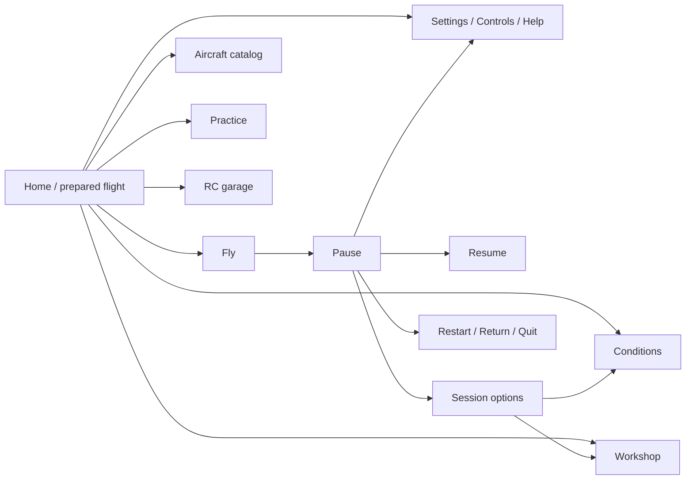

# OpenRC Simulator — cinematic menu and experience redesign

**Revision 17 · 2026-10-24 · Owner: product shell · UI-20…29; audit repairs UI-31…38 in [§11](#11-ui-30-audit-repairs).**

**Status: core redesign implemented; extended acceptance remains open.** The grounded Home composition, bounded navigation, 1920×1080 reference scaling, lime/graphite theme, compact Pause, Settings and Conditions refinements are now in source. [UI-22–26-R2 evidence](research/menu-investigations/UI-25-R2/README.md) records the native EN/ES 720p–4K matrix and behavior checks for the earlier palette. This revision retains the wider design targets below; thumbnails, optional effects, release packages and human visual acceptance are not implicitly complete.

Build an aircraft-led RC club experience: a believable field, a well-lit model, a clear route to flight and a restrained interface that leaves the world visible. The [dated visual/resource investigation](research/menu-investigations/UI-20-R2/README.md) owns the current-screen diagnosis, reference analysis, Godot/GitHub research and source licenses.

## 1. Outcome, scope and retained work

The first screen must immediately communicate **which aircraft is selected, where the session takes place and how to start**. It must work at native 1080p and fullscreen 4K without a page scrollbar at normal text size. Aircraft, runway and club must share a convincing space; the menu must not consume a third of the image simply because the screen is large.

UI owns `app/app_root.*`, `app/ui/`, shell preferences/localization, UI tests and proposed UI assets. Coordinate field/scenery/material work with [SC](SCENERY-PLAN.md), [L/LU](LANDSCAPE-PLAN.md), [FW](FIELD-WORLD-PLAN.md), [TOD](TIME-OF-DAY-PLAN.md) and [VQ](plans/global-performance-visual-quality.md); controllers with [D6-GP](plans/controller-support.md), Workshop with AE, failures with EM, garage with RCV, overlays with HUD and display/export with DT. [Ownership registry](README.md#tracks-plans-and-step-ids).

Preserve these implemented foundations:

- `Screen`, `ScreenStack` and widgets: top-screen input isolation, focus restoration, named session holds and held-input release. [UI-21 proof](research/menu-investigations/UI-21/README.md).
- Catalog validation, latest-request preview ownership, bounded model cache and selected-resource loading. [UI-05-R2](research/menu-investigations/UI-05-R2/README.md), [UI-05-R3](research/menu-investigations/UI-05-R3/README.md), [remaining loading work](research/menu-investigations/26-menu-responsiveness-loading.md).
- Native fullscreen Keep/Revert with a 15-second wall-clock deadline, separate display/accessibility preferences, live language, opaque panels and reduced motion. Retain `Window` state-machine recovery; do not return to manually resizing a borderless window. [Implementation/recovery evidence](research/menu-investigations/UI-22-26-R1/README.md).
- Existing controller/radio setup, Natural Random, failure practice, Workshop trials, car activity, Help, recording recovery and technical CLI routes. These are real features to reorganize, not future placeholder tiles.
- Home sectioning and compact Settings repairs as functional baselines. Their [native captures](research/menu-investigations/UI-22-26-R1/README.md) do not close visual acceptance.

No flight-model tuning, aircraft-geometry edits, new gameplay modes, recording changes or golden-flight rerecording belongs to this redesign. Presentation poses never change accepted simulation state. Close-up assets, if justified, come from existing or freely downloadable licensed sources and their documented pipelines.

## 2. Diagnosis and design thesis

| Current finding | Required response |
| --- | --- |
| 440 logical pixels of sidebar in a 1280-wide design; approximately 1320 physical pixels at 4K | Separate readable type scale from panel proportions; substantially narrow and bound navigation. |
| Fixed 12° vertical FOV, airborne pose, distant background | Compose a ground-level view with foreground, aircraft, runway and recognizable club buildings. Adjust position, aim and lens together. |
| Dark aircraft in the reviewed sunset capture | Establish exposure and material separation before adding effects. Canopy, wings and fuselage must remain readable. |
| Repeated boxes, wide controls and persistent bottom slab | Use quiet rows, compact actions and less surface area. Give space to the scene. |
| Long weather/time descriptions on Home | Show an operational summary; put specifications, limitations and advanced controls in explicit destinations. Keep blocking reasons visible. |
| Layout tests pass while the owner rejects the result | Require native visual review with concrete composition gates, separately from functional verification. |

**Visual thesis:** a believable RC club photographed with care, framed by neutral black translucent surfaces, pale white type and fluorescent green glass actions with dark interiors and luminous edges.

**Content plan:** world and aircraft first; compact activity navigation; selected aircraft and next-flight summary; one primary action; detail on request.

**Interaction thesis:** immediate focus feedback, a brief crystal reflection on primary actions, tactile shading on press and a short panel transition. Motion settles and never delays input. Reduced motion retains static lighting without the moving reflections or camera travel.

Use the supplied airfield direction discussed around references 7–8 as the preferred composition; the wider concept around reference 6 informs horizontal organization with fewer lower-screen modules. Use Forza's grounded vehicle/space relationship, Cyberpunk's identity/focus hierarchy, MSFS's aircraft thumbnails and GT7's concise pause principle. [Reference inspection and limits](research/menu-investigations/UI-20-R2/README.md#reference-interpretation).

Avoid literal neon-city/fantasy dressing, airline-scale terminals that make RC models look full-size, marketplace panels, decorative telemetry, mirror-like dry pavement and copied commercial branding. This is an October 2026 design synthesis, not a claim that a universal trend requires glass or animation.

## 3. Home composition

### Desktop arrangement

At the 1920×1080 reference composition, start with a 48-pixel safe inset, a **304–340-pixel navigation column**, and a dominant open scene. Delivered navigation measures approximately 320 logical pixels at the reference size; remaining numeric composition targets still require their stated evidence. Controls should occupy no more than approximately 25% of image area; the readability scrim may extend beyond them.

```text
┌───────────────────────────────────────────────────────────────────────┐
│ OPENRC SIMULATOR                                 Language · Settings   │
│                                                                       │
│ Flight                                                                │
│ Aircraft                 CLUB / SHELTERS        DISTANT LANDSCAPE       │
│ Practice                                                              │
│ Workshop                           SELECTED AIRCRAFT                   │
│ RC garage                          on apron / suitable stand           │
│                                   ╱                                   │
│                          RUNWAY / FIELD EDGE                          │
│                                                                       │
│ Aircraft name             Start · Conditions · Input status            │
│ [ FLY ]                   concise editable session summary            │
│                                                                       │
│ Help · Quit                                        Select / Back      │
└───────────────────────────────────────────────────────────────────────┘
```

This is a spatial wireframe, not a full-width bottom card. Keep the summary in one bounded strip or two short rows. Keep the aircraft clear of navigation, summary and safe margins. The wordmark is recognizable without consuming the top quarter. Full build identity belongs in About; a small Alpha/experimental indication remains where relevant.

Five real destinations: Flight, Aircraft, Practice, Workshop and RC garage. Flight presents the prepared session and Fly without a mandatory wizard. Settings/language/Help are quieter but easy to find. Quit stays explicit and keyboard/controller reachable.

| Visible item | Budget and behavior |
| --- | --- |
| Aircraft name | One or two lines; full name accessible without widening the whole menu. |
| Aircraft status | One short status plus Details for complete limitations. Blocking reasons remain next to Fly. |
| Start | Compact labeled selector/edit row; only supported launch methods. |
| Conditions | Short wind/time summary; advanced turbulence/atmosphere behind Conditions. |
| Input | Device/profile and actionable readiness; no duplicate full control legend. |
| Primary action | One Fly button, initially 220–280×56–64 reference pixels; grow/reflow for language/text needs. No full-sidebar red slab. |
| Utility prompts | Quiet edge row; no opaque full-width footer by default. Essential prompt labels remain readable. |

Aircraft selection is one action from Home. Fly launches the accepted configuration without another confirmation when there is no loss or unresolved validation. Enter/Accept activates the focused control; typing or changing a selector never launches.

### Compact arrangement

Below approximately 1500×850 available logical pixels, reduce gaps, move the summary below navigation and move nonessential description behind Details. Use measured content fit for final breakpoints. Preserve selected aircraft, Start, Conditions and Fly.

At 720p choose fewer simultaneous rows over smaller text. At 200% text use section pages and bounded detail scrolling; primary actions and exits remain reachable. Catalog/help/dense settings may scroll inside their body. **Home and Pause at default text must fit without page scrolling**, including fullscreen 4K.

## 4. Scene, camera and materials

### Compose the field before decorating the menu

Reuse the real field. [Existing postcards](research/scenery-implementation/SC-03/README.md) and `app/scenery/postcards.gd` provide club/pavilion/pits viewpoints. Show a runway diagonal leading into the scene and a recognizable shelter/pavilion in the middle distance. Trees and distant terrain provide depth rather than a wall directly behind the aircraft.

The first experiment compares three shots:

| Shot | Purpose | Starting parameters and checks |
| --- | --- | --- |
| A — runway and club | Recommended default Home | Three-quarter aircraft view; camera roughly 0.5–1.2 m above local ground; test 36–46° vertical FOV. Runway diagonal and club landmark visible. |
| B — pits presentation | Aircraft/Workshop context | Existing shelter/table/stand setting; test 32–42° FOV. Familiar objects establish RC scale without obscuring the model. |
| C — club overview | Optional field preview | Start from existing 38° club postcard. Use only if useful for context; not default when the selected aircraft becomes too small. |

Test the reported jet, a trainer and helicopter before generalizing. A single fixed camera transform that fits one model is insufficient.

### Framing contract

- Target approximately **38–48% screen width** for the aircraft at 16:9, centered around 65–72% of width. Retain nose/wing/tail/rotor clearance; verify actual bounds for the catalog.
- Project presentation geometry bounds into the free scene rectangle after reserving UI. Fit by camera position/aim/lens, never by changing model scale.
- Reframe on aircraft, aspect or UI-layout changes. Cache bounds; no per-frame complete mesh traversal. Preserve preview cancellation and cache limits.
- Keep contact, runway and a club landmark visible. Avoid sun, trunks or building edges behind labels or crossing the aircraft silhouette.
- Start with `Camera3D.KEEP_HEIGHT` for landscape aspect; verify 16:10/21:9. Wider screens reveal more world, not wider paragraphs. [Camera3D](https://docs.godotengine.org/en/4.7/classes/class_camera3d.html).
- Respect authored origins, CG mapping, gear and rotor extents. Do not change hinge names or model geometry to solve framing.

### Grounding and truthful preview

Prefer a parked pose where current bindings support it. Derive wheel/skid contact from visual/gear metadata with the model owner; a mesh bounding-box minimum is insufficient when a propeller or rotor defines it. Shadows follow the actual pose/light.

For unsupported parked visuals, use a suitable existing/free display stand or an intentional separate in-flight presentation. Never invent operational gear or imply ground capability from a display pose. The preview remains observational: no physics ticks, random incidents or input-driven motion. Display pose and session launch selection remain separate.

### Lighting and material priorities

Start with clear daytime/late-afternoon studies. Preserve chosen flight conditions; distinguish a fixed catalog presentation-light preset from next-flight weather/time if both exist.

Prioritize ground contact, restrained roughness/specular separation, readable canopy, coherent sun/sky and building depth. Fix exposure before bloom. Inspect wing/glass/foliage edges at actual 4K size, not just reduced thumbnails.

Inventory existing close-up assets first. Improve only surfaces proven weak in the chosen shot: apron/runway edge, one pavilion/shelter, aircraft highlights and nearby vegetation. Source free compatible PBR materials when needed. Keep texel scale, color, normal strength and roughness coherent. No wholesale scenery replacement is required.

### Renderer policy

Keep Compatibility as baseline. Godot 4.7 documents support for reflection probes, fog, SSAO, glow and tonemapping; DOF, volumetric fog, SSR and CompositorEffects have different support. [Renderer comparison](https://docs.godotengine.org/en/4.7/tutorials/rendering/renderers.html).

A bounded reflection-probe experiment must account for the existing lake and two-slot atlas. Measure update cost and memory before changing atlas capacity. Do not add another full-resolution world viewport solely for glass. Any Forward+ comparison is an isolated VQ/FW experiment with flight-material, sky, water, shadow and export regressions; it cannot silently change production rendering.

## 5. Visual system

### Color and surfaces

UI-22-R7–R9 follow the owner's three fluorescent-glass photographs: green `#66FF16` accents, purer `#3DFF0A` glass emission, pale crystal `#C4FFB3`, and dark translucent primary fills (`#08290F` at 76% normal, `#0B3A14` at 80% hover, `#061E0B` at 84% pressed). Primary text/icons use pale `#E4FFDA`; checked symbols keep separate dark `ACCENT_INK` on bright green. Disabled actions are muted gray. Opaque mode also makes primary glass opaque. Backgrounds retain UI-22-R5's neutral black `#111111` panels, charcoal `#202020` cards, white `#F2F2F2` text and secondary gray `#C4C4C4`. Panel reflections, borders and shadows remain neutral. Primary actions have a two-pixel green halo (three on hover, one while pressed), a rounded 12-pixel contour and pale native keyboard/gamepad focus brackets inset nine pixels inside the dark glass. The brackets retain three-pixel left/right strokes, leaving the upper/lower material visible. Toggles, checks, sliders and selected navigation share the fluorescent accent. Red remains reserved for destructive/error states.

UI-22-R4 adds a shader underlay to primary buttons, Cards, sidebars and Settings panels. UI-22-R6 established directional contours and a 560 ms specular sweep with sine easing on focus/hover or panel appearance. UI-22-R8 shapes a rounded fluorescent wall, thin grazing highlights and an offset rear contour around a darker interior with curved/folded reflections. R9's ten-variant comparison narrows this wall to 52% of its former depth, scales its light to 82%, interior reflections to 48% and the moving glint to 65%. Antialiasing retains its screen-space width. The text well has a bounded brightness. Neutral panels bypass this extra material calculation, and disabled buttons retain their flat muted fill. Edges gain opacity with thickness; this is stylized lighting rather than simulated refraction. Press/release shading takes 80/140 ms. R10 extends the shared `Widgets.button()` factory and `Screen.open()` decoration to supported Button subclasses, including secondary actions, navigation, toggles and option selectors. Their backgrounds keep the native palette. Native text, focus, shadows and layout remain above the noninteractive underlay. Effects and the screen entrance cancel when hidden or detached, and settle on the next animation update if reduced motion is enabled. Event-driven tweens stop at rest; there is no effect `_process`, automatic shader clock, screen copy, background blur or new runtime dependency. Screen-specific style overrides retain ownership. The shader adapts freely available CC0/MIT code, with its notice included by every desktop export preset.

R10 shares a 140 ms state-color transition between hover and keyboard/gamepad focus; the native focus marker remains immediate. Hover followed by click focus is one engagement, so the sweep does not restart. Primary glass has a localized edge reflection that follows pointer events over 120 ms and centers for keyboard/gamepad navigation. The native activation signal produces a 60 ms rise and 240 ms decay at the rim, while cancelling a press produces no confirmation. Interrupted color transitions continue from the displayed value. No control is moved or scaled. Flat idle buttons and unsupported/screen-owned styles retain their native rendering without hidden animation.

[UI-22-R10 evidence](research/menu-investigations/README.md#ui-22-r10--hover-focus-and-activation-feedback-2026-10-24) records native mouse/keyboard/gamepad interaction checks and 1080p inspection.
[UI-22-R9 evidence](research/menu-investigations/README.md#ui-22-r9--ten-thinner-glass-variants-2026-10-24) records all ten material variants and native 1080p inspection. [UI-22-R6 research](research/menu-investigations/UI-22-R6/README.md) retains the twenty investigations; [UI-22-R4](research/menu-investigations/README.md#ui-22-r4--crystal-lighting-and-finite-motion-2026-10-24) retains integration and source-license evidence. Contrast checks bound the brightest translucent text interior and sample a grid of actual rendered glass over white, including underneath focus markers; they do not sample every composited scene.

Use local scrims and limited translucent surfaces. For panels, start opacity near 0.86–0.94, increasing it where measured contrast requires; primary glass uses the checked values above. Opaque mode is 1.0. Start with quiet 1-pixel edges and 6–8-pixel radii. Avoid borders around every row and nested cards. Focus uses an outline/shape as well as color and remains distinguishable from selection.

### Type, spacing and controls

Compare existing type with Atkinson Hyperlegible Next in real EN/ES screenshots. Prefer one readable family; verify accents, long names, units, numerals and prompts. Pin/download only after comparison and retain its license. [Resource matrix](research/menu-investigations/UI-20-R2/README.md#free-resources-and-github-candidates).

At the 1920×1080 reference scale, begin with brand 42–48, title 34–40, navigation 28–30, body/control 26 and supporting text 22–24. Measure rendered glyphs; nominal font size is not the legibility result. Supporting type cannot carry essential actions if its ink is too small. Body text honors user scaling independently of decorative titles.

Spacing: 4/8/12/16/24/32/48. Base rows 48–56 high; primary actions 56–64, growing for wrapping. Dense pages use aligned labels and bounded values. Settings selectors initially 240–320 wide, adapted to translated values and available space; switches are compact controls in labeled rows.

Theme normal/hover/pressed/focused/disabled/selected states of buttons, selectors/popups, sliders, spin boxes, fields, switches, tabs, scrollbars, tooltips and errors. Disabled reasons work with keyboard focus. Tooltips supplement visible labels.

### Glass and motion

Prototype one shared scene-blur pass below menu content. Keep text/focus sharp; include blur padding, intentional back-buffer ordering and nested-dialog/canopy tests. No separate screen-copy shader per row. [Screen-reading shaders](https://docs.godotengine.org/en/4.7/tutorials/shaders/screen-reading_shaders.html).

Start focus feedback at 100–140 ms, panel transitions at 160–220 ms, optional camera changes at 500–700 ms. Camera movement settles; no constant orbit or mouse parallax is required. Input isolation changes immediately, and animation never delays Fly, Back or errors.

Reduced motion removes camera travel/movement reveals. Opaque mode remains equally coherent. If blur exceeds budget, retain the composed scrim/opaque treatment; effects are optional, composition is not.

## 6. Resolution and localization contract

### A desktop composition with real compact reflow

The present 1280×720 canvas becomes 3× at 4K and preserves its oversized proportions. Test a **1920×1080 desktop composition**, with a compact layout below that size. This policy is implemented through a dynamic logical canvas and compact breakpoints; text scaling remains independent.

```text
s = max(1.0, min(physical_width / 1920, physical_height / 1080))
available_logical_size = physical_size / s
```

Apply the result once through Godot native canvas scaling; test rounding, resize and pointer alignment. Text scaling stays separate at 100–200%. Do not multiply by Windows DPI again. Keep native 3D resolution independent. [Godot resolution guidance](https://docs.godotengine.org/en/4.7/tutorials/rendering/multiple_resolutions.html).

| Physical output | Canvas factor | Logical area | Navigation width, physical pixels |
| --- | --- | --- | --- |
| 1280×720 | 1.0 | 1280×720 compact | 280–304, summary reflows |
| 1920×1080 | 1.0 | 1920×1080 | 304–340 |
| 2560×1440 | 1.333… | 1920×1080 | approximately 405–453 |
| 3840×2160 | 2.0 | 1920×1080 | 608–680; rejected baseline approximately 1320 |
| 3440×1440 | 1.333… | 2580×1080 | Same bounded navigation; more world |

At 1024×576 use a recovery layout with less simultaneous content; document limits. Choose breakpoints from content fit. Audit all CanvasLayers, popups, Help, Workshop, HUD and ground-vehicle screens before adopting a root-window policy; Home must not break flight UI.

Use the PC reading-distance baseline in [XAG 101](https://learn.microsoft.com/en-us/xbox/accessibility/xbox-accessibility-guidelines/101): essential rendered character height approximately 18 px at 1080p and 36 at 4K, with larger type available. Project target at 720p: at least 17 px. Measure ink, including prompt labels. A couch/TV presentation requires larger text and separate assessment.

### English, Spanish and text growth

Test EN/ES and 30–40% pseudolocalization, long aircraft/device names, units, degree/percent signs, punctuation and errors. Live switching preserves focus, draft and selection. Numeric editing retains current units/validation.

Use `Fly / Volar`, `Resume / Continuar`, `Aircraft / Aeronaves`, `Practice / Práctica`, `Workshop / Taller`, `RC garage / Garaje RC`, `Conditions / Condiciones`, `Settings / Ajustes`, `Return to Home / Volver al inicio`, `Quit to desktop / Salir al escritorio`. Keep `Language / Idioma` discoverable with its value spelled out.

At 150–200%, stack labels/values, narrow page scope, wrap buttons and scroll only detail bodies with pinned actions. Do not promise that all dense content fits without scrolling at 200%; require complete operability. Default-text no-scroll Home/Pause is a separate hard gate.

## 7. Screen flows and behavior



| Screen | Composition and required behavior |
| --- | --- |
| Aircraft catalog | Native-model thumbnails, bounded list/grid and one main preview. Generate thumbnails from accepted models, not stock photos. Show current catalog without empty categories; filters only when useful. Selection/name/focus update immediately, loading separately. Preserve latest-request-wins/cache; preview failure and flight validity stay distinct. Keep experimental/surrogate limits and supported starts accessible. |
| Practice | Natural Random and failure practice with existing briefing/reroll/repeat/availability. No invented career or achievements. |
| Conditions | Presets/summary first; Wind, Atmosphere, Time/Sky, Advanced with units. Home edits mean next flight; paused lighting retains explicit current-session semantics. Physical-weather staging remains owner-coordinated work. Cancel preserves accepted state; edits cannot silently reroll active failures. |
| Workshop | AE's [interface contract and delivery gates](plans/aircraft-editor.md#59-menus-workflow-and-visual-design) own library-on-demand, large Inspect/Compare preview, one page inspector, draft-loss guards, save/trial logic and direct trial return. AE/UI reuse this shell, theme, scale and input ownership; appearance/smoke pages require their implemented capability. The physical-editor slice is implemented in [AE-08b/09 evidence](research/aircraft-editor/AE-08b-09/README.md); later appearance/smoke and user acceptance remain open. No overwriting stock data. |
| RC garage | Clear activity identity and accepted vehicle selection; preserve its dedicated session/controls. Do not imply airplane actions apply to cars. |
| Help | First flight, input, recovery, limits, About; launch-aware instructions from shared references. Pinned header and readable body. |
| Overlays | Preserve live preview/autosave semantics and avoid obscuring the edited overlay. HUD owns behavior. |
| Reports/errors | Preserve incident/economic uncertainty and source identity. Long errors stay recoverable; styling cannot turn estimates into confirmed facts. Nonblocking updates never cover Fly or steal focus. |

### Pause

Keep the real frozen pilot view; do not replace it with Home or move the flight camera. Use a controlled scrim and compact panel with session identity. Resume is dominant; Restart, Session options, Settings and Help are secondary. A separated exit group contains Home/Quit. Default Pause fits without scrolling.

Readiness/disconnection reasons are visible and actionable. Preserve current radio/gamepad differences; do not reintroduce obsolete gamepad arming gestures. Transmitter axes never navigate menus. Children retain named holds; Esc/Back closes only the top layer. Focus loss never resumes automatically.

Confirm restart/exit only for real loss, such as active recording/trial. Preserve trace-save failure recovery and explicit discard. During a trial, the return destination says Workshop. Resume needs no decorative confirmation.

### Settings and Controls

Use a bounded workspace with category navigation and one readable editing column: Display, Audio when supported, Accessibility, Controls, Language, About. Existing nested destinations are valid where their stores/transactions require them. No dummy sliders.

Default Display/Accessibility fits at 1080p/4K without scrolling; longer bodies scroll independently with title, Back and Keep/Revert pinned. Retain 15-second real-time display recovery, including while paused. Persist display changes only after Keep.

Controls retain Devices/Profile/Axes/AUX/Buttons, calibration and Save/Cancel. Put live channel feedback next to edited channels. Preserve capture/profile ownership; consistent visuals do not mean combining unrelated stores.

All popups/confirmations fit safe bounds and restore focus. Loading states respond immediately and expose Back when cancellation is supported. Enter/Accept never leaks through a modal into Fly/Resume.

## 8. Implementation seams and resources

| Area | Existing seam | Planned change and boundary |
| --- | --- | --- |
| Home | `app/ui/home.gd` | Build explicit navigation/summary/action regions directly; avoid accumulating reparenting patches. Preserve public signals/routes. |
| Presentation | `app/ui/home_scene.gd`, postcards | Authored shot data, render-only pose and projected-bounds framing; reuse builders/cache. Prefer a small helper/resource over a new framework. |
| Theme | `app/ui/ui_theme.gd` | Central type/color/spacing/states and named variations; avoid scattered one-off overrides. |
| Scaling | `app/ui/ui_scale.gd`, `app_root.gd` | One scale, measured breakpoints, resize-safe focus/popups; technical route/native 3D preserved. |
| Lifecycle | Screen/ScreenStack | Preserve holds, cancellation, input and focus; add only needed presentation hooks. |
| World context | Shared World presentation state | Building Home can mutate shared state. Do not create another active world in Pause; preserve/restore context across retained Home/trial/error paths. |
| Evidence | UI driver/capture tooling | Native composition cases, meaningful bounds/input checks, actual mode/size/build/renderer records. |

Preferred resources: native Controls/Camera3D/Tween, existing Kenney prompts, a small Lucide SVG subset if needed, one tested font family. Phantom Camera is optional if shot authoring outgrows the native solution. Maaack's Menus Template is a reference; replacing OpenRC's loading/settings/input architecture is not proposed. [Primary sources, licenses and decisions](research/menu-investigations/UI-20-R2/README.md#free-resources-and-github-candidates).

Download only identified missing free assets. Pin exact version/commit/hash, retain license and record transforms/import settings. Existing scenery/provenance comes first; Poly Haven/ambientCG are material candidates. Commercial reference screenshots never become runtime assets. Do not generate replacements for suitable downloadable fonts/icons/textures/props.

## 9. Phased implementation

### Delivered review · UI-29-R3 · visual and navigation checks

The final source-tree review corrects clipped keyboard focus, logical-Escape handling and Spanish menu copy. Eight native resolution/language/text cases, 158 captures, fourteen functional scripts and warmed 1080p/4K navigation frame intervals are retained in [UI-29-R3](research/menu-investigations/UI-29-R3/README.md). That dated review found Workshop inspection too small and rejected its attempted 6% camera gain. The later [AE-08b/09 delivery](research/aircraft-editor/AE-08b-09/README.md) replaces the inspection layout; UI-29's original evidence remains unchanged. Export, mixed-monitor and human acceptance gates remain open.

### Delivered refinement · UI-23-R5 · measured menu cost

Volume preview no longer rebuilds screen themes, and unchanged Home layout passes reuse their font overrides and gradients. Five alternating reference/candidate runs, functional regressions and native 720p/540p/4K captures are retained in [UI-23-R5](research/menu-investigations/UI-23-R5/README.md). These are CPU handler measurements; no general flight-FPS improvement is claimed.

### Delivered refinement · UI-23-R4 · resolution and reflow

1. **Measure:** exercise EN/ES at 100% and 200% text, from 960×540 through 4K, including 4:3, 16:10 and ultrawide canvases. Resize the same open screen from wide to narrow and back; distinguish physical pixels from the logical canvas.
2. **Repair:** bound panels to available space; reflow navigation and form fields; keep primary actions and exits reachable. Scroll dense reference/editor bodies when needed, while normal Home and Pause remain free of unnecessary scrolling at 720p and above. Preserve typography and preferences.
3. **Verify:** check real Control bounds, scroll content width, focus, popups and retained drafts. Run existing route/controller/Workshop tests and inspect native Windows captures. Record the monitor mode actually reported by the host, rather than inferring fullscreen 4K from a requested size.

Evidence is retained in [UI-23-R4](research/menu-investigations/UI-23-R4/README.md). This slice does not claim mixed-monitor DPI acceptance, release export or physical flight validation.

### Delivered refinement · UI-28-R3

**Implemented and verified:** [UI-28-R3 evidence](research/menu-investigations/UI-28-R3/README.md). This closes the feedback/flow slice below, while the wider release and visual-acceptance gates remain open.

This slice improves feedback and decisions inside the delivered compact shell:

1. **Home flow:** give the garage its own primary drive action; shorten catalog rows; explain Practice choices and retain selected-entry keyboard focus. Keep Flight free of scrolling at default text size.
2. **Settings:** separate Display, Interface and Sound into compact categories with pinned Close/Keep/Revert. Preview and persist menu volume, including mute; explicitly explain the existing immediate-save language behavior.
3. **Feedback:** use a small, pinned CC0 Kenney sound subset for navigation, selection and back. Observe only active menu controls, silence automatic focus, debounce repeats and limit simultaneous voices. Reduced motion keeps immediate input and the same final layout.
4. **Verification:** test route cues, mute/preview/revert/persistence, garage intent, nested focus and paused ticks. Capture EN/ES at 720p, 1080p and native fullscreen 4K, plus the densest Settings page at 200%. Retain audio provenance and distinguish native rendering from headless behavioral checks.

Optional blur, moving cameras and catalog thumbnails stay outside this slice. Native results and any remaining limits belong in the existing menu evidence track.

Each phase leaves a working, reviewable app. Do not style all screens before Home's scene and density are convincing. Visual review means assessing a concrete native result; it is not an extra permission requirement to prepare that result.

| Phase / step | Delivery | Exit evidence | Status |
| --- | --- | --- | --- |
| 0 · UI-20-R2 | Diagnosis, references/resources, revised plan | Dated report, real baseline, source-linked choices and limits | Delivered; runtime evidence linked above |
| 1 · UI-25-R2a | Three scene studies: runway/club, pits, overview | Same jet/trainer/helicopter at 1080p/4K; UI-off captures plus overlay masks; grounding/landmarks visible | Implemented chosen shot; nine 1080p studies, final scene at 4K; complete study matrix not repeated |
| 2 · UI-22-R2 / UI-23-R2 | One complete slice: selected scene + Home + tokens + scale | Native EN/ES 720/1080/1440/4K; old/new comparison; no default scroll; panel/type/model bounds and click alignment | Implemented and native matrix verified; owner aesthetic acceptance remains open |
| 3 · UI-25-R2b | Catalog, prepared-flight summary, Practice/garage entry | All catalog capabilities; rapid selection/loading/error; mouse/keyboard/pad route to flight | Implemented destinations/summary and selected-entry navigation; native thumbnails remain open |
| 4 · UI-26-R2a | Pause and nested session navigation | Frozen tick/camera, Resume/Restart/Home/Quit, trial return, device loss and recording/save failure | Implemented compact/disclosure layout; session/lifecycle regressions pass |
| 5 · UI-24-R2 / UI-26-R2b | Settings/Controls/Conditions/Help/dense screens | Every tab EN/ES 100/200%; display recovery, drafts/focus/persistence, long labels | Implemented bounded Settings/Conditions and shared theme; all dense tabs/200% matrix still open |
| 6 · UI-28-R2 | Optional glass, settled camera transitions, loading/sound polish | Reduced-motion/opaque parity; same-host GPU/CPU/memory evidence; immediate input/holds | Optional blur/camera travel and performance study pending; opaque/reduced-motion paths retained |
| 7 · UI-29-R2 | Acceptance matrix, fresh exports, operating docs | Native Windows 4K package flows/captures; explicit other-platform status; user tasks and visual review | Native core matrix delivered; fresh exports, DPI/monitor matrix and human acceptance pending |

**Next gates:** inspect the delivered native result, then complete the remaining dense-tab/accessibility, lighting, performance and export evidence. Catalog thumbnails and optional motion/blur remain separate follow-ups; they are not required to preserve the corrected compact layout.

Prior work remains in [UI-20-R1](research/menu-investigations/UI-20-R1/README.md), [UI-21](research/menu-investigations/UI-21/README.md) and [UI-22–26-R1](research/menu-investigations/UI-22-26-R1/README.md). UI-27 functionality belongs to [HUD](plans/flight-overlays.md). Safe-margin settings, paused-weather staging and loading performance remain explicit open tasks. Menu volume and feedback are delivered in UI-28-R3; the whole-game volume on the same Sound page is owned by the [audio plan](plans/audio-realism.md) (AUD-12b).

## 10. Acceptance and completion

### Visual gates

1. Home/Pause default text has **no page scrollbar** at 720p/1080p/1440p/true fullscreen 4K. Selected model, primary action and exit/back remain visible.
2. Bounded navigation at 1080p/4K replaces the one-third-screen sidebar and full-width utility slab. Full EN/ES action labels remain visible.
3. Aircraft is completely framed and grounded in the chosen presentation; runway and club landmark are identifiable with UI visible. No wing/rotor/tail intersects a panel or screen edge.
4. Day/sunset/night retain readable canopy/fuselage/wings. No black silhouette, excessive bloom, broken transparency or floating shadows.
5. One dominant action and coherent spacing/type remain with opaque panels/reduced motion. Routine settings do not become nested boxes.
6. Review full frames, 100% crops and a navigation recording at actual display size/normal distance. Code checks cannot substitute for this assessment.

### Behavior, accessibility and coverage

Measure contrast on the composited scene: target ≥4.5:1 text and ≥3:1 focus/essential boundaries, with state communicated beyond color. Apply [XAG 102](https://learn.microsoft.com/en-us/xbox/accessibility/xbox-accessibility-guidelines/102) as guidance, not a certification claim. Include bright clouds, vegetation, sunset/night, dropdowns and disabled states.

| Axis | Required cases |
| --- | --- |
| Resolution/aspect | 1280×720, 1920×1080, 2560×1440, actual 3840×2160; 1280×800/1920×1200; 2560×1080/3440×1440; 1024×576 recovery |
| Window/scale | Window, maximize/restore, fullscreen/revert, live resize; text 100/125/150/200%; Windows DPI 100/125/150/200%, monitor movement where available |
| Language | EN/ES, 30–40% pseudo-locale, live switching, long identifiers/errors, accents/units |
| Screens | Home/catalog, Pause branches, Settings/Controls/Conditions tabs, Practice, Workshop/trial, garage entry, Help, overlays, reports/errors |
| Input | Mouse, keyboard only, selected Xbox/DualSense; text/slider/popup capture; hot-plug/focus loss; radio isolation |
| State | Whole current catalog, helicopter surrogate, ground activity; pending/failed preview, unsupported capability, dirty draft, recording/save failure, crash, disconnected controller |

Every screen at 720p/4K in EN/ES; densest pages also at 200%. Pairwise coverage elsewhere, retaining 720p+ES+200% and 4K+ES+200%. Log actual pixels/mode/logical size/UI and text scales/DPI/renderer/GPU/source identity/isolated preferences. A requested 4K window clamped by Windows is not a pass.

Exercise Home → aircraft → conditions → Fly → Pause → Settings → Resume → Home using keyboard and menu pad. Check paused ticks, focus and accepted weather/profile/recording/trial state. Reuse relevant UI/controller/session/Workshop tests. No physics baseline regeneration.

### Performance and release

Measure baseline/candidate alone on the same host/scene/resolution: warm median/p95 frame time, cold/warm selection stalls, time to first feedback, peak memory and steady cache. Use ≥300 warm frames and separate shader warmup/loading. Target ≤1 ms p95 **incremental effect** cost for optional glass/motion; assess total scene cost separately against the agreed desktop frame budget. These are proposed gates, not measured results.

Do not rebuild the field on selection or Pause. Bound retained resources. Headless CPU timing does not establish native GPU cost. Quality reductions preserve composition and interaction.

Run relevant [TOOLS](TOOLS.md) checks, inspect engine errors and exit status, then verify a fresh Windows export at native 4K. Other OSes and physical controllers stay explicit until tested. Isolate preferences and run native display experiments sequentially.

Formative tasks: select aircraft, edit conditions, find Controls, change language, return from Pause. Record assistance/wrong turns/failures with at least three first-time users; target ≥90% unassisted completion across recorded tasks and zero critical loss/resume errors. This is formative evidence, not population validation.

Completion requires both native visual acceptance and behavior gates. Consolidate operating instructions into [MENU-PLAN](MENU-PLAN.md), retain dated evidence/provenance, and remove this active plan when complete under the [documentation conventions](README.md#conventions-for-documents).

## 11. UI-30 audit repairs

**Status: proposed 2026-10-20 · UI-31…38.** The [UI-30 audit](research/menu-investigations/UI-30/README.md) owns the findings, evidence and severity. This section owns the repair order and the proof for each step. The repairs fix flows, state and consistency inside the delivered shell: the visual direction, canvas policy and screen stack stay. No physics, aircraft data or golden recording changes.

Rules for every step:

1. **Recovery comes before polish.** No reachable state may hold the simulation without a visible next action.
2. **Browsing never overwrites a saved choice as a side effect.**
3. **One interaction pattern per control type.** The label says what happens; cyclers, dialogs and editors look different.
4. **Use the space where the user compares content.** At logical ≥1500×850, give that content width and keep the scene visible. Compact layout keeps the current rail behavior.
5. **Every visible surface joins the shell's stack, theme, text scale and translation.**

| Step | Priority | Work | Fixes | Proof | Status |
| --- | --- | --- | --- | --- | --- |
| UI-31 | P0 | **Recovery dead ends.** See the list below this table. | PS-1–4, PS-7, PS-10–12 | Reproduce each dead end in `test_controller_pause_recovery.gd`, `test_ui_pause.gd` or `test_controller_menu.gd` first: fail before, pass after. Native calibration-card capture. | Delivered 2026-10-20: [evidence](research/menu-investigations/UI-31/README.md). Smoke AUX is cancelled rather than stacked; Stay after a failed window-close save still resumes (owner decision) |
| UI-32 | P0 | **Preserve choices.** Rotorcraft weather does not overwrite saved airplane turbulence. Battery mode and fuel fill persist per aircraft (additive preference keys; legacy files stay readable). The start is stored per vehicle class and resolved at launch. Selection keeps the Home note. | AS-3, AS-4, AS-7 | Preference round-trip tests. `test_ui_home.gd`: Stik → helicopter → Stik keeps turbulence and start; End flight keeps fuel and battery. | Delivered 2026-10-20: [evidence](research/menu-investigations/UI-32/README.md) |
| UI-33 | P1 | **Interaction and words.** See the list below this table. | HN-1–6, VC-4, VC-8, PS-5, SC-3, AL-1, AL-5 | A glossary check: no retired label left in source or `es.po`. Focus-order tests. EN/ES 1080p and 4K captures. Formative task "find Controls / change conditions". | Delivered 2026-10-20: [evidence](research/menu-investigations/UI-33/README.md). HN-3 and HN-4 move to UI-34b; the garage backdrop stays with RCV |
| UI-34 | P1 | **Aircraft flow.** See the list below this table. | SP-1, SP-2, SP-7, SP-8, HN-7, AS-1, AS-2, AS-5, AS-6, AS-8–11 | A UI test asserts ≤3 activations from Pause for a mid-flight switch, with the trace transaction preserved. At 1080p default text all catalog entries are visible without scrolling. Native 1080p/4K/21:9 captures. Re-run the UI-05 selection timing protocol. | UI-34a and UI-34b–d delivered 2026-10-20: [UI-34a](research/menu-investigations/UI-34a/README.md), [UI-34b–d](research/menu-investigations/UI-34b-d/README.md). HN-3 (FLY caption) delivered with [UI-35c](research/menu-investigations/UI-35c/README.md). Open: favourite builds in the catalog, a blocked-FLY reason, the large-text scene card, separated Quit, keeping the preview broker across Home rebuilds |
| UI-35 | P1 | **Shared modal shell.** See the list below this table. | VC-1–3, VC-5, VC-9, VC-10, SP-3, SP-5, SC-5, AL-3, AL-4 | Extend the modal matrix and run `check_contrast.py` on the new states. Capture every dialog in EN/ES at 1080p and 4K. Conditions needs no scroll at 1080p default text. | First slice delivered 2026-10-20: [evidence](research/menu-investigations/UI-35/README.md) (theme states, error colour, Conditions height and primary Apply, two-step Escape, Settings focus). UI-35c delivered 2026-10-20: [evidence](research/menu-investigations/UI-35c/README.md) (SP-5 wide-canvas span, AL-3 opaque fades). The shared modal frame, VC-2/VC-9/VC-10 and dirty-draft confirmation remain |
| UI-36 | P2 | **Settings and content.** See the list below this table. | SC-1, SC-2, SC-4, SC-6–9, PS-6 | Settings preview/revert/persistence tests. A staging test: the current flight and active failures are unchanged until Restart. EN/ES captures. | First slice delivered 2026-10-20: [evidence](research/menu-investigations/UI-36/README.md) (SC-1, SC-4, SC-6, SC-8). Renderer options, units, onboarding and paused weather still need the DT, VQ, CAM, HUD and M5-W owners |
| UI-37 | P2 | **Join the shell.** See the list below this table. | SP-4, SP-6, VC-6, VC-7, PS-8, PS-9, AL-2 | In-flight captures at 150% and 200% text, 1080p and 4K. Overlay layout tests at the new sizes. ES garage capture. Accident regression suites. | Proposed; coordinate with HUD, CR and RCV |
| UI-38 | — | **Acceptance.** Re-run the UI-30 `audit.gd` matrix. Native Windows captures at 1440p, 4K and 21:9. Formative tasks with at least three first-time users: select an aircraft, switch aircraft mid-flight, change conditions, find Controls, return from Pause. Link each closed finding to its proof. | All | Updated `metrics.json`, task log, owner visual review | Proposed |

**UI-31 — recovery dead ends**
- Radio calibration becomes a modal step card (step, live axes, Esc to cancel). Pause reopens with the result when calibration ends, from any input. The controller track (D6-GP) owns the calibration logic; UI owns the card.
- When the controller is lost or unarmed, Controls becomes a top-level, focused action under the status.
- The Workshop trial runs the same controller launch step as Home flights.
- Continue checks the other holds before it closes Pause.
- Smoke AUX moves onto the screen stack.
- The flight-log label is hidden with the overlays.
- Helicopter R uses the shared restart path, with vehicle-neutral status text.
- Restart runs the trace-save check.
- Window focus-out pauses.

**UI-33 — interaction and words**
- Home rows: ‹ › for cyclers, › for dialogs. Landscape shows its consequence.
- Workshop is separated from the page navigation.
- The garage page shows a garage backdrop.
- The pinned primary action is labeled with its object.
- Pause:
  - order: current session · next flight · application;
  - indented groups with chevrons;
  - an "Aircraft · field" header.
- One EN/ES glossary.
- Home Quit gets its own group.
- Build identity moves to About.

**UI-34 — aircraft flow** (four reviewable sub-steps)
- **UI-34a — switch from Pause** (AS-1). Pause gets **Change aircraft**: the End-flight transaction, then the Aircraft page with the current entry focused. The Pause header shows the aircraft and field.
- **UI-34b — catalog and summary layout** (SP-1, SP-2, SP-7, SP-8, AS-2, AS-9):
  - wide catalog panel with a summary line and status chip per entry, plus a selected-aircraft card;
  - flight details become a card in the scene area;
  - at large text, details move to the scene-area card before the rail scrolls;
  - catalog entries get `short_name`;
  - a Home-fit test for every catalog entry.
- **UI-34c — feedback and cost** (HN-7, AS-5, AS-8, AS-11):
  - the Aircraft page shows the preview loading or failed state;
  - the Natural Random briefing previews the drawn aircraft;
  - Fly and End flight show a rendered "Preparing flight" state before the synchronous build;
  - runway and fuel capability are cached;
  - the preview broker survives Home rebuilds.
  - The delivered button acknowledgement does not provide a responsive flight-loading screen. [The 1080p audit](research/menu-investigations/UI-34c-R1/README.md) and [remaining loading work](#12-home-to-flight-loading-ui-34c-and-dt-11a) define the follow-up.
- **UI-34d — catalog reach** (AS-6, AS-10):
  - favourite saved builds are listed under their base aircraft and launch through the existing trial route;
  - selecting the helicopter no longer disables Workshop and Natural Random;
  - a blocked aircraft shows its reason under FLY.

**UI-35 — shared modal shell** (three reviewable sub-steps)
- **UI-35a — modal frame** (VC-1, SP-3, SC-5, AL-4). `Screen` gains:
  - title;
  - one dismiss control;
  - scrolling body;
  - action row with the primary last;
  - two or three width classes;
  - height up to 88% of the logical canvas.

  Escape order is field → popup → confirm a dirty draft → close. Initial focus goes to the first editable control.
- **UI-35b — theme states** (VC-2, VC-3, VC-5, VC-9, VC-10, AL-3):
  - shared tab, title, panel and error variations;
  - states for slider focus, check boxes, SpinBox, ScrollBar, native dialogs and disabled controls;
  - opaque panels reaches every surface.
- **UI-35c — wide canvases** (SP-5). An optional centred UI span for canvases wider than 21:9.

**UI-36 — settings and content**
- One Settings transaction model.
- A Controls category.
- Renderer options exposed only where DT, VQ and CAM already provide them.
- Help split into First flight · Controls · Radio setup · Developer · About; aircraft-specific keys are contextual.
- Conditions opens on the matching preset; the wind preset and intro live in the Wind tab.
- One Units setting shared by menus and overlays.
- Conditions in Pause, staged and labeled "applies on Restart".
- One onboarding surface on the first flight: the hint with larger key caps; the Control guide opens on request (with HUD).

**UI-37 — join the shell**
- Overlays, HUD, input panel, hint and update notice take their font sizes from `UiTheme` with the full text scale.
- The accident report becomes a Screen, with Return to Home and a quiet archived-report control.
- The garage pause uses `PauseMenu` with `tr()`.
- Theme refresh through a node group; overlays are re-translated.
- The canvas policy applies on all routes.
- Rotorcraft flights use the overlay framework, with an arming-steps panel (HELI and HUD own the content).

Order:

1. UI-31 and UI-32 first. They are independent, test-first and visually neutral.
2. UI-34a next. It is the highest-value flow fix and does not depend on layout work.
3. UI-33 settles the vocabulary that UI-34b–d and UI-35 use.
4. UI-35a comes before UI-36, because those dialogs adopt the shell.
5. UI-37 follows each owner's schedule.

Each sub-step is one reviewable change. Each step leaves a working app and retains its evidence under `research/menu-investigations/UI-3x/`.

Additional gates, on top of §10:

- No route may leave `session.sim.paused` true with no visible Screen or calibration card. Assert this after every Pause, restart, trial and calibration path.
- A mid-flight aircraft switch takes ≤3 activations from Pause (Change aircraft → entry → Fly).
- The catalog shows every current entry without scrolling at 1080p default text.
- Each closed finding is re-captured with the same `audit.gd` case.

## 12. Home-to-flight loading: UI-34c and DT-11a

2026-10-24. **Audit complete; implementation pending.** The [native 1080p evidence](research/menu-investigations/UI-34c-R1/README.md) reproduces seconds-long blocking construction after Fly. Existing UI-34c changes the button caption and yields one process frame; it does not keep a loading surface alive through construction. UI owns the transition, DT-11a owns measured construction/resource repairs, and session, world, aircraft and VQ owners retain their interfaces. This section is the execution plan; the evidence report is a dated observation.

### Intended experience and transaction

Accept one immutable launch request containing aircraft/livery, field, start, fuel/battery, weather/lighting, scenario and Workshop identity where applicable. Disable duplicate launch input immediately. Present a lightweight opaque loading surface above Home, with aircraft/field/setup summary and the current stage: **Preparing resources → Building landscape → Preparing aircraft → Checking flight → Ready**. Reuse the existing theme, translations and widgets; no new image assets or loading framework.

Keep that surface owned by AppRoot/ScreenStack, so detaching Home cannot remove it. Confirm its first `frame_post_draw` before expensive work on the rendered route. A button-text change or `process_frame` alone is not the acceptance measurement. Headless/direct trace and capture routes must retain their existing synchronous deterministic behavior; do not await a rendering signal there.

Keep simulation held while the candidate is incomplete. Commit only after validation, world/collision readiness, controller readiness and the first complete flight draw. Resume with the existing launch/input policy and a fresh wall-clock boundary, without integrating the loading delay. If controls/focus require Pause, show that recovery surface explicitly. Do not report a paused first draw as interactive readiness. Release obsolete Home resources at measured safe boundaries; do not move their destruction hitch onto the first active flight frame.

Use a generation token and one transition owner. Changing route invalidates stale results. Failure restores the exact prior selection/setup, error and focus; save successful-launch preferences only after acceptance. Cancel/Back takes effect at safe checkpoints, drains pending resource work and disposes the candidate; a synchronous chunk cannot promise immediate cancellation. Loading must not expose an active flight or stale callbacks after cancellation/quit. No artificial minimum display time or fabricated overall percentage: resource progress covers only that resource, while construction uses truthful stage names.

### Reviewable implementation order

| Step | Work and owned seam | Proof / status |
| --- | --- | --- |
| UI-34c-R1 | Audit the current interaction with the debug bridge and existing loading probe. | **Completed audit only:** [measurements and limits](research/menu-investigations/UI-34c-R1/README.md). |
| UI-34c-R2 | AppRoot/Home/ScreenStack loading surface, immutable request, rendered acknowledgement, duplicate suppression and rollback. Keep it visible across synchronous construction as the first bounded improvement. | **Pending.** EN/ES native 1080p capture and draw timestamps; error/double-Fly/back/quit/recovery checks. This slice alone does not qualify animated progress or eliminate stalls. |
| DT-11a + UI-34c-R3 | Add phase spans to the existing diagnostic path; separate resource load, instantiate, field validation, `World.build`/`field_build_ms`, scenery, aircraft/shadow/night preparation, session setup, attach, old-scene disposal and first draw. Then split the dominant builders into resumable stages shared with the synchronous route. | **Pending.** Instrument a disposable snapshot, preserving source contracts. Measure individual chunks and overlay draw cadence. A monolithic call inside an outer scheduler is still blocking; subdivide it where needed. First split the demonstrated dominant stage, not all builders at once. |
| DT-11a + UI-34c-R4 | Reuse measured immutable construction outputs and selected resource references across Home/flight. Extend existing cache/broker ownership rather than introducing a competing loader. | **Conditional on R3 attribution.** Independent mutable flight nodes/material state, exact geometry/data equivalence, content invalidation, bounded memory and lifecycle proof. Reuse current ground/lake/shadow caches first. |
| DT-11a + UI-34c-R5 | Trial selected-flight preparation during idle time **after Home has drawn** and the selected preview is settled. One request at a time; foreground intent outranks speculative work. | **Conditional experiment.** Compare immediate Fly and 2/5-second selection dwell, cold/warm routes and total launch-to-flight time. Do not re-adopt the [rejected pre-Home `main.tscn` preload](research/visual-quality-implementation/VQ-01c/loading/scene-warmup-2026-10-21/README.md). Retain baseline if it only moves the delay or adds contention/retention. |
| VQ / DT-11a + UI-34c-R6 | Texture/transcode changes or actual-render shader warmup only if phase evidence attributes the remaining stall there. | **Conditional.** Use existing authoring/import tools and VQ image gates. Compatibility warmup renders the actual needed features behind opaque UI; hidden nodes alone do not establish shader readiness. No renderer upgrade in this work. |
| UI-34c-R7 / DT-12 | Integrated Home/Fly/return/recovery, source and exported package verification. | **Pending.** Complete the matrix below; consolidate completed instructions into MENU-PLAN while retaining evidence. |

For R3, start with a roughly 4 ms incremental-work budget per 60 Hz loading frame, then adjust from measurements; it is a scheduling target, not a guarantee for indivisible engine calls. Keep active-tree/render work on the main thread. A worker may prepare detached immutable CPU data only after its purity, cancellation and shared-resource ownership are established. Never run the whole `Main._ready`, world builder or live session on a worker.

### Cache and prefetch policy

- Preserve current three-model preview and two-resource bounds. Initially retain only the selected flight's immutable preparation across the transition; measure resident RAM/VRAM peaks before selecting any additional byte budget. No fleet preload or persistent disk cache in the first candidate.
- Key resources by path/content/import identity and preparation by all relevant inputs: field content, geometry/generator version, aircraft/livery, detail tier and lighting where they alter output. Workshop/data edits invalidate by content, not just catalog ID. A hash hit never bypasses the aircraft validity/provenance contract.
- Keep mesh/array/resource data only where ownership allows it. Return independent copies of mutable dictionaries/arrays; do not reparent the live preview airplane, retain an old simulation, or share damage, smoke, material, audio or light state between flights. A whole retained world is a separate, higher-risk experiment after simpler reuse is exhausted.
- Poll threaded requests across frames and retrieve only completed resources; one outstanding request plus latest queued intent. Obsolete consumers are invalidated, while the owning broker drains engine work. Bounded strong references make retention explicit; merely loading and releasing is not persistent caching.
- Fuel/runway capability caches already exist. Repeated full aircraft validation is a possible seam, not a default priority: the previous scene-load attribution measured it near 16 ms. Optimize the current dominant costs first.

Engine contracts: [background loading](https://docs.godotengine.org/en/4.7/tutorials/io/background_loading.html), [resource lifetime](https://docs.godotengine.org/en/4.7/classes/class_resource.html), [thread safety](https://docs.godotengine.org/en/4.7/tutorials/performance/thread_safe_apis.html), [Compatibility shader warmup](https://docs.godotengine.org/en/4.7/tutorials/rendering/jitter_stutter.html). Checked 2026-10-24; these support the mechanism, not a predicted speedup.

### Acceptance and stop conditions

Keep the [global loading/performance gates](plans/global-performance-visual-quality.md#4-measurement-and-acceptance-contract): Fly ≤2 s, Home ≤5 s process-cold / ≤3 s warm; no flight before readiness. Add input-to-first-loading-draw ≤100 ms on the named 1080p host. After R3, aim for loading-frame p95 ≤33 ms and no unexplained main-thread slice above 100 ms; report maximums and counts over 33/50/100 ms, because percentiles hide rare stalls. These are pending targets, not achieved results. Measure first feedback, validated readiness, first draw and active control separately.

Use the existing debug bridge (`frames`, `timeline`, `objects`, `soak`, scenarios) and `research/performance/loading_probe.gd`; do not build another benchmark framework. Freeze source/import/package identities before A/B acceptance. Run at least five fresh-process pairs and five warm repetitions, alternating baseline/candidate; use 20 transitions for cadence distributions. Declare OS/driver cache state and observer overhead. A new optimization must beat variation and the existing complete-workload gate without regressing Home, warm selection or first use of crash/smoke/audio/controls.

At 1080p cover Stik, an imported heavy jet and another propulsion family; Club/Green; runway/airborne; day/night; fuel/battery/setup changes; immediate Fly during preview loading; rapid selection, double activation, cancellation/quit and injected invalid-resource/invalid-aircraft failures. Check ordinary, Natural Random, Workshop and helicopter routing when the shared shell changes, with their own validation gates. Verify keyboard/gamepad focus, EN/ES and reduced motion; then above-1080p, with 720p last. Headless tests cover state, not drawn feedback.

Require no unexplained post-warmup growth over 20 transition cycles; DT-12's 50-cycle/30-minute gate remains separate. Check exact replay/trace contracts and existing goldens without re-recording them; no physics tuning is part of this repair. An unavailable native platform or a paused sample leaves that gate open.
