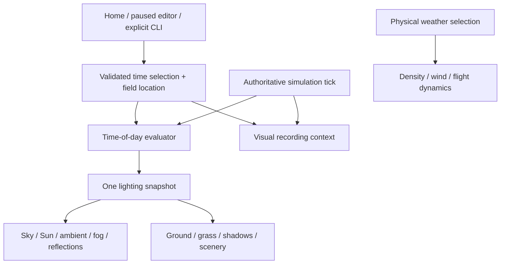

# Time of day: selectable light, credible darkness

2026-10-10 · Revision 4 · Step prefix: **TOD**

**Status: fixed selectable time (TOD-01…07) implemented and software-verified. TOD-08a paired checkpoints are implemented and software-verified; TOD-08b paused editing is implemented, with final regression checks running. Legacy daylight remains the default. Target-display/pilot acceptance is pending; progression and richer night lighting remain later slices.**

Owns this plan, `docs/research/time-of-day-investigations/` and `research/time-of-day/`, `app/environment/` and `app/tests/test_time_of_day_*`. Shared render, field-data, UI, session, trace and scenery changes stay with their existing owners. This is the scoped execution plan for the time-of-day part of [Landscape L19](LANDSCAPE-PLAN.md); L19's unrelated weather/birds proposals retain their owners.

Research: [TOD-00](research/time-of-day-investigations/TOD-00/README.md), [primary sources](research/time-of-day-investigations/TOD-00/primary-sources.md), [integration audit](research/time-of-day-investigations/TOD-00/integration-audit.md). Runtime baseline: `7fe3d84`, inspected 2026-10-10. Implemented command usage and trace boundaries are recorded in [TOD-05](research/time-of-day-investigations/TOD-05/README.md); TOD-08a contracts are in its [implementation report](research/time-of-day-investigations/TOD-08a/README.md); TOD-08b behavior and validation are in its [implementation report](research/time-of-day-investigations/TOD-08b/README.md); subsequent slices remain proposals.

## Outcome and delivery boundaries

The pilot can select any local clock time from 00:00 to 23:59. The sun, sky, clouds, ambient illumination, reflections, haze and shadows agree. At night an unlit airplane can become impossible to locate or orient; the renderer does not hide its mesh at a clock threshold or secretly brighten it. A silhouette may still be visible against a brighter sky. Detection and attitude recognition are different acceptance questions.

First delivery: a static selected time in the existing procedural field, configured from Home and reproducible by CLI. Include the complete dawn–day–dusk–moonless-night range, all four current aircraft, current cameras, scenery on/off and saved preferences. Keep the current daylight rendering as an explicit legacy preset and regression reference until the new default passes owner review. Do not relabel its arbitrary 225° azimuth / 45° elevation as an astronomical noon.

Paused selection is implemented in TOD-08b. Later deliveries add time progression, moon/stars, equipped-aircraft and field lighting, and optional glare. Live weather, diurnal temperature/wind simulation, photometric display calibration, a global timezone database and a renderer migration are separate projects. The owner authorised implementation of the fixed-time delivery on 2026-10-10. Later slices retain separate proof and review requirements.

## Expected experience

Local hours alone do not determine lighting. Date, latitude, longitude, UTC offset, clouds and terrain horizon matter. For a given site, presets resolve to astronomical events or solar elevation; they do not assume sunrise at 06:00 and sunset at 18:00.

| Condition | Expected scene | Pilot consequence |
| --- | --- | --- |
| Deep night, no Moon or lamps | Very weak natural background; dark field and aircraft; no solar disc, halo or sun shadow | Losing the aircraft is expected; pause/restart and menus remain easy to use |
| Predawn / astronomical twilight | Sky begins to brighten near the approaching Sun; stars fade later if implemented | A silhouette may appear before its attitude becomes readable |
| Nautical / civil twilight | Increasing horizon brightness, weak ground detail, little direct sunlight | Colour markings remain harder to interpret than silhouette; no instant day/night switch |
| Sunrise / low morning Sun | Warm direct light, bright solar region, long bounded shadows, sky fill in shade | Strong difference between looking toward and away from the Sun |
| Solar noon | High direct illumination, shorter shadows according to latitude/date, neutral daylight | Preserve white-wing detail and useful contrast without washing out the field; noon is not always overhead |
| Afternoon / sunset | Sun direction follows the same astronomical path; warmer low-angle light and lengthening shadows | Backlighting may obscure markings; sunset continues into twilight after the disc disappears |
| Moonlit night, later | Moon contribution depends on phase, altitude, cloud cover and whether it is above the horizon | Visibility can improve, but remains unlike daylight; no permanent full Moon opposite the Sun |

Use the solar centre's geometric elevations −6°, −12° and −18° as twilight reference boundaries, not visibility switches. Conventional sunrise/set uses approximately −0.8333° under a standard unobstructed horizon; actual terrain and refraction complicate it. These definitions do not prescribe aircraft contrast or sky brightness. See [USNO definitions](https://aa.usno.navy.mil/faq/RST_defs).

## Relationship to the current simulator

| Existing system | Integration / constraint | Owner |
| --- | --- | --- |
| [Visual atmosphere](../app/render/atmosphere.gd), [Spec](../app/spec.gd), [sky](../app/render/sky.gdshader) | Replace fixed lighting inputs with a single evaluated snapshot; keep the legacy snapshot exact. Preserve the shared linear-colour fog/horizon formula | Landscape / visual |
| [Ground](../app/render/ground.gdshader), [near grass](../app/render/near_grass.gd), [treeline](../app/render/treeline.gdshader), horizon and field surfaces | Update every material consumer, including copied and fallback surface materials; audit tree fill/atlas shading at low light | Landscape / visual |
| [Airplane shadow](../app/render/shadow.gd), [scenery shadows](../app/scenery/ground_features.gd), [cue grounding](../app/render/flight_cue_shadows.gd) | Separate directional cast shadows from contact darkening and the optional vertical pilot aid. Remove daylight-only assumptions | Visual / scenery |
| [Main flight](../app/main.gd), [Home scene](../app/ui/home_scene.gd) | Construct lighting before geometry; retain light/environment handles. Home preview and flight use the same selected snapshot, with separate scene lifetimes | Main line / UI |
| [Weather editor](../app/ui/weather_dialog.gd), [preferences](../app/app_state/preferences.gd), [app root](../app/app_root.gd) | Reuse draft/apply/cancel and accessible controls; add a separate lighting setting, not another physical-weather version | UI |
| [Physical atmosphere](../app/physics/atmosphere.gd), [ATMOSPHERE-PLAN](ATMOSPHERE-PLAN.md) | Temperature, QNH, humidity, density, trim and engine charge remain explicitly selected flight conditions | Physics |
| [Wind](WIND-PLAN.md), [shader clock](../app/render/shader_clock.gd) | Existing tick time still drives wind, cloud displacement and vegetation. Accelerating solar time must not accelerate any of these | Physics / visual |
| [Session](../app/sim/flight_session.gd), trace/checkpoints, crash pause | Store visual context beside physics context; restore it with an app-level checkpoint. Existing trace replay validates physics; a visual playback/seek feature is separate future scope | Main line / crash |
| [Aircraft models](../app/render/airplane.gd) | Lit materials respond normally. Any LEDs/navigation lights need per-aircraft equipment/anchors and owner evidence; preserve hinge/node contracts | Each model team |
| [Capture tools](TOOLS.md), [L6c readability](research/visual-quality-implementation/L6c/README.md), [SC-25](research/scenery-implementation/SC-25/README.md) | Record lighting identity and transition completion; test local aircraft contrast and human recognition separately | Visual / scenery |
| [Desktop delivery](DESKTOP-DELIVERY-PLAN.md) and exports | Probe Compatibility on the pinned engine, package new data and retain native target-GPU evidence | Desktop / visual |

The active editor file, [test_atmosphere.gd](../app/tests/test_atmosphere.gd), tests **visual** sky/fog/sun agreement and cloud timing. Extend that contract across lighting samples. [test_atmosphere_flight.gd](../app/tests/test_atmosphere_flight.gd) and [test_ui_atmosphere.gd](../app/tests/test_ui_atmosphere.gd) protect the separate physical atmosphere and its editor.

## Proposed state and interfaces

Keep a small pure evaluator and one renderer adapter; do not add a generic weather framework.

Proposed modules, finalized after TOD-01:

| Boundary | Responsibility | Must remain outside it |
| --- | --- | --- |
| `app/environment/time_of_day_config.gd` | Validate/normalize date, local time, offset, location reference, preset and schema; immutable copied configuration | Scene nodes, preferences I/O, physics mutation |
| `app/environment/solar_position.gd` | Pure float64 astronomical calculation; geometric elevation, azimuth and scalar NED direction | Godot rendering vectors, ambient colour choices |
| `app/environment/time_of_day.gd` | Resolve the current instant and twilight/day phase; evaluate documented lighting curves into a snapshot | OS wall clock, per-frame accumulated drift |
| Existing `render/atmosphere.gd` | Create resources and apply a snapshot coherently to registered consumers; report revision/update completion | Reading preferences or CLI at static initialization for new TOD settings |
| Existing app/session boundary | Own applied selection and future clock anchors; accept edits, record events, restore visual context | Solar calculations inside aerodynamic evaluations |

`TimeOfDayConfig v1` initially needs `mode` (legacy/astronomical), civil date, integer local seconds, fixed UTC offset in minutes and a field-location/profile identity. The UI selects minutes; captures may request seconds. A reference date is stored explicitly and is never silently replaced by today's date. Later progression has its own validated schema with clock rate and anchor tick/instant.

Add an optional validated geographic block to the field contract, coordinated with the field loader. Latitude/longitude are signed degrees, north/east positive; their provenance follows `{value, unit, kind, source}`. Fixed offset is a scenario choice, not inferred from longitude or the computer. Existing fields without geography remain valid and retain legacy daylight; using astronomical time on one requires an explicit reference location. Ship one clearly labelled synthetic reference-location profile with the default field, rather than claiming it is the owner's real club. TOD-02 records its exact values and reason. Do not move runway/terrain geometry when adding geography.

Interpret NED north as geographic true north for the solar evaluator. Use the existing `Frames.ned_to_render` boundary (render X east, Y up, −Z north); verify east/west before tuning colours. Geographic rotation of a real club field is a later field-authoring concern. Do not repurpose aircraft heading or physical-atmosphere elevation as a solar coordinate.

Supported initial calendar range: 2000–2100, a proposed product bound within the researched approximate-solar algorithm's domain. Validate Gregorian dates, leap years, finite values, latitude ±90°, longitude ±180°, offsets −12:00…+14:00 and clock values. Reject unknown versions and explicit malformed CLI input before flight. Leap seconds and historical timezone rules are outside v1. If a sunrise/sunset preset has no event at a polar site, say so and leave exact clock entry available; never manufacture an event.

Persist `lighting_config` separately from `weather_config`. Opening the editor and cancelling, or applying an untouched page, preserves existing weather data and schema exactly. Version the outer preferences only as required by its loader contract; migration tests cover all existing preference versions. A missing lighting preference maps to legacy daylight; damaged saved lighting produces a visible reset message and a safe known default.

## Player controls

Add a **Time of day** page to the existing Home conditions dialog, alongside the physical weather pages. Keep the initial controls small:

- A 24-hour slider paired with exact `HH:MM` entry; dragging changes only that value, using the existing slider/input precision conventions.
- Presets: Current daylight (legacy), Dawn, Solar noon, Sunset and Dark night. Event presets resolve against the selected date/location; show the resulting local time. If the requested event or dark-night interval does not exist, explain that inline and retain the previous valid selection.
- A compact field-location/date/UTC-offset summary, with date and reference-location selection in an advanced section. Avoid implying that the computer's timezone is the field's timezone.
- The predicted lighting phase and a contextual note when the chosen aircraft has no supported light equipment. Let the pilot proceed with a dark scene; no repeated confirmation dialog.
- Apply, Cancel and Restore current daylight. Apply updates the Home backdrop through the same renderer adapter used by flight; preview work is coalesced while dragging and expensive scenery updates happen at commit.

The initial release holds time fixed during flight. TOD-08b reuses these controls in a dedicated Pause dialog; return to Pause after applying and let Continue resume. Progression controls arrive only with TOD-09. Keep the radio exclusively assigned to flight, preserve keyboard focus/Esc behavior and EN/ES strings, and retain a usable layout at 800×600. Lost-aircraft recovery remains the existing pause/restart/end-flight flow; daylight restoration is an explicit selection, never automatic assistance.

## Astronomical and visual model

Use a primary-source solar-coordinate calculation with an explicit accuracy/domain statement and independent reference fixtures. Begin with the USNO approximate method if TOD-02b meets the needed angular error; retain NREL SPA as a reference option after checking its distribution terms. No online API is required at runtime. A proposed maximum **0.1° angular direction error** is an engineering target for TOD-02b, not achieved accuracy; compare direction near zenith where azimuth is ill-conditioned. Separate geometric altitude from any approximate atmospheric-refraction correction.

The current 45° Hosek-Wilkie fit is one daylight sample. The 2012 model is a daytime model; extrapolating it through negative solar elevations does not establish twilight realism. Start with bounded, continuous sky and illumination curves by solar elevation, explicitly estimated and evaluated through visual tuning and pilot review. TOD-00 supplies astronomical definitions, not calibrated sky-luminance data. TOD-03b collects a licensed reference set with camera/exposure limitations recorded; ordinary photographs guide appearance but cannot validate absolute brightness. Treat the 2021 post-sunset sky model as a later option if the simpler result fails review. Keep every fitted colour, energy and transition parameter labelled `estimated` or `derived` with its source and valid domain; Godot energy values are not measured lux.

A `LightingSnapshot` contains the resolved instant/config identity, geometric and apparent solar data if supported, direct-light colour/energy, sky zenith/horizon/cloud lighting, fog colour/energy/scatter, exposure policy, shadow strength and render-profile revision. Later lunar state is explicit. Consumers receive the same snapshot; none calculate their own sun or decide it is night from a hard-coded hour.

Use a finite basis at zenith/nadir: `Basis.looking_at` with a parallel up vector is not a safe universal construction. Interpolate directions using a continuous representation, not azimuth degrees across 359°→0°. Solar-disc clipping and the direct-light fade use the chosen apparent-horizon model; twilight fill remains after direct sunlight is gone. All divisions near the horizon need guards, including diagnostic/capture code.

## Rendering and darkness

Stay on Godot 4.7.2 Compatibility. Reuse the current sky shader, cloud field, haze equation and materials. Preserve the renderer-specific linear/sRGB handling already established by L2. Do not use an alternative sky/material without reproducing that colour contract.

1. **Direct light and sky:** update the visible disc, halo, sun direction, colour and energy together. Clouds darken with incident illumination; sunset cloud colour and silver lining cannot keep daytime constants. Direct light vanishes after the modelled apparent solar disc sets; a negative geometric elevation during refraction-assisted sunrise is not by itself a shutoff. Never shine an uncorrected below-ground light upward into the field/aircraft. The astronomical night starts with no Moon/lamp contribution, explicitly labelled as the initial night model.
2. **Ambient and reflections:** a dark sky with a cached daytime radiance map would still light the aircraft. Test background, diffuse ambient and shiny aircraft reflections together. Audit production materials for fixed emission/unshaded brightness; a surface should not glow merely because its albedo is white.
3. **Haze:** retain extinction as a separate visibility setting. Changing time changes in-scattered light, not automatically meteorological range, fog density or humidity. Match the engine fog and custom ground/grass fog at every phase so the 20 km field edge does not become a bright night seam. The existing daylight visibility convention is not a validated night-vision model.
4. **Exposure:** retain fixed exposure initially and calibrate lighting around it. Compatibility lacks the documented auto-exposure feature. Any later eye-adaptation approximation needs bounded gain, explicit state and replay behavior; it must not normalize night to daylight. Menus/HUD remain independently readable, with modest brightness; UI brightness must not alter world illumination.
5. **Contrast:** evaluate the actual airplane crop against its local background, toward/away from the Sun and against trees. Do not add an outline, ambient floor, emissive aircraft material or tracking light to make night pass a daylight visibility test. Existing auto-zoom is an explicit pilot aid; log its state and evaluate aids off/on separately.
6. **Occlusion:** visible terrain/clouds/trees must mask the solar disc and any glare consistently. Existing far hills are visual geometry, not physical collision terrain. Initial natural horizon clipping and existing geometry occlusion do not prove terrain-cast sunlight shadows; record that limitation. Any later glare occlusion uses a rendering/visual-horizon method, not invented collision data in the physics model.

The current sky adds its solar term after mixing cloud colour, so cloud cover does not yet attenuate that disc. TOD-03b must couple disc/halo visibility to the same cloud field and retain the zero-cloud control. The existing ground/grass custom light functions apply solar cloud transmission to every directional light; adding a Moon later requires separate solar/lunar handling rather than treating both as the Sun.

Noon brightness is a relative SDR representation, not real retinal illuminance. Check clipping, colour detail and backlit loss of orientation on the owner's display. Automated luminance measurements cannot establish that a monitor reproduces human night vision.

## Shadows, scenery and light equipment

The current airplane projection clamps the sun's vertical component and keeps positive opacity at all heights; it would leave an implausible shadow at night. Weight physical shadows by available direct illumination, bound low-angle extent, fade smoothly near the horizon and return an explicit “no cast shadow” state. Do not project a below-horizon Sun upward. Harden `main.gd` capture metadata, which currently divides by the sun's Y component without a horizon guard. Test zero, positive and negative elevations.

Scenery merges projected sun shadows during construction. For static selection, build them after resolving the light. For pause edits, rebuild only the affected shadow batches; retain geometry, object placement and identifiers. For progression, first prototype a bounded low-frequency update or shader projection; choose by measured hitch/visual error, not by rebuilding the whole field each frame. If that cost fails, an explicitly described contact-only shadow mode is an acceptable experimental fallback for progression, with owner review.

Contact grounding beneath posts/objects may remain as darkening-only shading, separate from directional shadows. Preserve the current default where it is valid. The vertical airplane shadow is an explicit height aid, not a Sun/Moon shadow; realistic night uses it off and the optional aid remains clearly identified in evidence. Do not enable engine cascaded shadows globally to bypass the work: the project already has a documented Compatibility colour/cost regression.

No aircraft gets lamps merely because its full-size counterpart has them. A later night-equipped aircraft needs sourced installation positions, colour, visibility sectors and flash periods from its model owner. Start with a verified emissive light fixture; add bounded real lights only when they must illuminate a surface. Small sources must stay occluded by the airframe and landscape, and a visible light must not expose the entire aircraft at distance. Authentic night equipment and training aids have separate labels/settings. Preserve all generated-model workflows.

Field/runway lamps belong to the scenery/field track, are opt-in and use a measured light budget. They do not silently turn the existing daytime club into a lit runway. Birds, people, ambience and future smoke can later consume lighting context; day/night ecology and sound replacement are not prerequisites for selectable time, and scenery remains off by default until Gate SC.

## Clocks, session behavior and reproducibility

The selected civil time identifies an instant; simulation time is elapsed physics time; `sim_clock` is the existing wrapped GPU animation time. Keep all three meanings separate. Never derive the Sun from wrapped `sim_clock`, shader `TIME`, `_process(delta)` accumulation or OS time.

| Action | Required behavior |
| --- | --- |
| Start a flight | Freeze a copy of the applied selection. Resolve lighting before the first visible frame |
| Fixed-time flight | Lighting holds its selected solar instant; clouds, wind and flight still advance normally |
| Pause, focus loss, calibration, radio disconnect, crash pause | Progressing solar time freezes wherever simulation ticks freeze |
| Restart | Reuse the most recently applied configured start time at tick zero; reset any solar/adaptation anchors, as well as current flight reset behavior |
| End flight → Home | Show the configured start selection, not a silently saved elapsed hour. Home is still; its cloud composition keeps its own documented fixed clock |
| Apply while paused | Validate draft, prepare lighting resources, then apply atomically; stay paused and retain aircraft state/controls. Cancel has no effects |
| App-level checkpoint restore, later | Restore paired visual configuration and time anchor alongside the existing physics restore; old physics-only artifacts identify visual context as missing and use explicit legacy fallback |
| Recorded context / future visual playback | Reconstruct a lighting sample at a known tick from saved context. A rendered trace player and seek UI require a separate feature plan; they are not supplied by current physics replay |
| Direct CLI / captures | Resolve solely from explicit arguments or the deterministic legacy default, never the user's preferences |

For progression, derive the current UTC instant from `anchor_utc + (tick − anchor_tick) * fixed_dt * rate`, evaluated in float64 or integer time units. Initial rates: 0× and 1×; a bounded accelerated preview rate (proposal: 30×) is enabled only after transition/performance checks. Rate affects sunlight only. Calendar rollover preserves the date; 23:59→00:00 must not repeat the same day's solar declination. Changing rate or time creates a new anchor, recorded at an exact tick.

Keep lighting out of physical weather hashes and aerodynamic checkpoint state. Add a versioned **visual-context envelope** at the app/session-recording boundary, containing configuration/profile identity, anchor, rate, ordered edit events and any later adaptation state. Link it to trace identity/content hash. For the fixed-time slice, TOD-05 uses an optional self-contained `visual_context` JSON header in the existing extensible trace metadata; CSV formats and columns remain unchanged. A future event/checkpoint envelope must report missing/mismatched context, never claim exact visual replay. Freeze configuration once recording starts unless events are being recorded. Physics-only replay remains supported. Paired checkpoint restoration and pure reconstruction of lighting at a known tick are in scope; building a rendered trace player, backward seeking and a playback interface is deferred. A sidecar alone does not provide them.

Captures add solar time/date/offset, location/profile hash, Sun direction/energy, exposure, active aids, renderer/version, sky-update state and visual revision. Preserve `--t` as elapsed simulation/capture time. Fixed-time selectors are `--time-of-day=HH:MM[:SS]`, `--date=YYYY-MM-DD` and `--lighting=legacy|astronomical`. Add `--lighting-config=<file.json>` for a complete selection, including resolved date/time/UTC offset and location/profile identity, validated by the same loader as Home. This form is mutually exclusive with individual lighting selectors; ordinary flight/capture flags remain usable. Record the configuration content/hash, not just its path, so every Home selection is reproducible without preferences. These selectors are implemented at the TOD-05 app boundary. Incomplete astronomical CLI requests use only documented pinned profile values; invalid explicit values fail before flight.

Avoid global mutable selection state leaking between Home, flight and fixtures. Existing global shader uniforms assume one active world; the first editor preview should reuse that scene, rather than creating a simultaneous second world that would change the flight's uniforms. Multiple live previews require per-world material ownership first.

## Performance and capture policy

Current `Sky.PROCESS_MODE_QUALITY` already recomputes radiance when the cloud-offset uniform changes (once per simulation second); it is not permanently frozen. Adding solar uniforms each frame can magnify that cost. The [Sky API](https://docs.godotengine.org/en/stable/classes/class_sky.html) provides incremental and realtime alternatives, but the pinned GLES3 implementation and actual captures decide which behavior is usable.

TOD-01 compares bounded-cadence QUALITY, INCREMENTAL and REALTIME with daytime→night jumps, sunset sweeps and the current clouds. Measure update frames, stale ambient/reflections, p50/p95/p99 and worst-frame hitches. An incremental map that leaves daylight reflections during a night selection is a correctness problem. During paused edits, prepare/warm the new environment before commit; captures use a documented completion criterion, not an arbitrary unmeasured sleep.

Calculate astronomy only when inputs or the quantized solar instant change; do not run it at each RK4 stage. Interpolation may smooth display movement while preserving deterministic capture evaluation. Choose update cadence after measuring angular steps and sky cost at the supported rates. Scene/material creation and scenery rebuilds stay outside the active flight's hot path.

Retain ROADMAP's ≤500 µs physics-tick budget and Landscape's ≤300 draws / ≤1 M primitives for the landscape-only view. Propose an incremental TOD p95 frame-cost allowance of **≤1 ms at 720p** on the slowest supported target, to be accepted/revised from TOD-01 evidence; it is not a measured result or a substitute for the total frame budget. Record total latency/frame-time regressions as well as means. llvmpipe establishes reproducible rendering, not target-GPU speed.

## Small steps and proofs

Each row is independently reviewable; split it further if it cannot be proven in one small change. Existing owners implement shared-file edits. The status column distinguishes implemented steps from proposed follow-up work.

| ID | Step | Proof | Dependency | Status (date) |
| --- | --- | --- | --- | --- |
| TOD-00 | Audit runtime, plans and primary sources; register scope | Linked reports distinguish inspection, source facts and unresolved probes; document/link review | Existing L19 and track registry | Recorded 2026-10-10 |
| TOD-01 | Isolated Compatibility lighting/radiance spike and frozen baseline | Day/night change settles in background, diffuse and specular probes; process-mode cost, horizon/sRGB checks; no production code adoption | Visual owner, pinned engine | Verified on llvmpipe; target GPU pending ([evidence](research/time-of-day-investigations/TOD-01/README.md)) |
| TOD-02a | Config validation and field reference-location contract | Old fields/preferences accepted; invalid dates/locations rejected; synthetic location labelled; deterministic civil↔UTC cases | Field/UI owners; TOD-01 | Implemented; configuration/migration boundary checks ([evidence](research/time-of-day-investigations/TOD-02/README.md)) |
| TOD-02b | Pure solar evaluator | Independent direction/event fixtures across seasons, hemispheres, poles, zenith and midnight; stated angular tolerance/domain | TOD-02a | Implemented; independent solar fixtures pass ([evidence](research/time-of-day-investigations/TOD-02/README.md)) |
| TOD-03a | Thread one legacy lighting snapshot through all consumers | Existing default images on pinned renderer and full physics outputs unchanged; Home/flight/fixture isolation | TOD-01; visual/main owners | Implemented; legacy snapshot preserved ([evidence](research/time-of-day-investigations/TOD-03/README.md)) |
| TOD-03b | Daylight, twilight and moonless-night sky/light/fog | Multi-phase fog/ground/sky equality; no direct sunlight after apparent disc set, no stale radiance; bounded transition images | TOD-02b, TOD-03a | Implemented with estimated curves; reference/display calibration pending ([evidence](research/time-of-day-investigations/TOD-03/README.md)) |
| TOD-04a | Sun-dependent aircraft shadows and capture math | No invalid division/basis; no physical sun shadow in darkness; low-angle footprint bounded; vertical aid separate | TOD-03b; main/visual owners | Implemented; night and horizon tests pass ([evidence](research/time-of-day-investigations/TOD-04/README.md)) |
| TOD-04b | Static scenery/material compatibility at arbitrary time | Ground/grass/trees/props/cues and all aircraft coherent with scenery off/on; fixed-sun artifacts rejected | TOD-04a; scenery/model owners | Implemented; fleet/scenery matrix verified on llvmpipe ([evidence](research/time-of-day-investigations/TOD-04/README.md)) |
| TOD-05 | CLI selection, visual manifest and frozen recording context | Complete Home-equivalent config input, fresh-process repeats, invalid flags fail; 30/60/144 fps samples agree at equal ticks; daylight/night physics states and weather RNG identical | TOD-04b; trace/tool owners | Implemented; CLI and physics-independence checks pass ([evidence](research/time-of-day-investigations/TOD-05/README.md)) |
| TOD-06 | Home Time of day editor and saved selection | Draft/apply/cancel, defaults, migration, EN/ES, keyboard/mouse, radio isolation, 800×600; start/restart/Home consistency | TOD-05; UI owner | Implemented; UI, persistence and EN/ES checks pass ([evidence](research/time-of-day-investigations/TOD-06/README.md)) |
| TOD-07 | Deliver fixed selectable time for pilot review | Full app suite, exported-build smoke, daylight regression plus twilight/night flight kit and target-GPU timings | TOD-06; existing Gate L/2 review | Software checks and Linux export pass; target GPU/pilot acceptance pending ([evidence](research/time-of-day-investigations/TOD-07/verification.md)) |
| TOD-08a | Paired visual-context checkpoint restore and edit-log schema | Restored lighting snapshot matches at the saved tick; pure event evaluation at known ticks; old/missing context handled; atomic invalid-restore refusal, without a playback UI | TOD-05; session/trace owners | Implemented; full suite, atomic restore and rendered round-trips pass ([evidence](research/time-of-day-investigations/TOD-08a/README.md)) |
| TOD-08b | Paused time editing | Rapid day↔night applies/cancels leave physics unchanged; no partial visible lighting or unintended resume; edit events reconstruct the selected lighting sample | TOD-07, TOD-08a; UI owner | Implemented; final regression running ([evidence](research/time-of-day-investigations/TOD-08b/README.md)) |
| TOD-09 | Deterministic 1× progression, then bounded acceleration | Pause/focus/crash/restart, midnight/year rollover, equal-tick frame-rate parity, scenery-shadow continuity and worst update hitch | TOD-08a/b; scenery update policy proven | Proposed |
| TOD-10 | Moon position/phase and restrained stars | Independent lunar fixtures, Moon below horizon contributes zero direct light; correct phase/direction, cloud occlusion; repeatable sky | TOD-07; separate source/data/license review | Optional later slice |
| TOD-11 | One supported night-equipped airplane and optional field lamps | Authored equipment/anchors, occlusion/sectors, local illumination, target cost and pilot identification evidence | Model/scenery owners; TOD-07 | Optional later slice |
| TOD-12 | Optional sun glare / bounded eye-adaptation experiment | Occlusion and off-switch; no extra night visibility, no persistent replay state gap; owner comfort/readability | TOD-08a; visual/UI owners | Optional; stop if it hurts flying |

Do not make TOD-07 wait for the Moon, glare or real lamps. Each first-slice build remains useful and explicitly describes its moonless-night and shadow approximations. Later weather/thermal coupling needs a new sourced physics proposal under M5; no automatic midday heat, morning fog, turbulence or wind is inferred by this plan.

## Verification and acceptance matrix

| Area | Cases / oracle | Passing condition |
| --- | --- | --- |
| Astronomy | Independent ephemeris fixtures; equinox/solstice, both hemispheres, polar day/night, UTC/date boundaries and zenith | Within declared algorithm tolerance; finite direction; absent events handled; no fitted oracle from the implementation itself |
| Visual consistency | Legacy, noon, low Sun, sunrise/set, −6/−12/−18° boundaries and deep night | Shared snapshot in every consumer; finite pixels/data; continuous transitions; no bright seams/daylight cloud or reflection residue |
| Shadows | Sun east/west, horizon ±epsilon, overhead and below horizon; scenery on/off | Correct side and bounded extent; physical solar shadows disappear with direct light; no infinities in capture manifests |
| Flight isolation | Same applied controls, aircraft, wind seed and physical atmosphere at noon/night | Identical complete physics states, loads, trim, engine state and weather RNG at equal ticks; compare physical payload independently of new visual metadata |
| UI / lifecycle | Legacy prefs, untouched Apply, cancel, invalid values, restart, Home return, focus loss, all pause paths, EN/ES | Exact intended persistence; no weather-schema loss, radio navigation, accidental resume or world-state leak |
| Recording / clocks | Missing/new visual context, paired checkpoint restore, known-tick event reconstruction, rate edits, long run, 1024 s shader wrap, leap/year rollover | Deterministic solar instant at a tick; atomic restores; animation/physics clocks retain their semantics; no claim of a rendered playback/seek feature |
| Perception | Aircraft at 30/100/200 m; at least level, banked and nose-on; sky/trees/ground, sunward/antisunward; production pilot camera first | Daylight baseline stays readable; twilight degradation documented; genuine darkness is allowed to defeat detection; separate detection/attitude scoring |
| Fleet / rendering | All four aircraft, shiny/white/dark surfaces, cameras, scenery off/on, clear/hazy visibility presets, 720p and owner resolution | Correct lighting response; no model-specific brightness workaround, stale material or aid state |
| Packaging / performance | Real Compatibility captures plus native exported smoke and target frame logs | Data available from installed pack; no engine errors; measured cost within accepted budgets |

Use a reduced pairwise matrix for routine captures and a wider release kit; avoid a full Cartesian product on every edit. Reuse L6c's blinded attitude protocol but create separate night expectations instead of weakening daylight thresholds. Ground/sky darkening alone is insufficient: retain a daytime positive control and aircraft-on/off background pairs. Define night thresholds from reference scenes before tuning; an all-black output cannot pass the twilight/day controls.

Useful negative controls, run only on scratch copies: stale daytime radiance; omitted near-grass update; reversed east/west; solar shadow below the horizon; a fixed bright cloud; maximum ambient fill at night; solar time taken from wrapped shader time. Each must fail its intended check. Do not re-record flight goldens for a visual feature.

For implementation steps, run the focused tests/captures and then `app/test.sh` as required by the repository. Real GPU captures, physical pilot evaluation and exported-platform evidence remain separate claims. A plan-only change needs document/link checks, not an unmodified full physics run.

## Decisions to resolve with evidence

| Question | Proposed starting point | Resolution point |
| --- | --- | --- |
| What geographic setting is the fictional field using? | Labelled, pinned synthetic reference; real club coordinates only from evidence | TOD-02a, before astronomical user controls |
| Which sky update mode/cadence is affordable and coherent? | Compare pinned Compatibility modes; preserve legacy until one passes | TOD-01, revisit for TOD-09 |
| Are authored twilight curves sufficient? | Bounded estimates with sourced solar geometry; richer sky only for an observed gap | TOD-03b and pilot review |
| Should selected lighting replace today's default? | Explicit legacy remains default during rollout | TOD-07 owner review; record any accepted default change in DECISIONS |
| Is night visibility believable on the target screen? | Moonless, unlit aircraft may be lost; fixed exposure and no hidden assistance | TOD-07 owner session, alongside Gate L; keep its daylight acceptance intact |
| Can scenery shadows progress without hitches? | Static reconstruction first, then a measured bounded dynamic path | Before enabling TOD-09 |

The initial [TOD-01 probe](research/time-of-day-investigations/TOD-01/README.md) retains QUALITY after verifying the existing custom sky, matte ambient and metallic reflections under day→night changes. Software-renderer results are not target-GPU performance acceptance. Subsequent work must preserve that distinction.
