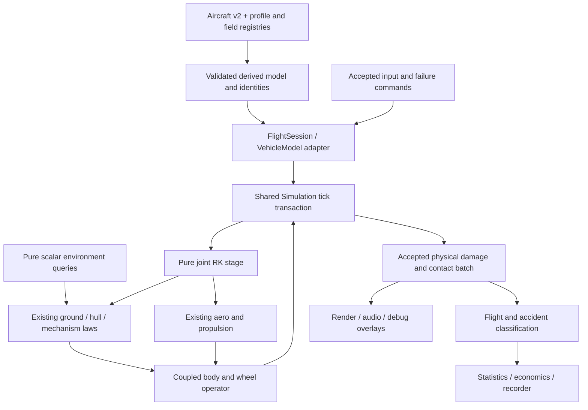
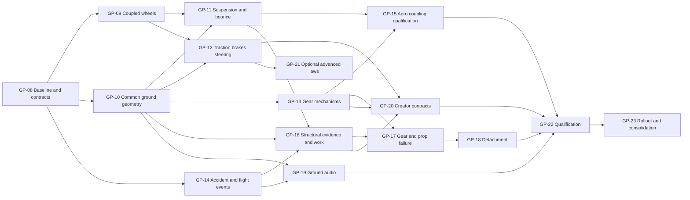

# Advanced ground, takeoff, landing and damage physics masterplan

**Status: design proposal; no runtime implementation authorized by this mission.** Audit date: **2026-10-25**. Owner: existing **GP ground-physics track**, with SF, AS, aircraft, CR, AUD, AE, UI-FS, input, landscape and performance owners retaining their interfaces. This plan extends GP-00…07; it does not replace their delivered evidence. Proposed execution steps are GP-08…23 (§12). Every implementation step remains pending.

Baseline commit: `4336ba6897e46adef2fe88aa24f55e639d5ad140`. Source symbols, rather than graph line numbers, are the audit references: the existing knowledge graph was substantially stale, so discoveries were checked against current files. Concurrent work in this shared tree is explicitly outside this mission. The dated [source and audit ledger](research/ground-physics/GP-08/sources.md) records execution, source identity, research limitations and any checks actually performed. Numerical targets below are **proposed acceptance criteria**, not achieved measurements or universal physical limits.

Canonical boundaries: [stack](STACK.md#boundaries-and-data-flow), [aircraft contract](AIRCRAFT_CONTRACT.md), [ground evidence](research/ground-physics/README.md), [crash guide](CRASH-DAMAGE-PLAN.md), [audio guide](AUDIO-PLAN.md), [Workshop plan](plans/aircraft-editor.md), [statistics plan](flight-statistics-plan.md), [flight logging](FLIGHT-LOGGING.md), [tool index](tools/README.md). This document owns the integrated future sequence; those guides continue to own current behavior and their existing qualification gates.

## 1. Executive summary

OpenRC already has a substantial ground model. Aircraft are integrated by a custom float64, six-degree-of-freedom kernel at 240 Hz, with RK4-coupled wheel rim speeds, spring/damper support, separate rolling and sliding terms, friction limiting, static anchors, terrain micro-relief, rudder-linked steering, ground effect, retractable-gear drag, soft airframe contact and propeller strikes. Replacing this with `VehicleBody3D` or a second `RigidBody3D` solver would discard valuable behavior and create conflicting force owners.

The largest gaps are **physical parameter evidence, coherent wheel/body energy accounting, geometry, state semantics and integration**:

1. Gear springs were partly selected to satisfy an older numerical envelope. The GP-06 audit measured simulator sag of roughly 17.5–34.5 mm, not real aircraft sag. Inflating allowable compression to pass a borrowed full-scale reserve-drop convention did not measure RC structural strength.
2. A wheel is still represented by its body-fixed level-attitude bottom point. Pitch, bank, camber and retraction change the real rim contact location. Hull and propeller ground queries also differ from wheel terrain queries outside lake geometry.
3. The wheel spin reaction, locked-body inertia and relative rim speed require a single energy derivation. §4 gives a falsifiable rotating-body counterexample under the current additive energy convention; this is an inspection finding to reproduce, not a newly measured flight defect.
4. Friction, rolling loss, braking and roughness are partly entangled. The surface table has no explicit material identity; roughness is selected through rolling-factor values. Brakes only act in loaded contact and the session exposes brake demand through retractable-gear capability.
5. Retracts have continuous extension and drag, but wheel support is admitted only at full extension. Partial deployment does not have a complete mechanical collision/support model, door forces, asymmetric state or failure contract.
6. Soft belly slides already continue in ordinary interactive flight. Gear overtravel and selected severe hull contacts still terminate it. There is no general persistent aircraft component-damage model; wreck breakup and repair estimates are not damaged-flight mechanics.
7. Contact observations, audio and the planned statistics detector are valuable foundations, but there is no accepted shared takeoff/landing/accident episode contract covering a survivable gear-up crash. Statistics' terminal-crash assumption must be amended explicitly.

**Recommended architecture:** retain the shared kernel and aircraft aerodynamic model. Extend the existing ground laws through versioned aircraft modules, explicit surface/material queries and a coupled wheel/body formulation. Keep compliant normal support; select substeps from physical stiffness and numerical accuracy, never soften hardware merely to fit a tick. Stage all physical changes transactionally. Publish accepted contact, damage and flight-episode observations to audio, reports and statistics. A statistical accident is independent of damage severity and independent of whether physics continues.

**Required visible outcome:** as aerodynamic lift and pitching moments change, per-wheel reactions change through the equations of motion. Rolling loss decreases with load; the last contact unloads naturally. Touchdown restores support through finite compliance, wheel spin-up and dissipative tire forces. No force is enabled by a takeoff score, airspeed threshold, animation state or sound cue. Gentle gear-up contact emits an accident/crash classification and may continue sliding, steering or flying when the physical model remains valid.

**Priority order:** P0 conservation, contact/query correctness, deterministic lifecycle and accidental termination; P1 measured suspension, wheel geometry/traction, gear mechanisms and aerodynamic coupling; P2 persistent damage, complete feedback and authoring; P3 measured refinements, deformable terrain and polish. Rendering qualification is **1920×1080 first**, higher resolutions second, 720p fallback last. Existing 720p defaults are not qualification evidence.

## 2. Repository audit

### 2.1 Runtime, scene and solver identity

| Item | Verified implementation | Architectural consequence |
| --- | --- | --- |
| Engine | [get-godot.sh](../app/get-godot.sh) pins **4.8-beta1**, exact identity `4.8.beta1.official.4d10419ca`, official archive SHA-512 per platform. [project.godot](../app/project.godot) declares 4.8. | Use this binary/source tag for acceptance. Do not quietly substitute stable or latest documentation behavior. |
| Native 3D backend | No `physics/3d/physics_engine` override is set. In this pinned engine the setting's default is **GodotPhysics3D**. The fact that newly created projects select Jolt does not change an existing project's unset setting. | Native backend is not the flight solver. Log the resolved setting in future acceptance receipts, especially exported builds. |
| Application route | [startup.tscn](../app/ui/startup.tscn) → [app_root.tscn](../app/app_root.tscn)/[app_root.gd](../app/app_root.gd) → [main.tscn](../app/main.tscn)/[main.gd](../app/main.gd). `main.tscn` has a `Node3D` root, not a flight `RigidBody3D`. | Session owns aircraft physics; Main assembles presentation, input actions and reports. |
| Kernel | [simulation.gd](../app/sim/simulation.gd), `step`, checkpoint/restore and accepted `stepped` publication; [vehicle_model.gd](../app/sim/vehicle_model.gd) defines stage, continuous state, event and substep callbacks. | One model per simulation. No `if aircraft` branch in the kernel. |
| Timing | 240 Hz, `dt=1/240 s`; maximum 12 catch-up ticks per rendered frame; custom render interpolation, jitter fix 0. Kernel supports bounded contact substeps. | Physics time, not render time or wall time, drives contact, damage and episode timers. Slow rendering can slow simulation. |
| Coordinates/state | 13 rigid-body float64 values plus continuous blocks. FRD body, NED world, quaternion `[w,x,y,z]` maps body to NED. Rendering conversion at [frames.gd](../app/render/frames.gd). | No `Vector3`, `Basis`, `Quaternion` or `Transform3D` simulation state. Native vector queries, if used, are boundary adapters only. |
| Moving mass | [mass_inventory.gd](../app/physics/mass_inventory.gd), [fixed_datum_body.gd](../app/physics/fixed_datum_body.gd), session `mass_properties()`. O is the fixed reference datum; live CG/inertia depend on fuel. | Contact point velocities use O-relative arms; dynamic moments/mobility use live CG. Do not subtract CG twice. |
| Landscapes | [catalog.gd](../app/landscapes/catalog.gd), [field_loader.gd](../app/data/field_loader.gd), selected field data and scenery inventory. [environment.gd](../app/sim/environment.gd) supplies physical wind, atmosphere, terrain, lake and optional road queries. | Extend this environment contract rather than add a parallel runway detector. |

### 2.2 Subsystem classification and exact seams

**Existing** means implemented; **reusable** means suitable foundation; **incomplete** means a real implementation lacks a requested capability; **incorrect** identifies a demonstrated contract/model inconsistency within stated assumptions; **missing** means absent in the audited baseline. None of these labels establishes physical calibration. Later concurrent UI-FS edits are not treated as accepted baseline functionality.

| Subsystem / classification | Source and functions | Evidence, limitation and required integration |
| --- | --- | --- |
| Flight force model — existing/reusable | [aero.gd](../app/physics/aero.gd), `loads`, strip/envelope paths; [propulsion.gd](../app/physics/propulsion.gd); session `_loads`, joint stage evaluators | Aerodynamics, propulsion and contact already sum physical loads. Preserve free-flight laws; add ground contributions at their current boundaries, not in Main. |
| Body integration — existing/reusable | [rigid_body.gd](../app/physics/rigid_body.gd), `derivative`; [rk4.gd](../app/physics/rk4.gd); `VehicleModel.stage` | Kernel handles accepted state/rollback. A contact projection must update body and wheel state together; existing body-only post-tick callbacks cannot do that. |
| Gear support — existing/incomplete | [ground_contact.gd](../app/physics/ground_contact.gd), `loads`, `evaluate`, `compressions`, `collapsed`, `substeps`; [ground_wheels.gd](../app/physics/ground_wheels.gd), `frame`, `evaluate` | Spring/damper load and terrain normal already exist. Physical stiffness evidence, round contact, explicit stroke/bottom stop and surviving collapse are missing. GP-06 remains the parameter warning. |
| Wheel rotation/traction — existing/incomplete; energy consistency issue | `GroundWheels.evaluate`, `coefficients`, `anchor_step`; [wheel_profiles.gd](../app/physics/wheel_profiles.gd), `apply_to_model`, `_validate_physics_limits` | Rim speed, longitudinal slip and combined tangential bound exist. Current force slope is capped by numerical relaxation, not a measured tire law. Coupled-body energy and general static rolling need §4/GP-09 proof. |
| Resting/static friction — existing/incomplete | `GroundContact.anchor_step`, `anchor_energy`; `GroundWheels.anchor_step` | Anchors use low-speed thresholds and separate rolling/lateral limits. Do not call this a fully calibrated tire static-friction law. Preserve spring energy and deterministic anchor lifecycle during replacement. |
| Terrain/material lookup — existing/reusable but incomplete | [ground_surfaces.gd](../app/physics/ground_surfaces.gd), `validate`, `build`, `build_airframe`; [ground_terrain.gd](../app/physics/ground_terrain.gd), `sample_validated`, `amplitude_for_rolling_factor`; [surface_friction.json](../app/data/ground/surface_friction.json) | Per-wheel rectangle precedence is already used. `runway` means maintained turf in the default field. Only runway/rotorpad/mown/rough types are accepted; asphalt/concrete names in crash presentation are not full field support. Roughness is inferred from rolling factor, including reserved rotorpad 0.5. |
| Hull support — existing/reusable/incomplete | [hull_contact.gd](../app/physics/hull_contact.gd), `prepare`, `loads`, `contacts`, `terminal`, `prop_disc_depth` | Soft hull forces allow slides. Outside lake coverage the ordinary hull/prop plane is not the wheels' full micro-relief query. Numerical penetration is not measured soil sinkage. More probes alone must not multiply stiffness or friction. |
| Obstacles/water — existing/reusable/incomplete | [scenery_collision.gd](../app/physics/scenery_collision.gd), session scenery/lake post-tick paths; [lake_collision.gd](../app/physics/lake_collision.gd), [impact_snapshot.gd](../app/physics/impact_snapshot.gd) | Swept/typed impacts and bounded responses exist. Reuse their crossing evidence, immutable inventory and accepted damage masks. Sparse aircraft proxies and moving gear/attachments remain coverage gaps. |
| Ground starts — existing/reusable | [ground_start.gd](../app/physics/ground_start.gd), `solve`, `_contact_feasibility`; session runway/reset setup | Start qualification solves supported geometry and checks stability. Extend to new roles/curved wheels; never spawn an invalid aircraft by clamping its altitude. |
| Steering — existing/incomplete | `GroundWheels.frame`; session control deflections; [controls.gd](../app/physics/controls.gd) | Signed steering follows actual rudder servo output. No general independent tiller, caster trail, tire aligning moment or shimmy dynamics. Authority must depend on N and tire traction, not a direct yaw-rate override. |
| Brakes — existing/incomplete | `GroundWheels.evaluate`; session `set_wheel_brake`, `gear_is_retractable`, `_inputs`; Main `_clear_wheel_brake`, `_input`, `_unhandled_input` | `B` supplies full brake and releases on key-up/focus loss. Session acceptance is gated by retractability; brake torque evaluation is inside loaded-contact logic and early airborne exit. No independent left/right channel or stopped-wheel constraint. |
| Retracts — existing/incomplete | [retractable_gear.gd](../app/physics/retractable_gear.gd), `advance`, `pose`, `drag_loads`; session `current_landing_gear`, `set_gear_down`, `gear_state` | Extension timing, interpolation, CdA force/moment and weight-on-wheels command inhibit exist. Inhibit is a simulator operator rule, not declared pneumatic hardware. Full mechanical support during intermediate states, per-leg locks/failures and door loads are missing. |
| Ground effect — existing/incomplete | [ground_effect.gd](../app/physics/ground_effect.gd), `factors`; `Aero` global/local wing and free-tail paths | Already modifies lift slope, induced drag/downwash continuously. Shared fit is approximate; add local clearance/planform evidence without multiplying the whole-aircraft lift a second time. |
| Propwash/shaft — existing/reusable/incomplete | [slipstream.gd](../app/physics/slipstream.gd), `stage_loads`; propeller, glow, electric and turbine evaluators | Tail wash is a washed-minus-free increment. Preserve installed capability and force bookkeeping; no universal throttle steering boost. Ground-effect interaction and wing wash remain model limits. |
| Prop strikes — existing/incomplete | session `_check_prop_strike`; `HullContact.prop_disc_depth`; `AircraftContactEvents.strike_event` | Turning prop contact can stop the engine and continue flight. Current 300 RPM trigger and disc proxy are explicit estimates; no complete stopped-blade orientation, shaft/mount failure or rotor impact-energy transfer. |
| Contact observations — existing/reusable | [aircraft_contact_contract.gd](../app/physics/aircraft_contact_contract.gd), `describe`; [aircraft_contact_events.gd](../app/sim/aircraft_contact_events.gd), `hull_events`, `impact_event`, `strike_event`, `validate_events`; session `_on_sim_stepped`, `contact_events` | Stable IDs, new/persistent/ended lifecycle and strict measurements exist. Support role is only `wheel_support`; ordinary wheel support is not a touchdown event. Schema is closed: adding fields requires versioned readers. |
| Terminal response — existing/incomplete | session `_crash`, `reset`, `reload`; `HullContact.terminal`, `GroundContact.collapsed` | Severe hull impact/depth and gear overtravel pause the flight. Separate accident classification from this control path. Preserve invalid-state fault containment. |
| Structural damage — missing as general flyable model | [crash guide](CRASH-DAMAGE-PLAN.md), existing `app/render/crash/`; proposed `app/damage/` owned by CR | Mesh breakup, debris and severity are presentation. They cannot silently change aircraft inertia, lift or control effectiveness. Structural calibration and continued damaged-flight topology need an explicit transaction. |
| Accident economics — existing/reusable/incomplete | [incident.gd](../app/economy/incident.gd), `observe`; [settlement.gd](../app/economy/settlement.gd); impact/thermal budgets and checkpoint/archive paths | Deduplication, bounded evidence and last-accident persistence exist. An inspection state or price does not prove damage. Keep economic assessment separate from physical failure and statistics. |
| Landing/takeoff evaluation — incomplete | [takeoff_maneuver.gd](../app/sim/takeoff_maneuver.gd), [landing_maneuver.gd](../app/sim/landing_maneuver.gd); scenario tests | Maneuvers are test drivers, not a player event ledger. Do not copy their pilot commands or thresholds into physics. |
| Statistics — proposed baseline; concurrent implementation must be reconciled | [flight-statistics-plan.md](flight-statistics-plan.md), UI-FS-00…08 | Defines accepted-tick episodes, session/lifetime and per-aircraft totals. Current proposal calls M7 terminal crashes. This mission requires a survivable gear-up event to count as a crash; GP-14 must coordinate a rules-version change, not create a second statistics store. |
| Audio — existing/reusable/incomplete | [ground_audio.gd](../app/audio/ground_audio.gd), ground events/profile helpers, soundscape/powertrain code; crash audio | Rolling and touchdown layers already read accepted support and surface. Extend observations and layering for slip, brakes, strokes, mechanisms and materials; do not create another per-frame touchdown detector. §9 gives exact ownership. |
| Aircraft contract — existing/reusable/incomplete | [aircraft_contract.gd](../app/physics/aircraft_contract.gd), `validate`; [aircraft_data.gd](../app/physics/aircraft_data.gd), `load_file`, `validate_and_derive`, `_landing_gear`; [aircraft_modules.gd](../app/physics/aircraft_modules.gd), `classify` | Closed v2 quantities/capabilities, stable identity and separate rotating-wheel registry exist. Missing explicit wheel axle/axis, support roles, component topology and model-selectable advanced contact law. |
| Workshop — existing/reusable/incomplete | [parameters.gd](../app/workshop/parameters.gd), `validate`, `definitions`; [compiler.gd](../app/workshop/compiler.gd), `compile`, `_inherit_wheel_model`; descriptor/dependencies/trial/store | Current closed recipe transforms scale/mass/controls and inherits wheel profiles by name. It does not author arbitrary gear layouts or damage. Extend the compiler and source pins, not raw mutation of live aircraft dictionaries. |
| Logging/debugging — existing/reusable | [flight_log.gd](../app/sim/flight_log.gd), [trace.gd](../app/sim/trace.gd), debug bridge and tool index | Read-only bounded logs, exact replay, fault checks, contact tests and state inspection exist. Add versioned diagnostics and use existing viewers/plotting tools. No new test platform is justified. |
| Experimental truck solver — reusable mathematics, not drop-in aircraft law | [vehicle_dynamics.gd](../app/physics/ground_vehicle/vehicle_dynamics.gd), generalized wheel coupling/constraint solver | Useful coupling and constrained-friction precedent. Do not import truck suspension/drivetrain assumptions, native backend or qualified status into aircraft by inheritance. Extract only independently tested float64 primitives. |

### 2.3 Fleet and authoring sources

The current catalog has **nine fixed-wing configurations in six visual families**, plus the separate X-Cell rotorcraft route. Older prose listing eight fixed-wing routes is stale. Enumerate `AircraftCatalog.airplane_flyable_entries()` in acceptance; never hardcode a historical count.

| Family / installed arrangement | Current source pipeline and migration focus |
| --- | --- |
| Ugly Stik baseline and 61FX/55AX/FS-64V variants; tricycle fixed gear | Base [jensen_ugly_stik_60.json](../app/data/aircraft/jensen_ugly_stik_60.json); glow variants via [build_installations.py](../research/glow-engines/build_installations.py); hull via [derive_stik_hull.py](../research/ground-physics/gp07/derive_stik_hull.py). Preserve GP-06b datum and GP-07 probes. Resolve the generator's 0.8 stiffness/damping scaling only with physical gear evidence. |
| Extra 300S; taildragger fixed gear | [derive_physics.py](../research/extra-300/ex05/derive_physics.py). Includes the current finite MAX-61FX installation. Test wheel pants, tailwheel angle, tail-raising, tip scrape and fuel-dependent CG. |
| P-51D; retractable taildragger | [derive_physics.py](../research/p51/p51-05/derive_physics.py). Retain installed brakes/CdA/force point; qualify circular wheel contact, main-gear loading and asymmetric mechanisms. |
| F4U Corsair; retractable taildragger | Aircraft guide and [f4u_corsair_250.json](../app/data/aircraft/f4u_corsair_250.json) identify the F4U authoring pipeline. Preserve wing-fold/canopy/tailhook identities. Current manual-versus-simulator nose-over discrepancy is an open validation case, not permission for a pitch hack. |
| Ventage Jet / Avanti; retractable tricycle | [derive_physics.py](../research/avanti-s/av06/derive_physics.py). Current gear/brakes exist despite historical GP-05 gear-up-only prose. No propeller-strike module; intake and undercarriage contacts must stay distinct. |
| Turbo Lumber; fixed taildragger, electric and finite-pack selection | [derive_physics.py](../research/timber/tt07/derive_physics.py). Large wheels, flaps, soft-field geometry, low nose-over margin and pack mass. No implicit ground-effect or propwash module added by family name. |
| Future wheel-less/flying-wing/glider arrangements | No new commercial model is required for solver qualification. Use analytical fixtures plus a suitable freely licensed model when an authored visual is needed. Permit explicit belly/skid support and absent propulsion; this requires a reviewed aircraft-module extension, not a fake set of three wheels. |

Generated physics, descriptors, model manifests and economics pins must be regenerated through their source pipelines. Preserve `airplane`, `propeller`, `*_hinge`, authored contact IDs and attachment IDs. A physics rollout must include all catalog routes and applicable Workshop/finite-resource variants.

## 3. RC flight and ground-dynamics research

### 3.1 Evidence hierarchy and conclusions

The [dated source ledger](research/ground-physics/GP-08/sources.md) retains primary URLs, access scope and what each source supports. Use sources for their actual domain:

| Evidence class | Useful conclusion | Limit on transfer to this simulator |
| --- | --- | --- |
| Rigid-body mechanics and constrained dynamics | Forces/impulses must obey virtual work, angular momentum and dissipation; effective mass depends on inertia and arm. | A correct equation does not establish aircraft-specific k, c, tire grip or strength. |
| JSBSim ground-reaction implementation/documentation | Existing free, auditable precedent for per-contact loads, static/dynamic/rolling friction and bogey/structure distinctions. | Do not transplant its full-scale coefficients or replace the OpenRC kernel. Review license before sharing code. |
| Project Chrono tire/terrain documentation | Distinguishes slip laws, contact assumptions and deformable soil models. Useful independent reference software. | Tire models requiring measured automotive curves or finite contact patches are not automatically suitable for small foam/rubber RC wheels. |
| FAA Airplane Flying Handbook | Supports qualitative tricycle/tailwheel handling, bounce mechanisms, crosswind control and configuration-dependent elevator effects. | Full-scale procedures, speeds and certification criteria are not RC measurements or simulator scoring thresholds. |
| Manufacturer RC manuals and actual fleet evidence | Installed gear type, wheel sizes, brake presence, retract sequence and cautions; geometry and component identity. | A manual's caution is not a calibrated force curve. Do not infer universal nose-over behavior from one design. |
| Phillips/Hunsaker ground-effect research | Ground effect depends on height/span, planform, aspect ratio and lift condition; induced drag/downwash are central. | A single fitted multiplier cannot claim whole-fleet RC validation, particularly with stall, bank, propwash and uneven ground. |
| GP-02/04/05/06/07 and retained flight research | Existing analytical checks, exact replay, numerical convergence, geometry and measured simulator outcomes. | Software-generated coast distances/drop heights do not validate actual grass, tires or aircraft strength. |

### 3.2 What must be measured

Use existing free tools: Python/NumPy/SciPy and plotting software already in the research workflows, manufacturer geometry/manuals, video tracking/reduction tools listed in [TOOLS](TOOLS.md), and CC0/compatible audio libraries. Do not author replacements for available tools or freely downloadable suitable assets. Asset selection still needs exact source, license and redistribution provenance.

The minimum independent RC dataset is deliberately small and discriminating:

1. **Static support:** weighed aircraft, per-wheel scale readings, fixed datum/CG, fuel state, wheel pressure/material and unloaded/loaded axle positions. Fit k from load–deflection, including uncertainty and nonlinearity. Repeat nose/tail/main support redistribution with known ballast.
2. **Drop response:** instrumented/video-tracked low-energy drops of a gear rig or representative aircraft under suitable supervision; capture pre-impact speed, stroke, rebound and attitude. Fit compression/rebound damping jointly with tire compliance. A 240 fps camera gives 4.17 ms frames; peak loads need suitable higher-rate instrumentation, not a differentiated noisy video claim.
3. **Coast/pull tests:** known mass, wheel radius, surface moisture/grass length, slope and wind. Separate low-speed breakaway torque from steady rolling force, and rolling resistance from sliding traction. Compare at several loads and speeds; do not fit drag to one powered takeoff distance.
4. **Traction:** controlled lateral pull and braked-wheel pull with measured N; record breakaway/sliding and combined-force behavior. A chassis that tips before sliding only bounds tire grip; it does not measure μ directly.
5. **Ground transitions:** synchronized control/RPM/video and reference airspeed where available. Record takeoff wheel unloading, nose/tail motion, spin-up and bounce, not just time-to-liftoff. Separate true airspeed from GPS/ground speed and local wind.
6. **Material/joints:** component-specific load/deflection or manufacturer limits for gear, doors, foam/wood/composite sections, attachments and prop/shaft. Use fixtures or published tests where available. Unknown strength remains unknown; do not destructively test an aircraft merely to fill a table.

Each receipt needs exact configuration, source identity, environmental conditions, measurement method, sample rate, uncertainty and excluded observations. Parameter fitting and validation use different runs. Publish confidence intervals or bounded ranges where possible. Reserve full-scale certification drop rules as labelled scenario conventions; they do not certify an RC model.

### 3.3 RC scale and pilot-control interpretation

For geometrically similar vehicles, mass, inertia, wheel size, Reynolds number and terrain-to-wheel ratios do not scale independently. Tire deformation, bearing drag and grass stem/soil resistance can dominate small wheels. Use `Re=ρVc/μ_air` for aerodynamic applicability and `roughness_amplitude/R`, `stroke/R`, wheel loading and `I_w/(mR²)` for contact comparisons. Workshop virtual similarity is a declared simulator transform, not a prediction that a commercial aircraft scaled to 10% has the same tire or aerodynamic behavior.

Tricycle nose loading and taildragger tail loading follow **forces and pitch moments**, including elevator effectiveness, tail wash, thrust-line moment, CG, braking and wind. A down-elevator command can increase nosewheel load in an applicable tricycle configuration, but not at zero effective tail dynamic pressure and not universally with crosswind/gusts. Up-elevator can increase tailwheel load in an applicable taildragger, while tail-raising and wheel landing require different control histories. Do not create universal control coaching from those tendencies. Crosswind techniques and safe limits remain aircraft/manual/pilot-specific. The simulation should expose the forces and reproduce controlled test cases; it should not force the expected attitude.

## 4. Mathematical physics model

### 4.1 Reference frames and one force ledger

Let `R_BN` map FRD body vectors to NED, `O` be the fixed body datum, `c` the live CG offset from O in body coordinates, `r_i` a contact arm from O, `ω` body angular velocity, and `v_O` the datum velocity. For static contact geometry:

```text
p_i,N = p_O,N + R_BN r_i
v_i,N = R_BN [v_O,B + ω × r_i]
r_i,CM = r_i - c
F_i,B = R_BNᵀ F_i,N
M_i,O = r_i × F_i,B
M_total,CM = M_total,O - c × F_total,B
```

Perform the total-load moment transfer **once**, through the existing finite-mass adapter. Do not compute CG-relative moments and then pass them as O-relative moments to `FixedDatumBody`. A moving axle/door adds its relative kinematic velocity; an independently spinning wheel adds `σ_i a_i × ρ_i`, where `ρ_i` is the contact offset from axle and `a_i` the positive spin axis. Contact velocity subtracts terrain velocity if a future moving-platform capability is enabled. Current fields are stationary.

For constant mass at its CG:

```text
m (dv_CM,B/dt + ω × v_CM,B) = F_aero + F_prop + ΣF_contact + m g_B
I_CM dω/dt + ω × (I_CM ω) = M_external,CM       # rigid locked-body case
```

Wheel rotors replace the second equation with the coupled formulation below. Finite-resource routes retain the existing co-moving efflux law; blindly adding `-I_dot ω` or a fuel-ejection thrust would be a separate, unjustified model change.

| Quantity | Sole authoritative owner | Explicit exclusion |
| --- | --- | --- |
| Gravity, kinematics, tick commit/fault | Shared kernel / selected qualified body derivative | Ground law does not add a second weight force. |
| Wing/tail/body aero and propulsive wrench | Existing Dynamics/Aero/propulsion/wash assembly | No ground observer, retract animator or tire law scales aircraft speed. |
| Wheel normal, tangential and rolling reactions | Selected version of GroundContact/GroundWheels | Native Godot aircraft collision impulses disabled/absent. |
| Wheel/body internal brake/steer reaction | Coupled generalized wheel dynamics | No additional hand-added spin correction after the coupled solve. |
| Belly/wingtip/skid reaction | HullContact or explicit intended skid support | Each authored feature belongs to one support owner; duplicate hull/wheel points are rejected. |
| Obstacle/water impulse | Existing accepted collision arbitration, extended with the same geometry IDs | A swept hit and compliant surface contact cannot both supply the same normal impulse. |
| Damage dissipation/topology | Damage transaction, with an explicit energy and momentum receipt | Presentation severity, debris and economics never alter physical state. |
| Scores, sounds, VFX | Accepted read-only observers | No forces, damage inference from loudness, or integration clocks. |

### 4.2 Normal support, weight distribution and continuous release

For terrain height `h(N,E)` measured upward, the surface is `D=-h` and outward normal is

```text
n = (-∂h/∂N, -∂h/∂E, -1) / sqrt(1 + h_N² + h_E²).
```

Define signed separation `g_i` positive outside the surface and compression `x_i=max(0,-g_i)`. Define compression rate positive while closing, `x_dot=-g_dot`. A first qualified effective normal spring/damper is

```text
F_el(x) = k x                       # linear starting model; k in N/m
U_el(x) = integral_0^x F_el(z) dz    # ½ k x² in the linear case
N_i = max(0, F_el(x_i) + c(x_i,x_dot_i) x_dot_i), if x_i>0; else 0
F_normal,i = N_i n_i.
```

Compression and rebound damping may differ, with nonnegative coefficients. Preserve a documented contact-onset ramp if necessary for a continuous force at `x→0`; its width is a numerical/model parameter and must pass refinement. A damper cannot pull the wheel into the ground. The force/gap Jacobian and elastic energy must use the same geometry. Current local-tangent compression and `-n·v` differ on curved terrain at finite penetration; GP-10 must either use a closest-point gap with its derivative or qualify the current approximation only inside a measured micro-relief/penetration envelope. Generic hills cannot inherit that qualification.

For nearly level motion, projecting Newton's law upward gives

```text
ΣN_i = mg - F_aero,up - F_prop,up + m a_CM,up.
```

Thus `N≈W-L` is only a **quasi-static aggregate check** when vertical thrust, acceleration, slope and other forces are negligible. Never allocate it equally to wheels. Individual forces must also satisfy pitch/roll moment balance. For two equivalent fore/aft supports on flat ground, measured static reactions satisfy `N_front+N_rear=mg` and `x_front N_front+x_rear N_rear=0` about CG; the same equations include tail/thrust/braking moments when present. This gives a useful independent scale-load oracle.

During takeoff, the aero and propulsion laws stay active at every stage. Increasing lift generally reduces aggregate support, but elevator tail downforce, rotation and vertical acceleration can temporarily increase a particular wheel load. As compression/reaction vanishes, its rolling and traction forces vanish. Keep wheel spin, shaft/wash states and aero continuous through release. **No airspeed threshold, friction toggle, minimum liftoff force or velocity jump is permitted.** State-machine hysteresis in §8 affects records only.

Touchdown reverses support acquisition, with contact-point velocity including pitch/roll/yaw. A hard one-wheel or nosewheel touchdown may be severe despite modest CG sink rate. Predict first touch using swept geometry and stage/substep refinement; do not wait for a deep endpoint penetration to manufacture a large impulse.

### 4.3 Suspension travel, bounce and bottoming

**Realistic bounce is a required outcome, not a defect to suppress.** Keep these mechanisms separate:

| Mechanism | Energy source and observable signature | Correct response |
| --- | --- | --- |
| Elastic gear/tire rebound | Stored `U_el` returns during extension; damper work reduces it. | Simulate compression/rebound and changing load. Do not zero vertical velocity at touchdown. |
| Taildragger aerodynamic bounce/balloon | Main-wheel impulse ahead of CG raises pitch/AOA; lift can add upward work while propulsion still supplies energy. | Continue aero at all stages. Compare with an aero-disabled drop to separate restitution from flight coupling. |
| Roughness-induced hop | Wheels traverse a known height profile; body/gear exchange gravitational/elastic energy. | Use actual surface wavelength/height and load transfer. No random vertical kicks. |
| Bottom stop | Stroke is exhausted and a much stiffer local compliance engages. | Add a measured/declared progressive stop and its energy; check overload. Do not simply enlarge travel until a test passes. |
| Yield/break/collapse | Plastic strain, joint fracture or bent geometry dissipates energy and changes future support. | Commit per-leg damage, reduce travel/stiffness/geometry as authored, and allow belly support and continued dynamics. |

Initial normal support is a lumped **effective leg+tire compliance**, justified for the available data. It must not claim an independent unsprung suspension mode. Author an optional two-stage leg/tire or unsprung module only when measurements demand it. Springs in series satisfy `1/k_eff=1/k_leg+1/k_tire`; applying both complete reactions in parallel is wrong. For an oblique massless strut with compression axis `a_s`, geometry and virtual work give `N(n·a_s)=F_strut`, with positive compression defined consistently. Reject a near-zero projection for that model; do not divide through a near-horizontal strut without lateral/bending support physics.

Separate `stroke_m` (mechanical travel), `tire_deflection_m`, `stop_deflection_m` and numerical overlap. A progressive stop can use `F_stop=k_stop max(0,x-stroke)^p`, `p≥1`, plus nonnegative dissipative damping, with `U_stop=k_stop excess^(p+1)/(p+1)`. Values need component evidence or an explicitly bounded estimate. Failure criteria (§8) evaluate load/moment, absorbed energy and geometry; crossing `stroke_m` alone is not proof of fracture.

For an isolated linear underdamped mode, `ω_n=sqrt(k/m_eff)` and `ζ=c/(2 sqrt(k m_eff))`. The textbook rebound ratio `exp(-πζ/sqrt(1-ζ²))` applies only to that ideal mode and boundary convention; unilateral clipping, damping onset, multiple legs, aerodynamic work and plastic loss change it. Use it as an analytic fixture, never as the aircraft's universal bounce coefficient.

**Heavy aircraft tests:** increasing mass with the same gear changes sag, modal frequency, load distribution and impact energy; `E_n≈½m_eff v_n²` grows with effective mass and quadratically with impact speed. A larger aircraft with appropriately stronger gear need not fail earlier than a small one. Full/reserve fuel, ballast changes, high CG, asymmetric touchdown, forward speed, pitch rate and load on each leg must be explicit. Do not break every aircraft above a global mass or sink-rate threshold.

### 4.4 Wheel rotation, inertia and generalized energy

Retain a relative rim-speed state `u_i=R_i σ_i`, m/s, where `σ_i` is wheel spin relative to its carrier. On flat terrain with heading `t`, outward `n`, rightward tangent `s=t×n`, positive forward spin axis is `a=-s`. The no-camber longitudinal slip velocity is

```text
v_slip,long = v_locked_contact·t - u_i.
```

For arbitrary geometry use the full contact Jacobian, including `σ(a×ρ)`, rather than assume the radius projects identically at all camber angles.

If `I_locked` includes the wheels locked to the aircraft **once**, the rotational/relative-spin kinetic energy is

```text
T = ½ m |v_CM|² + ½ ωᵀ I_locked ω
    + Σ [(J_i/R_i) u_i (a_i·ω) + ½(J_i/R_i²)u_i²].
```

The angular/wheel generalized mass blocks are

```text
M_ωω = I_locked
M_ωui = (J_i/R_i) a_i
M_uiui = J_i/R_i²
M_uiuj = 0, i≠j                         # fixed hubs, separate axial rotors
```

Validate the assembled matrix and residual `I_locked-ΣJ_i a_i a_iᵀ` as positive definite. If authored inventory only provides a box/point approximation, record the rotor inertia partition explicitly and reject an impossible split. Translational wheel mass is already in inventory; do not add it again as a separate sprung mass.

At each RK stage solve

```text
M(q) z_dot = Q_external + Q_internal - b(q,z)
Q_contact = J_contactᵀ F_contact
Q_ui,contact = a_i·(ρ_i×F_contact)/R_i
Q_ui,brake = -τ_brake/R_i
```

`b` includes body-frame transport, gyroscopic terms and changing-axis kinematics. Reuse [generalized_coordinates.gd](../app/physics/generalized_coordinates.gd), `factor_body_local`/`solve_body_local`, and the qualified finite-datum mass adapter. The new aircraft stage may return `body_derivative`; SF must explicitly qualify this use alongside finite-resource derivatives. Do not also add today's independent `spin=J/R*u_dot` correction. Internal braking conserves total angular momentum when isolated and dissipates `τ_brake σ`; it works airborne and at zero ground grip.

**Existing-oracle counterexample, inspection only:** current code uses `F_t=-K(v_long-u)`, `u_dot=-F_t/(J/R²)` and an extra body torque `(J/R)u_dot s`. Under an additive body+wheel energy oracle, its tire power is `F_t[(v_long-u)-R(ω·s)]`. Set `r_contact=(0,0,0.5) m`, `R=0.2 m`, `J=0.1 kg·m²`, `τ=0.03 s`, `N=100 N`, `μ=0.8`, body pitch rate `q=1 rad/s`, `v_x=-0.4 m/s`, rim speed zero and no rolling/brake. Then `v_long=0.1`, `K=80`, `F_t=-8 N`, `u_dot=3.2 m/s²`; the additive oracle gives **+0.8 W**. This does not assert that the correct relative-spin kinetic energy rises by that amount. It proves the existing additive/zero-body-rate proof is insufficient. GP-09 must independently differentiate the correct energy and validate virtual work before changing the law or claiming a runtime defect is fixed.

### 4.5 Traction, static friction, rolling loss and brakes

Let wheel-plane slip components be `w=(v_slip,long,v_slip,lat)`. Longitudinal slip ratio and slip angle are useful telemetry above a declared low-speed range:

```text
κ = (Rσ - v_long) / max(|v_long|, |Rσ|, v_reg)
α = atan2(v_lat, max(|v_long|, v_reg))
```

Retain sign conventions in reverse explicitly; the force law uses physical slip velocity at/near zero rather than dividing by speed. The first coupled reference keeps the existing finite-slope law under a new identified formulation, so geometry/inertia corrections can be tested separately from tuning.

For isotropic friction, `sqrt(F_t²+F_l²)≤μN`. If measured anisotropy justifies it, use `(F_t/(μ_xN))²+(F_l/(μ_yN))²≤1`. Static and kinetic friction are distinct: a static reaction cancels a feasible external tendency; sliding traction dissipates slip power. Tire braking and cornering share one limit. An independent full lateral limit plus full brake limit overestimates grip by up to `sqrt(2)` in the isotropic case.

The selected P1 refinement is a **pure-stage, finite-relaxation constrained-force solve**, reusing the truck's tested mobility-metric mathematics. With all contact tangent/brake rows assembled:

```text
W = J M⁻¹ Jᵀ
c_free = J M⁻¹(Q_free-b) + J_dot z + prescribed_geometry_bias
target = -w/τ_relax
solve bounded reactions so W λ + c_free approaches target
subject to each tire's coupled traction cone and each brake's torque bound.
```

Use a small deterministic active-set/metric-projected iteration in stable contact-ID order. Freeze its sweep cap/tolerances in the law identity; verify feasibility and stationarity/complementarity residuals, not just small update size. Sliding reactions must satisfy `F_t w_long+F_l w_lat≤0`; internal brake power must be nonpositive. A static constraint at zero slip may carry nonzero force with zero work. Any regularized transition that stores/releases elastic tire/anchor energy must expose that energy in the ledger. Do not accept a force solve that satisfies acceleration targets while injecting unexplained contact energy. At load loss the feasible tire reaction becomes exactly zero; brake rows remain active independently of N.

**Rolling resistance:** `F_rr≈C_rr N` is an equivalent steady rolling-force approximation, not available traction. In the initial coupled reference retain the old explicitly identified force approximation for isolated comparison. The selected refined law uses a dissipative wheel-ground resisting couple with magnitude `M_rr≈C_rr N R`, opposing the wheel's absolute rolling angular motion, with near-zero static torque bounds and separately authored bearing drag. Its generalized body and wheel work must equal that of the same external couple; do not add `C_rrN` force as well. In steady no-slip rolling it gives the equivalent force above. Soil/vegetation drag is a separate external resistance with an identified application point and power ledger; do not disguise it as brake friction.

Brake capability is independent of retractability: `none`, shared proportional axle braking, or independent channels. `τ_brake,max` is N·m, not a vehicle deceleration. At zero spin, a bounded static brake reaction can hold the wheel; with excess applied torque the wheel turns, and with insufficient ground traction the locked wheel skids. Braking limits and tire grip remain separate. Never clamp aircraft velocity to a brake target.

### 4.6 Stability, impulses and conservation gates

Rigid-body point normal effective mass is

```text
m_eff,n⁻¹ = 1/m + (r_CM×n)ᵀ I_CM⁻¹ (r_CM×n).
```

The generalized form is `W_nn=J_n M⁻¹J_nᵀ`; its off-diagonal entries couple multiple contacts. Spring, damper, friction, anchor and brake modes must be bounded together. `sqrt(Σk/m)` and `dt/τ` alone are insufficient. Build an offline linearization/eigenvalue or conservative matrix-bound oracle over admitted mass/CG/attitude/load ranges. RK4's approximate negative-real stability limit 2.785 and imaginary-axis limit 2.828 are boundaries, **not accuracy targets**. Start with `ω_max dt_sub≤0.25` and decay-rate `λ_max dt_sub≤0.5` as conservative proposed engineering guards, then validate complex modes and nonlinear refinement. These are acceptance-policy choices, not gear properties.

Choose substeps before a swept contact can enter, using wheel/hull reach, point translational+rotational speed, mechanism speed and terrain bounds. Kernel maximum is 16; current GP qualification is narrower (up to 8). Exceeding a qualified bound returns a numerical/configuration diagnostic and preserves the last accepted state. It must not silently soften k/c, skip contacts or be recorded as a physical crash.

The chosen P0/P1 design keeps compliant normal force and RK4. Ideal impact impulses are an **alternative only if measured stiffness/cost or contact error fails GP-22**. For that alternative use `j_n=-(1+e)v_n/W_nn` only for an isolated approaching contact; simultaneous contacts require a coupled unilateral solve. Clamp neither body nor wheel independently. Do not apply restitution impulse on top of an already energy-rebounding penalty impact. Current `post_tick_joint` can only return body state; a combined-state impulse implementation requires an explicitly qualified generic policy and composition with shaft/fuel/battery boundaries. It is not a hidden local fix.

## 5. Ground contact and terrain

### 5.1 Explicit shared surface query

Extend `GroundSurfaces` and `SimulationEnvironment` with one immutable versioned query contract, used by wheels, hull, prop, gear doors, obstacle support, ground effect, audio and VFX:

```text
sample_support(position_NED, footprint, stage_time, environment_identity) ->
  valid, support_geometry_id, material_id, region_id,
  signed_gap_m, closest_point_NED, outward_normal_NED, surface_velocity_NED,
  profile_index, geometry_derivatives_or_validity_bound, coverage_status
```

Use float64 packed arrays for hot numeric channels and stable integer IDs into immutable registries; strings/dictionaries belong to setup and detached observations. Explicit `no_surface`, invalid query and unsupported geometry are different outcomes. The field's current ordered rectangles remain a reusable region map; retain their overlap precedence and outside region. Regions identify usage (`runway`, `rotorpad`) separately from material (`maintained_turf`, `asphalt`, etc.). A runway can be grass. A bare empty-table flat fixture keeps its named dry-pavement semantics.

Version the existing six-float surface representation through an adapter rather than silently append a seventh value: helicopters, truck courses, checkpoints, render shaders and tests also consume it. For v1, map each legacy region to explicit material/roughness fields preserving old coefficients and exact empty-fixture behavior. For v2, roughness never comes from `rolling_factor`; remove the rotorpad 0.5 selector by explicit `height_profile=flat`. Keep old readers for old identities.

### 5.2 Material behavior and profile fields

| Surface | Expected behavior to model | Parameters/evidence required; limits |
| --- | --- | --- |
| Smooth asphalt/concrete | Small load-bearing roughness and rolling loss, predictable dry grip, higher body abrasion than grass in many material pairs | Separate tire μ_s/μ_k, Crr, material-pair hull friction, spectral/height profile, wear/impact transfer and sound. Asphalt and concrete remain distinct IDs even if a provisional profile shares values. |
| Maintained runway turf | Current default field; more small-wheel rolling loss and grass noise than pavement | Grass length/moisture, soil firmness, wheel radius/load dependence and measured drag. No assumption that green color establishes traction. |
| Mown/long grass | More vegetation drag, possible wheel trapping and reduced directional control; roughness may unload a wheel | Keep tire grip independent of vegetation drag. Do not force Crr to rise whenever roughness rises. Long stems and soft soil are distinct mechanisms. |
| Firm dirt | Dust and texture/compaction dependent grip/drag | Dry/wet state only if authored and tested. Do not derive physical mud from weather VFX alone. |
| Gravel | Granular displacement, local variation and audible texture; potential reduced lateral traction | A first rigid-terrain profile is an effective model. Loose-particle displacement/sinkage needs a later terrain law. |
| Rough/damaged hard surface | Potholes, edges and bumps increase impacts despite low average rolling drag | Geometry must contain the defect with resolution/sweep coverage adequate for R and speed. No random force spikes. |
| Optional soft soil/sand/mud | Sinkage and ploughing can consume substantial work, reduce clearance and cause nose-over | Opt-in pressure–sinkage/shear law with wheel width/contact area, calibrated soil parameters, independent terrain deformation state and energy accounting. Numerical penalty overlap is not soil sinkage. |

`GroundSurfaceProfile` fields: immutable ID/version, physical material class, tire interaction class, `mu_static`, `mu_kinetic`, optional directional ratios, rolling-law selector/coefficients, bearing-independent vegetation term, roughness geometry/spectrum/seed, contact stiffness only when soil compliance is actually modeled, hull material-pair law, audio/VFX tags and provenance. Physical quantities carry units and evidence. No universal coefficient table is asserted here: seed profiles preserve existing values with `borrowed/estimated` status; new materials remain experimental until measured or credibly bounded.

Height is spatially deterministic: the same point yields the same sample at every RK evaluation, regardless of FPS or contact iteration count. Roughness bandwidth must be resolved by contact footprint and sampling; high-frequency grass blades are an audio/render cue unless they represent load-bearing geometry. Store sample phase/seed in environment identity. A wheel-sized footprint filters sub-resolution geometry physically; increasing render quality must not change the physical field.

### 5.3 Round wheels and hull agreement

For a thin circular wheel with unit axle `a`, hub `p_h` and surface normal `n`, compute `b=n-a(a·n)` and `ρ=-R b/|b|`; `p_contact=p_h+ρ`. Re-sample slope at the candidate with a bounded deterministic closest-contact iteration. At near-degenerate `|b|`, select a declared finite-width/sidewall support shape or transfer to a named nonrolling feature; do not invent a forward tangent. A finite-width cylinder/rounded tire is the later geometry option for high camber and curb contact.

Author hubs, axes, tire width and radius; derive contact points. Migrate level-bottom legacy data by a reviewed inverse transform, not a guessed display-node axis. Use the same geometry for loads, travel, render compression, prop clearance, swept obstacle queries and damage. Keep mesh and physical support comparison at several pitch/bank/retract fractions, not only the build pose. Preserve GP-06's P-51 rest-angle discrepancy as a regression.

Hull, prop disc and wheel queries must agree on the physical ground surface. Reuse GP-07 hull-generation/coverage tools across the fleet. Adding probes must preserve a bounded distributed support stiffness/damping and energy budget; otherwise mesh-detail changes would change bounce and damage. Treat a scraping wingtip as a contact patch feature with consistent area/material mapping, not N independent copies of the entire wing strength.

## 6. Landing gear configurations

### 6.1 Reusable mechanical configurations

| Arrangement | Required authored mechanisms | Dynamic behavior and qualification |
| --- | --- | --- |
| Fixed tricycle | Two main supports aft of CG, steering nose support, signed steering axis/range, actual brake hardware | Static nose share; elevator/thrust/brake load transfer; nosewheel unloading during rotation; loaded steering versus unloaded caster; lateral tip and nose-over boundaries. Shimmy is optional, never a cosmetic yaw oscillation. |
| Fixed/retractable taildragger | Mains ahead of CG, tailwheel or skid, linkage/caster/lock behavior, prop clearance | Tail raise removes rear steering load naturally. Ground-loop divergence comes from geometry, lateral tire reaction and inertia; three-point and wheel landing use distinct pitch histories. Brake and drag can pitch nose-down. |
| Retractable tricycle | Per-leg deployment path and locks, doors where installed, brakes/tiller declared separately | Nose/mains during rotation and landing, partial/unequal extension, door/belly contact and realistic drag increments. |
| Wheel-less belly landing | Intended belly/skid support feature IDs and materials, allowed attitude range, no wheel state | Normal belly landing can be successful for this configuration. It is not a gear-up accident when gear was never installed. Unintended wingtip/prop damage remains distinct. |
| Hand-launched glider/flying wing | Explicit absent gear/propulsion capability as appropriate, launch state/force policy, elevon or other control topology | No fake wheel masses or automatic launch speed. Ground support, trim, launch eligibility and landing classifier must accept the actual geometry. |
| Nonstandard gear/skids | Explicit count/roles/axes, intended support sets and qualified contact law | Do not retain the current minimum-three-wheel assumption for all support types. A tandem or two-skid model needs its own equilibrium/coverage proof. Floats remain a separate water-contact capability. |

### 6.2 Steering and shimmy

Stage steering reads the accepted actual actuator output, not raw keyboard/radio demand. Preserve current signed tailwheel conventions from `ControlSurfaces` and gear data. Provide optional input mapping to `steering`, `brake_left`, `brake_right` and `brake_common`; no brake hardware means a recognized inactive channel with no force. Retain throttle arming/failsafe/focus-release behavior.

For a linked wheel, compute target angle from the declared linkage ratio and servo limits/rate. Force authority emerges from `N`, tire law and contact orientation. A speed-dependent steering limiter is allowed only as a declared transmitter/control assist or measured servo/load behavior, with its identity recorded; it is not an unexplained physics yaw gain. Differential brakes act through wheel torques and lateral lever arms.

Free-caster/tailwheel lock/shimmy is an optional P3 mechanical module: `I_δ δ_ddot = M_trail + M_align + M_link - c_δ δ_dot - M_friction`, with trail, caster, inertia, damping, stops and linkage compliance. Tire slip and contact-patch state generate aligning moment. A high-speed oscillation requires that model and timestep qualification; otherwise report shimmy as unsupported. No sinusoidal steering perturbation is called shimmy.

### 6.3 Retract state and moving contact

Replace the one common fraction only when installing the versioned per-leg module. Each leg has command, actual extension `q∈[0,1]`, rate, up/down lock, optional jam/bent/failed mode and its cause evidence. Doors have their own declared schedule/interlock or kinematic relationship. Preserve the old module as a compatibility reader/law.

Moving path geometry must return position, orientation and their derivatives at stage time. A visual hinge is a binding target, never the physical authority. Distinguish deployed/unlocked/locked support capacity: a partially extended leg can strike, fold or bear a bounded load according to its geometry/lock strength. It cannot become noncolliding simply because `q<1`. End-stop/lock transitions generate one event and an energy receipt; no position/velocity teleport is allowed to cross the ground.

Weight-on-wheels command inhibit is an explicit simulator assistance policy. Record both pilot request and actual actuator state so a blocked request is not blamed for a later failure. If an installation has real squat-switch logic, declare it separately. Failure-practice injection must use accepted sampled/discrete state and deterministic seeds through the existing failures track.

## 7. Aerodynamic coupling

### 7.1 Takeoff and landing force budget

For each stage retain wing lift/drag, tail lift, side force, propulsion force/torque, ground reaction and their moments. Use air-relative velocity for aero and terrain-relative point velocity for wheels. The aircraft's acceleration is the resultant; no direct drag or acceleration multiplier is permissible. At constant density a local aerodynamic drag contribution is

```text
D = ½ ρ V_air² S C_D;
F_drag = -½ ρ (C_D A) |v_local,air| v_local,air.
```

Use force application points and `r×F` to obtain pitch/yaw effects. A gust changes both aero side force and wheel-load distribution; it must not simply change tire friction. Propeller torque, P-factor/swirl and gyroscopic effects remain with existing qualified propulsion models. The wheel solver consumes their resultant load.

Takeoff telemetry must explain any nonmonotonic wheel unloading: tail force or rotation may increase total N briefly even while wing lift increases. The isolated increasing-lift fixture should unload monotonically when all other vertical forces/moments are held appropriately; a real controlled takeoff need not do so at every sample.

### 7.2 Ground effect and tail flow

Reuse `GroundEffect.factors` and Aero's existing strip/free-tail machinery. Current GE is present on Stik/glow Stiks, Extra, P-51 and F4U; absent on Avanti and Turbo Lumber. F4U already has planform-specific image-method VLM work. Preserve absence on unsupported configurations rather than silently grant lift to every aircraft.

The current height query under the datum/CG is reused for strips. Extend to local strip/wing-plane clearance only through the shared terrain sampler, with a declared slowly varying ground-plane approximation. Bank and unequal wing height affect moments. At large height the new module must become exactly inactive or reproduce its accepted asymptote; low/negative clearance is handled by bounded aerodynamic domain plus physical contact, not infinite GE lift.

Current `Slipstream.stage_loads` adds washed-tail minus free-tail load; GE is not threaded consistently through that increment's tail baseline. The correction is a shared stage-local tail-flow context, used in **both** free and washed evaluations, then one subtraction. Do not append an extra tail GE moment to the existing totals. Preserve wake-transport state, stage time and frozen inputs; avoid algebraic feedback where a force uses its own already-corrected result twice.

Add no-wash aircraft to the existing wash module only with installation/tail-immersion evidence. At zero free-stream speed, absent wash must give no invented elevator force. Propeller windmilling/coast, engine cutoff and damage must alter wash through accepted shaft/thrust state.

### 7.3 Fixed gear, retracts, doors and trim

`RetractableGear.drag_loads` already applies local-airflow CdA drag and a moment at an authored point. Current fully exposed CdA estimates are P-51 `0.022 m²`, F4U `0.0176 m²`, Avanti `0.020 m²`; these are source data, not universal values. Current extension scaling is linear and isotropic. Preserve those endpoints during the first mechanism migration before changing aerodynamic calibration.

Refined law: per-component projected-area/coefficient table versus extension, door angle and airflow direction; interpolate continuously with bounded derivatives and no negative drag work. Sum only **incremental exposure beyond the defined clean baseline**. Audit whether the main aircraft `CD0` already includes fixed gear or exposed retracted wheels; record a drag-accounting manifest. Do not add a second full fixed-gear drag force to a polar already fitted with that gear installed.

An aerodynamic component may have its own force point and pitching-moment coefficient if evidence supports one. Transfer moment once to live CG. Asymmetric gear/doors create asymmetric forces and yaw/roll naturally. Retraction does not grant a speed bonus; lower drag changes subsequent acceleration and equilibrium. Extending gear can change approach energy, required thrust and trim, with direction depending on installation.

The existing airborne trim solve is essentially the clean reference, not a gear-down/flapped landing trim qualification. Extend the existing trim query to accept frozen gear/flap/door/damage configuration; do not mutate the flight or solve a separate approximate equilibrium. Qualify clean/down/partial/asymmetric configurations and full/reserve fuel against the same Dynamics evaluator. Changed gear aero is a separately versioned candidate; preserve unrelated free-flight goldens.

## 8. Damage and crash architecture

### 8.1 Three independent decisions

Every accepted incident has three separate outputs:

1. **Classification:** touchdown, intended skid contact, unintended scrape, gear-up accident, component damage, crash, etc. This feeds the logbook and reports.
2. **Physical state:** measured/estimated deformation, fractured joint, locked wheel, unavailable control, lost propeller, disabled engine, changed mass/aero/contact topology, or `assessment_unknown`.
3. **Continuation:** intact/partly damaged model can continue; a model incapable of flight may still slide/roll; a numerical fault safely preserves its last accepted state; a supported destruction transition can transfer to physical wreck bodies. These are not interchangeable.

`FlightSession._crash()` currently pauses and sets crash state used by guards. **Do not call it merely to count an accident.** Preserve `_crash` as the legacy terminal adapter until explicit physical outcome/continuation contracts replace its callers. A valid gentle gear-up contact must emit `GEAR_UP_CONTACT` and one `CRASH` classification with `terminal=false`, keep integrating, and make the landing unsuccessful in statistics. It may produce little physical damage. A severe gear-up impact can produce a terminal structural outcome, but gear position alone cannot determine it.

### 8.2 Component structure and failure model

Extend CR's proposed `app/damage/` boundary; reuse existing physical IDs, inventory, contact events, `ImpactSnapshot`, economics impact/thermal budgets and failure-state patterns. Do not build a second crash director or price ledger.

| Component | Inputs / response | Required distinction |
| --- | --- | --- |
| Gear leg, mount, wheel/axle | Axial/bending/shear load, compression, stop contact, cumulative plastic/impact work; elastic → yielded/bent → collapsed/detached | Travel exhaustion is not automatic fracture; bent gear changes contact position/capacity. Each leg can fail separately. |
| Fuselage belly / skid | Normal load, pressure proxy/area, sliding work, local material, structural support graph | Intended skid/belly support differs from gear-up accident; thin decorative skin is not the entire fuselage's strength. |
| Wingtip, wing, stabilizer, control surface/flap | Contact direction/arm, section/joint loads, deformation and aero/control binding | Cosmetic scrape can leave lift/control intact; hinge loss or structural fracture alters the explicitly bound surface. |
| Gear doors | Hinge/edge contact, local load and travel; jam/detach | Door breakage must not remove whole gear support or invent a lost wheel. |
| Propeller / motor / engine mount | Rotor phase/swept envelope, local impact, shaft rotational energy, fracture/jam/load transfer | Current stop-and-continue is a reusable limited response. Broken blade, bent shaft and failed mount require distinct evidence and dynamics. |
| Antennas, pods, decorative bombs and external accessories | Authored attachment transform, mass/inertia, geometry, mount strength and optional drag | Small detachments should not destroy the whole aircraft. No attachment means no invented contact/damage. Decorative devices have no explosive behavior. |
| Wheel-less foam wing/glider | Intended support footprint, abrasion and structural limits | A clean intentional belly landing can succeed; unknown structure does not imply indestructibility or total failure. |

Physical damage state is a bounded component/joint state table, not a single global hit-point number. Suggested modes are `intact`, `yielded`, `jammed`, `fractured_attached`, `detached`, `unknown_assessment`, with mode-specific continuous variables only where necessary. A declarative mapping identifies affected contact geometry, actuator DOF, aero strip/section, propulsion installation and inventory item. IDs for hull probes, visual sections and inventory masses remain distinct; explicit bindings connect them.

### 8.3 Collision energy, overload and abrasion

For a single approaching point, the normal kinetic scale is `E_n=½m_eff,n v_n²`; for a rotating propeller include `E_rot=½J_prop Ω²` only through the shaft/contact exchange. Neither the aircraft's entire `½mV²` nor all shaft energy is automatically deposited into each contacted component.

For a compliant contact, integrate actual channel work:

```text
W_damper = integral c(x,x_dot) x_dot² dt, with unilateral-law accounting
W_slide  = integral max(0, -F_tangent·v_slip) dt
W_brake  = integral max(0, τ_brake σ_relative) dt
ΔU_elastic = U_after - U_before
E_dissipated = E_before + W_external - E_after   # same system boundary
```

Track gravity/aero/propulsion/actuator work so powered or lifting bounces are not called energy creation. Some energy leaves in ground deformation, heat and sound; only a documented fraction/work channel enters structural damage. Multiple simultaneous contacts share one event/work budget. Repeated scrape frames must add their incremental work, not re-charge the original impact kinetic energy every tick. Reuse CR's impact-budget allocation contract and reject allocations exceeding the available budget within numerical tolerance.

Each component profile supplies load axes, area/section proxy, elastic/plastic law and strength evidence. A first bounded combined overload criterion can be an authored interaction surface, for example

```text
η_load = (N/N_limit)^pN + (|V|/V_limit)^pV + (|M|/M_limit)^pM,
```

with the interaction/exponents justified for that component. `η_load>1` identifies exceeding the declared envelope, not universally instant fracture. A qualified brittle joint can break at its peak limit; a ductile wire leg follows a plastic work/rotation rule. Define `E_yield`, `E_fracture`, residual stiffness, permanent geometry change and rate dependence only with evidence or labelled experimental bounds. Abrasion can integrate sliding work per effective area, with a separate material-pair wear coefficient. Do not derive structural strength from `CRASH_DEPTH_M`, C0–C3 presentation classes or repair price.

**Threshold policy:** no universal joule, sink-rate or mass cutoff is proposed. Profiles must contain explicit units/provenance and a numerical test fixture for each onset/ultimate threshold. Missing strength yields `inspection_required/unknown` and the conservative previously qualified physical law; do not silently infer breakage. Structural experiments stay opt-in until their component evidence and conservation gates pass. The gear-up accident classification does not wait for calibrated structural thresholds.

### 8.4 Collapse, detachment and continued motion

At a committed leg failure, replace its healthy support law/geometry with the declared bent/collapsed leg and remaining wheel/strut features. Lost load transfers through the next coupled solve; belly, door or wingtip contacts may acquire support. Do not zero aircraft velocity, snap it onto its belly or delete all gear at once. Damping/plastic work must account for released spring energy; a broken spring cannot vanish its stored energy without a recorded dissipation/release allocation.

For component detachment:

1. Resolve exact inventory partition and attachment geometry before accepting the aircraft profile. Decorative mesh sections without mass/physics bindings cannot become authoritative debris.
2. At event time, detached component center velocity starts as `v_CM + ω×r_component` plus any qualified release impulse; angular velocity follows the parent plus declared internal rotation.
3. Recompute retained mass, CG and full inertia from inventory, preserving common-frame total linear/angular momentum and explicitly accounting fracture work. Fuel/battery/propeller resources belong to exactly one retained or detached body.
4. Remove/reconfigure only the mapped lift/control/propulsion/contact terms. Validate remaining inertia, state dimensions and geometry before commit; component topology changes are model-owned and kernel-generic.
5. Publish detached-body physical state and IDs to presentation. Native decorative debris may follow a detached authoritative receipt, but cannot push on the still-authoritative aircraft through a second collision solver. Debris that must interact physically requires the same qualified coupling owner.

A destroyed airframe may cease to be a qualified single rigid aircraft. Transfer once to an explicitly qualified wreck-body representation or stop with an honest unsupported-physical-outcome state. Never label a numerical singularity as a pilot crash. User restart/repair is explicit; failed reset preserves prior state, successful clean reinitialization clears damage and creates a new generation while keeping historical incident records.

### 8.5 Shared accepted event model

Retain low-level `openrc-aircraft-contact-events v1` compatibility. Introduce a strict v2 physical observation envelope and one session-level flight/incident classifier; use adapters for legacy observers. Proposed required envelope:

```text
format, rules_version, law_identity,
activity_id, generation_id, flight_id?, contact_episode_id?, accident_id?, event_id,
type, accepted_tick, substep_fraction?, sequence,
aircraft_id, configuration_hash, field_hash,
contact_ids[], component_ids[], material_id?, evidence_coverage,
measurements{units implicit in closed field names}, severity_status,
terminal, continuation, cause{classification, evidence_ids[], uncertainty}
```

IDs are deterministic from generation, accepted tick/order and stable entities, not wall time or display names. Bounded buffers retain overflow/coverage status. Events from rejected stages/ticks never escape; observers receive a detached committed batch after physical state and damage commit. A contact snapshot includes support load/geometry even when there is no new event. Crossing time is optional evidence; absent crossing is recorded with ≤one accepted sample interval uncertainty, not fabricated precision.

| Event | Definition and deduplication |
| --- | --- |
| `TAKEOFF` | Confirmed departure from actual supported state, retaining first loss-of-support time. An airborne spawn is `air_start`, never takeoff. No force depends on this confirmation. |
| `TOUCHDOWN` | First actual land support/contact after flight, with intended/unintended contact kind and pre-contact velocity. Spawn/reset priming emits none. Multiple simultaneous wheels share an episode with per-contact details. |
| `BOUNCE` | Separation/recontact sequence within the unresolved landing episode before confirmed rearm; store hop height, unsupported duration, wheel/hull set and energy channels. One record per resolved hop, not every unloaded tick. |
| `LANDING_SUCCESS` | Classifier resolves a clean controlled full stop or confirmed touch-and-go under versioned aircraft-aware rules; emitted once. Unknown coverage cannot earn success. |
| `TOUCH_AND_GO` | A qualified clean support window followed by confirmed re-ascent before full stop; same flight, one landing success with subtype. No arbitrary rollout deadline. |
| `GEAR_UP_CONTACT` | Unintended belly/door/retracted-gear ground contact on an aircraft whose intended landing configuration requires deployed locked gear. Always opens/joins an accident, even with negligible damage. No such event for an intended wheel-less belly landing. |
| `CRASH` | One accident classification per `accident_id`, including survivable gear-up contact. `terminal=false` does not close flight or stop physics. Later severity/terminal escalation updates the same incident. |
| `COMPONENT_DAMAGE` | Accepted transition or incremental damage revision for a stable component ID; repeated ongoing scrape work updates its revision without replaying initial breakage. |
| `GEAR_FAILURE` | Accepted lock/jam/yield/collapse/fracture state change; can occur before or during ground contact. Preserve actual command/state and failure evidence. |
| `GROUND_STOP` | A kinematic supported-rest observation under explicit thresholds. It can describe a damaged/inverted aircraft and is not by itself `LANDING_SUCCESS`. |

Open an accident at the first qualifying event in a contact episode. Persistent scraping, changing material, additional damaged parts, bounce recontacts and subsequent terminal escalation share its ID. Close its active contact grouping after supported rest or confirmed airborne rearm; a genuinely new independent accident after rearm may have a new ID even within the same generation. Keep historical IDs so reports/persistence never rebill/recount. This explicitly replaces the statistics proposal's simplistic one-terminal-crash-per-generation assumption; record separate `accidents` and `terminal_crashes` if both metrics are shown.

### 8.6 Landing criteria and statistics compatibility

Reuse the UI-FS detector/reducer/store, including any concurrent implementation, rather than building a GP statistics service. Preserve its provisional classifier policies unless a separately reviewed version changes them: 0.5 s clean intended support, 2 s supported full stop, speed ≤0.5 m/s and angular speed ≤0.10 rad/s, 2 s airborne rearm, 1 s liftoff confirmation above geometry-relative clearance `max(0.25 m,0.1 span)`. These are **classification choices**, not force thresholds or physical validation. Review the existing ±15° roll / ±20° resting-pitch / ≤1 rad/s controlled envelope per configuration. Load/geometry observations replace reliance on a bare compression threshold as the new law evolves.

Normal wheel contact can begin on one main wheel; touchdown does not require all three. Stop-support sets must be explicit and use stable roles, including skids/belly when intentional. Brief bounces reset the stable-support timer but keep the episode; aerodynamic ballooning is not a second successful landing. Once a clean support window qualifies, departure retains that evidence until rearm. An unintended contact/gear-up accident disqualifies that episode even if the aircraft stops gently.

GP-14 must amend UI-FS M7, detector precedence, totals and conservation equations: a nonterminal crash increments the accident count once, latches incident evidence, but leaves airborne time and active-flight state running. If it later stops damaged, close as `damaged_stop`; if later terminal, close as `crashed` without another count for the same accident. A previous successful touch-and-go remains successful after a later unrelated accident. Store rules version; never silently retally historical terminal-only records as if nonterminal accidents were observed.

Continue the existing eligibility distinction: player flight totals versus sandbox Workshop trials, automation, debug-controlled runs, replay and AI companions. Pause, Home, failed reload, restore and scene switching must not create touchdown or reset events. Use committed lifecycle receipts; raw `resetting` is not proof of success. Statistics writing remains outside tick callbacks. Local lifetime/per-aircraft/session scope remains UI-FS-owned.

### 8.7 Gear-up cause without false certainty

Store actual leg fractions/locks, requested command history, inhibit state, actuator fault/jam receipts, timing and telemetry coverage. Possible classifications are `pilot_command_observed`, `mechanical_failure_confirmed`, `incomplete_extension_observed`, `mixed_evidence` and `unknown`. Incomplete extension is an observed state, not necessarily the root cause. A pilot-down command with jam receipt supports failure; a final up command alone does not establish intent, responsibility or what happened before the recording began. Never infer a mechanical fault solely from missing wheels or a pilot error solely from a belly mark.

## 9. Audio architecture

### 9.1 Preserve and correct the existing path

Actual foundations are [ground_audio.gd](../app/audio/ground_audio.gd) and [ground_audio_model.gd](../app/audio/ground_audio_model.gd), with flight/helicopter audio and crash audio. `GroundAudioModel.snapshot_contacts()` currently reevaluates ground forces from accepted state and uses a frame-polled contact observer. This is read-only, but can miss brief contacts between rendered frames and duplicates work. Its `surface_name()` maps `runway/rotorpad` to `hard` and rough/outside to `gravel`; that disagrees with the default turf field and crash audio's turf mapping.

GP-19 first replaces those material aliases and frame-only touchdown detection with the accepted contact batch from GP-10/14. Keep existing rolling assets, bounded player pools, smoothing and pause behavior; do not recreate the audio engine. Audio assets/profile IDs remain separate from physical identity, while event and material IDs connect them.

### 9.2 Signal-to-layer contract

| Layer | Physical driver | Playback rule / realistic scope |
| --- | --- | --- |
| Smooth rolling | Loaded wheel, axle/rim speed, Crr/deformation work, hard-surface tag | Quiet continuous loop; fade to zero with N or motion. Airborne spinning wheels do not make pavement sound. |
| Turf/dirt/gravel rolling | Actual material and roughness excitation; load and speed | Crossfade material loops by contact load/coverage. Rough grass is not automatically gravel. Long grass can add a soft brush layer. |
| Touchdown/spin-up | Accepted first contact, normal impact energy/impulse, spin mismatch and slip work | One bounded one-shot per wheel/contact onset, coalesced for nearly simultaneous contacts. A rubber hard-surface chirp is optional; foam wheels on turf need not squeal. |
| Suspension/bottom stop | Compression rate, stop transition, transmitted impulse, intact/damaged mechanism | One impact/lock click per transition; rattle loop only with declared looseness/excitation. No pitch oscillation manufactured to make sound. |
| Tire skid / braking | Tangential slip power, N, material and brake hardware | Fade in/out continuously; braking with no slip need not squeal. Internal airborne brake may make a mechanism sound, not ground skid. |
| Nose/tailwheel vibration | Measured/simulated strut/caster response and surface excitation | Bounded filtered rumble/rattle. Do not imply shimmy when no caster dynamics exist. |
| Belly/wingtip scraping | Incremental sliding work, contact material pair, support footprint and speed | Separate foam/wood/plastic/metal banks where licensed assets exist; avoid metal scrape for foam by default. |
| Breakage/impact | Committed component transition and allocated impact/structural work | One-shot keyed by component transition ID; severity sets mix intensity, never physical damage. |
| Gear motors/doors/locks | Actual actuator rate, motor mode/load, door state and lock edge | Start loop when moving, follow direction/load, stop/fade at stop or jam, one lock event. Pilot command alone does not play completion. |
| Prop strike/damaged mechanisms | Accepted prop/shaft event, rotor state and persistent damage mode | Coordinate engine bank shutdown/coast and strike clip through one event; prevent crash and ground paths playing duplicate strikes. |

Continuous inputs include `normal_load_N`, `slip_long_mps`, `slip_lat_mps`, rim/axle speed, `compression_m`, `compression_rate_mps`, dissipative power W, material IDs and component state. Transients include peak/impulse/integrated-work measures accumulated over accepted physics substeps. Do not infer impact solely from positive compression at the rendered endpoint.

### 9.3 Mix, spatialization and bounded work

Use `AudioStreamPlayer3D` through existing aircraft-relative emitters and camera/listener conventions. Convert NED to render once at the presentation boundary. Preserve near-field attenuation guards, camera-cut/Doppler reset, pause/hold, reset, aircraft switch and teardown. All sounds are read-only consumers of detached accepted packets; workers never touch session state.

Recommended initial mix rules, explicitly authored and subject to listening:

- Load/speed/work mappings use bounded monotonic curves with per-profile reference values. Gain may scale with `sqrt(max(P_loss,0)/P_ref)` before compression/clamping; this is a sound-design mapping, not acoustic calibration.
- Rolling loop pitch follows wheel rate/speed within the recorded usable band; crossfade adjacent bands before excessive transposition. Mechanism pitch follows actual actuator rate/load. Never use aircraft airspeed alone for ground sound.
- Material transitions use short equal-power crossfades (initial target 80–150 ms), continuous envelopes (20–50 ms attack, 100–250 ms release) and event scheduling from accepted tick time. These are provisional mix values, not contact delays.
- Begin with **8 active loop voices and 12 transient voices across one player's ground/damage subsystem**, shared with existing crash budgets rather than added independently. Prioritize near/energetic/unique events and aggregate quiet simultaneous wheel impacts. Never suppress physical evidence when dropping an audio voice.
- Consume a bounded accepted queue once per render/audio update; coalesce continuous samples while preserving event IDs and peak/work summaries. A 128-event bounded queue plus overflow counter is an initial implementation limit to test, not permission to accumulate every contact frame. Disk I/O and sample decoding occur before flight or asynchronously, never in the solver.
- Missing optional clip/profile: fall back to a compatible material family or silence, report once in diagnostics, and continue physics/events. Missing physics configuration still blocks flight. Do not generate synthetic recordings merely because a suitable free licensed recording exists.

Silence is correct at supported rest unless an actual moving/damaged mechanism warrants sound. Pause resumes loops without replaying a touchdown; reset primes observer state; returning from an unseen airborne/ground interval does not invent old events. Audio quality can reduce voices/distance without changing simulation timestep, contact laws or accident counts. Headless Dummy-driver tests prove logic/bounds, not audibility, spatial quality, clipping or real-time mixer performance.

## 10. Godot system architecture

### 10.1 Selected data flow and file ownership



The diagram's damage box denotes a **transactional commit boundary**, not an observer allowed to mutate already published physics. Future damage transitions are staged and validated before accepted state/event publication. Rendering can interpolate detached snapshots; it cannot interpolate the authoritative event sequence into new impacts.

| Existing boundary | Planned extension | Owner / implementation restriction |
| --- | --- | --- |
| `ground_wheels.gd`, `ground_contact.gd` | Relative wheel convention, shared contact geometry, coupled wrench/Jacobians, passive traction and brakes | GP; split small pure helpers only when reuse warrants them. Keep legacy law reader explicit. |
| `generalized_coordinates.gd` | Reuse factor/solve and qualify any common constrained-force primitive | SF with RCV parity tests; no copied matrix library. |
| `flight_session.gd` | Assemble stage mass/geometry, resolve new continuous/discrete layout, accepted snapshots/events, explicit damage transitions | Aircraft adapter; no per-aircraft ID branches for physical laws. |
| `vehicle_model.gd`, `simulation.gd` | Document/test coupled `body_derivative`; generic transaction support only if damage composition requires it | SF; preserve fixed-wing/rotorcraft/truck/multirotor contracts. No gameplay enums in kernel. |
| `ground_surfaces.gd`, `ground_terrain.gd`, `environment.gd` | Versioned typed support/material query and legacy adapters | GP with LU/FW/HELI/RCV. Query results must be deterministic and immutable. |
| `retractable_gear.gd`, aircraft mechanisms/render binding | Per-leg/door state and stage geometry; admitted support/locks and incremental drag | GP/AS/aircraft owners, presentation consumes accepted pose. |
| `hull_contact.gd`, `sim/scenery_collision.gd`, `scenery/collision_world.gd`, lake paths | Shared geometry, finite support/swept attachment coverage and one contact arbitration owner | GP/CR/LU; retain stable IDs and scenery damage masks. |
| `aircraft_contact_contract.gd`, `aircraft_contact_events.gd` | Versioned observations, support roles, source provenance and episode inputs | AS/GP; strict legacy adapters; no unknown measurements represented by zero. |
| Proposed `app/damage/` | Component/joint evaluation and staged response, physically bound topology | CR; economics/visual bindings remain adapters. Do not move files before searching all references. |
| UI-FS `app/statistics/` | Consume shared episodes and new nonterminal crash semantics | UI-FS; reconcile concurrent implementation and its tests before editing. |
| `audio/ground_audio*.gd`, flight/crash audio | Accepted packet consumer, materials, layers and shared budget | AUD; no solver calls for sound-only reconstruction. |
| `workshop/parameters`, compiler, descriptor/dependencies/trial/store | Capability-gated ground/damage recipes, frozen identity and migration | AE/AS; no arbitrary scripts embedded in aircraft packages. |

### 10.2 Godot alternatives and API limits

The exact engine references are pinned in the source ledger. Context7 was used for discovery, then beta1 official source/XML checked for decisive claims.

| Alternative | Supported APIs and limits | Decision |
| --- | --- | --- |
| Native dynamic flight body | `RigidBody3D._integrate_forces`, `PhysicsDirectBodyState3D.apply_force/apply_torque`, contact reporting, `continuous_cd` | Rejected for this roadmap: conflicts with float64 deterministic kernel/state/replay. `custom_integrator=true` disables default force integration but **does not disable collision response**. |
| `VehicleBody3D` / raycast wheels | Native car-style vehicle support; engine documentation itself warns about realistic advanced vehicle physics | Rejected as aircraft solver; does not preserve current coupling or required flight contracts. |
| Scalar analytic field + existing obstacle proxies | Current float64 terrain, stable IDs, swept scenery queries, stage-local sampling | Selected. Extend geometry coverage and material identity; reuse existing broad phase. |
| `PhysicsDirectSpaceState3D.intersect_ray/intersect_shape/cast_motion` | Version-supported boundary queries via shape/ray parameters; collision masks and excludes; cast translation, initial-overlap caveats and float32 fraction result | Optional later geometry adapter only when scalar inventory cannot represent required scenery. Separate overlap test and rotational sweep; pin query/backend identity. |
| `RayCast3D`/`ShapeCast3D` nodes | Cached physics-frame result; force-update APIs exist; shape casts cost more and mutate scene query objects | Debug/authoring comparison only by default. A cached render/physics-frame ray cannot stand in for four stage-local wheel queries. |

Direct physics-space access is subject to engine main-thread/physics-frame locking rules; detached replay workers cannot assume access. Native `Vector3` precision and backend contact ordering do not promise byte-identical cross-platform replay. Collision layer/mask policies must keep authoritative aircraft out of native response; optional query proxies can occupy a dedicated query layer. Exclude own visual/debris proxies and identify materials by authored metadata, not node names or shader color. `continuous_cd` on a visual/native body does not prevent tunneling in separately integrated scalar aircraft state.

### 10.3 Mathematical pseudocode: selected stage solver

```text
stage(body, continuous, stage_time, frozen_tick_context):
    validate layout/domain; unpack relative wheel rims and existing shaft/wash/fuel states
    mass = existing stage mass properties; geometry = mechanism_pose(stage_time, state)
    aero_prop = existing Dynamics using actual controls, wind, density and geometry context
    contacts = shared per-feature support queries(body, geometry, environment)
    assemble M and kinematic bias from declared inventory + wheel rotor partition
    require finite SPD M; factor using GeneralizedCoordinates
    for each stable-ID contact:
        compute gap, compression rate, actual-point Jacobian
        compute unilateral normal compliance and potential/damper ledger
        add normal generalized force once
        prepare tangent rows, tire limits, rolling/terrain losses
    prepare internal brake rows for every installed brake, including airborne wheels
    solve continuous reference forces or selected constrained-force law
    check grip, passivity, residual and iteration bounds
    solve coupled body/wheel accelerations with existing finite-datum mass semantics
    return body derivative, all continuous derivatives, loads and bounded stage diagnostics
    # no events, RNG advancement, sound, files, damage mutation or session writes here
```

```text
accepted_tick_transaction:
    sample pilot/failure commands once; advance sampled actuators/anchors under their contract
    choose bounded substeps from geometry reach + coupled rate bound + existing engine bounds
    integrate all continuous states together; arbitrate swept impacts once
    accumulate contact impulse/work/peak evidence locally across substeps
    evaluate candidate component transitions from accepted-path evidence
    validate candidate mass/topology/state and work/momentum receipt
    if any physical/numerical transaction guard fails: roll back, publish fault only
    else commit body/continuous/aux/modes/contact/damage state together
    publish ordered accepted contact and damage batch, then episode observations
```

Some current session contact transitions run at tick boundaries. GP-08 must map exact callback ordering before extending it. A new accumulator cannot mutate global state from speculative RK stages or count four RK evaluations as four physical impacts. Derive integral estimates with the accepted integration weights/substeps, or use a separately qualified accepted-interval quadrature; preserve uncertainty for a located crossing.

### 10.4 Steering, damage and transition pseudocode

```text
steering_stage:
    demand = mapped channel after device calibration/failsafe
    actual_angle = declared actuator/linkage state within mechanical stops
    axle_axis, heading = mechanism geometry(actual_angle)
    wheel_contact_velocity = actual-point Jacobian * generalized_velocity
    tire_force = solve slip + normal-load-limited traction
    # actual yaw/pitch/roll response is the resulting moment, never a target yaw rate
```

```text
damage_candidate(accepted_contact_work, old_damage):
    group simultaneous contacts by physical feature/joint and event interval
    get one available incident-energy ledger; partition without duplicated work
    for each affected component:
        evaluate authored load/energy/abrasion envelope with evidence status
        propose mode/deformation only if supported by selected profile
    if gear-up unintended contact: classify accident independently of damage magnitude
    resolve lost support/actuation/aero/mass from declarative bindings
    validate conservation and topology; return candidate + immutable receipts
```

```text
observe_accepted_flight_batch(batch, classifier_state):
    reject duplicate generation/tick/sequence; mark gaps unknown
    update physical support from all wheel/skid/hull sources
    open/reuse landing episode on first real touchdown
    join bounce/recontact to same episode until rearm criteria are satisfied
    attach gear-up/component/terminal evidence to one accident ID
    emit CRASH once per accident; later escalation updates it
    if continued flight is physically allowed: keep accumulating accepted state/time
    resolve LANDING_SUCCESS only after clean controlled support + stop or re-ascent rules
    process committed reset/switch receipt after closing unresolved outcomes explicitly
```

### 10.5 Debug and telemetry contract

Extend the debug bridge/state/overlay hooks, not ad-hoc UI automation. A read-only ground overlay should show each actual contact/axle, outward normal, scaled force vectors, material/region IDs, longitudinal/lateral slip, rim speed, stroke/stop margin, brake torque and component state. Add a compact energy/work residual and solver iteration/substep indicator. Use IDs and numeric labels as well as color; hide/distance-limit dense detail. Presentation disabled must leave identical state/events.

Production keeps bounded scalar counters/last accepted snapshots; expensive contact arrays, histories, eigenvalue diagnostics and vector drawing are opt-in. Capture channel names/units, datum reference, source/solver/profile/layout hashes, sample phase, completeness and known gaps. Extend trace metadata/readers and `.orfl` solver identity together; existing CSV layouts cannot silently acquire ambiguous columns. Match P0 baseline and candidate by accepted tick/input tape, not render-frame timestamps.

## 11. Aircraft / Workshop contract

### 11.1 Extend established abstractions, not six competing resources

The requested conceptual profiles map to existing JSON/module boundaries. Use `RefCounted` validated data and packed arrays for simulation; optional Godot `Resource` wrappers may support editor UX but are not a second authority. Keep `openrc-aircraft v2` as the envelope while adding explicit versioned modules/registries and closed schemas. Unknown modules/versions fail with diagnostics; no silent downgrade.

| Concept | Selected home / schema evolution | Required contents |
| --- | --- | --- |
| `AircraftGroundProfile` | New registered ground module resolved by `AircraftModules` and `AircraftData`; derived model owns normalized view | Law/version, intended support roles/sets, accepted geometry envelope, refs to gear/wheel/damage material bindings and provenance. No runtime compression or event history. |
| `LandingGearConfiguration` | Extend existing `landing_gear` through a versioned module | Fixed/retract/skid/none topology, stable leg/contact/attachment IDs, hubs/axes/linkage/paths/locks, stroke/compliance and actuator limits; no hidden aircraft-ID dispatch. |
| `WheelContactProfile` | Version `openrc-wheel-profiles v1` registry; bind new records by stable contact ID with explicit legacy name adapter | Radius/width, rotational inertia partition, tire law/slip parameters, bearing/rolling behavior, brake hardware/torque, steering/caster capability. |
| `GroundSurfaceProfile` | Version `openrc-surfaces v1`, retain legacy adapters | Explicit material/region, traction, rolling/roughness/soil laws and audio/VFX refs. Environment owns placement; aircraft owns tires. |
| `AircraftDamageProfile` | CR-owned versioned structural module bound to physical identity/inventory | Components/joints, material and section laws, threshold provenance, energy channels, topology/actuator/aero mappings, continuation envelope. |
| `GroundAudioProfile` | AUD-owned data/presentation profile | Material-compatible licensed assets, gain/pitch/crossfade rules and voice priorities; no physical strength or solver coefficient overrides. |

### 11.2 Concrete parameter contract

All numeric authored physical quantities use `{value, unit, kind, source}` with current evidence kinds `manual`, `measured`, `borrowed`, `estimated`, `derived`. Optional uncertainty/range metadata requires explicit schema support. Normalized runtime arrays have documented index layouts and SI units.

| Parameter group | Units / convention | Validation and safe absence |
| --- | --- | --- |
| Hub/attachment/feature position | m in authored LE `[aft,right,up]`; derived O-relative FRD | One conversion; stable model-manifest binding. Every axle/door path in bounds; no nonfinite/duplicate IDs. |
| Axle, strut, steering axes | unit direction, right-handed FRD after conversion | Unit tolerance then deterministic normalization; orthogonality/degenerate wheel-plane checks; sign fixture for left/right/reverse. |
| Wheel geometry | radius and width m; optional rounded profile | Positive radius; width required for sidewall/finite-volume model; absent width retains explicitly limited thin-wheel model. |
| Wheel inertia | kg·m²; relative spin convention and inventory owner ID | Positive rotor inertia; residual locked-body inertia SPD; no duplicate translational/rotational inventory. Missing profile may use legacy only under its explicit historical law. |
| Suspension | N/m, N·s/m, m stroke, optional nonlinear curve/stop | Monotone elastic potential, nonnegative dissipation, finite travel, no hidden k changes with dt; load-sharing/eigenvalue checks. Unknown k/c labelled estimate, not measured. |
| Tire traction | dimensionless μ and slip ratios; force slope N/(m/s) or identified transient model | μ_s≥0, μ_k≥0; declared relation where appropriate; combined constraint; finite zero/reverse-speed behavior. No default aircraft-level brake. |
| Rolling/bearings | dimensionless Crr or resisting moment N·m; law selector | Nonnegative dissipative work over both travel directions. Separate surface/size interaction to avoid scaling wheel radius twice. |
| Brake | none/shared/differential, N·m limit, response/rate and command mapping | Absent means zero torque; shared does not imply retractable. Unsupported input cannot silently control another channel. |
| Steering/caster | rad/rad linkage, rad angle, rad/s rate; optional kg·m², N·m/rad, N·m·s/rad, m trail | Fixed/linked/free/locked distinct. Absent shimmy state means no claimed shimmy. |
| Retracts/doors | dimensionless q, seconds/rates, path geometry, lock capacity N/N·m | Intermediate geometry remains collidable; independent leg IDs; rate/position continuous and bounded; actuator work policy explicit. |
| Aero exposure | CdA m² or dimensionless coefficients with S reference; force point m | Nonnegative drag work, clean-baseline accounting, endpoints/partial tables, force/moment application reference. |
| Damage | N, N·m, Pa, J, J/m² and deformation units by selected model | No magic global threshold; explicit component and mode mapping, evidence coverage, valid post-failure geometry/mass. Unknown strength is not zero. |
| Limits/quality | contact/feature count, geometry envelope, iteration/substep caps | Reject or mark configuration unavailable if it exceeds qualified caps; never silently delete physical contacts for performance. |

Launch validation checks required supports, equilibrium feasibility, prop/door/belly clearance, full tensor, brake/steer roles, path geometry, mechanisms, material coverage, numerical rate envelope and resource identity. Existing minimum-three-support logic must remain for legacy wheeled law but change for explicitly selected skid/no-gear laws. A glider also requires a propulsion-absent/control-topology extension; accepting no wheels alone is not full glider support.

### 11.3 Compatibility and migration

1. Freeze stock source bytes, current registry and solver identities plus baseline tapes before migration. Old logs/checkpoints retain exact readers/laws or are explicitly unavailable; do not reinterpret rim-state bytes under a new convention.
2. Register the new module/law in `app/data/schema/aircraft-modules-v1.json`, `aircraft-contract-v2.json` and generated JSON schema, through existing schema generators. Coordinate AS before adding physical fields.
3. Build a legacy adapter that derives an explicit ground profile from existing gear+wheel registry without changing numerical behavior. Legacy names remain pins; stable IDs are new primary keys. Do not rename current wheel names during this step.
4. Migrate one tricycle reference, one taildragger, one retractable tricycle and one retractable taildragger through their source generators; retain legacy comparison fixtures. Then enumerate the entire current catalog and source-dependent synthetic/Workshop variants.
5. Changing geometry/law/thresholds produces new configuration/solver hashes, model/descriptor/dependency pins and replay version decisions. A physically changed candidate is not exact replay. Re-record golden flights only after an intentional explained change passes independent checks.
6. Only the selected qualified module may write physical contact loads. Legacy and new paths cannot both be active. Missing optional sound remains harmless; missing required geometry/profile or unsupported law blocks launch with a useful error.

### 11.4 Workshop and hot reload

Add creator controls in existing Workshop parameter definitions/compiler: gear type/support role, wheel hub/radius/inertia, spring/damper/stroke, steering/linkage, brake availability/torque, retract path/door/lock, intended hull/skid supports and component strength evidence. Basic controls expose validated presets and units; advanced panels show provenance/range and qualification warnings. Do not surface matrix-layout/debug details as ordinary creator choices.

Use one detached candidate compile, recalculate mass/CG/inertia/contact arms, run existing start qualification and show physical compatibility before a trial. Import GLB/FBX metadata through the established manifest/binding pipeline; never infer gear strength or tire radius solely from node names. Explicit author tools can measure geometry, but physics values remain reviewed quantities. Preserve stable `airplane`, `propeller` and hinge identities.

Extend `parameters.gd`, `compiler.gd`, descriptor/dependency pins, bundle/versioned store and trial freeze as one contract change. Current `_inherit_wheel_model` applies similarity scaling to radius/inertia/brake torque; new independent hardware edits must not also apply that transform twice. Virtual scaling remains labelled experimental. Saved builds use a new immutable revision; do not mutate stock generated data or previous saved revisions.

**Hot reload:** physical parameter/layout/topology changes require a transactional reinitialization or new trial, with new generation and explicit statistics outcome. Invalid reload keeps accepted aircraft, damage, input state and logs unchanged. Do not hot-swap k, tire inertia or damage profile mid-contact and erase stored energy. Compatible presentation/audio changes can rebind at a safe presentation boundary without touching physical hashes. Checkpoint restore requires matching law/layout/profile/source identities and complete damage/episode cursors; partial history remains unknown, not clean.

## 12. Phased implementation roadmap

### 12.1 Execution rules and dependency order

All steps below are **planned, not implemented by this document**. GP owns contact mechanics; SF owns kernel contracts; AS owns authoring schemas; CR owns physical damage; AUD owns audio; UI-FS owns statistics; AE owns Workshop. The step IDs extend the existing GP track. Cross-track work is coordinated at those existing interfaces, not a new parallel implementation track.

Each step must produce a small independently reviewable change, exact source/configuration identities, a test inventory with outcomes and limitations, and a dated receipt under the owning evidence directory. Read current source again before implementation: the audit occurred in a concurrently changing tree. A row's paths are existing integration points unless explicitly marked proposed. Every new law is versioned. Every generated aircraft change goes through its source pipeline.

Priority ranks consider correctness (C), realism (R), stability (S), player impact (P), and architectural cost (A). H/M/L are qualitative, not calculated benefit scores. High cost never excuses failing a conservation or transaction gate. Dependencies specify minimum prerequisite gates; physical calibration can proceed independently while software foundations are built.



GP-14's survivable accident path must not wait for a complete structural solver. It can classify accepted gentle hull contact using existing soft-contact physics and report structural severity as unknown. GP-19 can follow the accepted event contract before advanced damage assets exist. GP-21 is optional and cannot block a qualified core release; if enabled, its own evidence joins GP-22.

### 12.2 P0 — core correctness and lifecycle

| Step / priority | Existing foundation and gap | Change and exact integration | Physical justification / implementation | Dependency, risk and acceptance gate |
| --- | --- | --- | --- | --- |
| **GP-08: freeze evidence and contracts**; C H/R H/S H/P M/A L | GP-00…07, flight recorder, current contact tests and source generators exist; no frozen cross-system baseline for this mission. | Record current catalog, source bytes, `VehicleModel` layouts/callback ordering, `FlightSession` contact publication, wheel/gear/hull laws and UI-FS state. Extend existing test fixtures/trace metadata only as needed. | Separates solver errors, geometry errors, data fitting and player classification. Preserve baseline `.orfl`, exact replay and current software observations before changing a law. Include current heavy-aircraft/drop outcomes without calling them real validation. | First step. Risk: concurrent changes invalidate receipts. Gate: isolated snapshot, full scenario inventory, baseline replay complete and exact where supported, all existing failures/pending checks explicitly listed; no golden re-recording. |
| **GP-09: coupled wheel/body dynamics**; C H/R H/S H/P H/A H | Rim state, spin-up and shared generalized-coordinate factors exist; arbitrary-body-rate energy proof, inertia partition and airborne brake integration are incomplete. | `ground_wheels.gd`, `generalized_coordinates.gd`, `flight_session.gd`, `vehicle_model.gd`, wheel profiles, wheel/session/finite-mass tests and replay identity. Qualify coupled `body_derivative` without adding a vehicle branch to Simulation. | Implement §4's relative-spin mass/Jacobian convention first with the existing continuous traction law. Remove the redundant independent reaction path in the new law. Evaluate installed internal brakes without ground or retractability gating. Do not simultaneously retune tires. | After GP-08. Risk: sign, locked inertia, axle transport and fuel coupling. Gate: independent matrix/virtual-work oracle, body-wheel momentum/energy tests including nonzero body rates, airborne internal brake, reverse spin, rejected-step rollback, no double torque and explicit old-log compatibility. |
| **GP-10: one geometry/material query**; C H/R H/S H/P H/A M | Analytic terrain, per-wheel regions, hull probes and scenery IDs exist; height/material/relief differ across consumers. | `ground_terrain.gd`, `ground_surfaces.gd`, `environment.gd`, `hull_contact.gd`, `ground_contact.gd`, `ground_wheels.gd`, field loader, `scenery/collision_world.gd`, authoring contracts. Introduce versioned typed samples and a legacy adapter. | Use consistent gap, normal, gap rate and material IDs; separate roughness from rolling coefficient. Define shared round-wheel geometry helpers, retaining the legacy point law until GP-12 migration. Match collision geometry and support work; no hidden runway-location friction switch. | After GP-08; can parallel GP-09 on separate files with interface agreement. Risk: broader terrain semantics and changing contact datums. Gate: flat/slope/curved-surface derivatives and virtual work, per-wheel edge samples, hull/prop agreement, deterministic query parity for legacy path, no new material inferred from usage name. |
| **GP-14: accepted events and survivable accidents**; C H/R H/S H/P H/A M | Strict contact events, soft hull continuation, economy dedup and UI-FS work exist; terminal crash semantics cannot represent a gentle gear-up accident correctly. | Version `aircraft_contact_events.gd`/contract, session accepted publication, UI-FS adapter/detector/rules/schema/reducer/store, existing incident adapter; coordinate current UI-FS source before edits. | Implement §8's orthogonal accident, damage and continuation fields; wheel observations and episode state machine; generation-latched M7 plus distinct accident archive. A valid gentle belly slide records `GEAR_UP_CONTACT` and nonterminal `CRASH` while accepted ticks continue. No new force or mandatory structural-failure inference. | After GP-08; initial existing-material adapter permitted, GP-10 completes typed samples. Risk: duplicate counts, flight closure and reset races. Gate: all ten event types, bounce/touch-and-go boundary tests, 100 persistent scrape ticks yield one incident, terminal escalation yields no second M7, failed reset/reload changes nothing, intended skid contact is not gear-up. |

**P0 exit:** legacy airborne behavior is unchanged outside a justified, isolated wheel-coupling correction; one authoritative force path exists; no ordinary survivable gear-up contact is forced through `_crash` solely to update statistics; physical state, accepted observations and persistence agree. Existing severe-response heuristics remain explicitly provisional until P2 replaces their physical meaning. Numerical faults remain contained and distinct from aircraft accidents.

### 12.3 P1 — realistic support and flight transitions

| Step / priority | Existing foundation and gap | Change and exact integration | Physical justification / implementation | Dependency, risk and acceptance gate |
| --- | --- | --- | --- | --- |
| **GP-11: suspension, bounce and numerical envelope**; C H/R H/S H/P H/A M | Linear support/damping, substeps and GP-06 drop scenarios exist; coefficients/overtravel are not structural calibration. | `ground_contact.gd`, wheel normal law, `ground_start.gd`, profile validation and source generators; contact/substep/drop/landing tests and traces. | Fit static sag then dynamic compression/rebound independently; add explicit progressive stop potential and separate travel/yield/fracture. Compute coupled stiffness/damping rate bounds. Same hardware under larger mass must change sag/response through equations. Preserve natural rebound energy; no post-touchdown velocity clamp or artificial bounce. | After GP-09/10. Risk: excessive stiffness, damper sign, onset discontinuity, hidden energy from anchors. Gate: static load split, independent drop oscillator, phase/refinement sweep, rebound-energy ledger, no attractive support, heavy/CG sweeps and documented uncertainty. Unknown strength remains unknown. |
| **GP-12: wheel shape, traction, brakes and steering**; C H/R H/S H/P H/A H | Current point contacts, slip circle, anchors and rudder steering provide a baseline; actual rolling geometry, stable general static rolling and differential brakes are incomplete. | `ground_wheels.gd`, `wheel_profiles.gd`, shared GP-10 geometry, input/channel definitions, session brake commands, wheel render bindings and ground-start qualification. | Migrate declared hubs/axles/radii to round contact; implement §4 constrained tangent-force solve after coupled continuous reference passes. Distinct rolling moment/bearings/traction; proper stopped-wheel/airborne brake; per-wheel commands and real steering linkage. Keep old rolling-force law as an explicit baseline, never sum both laws. | After GP-09/10; use GP-11 normal model when migrated. Risk: low-speed creep, wrong friction projection, poorly conditioned contact sets and camber degeneracy. Gate: cone/passivity/KKT checks, coast/hold/reverse/combined braking, brake hardware absent means zero, steering requires load, tricycle load transfer and taildragger destabilizing moment tests. |
| **GP-13: retractable mechanisms and partial contact**; C H/R H/S H/P H/A H | Common extension timer, contact path, visual interpolation and gear CdA already exist. Intermediate support is currently removed. | `retractable_gear.gd`, session layout/current gear, contact contract, aircraft bindings/generators and retract traces/checkpoints. | Per-leg actuator/lock/path and optional doors; moving-axis kinematics and actuator work; continuous contact geometry at intermediate positions. Distinguish operator inhibit from installed hardware. A partial leg supports only according to its mechanism/lock/load capacity, not a global q threshold. | After GP-10 and GP-09 for moving wheel axes. Risk: actuator-created energy and shape tunneling. Gate: reversal/endpoints/asymmetry/jam, complete geometry sweeps, unchanged initial endpoint CdA, passive fixed mechanism and accounted moving-mechanism work, deterministic rollback/restore. |
| **GP-15: aerodynamic takeoff/landing coupling**; C H/R H/S M/P H/A M | Existing GE, wash, flap and gear drag modules have aircraft-specific coverage; trim and intermediate aero require evidence. | `aero.gd`, `ground_effect.gd`, `slipstream.gd`, `retractable_gear.gd`, trim/maneuver tooling and aircraft source generators. | Validate unchanged free-flight model first; expose actual gear/flap state to trim, incremental door/partial-gear drag and measured moments, local wing clearance as justified. Add GE/wash to an aircraft only via its capabilities/evidence. Lift unloads wheels through dynamics, never a takeoff detector. | After GP-11/13; calibration data may be collected earlier. Risk: duplicate clean drag, global GE lift multiplier and empirical model extrapolation. Gate: power/drag/trim signs, q-dependent exposure, gear-asymmetry yaw, airspeed versus ground-speed crosswind cases, continuous individual loads through rotation, bounce and go-around; unchanged disabled-module results. |

**P1 exit:** reference tricycle and taildragger aircraft taxi, accelerate, unload, lift off, touch down, bounce and settle through force balance. A hard drop can reach the stop without being classified as a proven fracture; P2 supplies structural consequences. An aircraft with doubled mass and unchanged gear is not required to have the same response as a correctly resized gear assembly. Numerical convergence and held-out physical validation remain separate gates.

### 12.4 P2 — meaningful damage, complete feedback and authoring

| Step / priority | Existing foundation and gap | Change and exact integration | Physical justification / implementation | Dependency, risk and acceptance gate |
| --- | --- | --- | --- | --- |
| **GP-16: structural contracts and accepted work**; C H/R H/S H/P H/A H | Contact snapshots, mass inventory, economic evidence and visual crash effects exist; no general physical component/joint model. | Proposed CR `app/damage/`, contact measurements/contract, session transaction, mass inventory binding, v2 component schema and source generators. | Implement component/mount IDs, local load/energy/deformation channels, material/strength evidence and solver-work provenance. Define work-sharing across probes/patches; unknown threshold never becomes a made-up fracture. Reuse economics arithmetic only with its actual provenance. | After GP-10/11/14. Risk: spending full aircraft kinetic energy at every probe, damage from rejected stages, circular economics-to-physics inference. Gate: multipoint partition bounded by accepted work, local-frame direction, probe-count invariance, threshold intervals and immutable accepted transitions. |
| **GP-17: gear collapse, scraping and prop damage**; C H/R H/S H/P H/A H | Current terminal overtravel, soft scraping and engine-stop prop strike are useful observation paths but incomplete physical failures. | Ground/retract/hull laws, proposed damage components, session propulsion/failure adapters, aircraft geometry/aero masks and component bindings. | Progressive yielding/bending/broken-lock/leg response for supported profiles; continued belly/wingtip/door contact; prop rotational/mount energy and declared stopped/coasting blade coverage. Replace the physical meaning of global terminal heuristics only where the new profile is qualified. | After GP-13/16; wheel/fixed-gear subset can precede full retract damage. Risk: unstable broken geometry, unsupported thrust after strike and false certainty. Gate: gentle gear-up survives with one crash, overload collapses weak gear in an independently bounded fixture, stronger gear survives the same case, heavy mass effect follows loads, subsequent scrape moves plausibly, serious failure has explicit continuation limit. |
| **GP-18: detachable physical components**; C H/R H/S H/P M/A H | Stable visual parts and inventory mathematics exist; deleting a mesh does not partition the physical vehicle. | CR topology transaction; SF generic combined-state/topology boundary if required; inventory, aircraft aero/control/propulsion masks, scalar collision inventory and render adapters. | Start with a wheel/door/accessory, then supported control/wing parts. Partition mass, full inertia, angular/linear momentum and stored/relative-spin energy once; assign fuel/shaft state ownership. Qualify wreck continuation or explicit unsupported outcome. | After GP-17 and approved generic SF contract. Risk: invalid SPD retained inertia, double resource ownership, energy gain, many bodies. Gate: conservation/energy budget, deterministic simultaneous failure order, no repeated detach, continued contact and bounded debris budget. Unsupported critical topology must not masquerade as a validated damaged aircraft. |
| **GP-19: physics-aware ground audio**; C M/R M/S M/P H/A M | Ground rolling/touchdown assets, pooling, crash/powertrain audio and tools exist. Frame polling and usage-name material aliases miss important events. | `audio/ground_audio.gd`, `ground_audio_model.gd`, ground/flight/crash profiles and pools; AUD accepted packet adapter; existing free-asset importer/manifest. Reconcile concurrent mechanical-audio work first. | Consume accepted material/contact/slip/work/gear observations, not reconstructed forces. Add rolling crossfades, spin-up/skid, suspension/bottom-stop, scrape/breakage/prop/mechanism layers with event dedup and missing-asset fallbacks. | After GP-10/14; GP-16/17 unlock truthful damage layers. Risk: aliasing, repeated one-shots, pool leaks, fake squeal and licensing gaps. Gate: deterministic event selection under render stalls, silence at rest, pause/reset/hot reload, no missing-asset crash, profile/pool/native-output and long-soak tests (§13). |
| **GP-20: universal aircraft and Workshop migration**; C H/R H/S H/P H/A H | v2 module contracts, compiler, source pins, trials and profile transfer already exist. Advanced roles/layouts are not creator-editable. | AS schema/registry/generators; `workshop/parameters.gd`, compiler/descriptor/dependencies/bundle/trial/store and existing Workshop UI; contact/render bindings. | Capability-gated wheel/gear/brake/damage presets and numeric units; explicit skid/no-gear and propulsion-absent routes; independent geometry/hardware edits. Recompute all dependent mass/arms and numerics on a detached candidate. Preserve saved immutable revisions and historical readers. | After GP-12/13/16 contract freeze; UI prototypes may precede runtime enablement. Risk: invalid imported geometry, hidden similarity scaling twice, source drift and wrong profile key. Gate: current fleet plus variants compile through one pipeline, malformed/unsupported candidates reject atomically, export/fresh-clone resources present, failed hot reload preserves accepted state. |

**P2 exit:** supported damage outcomes change physics and remain controllable when plausible; gentle gear-up contact counts statistically while continuing; contact/accident/audio/economics share accepted evidence without duplicate events. A missing sound is harmless. Missing mandatory physical data prevents selection of that law rather than inventing strength.

### 12.5 P3 — advanced realism and release qualification

| Step / priority | Existing foundation and gap | Change and exact integration | Physical justification / implementation | Dependency, risk and acceptance gate |
| --- | --- | --- | --- | --- |
| **GP-21: optional measured refinements**; C M/R H/S M/P M/A H | Basic linkage, analytic relief and tire laws are available after P1; true caster shimmy, wheel sinkage and deformable soil are not. | GP wheel/terrain modules, explicit caster/soil continuous state and schema, existing environment query and audio packet. | Add only evidence-supported trail/alignment dynamics, unsprung modes, finite patch/roughness filtering, grass ploughing or soil deformation. Never call numerical penetration soil sinkage or animate random shimmy as force. | After GP-12 and relevant data. Risk: parameter identifiability, stiffness, terrain memory and cost. Gate: independent measurements, passive energy and refinement, bounded state, saved terrain/reset semantics, proven incremental realism within budget. Each optional module can remain deferred. |
| **GP-22: whole-fleet numerical/physical/performance qualification**; C H/R H/S H/P H/A M | Existing test runner, .orfl replay, flight scenarios, benchmarks and debug bridge exist. Historical performance does not qualify new engine/laws. | Extend existing test/flight/audio tools and evidence manifests, not a new platform; all applicable aircraft/contact/damage routes. | Execute §13 in an isolated frozen snapshot, separate law/data changes, include held-out physical cases and 1080p rendered pacing. Profile before optimizing; preserve deterministic ordering and derived-rate guarantees. | After required P0–P2 gates; include GP-21 only if enabled. Risk: shared host noise, missing cases, false batch percentiles and tuned-to-test fixtures. Gate: every declared scenario executed, uncertainty/results recorded, current engine/hardware receipts, all enabled modules within approved budget. No claims of physical validation for unmeasured configurations. |
| **GP-23: guarded rollout and canonical documentation**; C H/R M/S H/P H/A L | Existing aircraft guides, STACK/contract/decisions and GP evidence homes define ownership. | Capability/law selection, release manifests, canonical GP/aircraft/AS/CR/AUD/UI-FS guides, `DECISIONS.md`, useful `LEARNINGS.md` entries only. | Roll out one qualified tricycle and taildragger then retract/no-gear routes; keep legacy law explicitly selectable for historical replay during the supported migration window. Retire duplicate paths only after dependent data/logs migrate. | After GP-22. Risk: hidden mixed laws, stale instructions and premature legacy removal. Gate: fresh clone/export and upgrade/restore acceptance, documented supported/experimental modes, no duplicate force ownership, plans consolidated when completed as repository policy requires. |

No date estimate substitutes for a gate. If empirical hardware data remain unavailable, ship only an honestly labelled estimated configuration after software/stability acceptance; do not call it physically validated. If the coupled solver exceeds budget, first reduce allocations/query duplication and factor once per stage; never repair performance by disabling forces when a speed threshold is crossed.
