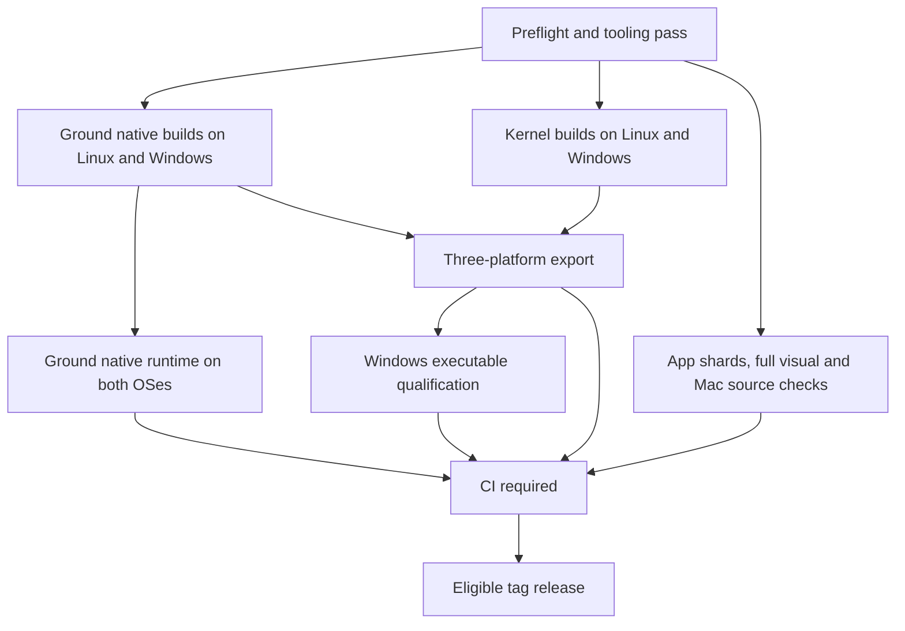

# OpenRC Simulator CI/CD and test infrastructure audit

**Baseline** `85a2475f60029a4b6b09f23f643119bceea84a45` · **Audit branch** `audit/ci-quality-performance-overhaul-2026-11-22` · **Evidence collected** 2026-11-22

**Later hosted evidence:** the [hosted follow-up](CI_HOSTED_FOLLOWUP.md) records a concurrent 17-commit advance of `main`, the resulting UID preflight failure, its branch-only metadata repair, the later stale qualification failures, their independently reviewed bounded renewals, and additional validation. The inventory and performance baseline below remain bound to the original source snapshot.

## A. Executive Summary

The clearest opportunity was to improve what a green run proves. The baseline Linux offline runner selected eight native-kernel Python test files. It missed existing regression cases for receipts, platform policy and packaging. Its telemetry workflow could finish its health-readiness loop successfully after every HTTP probe failed. The real Godot client-to-receiver test could skip because the engine path was absent. The three.js capture upload could match screenshots already tracked in the repository. These are distinct failure modes, each with a testable remedy. [Test effectiveness appendix](CI_TEST_EFFECTIVENESS.md) · [Baseline workflow](https://github.com/bultodepapas/OpenRCsimulator/blob/85a2475f60029a4b6b09f23f643119bceea84a45/.github/workflows/ci.yml)

The branch brings **185 additional existing cases** into the Linux offline route and adds required real-client telemetry qualification to the imported app integration partition. It requires three freshly produced prototype screenshots, checks all eight workflow definitions with a pinned linter and makes the final result depend directly on the tooling job. On the first PR head, the mandatory real-client step passed after a 430-second full-project import. The pinned Godot client sent three batches with zero queued or dropped. The receiver test reconciled the client's count against its database. The same run exposed a separate integration regression: a partition fixture interpreted the newly inserted workflow steps as Bash. The corrected fixture passed all 14 cases locally in 20.019 seconds. The corrected offline step subsequently passed in 132 seconds at head `847d8d1a`. That integrated run exposed separate qualification failures caused by intervening main changes; see the [hosted follow-up](CI_HOSTED_FOLLOWUP.md). No successful full aggregate is claimed. [Offline runner](../../research/test-tools.sh) · [Receiver test](../../services/telemetry/tests/test_godot_e2e.py) · [Candidate CI](../../.github/workflows/ci.yml)

The **median successful CI elapsed time was 162.53 minutes** in the sampled main runs. In two detailed runs the required visual job took 139–141 minutes, while integration took about 70 minutes. Optimizing unit shards alone would have left both completion times dominated by rendering. The branch therefore leaves the full visual render and platform-specific native/package gates in place. It reduces other avoidable work by changing Git checkout content, validating cheaper prerequisites concurrently, and storing the release ZIPs without a second round of deflation. The final verifier's sparse checkout reproduced all 2,067 GDScript paths and their source digest, including the 1,163 unit-test paths. These are measured coverage results. **No hosted speedup or billing reduction is attributed to the branch at report freeze.** [Successful run](https://github.com/bultodepapas/OpenRCsimulator/actions/runs/45044228684) · [Export-failure run](https://github.com/bultodepapas/OpenRCsimulator/actions/runs/45051610753) · [Roster verifier](../../tools/ci/phase_roster.py)

**Decision.** Keep PR #21 in draft. The integrated upstream scenery still exceeds two established source-geometry allowances (CI-17), and the renewed source needs its hosted platform, unit, integration and visual results. The audit preserves the failing limits. The completed earlier visual job also exposed a mutation harness that still searched for a function moved into a shared shader include (CI-19). Its bounded repair passed source and capture-dispatch controls; rendered acceptance remains pending. The register now contains 19 findings. Merge readiness requires correcting the geometry regression and a successful aggregate. Collect comparable timings before changing the full-check policy. [PR #21](https://github.com/bultodepapas/OpenRCsimulator/pull/21) · [Hosted follow-up](CI_HOSTED_FOLLOWUP.md)

The most promising larger change is the existing seven-group rendering experiment. Promotion requires a complete same-source comparison with the full render, including negative controls and outputs. Selecting affected paths or adding a shared Godot import cache has a larger correctness cost if implemented incorrectly. Both should remain separate experiments. No changes to the default branch, release assets, repository enforcement settings or live telemetry service are part of this audit.

| Evidence label | Meaning in this report |
| --- | --- |
| Verified | The claim follows from the named source/configuration or a specific observed run. |
| Hosted verified | The named job, step or artifact was observed at an identified PR head. Other jobs and later heads have independent outcomes. |
| Locally validated | The audit ran the candidate or an explicit negative control under the stated local conditions. |
| Hypothesis | A plausible performance or reliability explanation lacks a suitably controlled observation. |
| Proposed | A follow-up has a stated acceptance test and has not been promoted to a production gate. |
| Hosted pending | The applicable GitHub event, runner, renderer, release artifact or full gate still requires verification on the branch. |

## B. Complete CI Inventory

Both snapshots have eight workflow files. The candidate has **27 declared jobs and 188 steps**, up from 26 and 184. Those totals include reusable declarations once per file and count a matrix as one declaration. There are 102 command steps, 86 commit-pinned external action references and two calls to workflows inside this repository. The workflow appendix contains one decision and dependency row per candidate job. The machine-readable companion preserves the baseline and candidate configurations, exact shell commands, job/step conditions, runners, matrices, timeouts, cache keys, artifact paths, retention, permissions and source locations. Each configuration is bound to its Git blob identity. [Job-by-job workflow inventory](CI_WORKFLOW_INVENTORY.md) · [Complete workflow configurations](CI_WORKFLOW_INVENTORY.json)

| Workflow | Candidate execution and decision |
| --- | --- |
| CI | Main pushes, PRs, version tags and manual runs. Keep selection and release preflight, required app partitions, full visual, platform qualification and same-run release checks. Improve independent tooling, test routing, artifact evidence and checkout scope. Optional visual shadows, Vulkan captures and publication evidence retain separate inputs. |
| GOD TEST portable tooling | Matching main and designated performance-branch pushes, relevant PRs and manual runs. Keep Linux, Windows and macOS fixtures and a dry-run plan. Align push/PR path matching and cancel superseded PR runs. |
| MetalFX source controls | Matching main pushes or PRs, plus manual dispatch. Keep Linux source-patch and negative controls against the pinned, verified engine archive. |
| Native kernel correctness on macOS ARM64 | Called by the primary CI app scope or run manually. Keep the real source/compiler/engine checks on their designated Mac runner. |
| Publication rebind evidence | Manually dispatched or explicitly requested from manual CI. Keep Linux/Windows checked comparison against the fixed historical baseline. |
| Telemetry contracts | Relevant PRs, matching main pushes, every tag push and manual dispatch. Keep portable schemas, receiver, dashboard, database and container smoke. The branch removes duplicate topic-branch push runs and makes readiness fail on exhaustion. An unsubmitted topic branch can still use manual dispatch. |
| Telemetry receiver health | Daily at 09:17 UTC or manually. Keep the public health read separate from PR test correctness. No endpoint configured is a deliberate no-op. |
| Windows testqueue regressions | Matching main pushes or PRs, plus manual dispatch. Keep real Windows process containment, queue, resource and debug/MCP fixtures with their host-specific dependencies. |

Application PRs still run production and prototype checks under the selection policy's shadow mode. The website can skip when the verified path selection allows it. Main, version tags and manual CI can run export and package qualification. Only a qualifying version-tag run can reach the release job. Optional sibling workflows are outside the primary aggregate except when invoked through its explicit reusable calls. Reusable macOS source qualification and the standalone Windows queue workflow test different things. [Selection policy](../../tools/ci/policy.py) · [Workflow graph and event inventory](CI_WORKFLOW_INVENTORY.md)

## C. Test Effectiveness Assessment

The source census enumerated 52,627 tracked baseline paths and classified **2,012 executable test, checker, harness, helper or historical-source paths**: 2,009 from the baseline plus three new candidate files. At the inventory freeze, 29 modules or drivers had a direct local verification record, 1,516 paths had a source-established route, 130 had no established automatic route, and 337 were archived. The unresolved 130 include 102 named tests plus probes and helpers. Route established describes how code is selected. It does not establish assertion, line or branch coverage. The review sampled assertion quality in high-risk families and followed the relevant launch paths. It did not inspect every assertion in each of the 1,163 application unit scripts. [Execution-route census](CI_TEST_INVENTORY.json) · [Per-family effectiveness analysis](CI_TEST_EFFECTIVENESS.md)

| Test family | Behavior and risk if removed | Decision, cost and cadence |
| --- | --- | --- |
| Selection, shard coverage and release preflight | Event/ref identity, legitimate skips, missing results, moved tags and complete discovered-script coverage. A missing shard could otherwise leave a green aggregate. | Keep required on ordinary CI events. Add structural lint and enforce tooling independently. Fixture cost is small compared with simulator fan-out. |
| Host process ownership and runners | Detects lost subprocess ownership, incorrect exit interpretation, cleanup and retention failures. These affect the trustworthiness of all downstream evidence. | Keep cheap Linux fixtures before expensive work and Windows containment on its real host. Overlapping portable fixtures require identical trigger and dependency coverage before consolidation. |
| Simulation, numerical accuracy and vehicle behavior | Independent physics expectations, fixed-tick constraints, rollback and aircraft/helicopter/vehicle-specific behavior. An exact replay can reproduce a wrong model. | Keep numerical oracles alongside replay and complete application shards. Separate physical flight and target-device acceptance from hosted software checks. |
| Headless app integration and UI | Covers startup, loader paths, saved state, menus, input transitions and activity/replay integration that isolated functions can miss. | Keep required, with checked import and meaningful completion evidence. A desktop/device-only assertion needs a corresponding environment. |
| Native backend, mutation controls and replay | A reference fallback can hide a broken native library. Real host selection, mutant rejection, production admission and replay markers establish which backend ran. | Keep actual Linux/Windows production gates and ARM64 Mac source correctness. Improve portable native identity/receipt/package fixtures on Linux. |
| Trace and file-format contracts | Wrong mass/CG column order, malformed liquid inventory, resets or lossy projections can silently corrupt scientific evidence. | Add seven lightweight existing tests to the offline gate. Keep actual app trace/replay coverage for runtime behavior. |
| Visual regression and rendering | Pixel comparisons and shader mutation controls can detect a visual defect while headless simulation still passes. A stale individual image can make artifact existence misleading. | Keep the full render on selected CI. Leave seven-group production promotion proposed. Require per-member freshness where the baseline already tracked the output. |
| Renderer source changes and native graphics tools | Pinned MetalFX patch checks cover source behavior. Seven native graphics Python test files have no automatic route established by this audit. GPU behavior needs an appropriate renderer and device. | Keep portable MetalFX controls scoped to relevant changes. Propose measured path-triggered portable native-graphics tests, with separate target-GPU qualification. |
| Telemetry protocol, privacy and operations | Generated schema examples may still disagree with the running client. Container readiness, stored batches, privacy fields and protocol errors exercise separate boundaries. | Keep cheap receiver and Docker checks. Add the actual client/receiver path after app import using temporary state and loopback. Run the deployed service probe on its daily schedule. |
| Packaging, export and publication | Source-editor execution cannot establish that the shipped executable loads the correct native binary. A transfer or source/manifest mismatch can affect the distributed package. | Keep the qualified native producers, actual archive verification and same-run publisher sequential where artifacts are consumed. Pay these costs on export-bearing events. |
| Website and frozen prototype | Localized release routes, advertised files, keyboard controls and generated images are user-visible contracts. A checked-in screenshot alone proves no current browser render. | Keep selected website tests and current prototype shadow cadence. Require each expected PNG to be fresh. Consider shared prototype build output only after measuring both command paths. |
| Research campaigns and supplied source snapshots | Archived snapshots preserve comparisons and provenance. An expensive hardware campaign may answer an acceptance question a hosted synthetic test cannot. | Keep historical material available and schedule campaigns by experiment or target hardware. Triage apparently orphaned active tests by owner and runtime before automatic enrollment or removal. |

Three examples show why execution quality matters more than raw counts. The native offline allowlist previously ran 176 methods in eight files. Discovery now runs 354 methods in 23 native test files, with two further named modules providing runtime CLI entry points. Seven mass/trace cases add coverage of independent rejection paths. The 185-case increase counts 178 previously omitted native methods plus the seven trace methods. It does not count production executable qualification again. [Changed harness](../../research/test-tools.sh) · [Mass and trace tests](../../app/tests/test_mass_trace_contract.py)

The telemetry E2E asserts that the actual receiver stores the client's batches, that the expected event families appear and that these submitted batches omit the fixture's specified identifying strings. This finite denylist check is one privacy regression control; it does not establish that arbitrary events contain no identifying information. The fixture retains checked client and server diagnostics, refuses to skip in required mode, and uses disposable consent data. UI/source-string and workflow text assertions have narrower reach. Several enforce exact labels or source structure. They can be appropriate for stable public contracts, but a passing textual match cannot prove a runtime state transition. Replace brittle assertions only after constructing a direct positive and negative behavior test. [Receiver test](../../services/telemetry/tests/test_godot_e2e.py) · [Visual workflow fixtures](../../tools/ci/test_visual_workflow.py)

The audit also reproduced a diagnostic gap: the original unit loop stopped after its first failed script even with `OPENRC_KEEP_GOING=1`. That behavior hid later scenery-budget failures behind an earlier companion refusal. The branch now uses the existing checked section mechanism for each unit. Later scripts run under the explicit keep-going option, while failures remain nonzero and prevent a complete unit receipt. Default local execution still stops with the original failure status. Separately, two tree-backlighting scripts return success on a headless display before their pixel assertions, and no dedicated rendered route for those two scripts was identified. The existing rendered skin/segment controls provide a pattern for targeted follow-up. [Unit-loop evidence and rendered-route assessment](CI_TEST_EFFECTIVENESS.md)

## D. Findings Register

Severity ranks the consequence and evidence in this repository. “High” is used for misleading qualification or missing coverage of an important interface. A slow or duplicated step alone is a lower priority. The two tables share stable IDs so the evidence and disposition can be read without an excessively wide row.

| ID | Severity | Affected files and current behavior | Root cause and evidence |
| --- | --- | --- | --- |
| CI-01 | High | Telemetry receiver discovery allowed the live-client test to skip. The branch requires it after checked import. | The baseline fixture's class guard required an engine path and no workflow supplied it. The candidate supplies the pinned editor and rejects a skip in required mode. [Receiver fixture](../../services/telemetry/tests/test_godot_e2e.py) |
| CI-02 | High | The Linux offline native and trace test roster omitted existing cases. | A hand-maintained eight-file list stopped tracking the growing native suite. The baseline route selected 176 methods. Candidate discovery selected 354 and the trace harness added seven. [Offline test route](../../research/test-tools.sh) |
| CI-03 | Medium | The baseline container smoke loop could finish successfully after thirty failing health checks. | The final sleep returned zero. A failed-probe fixture reached the following command. Later ingest/purge assertions had independent failure modes. [Baseline telemetry workflow](https://github.com/bultodepapas/OpenRCsimulator/blob/85a2475f60029a4b6b09f23f643119bceea84a45/.github/workflows/telemetry-contracts.yml#L70) |
| CI-04 | Medium | The frozen prototype upload matched existing tracked PNGs. | Upload globs and a zero runner exit did not require the current renderer to produce each of the three expected images. [Capture producer](../../prototypes/stage0/three/capture.mjs) |
| CI-05 | Medium | Heavy work needs cheap prerequisites, and the baseline serialized those fixtures with release preflight. | Historical source/preflight and tooling setup costs overlapped in purpose but formerly shared one job. A host-tool failure once prevented 17 downstream job entries from running. [Early failure](https://github.com/bultodepapas/OpenRCsimulator/actions/runs/45045496350) |
| CI-06 | Medium | The primary final gate checked out the broader repository and ordinary full-history jobs could fetch unused historical blobs. | Final reconciliation reads every relevant GDScript and runner input, but does not use binary art assets. Source/tag validation needs history, with selected historical contents obtainable on demand. [Roster inputs](../../tools/ci/phase_roster.py) |
| CI-07 | Medium | No automatic structural/expression check of all eight workflows existed. | Individual source-text policy fixtures exercise specific safety contracts but do not validate the whole Actions schema. [Baseline workflow collection](https://github.com/bultodepapas/OpenRCsimulator/tree/85a2475f60029a4b6b09f23f643119bceea84a45/.github/workflows) |
| CI-08 | Medium | The required visual run dominates completion. | In a successful and a failed detailed run it took over 139 minutes. Output equivalence for the opt-in seven-group split is unqualified. [Visual controls and comparator](../../tools/ci/capture_groups.py) |
| CI-09 | Medium | Source code can pass parse/roster checks without executing every meaningful assertion. | A successful discovered-script receipt identifies completed invocation and bytes. An early clean exit before the final assertions requires an explicit semantic marker to be distinguished. This is an exposure, not an attributed historical defect. [App runner](../../app/test.sh) |
| CI-10 | Low | Telemetry push/PR subscriptions could duplicate runs and portable tooling push/PR filters differed. | Telemetry subscribed to pushes on any branch, while GOD TEST's old push filter used a narrower pattern and had no PR supersession. [Telemetry workflow](../../.github/workflows/telemetry-contracts.yml) · [GOD TEST workflow](../../.github/workflows/godtest-tooling.yml) |
| CI-11 | Medium | Branch enforcement and repo-defined success have different authority. | The branch response displayed protected false and empty required contexts, ruleset listing was empty, and detailed protection was inaccessible with HTTP 403. [GitHub required-check semantics](https://docs.github.com/en/pull-requests/how-tos/merge-and-close-pull-requests/troubleshooting-required-status-checks) |
| CI-12 | Low | Some setup and dependency inputs can drift, and the release archive combines all platforms. | The receiver Dockerfile uses a version tag. The site manifest pins its direct package without all transitive hashes. The Windows package job downloads the all-platform release artifact. [Dockerfile](../../services/telemetry/Dockerfile) · [Website requirements](../../site/requirements-seo.txt) · [Export workflow](../../.github/workflows/ci.yml) |
| CI-13 | Medium | A workflow-shape regression broke the import-failure fixture in `app/tests/test_ci_partitions.py` on the first PR head. | The fixture sliced from the named import step to the later named schema step. The new telemetry steps between them were pulled into the extracted shell text. The expected import failure exit 1 became command-not-found exit 127. The initial local checks did not run the complete partition module against this changed workflow. [Integration job](https://github.com/bultodepapas/OpenRCsimulator/actions/runs/45075562784/job/137372676636) · [Partition tests](../../app/tests/test_ci_partitions.py) |
| CI-14 | High | Concurrent upstream changes invalidated companion behavior admission, eight native-fleet reset fingerprints and the macOS stock-world domain. | Two source files changed while their accepted behavior manifest stayed fixed; seven completed unit shards rejected companion admission. A matched Linux reproduction isolated sixteen fleet assertions to changed collision-world identities. The same companion cases and all fleet checks passed on the pre-integration source. The Mac guard later failed its sole stock identity/count assertion (71 of 72 passed). [Hosted source attribution and bounded evidence](CI_HOSTED_FOLLOWUP.md) |
| CI-15 | Medium | A real manifest refusal caused the companion fixture to raise a script error and wait for its timeout. | `test_companions_behavior_manifest.gd` inspected success-only admission identity fields after its own failure assertion. Unit shard 5 timed out after 60 seconds. [Failed job](https://github.com/bultodepapas/OpenRCsimulator/actions/runs/45079559400/job/137385028504) · [Fixture](../../app/tests/test_companions_behavior_manifest.gd) |
| CI-16 | Medium | Upstream scenery changes left the deterministic woodland recipe and four exact fixture counts stale. | The completed integration job rejected the recipe. Regeneration changed exactly two source hashes, four inventory counts and two positive clearance measurements; every plant placement remained identical. [Bounded regeneration record](../research/visual-quality-implementation/L6c/tree-completion/woodland-edges/2026-11-22-ci-audit/README.md) |
| CI-17 | Medium | The integrated upstream scene exceeds two existing LU-34 geometry allowances. | Merged cells contain 178,746 source triangles against 175,000; miscellaneous meshes contain 9,365 against 8,000. Old and regenerated woodland recipes yield identical counts. The same guard passed before upstream integration. [Controlled attribution](../research/visual-quality-implementation/L6c/tree-completion/woodland-edges/2026-11-22-ci-audit/receipt.json) · [Unchanged allowances](../../app/tests/scene_source_budget.gd) |
| CI-18 | Medium | CI requested keep-going, but the unit loop still stopped at its first failed script. | A controlled first-unit failure attempted only one of 19 selected scripts. Hosted companion failures preceded later required scene-budget tests, delaying discovery of a separate regression. [Runner](../../app/test.sh) · [Behavior controls](../../app/tests/test_ci_partitions.py) |
| CI-19 | Medium | The L9c mutation helper could no longer disable runway filtering after the filter moved into a shared include. Both rendered ground consumers use it. | Hosted visual job 137385028425 failed before its acceptance verdict: `cannot apply no-filter mutation to the current ground shader`. The old regex searched for the function definition in `ground.gdshader`; it now lives in `meadow_surface.gdshaderinc`. Editing the shared function would also affect meadow rows. [Failed visual job](https://github.com/bultodepapas/OpenRCsimulator/actions/runs/45079559400/job/137385028425) · [Mutation helper](../../tools/ground/check_surfaces.py) |

| ID | Impact if left unresolved | Remediation and status |
| --- | --- | --- |
| CI-01 | The release could carry a client incompatible with its receiver while both sides' individual fixtures stay green. | **Hosted verified on ce31055c.** The full project imported and the required real-client step passed in 8 seconds. The downloaded receipt showed three sent and zero queued or dropped. The later offline fixture failure is recorded separately in CI-13. |
| CI-02 | Bad receipt identity or trace data could pass the offline route. | **Locally validated and hosted verified on 847d8d1a.** All 361 selected cases passed locally. The complete offline workflow step, including this route and the corrected partition fixture, passed in 132 seconds on the integrated source. Later companion and fleet qualification failures are independent and documented in the hosted follow-up. |
| CI-03 | A broken health endpoint may be obscured by healthy unrelated operations. | **Locally validated and hosted verified on ce31055c.** All eleven readiness fixtures and the real container smoke passed in the telemetry contracts workflow. The helper refuses redirects and the caller bounds its lifetime. |
| CI-04 | Reviewers could receive stale images. | **Locally validated and hosted verified on ce31055c.** Zero and partial fresh outputs failed local controls. The hosted producer recreated all three images and its downloadable archive contained three valid 1280×720 PNG files. |
| CI-05 | Unconditionally starting all jobs after a broken prerequisite can spend hundreds of runner-minutes. Fully serial cheap checks also delay useful feedback. | **Hosted ordering verified on ce31055c.** Preflight and tooling started together. The two lightweight jobs started after preflight. All 15 expensive first-tier jobs started after tooling also passed. The aggregate's required dependency is verified in code. |
| CI-06 | Additional checkout time and traffic on a repository containing large historical assets. | **Local roster equivalence verified, timing impact pending.** The hosted preflight log confirmed lazy historical blobs and a valid selection artifact. Its checkout took 81 seconds. One run does not establish an improvement. The final sparse checkout and tag/export path need their own source-matched results. |
| CI-07 | A malformed expression or invalid workflow change might only surface during hosted execution. | **Locally validated and hosted verified on ce31055c.** The tool archive passed its checksum check. The hosted actionlint check and all 139 orchestration tests passed. The linter does not execute the Bash extracted by application fixtures, as CI-13 illustrates. |
| CI-08 | Long waits for a final all-green verdict and expensive visual re-runs. | **Proposed.** Use paired shadow dispatches with identical source/render conditions. Keep full captures required until equivalence and cost meet the acceptance plan. |
| CI-09 | Some obligations can appear satisfied by successful process termination. | **Proposed.** Introduce final semantic markers first in consequential tests with identifiable success conditions. Prove missing-marker refusal before expanding. |
| CI-10 | Duplicate expense and stale PR runs, with uneven path coverage between events. | **Matching PR execution verified on ce31055c.** The telemetry contract workflow and all three portable OS jobs passed. Branch-specific and unrelated-change matching remain distinct event cases. Unsubmitted feature pushes lose the standalone telemetry check. Critical review caught that branch filtering also disabled tag events; an explicit all-tag pattern now preserves their baseline coverage. Event syntax was linted and checked against GitHub semantics; no release tag was created for testing. |
| CI-11 | A maintainer may believe a workflow result universally prevents a main-branch update. | **Verified visible settings, administrative confirmation pending.** Confirm whether branch rules should require the stable check through the repository owner's administrative channel. |
| CI-12 | Slower transfers, less predictable builds or additional maintenance after upstream dependency changes. | **Proposed.** Measure artifact transfer by platform and plan reviewed digest/lock updates. Both changes require explicit maintenance ownership. |
| CI-13 | A misleading fixture failure blocks the offline integration step before subsequent coverage can complete. | **Reproduced, corrected and hosted verified on 847d8d1a.** The offline step passed in 132 seconds. Extract only the import step up to the next generic YAML step boundary. Separately assert its ordering relative to schema. Preserve the existing import exit-code, diagnostic and receipt assertions. All 14 partition fixtures passed after the edit. |
| CI-14 | Source/proof drift can disable ordinary companion launches and block platform qualification. Blindly replacing hashes would remove evidence of changed behavior. | **Verified post-baseline source inconsistency.** The V7 reset renewal passed the retained 460-check comparison, all 598 fleet checks, 130 trajectory checks and 354 Python cases, with stale/tampered proofs still rejected. The separate companion renewal passed 23 expected process outcomes over the complete app and external source closure, including actual Club-world clearance and fresh ordinary Home admission for one, two and three companions with the solver guard enabled. The separate three-literal Mac renewal passed nine portable controls and required an official nine-tape solver rebind: all 25,929 CSV rows per side matched. Final-source Home1/2/3 launches passed with the renewed live solver digest and no override. Actual hosted native/default-route and aggregate results remain separate. Details are in the [hosted follow-up](CI_HOSTED_FOLLOWUP.md); no full aggregate success is claimed. |
| CI-15 | A secondary script exception delays and obscures the actionable qualification refusal. | **Locally validated against the complete source and effective Git checkout bytes.** Normal stale-source mode reports seven checks/two failures and exits 1 in 7.629s; explicit expected-refusal mode passes eight checks in 7.468s. Neither produces an engine error or warning. The isolated candidate positive/mutation path also passes 39 checks; its malformed-UTF-8 control emits the expected decoder diagnostics. Stop after reporting failed admission, before accessing identity fields. Preserve positive assertions, explicit source-mutation rejection and the nonzero failure status. |
| CI-16 | Generated evidence no longer describes its current authored exclusions, blocking integration and weakening reviewability. | **Locally validated.** Regenerate with the unchanged owning tool; update the four exact counts from independently inspected source additions. Six Python cases and 54 headless habitat assertions passed. An overlapping patch still failed. The complete airspace report and three-companion launch record matched the earlier qualification. Pixel readback and whole-scene budgets are separate. |
| CI-17 | Geometry can exceed the project's source/memory limits even when placement and collision checks pass. | **Verified unresolved upstream product regression.** Preserve both limits. Attribute costly nodes, reduce at least 3,746 cell triangles and 1,365 miscellaneous triangles without category relabeling, then pass all three scene-budget consumers and relevant rendered checks. Hosted shard 7 subsequently failed the farm-tractor and complete-scenery consumers while continuing through 146 invocations. The counts do not establish GPU frame-time impact. This finding blocks a clean aggregate and is not fixed by refreshing a digest. |
| CI-18 | Separate failures emerge only after repeated expensive runs, reducing useful feedback per run. | **Implemented and validated with a documented fixture correction.** All 16 partition and 16 phase cases passed. Two default-mode fixtures subsequently failed under the hosted parent flag; isolating that variable made all 16 partition cases pass both with the actual CI flag enabled and unset. Process, exit-zero engine/shader and historical-brake failures still fail the suite; all 19 selected probes run under keep-going, old valid receipts remain unchanged, and failed runs produce no complete unit receipt. Default fail-fast remains. Independent all-mode runtime gates continue; valid unit-only receipts remain possible after unrelated source failures. Shared project state can cause secondary errors, so later diagnostics need attribution. |
| CI-19 | An unusable negative control blocks visual qualification after expensive earlier captures; incomplete source hashes can omit a shared dependency. | **Implemented and locally validated; rendered acceptance pending.** Replace exactly the unique runway-filter assignment in the disposable copy, reject zero or multiple targets, preserve all other shader/include bytes, and bind the shared include and mutator to visual receipts. All 21 stripe controls and 24 capture-dispatch cases pass. Run the source controls during full/ground setup, with no success receipt on failure. Production shaders, rendered predicates and thresholds are unchanged. |

## E. Architecture and Execution Improvements

The graph below shows the production path for an export-bearing event. Its first node represents two independently scheduled prerequisites. Boxes grouping operating systems represent separate runner jobs. Website and prototype checks can start after source selection and also feed the final aggregate when selected. The publication and renderer shadow experiments sit outside this diagram. The exact job graph for PR and manual variants is in the inventory. [Exact workflow dependencies](CI_WORKFLOW_INVENTORY.md)

**Parallelize independent checks and keep the expensive barrier.** The selector verifies the event source, tag and selection policy without waiting for Python fixture suites to finish in its own job. The tooling job runs independently, with its own checkout. Cheap website/prototype work may begin once the selector succeeds. Each first-tier app, native and visual job explicitly requires both cheap prerequisites. A literal workflow-to-policy test verifies the required dependency set and the presence of tooling even in a documentation-only case. The aggregate checks exact job identities, including omissions and unexpected failure, cancellation or skip. [Policy regression tests](../../tools/ci/test_policy.py) · [CI job definitions](../../.github/workflows/ci.yml)

An early design would have immediately scheduled the full native/app/visual work after selection. The independent review rejected that design using a real host-admission failure. That run used 5.47 summed runner-minutes and skipped 17 of 19 job entries. The two detailed full-work cases used approximately 600 summed runner-minutes each. The candidate keeps early failure containment while allowing useful overlap. The added tooling runner has its own startup/checkout cost and can wait for a free runner. Its net benefit must therefore be measured on the hosted queue. [Early failure](https://github.com/bultodepapas/OpenRCsimulator/actions/runs/45045496350) · [Measured run data](CI_PERFORMANCE_BASELINE.json)

**Keep real producer–consumer edges sequential.** The ground runtime installs both operating systems' qualified libraries and matching receipts, even on a job that exercises only one host. Export consumes those two libraries and the two kernel qualifications. Windows package validation exercises the executable that export produced. The Linux editor and the Windows cross-exporter cannot supply the Windows executable's native session, helicopter, replay and default-route verdicts. On a tag, the publisher rechecks the current tag and the completed release's downloaded assets. Removing any of these edges or using a previous build would require a different promotion and source-identity design. [CI native/export chain](../../.github/workflows/ci.yml) · [Publisher](../../tools/release/publish.py)

**Consolidate only matching evidence.** Linux discovery and the portable GOD TEST workflow share some fixture commands. The Windows queue and portable workflow overlap in GOD TEST and frame-watch coverage. The trigger domains, installed process dependencies, platform behavior and hardware assumptions differ. Before combining them, build a union of the existing trigger domains, exercise representative changes and preserve a direct owner for the Windows containment cases. The frozen prototype also builds Vite separately for capture and keyboard E2E. Reuse there is plausible if both standalone commands keep their current behavior and the measured saving is worth the extra artifact or setup. No existing simulator, native, visual or package test was removed. [GOD TEST workflow](../../.github/workflows/godtest-tooling.yml) · [Windows suite](../../.github/workflows/testqueue-windows.yml) · [Prototype E2E](../../prototypes/stage0/three/e2e.mjs)

## F. Performance Analysis

The historical sample is the latest 50 completed runs on main returned during collection, spanning 2026-11-20 through 2026-11-22. It includes 22 primary CI runs, eight telemetry contract runs, seven portable GOD TEST runs, eleven Windows testqueue runs and two receiver health runs. Of the primary CI runs, **13 succeeded and nine failed**. The sample mixes source revisions and change types, and successful/failed distributions have different early-exit paths. The ratio describes this short sample. Determining the repository's flake rate requires repeated comparable executions and failure attribution. [Baseline method and individual runs](CI_PERFORMANCE_BASELINE.json)

| Main CI cohort | Count | Minimum elapsed | Median elapsed | Maximum elapsed |
| --- | ---: | ---: | ---: | ---: |
| Successful | 13 | 145.30 min | 162.53 min | 204.48 min |
| Failed | 9 | 5.08 min | 145.80 min | 151.07 min |

| Detailed run | What actually happened | Elapsed job examples | Summed runner time |
| --- | --- | --- | ---: |
| [45044228684](https://github.com/bultodepapas/OpenRCsimulator/actions/runs/45044228684) | Successful primary CI. | Visual 139.33 min, app integration 69.68 min, export 25.92 min, Windows package 12.02 min. | 602.42 min |
| [45051610753](https://github.com/bultodepapas/OpenRCsimulator/actions/runs/45051610753) | Export failed, and the packaged Windows job skipped. Independent production checks continued. | Visual 140.97 min, app integration 69.53 min, Mac source 57.53 min, export 12.25 min. | 601.13 min |
| [45045496350](https://github.com/bultodepapas/OpenRCsimulator/actions/runs/45045496350) | Host-admission/testqueue Python exited 139 during preflight. The aggregate rejected the run. | Scope 3.63 min, final aggregate 1.83 min. | 5.47 min |
| [45024280846](https://github.com/bultodepapas/OpenRCsimulator/actions/runs/45024280846) | Historical standalone Windows queue failure in process-ownership checks. The baseline Windows workflow now installs the pinned process-monitoring dependency. | One Windows job. | 2.63 min |

In the export-failure case the exporter had already reported failure approximately 102 minutes before the full visual lane finished. The final result waited because it must account for independent checks. Developers can use the failing producer job as the first actionable signal without weakening the all-jobs summary. Inside that visual job, the actual capture command ran for **128m32s**. Restoring a small editor cache took seconds, and transferring the reconstructed capture artifact took about 87 seconds. Optimizing either operation alone cannot remove the observed two-hour render. [Job and step records](CI_PERFORMANCE_BASELINE.json)

| Intervention | Local or structural evidence | Expected effect requiring hosted measurement |
| --- | --- | --- |
| Preflight and tooling overlap | Three detailed primary runs spent 132–151 seconds in the two baseline tooling suites inside the selector. The split tooling input set consisted of 499 tracked files at baseline, plus the two new lint files in the local verification. | Earlier readiness for lightweight work, with a cleaner failure owner. Net wall time can improve or regress depending on provisioning, queue depth and duplicate setup. |
| Sparse final aggregate | At the baseline cutoff 2,125 materialized files sufficed to reproduce every tracked parse/unit path and both byte digests. A representative baseline aggregate spent 123 seconds in checkout. | Less filesystem and transfer work in the final gate. No proportional seconds-per-file claim follows from the file-count difference. |
| Historical blob filtering | Full commit history and tags remain requested for scope/export. Git may request individual historical file contents when needed. | Avoid transferring unused historical assets. Record actual Git checkout elapsed time across cache/network conditions and check the tag path independently. |
| Release ZIP outer compression | Same six release-file paths and existing per-file integrity checks; only the outer Actions compression setting changes. Compression level is zero because three platform payloads are ZIP files. A full candidate export was not byte-compared with baseline. | Lower compressing CPU, potentially different transferred size, and no proven critical-path change. Compare producer and consumer measurements together. |
| Added offline native and trace tests | All 361 selected cases passed locally. The native portion ran in 18.466 seconds and the trace portion in 0.006 seconds on the test host. | Additional CI runtime is expected. Measure the step after dependency setup rather than extrapolating local elapsed time to hosted runners. |
| Grouped visual or affected-path selection | The group/shadow architecture already exists. The present audit did not establish complete output equivalence or false-negative rates for active selection. | Potentially substantial critical-path or runner-minute reduction. Keep proposed until measured against full controls. |
| Early runway-mutation source checks | The 21-case source/metric suite passes in 0.419 seconds locally. Full and ground-only dispatch controls reject a failed suite before the first production capture. Mandatory import still precedes it. | Earlier actionable feedback for this specific source-contract failure, without removing rendered acceptance. No hosted elapsed-time or cost reduction is measured. |

The first PR run at `ce31055c` supplied a hosted observation of the new dependency graph. Both prerequisites started together. Preflight took 87 seconds, including an 81-second checkout and a successful upload of the selection receipt. Tooling took 153 seconds, including a 3-second sparse checkout, 139 CI tests in 85.272 seconds and 458 queue tests in 61.033 seconds with 12 platform/opt-in skips. Website and prototype jobs started two seconds after preflight. All 15 expensive first-tier jobs started two to three seconds after tooling finished, 158–159 seconds after run start. Different events, network/cache state and change sets prevent attributing the elapsed difference from historical main runs to this branch alone. [Preflight job](https://github.com/bultodepapas/OpenRCsimulator/actions/runs/45075562784/job/137371891529) · [Tooling job](https://github.com/bultodepapas/OpenRCsimulator/actions/runs/45075562784/job/137371891289)

The job totals sum overlapping runner intervals. They do not capture negotiated rates, free allowances, runner-class multipliers, Actions storage retention, or other account-specific billing. To measure improvement, pair a baseline and candidate at equivalent source content, event type, engine, renderer and runner class. Preserve queue delay, time to first actionable failure, time to required result, summed runner time, cold/warm state, artifact bytes and completed test rosters. Use multiple successful paired runs before drawing trend conclusions, and retain failed pairs for diagnosis. A single PR run can validate execution semantics while still leaving economic impact undetermined. [Sampling definition](CI_PERFORMANCE_BASELINE.json)

## G. Security and Reliability Review

**Permissions and trust.** All 86 candidate external action references are pinned to immutable commit SHAs. No workflow directly interpolates a repository secret into its scripts, and the baseline/default workflow permissions are read-only or empty. Only the version-tag publisher requests contents write and supplies the GitHub token through the publication step's environment. The audit disabled persisted checkout credentials for website, prototype and tooling jobs. It kept the release job's authenticated tag fetches and the resolved history comparisons intact. The workflow set uses no privileged PR event that checks out untrusted code. The Mac runner label is declared in the linter configuration. Its administrative runner-group access policy cannot be determined from this YAML. [Workflow permissions and pins](CI_WORKFLOW_INVENTORY.json) · [Publisher source](../../tools/release/publish.py) · [GitHub secure-use reference](https://docs.github.com/en/actions/reference/security/secure-use)

**Fetched tools and cache reuse.** Linux/Windows editor downloads pin archive and executable SHA-512 values and rehash executables on cache reuse. Export templates verify member hashes. MetalFX checks the pinned source archive on a warm cache hit as well as after download. MinGW has a checked SHA-256, and native prerequisite locks fix the SCons wheel digest and godot-cpp commit. Actionlint now has a checked Linux amd64 archive digest, bounded HTTPS requests and an isolated temporary extraction directory. A versioned Docker base-image tag and un-hashed Python requirements remain follow-up opportunities. Altering runner images or introducing broader caches should preserve the corresponding identity checks. [Godot getter](../../app/get-godot.sh) · [Template getter](../../app/get-templates.sh) · [Workflow checker](../../tools/ci/check-workflows.sh) · [Receiver Dockerfile](../../services/telemetry/Dockerfile)

**Failure signaling and evidence retention.** The full visual capture, native qualification, artifact checksum, package qualification and required aggregate retain strict failure semantics. The baseline's eight explicit tolerances are limited to optional visual diagnostics or shadow experiments. Compact artifact preparation may fail and the full upload remains available. An artifact glob that matches one of several paths cannot prove the rest exist, so prototype checks validate each filename before upload. Required telemetry now fails when its editor is missing. The E2E and Docker callers apply hard process-level deadlines to readiness in addition to shorter HTTP timeouts. Direct requests must receive the expected status and JSON from the requested endpoint, including refusing a redirect to another healthy route. [CI artifact paths](../../.github/workflows/ci.yml) · [Readiness helper](../../tools/telemetry/wait_for_health.py) · [Readiness tests](../../tools/telemetry/test_wait_for_health.py)

**Data isolation.** Telemetry E2E uses a loopback receiver, a temporary data directory, a fresh consent path and a checked client process. Existing consent and its temporary-store sibling are refused before writing. Negative controls confirmed that both pre-existing files remained intact. This permits the live protocol to be tested without operating the deployed service or using real telemetry records. The daily health workflow remains a separate read-only operation with no token permissions. [Client E2E driver](../../app/tests/telemetry_receiver_e2e.gd) · [Receiver E2E harness](../../services/telemetry/tests/test_godot_e2e.py) · [Daily health workflow](../../.github/workflows/telemetry-health.yml)

**Intermittent failures and developer feedback.** The nine failed main CI runs in this sample broke down into three timeouts during export import, three failed Godot UID sidecar checks, two distinct application assertion failures and one host Python process exit 139. These are observed first-failure signatures. They identify which checks rejected the builds and leave the underlying cause of a timeout or crash open. Counting them as interchangeable flakes would obscure the real input and product rejections. [Historical run sample and job details](CI_PERFORMANCE_BASELINE.json)

| First-failure signature | Count | Historical runs |
| --- | ---: | --- |
| Export resource import timeout | 3 | [45051610753](https://github.com/bultodepapas/OpenRCsimulator/actions/runs/45051610753) · [45046440150](https://github.com/bultodepapas/OpenRCsimulator/actions/runs/45046440150/job/137290881561) · [44973694586](https://github.com/bultodepapas/OpenRCsimulator/actions/runs/44973694586/job/137066077135) |
| UID sidecar preflight rejection | 3 | [44971274685](https://github.com/bultodepapas/OpenRCsimulator/actions/runs/44971274685/job/137051375780) · [44833680915](https://github.com/bultodepapas/OpenRCsimulator/actions/runs/44833680915/job/136624634353) · [44830317537](https://github.com/bultodepapas/OpenRCsimulator/actions/runs/44830317537/job/136613300015) |
| Audio underrun assertion | 1 | [44972096871](https://github.com/bultodepapas/OpenRCsimulator/actions/runs/44972096871/job/137054701973) |
| Locale message coverage assertion | 1 | [44946381164](https://github.com/bultodepapas/OpenRCsimulator/actions/runs/44946381164/job/136975525915) |
| Host Python process exited 139 | 1 | [45045496350](https://github.com/bultodepapas/OpenRCsimulator/actions/runs/45045496350) |

The checked runner already captures diagnostic reasons that a zero process exit can conceal. Preserve the failing attempt, host/tool versions, inputs, seeds where applicable, exit code and child logs. Retry to collect diagnostic evidence only when the operation is safe and explicitly bounded, as with Windows archive transfer. Avoid treating a subsequent pass as proof that the original failure was an infrastructure flake. For local triage, the existing quick/full/release entry points identify which checks are local and which require a real supported host. [Checked runner](../../tools/godot/run_checked.py) · [Local commands and coverage](../../tools/ci/README.md) · [GitHub job evidence](CI_PERFORMANCE_BASELINE.json)

**Merge enforcement.** The main branch record returned protected false and empty required status contexts. The accessible repository ruleset listing returned an empty list. Detailed branch protection returned HTTP 403 due to the integration's permissions. This establishes what the available views showed, while leaving settings outside that access boundary unverified. The audit changes only version-controlled branch content. A desired organization policy for required checks or direct main pushes must be evaluated by a repository administrator. Keep the stable check name across changes so that administrators can reference it reliably. [Required check semantics](https://docs.github.com/en/pull-requests/how-tos/merge-and-close-pull-requests/troubleshooting-required-status-checks)

## H. External Research and New Ideas

Upstream material informed the decisions below. The evidence supporting an OpenRC performance or coverage claim is still the project's own sources, fixtures and run data.

| Primary source | Applicability and branch decision | Complexity, maintenance and risk |
| --- | --- | --- |
| [GitHub required-status checks](https://docs.github.com/en/pull-requests/how-tos/merge-and-close-pull-requests/troubleshooting-required-status-checks) | Preserve a stable, always-evaluated aggregate. Top-level path filtering can leave a required workflow pending. Make acceptable skips explicit in a source-bound policy. | Low implementation complexity here because the verifier already exists. Changes to job IDs must update enforced policy and regression fixtures together. |
| [GitHub branch, tag and path filters](https://docs.github.com/en/actions/reference/workflows-and-actions/workflow-syntax#onpushbranchestagsbranches-ignoretags-ignore) | Explicitly preserve all tag events while restricting branch pushes to main. A branch filter alone removes tag execution, and tags ignore path filters. The critical review caught and corrected this event-domain regression. | Low implementation complexity; validate the event matrix and static syntax. Do not create production tags solely to test filtering. |
| [GitHub secure Actions use](https://docs.github.com/en/actions/reference/security/secure-use) | Maintain whole-commit action pins, minimum token scopes and separation of release publication from untrusted PR work. | Low runtime cost. Pin maintenance needs an owner and reviewed updates. Unreviewed floating releases would weaken reproducibility. |
| [GitHub cache behavior](https://docs.github.com/en/actions/concepts/workflows-and-actions/dependency-caching) and [artifact transfer](https://docs.github.com/en/actions/tutorials/store-and-share-data) | Preserve data-integrity validation after cache restoration or artifact transfer. Evaluate editor reuse and platform-specific release packages separately. | Moderate complexity for artifact restructuring. Larger caches may displace useful entries. Source-bound evidence and per-platform archive verification are acceptance requirements. |
| [GitHub concurrency](https://docs.github.com/en/actions/how-tos/write-workflows/choose-when-workflows-run/control-workflow-concurrency) and [matrix controls](https://docs.github.com/en/actions/how-tos/write-workflows/choose-what-workflows-do/run-job-variations) | Cancel replaceable PR tooling runs. Keep main/tag/manual verification and non-fail-fast evidence-producing matrices. Avoid cancelling a valid release run because a newer unrelated ref arrived. | Low complexity for current PR groups. Capacity and pending-job behavior should be monitored before introducing additional concurrency control. |
| [Godot command-line behavior](https://docs.godotengine.org/en/stable/tutorials/editor/command_line_tutorial.html), [GDExtension library selection](https://docs.godotengine.org/en/stable/engine_details/engine_api/gdextension/gdextension_file.html) and [pinned editor release](https://github.com/godotengine/godot-builds/releases/tag/4.8-beta2) | Distinguish parsing, headless script execution, active native-library selection and target-renderer output. Preserve native host and actual archive qualification. | Moderate cost for a distinct host/renderer. A successful import, dry-run campaign or cross-build cannot establish those additional outcomes. |
| [actionlint checks](https://github.com/rhysd/actionlint/blob/v1.7.12/docs/checks.md) | Add a version-pinned static gate for expressions, job dependencies, labels and reusable workflow wiring. Keep project-specific outcome tests. | Low maintenance except tool updates and intentional runner-label changes. External ShellCheck and Pyflakes passes are explicitly disabled here and receive no coverage credit. |
| [Google's test-selection study](https://research.google/pubs/assessing-transition-based-test-selection-algorithms-at-google/) and [Meta's deployment report](https://engineering.fb.com/2018/11/21/developer-tools/predictive-test-selection/) | Explore affected-path or duration-aware selection only in parallel with the full suite. Collect misses, selection decisions and actual outcomes in this repository. | High implementation/maintenance burden where assets, generators, physics and native inputs interact. Different organizations' hit rates and savings cannot be applied to OpenRC. |
| [Google Testing Blog on flaky tests](https://testing.googleblog.com/2020/12/test-flakiness-one-of-main-challenges.html) | Classify the first failure by test, product, framework or infrastructure, reproducing under matching conditions where possible. | Low initial measurement cost. Automatic retries without preserving first-failure evidence would hide signal and consume expensive runner time. |

## I. Changes Implemented

All implementation commits below were published to the dedicated audit branch. The baseline remains the comparison point, and no version-tag publication or branch-enforcement change was requested as part of implementing the code.

| Branch commit | Changes and user-visible effect |
| --- | --- |
| [4c13f76b — CI architecture and evidence](https://github.com/bultodepapas/OpenRCsimulator/commit/4c13f76b6ddc8e8bdf989100c413584d3e8ecfea) | Add immutable, checksum-verified actionlint, independent required tooling and cheap-before-expensive prerequisites. Verify complete aggregate membership, narrow final checkout, filter historical blobs, harden selected credentials, fresh capture outputs and artifact handling. Align portable tooling triggers and PR supersession. |
| [b36fa60f — native and trace coverage](https://github.com/bultodepapas/OpenRCsimulator/commit/b36fa60f65eb7d8f39a247bbb7ac0f4bc04b233d) | Expand the Linux native Python discovery route to the full fixture suite and run the existing mass/CG trace contract cases. Retain real native runtime and packaged artifact checks. |
| [f1efc007 — telemetry qualification](https://github.com/bultodepapas/OpenRCsimulator/commit/f1efc0078acf926cddd185ec9943f38bffcc70dc) | Require the real client/receiver execution in app integration, preserve diagnostic evidence, reject unhealthy or redirected readiness and protect disposable consent state. Keep the portable contract/container workflow on relevant PRs, main pushes, every tag push and manual runs. |
| [7aa7e270 — bounded collision-evidence renewal](https://github.com/bultodepapas/OpenRCsimulator/commit/7aa7e270e20f5687962ca3e5d36e6852feb27e23) | Retain paired source-bound captures and the original typed comparator. Renew exactly eight Linux reference-reset fingerprints after proving all physical/refusal fields unchanged; keep V6 and forged-proof rejection. Companion route qualification is separate. |
| [d04eda41 — telemetry event coverage and diagnostic refusal](https://github.com/bultodepapas/OpenRCsimulator/commit/d04eda4197c102b86a724be0cf4ef5c0b21c5499) | Restore baseline all-tag telemetry execution alongside main/PR filtering. Make a rejected companion qualification terminate with its failed assertions before reading success-only fields; preserve expected-refusal and positive/mutation checks. |
| [50a63d29 — bounded companion behavior renewal](https://github.com/bultodepapas/OpenRCsimulator/commit/50a63d290d97d89b708f2a32289cc5182781963f) | Renew exactly two changed source hashes and the profile manifest reference after 23 source-bound process outcomes, actual nominal Club clearance and fresh production one/two/three-companion admissions. Preserve all guards and solver identity; retain the complete evidence packet and explicit platform/scope limits. |
| [e02863c0 — deterministic woodland renewal](https://github.com/bultodepapas/OpenRCsimulator/commit/e02863c0957c3501dc53df0a3bdeb5624f931d17) | Regenerate eight metadata/measurement leaves and four literal fixture counts from current authored source. Preserve plant geometry and every exclusion predicate; retain the independently failing scene-budget finding. |
| [c320d34d — macOS world source pins](https://github.com/bultodepapas/OpenRCsimulator/commit/c320d34d77197d2a34a5e41feced445a80f51712) | Apply the documented three-pin source renewal using the actual macOS diagnostic and a separately observed portable geometry fingerprint. This committed source precedes the required companion solver rebind and does not itself establish a passing native default route. |
| [93657c77 — useful unit keep-going diagnostics](https://github.com/bultodepapas/OpenRCsimulator/commit/93657c77c375fd1d63996f2b53aa414a975381f2) | Execute unit commands through the existing checked section boundary, withhold complete receipts after unit failures, preserve default fail-fast and continue independent runtime sections under the explicit option. Add four meaningful runner regression cases. |
| [0e57e797 — companion solver rebind](https://github.com/bultodepapas/OpenRCsimulator/commit/0e57e797c5acc7a664ec8d4478838641c16276cc) | Keep the official profile, registry and receipt together after all nine retained tapes produce matching CSV byte hashes. Verify ordinary Home admission on the final combined app tree; keep native and physical qualifications separate. |
| [e47284bb — runway mutation and early source controls](https://github.com/bultodepapas/OpenRCsimulator/commit/e47284bb2f8750ad10fdd53519e84ab837353236) | Repair the two rendered ground checkers' shared mutation helper, bind the extracted include to their evidence, and run shader-source controls before captures. Add source-preservation, missing/duplicate-target and early-failure regression controls. Keep all rendered acceptance predicates and production shader bytes. |
| [24e083e2 — partition fixture environment isolation](https://github.com/bultodepapas/OpenRCsimulator/commit/24e083e27fc26cb810ce7d0c5f714268ecd839fb) | Clear only the fixture-owned inherited keep-going flag before applying each case's explicit options. Preserve actual unset fail-fast and explicit keep-going assertions. Retain two complete 16-case passes using the hosted integration/shard variables, with parent keep-going enabled and unset. Production runner and workflow are unchanged. |

Reviewers can compare what each workflow actually executes in the two snapshots. Five workflow files have unchanged content. The changes affect the primary CI, GOD TEST portable tooling and telemetry contracts. The machine-readable inventory includes complete commands from both versions and source blob IDs, allowing future revisions to be compared without relying on a job display name. [Workflow appendix](CI_WORKFLOW_INVENTORY.md) · [Structured snapshots](CI_WORKFLOW_INVENTORY.json)

## J. Validation Results

The [structured validation record](CI_VALIDATION_RESULTS.json) preserves commands, case counts, log summaries and the exact source identities of the focused engine test. Counts from overlapping suites are not added into a purported unique coverage total.

| Check and environment | Result | What it establishes |
| --- | --- | --- |
| All eight workflows, actionlint 1.7.12, Linux amd64 | Zero reported findings. Official archive SHA-256 verified. Corrupt archive test failed and temporary extraction was cleaned up. | Workflow syntax and supported semantics under the selected static checks. Runtime tools and hosted conditions are independent. |
| Exact candidate sparse tooling checkout | 139 CI tests passed in 95.889s. Testqueue ran 458 in 60.688s with 12 platform/opt-in skips. | The narrow checkout contains the real selected fixture dependencies. Baseline file bytes were checked against Git, apart from the intended candidate edits. |
| Independent final-gate roster and digest comparison | Sparse and full script inputs matched for 2,067 parse paths and 1,163 unit paths. | Same checkout roster and byte input to the verifier. This check did not execute all 1,163 tests under Godot. |
| Prototype negative controls with tracked outputs initially present | Zero new screenshots failed. Two new screenshots failed. All three new nonempty screenshots passed. | Freshness and complete per-file checks work. This particular mutation fixture does not validate Chromium's rendered pixels. |
| Native-kernel Python discovery and mass/trace cases | 354 native methods passed in 18.466s. Seven trace cases passed in 0.006s. | Portable identity, policy and rejection coverage on Linux. Self-contained Python fixtures do not replace native toolchains or package consumers. |
| Receiver service discovery with its own dependencies | 149 tests in 4.279s, with one optional-engine skip. Explicit required-mode test refused to proceed without an executable engine. | Lightweight receiver behavior and honest optional/required mode handling. The engine test has a separate successful focused execution. |
| Telemetry health/readiness | 11 fixtures passed, including a real HTTP redirect to a healthy alternate route that the candidate correctly rejected. | Checks initial/eventual success, refusal and endpoint-specific health behavior. Docker and E2E callers provide outer wall-clock bounds. |
| Real client/receiver on a minimal project containing the exact telemetry sources, pinned 4.8 beta 2 editor | Three batches accepted and stored, zero queued or dropped, 1.126s test time. Pre-existing consent destination and temporary sibling canaries were each refused and remained unchanged. | Actual Godot client, HTTP receiver and persisted event flow on Linux with isolated state. The separate full production app run on ce31055c also reached this qualification successfully, as recorded below. |
| Additional offline prelude validation after the first hosted failure | All 45 export-identity cases passed in 72.576s; all three native-install cases in 1.462s; the F4U generated-identity case in 4.622s. An independent rerun passed all 354 native discovery cases and seven mass/trace cases. | Exact tracked fixtures in disposable source trees; confirms the subsequent portable commands. Fake-engine export fixtures do not establish a real simulator export. |
| Historical working-tree and workflow configuration checks | Full workflow snapshots, references and artifact inputs reconciled against Git blob identities. Static checks and whitespace verification passed on the candidate. | Locally evaluated configuration and source correspondence. These checks do not demonstrate hosted branch results. |

### First PR evidence and corrective action

All observations in this table apply to head `ce31055c494a969092e5deaf3aae686aace8796c` in PR #21, evaluated by primary CI against merge ref `02849d7e703cd1ae9fd5307ed8b101cb13f943c1`. This is a mixed result. The real-client qualification and artifact checks passed. The later offline step failed.

| Hosted job or result | Verified evidence |
| --- | --- |
| [Telemetry contracts](https://github.com/bultodepapas/OpenRCsimulator/actions/runs/45075562688) | Passed, including the 11 readiness controls and the actual container health, ingest, purge and storage checks. |
| [Portable GOD TEST matrix](https://github.com/bultodepapas/OpenRCsimulator/actions/runs/45075562687) | Linux, Windows and macOS passed the portable tooling contract and campaign-plan checks. These runners did not perform hardware flight or GPU qualification. |
| [Preflight](https://github.com/bultodepapas/OpenRCsimulator/actions/runs/45075562784/job/137371891529) and [tooling](https://github.com/bultodepapas/OpenRCsimulator/actions/runs/45075562784/job/137371891289) | Both passed. The scope receipt matched the merge ref, the actionlint archive checksum passed, and the costly first-tier jobs waited for both prerequisites. |
| [Website](https://github.com/bultodepapas/OpenRCsimulator/actions/runs/45075562784/job/137372341023) and [prototype](https://github.com/bultodepapas/OpenRCsimulator/actions/runs/45075562784/job/137372341010) | Both passed. The downloaded 70,034-byte prototype ZIP contained the three expected valid 1280×720 PNGs. Artifact ID `14774169475`, ZIP SHA-256 `4ba44c41d4691f40a22bfd69cbb3e40a674a9bdbafe386f41949bde882934964`. [Prototype artifact](https://github.com/bultodepapas/OpenRCsimulator/actions/runs/45075562784/artifacts/14774169475) |
| [App integration, telemetry steps](https://github.com/bultodepapas/OpenRCsimulator/actions/runs/45075562784/job/137372676636) | Full resource import passed in 430 seconds. The mandatory client/receiver step then passed in 8 seconds. Downloaded diagnostics identified Godot 4.8 beta 2, commit `cafc17a19`, and a successful checked runner with no diagnostics. Three batches were sent and none were queued. Both client counters, `dropped` and `local_drops`, were zero. Artifact ID `14774544712`, ZIP SHA-256 `9962bfac09a8e2289c5d05eb6f9c9ba372021dad7a1645a89028ba7224a3dc33`. [Telemetry artifact](https://github.com/bultodepapas/OpenRCsimulator/actions/runs/45075562784/artifacts/14774544712) |
| [App integration, offline regression step](https://github.com/bultodepapas/OpenRCsimulator/actions/runs/45075562784/job/137372676636) | Failed in 14 seconds. Local reproduction isolated one failure in the 14-case partition suite. Extracted import-shell text ran into two unrelated YAML steps inserted before schema validation. Bash exited 127 instead of the fixture's expected import failure exit 1. The corrected fixture uses the next generic step boundary and tests import-before-schema ordering separately. All 14 passed locally in 20.019 seconds. All 14 companion phase tests passed in 56.270 seconds. A disposable reordering of the schema step correctly failed the new ordering assertion. |

**Overall verdict.** The corrected partition fixture and the complete offline step passed on `847d8d1a` in 132 seconds. The integrated source then exposed separate upstream qualification inconsistencies. The renewed source still requires successful hosted integration, platform and aggregate results. The independently reproduced LU-34 geometry overages remain an unresolved product blocker; no threshold was raised. PR runs do not select main/tag-only export or publication. A non-tag branch dispatch can validate the export and package-gate path without publishing a release. Hardware acceptance, physical flight and quantitative hosted speedup remain independent qualifications. [Draft PR #21](https://github.com/bultodepapas/OpenRCsimulator/pull/21) · [First primary run](https://github.com/bultodepapas/OpenRCsimulator/actions/runs/45075562784)

### Later visual repair and renewed-head observations

The archived visual job on `847d8d1a` failed on the obsolete mutation anchor at 2026-11-22 23:56:18 UTC. The affected helper and shader inputs were identical at `3cc86387`, so that failure applies to the repair's parent as well. The new tests reproduce the old failure and pass with commit `e47284bb`. Its 21 stripe cases ran in 0.419 seconds and 24 capture-dispatch cases in 41.346 seconds. Source controls cover byte preservation, zero/duplicate-target rejection and failure before rendering without a success receipt. Local NumPy 2.3.5 and Pillow 13.0.0 differ from the hosted visual lock's NumPy 2.5.3 and Pillow 12.3.0. Xvfb was unavailable locally; **no rendered L9c/L9c-R1 pass is inferred**. [Detailed evidence](CI_HOSTED_FOLLOWUP.md) · [Stripe controls](../../tools/ground/test_stripes.py) · [Dispatch controls](../../tools/ci/test_capture_groups.py)

The preceding `3cc86387` hosted attempt separately passed preflight, tooling, website, prototype, both RC native builders, Linux RC production, Linux NK-3 and Windows NK-4 qualification, telemetry contracts and the three-platform portable GOD TEST matrix by the stated follow-up cutoff. Tooling ran 141 CI cases and 459 queue cases, with 12 queue skips. Each observation belongs to that head and its verified merge tree; later source changes do not inherit an all-green verdict. The [follow-up record](CI_HOSTED_FOLLOWUP.json) preserves job IDs, timestamps, subsequent milestones and the application-source boundary.

Archived logs then isolated the new offline failure to two partition fixtures inheriting CI's `OPENRC_KEEP_GOING=1`. They expected default child exits 7 and 9, but correctly received aggregate exit 1 after continued execution. This is a validation-context gap in the audit's CI-18 change. Commit `24e083e2` isolates the fixture's chosen mode; all 16 cases pass with the hosted flag enabled (29.039 seconds) and unset (28.884 seconds). Explicit keep-going/invalid-value overrides and every failure assertion remain. [Retained commands and hashed logs](partition-environment-2026-11-23/results.json)

The completed `3cc86387` unit shard 2 passed; shard 7 visited 146 invocations and reported both source-budget failures, demonstrating useful continued diagnostics without a false green result. The Mac ARM64 packed-domain suite passed all 72 checks; its isolated stock-world loop matched on all 2,400 calls before supersession. Installed execution/default-route qualification remains pending. Windows RC production also passed. On intermediate head `0dcd7fcb`, the repaired capture orchestration passed the hosted 142-case CI suite and 459 queue cases with 12 skips. The full selected gate on the final fixture-corrected head remains separate. [Head-specific follow-up](CI_HOSTED_FOLLOWUP.md)

## K. Prioritized Roadmap

| Priority and action | Expected impact | Effort / risk | Dependencies, owner and acceptance |
| --- | --- | --- | --- |
| P0 — Verify the corrected candidate to its aggregate and review branch settings | Carry the PR evidence forward to the corrected head and confirm whether the gate has branch-level effect. | Low code effort, moderate hosted cost. | CI maintainer checks selected scope, tooling, each required/conditionally skipped result, complete receipts and no unintended write permissions. Repository administrator separately confirms desired main enforcement. |
| P0 — Close integrated-source qualification findings | The corrected offline step passed on 847d8d1a; subsequent independent gates exposed stale companion and collision evidence from concurrent upstream changes. | Moderate validation effort, material evidence risk if reduced to hash updates. | Require source-bound bounded reset comparison, complete-project companion clearance and production admission, retained tamper refusal, then the new hosted aggregate. Record unresolved source changes without widening acceptance. |
| P0 — Restore the LU-34 source-geometry allowances | Resolve a measured regression that will keep the complete application gate red. | Moderate geometry work; visual/collision regression risk. | Scenery owner profiles individual merged-cell and miscellaneous meshes, reduces the respective excesses of 3,746 and 1,365 triangles, and passes all three consumers: `test_scenery_build.gd`, `test_landscape_vegetation.gd` and `test_farm_tractor.gd`, plus affected rendered checks. Keep thresholds and category definitions intact; measure target-GPU performance separately. |
| P0 — Verify the repaired runway negative control on the pinned renderer | Restore usable L9c and stripe-reference qualification after the shared-include refactor. | Bounded source change; expensive hosted render verification. | Require L9c disabled-surface rejection and its observational raw capture, L9c-R1 rejection of raw/complete-erasure/threshold-erasure controls, complete source-bound receipts and the visual aggregate on the repaired head. Passing source/dispatch fixtures does not establish pixel acceptance. |
| P1 — Move cheap source-consistency checks ahead of expensive work | Detect stale generated records or manifest source identities before scheduling hundreds of runner-minutes. | Moderate dependency-closure work; low runtime if kept narrowly scoped. | CI owners prove complete input coverage and negative controls for the selected deterministic checks. Preserve required engine/runtime qualification and full-scope fallback; do not substitute a hash comparison for behavior renewal. |
| P1 — Establish reproducible timing baselines | Separate useful wall-time improvements from queue, network, runner-class and cache effects. | Moderate measurement effort, low product risk. | CI maintainer compares equivalent full/partial event classes and records both latency and summed active runner-minutes, first failure, steps, artifacts and rosters. Publish medians with denominator and limitations. |
| P1 — Attribute repeat Windows or host-process failures | Improve developer trust and reduce wasted reruns. | Moderate investigation effort. | Tooling owners group by exact first-failing command and exception/exit/host class, then compare same-source reruns and add targeted regression fixtures where reproducible. Preserve disabled-by-platform reasons. |
| P1 — Run controlled full-vs-group visual comparisons | Largest plausible wall-clock opportunity in the measured runs. | High hosted compute and evidence risk. | Rendering owner uses opt-in same-source captures on matched editor/renderer, checks every image, receipt, negative control and failure case, and compares total runner time as well as elapsed time. Retain full gate until acceptance. |
| P1 — Resolve unrouted active tests by owner | Raise confidence in critical areas before introducing broader scheduling shortcuts. | Moderate inventory maintenance, low initial runtime. | Assign the 130 unresolved paths by active/archived, portable/hardware and test/helper. Prioritize the seven native graphics Python files. Require evidence of meaningful assertions, a real execution route and a measured cost before enrollment. |
| P2 — Add semantic completion markers to selected high-consequence scripts | Detect a premature clean exit that roster reconciliation alone cannot catch. | Small per test, moderate compatibility risk if overgeneralized. | Test owners select stable intent-specific markers and exercise early exit, zero selected cases, actual failed assertion and complete success. Preserve separate reference/native verdicts. |
| P2 — Evaluate narrowly scoped duplicate-work removal and package transfer | Reduce repeat setup or large transfer on Linux/Windows without eroding host coverage. | Moderate effort for workflow consolidation, higher integrity risk for artifact restructuring. | CI/release owners prove trigger and fixture environment parity, then compare outputs. For multi-platform packages require exact same-run manifests, byte hashes, release retry behavior and a failed-transfer control. |
| P2 — Review dependency pin maintenance | Improve supply-chain reproducibility for Docker/Python and reduce manual action update drift. | Moderate maintenance cost across platforms. | Service/security owners identify supported architectures, review upstream digests/wheels and issue a tested refresh procedure before enforcing new locks. |
| P3 — Consider active affected-path selection or imported-resource caching | May reduce repeated work on documentation/site-only changes or identical Godot inputs. | High dependency-analysis and stale-state risk. | CI/app owners first run shadow comparisons with conservative fallback on unknown/deleted/mode-changed inputs, prove identical source/resource/engine fingerprints and force full validation when uncertain. |

The rollout decision belongs to the branch maintainer after the corrected head's full hosted verdict is available. This branch delivers additional required coverage, stronger failure signals, and a measured basis for the next performance experiments. The complete inventory, run sample and exact commands remain available for review. [Workflow inventory](CI_WORKFLOW_INVENTORY.json) · [Test inventory](CI_TEST_INVENTORY.json) · [Historical run measurements](CI_PERFORMANCE_BASELINE.json)
