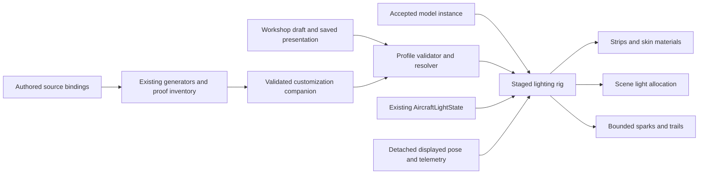

# Night flight and programmable RGB lighting masterplan

**Status: core renderer, profiles and Workshop implemented; authoring and qualification work remains.** Investigated 2026-10-25 against working-tree base `d7d49b1574f968edab533f8fc34f5a6e9e4920d3`; the user subsequently approved implementation. Runtime source takes precedence over proposals below. [Implementation and qualification record](research/night-flight-lighting/implementation.md) separates delivered behavior from remaining authoring, performance and pilot gates. Unrelated graphics and simulation work remains outside this subtrack.

**Owner:** Field World, aircraft-lighting subtrack **FW-RGB-00…16**, coordinated with AS/model authors, AE/Workshop, UI/input, CAM, VQ/PT, SM and CR. Gate **FW-N** remains the pilot acceptance gate; these proposals do not close it. [Ownership registry](README.md#tracks-plans-and-step-ids), [current aircraft lighting](AIRCRAFT-LIGHTING.md), [Workshop](AIRCRAFT-WORKSHOP.md), [field world](FIELD-WORLD-PLAN.md), [aircraft contract](AIRCRAFT_CONTRACT.md).

**Reading map:** [decisions](#1-product-outcome-and-architectural-decisions) · [repository audit](#2-repository-audit-what-exists-and-what-is-needed) · [references](#3-reference-research-and-visual-direction) · [presets](#4-six-complete-presets) · [rendering](#5-hybrid-rendering-architecture) · [aircraft contract](#6-universal-aircraft-lighting-contract) · [clock/lifecycle](#7-animation-telemetry-and-lifecycle) · [Workshop/UI](#8-workshop-and-menu-integration) · [persistence](#9-persistence-upgrades-and-recovery) · [budgets](#10-performance-budgets-and-quality-progression) · [verification](#11-verification-and-acceptance-matrix) · [implementation order](#12-ordered-implementation-packages) · [risks](#13-risks-decisions-requiring-evidence-and-handoff).

## 1. Product outcome and architectural decisions

Make a small RC aircraft read as a three-dimensional illuminated airframe against a convincing night sky: recognizable wing outline, warm upper skin, distinguishable underside, stable navigation references and vivid moving color. Up close, embedded emitters reveal structure; at pilot distance, pattern simplification preserves orientation. At every distance, light spill and shading keep the aircraft from looking like disconnected neon lines.

The implementation is an extension of the existing night kit, presentation profiles and Workshop. It is not a new aircraft loader, a second time-of-day system, a physics module or a renderer migration. The default renderer remains Compatibility. Forward+ is an optional enhanced path through the existing High experiment. A real Night Radian model is not required: the named preset describes an inspired lighting treatment on supported aircraft, not a catalog aircraft, official replica or endorsement.

| Decision | Rationale and boundary |
| --- | --- |
| Retain `AircraftLightState` as the single AUTO/ALL/NAV/OFF policy owner | Preserve 17:30 civil time, solar fallback, manual precedence and reset behavior. RGB is a rendering/profile extension below this policy. |
| Evolve `AircraftLights` and its existing `NightKit` | Reuse fitted geometry, stable lamps, group binding, exposure caps, attachment and crash metadata. Never attach the legacy kit and a second RGB kit simultaneously. |
| Introduce a render-only `AircraftLightingRig3D` facade | It owns one kit's resources, patterns, spill and bounded VFX; configuration stays data-only. Existing kit functions remain reusable implementation helpers. |
| Put lighting selections inside versioned Workshop presentation profiles | Reuse immutable variants, draft recovery, copy review, trial freezing and presentation hashes. Do not store light colors in physical aircraft JSON. |
| Keep authored geometry bindings separate from player choices | Creators define validated anchors/masks; players reference stable zone IDs and edit bounded values. Downloaded profiles cannot contain scripts, node paths or arbitrary geometry. |
| Shader color/patterns + a few real lights + bounded particles | Most visible LEDs cost geometry and fragments, not one light or node per diode. Emission alone does not illuminate nearby geometry. |
| Compatibility core must look complete with glow disabled | Glow is optional polish; distance sprites and ribbons already exist. Do not substitute bloom for readable geometry. |
| Preserve physics and replay identity | Read accepted telemetry at the presentation boundary. No mass, battery drain, aerodynamic coupling, solver callbacks or new kernel branches. |
| Keep missing metadata usable and explicit | Retain legacy automatic fitting for ordinary fixed-wing aircraft; mark estimated placements. Never guess internal glowing volumes, aircraft material translucency or unknown articulated mounts. |

### Scope and completion definition

Deliver six presets, per-zone advanced editing, isolated day/night preview, durable per-build appearance, safe migration, conventional-aircraft onboarding and evidence at **1920×1080 first**, then 1440p/4K, then 720p fallback. Hardware performance, pilot readability and visual preference require separate acceptance. A headless parser or a beautiful still cannot establish these.

Out of scope: changing flight physics, modeling LED electrical consumption, adding commercial aircraft, music playback/licensing, network synchronization, multiplayer event transport, a general shader editor, unrestricted scripting, real pyrotechnic instructions, dynamic GI as a dependency, and new world lighting/scenery frameworks. Reuse suitable free licensed assets before authoring new textures or effects; shader logic and application integration still require project code.

## 2. Repository audit: what exists and what is needed

Classification describes the inspected source, not marketing readiness. **Existing** means implemented; **reusable** identifies a seam this plan should extend; **incomplete** means part of the requested capability exists; **missing** means no implementation was found in the inspected route.

| Area | Status | Verified source and integration point | Consequence |
| --- | --- | --- | --- |
| Engine | Existing | [`app/get-godot.sh`](../app/get-godot.sh): `4.8-beta1`, exact CLI `4.8.beta1.official.4d10419ca`, archive and executable hash checks | Test the pinned prerelease; do not use an installed arbitrary Godot. |
| Default renderer | Existing | [`project.godot`](../app/project.godot): `gl_compatibility`, 4× MSAA, configured viewport 1280×720 | Configured viewport is not the product acceptance target. All new qualification starts at 1080p. |
| Enhanced renderer | Reusable, experimental | [`high_graphics_profile.gd`](../app/render/high_graphics_profile.gd): `active()`, `apply_environment()`, actual rendering-method check; [`tools/graphics`](../tools/graphics/README.md) | Feature detection uses the active renderer, not GPU brand or the requested setting alone. Preserve the user's existing edit. |
| Aircraft catalog/build | Reusable | [`aircraft_catalog.gd`](../app/app_state/aircraft_catalog.gd), [`airplane.gd`](../app/render/airplane.gd) `build()`, [`model_registry.gd`](../app/aircraft/model_registry.gd) | Build once through the accepted family/manifest path; lighting receives the resulting instance dictionary. |
| Imported and procedural models | Existing | [`imported_model.gd`](../app/aircraft/imported_model.gd); [`model-bindings.json`](../assets/aircraft/model-bindings.json); generated [`aircraft_models`](../app/data/aircraft_models/) | Manifest v1 builders and v2 imported GLBs coexist. Do not assume every family is a `.tscn` or every model has shared topology. |
| Stable coordinates/articulation | Reusable | [`frames.gd`](../app/render/frames.gd), manifest datum, `airplane`, `propeller`, `*_hinge`; `apply_controls()`, `apply_flaps()`, `apply_folds()` | Resolve in model coordinates; follow actual articulated nodes. Never rename existing nodes. |
| Light selection | Existing/reusable | [`aircraft_light_state.gd`](../app/render/world/aircraft_light_state.gd), [`main.gd`](../app/main.gd) `set_aircraft_lights()`, `_update_aircraft_lights()`, `_on_resetting()` | One persistent state per flight. L/controller cycle is already implemented. |
| Generic aircraft kit | Existing/reusable | [`aircraft_lights.gd`](../app/render/world/aircraft_lights.gd): `prepare_layout()`, `attach()`, `bind_groups()`, `update_dynamic()`; node `NightKit` | Existing nav, strobes, landing spotlight, top/underside/belly strips. Extend rather than rebuild. |
| Fitting geometry | Existing, heuristic | `bounds()`, `_geometry_arrays()`, `wing_skin_lines()`, `belly_line()`, `tip()` | Works on the accepted conventional-aircraft frame; not a universal semantic recognizer. Cache compact results, not full triangle copies. |
| Authored lights | Existing/reusable | `light_anchors`, `light_groups`, `light_material_groups`; [`timber_visual_lighting.gd`](../app/aircraft/timber_visual_lighting.gd); P-51 model anchors | Timber has authored factory lens placements and omits orientation strips. Its current Turbo Timber visual is not a Night Timber X model. |
| Lens material isolation | Existing/reusable | `prepare_emission()` / `set_emission_mode()` in `aircraft_lights.gd` | Duplicate surface overrides per instance, preserve reflective lenses when OFF, never edit shared imported materials. |
| Distance-readable light shaders | Existing/reusable | [`light_sprite.gdshader`](../app/render/world/light_sprite.gdshader), [`led_strip.gdshader`](../app/render/world/led_strip.gdshader), [`engine_srgb.gdshaderinc`](../app/render/world/engine_srgb.gdshaderinc) | Projection-aware minimum size, flux compensation, face gating, `world_exposure`, `sim_clock`; preserve these contracts while adding patterns. |
| RGB sequences/internal foam | Missing | Existing strip shader has one color, not a programmable zone graph or internal light mask | New bounded pattern evaluator, authorable zone bindings and optional skin treatment needed. |
| Real aircraft light spill | Incomplete | Existing `SpotLight3D` landing beam(s), shadowless; strips/sprites are additive/unshaded | Add a small shared light budget for colored nearby spill. Emissive strips do not supply it. |
| Sky/time/exposure | Existing/reusable, qualification incomplete | [`world.gd`](../app/render/world/world.gd), [`time_of_day_lighting.gd`](../app/render/time_of_day_lighting.gd), [`environment`](../app/environment/), [`world/exposure.gd`](../app/render/world/exposure.gd) | Reuse both fixed TOD and field-world clocks; retain current moon/sky route limitations. |
| Night ground scenery | Existing/reusable | [FW-66–75](FIELD-WORLD-PLAN.md), [`tools/night-lighting`](../tools/night-lighting/README.md), field-light data and Club/Airfield/Off | Runway/club illumination already exists. Do not create another field-light controller or duplicate downloaded lamp assets. |
| Cameras and magnifier | Existing/reusable | [`render/camera`](../app/render/camera/), [camera plan](plans/camera-views.md), main's displayed pose/clock | Pilot, chase, orbit, fly-by and aircraft-only inset need different distance/occlusion tests, not different profile clocks. |
| Workshop pages and draft | Existing/reusable | [`ui/workshop.gd`](../app/ui/workshop.gd), [`workshop_customization.gd`](../app/ui/workshop_customization.gd) | Add Lighting alongside Appearance/Smoke/Flight setup/Compare; extend the same history and dirty guard. |
| Workshop preview | Existing/reusable | [`workshop_preview.gd`](../app/ui/workshop_preview.gd): `SubViewport`, `_stage`, `_rig`, `_camera`, isolated 240 Hz playhead | Add lighting preview and temporary night environment; no second live flight or global shader-clock mutation. |
| Appearance persistence | Existing/reusable | [`presentation.gd`](../app/workshop/presentation.gd): presentation v2, companion v3; [`store.gd`](../app/workshop/store.gd): immutable variants under `user://aircraft_variants` | Lighting requires explicit version readers and identities, not extra unknown keys inserted into v2. |
| Trial/copy/recovery/bundles | Existing/reusable | [`trial.gd`](../app/workshop/trial.gd) `freeze()`, [`profile_transfer.gd`](../app/workshop/profile_transfer.gd), [`draft_store.gd`](../app/workshop/draft_store.gd), [`bundle.gd`](../app/workshop/bundle.gd) | Every route must understand lighting. A UI-only implementation would lose data or reject saved builds. |
| Global preferences | Existing/reusable | [`preferences.gd`](../app/app_state/preferences.gd), [`display_preferences.gd`](../app/app_state/display_preferences.gd) | Field/time remains in `settings.cfg`; visual quality/accessibility belongs in `display.cfg`. |
| Smoke/VFX | Reusable patterns, separate ownership | [`smoke_system.gd`](../app/render/smoke/smoke_system.gd), bounded profiles and presentation scheduling, [SMOKE](SMOKE.md); crash effects under [`render/crash`](../app/render/crash/) | Reuse lifecycle/budget principles and clocks. Do not turn spark requests into smoke-pump state or resize live smoke pools. |
| Wingtip fireworks | Missing | No general programmable spark/show system found in the aircraft-lighting route | Add optional bounded presentation VFX, off by default; no collision/physics side effects. |

### Source conflicts that must not propagate

The knowledge graph is available but several stored GDScript ranges lag the working tree; search results were verified in current files. Some documents still describe Godot 4.7.2, eight configurations or older night-kit gaps. The current engine pin and runtime win. `AIRCRAFT-LIGHTING.md` includes an older executable in its sample check; use the pinned checked runner from [shared tools](tools/shared.md#one-godot-script). Enumerate catalog entries and generated companions at implementation time rather than hardcoding a fleet count in acceptance scripts.

## 3. Reference research and visual direction

The dated [source ledger](research/night-flight-lighting/2026-10-25-sources.md) records manufacturer references, image/video locations, Godot evidence and the resolved pilot identity. Photographs and videos are reference links, not redistributed assets. Manufacturer LED counts and marketing descriptions are not luminance measurements or proof that a particular animated effect was observed.

Verified references are the **E-flite Night Radian 2.0m**, **Night Timber X Evolution 1.2m**, **H-King Flybeam 2**, Flytron Strobon NEO, xwLedControl and external wingtip illumination from Night Fire RC. The user confirmed that **“Jastusa / Jast USA” means Jase “The Ace” Dussia**, the RC aerobatic pilot. The [source ledger](research/night-flight-lighting/2026-10-25-sources.md#jastusa--jast-usa-identity-result) records the identity check and documented night performances. Use his performances as creative references; do not invent a commercial aircraft or claim an official reproduction of his lighting setup.

Use the references for three distinct looks:

1. **Embedded RC illumination:** distributed colored emitters beneath diffuse foam, dark ribs/spars interrupting light, a readable whole-wing envelope and slow mode changes. The airframe remains visible between emitters.
2. **Programmable retrofit:** visibly attached strips along span, fuselage and tail, brighter individual segments at close range and a coherent line farther away. These can fit existing aircraft without implying transparent metal or composite skins.
3. **Airshow fantasy:** brief gold sparks, colored wake ribbons and synchronized bursts. Clearly label these Show effects. They are visual entertainment, not verified real equipment or a flight-training aid.

### Art-direction rules

The fixed visual hierarchy is **aircraft shape → orientation references → animated color → accents → optional particles**. Do not allow a rainbow or a white flash to replace the left-red/right-green references in a normal preset. Preserve a steady warm-white top cue and cyan/blue underside cue, supplemented by shape: one longitudinal dorsal spine versus two transverse underside bars. Color alone is insufficient for red/green color-vision differences or an aircraft smaller than a few pixels.

Port/starboard mean the pilot's left/right when facing the aircraft nose, regardless of camera view; white is the aft reference. Front-on and inverted attitudes can produce similar screen color order, so never infer heading from a red/green pair alone. Classic RC follows these RC navigation conventions; it is not a regulatory compliance claim. Today's billboard lamps do not establish exact full-size viewing sectors. Optional authored directional masks must be verified from front/side/rear before describing a scale installation as directionally accurate.

Keep a dark separation between neighboring saturated regions. Avoid coating the entire silhouette in white bloom. LEDs have a narrow luminous core, a restrained local halo and, only nearby, selected spill. Lit foam has low-frequency color pools and visible structural shadows; it is not uniform fullbright albedo. Original paint remains legible in day view and when the kit is OFF.

The night environment should retain a dim horizon, moonlit form and readable runway landmarks. Do not brighten the whole sky when the aircraft preset changes. Never increase exposure just to make a light preset impressive: match the same sky, camera and exposure when comparing.

## 4. Six complete presets

Values below are initial artistic targets, not calibrated photometry. `brightness` is a dimensionless multiplier on the existing exposure-managed emitter baseline. Profile defaults remain stable across machines; resolved quality may reduce cost without rewriting them.

| Preset | Palette and arrangement | Motion | Spill and effects | Defaults and fallback |
| --- | --- | --- | --- | --- |
| **Classic RC** | Port red `#FF241C`, starboard green `#22E85B`, tail neutral white; warm landing light `#FFF1D6` | Existing double strobe cadence; steady navigation | Existing landing beam; no decorative VFX | Brightness 1.0; optional landing group; supported stock equipment only. Retain current default kit for old profiles rather than silently substituting this new preset. |
| **Night Radian** | Full-span diffuse cyan, magenta, amber and violet sections with dark rib breaks; warm top spine; cyan underside bars; separate nav references | One slow 8 s bilateral traveling wave, 0.2 baseline brightness; no competing scene-transition cycle | Two low-energy nearby spill proxies; foam masks only where authored | Brightness 0.8; no sparks. On opaque aircraft, label “strip adaptation”; do not fake a transparent airframe. |
| **Neon RGB** | Cyan `#20DFFF`, violet `#794CFF`, magenta `#FF38A8`; dark gaps and amber accents | 4 s root-to-tip chase; 16 visible macrosegments near, smoothly filtered far | Bounded local colored spill; no particles | Brightness 0.75, pattern speed 1×. Nav/upper/lower reference zones stay steady. |
| **Night Aerobatics** | Warm top, cyan underside, amber leading-edge accents; distinct wing endpoints | Subtle 6 s breathing in decorative zones; throttle and roll-rate change amber accents only; reference spine/bars/endpoints remain steady | Optional short 0.25 s spark accent on a qualified maneuver event; initially disabled | Brightness 0.9; orientation lock enabled; no rapid whole-wing blackouts. Missing telemetry resolves to steady accents. |
| **Festival / Fireworks** | Indigo base, cyan/magenta moving panels, warm gold tip sparks `#FFD17A` | 16 s repeatable cue sequence: 0–4 breathe, 4–8 chase, 8–12 outward wave, 12–16 quiet fade with steady references | One synchronized pair of 0.4 s tip bursts at 8 s, aligned to the outward wave; optional 0.6 s trail; no explosion sound by default | Explicit opt-in Show preset, brightness 0.7, effect intensity 0.5; quiet mode removes flashing and bursts. Preset selection does not immediately fire a paused preview. |
| **Custom** | Starts from a selected preset or accepted current profile | Per-zone pattern, palette, phase and bounded cue editor | Independent enable/disable per supported effect | No hidden randomization. “Reset zone” and “Reset lighting to aircraft default” are separate Undo operations. |

### Pattern library and authoring semantics

Initial closed pattern IDs: `steady`, `breath`, `pulse`, `chase`, `wave`, `rainbow`, `segments`, `sequence`. A pattern operates on normalized **arc length** along a strip, not vertex index. Root-to-tip direction is authored per side so mirrored wings can move outward together. A `sync_group` shares phase; `phase_turns` and `reverse` are explicit. Interior illumination samples the same palette field through an authored mask, making internal pools and external strips coherent.

`steady` returns one color. `breath` uses a smooth envelope between configured floor and peak. `pulse` has smooth attack/release; a true hard strobe is restricted to the dedicated strobe role. `chase` uses an antialiased moving band and dark-but-visible floor. `wave` interpolates a finite palette periodically. `rainbow` traverses a precomputed artist palette, not an uncontrolled per-pixel HSV conversion. `segments` holds discrete macrosegments with filtered edges. `sequence` references at most 32 cues; each cue names a pattern and duration, with no recursion or scripts.

Ordinary effects default to periods of 4–12 s. Advanced animation rate is 0.1–4 cycles/s; the Reduced flashes preference clamps dynamic contrast and turns short flashes into steady/slow accents independently of saved content. Navigation is never a beat-reactive channel. Do not equate a frequency cap with photosensitivity certification.

## 5. Hybrid rendering architecture

### 5.1 Technique selection

| Effect | Primary technique | Why | Limitation and fallback |
| --- | --- | --- | --- |
| Navigation/strobe source | Existing exposure-aware billboard shader plus physical lens mesh | Preserves far visibility without hundreds of lights | A sprite is not scene illumination. Keep depth testing and bounded minimum size; never draw through airframe or scenery. |
| Programmable strips | Existing ribbon geometry extended with arc-length UV, pattern uniforms and palette lookup | A few surfaces per aircraft; no per-LED scene nodes or per-frame geometry rebuild | Width expansion can breach silhouette; preserve face gating and cap projected expansion. Far LOD uses average colored energy. |
| Simple authored lens emission | Per-instance `StandardMaterial3D` surface override | Easy reuse of imported albedo/normal/roughness and static emission maps | Standard material alone cannot express the full sequence contract; animated zones use a custom spatial shader. |
| Internal foam glow | Opaque lit skin shader with authored thickness/transmission mask and low-frequency emission field | Preserves depth, shading and structure; avoids wholesale alpha blending | This approximates light diffusion, not subsurface transport. Unsupported skins use attached strips. |
| Thin translucent cover | Small explicitly authored two-sided/transparent surface, only if visually required | Appropriate for a lamp cover or limited panel | Sorting, overdraw and backface artifacts; prefer opaque diffusion or alpha scissor for cutouts. Never convert the whole aircraft to transparent. |
| Real local spill | Few shadowless `OmniLight3D` color proxies and existing `SpotLight3D` landing beam | Illuminates aircraft/runway/nearby geometry | Shadowless lights can leak through thin wings. Restrict radius, position and recipients; turn down or omit a misleading light. |
| Glow/bloom | Existing `WorldEnvironment` configuration with restrained optional engine glow | Softens intense sources coherently | Renderer implementations differ; baseline must remain readable when disabled. Do not add a full-screen postprocess for every aircraft. |
| Spark points | Bounded `GPUParticles3D` quads or small pooled analytic instances | Cheap, short-lived visual accents | Engine particle time needs qualification against pause/replay. Analytic material driven by supplied presentation clock is the deterministic fallback. |
| Continuous wingtip trails | Small dynamic `ArrayMesh` ribbons from a bounded ring of displayed anchor poses | Works across renderers; accurate attachment and controllable lifetime | CPU/upload cost and ribbon twist; maximum 2 allocated trails in the entire scene, including residuals; simplify by projected error. |
| Particle ribbon trails/subemitters | Optional enhanced renderer path after capability tests | Useful richer burst shapes | Pinned Compatibility explicitly does not implement these. Flat sparks plus the explicit ribbon path remain complete alternatives. |
| Runway pools/horizon/moon | Existing world/field lighting, sky, exposure and glare | Avoids duplicate infrastructure and conflicting exposure | Some TOD/moon progression and pilot gates remain open; profiles cannot claim to fix them. |

### 5.2 Color, emission, exposure and bloom

Store canonical opaque sRGB `#RRGGBB` palette values; use a separate brightness/envelope scalar. Convert color once at the rendering boundary. Mask textures are linear data, not sRGB color. Existing custom shaders use `encode_for_engine()` because of the calibrated rendering path; do not blindly add another linearization. Test neutral gray and saturated swatches in both renderers with their actual output mode.

The baseline custom strip currently writes unshaded additive `ALBEDO`, not a physically emitting surface. Its view-facing ribbon is a luminous representation. New lit skin shaders may write `EMISSION`, but that still does not illuminate neighbors without a separate lighting/GI mechanism. Explicit light proxies are the guaranteed source of local spill. Baked lightmaps cannot follow a flying aircraft or arbitrary player colors; SDFGI/VoxelGI are not dependencies and are inappropriate as a baseline shortcut.

Keep the world's calibrated tonemapper and adaptation owner. Do not switch tonemapper, camera exposure or physical-light-units settings per aircraft. For bloom calibration, capture a red/green emitter, painted fuselage, white runway marker and moon together; increase halo only while the core stays colored and surrounding contrast remains useful. An all-white clipped aircraft fails even if total screen brightness looks dramatic.

The [pinned 4.8-beta1 GLES3 source](https://github.com/godotengine/godot/blob/4d10419cacd6d3009976e8f9fd3abd970fd58018/drivers/gles3/effects/glow.cpp#L680) confirms Compatibility glow exists. Its simpler implementation ignores several advanced controls, including glow levels, maps and blend modes; see the [Environment reference](https://docs.godotengine.org/en/4.7/classes/class_environment.html#class-environment-property-glow-enabled). The project's `Atmosphere.environment()` currently disables glow. Introduce any optional night halo through that environment owner, keep the current default intact until qualified, and test each active backend. No fixed arbitrary HDR threshold is accepted across the repository's exposure normalization and both backends.

### Renderer capability matrix

This is a technique selection matrix, not a change to supported platforms. [Official renderer comparison](https://docs.godotengine.org/en/4.7/tutorials/rendering/renderers.html) supplies the documented defaults; exact beta source resolves the glow/particle questions.

| Capability | Compatibility: production baseline | Mobile: evaluated fallback only | Forward+: existing High experiment |
| --- | --- | --- | --- |
| Emission / custom strip shaders / real spot and omni lights | Yes; calibrated color/exposure path | Yes, separately qualify shader color output | Yes, separately qualify HDR output |
| Render color precision | LDR RGBA8 path; emission values do not make its framebuffer full HDR | Intermediate precision by default | HDR RGBA16F |
| Default local-light limit | 8 omni and 8 spot per mesh; configurable engine ceiling is not a project budget | 8 per mesh, 256 per view by light type | Clustered; documented 512 per cluster, configurable |
| Glow | Supported, simpler controls; optional | Supported, qualify precision/tuning | Supported, full control set; optional |
| GPU particle points | Supported subject to backend/driver qualification | Supported | Supported |
| Built-in GPU particle trails / subemitters | Not implemented in pinned GLES3; use explicit ribbon/analytic burst | Candidate supported path, not shipped/qualified here | Candidate enhanced path, qualify clocks and motion |
| Volumetric fog / dynamic GI | Not required; no volumetric fog/SDFGI | No volumetric fog/SDFGI dependency | Available techniques, omitted from first implementation |
| Light projectors / decals | Not a baseline option | Possible later | Possible later |

The [pinned particle backend](https://github.com/godotengine/godot/blob/4d10419cacd6d3009976e8f9fd3abd970fd58018/drivers/gles3/storage/particles_storage.cpp#L2638) explicitly warns/no-ops for trails and subemitters. A `GPUParticles3D` node successfully loading is therefore not a capability test for those features. `CPUParticles3D` is a possible tiny fallback if measured, but transfers work to the CPU and does not solve trail support; prefer bounded analytic sparks or omit optional sparks on a failed backend.

### 5.3 Strip construction and patterns

Generate strip surfaces at binding time. Preserve the current shader's `UV.x` across-strip convention and add cumulative normalized length in `UV.y`; preserve normal-as-across data or explicitly version the mesh layout. A zone contains physical path geometry and an integer virtual LED count. Virtual LED count changes shader segmentation, not node count. Cap all generated geometry before allocation.

One per-rig pattern evaluator resolves cue transitions and event envelopes; shaders evaluate spatial color. Static parameters update only on edits. Upload a compact palette/cue lookup only when changed. Do not upload a texture or set a uniform for every LED each frame. Start with a shared shader and per-rig materials; later combine compatible zones into one surface with a zone index and bounded lookup table if profiling justifies it. Godot does not automatically batch arbitrary MeshInstance3D materials into one draw.

A MultiMesh is useful for many identical lamp cores, but its culling is aggregate and it does not solve arbitrary ribbons or transparent ordering. Do not introduce MultiMesh solely to label the system “batched.” Favor a small fixed mesh/material count first.

### 5.4 Real spill allocation

Select a maximum of one fuselage/underside color proxy and one wing-pair aggregate proxy in Standard quality, plus the existing landing beam budget. Enhanced quality may allow four proxies after measurement. A color proxy uses an area/energy-weighted local palette average; it never chases every LED. Smooth proxy changes over about 0.1 s without delaying source sprites. Radius starts near 0.5–1.5 aircraft spans for decorative spill; landing range remains the existing separately calibrated beam unless intentionally retuned.

The allocator operates at the **scene/view level**, accounting for field lights, campfire, companions and crash effects. It must not let every aircraft independently claim a full hardware allowance. Reserve navigation visibility first, existing landing usefulness next, decorative spill last. Disable distant proxies before reducing shape cues. Use light cull masks only after checking existing camera/render layer ownership; do not repurpose CAM's aircraft-only layer blindly. Shadowless through-surface leaks require a visual test from above and below. One optional shadowed landing light is an enhanced experiment, never a required effect.

[`field_lights.gd`](../app/render/world/field_lights.gd) already caps field spots at seven, reserving one spot slot for an aircraft landing lamp. The actual kit can create **two** landing spots for Timber. FW-RGB-06 must resolve this existing combined-case risk explicitly: test per-mesh overlap and allocate the paired beams/field spots within the effective limit, combining a distant pair into one energy-preserving beam or reducing eligible decorative field contribution where qualified. Two visible lens sprites can remain even when one aggregate beam is allocated. Do not raise the engine light limit globally to hide the issue.

### 5.5 LOD, culling and camera consistency

Use projected aircraft span in the actual viewport, with hysteresis: initial near >180 px, medium 60–180 px, far 12–60 px, tiny <12 px. These are proposed thresholds to tune at 1080p. Use projection matrices and viewport dimensions, not camera distance alone; orthographic preview, pilot zoom and inset differ.

Near draws segments, authored skin masks and bounded particles. Medium merges subpixel LEDs and reduces particle births. Far retains stable nav/endpoints, top/bottom cues and low-frequency color flow. Tiny retains a capped orientation beacon representation without pretending attitude is always discernible. Minimum source sizes must be qualified at 1080p and scale according to the camera/readability policy; do not turn every distant diode into a 4 px disc.

Shaders use the current view for width and facing. CPU decisions select the highest useful LOD among visible relevant views, with the inset configured to exclude expensive world spill and show VFX. Clear camera-switch history only where needed; never restart the light sequence. Frustum culling uses expanded bounds for shader-width changes and live trails. A moving spark can remain visible after its aircraft leaves the frustum; track residual bounds/lifetime separately. Offscreen residuals expire against the authoritative clock and cannot reappear frozen.

There is a concrete integration trap in [`magnifier.gd`](../app/render/camera/magnifier.gd): `update()` tags the model only when its root reference changes, using `LAYER = 1 << 18`. A kit attached later at dusk is therefore not automatically tagged. At rig commit, register new luminous aircraft geometry with the existing `Magnifier.tag()` helper or a CAM-owned equivalent; do not recursively tag world-space show trails into the inset. The current helper tags every descendant `VisualInstance3D`, so selected geometry must be registered deliberately and late-created objects tested. Keep crash-debris layer `1 << 19` ownership intact.

### 5.6 Spark and trail construction

Festival emits a narrow outward-and-aft fan from each validated tip anchor. At birth store immutable world position, inherited displayed aircraft velocity, outward velocity, seed, color and birth tick. Evaluate a bounded ballistic/drag-like visual path from age; these constants are artistic and never feed the solver. Limit bright cores to the first part of life, then cool gold to amber and fade. No particle gets an OmniLight, collision body, damage event or sound source. Any optional terrain clipping reads the existing field query and remains presentation-only.

Trails store world-space tip samples in a fixed ring; never parent old points to the moving aircraft. Sample displayed motion at a bounded cadence with interpolation and distance-based insertion, then remove points by age. A teleport/reset or unsupported pose gap breaks the ribbon instead of connecting across the field. Parallel-transport the ribbon frame or use a camera-facing width with degeneracy handling; abrupt bank changes must not flip its winding. Additive blending reduces alpha sort dependence, but overdraw still needs budgeting. Depth test against real geometry, keep bounds current, and taper width/alpha toward the tail. Default max length is the smaller of the lifetime-generated path and four aircraft spans; this is a show-design bound, not a physical flame/trail model.

### 5.7 Environment composition

Use the existing Clear/night sky presets, moon configuration, exposure/horizon curves and Club/Airfield/Off field lighting. Initial demonstration conditions should be a frozen moonlit night for orientation inspection and a frozen dark night for contrast stress; use named existing configuration readers rather than inventing another `night.json`. Show atmospheric depth through the existing haze and moon/sky illumination, not a bright fog volume attached to the aircraft.

Keep stars and horizon lower in visual priority than the airframe. Landing spill must visibly reveal the ground on approach; it must not illuminate an entire runway from hundreds of metres. Runway fixtures remain useful when Show effects are off. Lake reflections follow the current landscape/reflection path; do not promise that emissive strips automatically appear in every reflection method. Test reflected lamps and bloom separately where the water path is enabled. Moon, sky and field preferences retain their existing ownership, route limitations and gates.

## 6. Universal aircraft lighting contract

### 6.1 Data ownership and versions

The following names and paths are **proposed**, not existing classes. Use plain GDScript types with explicit `class_name` only if repository conventions and collision checks permit it.

| Object | Proposed representation / path | Owns |
| --- | --- | --- |
| `AircraftLightingProfile` | Validated immutable Dictionary facade in `app/render/lighting/lighting_profile.gd`; nested payload `openrc-aircraft-lighting`, version 1 | Preset intent, zone overrides, pattern parameters, bounded VFX choices, visual seed; no geometry or live node handles. |
| Authored lighting bindings | New explicit version of the existing customization companion, initially proposed v4; source extends `assets/aircraft/customization-bindings.json` through `build_customization.py` | Stable semantic zones, anchors, paths, surface/mask bindings, provenance, capabilities and dependency pins. |
| `AircraftLightingRig3D` | `app/render/lighting/aircraft_lighting_rig_3d.gd`, render-owned `Node3D` facade for one `NightKit` | Runtime nodes/material instances, bindings, current pattern time, spill handles, VFX allocation and teardown. |
| Pattern evaluator | `app/render/lighting/lighting_patterns.gd` | Pure bounded evaluation from profile, clock and accepted telemetry; no scene traversal or filesystem access. |
| Spark/trail renderer | `app/render/lighting/lighting_vfx.gd` | Bounded visual births/residuals; reads anchors and clock; cannot call physics. |
| Budget coordinator | Small extension at activity/render composition boundary, optionally `app/render/lighting/lighting_budget.gd` | Scene-wide allocation and diagnostics; no global singleton containing aircraft configuration. |
| Workshop presentation envelope | `openrc-aircraft-presentation` proposed v3, preserving explicit v1/v2 readers | Existing paint/markings/smoke plus the new lighting payload and full presentation identity. |

Do not bump the physical `openrc-aircraft v2` format. Version numbers above are reserved proposals; before implementation, check that another track has not allocated them. Extend source-proof inventories deliberately; current proof paths are closed and a new shader/mask cannot be loaded by an unrecorded path. Stock/no-metadata remains allowed without requiring every old model to gain a new manifest immediately.



No arrow returns from presentation to the simulation. The activity owns rig disposal; the model root owns attached geometry. World-space residual pools are owned by the activity's lighting service and released with that rig generation. A generation token prevents delayed async preparation from committing to a newly selected aircraft.

### Existing integration seams to change

| Existing seam | Planned change, confined to its responsibility |
| --- | --- |
| `AircraftLights.attach()` and `prepare_layout()` | Add a detached construction/staging helper that consumes an already resolved layout. Keep `attach()` as an idempotent legacy wrapper; its current early return for an existing `NightKit` is not a transactional replacement API. |
| `World.dress_aircraft()`, field builder, `ui/home_scene.gd`, runway scenario and main's night-kit construction sites | Route every existing attachment caller through the same factory. Default/inherit creates legacy-equivalent equipment; explicit profile resolves once. No caller may bypass a selected disabled profile or attach a second kit. |
| `main._update_aircraft_lights()` | Retain light-state policy; dispatch accepted mode/gain to the one rig. Stage profile changes elsewhere, not in every frame. |
| Main after `_render_pose()` and the existing fractional smoke-clock calculation | Supply RGB/VFX displayed pose time and accepted observations. Reuse the clock calculation without making lighting depend on smoke being enabled. |
| `AircraftCustomization.apply()` / `_stage_targets()` / `AircraftLights.prepare_emission()` | Compose paint, skin emission and lens overrides in one staged per-instance material transaction. Keep an immutable original-material reference and rebuild from original + accepted paint + accepted lighting; never repeatedly duplicate the previous override or let two owners overwrite the same surface. |
| `Presentation.defaults()`, `validate()`, `validate_stored()`, `identity_record()`, `_validate_bindings()` | Add explicit v3 profile/v4 companion readers, canonical lighting normalization and source/preset/fitter identity. Preserve historical readers and a separate presentation identity. |
| `presentation_sources.gd`, `build_customization.py`, model/Workshop descriptor generators | Extend closed proof inventory and generated companion schema, including allowed masks and new shaders. Regenerate consumers; do not edit output hashes manually. |
| `workshop.gd` `PAGE_IDS`, `_set_page()`, `_draft_payload()`, `_restore_history()` | Add page and accepted lighting payload; include it in one shared Undo/Redo/draft history. Environment settings remain outside the payload. |
| `workshop_customization.gd` `configure()`, `restore_editor_state()` | Reuse control/edit conventions; implement lighting controls as a focused child component if needed instead of growing unrelated paint/smoke logic. |
| `workshop_preview.gd` `set_presentation()`, `_refresh_model_presentation()`, `_build_world()`, `reset_playback()`, `_process()`, `_exit_tree()` | Apply staged rig, local preview exposure/time, animation demand redraw, reset and resource release. Existing smoke and lighting share the isolated playhead while retaining separate enable controls. |
| `profile_transfer.gd` | Explicitly extend its current paint/markings/smoke-only transfer schema for lighting semantic-role/capability matching, skipped-zone report and mixed target preservation. It does not support lighting today. |
| `trial.freeze()`, Store, Bundle and DraftStore | Carry new profile through validation/readback/export/import/recovery. Preserve the existing separate presentation identity rather than folding it into physical trial identity. |

A staged commit validates all required hosts/material targets, reserves bounded resources, then swaps ownership in one main-thread operation. Only afterward dispose the old rig and release its allocations. If staging fails, free only the candidate. Preserve the public `NightKit` node name and crash metadata; support existing dynamic-lamp consumers until migrated in the same package.

### 6.2 Stable semantics

Anchor IDs use lowercase snake_case, maximum 80 characters, unique per visual family. Suggested roles: `wing_left_root`, `wing_left_tip`, `wing_right_root`, `wing_right_tip`, `fuselage_dorsal`, `fuselage_ventral`, `tail_left`, `tail_right`, `tail_end`, `landing_left`, `landing_right`, `vfx_tip_left`, `vfx_tip_right`. A role is a semantic hint, not permission to attach to an arbitrary similarly named node.

Zone IDs are stable independent identities, for example `wing_left_upper`, `wing_left_lower`, `fuselage_spine`, `tail_outline`, `nav_port`, `nav_starboard`, `landing_pair`. Supported zone kinds: `point`, `strip`, `diffuse_skin`; supported VFX kinds: `spark`, `trail`, `burst`. Keep capability lists explicit. A mask-equipped aircraft may advertise internal glow; an opaque warbird does not acquire it because its bounds resemble foam wings.

Retain current policy groups `navigation`, `strobe`, `landing`, `orientation`. New decorative RGB zones map to `orientation`; show VFX require ALL and an explicit effect enable/request. NAV contains only enabled navigation and strobe roles. OFF suppresses all aircraft-light emissions and births, including internal skins, while reflective lenses remain. Quality reduction cannot enable a disabled zone. “Orientation lock” is an editing aid in safe presets, not a way to override the user's OFF selection.

### 6.3 Coordinates and transforms

Authored positions are metres in the validated model frame **+X right, +Y up, −Z nose**. A local anchor has a root-relative node binding, `position_m[3]`, normalized `forward[3]`, normalized `up[3]`, and an explicit rest-pose identity. Right/left are aircraft-relative, never screen-relative. Prefer direction/up vectors to ambiguous Euler order. Forward and up must be finite, nonzero and nonparallel; orthonormalize only within a documented tolerance, otherwise reject.

Resolve root-relative node references once. For a local anchor, `T_world_anchor = T_world_host × T_local_anchor`. Strip points use the same host-local frame. For a root-bound zone, the host is `airplane`. Existing `Frames.root_transform()` already places the model relative to its datum; **do not subtract CG again**. For imported nested transforms, use the verified hierarchy, not a bounding-box recenter.

The prototype supports positive **uniform** scale. Workshop size scales anchor positions, strip widths and apertures exactly once through the model/rig relationship. Unit directions remain normalized. Do not both multiply source coordinates by Workshop scale and inherit it from the parent. Reject negative scale, shear and nonuniform scale for exact authored effects; report unavailable effects without invalidating otherwise valid stock flight. A future explicit transform contract can expand support. Do not silently fit a stretched or mirrored aircraft.

Moving surfaces own their strips: bind to a wing/fold/control node and maintain local paths. Never span a moving hinge with one rigid ribbon; split zones across the seam and synchronize their pattern coordinates. Follow current gear gates for landing lights. A source model's origin/rotation is handled by the manifest/import adapter; geometry fitting is attempted only after normalization to the conventional frame.

### 6.4 Authored binding example

This is a **proposed fragment** inside a v4 companion, using illustrative geometry, not measured coordinates for a shipped aircraft. Actual family pins, hosts and paths must be generated from its owning pipeline. The example deliberately keeps player preferences out of geometry data.

```json
{
  "lighting_bindings_version": 1,
  "lighting": {
    "capabilities": ["navigation", "strips", "spill", "spark"],
    "anchors": [
      {
        "id": "wing_left_tip",
        "role": "wing_left_tip",
        "node_path": ".",
        "position_m": [-0.76, 0.12, 0.04],
        "forward": [0, 0, -1],
        "up": [0, 1, 0],
        "provenance": "estimated"
      }
    ],
    "zones": [
      {
        "id": "wing_left_lower",
        "kind": "strip",
        "group": "orientation",
        "node_path": ".",
        "points_m": [[-0.15, 0.10, 0.03], [-0.45, 0.11, 0.04], [-0.74, 0.12, 0.04]],
        "face_direction": [0, -1, 0],
        "width_m": 0.012,
        "virtual_led_count": 48,
        "sync_group": "lower_wings",
        "default_pattern": "wave",
        "provenance": "estimated"
      }
    ],
    "vfx_anchors": [
      {"id": "show_left", "anchor_id": "wing_left_tip", "allowed_effects": ["spark"], "outward": [-1, 0, 0]}
    ]
  }
}
```

Additional diffuse-skin target fields are creator-only: registered `node_path`, surface index/material kind, pinned mask resource ID, thickness range, and structural-darkening strength. Resource IDs resolve through an allowlisted generated dependency table; they are not arbitrary user paths. Point zones reference an anchor ID and declared emission direction/visibility sector. Spill descriptors reference bounded anchor IDs and a maximum authored radius, with runtime allocation below that maximum.

### 6.5 Player profile example

This complete **lighting payload** is nested in the proposed presentation v3 envelope; the existing outer binding pins the visual family, manifest and companion. It does not claim to be accepted by today's v2 parser.

```json
{
  "format": "openrc-aircraft-lighting",
  "version": 1,
  "selection": "custom",
  "preset_id": "neon_rgb",
  "preset_revision": 1,
  "orientation_lock": true,
  "brightness": 0.75,
  "visual_seed": 1042,
  "zones": [
    {
      "id": "wing_left_lower",
      "enabled": true,
      "brightness": 0.8,
      "pattern": {
        "id": "wave",
        "palette": ["#20DFFF", "#794CFF", "#FF38A8"],
        "period_ticks": 960,
        "phase_turns": 0.0,
        "floor": 0.2,
        "duty": 0.5,
        "reverse": false,
        "segments": 16
      },
      "reactive": {"source": "none", "gain": 0.0}
    }
  ],
  "effects": [
    {"anchor_id": "show_left", "kind": "spark", "enabled": false, "intensity": 0.3, "lifetime_ticks": 72}
  ],
  "sequence": []
}
```

`selection` is `inherit`, `preset`, `custom` or `disabled`. `inherit` means the historical/model stock equipment treatment; `disabled` is an explicit empty lighting installation and cannot fall through to stock. `preset` resolves a **version-pinned** preset plus bounded overrides. `custom` stores the materialized accepted settings; omitted zone IDs inherit that pinned preset/aircraft default, while `enabled:false` is explicit. Canonical validation expands defaults before hashing. Profile brightness multiplies zone brightness, resolved AUTO gain and accessibility caps; it never modifies physical units or sky exposure.

The v1 payload has exactly the top-level keys shown in the example. `preset_id` is empty and `preset_revision=0` for `inherit`/`disabled`; their zone/effect/sequence arrays must be empty. `custom` requires the explicit base preset ID/revision or the reserved base `aircraft_default` revision 1, resolved against the same binding proof. `visual_seed` is a nonnegative integer ≤2147483647. Booleans are not integers for validation.

Zone entries require `id`, `enabled`, `brightness`, `pattern`, `reactive`. Pattern entries use exactly the keys in the example; irrelevant fields receive fixed canonical defaults, not arbitrary hidden values. Palette length is 1–8; `steady` samples index 0. `reactive` is `{source, gain}` with source `none|throttle|airspeed|roll_rate|pitch_rate` and gain 0–1; conversion ranges, smoothing and validity policy belong to the versioned reaction definition, not arbitrary profile expressions. Absent telemetry produces the base pattern. No user expression evaluator is introduced.

Effect entries require `{anchor_id, kind, enabled, intensity, lifetime_ticks}` and optional `required` boolean defaulting true. `required:false` explicitly permits an availability downgrade with a warning. Cue entries are `{id, duration_ticks, pattern, zone_ids, effect_anchor_ids}`: stable unique cue ID, complete non-sequence pattern record, registered zone IDs and effect IDs already enabled in `effects`. A nonempty sequence requires at least one zone with `pattern.id=sequence`; its cues advance in array order, loop at the summed duration and fire effects only on boundary crossings. No nested sequence pattern is allowed in a cue. The first cue boundary is primed without a burst at configure/reset; it fires on subsequent playback crossings only.

Runtime `ResolvedLightingBindings` is a detached dictionary containing stable IDs, `Node3D` host handles, local paths/frames, validated material targets, capability flags and proof identity. It is never JSON-serialized. `LightingFrameSample` carries integer accepted tick, finite displayed seconds, generation token, detached read-only telemetry, validated render transforms and view descriptors. `LightingBudgetReceipt` contains requested/resolved counts and degradation reasons. Do not pass session objects or mutable physics arrays into shaders/VFX.

### 6.6 Validation and error policy

Use strict JSON parsing consistent with Workshop's existing parser. Reject duplicate keys/IDs, unknown fields in a known schema, booleans supplied as numbers, nonfinite values, unbounded strings, unsupported versions and invalid references. Suggested initial bounds: 32 zones, 64 anchors, 128 points per strip, **1024 path points total**, 8 palette colors, 32 cues, 4 VFX anchors with at most 2 simultaneously emitting. The current binding reader has an 8192-node JSON-tree cap; allow at most 6144 nodes for the lighting subtree **and** enforce the unchanged total cap across paint/markings/smoke/lighting. A record can hit that total before any individual maximum. Count structural nodes before allocation and test worst-case combined fixtures; no implied allowance for all maxima simultaneously. Retain the 64 KiB presentation cap by allocating a lighting sub-budget, initially 24 KiB; measure canonical worst cases before approving a larger envelope.

Brightness is 0–2, phase 0–1, duty 0.05–0.95, floor 0–1, segments 1–256, and speed periods 60–14400 ticks (0.25–60 s at 240 Hz). Effect lifetime is 12–480 ticks; intensity is 0–1. Cue durations are positive integer ticks, total ≤14400 ticks, with no nested sequences. Clamp only UI gestures and explicitly documented global preference recovery. Invalid saved profile numbers are errors, not silently corrected content.

Separate outcomes: `ok` (well-formed), `available` (pins/capabilities resolve), warnings (estimated fit or quality downgrade), and errors (cannot apply). A malformed optional shipped lighting companion must not make otherwise valid aircraft physics unflyable: stock launch logs/displays the lighting problem and uses safe legacy equipment only when its independent bindings validate. A user-selected frozen custom build with stale required lighting pins is **not** silently substituted; preserve the previous accepted flight and offer explicit “Use stock lighting in a new draft.” Missing optional VFX only disables that effect when the saved schema explicitly marks it optional and the user sees the availability note.

### 6.7 No metadata and upgrade path

1. With no new lighting metadata and no new selection, preserve today's kit, authored legacy anchors, disabled anchors and supported groups exactly. This protects Timber factory equipment and P-51 gear-gated lamps.
2. For a conventional normalized model with usable triangles, reuse `prepare_layout()` to propose upper/lower/belly paths and tip points. Exclude owned lights/VFX, propeller sweep and helper meshes; compute once in neutral pose before attaching effects.
3. Validate nonempty finite bounds, left/right coverage, path continuity, normals, surface clearance and credible wing sections. Heuristic confidence is a discrete reasoned result (`authored`, `estimated_fit`, `unavailable`), not an invented accuracy percentage.
4. If a path fails, omit it and show the reason; do not bridge large gaps or draw a strip at the origin. If wing semantics are ambiguous (biplane, flying wing, asymmetric/animated/skinned geometry), provide only independently valid legacy lights and require creator metadata for exact zones.
5. Workshop offers **Customize fitted lighting**. This creates a draft from registered synthetic zone IDs bound to the current manifest plus fitting-algorithm revision and layout digest. It never writes to the imported GLB. A changed asset/fitter makes this draft stale for review.
6. Creators replace estimated zones through source bindings and regeneration. A stable-ID migration compares old/new anchors and produces a new revision; it does not reinterpret old coordinates silently.

**Synthetic-binding provider:** extend the companion resolver with a versioned `derived_fit` provider, not an exception inside the profile validator. Proposed presentation-v3 binding adds a closed `lighting_binding` record: `{provider: "authored"|"derived_fit"|"legacy", revision:int, source_sha256:string, layout_sha256:string}`. For authored bindings, source is the generated lighting companion projection and layout is its normalized target/path digest; for derived fit, source combines the manifest, admitted geometry/dependency proof and fitter source revision. For legacy/inherit, revision is 0 and both hashes are empty. Empty hashes are invalid for explicit custom/preset binding.

The provider builds registered synthetic zones from the accepted neutral model through the same preparation service in Workshop and trial launch. Quantize fitted layout coordinates to 1 µm solely for the **presentation layout digest**, serialize stable zone IDs/ordered points canonically, and include the quantization algorithm version; never round physical model values. Include admitted Workshop scale and livery identity in the resolution cache key. Persist only the provider/proof record and semantic zone selections, not node paths or fitted geometry in the user profile. A nonauthoritative memory cache can reuse a resolved layout for the exact key. `disabled` uses the legacy provider with empty hashes because it requires no geometry; it still cannot fall through to inherited equipment.

Library listing performs bounded structural validation without constructing aircraft. Opening/preview or trial preparation re-derives the provider, compares the layout/proof digest, and then calls the common validator with the synthetic registered companion. Until that resolution succeeds the profile is structurally valid but unavailable for launch. If re-derivation differs, retain the old record and offer reviewed regeneration into a new draft. The store/trial/bundle/recovery readers must explicitly carry this new closed binding field; this cannot be implemented by relaxing today's registered-slot checks. No per-aircraft sidecar or filesystem scan is needed.

No-metadata support is strongest for the existing fixed-wing family contract. Helicopters retain their own light-state adapter and existing behavior until a dedicated binding adapter is qualified; never treat a rotor disc as a fixed wing. The contract is extensible to future vehicle visuals without changing `Simulation`, but “universal” does not mean every geometry can be inferred automatically.

### 6.8 Creator onboarding checklist

- Confirm reusable/free source assets and their licenses; preserve provenance and source generator identity.
- Validate neutral pose, metre units, datum, positive uniform scale and stable node/hinge names.
- Assign navigation roles, authored groups, disable absent equipment and bind moving lamps/strips to their real hosts.
- Author internal masks only for supported materials; inspect paint and lighting together on every admitted livery.
- Regenerate model/customization companions, renderer proofs and Workshop descriptors through existing generators; never hand-edit generated JSON.
- Validate profile limits, two independent instances, default/empty/disabled behavior and missing-anchor diagnostics.
- Inspect upright/inverted, front/rear, full control/gear/fold travel, close and pilot distance, bright day and dark night.
- Check VFX/spill bounds and package inclusion; retain small receipts and link captures outside Git unless needed as accepted evidence.

## 7. Animation, telemetry and lifecycle

### Clock and observation contract

Flight patterns must consume the same displayed presentation time as the aircraft pose, derived from accepted simulation ticks and the existing fractional presentation clock. This is a required extension: today's `main._process()` updates World and light-selection policy with `visual_clock_s = session.sim.time()`, while its `smoke_clock_s` after `_render_pose()` uses `sim.time() - sim.dt() + interpolation_fraction * sim.dt()` where applicable. Add the RGB rig at that displayed-pose seam; keep AUTO/civil-time policy on its established accepted clock. Do not read OS time, shader `TIME` or independently accumulated wall-clock delta. The existing `sim_clock` remains the legacy flight shader clock. A narrowly scoped per-rig presentation-clock uniform, derived from the accepted clock, is required for smooth RGB and independently previewed instances; document this extension with the render owner rather than mutate the process-wide global from Workshop.

The proposed `configure(profile, bindings, context)` returns a staged result; `commit()` replaces the accepted rig only after validation. `advance(sample)` accepts `{accepted_tick:int, presentation_seconds:float, pose, camera_context, light_state, telemetry}`. `reset(reason)`, `set_visible_context()`, `budget_info()` and `dispose()` complete the lifecycle. These are render APIs, not methods added to `Simulation`.

Telemetry is a detached snapshot, read at the existing main/session presentation boundary: requested/accepted throttle where available, validated airspeed with units, body roll/pitch rates in rad/s, gear extension, crash/fault state and existing source operation. Label throttle response as control response rather than engine power when only throttle is known. Unknown values carry validity flags; no guessed physics or numeric derivatives of camera movement.

For “roll accent,” use a bounded envelope from absolute accepted roll rate with a threshold, hysteresis, 0.15 s attack and 0.4 s release; no discrete aerobatic achievement claim. A burst event requires a threshold crossing, 1 s cooldown and one event ID per accepted tick/source. Queue accepted events until the displayed clock reaches them, mirroring the existing smoke scheduling principle. Future state cannot trigger VFX ahead of its rendered pose. Telemetry color is optional; nav roles remain constant.

Initial reaction-definition revision 1 uses throttle directly on [0,1], roll-rate magnitude normalized over [0, π] rad/s and pitch-rate magnitude over [0, π/2] rad/s; sign changes accent flow direction only. A roll accent arms below π/4 rad/s and triggers above π/2 rad/s, using the cooldown above. Airspeed response uses the accepted aircraft's declared visualization range when available; otherwise the reaction is unavailable, rather than importing a guessed stall/Vne number. These are visual response thresholds, not flight-envelope or maneuver-quality judgments. Source validity loss returns to the base accent over the release envelope and cancels pending births.

Pattern time uses integer ticks for cue boundaries and bounded fractions for smooth display. Resolve a nonnegative displayed tick `k` and fraction `a` from the same pose sample. For a period of `P` ticks, compute `phase = ((k % P) + a) / P` in CPU float64, add the authored phase offset and wrap to [0,1); upload only this bounded phase to the material. Sequence time similarly uses `k % total_duration_ticks` and cumulative integer cue boundaries. The GPU never reconstructs arbitrary-period phase from a 1024-second wrapped clock. Shared sync groups reuse the computed phase; at most 32 zone parameter updates occur per rig/frame, not one per diode.

Use per-rig seeded hashing for visual randomness, never the simulator RNG. Current `ShaderClock` wraps at 1024 seconds and existing point strobes require compatible periods; keep that legacy strobe path unchanged in the parity slice. New patterns use the explicit bounded phase contract above, with a render-owner update to the documented `sim_clock` convention: time still originates from accepted simulation, while previews have their own isolated tick sample. Test at 1024-second boundaries and long-session tick values; pause and fractional rollback cannot replay cue transitions. Track the last consumed integer cue/event index separately from shader phase.

### Lifecycle table

| Event | Required behavior |
| --- | --- |
| Aircraft build | Validate instance, measure unlit geometry, resolve profile/bindings once, create one kit, apply current selection, then show atomically. |
| Normal frame | Update displayed host transforms, pattern phase and active spill/VFX within allocation; no file I/O, resource hashing, geometry extraction or model-name dispatch. |
| Manual ALL/NAV/OFF | Preserve current state API and cycle. Stop disallowed VFX births immediately; extinguish light sources. Residual sparks/trails expire normally unless OFF's explicit clear policy is selected; default OFF clears luminous show residuals immediately. |
| Pause/focus loss that pauses flight | Freeze phase, age and event consumption with displayed time. No accumulated burst when resuming. |
| Resume | Continue accepted phase; handle tiny fractional clock rollback without replaying cues. |
| Reset/restart/successful F5 reload/checkpoint restoration | Retain selected build profile, reset manual override to AUTO per current contract, clear residuals/event history, re-prime against accepted pose. Successful new geometry invalidates old handles. |
| Rejected reload/edit | Keep accepted profile, rig and manual selection. Staging errors cannot free the live instance. |
| Aircraft switch/new flight | Dispose old rig, release allocations/resources, resolve new aircraft's profile and start AUTO. No cross-aircraft material mutation or inherited spark history. |
| Shader/asset hot reload | Development reload only: invalidate source identity, rebuild staged bindings/materials, keep last valid preview on error. Never save a library revision or silently accept changed pins. |
| Camera switch/zoom/inset | Same pattern phase; per-view sizing/culling. No replay of one-shot bursts. |
| Crash/fault | Stop show births. Coordinate existing `crash_follow`/`crash_no_bounds` behavior; default disable decorative spill, retain bounded existing navigation behavior on supported wreck hosts. Never create colliders. |
| Preview hidden/Original selected | Pause preview clock, stop viewport updates after residual state is frozen; original displays stock lighting, draft displays accepted draft. |
| Trial launch/return | Freeze profile and proof identity with trial; isolate preview state; restore draft/history/page/camera/scroll on return. |
| Restore physical checkpoint | Restore physical state independently; existing visual-context mechanisms restore their supported context. Clear ephemeral particles. No claim of exact VFX replay from a physical checkpoint alone. |

For deterministic captures, record a visual receipt with profile/preset/fitter/shader hashes, seed, active renderer/driver, quality resolution, camera, exposure/sky state, start tick and observation tape. This is separate from physical replay identity. GPU particle pixels may differ across drivers; logical cue/birth IDs can be exact while rendered pixels are qualified by tolerance. Never re-record golden flights merely to accept a lighting change.

## 8. Workshop and menu integration

### Information architecture

Keep the existing Workshop shell and [`ui_theme.gd`](../app/ui/ui_theme.gd). Add **Lighting** after Appearance and before Smoke. First view shows a preset selector, overall brightness, preview day/night, and an effect summary. Advanced controls appear only after **Customize zones**. Use the same scrolling inspector, shared text scale, English/Spanish localization and keyboard/controller focus treatment as existing pages. Do not add a floating full-screen RGB application inside Workshop.

```text
Home / Pause → Aircraft Workshop → Lighting
  Preset card → accepted draft preview → Save build / Test fly
  Customize zones → select zone → edit palette/pattern → Apply zone → draft
  More effects → supported anchors → enable/intensity → draft
  Back → pending editor cancel → dirty-draft guard → caller

Test fly → existing inherited-conditions summary → frozen lighting profile
         → flight (L / Cycle lights) → Pause → Return to Workshop
```

### 1080p wireframe: simple view

```text
┌ Aircraft Workshop · Ugly Stick · Unsaved changes       Undo  Redo  Back ┐
│ Library  Appearance  [Lighting]  Smoke  Flight setup  Compare           │
├───────────────────────────────────────────┬───────────────────────────┤
│ [Inspect] [Compare size]  Original [Draft] │ LIGHTING                  │
│                                           │ [Night Radian        ▾]   │
│              LIVE 3D AIRCRAFT              │ Embedded-color style      │
│       steady nav points + moving wings    │ Placement: fitted         │
│                                           │ Brightness [────●──] 80%  │
│ [Day] [Night ✓]     [Play] [Restart]        │ [Customize zones]         │
│ Front  Side  Top  Orbit  Zoom  Reset       │ Show effects: Off         │
│ Preview only · Night does not change trial│ [More effects ▾]          │
│ conditions                                │ [Reset lighting]          │
├───────────────────────────────────────────┴───────────────────────────┤
│ 6 zones available · 2 fitted · Internal foam unavailable  [View details]│
│                                     [Save build] [Test fly]           │
└───────────────────────────────────────────────────────────────────────┘
```

The preview consumes roughly two-thirds of the usable width; preserve existing breakpoints rather than hardcoding the drawing's pixel dimensions. Availability text says what the user can change. Implementation terms such as shader uniforms and hash algorithms stay in Technical details. “Night Radian” on an opaque model includes a clear “strip adaptation” subtitle.

### Advanced inspector and zone selection

```text
LIGHTING / Customize zones                       [Done]
Zone [Left wing · underside ▾]                   [Enabled ✓]
  Preview outline: dotted highlight + label (editor only)
  Linked pair [Both wings ✓]                     [Unlink]
Colors  [cyan] [violet] [magenta] [+]   [RGB picker]
Brightness [────●──] 80%             Hex [20DFFF]
Pattern [Flowing wave ▾]             Speed [1.0×]
[More pattern options ▾]  direction, phase, segment count, floor
Response [None ▾]        source availability shown by name
[Reset this zone]                      [Cancel] [Apply zone]

SHOW EFFECTS (separate disclosure)
Style [Gold sparks ▾]     [Enabled □]    Intensity [──●──]
Anchor [Wing tips ▾]      Lifetime [0.3 s]
Reduced flashes applies · preview bursts require Play
```

Zone dropdown is always available; optional 3D clicking selects registered lighting zones only, not arbitrary mesh surfaces. Cycle overlapping zones explicitly. Highlight without altering the saved material, exclude the highlight from captures/trials, and give top/bottom/left/right labels. Pair edits are one Undo transaction. If paired zones have different values, show Mixed; do not quietly overwrite the second side until Apply.

Use a standard color picker with numeric RGB/hex support and accessible color names/swatches. Dragging updates a temporary accepted preview at bounded rate; release/Apply commits one history step. Invalid text remains visible with a field-level explanation; never render NaN or discard the user's entry on blur. Pattern selection hides irrelevant parameters. The sequence editor is a bounded cue list with duration and move-up/down controls, not a scripting language or mandatory timeline UI.

### Interaction states and persistence semantics

| State/action | UI and data result |
| --- | --- |
| Open Lighting | Show current accepted draft; default playback paused unless an existing preview session was playing. |
| Select preset | Show available/skipped capabilities; atomically apply a materialized preset to draft as one Undo action. Preserve unrelated paint, smoke and physical setup. |
| Edit pending color/number | Preview only valid temporary value; mark pending. Changing zone/page invokes Apply/Cancel handling like current customization. |
| Apply zone | Commit to draft and Undo history; no disk write, no live-flight change. |
| Done | Close advanced inspector; does not imply save. |
| Save build | Existing immutable new revision, same name flow and failure retention. Includes profile and proof identity. |
| Test fly | Can use unsaved valid draft; existing freeze/qualification flow. Invalid lighting blocks the selected custom trial with a focused issue. |
| Reset this zone | Restore aircraft/preset default for one zone, one Undo. |
| Reset lighting | Restore inherited aircraft lighting after an explicit reset action; preserve other pages. |
| Save failure | Keep draft and destination; offer retry; never report Saved early. |
| Missing/stale bindings | Show Unavailable, explain changed aircraft resources, allow review/migrate or stock lighting in a new draft. |
| Leave dirty editor | Existing Save and continue / Discard changes / Cancel guard, Cancel focused. |
| Crash recovery | Extend existing 750 ms recovery snapshot; retain accepted lighting separately from pending text, selected zone and page. |

At compact width use the existing page selector and View/Edit split. At 1080p with large text, controls scroll without covering Save/Test fly; a short preview exposes camera controls in its existing menu. Test controller navigation into/out of the color dialog and list, Escape/Back precedence, focus restoration after error, and visible state without relying on hue alone.

### Preview isolation and real-flight controls

Extend the preview's **existing isolated `World3D`/SubViewport** through its current owner. Reuse the project's sky/exposure calculations but pass **local** light clock/exposure uniforms to preview materials. Existing shader globals are process-wide, so setting `world_exposure` or `sim_clock` from preview would affect a retained paused flight/Home backdrop. This is a required isolation change, not a reason to spawn another simulator. Night preview may initially use a fixed validated night snapshot without a full landscape; provide a neutral ground receiver to inspect real spill.

Day/Night preview is temporary editor state and never changes the inherited trial weather/time. The trial confirmation explicitly states its actual time and light preset; add “Use night conditions for this trial” only through the existing scenario/time configuration path, with an explicit user action. Preview throttle/roll examples are labeled illustrative and use no flight solver. Stop, Pause and Restart retain their existing distinct meanings.

Retain L and `lights_cycle` unchanged. Optional new semantic actions are `lighting_show_toggle` and `lighting_preset_next`, with no default keyboard mapping until input conflicts are checked. Bind through existing action routing/radio AUX settings, never poll a hardware channel in the light rig. Disconnect/reconnect must not trigger a burst or leave a held show command latched. A pause-menu shortcut can open Lighting for the current aircraft draft; it must not edit the retained flight behind the user's back.

## 9. Persistence, upgrades and recovery

### What is stored where

| Data | Home | Survives |
| --- | --- | --- |
| Authored anchors/masks/default equipment | Generated customization companion and model dependencies under `res://` | Package/restart; replaced only through source pipeline. |
| Per-build colors/patterns/effects | Existing immutable variant `presentation_profile`, proposed v3 | Aircraft switch, restart, scene reload, exported/imported data bundle. |
| Current unsaved edit | Existing draft recovery payload, explicit recovery-version extension | Restart/crash recovery without creating a library revision. |
| Last selected build | Existing Home/Workshop selection path | As current product selection rules allow; do not create a second lighting library. |
| Global quality, bloom preference, Reduced flashes, Show VFX allowed | New validated optional keys under `display.cfg [aircraft_lighting]` | Restart, independent of aircraft. |
| Temporary AUTO/ALL/NAV/OFF override | Existing flight-local `AircraftLightState` | Until successful reset/new flight; not persisted. |
| Preview day/night, selected zone, playhead | Bounded editor-state extension; playhead may reset on rebuild | Page/return-to-Workshop restoration; not aircraft profile identity. |
| Live particles, trail samples, light allocation | Runtime only | Never serialized as durable aircraft configuration. |

Stock aircraft can be customized by creating a Workshop build with an unchanged physical recipe. Do not write an unversioned per-aircraft JSON sidecar next to the library. Shared visual families share authored defaults but individual catalog configurations/build revisions retain independent selections. A global preference may suppress Show VFX or lower quality, but cannot silently overwrite saved colors or AUTO policy.

### Versioning and migration

Keep three independent versions: outer presentation schema, lighting payload schema, and binding/preset revisions. Historical presentation v1/v2 means **inherit current legacy lighting behavior**, using the explicit historical reader; it must not acquire a new arbitrary RGB default. New v3 must contain a lighting selection explicitly. `disabled` differs from absence; missing required v3 lighting is a malformed record.

Draft recovery also needs an explicit v2 reader/writer: today's `DraftStore` v1 admits only Appearance/Smoke presentation pages and a 16 KiB editor-state object. Read old snapshots unchanged; new snapshots admit `lighting` page/zone/color buffers with a proposed 4 KiB lighting editor sub-budget inside the same total 16 KiB limit. Recovery-version migration maps no old field to a lighting value and preserves unsupported old snapshots for review. A huge cue list belongs in the accepted 24 KiB lighting profile budget, never duplicated into pending editor text.

Migration is a pure function returning `{candidate, changes, warnings, unavailable}`. It never writes on read. v2→v3 preserves paint/markings/smoke and adds `inherit`; v3→future changes use named migration functions with fixtures. A renamed zone needs a creator-authored mapping and old/new pin comparison. Removed optional zones remain visible in the migration report; no nearest-name guess. Unknown future versions stay readable as unavailable metadata and cannot launch; do not downcast them.

Preset upgrades do not alter saved looks silently: saved profiles pin preset revision or store their fully expanded values. Source/model/fitter/shader proof changes mark affected profiles stale. Explicit **Review upgrade → Save as new revision** presents changed/removed zones and default changes, preserves the original and creates a new identity. Copy-to-aircraft reuses `profile_transfer.gd` compatibility review: match semantic roles and capabilities, list applied/skipped settings, preserve target values not touched, then commit one Undo edit. Matching labels or matching span is insufficient.

### Corrupted configurations and interrupted writes

Use existing atomic store/recovery transactions and strict depth/node/byte bounds. A corrupt optional display preference falls back per key with a visible note; it does not erase the file or aircraft profiles. A corrupt build/profile is unavailable and retained for inspection; valid other library records remain usable. A truncated primary recovery snapshot uses the existing verified backup policy. Failure during staging or commit leaves either the previous valid record or a recoverable staged transaction, never a partially accepted live rig.

Test duplicate keys, missing fields, future fields/versions, renamed/removed IDs, invalid colors, nonfinite/oversized input, wrong family, changed GLB/material topology, stale proof hash, missing mask, interrupted write, locked file, low disk space and unavailable recovery source. Error messages name the affected zone/build and the next valid action. Export bundles remain data-only with admitted resource proofs; no downloaded shader code or arbitrary paths enter from a user profile.

## 10. Performance budgets and quality progression

All numbers here are **proposed incremental budgets**, not measurements or claims about current hardware. Fix the baseline workload and target GPU before accepting them. One active aircraft is the first target; repeat with the configured companion maximum and existing field/smoke/crash workload before calling the system scalable.

| Tier | Intended appearance | Incremental geometry/draw target | Decorative real lights | Show effects |
| --- | --- | --- | --- | --- |
| Low | Steady nav, simplified colored strips, optional existing landing light | ≤4 additional surfaces, ≤2k strip triangles | 0; retain qualified landing beam | Off; static accents only |
| Standard | All patterns, authored diffuse skin, restrained glow optional | ≤8 additional surfaces, ≤8k strip triangles | ≤2 proxies per near player aircraft, scene allocator may reduce | Scene total ≤256 allocated sparks and ≤2 allocated trails ×64 samples, both including residuals |
| Enhanced | Finer masks, richer bursts, optional backend trail experiment | ≤12 additional surfaces, ≤16k strip triangles | ≤4 proxies, ≤1 optional shadowed beam after qualification | Scene total ≤512 allocated sparks and ≤2 allocated trails ×128 samples, both including residuals |

Counts exclude existing model surfaces and existing nav/landing equipment, which must also be reported in total. Paired landing fixtures may consume two SpotLights; do not hide them behind a one-beam conceptual count. Initial scene-wide decorative spill cap is 4 (Standard) or 8 (Enhanced), reduced by backend/per-object overlap limits and reserved field/landing work. No light per particle. Particle allocation includes inactive/residual pools; lowering birth rate alone does not prove reduced GPU cost.

Trail allocations belong to the scene coordinator even though each rig renders its own allocated trail. Prioritize the player, then eligible companions in stable slot-ID order; companion show effects default off. An expired/cleared trail releases its allocation. A new request cannot allocate extra buffers while an old trail is still fading. Scene changes dispose all residuals; ordinary quality changes preserve budgets without a transient double allocation.

At 1080p propose ≤0.25 ms p95 additional main-thread CPU and ≤1.0 ms p95 incremental GPU for Standard steady RGB, ≤1.5 ms GPU with its Show effects. Enhanced target ≤2.0 ms incremental GPU; these require matched GPU timings and may be revised from evidence. Target a 60 Hz whole-frame budget (16.67 ms) without claiming it is already met. A scene already over budget cannot be qualified by meeting only the incremental target. Preserve the separate 500 µs physics gate without attributing render frame time to the solver.

Aim for ≤8 MiB incremental lighting textures/buffers per active family at Standard and ≤16 MiB Enhanced, excluding shared existing assets. Prefer 512–1024 masks where justified and packed channels; record VRAM/RAM/import/package deltas. Reuse immutable masks across independent instances. Bound caches by family/revision count and drain them using current preview-resource lifecycle. Hash and fit only during setup; p95 staging hitch target ≤20 ms main-thread slice with visible loading if more work is needed, to be measured on the target host.

Degrade in this order: decorative spill → burst density → trail sampling/lifetime → segment detail → optional bloom. Preserve navigation and top/bottom cues. Reduced effects must not change the authored profile or event times. Provide requested/resolved counters and reasons in existing diagnostics. Runtime adaptive quality, if later added, uses hysteresis and a user-selected ceiling; do not make it part of the first slice.

### Measurement protocol

Use [frame diagnosis](tools/graphics.md#frame-diagnosis), actual renderer receipts and native GPU captures. Compare same source/config, camera, fixed input tape, tick range, sky/time, field population, smoke and resolution; warm shader/resource caches separately from cold-launch tests. Run baseline and candidate alternately at least three times, each with 30 s warm-up and ≥60 s measured motion. Record p50/p95/p99 CPU/GPU frame time, worst hitches, draws, primitives, active/allocated particles, overlapping real lights, RAM and VRAM. Disable VSync/frame caps only for throughput diagnostics; also inspect the shipping capped/presented experience.

Qualify Compatibility on at least one integrated/low-end target and one discrete GPU, then optional Forward+ on supported native devices. Headless and llvmpipe establish logic/capture contracts only. Record OS, driver, GPU, engine hash and actual renderer. Repeat 1080p before 1440p/4K; test 720p last. Dynamic resolution/upscalers are separate matrix rows because temporal trails and tiny LEDs may ghost or flicker; Native is the reference.

## 11. Verification and acceptance matrix

### Automated logic and integration

| Category | Required proof |
| --- | --- |
| Parser/canonical identity | Equivalent key ordering/default expansion gives identical presentation identity; one color/pattern/seed change changes presentation identity and leaves physical recipe/model/solver identity unchanged. |
| Limits and unavailable state | All bounds/errors from §6/§9; no unsafe allocation, arbitrary resource path or accidental fallback from explicit empty/disabled. |
| Transform contract | Translated/rotated roots, admitted uniform scales, nested hosts, datum offsets, folded wings, retracted gear; no double scaling/CG subtraction; unsupported transforms clearly unavailable. |
| No metadata | Current kit parity for every catalog fixed-wing family; no fabricated internal glow; invalid geometry produces explicit omission without origin lights. |
| Instance independence | Two identical models with different colors, clocks and OFF states; shared GLB materials unchanged before/after disposal; preview cannot alter retained flight. |
| Clock/events | Equal logical patterns at 30/60/144 FPS; pause/resume, long wrap, fractional rollback, accepted-tick rewind, reset and duplicate event suppression. |
| Workshop flows | Preset/edit/Undo/Redo/reset, copy review, pending invalid text, save/load/recovery, immutable revisions, trial roundtrip, delete/restore, bundle import/export and version migration. |
| Lifecycle | Repeated Home→Workshop→Trial→Return→Home cycles; resource counts and allocations return to bounded baseline. Missing/freed hosts cannot crash a frame. |
| Physics independence | Existing matched trace/golden/replay checks pass unchanged with lighting OFF/Standard/Festival; recorder remains read-only. No re-recorded golden baseline. |
| Renderer failures | Unsupported glow/trails/particles resolve to declared fallback; active renderer differs from requested renderer; no missing shader errors or blank aircraft. |

Reuse existing `test_aircraft_light_control.gd`, `test_night_kit.gd`, `test_p51_lights.gd`, `test_heli_night_lights.gd`, relevant Workshop/presentation and camera suites. Add focused new tests only for the new contracts. Follow the checked runner and full-suite requirements in [tools/shared](tools/shared.md); parse drafts outside `app/` before integration. Full graphics acceptance uses [capture tools](tools/graphics.md), not ad-hoc browser/mouse automation.

### Visual test scenes

Capture each preset at ground inspection, takeoff/climb, crossing pass, approach and aerobatic roll; include both existing landscapes. Use daylight, blue hour, moonlit night and dark night. Test against open sky, dark trees, lit clubhouse/runway and a low-contrast horizon. Include left/right bank, upright/inverted, nose/tail-on, gear motion and fold mechanisms where applicable. Sample near/medium/far/tiny projected spans, pilot zoom, chase/orbit/fly-by and inset.

Image checks should detect: detached lamps, wrong wing color, through-wing strips, foreground occlusion leaks, doubled kit, excessive halo area, clipped/desaturated cores, painted skin becoming fullbright, spark origin lag, ribbon teleport bridges, underwater/ground light leaks, stale particles and livery/material breakage. Motion clips are required for chase aliasing, rapid roll, pause, camera switches and temporal upscaler trails; still images cannot qualify these.

Use calibrated relative metrics: steady cue contrast against adjacent sky, hue separation under matched exposure, halo/core ratio, source attachment error in pixels and projected strip width. Establish numerical thresholds from baseline and pilot review in FW-RGB-01 rather than inventing “realistic luminance” from screenshots. Existing point/strip caps are a starting reference, not a blanket permission to enlarge every LED.

### Pilot and accessibility acceptance

Conduct blinded comparisons of legacy kit, Classic RC, Night Radian and Neon RGB on matched flight/input tapes at 1080p. Include at least three RC pilots if available, with one independent of authoring. Proposed gate: ≥95% correct left/right-bank and upright/inverted identification within 2 s for test cases at ≥30 px projected span, no deterioration versus legacy kit, and successful takeoff/circuit/approach without orientation loss attributable to effects. Record sample count, distance, display, failures and pilot comments; treat a small sample as provisional, not a population safety claim. Below 30 px, publish the observed limit rather than promising universal readability.

Evaluate Reduced flashes and Show VFX Off, grayscale and common color-vision simulation as screening tools, then human usability where available. Include large UI text, keyboard-only and controller-only setup. Festival must not be necessary for ordinary flight. A preset that looks impressive but impairs control is revised or restricted to Show use.

## 12. Ordered implementation packages

Each package is independently reviewable. This document authorizes a plan only; all entries below remain pending implementation. “Proof” describes required future evidence, not results from this mission.

| ID | Work and dependencies | Proof / exit condition |
| --- | --- | --- |
| FW-RGB-00 | Repository/source audit and masterplan; register owners; no runtime edits | This plan, dated ledger, link/content checks; complete for planning only. |
| FW-RGB-01 | Baseline captures and renderer capability probes using existing tools; reserve 1080p workloads | Matched current kit receipts; pinned glow/particle/limit facts; proposed budgets and readability metrics accepted for measurement. |
| FW-RGB-02 | Profile/companion/recovery schema and pure validation; authored/derived-fit provider/proof strategy with AE/AS | Canonical fixtures, combined JSON bounds, empty/legacy tests, migration proposal; no UI/runtime appearance change yet. |
| FW-RGB-03 | Single detached rig factory/commit path over current kit across Home, field, runway and flight callers; lifecycle and legacy parity | Current fleet/control/reset tests unchanged, two-instance isolation, late-added magnifier tagging and no duplicate kit. |
| FW-RGB-04 | Geometry bindings, fallback fitter validation and creator diagnostics | Authored P-51/Timber motion retained; procedural and imported examples; no-metadata/invalid geometry tests. |
| FW-RGB-05 | Shader strip patterns and phase/clock contract | Eight patterns, 30/60/144 FPS logical parity, paused/long-duration/distance captures; no per-LED nodes. |
| FW-RGB-06 | Real spill allocator and exposure/glow calibration | Nearby fuselage/runway receives actual light; leakage/overlap/fallback captures and incremental GPU measurements. |
| FW-RGB-07 | Authored internal-skin treatment on one suitable model/material | Licensed mask/source proof, opaque fallback, lit/unlit/day/night/upper/lower captures; no blanket translucency conversion. |
| FW-RGB-08 | Workshop simple Lighting page and isolated preview | Preset/brightness/Day-Night/Save/Test fly flows; retained flight unaffected; keyboard/controller/large-text checks. |
| FW-RGB-09 | Advanced zones/palettes/sequences, copy and full persistence | Undo/Redo, recovery, migration, immutable revision and data-only bundle matrix. |
| FW-RGB-10 | Read-only throttle/rate reactions | Validity/fallback, event delay/cooldown tests, exact unchanged physical replay; preview labeled illustrative. |
| FW-RGB-11 | Optional sparks and explicit world-space trails | Bounded allocations, pause/reset/occlusion/motion clips and platform fallback; no particle lights or physics changes. |
| FW-RGB-12 | Six preset art pass and creator templates | Same-aircraft comparison board, polished defaults, supported/skipped capability messaging, reuse/provenance receipt. |
| FW-RGB-13 | Camera/LOD/quality and whole-scene performance | 1080p target GPU budgets first; companions+field+smoke worst case; then 1440p/4K, finally 720p. |
| FW-RGB-14 | Full fleet/runtime/package regression | Fresh-checkout generation/proofs/export, full applicable suites, lifecycle soak, all settings/trial/reload routes. |
| FW-RGB-15 | Pilot/accessibility/art acceptance | Recorded FW-N pilot review, measured limits, remaining blockers; no inferred physical validation. |
| FW-RGB-16 | Operating docs and release scope | Consolidate implemented behavior into AIRCRAFT-LIGHTING/Workshop/creator guides; retain research/evidence; remove completed plan only after required rationale and links move. |

Critical path: 00→01→02→03→04→05→06→08→09→12→13→14→15→16. Internal skin (07) and reactive/VFX work (10–11) follow stable bindings/clocks and may proceed independently with separate file ownership. Deliver Classic/Neon and save/load before Festival complexity. Do not block a useful baseline on a custom particle renderer or a new aircraft asset.

First implementation slice should stop after FW-RGB-03: schema fixtures plus a facade preserving current appearance. Next, deliver one animated strip on the existing kit with preview isolation. This reduces integration risk while retaining the final visual ambition.

## 13. Risks, decisions requiring evidence and handoff

| Risk | Mitigation / decisive evidence |
| --- | --- |
| Existing night systems duplicated | One state owner and kit; integration parity tests; exact seam inventory above. |
| Engine beta behavior differs from general docs | Pin source/engine identity; capability probes before selecting a backend-dependent effect. |
| Global preview clock/exposure affects flight | Local preview parameters, isolated world and two-surface simultaneous test. |
| Auto-fit attaches to gear/tail/rotor | Confidence gates, manual semantic anchors, explicit omissions; never market fitting as universal geometry understanding. |
| Recoloring imported/shared resources changes another aircraft | Per-instance surface overrides, composition with paint, source-resource fingerprint test. |
| Bloom erases navigation colors and shape | Same-exposure comparison, capped cores, Reduced flashes and bloom-off acceptance. |
| RGB shader variants hitch on first selection | Small closed shader set, prewarm through existing loading path, cold/warm measurements. |
| Dynamic light overlap exceeds backend limits | Scene allocator, limited radius/cull masks, field/aircraft combined workload. |
| GPU particle time drifts or trails lag | Displayed-pose clock contract, native motion tests, analytic bounded fallback. |
| Saved builds become stale after shader changes | Explicit source proofs and reviewable migration; no automatic rebase or rewrite. |
| Livery surface indices differ | Per-livery binding proof or explicit unavailable skin/paint treatment; do not assume a common material layout. |
| Animated LEDs alias under zoom/upscaling | Projected LOD, arc-length filtering, temporal motion clips, Native reference. |
| Lighting changes accidentally alter physics | Presentation-only dependency direction, unchanged trace/replay hashes and recorder behavior. |
| Impressive screenshots conceal poor pilot control | Blinded moving-flight readability gate; Festival separate from realistic defaults. |

Open measurements are renderer-specific glow tuning, Compatibility particle fidelity/limits on the exact beta, practical spill cost alongside field lights, internal mask appearance on an eligible existing aircraft, and independent pilot preference. The Jase Dussia reference is confirmed by the user; exact light hardware, program and aircraft configuration for any chosen performance still require their own evidence before a replica claim.

The engineering handoff consists of this plan, its dated source ledger, the current contract links and the ordered evidence gates. It contains no claim that these new profiles, classes, schemas, menus or budgets already exist or have passed runtime tests.
