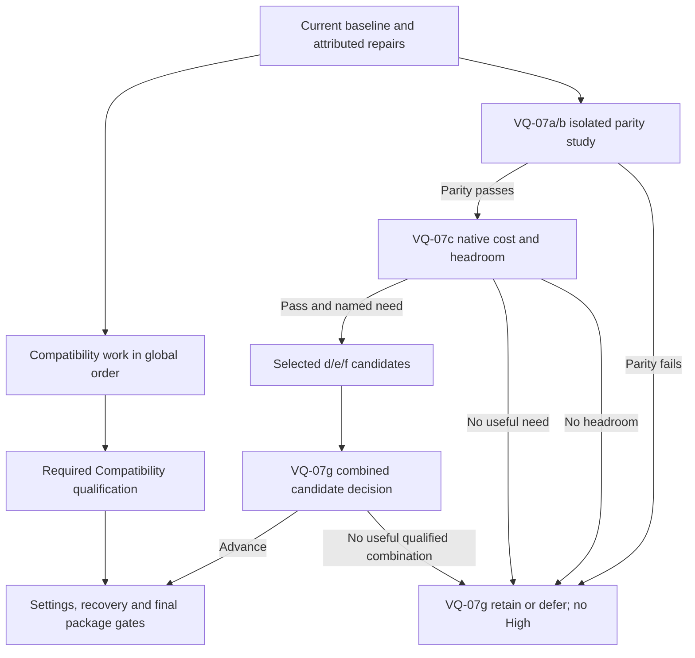

# Advanced graphics and visual-quality upgrade plan

2026-10-21 · Implementation-planning revision · Owner: Visual quality (VQ), with L/LU/SC, FW/TOD/SUN, aircraft, SM/CR, UI and DT owners.

Make OpenRC look substantially more convincing while flying: recognizable aircraft materials, stable vegetation, coherent sunlight and atmosphere, convincing ground contact, and smooth motion. Use modern rendering where it improves those outcomes. “AAA quality” is an ambition, not an acceptance metric or a promise of a particular technology.

**Execution order:** freeze a usable baseline → resolve attributed pacing/loading blockers → prioritize the selected Compatibility work in its owning order. A bounded, isolated Forward+ study may then answer parity/cost questions; only justified candidates advance to combined qualification and accepted settings. Retain Compatibility whenever the renderer study fails its stop/go gates. RTX, neural rendering and frame generation remain deferred.

**First execution result:** [2026-10-21 baseline triage](../research/visual-quality-implementation/VQ-01c/baseline-2026-10-21/README.md) repairs and tests the deferred Home/Fly loading collector, retains three standard native runs and five completed fresh/warm loading pairs, and ranks the next work. First-Fly draw median is 3.824 s; a paused control and an active p95 miss prevent baseline qualification. Runtime and aircraft source bytes are unchanged. This completes the bounded triage slice, not VQ-01c/d acceptance.

**Second execution result:** [startup and loading attribution](../research/visual-quality-implementation/VQ-01c/attribution-2026-10-21/README.md) records real focus loss behind two observed pauses and isolates first-flight resource loading at 1.628 s versus <0.1 ms instantiation. Preserve explicit resume. The [DT-11a background-warmup experiment](../research/visual-quality-implementation/VQ-01c/loading/scene-warmup-2026-10-21/README.md) is rejected: Home slows about 26%, combined Home/Fly gains are only 1.9–3.0%, and both candidates emit a new exit-leak warning. Production runtime remains unchanged; attribution and this retain-baseline decision complete the bounded second slice.

**Third execution result:** [Windows release attribution](../research/visual-quality-implementation/VQ-01c/loading/package-attribution-2026-10-21/README.md) runs the real Home/Fly collector inside the actual release template. Two active diagnostics measure 715–717 ms first scene loading and <0.1 ms instantiation. A separate 66-dependency profile finds distributed costs; no safe single lazy-load change establishes the >5% complete-path return. Keep the runtime. The normal release trimmed-flight check passes, but its four-object shutdown warning remains open.

**Fourth execution result:** [release Home construction](../research/visual-quality-implementation/VQ-01c/loading/home-build-2026-10-21/README.md) completes two controls and two diagnostics. First World build is 1.92–1.99 s, including a 1.71–1.76 s field callback and 1.08 s Scenery build; preview costs 0.41–0.44 s. Nested costs are not additive. No small safe mechanism establishes the >5% complete-path return, so runtime remains unchanged and this bounded loading attribution closes.

**Implemented optimization:** [VQ-04a-F4 cloth construction](../research/visual-quality-implementation/VQ-04a/windsock/README.md#vq-04a-f4-faster-cloth-construction) removes repeated geometry evaluation. Construction falls 73.3→23.2 ms, with exact mesh/state parity and 18 identical native images. Five active release pairs show a 5.1% median paired improvement for return-Home + second-Fly; first-path improvement is 1.6%, so initial loading goals remain open. The local arithmetic change is adopted without a persistent cache or physics change.

**Implemented construction follow-up:** [DT-11a batched shadow triangles](../research/visual-quality-implementation/VQ-01c/loading/shadow-geometry/triangle-runs-2026-10-21/README.md) preserves 180 exact workload pairs and reduces nearby population-caster collection by 10.9–14.5% across three native processes. Seven regression suites pass. This bounded component improvement does not establish a full loading or FPS gain.

**Native pacing follow-up:** [DT-10a/H/VQ release comparison](../research/visual-quality-implementation/VQ-01c/pacing-2026-10-21/README.md) records three active 10 s + 60 s default-setting controls passing the software gates (p95 17.378–17.586 ms), while three active controls with an additional 60 FPS cap fail. The shipped default was already uncapped: this is benchmark-condition attribution, not a new runtime speedup. End-of-sample cap/mode metadata and campaign consistency guards are implemented; 95 Python tests, 86 collector checks and packaged metadata probes pass. Historical reports remain explicitly configuration-incomplete.

**Advanced settings, requested by the user:** [UI-24-R3 / VQ-06b](../research/menu-investigations/UI-24-R3/README.md) adds manual resolution, FPS cap, VSync and main-view antialiasing with persistent Keep/Revert recovery. This is the first configurable desktop slice; it does not label unmeasured combinations as hardware presets.

**Next executable action:** VQ-01d/CAM motion-reference refresh using the updated source identity and explicit graphics settings, then qualify a lower-cost preset before a High profile. Extend the same menu with independently verified scenery/shadow/water controls as their owning work qualifies them. Test native Windows, macOS and Linux separately; operating-system names alone do not identify GPU capability. Physical-display qualification, capped pacing, readability, initial loading targets and ordinary-release shutdown remain open. Preserve focus safety and retain ineligible runs. Implement one attributable repair at a time; broad appearance changes and preload/cache rewrites remain unselected.

Use [section 8](#8-first-work-packages-and-stopping-rules) to execute, [section 3](#priority-and-expected-return) to choose dependency-ready work, and [section 6](#6-measurement-and-acceptance) to decide whether it succeeds.

## 1. Scope and authority

This plan expands **VQ-07** into reviewable steps and proposes the later High-profile decision. The [global performance/visual plan](global-performance-visual-quality.md) still owns the active Compatibility delivery; its exclusions and budgets remain binding for that delivery. [VQ](../VISUAL-QUALITY-PLAN.md) owns parent-step status. Existing material, landscape, smoke, sky and settings tasks stay in their current homes; they are dependencies, not a second backlog here.

The [dated investigation](../research/advanced-graphics-2026-10-21/README.md) records independent source checks, current-code findings and corrections to the supplied October 20 brief. Its [second round of 25 investigations](../research/advanced-graphics-2026-10-21/round-2.md) adds GitHub, Reddit, Godot Forum, documentation and tool evidence; [section 9](#9-disposition-of-the-25-follow-up-investigations) maps each finding to existing work. This document owns proposed execution. No graphics change, benchmark, renderer adoption or completed implementation is claimed by creating the plan.

| Boundary | Owner and paths |
| --- | --- |
| VQ-07 experiments | VQ; proposed tools under `research/visual-quality/forward-plus/`, future evidence under `docs/research/visual-quality-implementation/VQ-07/`; this plan owns VQ-07a…h |
| Renderer adaptation | VQ with FW/LU; `app/render/`, particularly sky, atmosphere, world exposure, lake, shadows and transparent effects |
| Aircraft finish | Aircraft owners; source generators and materials identified in their guides; AS owns node/binding contracts |
| Vegetation/terrain/scenery | L/LU/SC; existing assets, generators, batching, field adapters and obstacle inventory |
| Sky, time, smoke and incidents | FW/TOD/SUN and SM/CR; consume existing resolved state and lifecycle contracts |
| Profiles, startup and delivery | VQ-06 with UI-23/24 and DT; existing preferences, launcher and export paths |

Read [ownership](../README.md#tracks-plans-and-step-ids) and Git status before each implementation slice. Shared integration files have one integrator at a time. Draft scripts remain outside `app/` until they parse.

## 2. Starting point and visible target

The inspected tree at `ef91916374cee18b8bc84e736f69b9623e681adf` pins Godot **4.7.2-stable**, Compatibility, a 1280×720 base viewport, 4× MSAA and fixed 240 Hz physics. This was a working-tree review with unrelated trailer/documentation edits, not a clean release qualification. Runtime and pins remain authoritative: [project configuration](../../app/project.godot), [engine downloader](../../app/get-godot.sh), [architecture](../STACK.md).

Already present: PBR/shader-based aircraft, projected silhouettes, RPM-driven propeller blur, terrain/grass/trees, lake reflections/refraction, selectable skies, night lighting, smoke and storm presentation. Improve their integration and qualify their open gates before replacing them. The current delivery is desktop; Compatibility's web capability does not mean OpenRC ships a web build.

Build one representative comparison using the existing **Club field**, **Extra 300S** and **P-51**, with Ugly Stik as the main flight reference. Cover the runway edge, trees, mountains, lake and existing buildings. Expand to Green paradise and all enabled vehicles before qualifying shared changes.

| Visible outcome | Review evidence |
| --- | --- |
| Aircraft surfaces look like paint, film, metal, rubber and canopy material | Matched close views plus 20/50/100 m motion; coherent highlights without sparkle, disappearing markings or unreadable attitude |
| Field looks grounded and consistent | Pilot-height takeoff/landing; stable grass/tree edges, plausible texture scale, shadows attached to wheels and objects, readable runway cues |
| Light and atmosphere belong to one world | Day, cross-sun, dusk, moonlit and moonless clips; continuous sky/horizon haze, matching cloud/light/reflection state, no clipped flashes or exposure pumping |
| Motion feels responsive | Native frame-time distributions, first-use hitch record and same-device input-to-photon comparison where available |
| Presentation scales across machines | Measured Compatibility baseline and, only if qualified, an optional High profile with reliable startup recovery |

Keep an ordinary pilot-camera circuit in every review. A close-up or trailer shot alone cannot establish flight quality.

## 3. First delivery: improve what already works

Execute through the [existing implementation sequence](global-performance-visual-quality.md#3-order-dependencies-and-reviewable-deliveries). The table below prioritizes outcomes; it does not change those steps' status or adoption gates.

| Existing owner steps | Next useful outcome | Constraint |
| --- | --- | --- |
| VQ-01c/d, DT-01/10a/11a | Current source/package baseline, moving visibility reference and attributed loading/frame stalls | Read-only source research can proceed immediately; acceptance needs native measurements and owner flight |
| LU-10-R1, DT-11a, H/UI/session owners | Repair one reproduced dominant query, construction or first-draw cost before spending more frame time | Follow global sequence rows 03/04; prove complete-workload gain and unchanged state/output; component savings cannot be summed into a startup claim |
| VQ-02a/b, aircraft owners | Correct demonstrated import/channel/filter errors, then one aircraft material or marking repair; trial stock normal-aware roughness import only for a suitable texture pair and observed sparkle | Retain existing livery and generators; review perceived material in motion; no added clearcoat lobe or blanket metallic/4K conversion |
| L9e-R1 and grass/tree plans | Stable ground detail and foliage in motion; inspect LOD silhouette, wind-expanded bounds and night illumination during existing batching trials | Reconcile later [grass](grass-quality.md) and [tree](tree-forest-quality.md) work before applying an older probe; preserve population/contacts and reuse accepted assets |
| VQ-04b, L/FW/TOD/SUN | Better contact/light coherence where the current comparison identifies a defect | Preserve projected shadows as the reference; existing sun/night controls keep their owners |
| L15a/c, FW-81-R1 | Coherent windsock/foliage movement and smooth clouds | Visual clock/transport changes cannot modify physical wind or weather |
| SM-16…25, CR | Finish and qualify the existing smoke/effect overhaul | Reuse [SM's plan](../../SMOKE_SYSTEM_MASTER_PLAN.md); do not start another smoke renderer |
| VQ-06a/b/c, UI/DT | Qualified Balanced/Performance settings and integrated delivery | Same physical world and aircraft; current Compatibility budget and recovery gates apply |

Download-first intake: inspect retained packs first, then suitable free materials/HDRIs/models from [Poly Haven](https://polyhaven.com/license) or [ambientCG](https://docs.ambientcg.com/license/), both publishing CC0 assets. Record the exact asset URL, author, download date, license, hash, resolution, scale, channel layout and import recipe. Adapt the smallest suitable download; author replacement content only when a documented need has no suitable free source. A photographic sky with a baked sun is useful as a reference, but must not silently replace dynamic time-of-day lighting.

### Priority and expected return

ROI here means a useful improvement per total engineering and runtime cost, not a financial forecast. Resolve correctness, unreadable flight cues and release-blocking pacing/loading first. Among dependency-ready candidates, prefer frequent pilot-view benefit, wider target-hardware reach, stronger evidence and lower implementation/verification/maintenance cost. An attractive close-up alone has low return for flight. Preserve the global sequence: import audit precedes ground/foliage comparisons, which inform final aircraft/background acceptance.

| Work | Expected return and evidence confidence | Cost/risk and scheduling rule |
| --- | --- | --- |
| Current baseline and one attributed performance repair | Highest enabling value; recorded acceptance gaps, but current bottleneck still needs confirmation | Reuse collectors; budget diagnosis before code. Do this first; a failed benchmark is not spare visual headroom. |
| Demonstrated import/filter error | High when it affects repeated flight views; confidence becomes high only after reproduction | Usually narrow asset/import scope; include reimport, memory and generator checks. Correct inputs before artistic tuning. |
| Foliage/ground stability in motion | Potentially high because it occupies much of the pilot view; benefit conditional on the actual defect | Medium validation burden across distance, wind and light; use retained assets and current LOD/batching studies. |
| One aircraft finish/marking repair | High for attitude/marking loss; moderate for cosmetic finish | Small surface scope, but owner motion review is essential. No fleet-wide rollout from one successful aircraft. |
| Shadow/probe tuning | Moderate, rising to high for a demonstrated landing or lighting cue failure | Test cheap allocation/source corrections first; PCSS/SSR add cost and history/maintenance risk. |
| Forward+ parity/cost study | High information value if it can answer a renderer decision; visual return unknown | Bounded isolated work; higher verification and multi-renderer maintenance cost. Stop before effects if parity/cost fails. |
| Sky subpasses, volumetrics, GI, impostors | Uncertain until an attributed cost or visible gap remains | Larger integration and lifecycle burden; conditional, one candidate at a time. |
| Vendor forks/frame generation or a new tool stack | Low immediate return to the current acceptance gaps | High platform, maintenance and qualification burden; deferred. Reuse available tools. |

These are planning judgments, not measured gains. For each attempted candidate record total engineer time including failed trials, integration and tests; measured frame/load/memory deltas; the cue actually improved; and any new renderer-specific code, asset pipeline or platform checks. Re-rank after each accepted result. Do not use a numeric ROI score to override a correctness/readability failure or hide uncertain benefits.

## 4. VQ-07: isolated renderer comparison

Use separate checkouts/import caches and private preferences. Pin the same official engine and assets on both sides. Do not combine an engine upgrade, scenery replacement and renderer change in one comparison. The active Compatibility sequence has priority. Read-only preparation may proceed now; a disposable VQ-07 study starts only with VQ-07a's comparable source/host/tapes and recorded outcomes for relevant baseline repairs. It must not displace those repairs. Unavailable pilot/platform acceptance may remain open during isolated research, but cannot be waived for adoption. Completing every unrelated FW/SM/trailer feature is not an entry condition.

The parallel branch represents an isolated experiment, not permission to ship around the Compatibility qualification. On one developer's schedule, current repairs retain priority. The final package gate is rerun after settings/export integration; the pre-UI g decision is not shipping acceptance.

| ID | Work | Proof/status |
| --- | --- | --- |
| VQ-07a | Freeze the comparison manifest, target-host identities, scenes, motion tapes, camera states and baseline failures. Reuse VQ-01c/d tools; record actual renderer/backend and presentation settings. | **Pending.** Comparable repeated reference runs and runtime clips. If collection is unreliable, repair collection before b; a known target miss may be recorded but cannot qualify an effect. |
| VQ-07b | Establish Forward+ visual/functional parity with advanced effects off. Fix one demonstrated renderer assumption per patch in the isolated copy. | **Pending; after a.** Correct color/depth/materials/alpha and unchanged simulation; no new runtime errors. Unresolved parity at the timebox ends d/e/f and routes directly to g's retain/defer decision. |
| VQ-07c | Measure bare renderer cost and first-use behavior; attribute main/shadow passes, transparency and sky/radiance. Freeze a total effect budget on a named target. | **Pending; after b.** Paired native timing/load/memory evidence. If native gates or useful headroom fail, skip d/e/f on that target and record why in g; a different High target requires its own a/c evidence. |
| VQ-07d | Screen native MSAA/SMAA/TAA/FSR2 for a named edge/history defect, then qualify only useful finalists. Reduced-resolution FSR2 requires a demonstrated scaling need. | **Conditional; after c.** Reuse VQ-01d clips/tapes; motion readability, real cost and reset proof. No improvement means retain native baseline AA; do not run every scale by default. |
| VQ-07e | For an owner-confirmed gap, compare shadow allocation/probes first, then one justified PCSS, SSR or indirect-light candidate. | **Conditional; after c.** Reuse projected-shadow/environment references and VQ-04b's comparison contract; pin AA to baseline or accepted d result. No gap means skip. Each effect needs its own outcome. |
| VQ-07f | Evaluate bounded atmosphere and effect improvements when FW/SM/CR identify a gap. FW-85 retains the cloud-backend decision. | **Conditional; after c.** Same authoritative inputs, readable pilot circuit, pause/reset/cut behavior, bounded particles/overdraw and cost. Volumetric clouds are not required. |
| VQ-07g | Record the renderer decision; if advancing, integrate accepted candidates and qualify the exact combination before proposing High settings. | **Pending; after selected outcomes, including early rejection.** Retain/defer can close the study with no new profile. Adoption needs combined native/pilot/platform evidence and recovery; selected effects passing alone is insufficient. |
| VQ-07h | Review vendor technologies in disposable projects, only after the native path has a decision and a named unresolved need. | **Deferred, optional.** Pinned SDK/fork sample, license/build/API/hardware assessment, latency and image evidence. Not required to close VQ-07a…g. |

### VQ-07b: concrete migration hazards

The current source contains actual assumptions to test, not merely a generic shader checklist:

- `sky.gdshader` encodes output for the GLES3 sky colour conversion; `atmosphere.gd` and `world/exposure.gd` coordinate exposure, fog, ambient light and night presentation. Audit encoding and exposure as a complete chain. Do not stack engine auto-exposure on top of the existing adaptation.
- `lake/water.gdshader::view_depth_at()` reconstructs OpenGL NDC depth. Adapt and test the RenderingDevice depth convention, refraction and shore intersection. A successful compile is not proof of correct depth.
- Ground/bank shaders already branch on `OUTPUT_IS_SRGB`; inspect all relevant shader families before introducing new renderer branches. Include canopy, smoke, propeller disc, clouds, stars, sun/glare, rain, lightning and crash effects.
- Compare projected and engine shadows independently. Avoid double-darkening by explicitly choosing the receiver/caster path per comparison; keep current projected silhouettes available.
- Exercise Home, Workshop, direct-flight automation and fixed-wing/experimental vehicle routes. Shared world changes must survive scene replacement and restore.
- Keep the existing interpolated float64 pose as the aircraft/camera source. Check camera, shadow and smoke attachment at supported 30/60/120/144 Hz; distinguish pose phase from temporal-AA history before changing smoothing. Keep 240 Hz simulation and avoid double interpolation.
- Inspect screen-copy ordering with canopy, propeller disc, smoke and water/refraction. An effect reading the opaque screen copy may miss later transparent layers. Establish the required pass scope before considering a compositor or viewport addition.

Godot documents different shader colour/depth conventions and compositor availability across renderers. Use its [shader guidance](https://docs.godotengine.org/en/4.7/tutorials/shaders/advanced_postprocessing.html) and the [source audit](../research/advanced-graphics-2026-10-21/README.md#local-findings) before coding.

### VQ-07d: preserve a small moving aircraft

Keep the current Compatibility target at **720p/60**. Screen Forward+ at that resolution first; **1080p/60 is a separately named High target** requiring its own VQ-07c baseline/headroom. Qualify AA finalists on their intended target and check 720p regressions; 1440p is optional until advertised. Compare methods separately with other effects/sharpening fixed. FSR2 supplies temporal AA itself. Native scale 1.0 is a quality experiment with extra cost; try 0.85, then 0.75 only if scaling is needed and the preceding result remains readable. Stop at the first unacceptable silhouette/attitude loss; 0.67 needs an explicit remaining case. Record actual internal dimensions. [Godot scaling documentation](https://docs.godotengine.org/en/4.7/tutorials/3d/resolution_scaling.html)

Label the defect before selecting a treatment: geometric edges, specular sparkle, LOD loss, dither, texture-history trails or pose jitter. Use section 6's motion/history cases and distinguish attitude recognition from detecting a dot. SMAA is a spatial candidate, not a cure for every shimmer; older upstream reports suggest tests, not established 4.7.2 defects. Record non-reproduction as well as failures. [AA methods](https://docs.godotengine.org/en/4.7/tutorials/3d/3d_antialiasing.html), [R12, R16–R17, R21–R22](../research/advanced-graphics-2026-10-21/round-2.md)

### VQ-07e/f: spend headroom selectively

| Candidate | First experiment | Retain baseline if… |
| --- | --- | --- |
| Directional shadows, then optional PCSS | Tune distance/cascade allocation and bias separately at fixed resolution, starting from the current two-split setup; compare gear, fences and low-sun field against projected shadows | Contact cues, useful long shadows, flicker or total main/shadow-pass cost worsen |
| Reflections | Verify visible and probe-source environments across Home/Workshop/Fly and day/dusk; trial bounded refresh/masks; SSR only for a demonstrated water/aircraft gap | Off-screen loss, edge popping, missing alpha reflections, false inclusion/history lag or update stalls are worse |
| Indirect light | One nearby structure/aircraft scene; compare simple ambient/probe treatment, then one SSAO or SSIL candidate | Dark halos, hidden detail or negligible pilot-view improvement |
| SDFGI/VoxelGI/LightmapGI | Conditional building/hangar requirement, with the selected time-of-day contract | Open-field benefit is small, moving-object response is wrong, or baked sunlight contradicts dynamic time |
| Atmosphere | Existing haze first; if attribution warrants it, separately trial sky radiance work or a stock half-resolution cloud subpass; a bounded fog volume needs its own visible purpose | Aircraft disappears, bright edges/reflections degrade, lightning trails, restore diverges or horizon/fog is applied twice |
| Flight effects | Existing SM/CR sources first; one trail, contact-dust or exhaust-distortion candidate using available authoritative state | Overdraw dominates, effects lag inputs/reset, unsupported aircraft emit them, or fallback hides an active hazard |

Built-in GPU trails are renderer-dependent; they do not justify replacing the accepted smoke system. Dust requires suitable surface/contact state. Heat haze requires an installed propulsion source. Condensation and new water effects stay deferred until their owning tracks define credible triggers. No graphics setting invents humidity, tire friction, engine forces or damage.

SSR must pass section 6's alpha/depth/history cases: the prior-frame implementation makes the old blanket transparency exclusion insufficient. GPU particles require exact-version first-emission/resource-change/reset checks under SM/CR; issue status alone does not establish a defect or a fix. [R11](../research/advanced-graphics-2026-10-21/round-2.md#r11--lake-reflections-and-the-changed-ssr-path), [R13](../research/advanced-graphics-2026-10-21/round-2.md#r13--version-specific-first-particle-emission)

For conditional sky work, preserve the CPU visual clock and deterministic restore. Do not blindly replace QUALITY radiance mode. A stock cloud subpass keeps aircraft/sharp sky features full-resolution; it does not authorize a split scene viewport. Use section 6's lifecycle/visibility gates. Bruneton's reference is diagnostic, not a replacement commitment. [R08, R18, R25](../research/advanced-graphics-2026-10-21/round-2.md)

## 5. Quality profiles and safe adoption

**Balanced** retains the current Compatibility appearance as its reference; the owning plan's remaining qualification gates stay open. **Performance** remains the existing measured cheaper candidate. **High** is proposed only after VQ-07g; **Ultra** has no commitment. Renderer choice and effect quality are separate concerns.

The initial trial uses explicit startup configuration. Before exposing High, VQ-06/UI/DT must extend the existing preferences and launch flow: validate capabilities, require restart when necessary, retain a known-good Compatibility launch, handle invalid/unwritable preferences, and recover from unsuccessful initialization without a restart loop. Record the renderer that actually launched; engine fallback is not High acceptance. Unsupported effects must have qualified baseline behavior. Do not add a second settings file or silently change controller calibration.

Keep pilot presentation free of compulsory motion blur, depth of field, grain or chromatic aberration. Stronger grading, glow, optional depth of field and offline supersampling belong to the [trailer/camera workflow](cinematic-trailer.md) and remain independently switchable. Higher internal precision is not a commitment to HDR-display output.

VQ-07g must explicitly resolve whether to maintain a second renderer. Evidence of visual benefit, maintenance cost and supported platform coverage goes into [DECISIONS](../DECISIONS.md) before production adoption; the old global delivery is not retroactively expanded.

## 6. Measurement and acceptance

Reuse the [global measurement contract](global-performance-visual-quality.md#4-measurement-and-acceptance-contract) and [performance tools](../../research/performance/README.md). All numbers below are gates/proposals, not measurements from this research.

### Experiment contract and decision rules

Before implementation, add a compact candidate record to the owning step's evidence, not another tracker. State: **observed problem and reproduction; one mechanism/files/owner; baseline and target host/profile; primary success measure and protected cues; cost/effort limit; checks, rollback and final outcome**. Missing measurement capability is a task to resolve, not permission to estimate a pass.

- **Optimization succeeds** only when gain exceeds paired-run variation and reaches the global plan's 5% threshold for the declared affected complete workload, or removes a named reproducible hitch/memory defect. Declare that workload before the trial. A faster isolated constructor is attribution, not faster Home/Fly or flight.
- **Visual improvement succeeds** when the predeclared defect is repeatably reduced in its intended pilot view, owner review supports the change and all correctness/readability/cost guards pass. Define the observable result before coding; “looks better” without a matched motion case is insufficient. A visual change need not improve speed by 5%, but cannot exceed its allocated budget.
- **Inconclusive means retain for now.** If paired deltas change sign, variation covers the benefit, or blinded review is tied, inspect confounders and allow one predeclared repeat campaign. Do not keep sampling or tuning until a favorable result appears. Record failed and discarded runs with reasons.
- **Baseline failures remain failures.** Reproduced inherited faults may allow isolated diagnosis, but block the acceptance they affect. Do not claim improvement from a control with a different renderer, stale assets, missing effects or an invalid run. New state, shader, readiness or readability regressions stop the candidate immediately.

Keep two identities: the **frozen delivery baseline** for total regression/cost, and the **latest accepted control** for one candidate's incremental effect. Rebase the control after a shared change and rerun affected comparisons; do not reset the combined +0.5 ms allowance on every merge. At VQ-07c, declare per-target limits for frame tails, loading and memory, reserve margin for observed variation, then allocate only the remaining headroom. No positive measured margin means no added effect. Percentiles, component savings and effect costs are not additive: remeasure the combined configuration.

### Test funnel: cheap rejection before expensive qualification

| Stage | Smallest useful work | Exit and escalation |
| --- | --- | --- |
| Valid inputs | Source/package/engine identities; license/import inputs; parse/import and affected existing checks; verify actual renderer/AA settings | Stop on invalid data, new engine/shader errors or silent renderer fallback. Drafts parse outside `app/` before integration. |
| Focused screen | One reproduced defect, matched A/B runtime views/clip and an effect-off control where meaningful; only the affected lifecycle transitions | Reject no-benefit or visibly harmful candidates. Short captures/timings diagnose; they do not qualify performance or pilot use. |
| Finalist comparison | Full native paired sampling below, plus affected owner checks and blinded readability review; loading repetitions if construction/import/first-use is affected | Record adopt/retain/defer with raw evidence. A failed candidate does not enter the combined profile. |
| Combined regression | Latest accepted changes together; full applicable app/visual checks, cross-feature stress cases, 20-cycle lifecycle and total profile cost | Passing candidates can fail together. Remove the last harmful addition and remeasure the affected combination. |
| Package qualification | Actual exported package, startup/recovery, required target platforms, DT cycles/soak and owner circuit | Only this closes the corresponding shipping gates. Missing hardware/pilot work stays open; no release claim from fixtures. |

Reuse existing checks; add a focused regression only for a new behavior/bug or an otherwise untested contract. Do not create tests that merely mirror a shader constant or asset edit. Run required checks after integration, then broaden only for a changed dependency, failure or unresolved risk. Keep timed runs exclusive on the host; captures and profilers run separately.

### Coverage follows the changed behavior

Use a small representative set to screen; finalists get affected boundary cases and combined delivery gets the full owning matrix. Do not multiply every aircraft × weather × resolution × AA × camera for every edit.

| Changed behavior | Mandatory focused cases before acceptance |
| --- | --- |
| Material/import | Affected aircraft close and at 20/50/100 m in motion; relevant bright/dark background and day/dusk; verify channels, scale, markings, memory and first import/load |
| Vegetation/LOD/batching | Low pilot pass through transition distances, aircraft against treeline, maximum qualified wind and night lamps; preserve placements/colliders; check bounds and main/shadow cost |
| Renderer/color/depth | Home/Workshop/Fly; sky-ground horizon, lake shore, opaque/alpha crossings, contact shadows and night exposure; actual renderer identity and shared vehicle initialization/reset |
| Temporal AA/scaling | Small rolling aircraft, markings/propeller/smoke, disocclusion and applicable animated UV/dither; zoom/cut, pause/resume and reset/restore; supported refresh cases |
| Shadows/reflections | Low-sun runway/gear/fence and far useful range; day/dusk probe refresh; water/alpha with moving occluder and screen edges; avoid double shadow paths |
| Sky/effects | Named weather gap plus no-effect control, worst qualified smoke/storm, first emission, pause/reset/restore and reflected sky; reachable cloud boundary only when in scope |
| Preferences/startup | First launch, repeated apply, restart, invalid/unwritable settings, failed renderer initialization and known-good recovery; same controller/physical-world identity |

A renderer change always requires broad parity coverage. A one-material edit does not inherit every sky/particle case unless it changes their shared path. For combined High, stress at least small aircraft + foliage + chosen AA, low sun + shadows + reflections, and night/storm + transparent effects, followed by the owning full flight matrix. Record unaffected cases as not applicable with the reason; never label them passed without execution.

### Reuse tools within their limits

| Existing entrypoint / authoritative instructions | Use and limitation |
| --- | --- |
| [Checked Godot runner](../../tools/godot/README.md), [app commands](../TOOLS.md#app-and-release-commands) | Reject zero-exit engine errors and incomplete collections. `app/test.sh` covers parsing and app contracts; run full applicable checks at integration. Offline tool changes use `research/test-tools.sh`. |
| [Visibility runner and packager](../../research/performance/README.md#moving-visibility-reference-vq-01d--cam-22) | Reuse case definitions and metadata validation. Current fixture is Compatibility-only, prescribed poses with frozen shader time; no physics, shadows, moving propeller, HUD or night. It cannot qualify Forward+ temporal history unchanged. |
| [Shadow tools](../../tools/shadows/README.md), [tree tools](../../tools/trees/README.md), [atmosphere tools](../../tools/atmosphere/README.md) | Reuse relevant oracles, inputs and guards after checking renderer/version and baseline preconditions. Existing Compatibility/static fixtures are not Forward+ or full-flight proof. Do not run an old before-feature verifier against arbitrary snapshots. |
| [Native frame evidence](../../research/performance/README.md#native-frame-evidence), [loading probe](../../research/performance/README.md#homefly-loading-and-lake-geometry) | Use `--frametimes` for native samples; `--frame-diagnostics` separately for attribution; real Home/Fly route for load cost. CPU callback probes measure different work and cannot replace these. |
| [App capture/export commands](../TOOLS.md#app-and-release-commands) | `app/capture.sh` is a broad integration check, not a per-knob screen. `app/export.sh` recreates `dist/`: use an isolated checkout. Native execution of exports remains mandatory. Bash workflows on Windows use the documented WSL setup; native GPU trials stay native. |

VQ-07a/b must identify the missing Forward+ capture/history coverage and extend only that bounded capability in the isolated experiment, asserting actual renderer, active effects, completion and source identity. Reuse definitions and validators, not historical image artifacts as a new control. Do not claim the current capture suite already covers the experimental renderer.

### Numerical and human acceptance

| Dimension | Required evidence |
| --- | --- |
| Controlled comparison | Same aircraft/assets, world, inputs/ticks, camera/FOV/zoom, sky/time, resolution and host/driver. Keep visual capture overhead outside timed runs. |
| Sampling | Existing minimum: 10 s warmup + 60 s sample, three alternating A/B pairs. Extend for periodic effects; retain per-run distributions and paired deltas, keeping aircraft/conditions separate. Loading: five fresh-process and five warm repetitions, with cache conditions declared. |
| Frame pacing | Existing 60 Hz gate: process-loop p95 ≤18 ms, p99 ≤25 ms; simulation/wall ratio 0.99–1.01. Report uncapped throughput separately against 16.67 ms. Attribute recurring gameplay intervals >50 ms. |
| Visual cost | Active Compatibility delivery retains its combined +0.5 ms frame-p95 ceiling. Proposed High targets 1080p/60 on named hardware with the same pacing gate; freeze its total measured headroom in VQ-07c before selecting effects. It cannot borrow unused physics budget or justify a Compatibility regression. |
| CPU/GPU and memory | Separate complete-session CPU, render CPU, GPU timings where available, draw/primitive counts, allocated render-resource counters, actual residency if available and process RAM. Godot allocation counters are not physical VRAM residency; missing measurements remain missing, not estimates from FPS. |
| Loading and compilation | Preserve current Home ≤5 s process-cold/≤3 s warm and Fly ≤2 s goals; distinguish construction, import and first draw. Fresh process is not necessarily cold shader cache. Inspect first night/storm/smoke appearance and first profile application. Qualify actual exports, including separate empty-cache macOS runs when advertised; use isolated caches, not destructive global cache clearing. |
| Simulation preservation | Same accepted checkpoint/state/input results on the pinned runtime under existing exact/tolerance contracts. Keep 240 Hz, float64 kernel, collision world and aircraft definitions unchanged. Never re-record goldens for graphics. |
| Readability | Randomized matched clips and owner circuit with bright/dark aircraft at close range, 20/50/100 m and the existing farther acceptance range. No new repeatable loss of attitude, subject or landing cue. Record projected size and aids. |
| Responsiveness | Same input device, monitor/refresh, VSync/cap and scene; input-to-photon samples with a stated measurement method and uncertainty when available. Software frame time alone cannot close latency acceptance. |
| Presentation telemetry | On Windows, reuse PresentMon where useful: record process/swapchain and presentation mode; retain dropped frames. Separate rendered/displayed/generated counts only where supported instrumentation provides them. Missing metrics stay unavailable; keyboard/mouse latency fields cannot qualify an RC-radio path. |
| Lifecycle | Pause/reset/restore, camera changes, failed setup and field/aircraft switching. No unexplained growth after warmup over 20 cycles; DT qualification separately keeps 50 cycles and a 30-minute soak. |
| Platforms/packages | Actual exported Windows, Linux and macOS execution for each advertised renderer/profile. Missing hardware remains unqualified; one Windows GPU cannot establish a minimum spec or Mac/Linux support. |

Use existing Stik circuit/takeoff/contact, P-51 high-load flight and Timber electric routes; basic coverage for other enabled aircraft. Add both landscapes and shared-family initialization/reset/camera/world regressions when their render code changes. Include day/dusk, moonlit/moonless night, strongest qualified storm, maximum qualified smoke and a no-effect control. Report transient peaks separately from steady flight.

For flight-feel/control claims, follow [FL logging](../FLIGHT-LOGGING.md): retain a complete baseline `.orfl`, verify exact replay, then compare one candidate on the same input tape; preserve markers, identities, CSV/reports and `complete`/`solver_changed` fields. Candidate replay is not exact equivalence or physical validation. The fixed-wing recorder does not substitute for helicopter/truck recorders, and visual-history equality is a separate check.

Every accepted experiment retains a manifest, raw measurements, logs/errors, representative lossless motion/stills, source/license identities and an adopt/retain/defer outcome. Use existing free profilers and plotting tools. When attribution is unclear, retain an annotated RenderDoc frame separately from uncaptured timing; API/platform support must match the host. Extend warmup when a selected radiance/history path needs convergence and report that duration. No new general benchmarking product is required. [Tool findings, R06–R07](../research/advanced-graphics-2026-10-21/round-2.md)

## 7. Vendor research boundary

VQ-07h is optional and separate from delivery. Native FSR2 is the first reconstruction experiment. AFMF is a user-driver experiment, not an OpenRC integration. Newer FSR, DLSS/DLAA/Reflex and NVIDIA's Godot path-tracing fork require exact SDK/fork pins, compatible API/OS/GPU evidence, redistribution terms and a maintenance assessment before a simulator prototype.

Retained [vendor findings and corrections](../research/advanced-graphics-2026-10-21/README.md#vendor-claims-and-corrections) govern exact-version/API intake. Run existing samples first. Separate real/displayed/generated frames, simulation rate and measured latency; preserve silhouette, markings and state cues. No vendor feature is required for High, and frame generation cannot rescue a failed native-performance gate.

## 8. First work packages and stopping rules

These are execution checkpoints under existing step IDs, not new tasks for every research idea. Timeboxes below are **initial review limits for one developer**, not promised completion times. At a limit, stop expanding the candidate and record retain/defer or a smaller revised scope with evidence and a new bound. Never weaken a test to fit a timebox. Hardware/pilot waiting is recorded separately from engineer effort.

| Order / owner | Entry → concrete deliverable | First review limit and next decision |
| --- | --- | --- |
| 1. VQ-01c/d, DT; input to VQ-07a | Current source and known target → valid reference runs, refreshed motion cases, failure/measurement gaps and ranked bottlenecks | **1 engineering day for triage.** Choose one attributable blocker or collection repair; estimate the remaining campaign. Do not start appearance tuning while the control is unreliable. |
| 2. LU/DT/H, then current VQ/L/FW owners | Reproduced blocker → one mechanism, relevant parity proof and complete-workload comparison. Remaining global rows 03–14 continue in their own order; they need not all finish before isolated checkpoint 3 | **2 days per repair before review.** Retain only a qualifying result. Refresh affected controls; owner prerequisites still gate dependent adoption. This is not a two-day promise for the entire current delivery. |
| 3. VQ-07a/b | Comparable repaired snapshot and available host → isolated bare Forward+ with required color/depth/alpha and capture parity | **3 days before renderer review.** If parity requires broad rewrites or remains unproven, stop effects and send retain/defer to g. Record unavailable qualification separately. |
| 4. VQ-07c | Passing parity → paired native 720p baseline, separately named 1080p High trial if wanted, load/memory evidence and total headroom | **2 days before cost review.** No native margin means no added effects on that target. Do not try to conceal a failed gate with frame generation. |
| 5. VQ-07d/e and selected f | Positive budget and one named gap → one screened candidate, then finalist evidence | **Half a day for an initial screen; 2 days before reviewing a finalist's remaining work.** First High slice: at most two added choices, normally one AA treatment and one useful lighting/effect change. Skip absent triggers; no mandatory feature count. |
| 6. VQ-07g with VQ-06/UI/DT | Selected outcomes → combined private profile decision; only a beneficial, passing candidate proceeds to settings/recovery and exact package qualification | Estimate after c and scope selection. If no renderer/profile qualifies, close retain/defer without new UI. If it qualifies, run final checks again after settings/export integration before shipping. |

Within the first checkpoint, reuse the existing collectors, freeze identities and run an unchanged repeat before selecting a repair. Inspect process logs and workload completion before reducing timings. Produce a short owner-linked list of the top failures, the chosen hypothesis and the first A/B case; unresolved measurements receive explicit owners. No new general harness or dashboard is a deliverable.

**Work in progress:** one runtime candidate per developer; at most two isolated candidates across owners with distinct files. Reading, asset provenance and offline reduction may overlap; native timing and shared-file integration stay serialized. Merge one accepted mechanism at a time, rebase the next candidate and rerun tests affected by that merge. Avoid speculative UI and cross-renderer abstractions before a positive c/g decision.

**Rollback and closure:** each candidate is a separable patch or scoped configuration change with a known-good fallback; keep original source/import recipes and use source generators for any reverted generated output. Reject on new correctness/readability faults, absent useful benefit or exceeded cost; defer when evidence/hardware is missing. A failed b/c can close the study through g with d/e/f marked not run and a reason. For adoption, all selected candidates and their combination need proof; no-change decisions are valid completed experiments. Retained unsupported branches do not ship enabled.

At each checkpoint answer two questions in the evidence: **Did it solve the stated problem? Was the engineering/runtime/maintenance cost justified?** Record actual effort and remaining acceptance, then choose the next dependency-ready item by section 3. This prevents feature count, sunk effort or research novelty from determining the schedule.

When completed or superseded, consolidate adopted behavior into VQ and the owning guides, retain dated evidence and decisions, then remove this coordination plan under repository conventions.

## 9. Disposition of the 25 follow-up investigations

The [research ledger](../research/advanced-graphics-2026-10-21/round-2.md) retains questions, exact sources, dates, limitations and experiment gates. This table changes execution priorities without creating another track. “Selected” means a comparison/check, not feature adoption; conditional additions cannot displace the baseline/parity packages.

| Evidence IDs | Priority and concrete plan change | Owning work / disposition |
| --- | --- | --- |
| R01, R24 | Use runtime references and verify one interpolation phase before judging smoothness | VQ-07a/b, CAM; selected |
| R06, R07, R19 | Attribute GPU work, separate presentation metrics, declare cache conditions and retain first-use events | VQ-07a/c, DT; selected diagnostics |
| R15 | Test actual exported Mac startup with isolated cache when that profile is advertised | VQ-07c/DT; required for that platform claim |
| R02, R20 | If the baseline shows a material defect, compare stock roughness import or one finish adjustment | VQ-02a/b; conditional, source pipeline and livery preserved |
| R03, R22 | Add night-light reach, deformed bounds and silhouette transitions to existing vegetation evidence | L/LU/SC, VQ-07c; selected checks, changes only after evidence |
| R12, R16, R17, R21 | Separate aliasing/history failure types; include animated UV and dither cases only where present | VQ-07d; selected motion matrix, conditional case applicability |
| R04, R05, R11 | Fix environment/reflection semantics and shadow allocation before buying costlier effects | VQ-04b/VQ-07b/e; selected trials; FFT ocean deferred |
| R13, R23 | Check alpha pass ordering and exact-version first GPU-particle emission | VQ-07b/f, SM/CR; selected where applicable |
| R08, R18, R25 | Reuse a clear-sky reference and trial bounded sky work only for an identified gap; test cloud crossings where reachable | FW-85/VQ-07f; conditional; full atmosphere replacement deferred |
| R09 | Consider a licensed far-field impostor only after a measured scenery bottleneck | Existing tree plan; adoption deferred pending license, compatibility and circuit evidence |
| R10 | Reuse Material Maker offline only when retained/free materials cannot meet a named requirement | VQ-02b/aircraft; conditional; no custom replacement tool |
| R14 | Existing LUT addon is a possible trailer experiment if current tools lack the required capability | Cinematic workflow; conditional, outside pilot/High prerequisites |

First implementation choice remains the baseline package. The most promising low-scope visual experiments after that are one material correction, stable vegetation transitions and targeted shadow/probe tuning. Sky subpasses, impostors and LUT tooling require their stated triggers; no extra addon, engine fork or asset replacement is approved by a favorable README alone.
