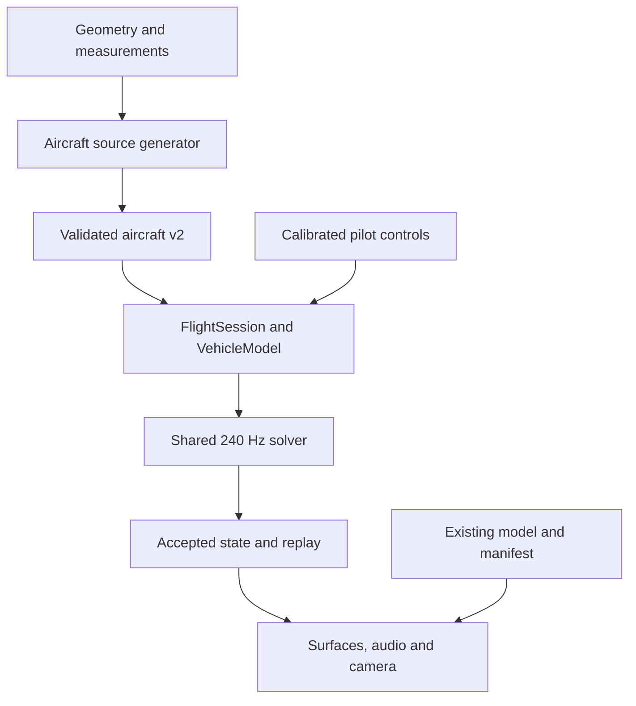

# AERIS-120: gasoline 3D aerobatic aircraft integration plan

**Date:** 2026-11-15. **Status:** research and planning only; no aircraft or physics implementation in this change. **Owner:** aircraft/physics, coordinating AS, SF/NK, D6, FUEL, AE, GP, FL, AUD and CAM. **Step prefix:** `A120-00…12`. **Baseline:** `main` at `ad21070798bfb9658785576a9c0b8bfc9a71fc7f`. [Dated investigation and sources](../research/aeris-120/README.md).

## 1. Intended result

Add the user's existing **AERIS-120**, an original 120 cc gasoline 3D aerobatic RC aircraft inspired by the Extra NG/Extra 300 class. The prior design specifies **2.64 m span, 2.60 m length and 1.2408 m² wing area**. These are supplied design inputs, pending reconciliation with the existing asset's physical metadata. This work does not create, redesign or source a 3D model.

The aircraft should support precision aerobatics and progressively qualified 3D flight: upright/inverted passes, axial rolls, loops, knife-edge, harriers, hover, torque rolls, rolling harriers, snaps and spins. Extreme reverse-flow and tumbling maneuvers receive separate gates. Aircraft motion must result from forces, moments, inertia and actual control positions. The normal reference configuration has no stabilization assist or maneuver-triggered forces.

The perceptual objective is a large aerobatic model with measurable momentum, strong powered control authority, plausible energy loss, gasoline throttle response and identifiable cross-axis coupling. “Feels right” is evaluated through repeatable pilot tasks alongside physical measurements, not used to justify arbitrary damping or direct angular-rate commands.

### Delivery levels

| Level | Offered behavior | Required evidence |
| --- | --- | --- |
| L0: authored research specimen | Valid data, asset binding and instrumentation; developer access only | Source provenance, loader/contract acceptance, coherent mass/CG/inertia and control signs |
| L1: experimental conventional flight | Taxi, takeoff, landing, upright/inverted trim, rolls, loops and engine operation | Software/replay gates, bench-informed propulsion, attached-flow tests and explicit limits |
| L2: qualified initial 3D envelope | Hover, torque roll, upright/inverted harrier and knife-edge within a recorded envelope | Wing/tail propwash and control-authority gates, instrumented comparisons and experienced-pilot evaluation |
| L3: advanced transient envelope | Rolling harrier, snap/spin recovery, waterfalls, pop-tops and tailslides where supported | Regime-specific reverse-flow/unsteady evidence, numerical refinement and held-out pilot/flight comparisons |

L1 is a useful early deliverable, but is not completion of the requested 3D integration. L2 and the L3 disposition must remain visible. A maneuver can remain experimental even when the aircraft is selectable.

## 2. Evidence and initial configuration

Use the [source register](../research/aeris-120/sources.md) for exact source versions and [physics investigation](../research/aeris-120/physics-and-propulsion.md) for derivations. The user geometry owns AERIS; the EF 104-inch Extra NG sheet and Pilot-RC 103-inch Extra NG V2 are comparative installations. Do not transfer their absolute CG positions or full-scale Extra flight numbers.

| Item | Planning basis | Admission requirement |
| --- | --- | --- |
| Airframe | Original AERIS geometry above; fixed taildragger, conventional controls, single tractor | Reconcile wing/tail/body geometry, datum, physical control spans and installed contact points |
| Mass | Reference aircraft list about 12.25–13.15 kg; no definitive AERIS dry mass | Build component inventory with declared fuel state; measure or label each estimate |
| CG and inertia | No measured AERIS values obtained | Full/empty/reference-fuel CG, full tensor about correct datum, physical feasibility and sensitivity study |
| Engine | Healthy, carbureted two-stroke gasoline twin; DA-120 is the reference installation, not a measured AERIS engine | Exact engine/exhaust/ignition identity, torque/RPM data and throttle transients |
| Propeller | 28×10 two-blade class; Mejzlik PN 228108 is a documented initial surrogate | Preserve simulated-data label, RPM envelope, rotor inertia and table coverage; confirm installed prop |
| Fuel | Proposed nominal 1.0 L gasoline tank; capacity/location/density/consumption remain installation inputs | Existing registry/blend, bound tank/liquid inventory, full/empty balance and depletion events |
| Controls | Donor high travel: aileron 38° up/37° down, elevator 55°, rudder 45° | Check actual linkage travel; record as borrowed settings until AERIS measurements exist |
| Radio | Calibrated transmitter with its own rates/expo; keyboard/gamepad use supported shaping | Single ownership of curves/mixes, correct signs/endpoints and real-device checks |

The donor sheet's 60+° XA elevator setting exceeds the current 60° loader bound. It is excluded from the initial configuration; adding it requires a shared contract and physical-envelope review, not a bound change to make an asset load.

## 3. Reuse and integration boundaries

The [source audit](../research/aeris-120/integration-audit.md) is authoritative for this snapshot. Preserve float64 state, the shared **240 Hz RK4** kernel and the `VehicleModel` boundary. Keep aircraft calibration in authored data and shared laws in their existing owners.

### Existing capability route

The current combustion family is named **`glow_prop`**, including legacy gasoline aircraft. Use that supported family with `conventional`, `fixed_taildragger`, `single_tractor`, `finite_liquid_fuel`, an explicit coupled shaft installation and **`gasoline_bsfc_v1`**. Do not invent `gas_prop`, select `finite_glow_fuel`, or load a glow-engine installation to obtain gasoline behavior. The visible aircraft/engine description should say gasoline; the historical internal identifier is not player-facing terminology.

`openrc-aircraft v2` is closed. Any new wake, signed-flow, gas-lifecycle or actuator capability must extend the shared structural contract, generated schema, loader, runtime consumers, native admission and lifecycle together. A JSON key with no consumer is not a feature. The first data generator remains outside `app/` until outputs validate.

### Proposed owned paths

| Purpose | Proposed location / existing boundary |
| --- | --- |
| Canonical plan and dated evidence | This plan; `docs/research/aeris-120/` |
| Physical inputs, derivation and measurements | `research/aeris-120/`, with one owning generator and a documented `--check` route |
| Generated physical aircraft | `app/data/aircraft/aeris_120.json`; generated, never edited directly |
| Existing model registration | Existing imported GLB pipeline, `assets/aircraft/model-bindings.json` and `app/app_state/aircraft_catalog.gd`; actual delivery path established during intake |
| Aircraft-specific checks/cards | `app/tests/test_aeris_120_*.gd`, `research/aeris-120/` and the existing flight-test/log tools |
| Shared mechanics | Existing `app/physics/`, `app/sim/`, `app/input/` and `research/native-kernel/src/`, coordinated with their owners |
| Workshop/presentation | Existing descriptors, controls, audio, smoke and contact consumers; no duplicate aircraft-specific framework |

Physical model intake is limited to scale, datum, hinge/prop identifiers, control travel and contact alignment. Material authoring, mesh redesign and a new engine asset are outside scope.

## 4. Work sequence and acceptance

The table owns step status. All implementation rows are pending; the linked research is completed planning evidence only.

| ID | Work | Proof / status |
| --- | --- | --- |
| A120-00 | Research the target, inspect current source and identify unsupported regimes | **Research complete:** source register, audit, equations and validation cards in the linked investigation; no aircraft validation |
| A120-01 | Establish configuration identity, geometry, component inventory, dry/fuel mass, CG, inertia and installed prop/servos | **Pending:** provenance ledger; inertia feasibility; full/empty CG; explicit unknowns and sensitivity ranges. L0 input gate |
| A120-02 | Author source generator, stable IDs, supported v2 capabilities and dependent manifests/descriptors | **Pending:** regeneration check, schema plus actual loader acceptance, invalid-input rejection, deterministic identities; no hidden donor defaults |
| A120-03 | Fit gasoline shaft/prop load and fuel consumption; specify ignition/start/cut lifecycle | **Pending:** matched RPM/thrust/torque/power, load-dependent RPM, throttle steps, idle/cut/fuel-out/restore; explicit surrogate scope |
| A120-04 | Qualify gasoline hub inflow and one coherent wing/tail propwash law | **Pending, L2 blocker:** common local inflow and force/wake law, overlap/contraction/swirl signs, static authority, convected transients and native/reference agreement |
| A120-05 | Calibrate attached and full-angle aerodynamic/control behavior | **Pending:** positive/negative lift, drag and moments, local stall progression, control effectiveness, body sideforce/coupling; smooth limits and held-out conventional flights |
| A120-06 | Integrate controls, rate profiles, physical surface state and finite servo response | **Pending:** transmitter bypass; no duplicate expo/mixes; linkage conversion; surface/physics alignment; device and onset-latency evidence. Per-servo loads coordinate D6-SRV |
| A120-07 | Bind existing visuals, fixed taildragger, start poses, catalog and Workshop | **Pending:** single registration, package dependencies, wheel/hull/prop clearance, stock/build save-load, coherent runway/airborne starts and 1080p inspection |
| A120-08 | Complete deterministic/native/replay and event checks | **Pending:** same-tape baseline/candidate, state-complete checkpoint/reset, convergence, source-bound backend admission; affected fleet unchanged unless separately approved physics change |
| A120-09 | Qualify conventional handling and initial 3D maneuver cards | **Pending:** L1 then L2 evidence; independent bench/flight data and pilot reports, limits stated per maneuver |
| A120-10 | Investigate reverse flow and remaining unsteady mismatches | **Pending:** signed prop regime, tailslide transitions; only then calibrated separation/wake memory if data demand it. Record supported/experimental/deferred disposition for each L3 maneuver |
| A120-11 | Connect accepted RPM/load/surfaces to audio and fixed comparison cameras | **Pending:** event synchronization, licensed source fit/listening, pilot sightline/FOV and controls readability; presentation cannot change physics |
| A120-12 | Review evidence, performance and promotion wording | **Pending:** exported build, actual-radio/platform matrix, sustained target-host 1080p performance, known limitations and accurate release guide |

**Critical path:** 01 → 02/03 → 04/05/06 → 07/08 → 09 → 12. A120-10 follows measured L2 mismatches and must be resolved before claiming L3. Presentation integration can proceed once state semantics are fixed. Time estimates depend mainly on access to matching hardware/flight data; no dates are implied by a finished plan.

Suggested reviewable implementation slices: data specimen; gasoline bench and lifecycle; common inflow/wake contract; aerodynamic/control calibration; selection and presentation; validation/promotion. Each shared physics change needs its own baseline and affected-fleet comparison. Do not combine a new aircraft, a solver rewrite and retuned goldens into one acceptance decision.

## 5. Physics priorities

1. **Mass, CG and inertia before responsiveness tuning.** A 3D mesh does not provide a material-density inventory. Do not scale the Extra .60 flight model by span or displacement. Preserve the existing fixed reference datum and stage-specific live CG/inertia for fuel changes.
2. **A coupled gasoline installation.** Throttle requests torque; shaft load determines RPM and propwash. Preserve reaction torque and rotor angular momentum exactly once. Nominal engine RPM is not thrust, and a peak horsepower claim is not a torque curve.
3. **Local air velocity everywhere it matters.** Include rotational velocity at wings, tails and the prop hub. Distinguish ground velocity, ambient wind, axial flow, crossflow and induced flow. Gasoline's current legacy datum-inflow shortcut is a named A120-04 gap.
4. **Wing and tail in a consistent wake.** The current wake supports tail pieces, with restricted transport options; it does not provide the required wing-inclusive swirling wake. Use geometrical overlap so aileron area outside the prop stream does not inherit tail authority.
5. **Control forces across the envelope.** Large throws alter circulation, separation and drag. Avoid a universal “aileron always correct” override: reversed or weak response must be assessed against local flow and evidence. Knife-edge needs body/tail sideforce and its moments, not an added vertical support force.
6. **Honest transient limits.** Static full-angle polars do not establish wing-rock frequency, snap timing, spin recovery or waterfall fidelity. Start with a coherent quasi-steady model, then add only identifiable unsteady mechanisms.

## 6. Controls and feel decisions

Retain the current `normal`, `sport` and `full` profile semantics; `full` means full physical travel without aircraft expo, not a newly calibrated 3D radio curve. `controls.rates.normal` is the available authored shaping module. A third named in-simulator 3D profile would be shared input/UI work, not an extra unchecked aircraft key.

A physical radio remains the primary 3D evaluation path. Calibrate actual channels/endpoints, preserve its curve/mix ownership and record the full transmitter setup. Keyboard/gamepad results are separate device configurations. Existing gamepad device expo still applies according to its profile. The [controls and test protocol](../research/aeris-120/controls-and-validation.md) defines exact donor settings and their conversion limits.

Healthy reference flight has explicit engine availability, finite servo motion, ordinary trim and no hidden stabilization. Rudder-to-elevator/aileron mixes are off during coupling identification; any pilot-specific mix is recorded separately. A rate switch changes surface targets and subsequent motion, never inertia, lift coefficients or attitude directly.

Measure input age, accepted command, servo angle, angular acceleration, steady rate, stop overshoot, RPM and wake response. Diagnose sluggish input/rendering separately from true inertia or actuator lag. Fix camera/FOV/zoom, weather, fuel and setup during comparisons. Audio reads accepted RPM/load and engine state.

## 7. Validation and promotion rules

Use the existing [flight-log workflow](../FLIGHT-LOGGING.md), [flight-test battery](../../research/flight-test/README.md), [physics tools](../tools/physics.md) and [native admission](../../research/native-kernel/README.md). The [maneuver matrix](../research/aeris-120/controls-and-validation.md#maneuver-cards) specifies observables and limits.

Keep three claims separate: software correctness/replay, agreement with physical measurements, and pilot handling evaluation. Exact replay proves repeatability for its identities; it does not validate a 120 cc aircraft. Candidate replay does not rerun device conditioning or model pilot adaptation. Use new controlled recordings for radio/expo changes.

Before L2 promotion, demonstrate a powered zero-freestream control map, hover force/moment balance and margin, both knife-edge directions, upright/inverted harrier behavior, and powered transitions with no special maneuver logic. Before L3 promotion, establish the applicable reverse-flow/unsteady envelope and recovery evidence. Do not require long-horizon byte-identical spin trajectories as a physical criterion.

New continuous state belongs in the model layout and RK stage evaluation; discrete input/lifecycle events belong at their accepted transaction boundary. Include every new state in reset, rollback, checkpoint, exact replay and native admission. A mutable lag hidden inside a four-stage force callback is invalid.

Performance remains 1080p first, on identified target machines. Profile whole-session step/render tails before increasing strip count or adding unsteady state. The 240 Hz production contract stays fixed; 120/240/480 Hz studies are controlled numerical experiments, not adaptive in-flight mode switches.

## 8. Open information and immediate next work

The planning task can finish without these measurements. Implementation begins by closing the following ledger, preserving estimates where direct data are unavailable:

| Missing input | Why it matters | Smallest useful acquisition |
| --- | --- | --- |
| Exact AERIS dry mass, inventory and CG | Stability, acceleration, hover power and fuel shift | Component masses/locations plus balanced full/empty configuration |
| Inertia tensor | Roll stops, snaps, gyroscopic response | Inventory estimate, then matched pendulum data using existing reducers |
| Installed engine, exhaust and prop version | Torque curve, RPM, braking and wake | Configuration record; RPM/thrust and throttle-step traces |
| Linkage geometry and actual throws | Servo timing, high-angle authority and visual agreement | Surface-angle/servo-shaft measurements at several commands |
| Matched flight observations | Coefficient identification and realism | Synchronized commands, RPM and motion; calibrated video where telemetry is unavailable |
| Target radio/OS and evaluation pilots | Conditioning, latency and transfer of skills | Real-device diagnostic plus repeatable precision/3D evaluation cards |

The first implementation decision is therefore a **data and instrumentation specimen**, followed by the gasoline inflow/wing-wake gap. The existing model can be bound once its physical contract is checked; model authoring is not on the critical path.
