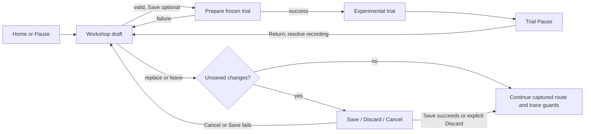

# Aircraft experiment editor plan

**Date:** 2026-10-19. **Revision:** 8 — current physical-editor interface delivery and remaining acceptance. **Status:** the shared Workshop includes the menu/inspection slice below; appearance, smoke, AE-09e/f and later release gates stay open. **Prefix:** AE-00…AE-26. **Owner:** aircraft-editor track.

The plan owns remaining work and acceptance. The [Aircraft Workshop guide](../AIRCRAFT-WORKSHOP.md) owns current player behavior and implementation details. The [aircraft contract](../AIRCRAFT_CONTRACT.md) owns physical and generated authoring schemas. [DECISIONS](../DECISIONS.md) owns durable rationale. Use the current repository state and linked evidence when a dated proposal differs.

For the next work: [ideas and examples](#52-idea-catalogue), [profile contract](#55-presentation-contract-to-implement), [ordered implementation packages](#56-implementation-packages-and-order), [test matrix](#57-required-test-matrix), [performance/evidence gates](#58-performance-and-evidence-gates), and [menu, workflow and visual design](#59-menus-workflow-and-visual-design). The [2026-10-19 source and official-documentation investigation](../research/aircraft-editor/AE-00/README.md) records current seams, diagnostic failures and a native color probe.

**Owns:** `app/workshop/`, `app/ui/workshop.gd`, `app/ui/workshop_preview.gd`, `app/data/workshop/`, `app/tests/test_workshop_*.gd`, `research/aircraft-editor/`, this plan and [AE evidence](../research/aircraft-editor/AE-01-10/README.md). Existing implementation paths are `app/workshop/` and `research/aircraft-editor/`; do not create a parallel `aircraft_editor/` subsystem.

**Coordinates:** physical schemas and generated bindings with aircraft-standardization/model owners; session and propulsion inputs with their owners; Workshop screens and preview with AE; the shared menu shell, preferences, routes and localization with UI. Check the [track registry](../README.md#tracks-plans-and-step-ids) before changing shared files. Do not edit generated aircraft geometry or physics data by hand.

## 0. Implemented slice and remaining acceptance

The guide describes the current interface, supported operations, schemas, persistence, verification commands and limitations. [AE-01–10 evidence](../research/aircraft-editor/AE-01-10/README.md) records the initial tests, later audits, native captures and limits. The table below separates delivered behavior from remaining acceptance.

| Steps | Implemented baseline | Remaining acceptance |
| --- | --- | --- |
| AE-00 | Initial source/ownership audit and implemented-path reconciliation | Keep interfaces coordinated as new aircraft families and authoring seams arrive |
| AE-01/02 | Shared compiler, catalog-discovered descriptor generator, versioned bindings, exact source/dependency/compiler pins and deterministic trial identity; eight descriptors pass the recorded generation check | Revalidate fleet behavior after Extra's finite-glow migration and P-51/Ventage finite-liquid changes; richer module composition and migration remain open |
| AE-03 | Local revisions, copy/load/trash/restore, staged first publication with validated readback, stale-save/delete refusal, exact UUID trash-generation restore, backup recovery and fail-closed locks | Full write-cut/restart matrix, staging cleanup policy and persistent draft recovery; first-publication boundary coverage does not establish power-loss durability |
| AE-04…07 | Detached shared compiler, conventional controls, legacy prescribed-RPM transforms and initial Stik/legacy-Extra fixtures with synthetic identities | Requalify current sources and fixtures after Extra's finite-glow migration; wider combinations/refinement and family transforms remain open |
| AE-08/09 | Inspect/Compare preview and camera controls, Flight setup/Compare pages, on-demand library, compact View/Edit, exact numeric edits, issue review, full-payload loss guards, direct trial return and EN/ES; [delivery evidence](../research/aircraft-editor/AE-08b-09/README.md) | Broader presentation anchors, persistent drafts, inherited-condition summary, full directional/reconnect/hardware journeys, performance and formative user acceptance; future pages require their AE-24 contracts |
| AE-10 | Frozen airborne trials, return to the same draft, F5 identity and preservation of the previous flight on failed preparation | Full crash/replay/recording and longer-duration trial matrix |
| AE-11…26 | Not complete | Work and gates are sequenced in [delivery sequence](#3-delivery-sequence-and-acceptance-gates); AE-19 is the current-fleet gate and AE-25 is the twenty-airframe gate |

The catalog currently has **eight fixed-wing configurations** and a separately selected rotorcraft. Identified airplane sources use stable physical IDs and Workshop v3 ID bindings; explicit readers retain ID-less v2 and historical v1/v2 behavior. The compiler must derive support from validated modules and never dispatch transformations by aircraft name or ID. The [interface delivery report](../research/aircraft-editor/AE-08b-09/README.md) records the current generator and focused-suite reruns. Earlier failures remain in the [dated diagnostics](../research/aircraft-editor/AE-00/README.md#diagnostic-checks). Neither set closes physical, fleet or user acceptance. Rotorcraft authoring and qualification stay outside airplane conformance.

The initial legacy prescribed-RPM proof used the Stik and the then-current Extra. Extra now uses finite glow and no longer qualifies for legacy size/mass/power transforms. Current fixtures and the two-aircraft V1 gate need reconciliation with the NITRO/aircraft owners; do not enable legacy transforms to satisfy a historical fixture. Other families retain registered conventional-control and tank-capacity operations where supported. Twenty synthetic IDs establish only the behavior of that recorded fixture, not current fleet or packaging acceptance.

## 1. Scope and delivery gates

Aircraft Workshop creates detached, experimental local variants from a shipped aircraft. It must preserve the source, explain the requested and effective changes, save reproducible identities and prepare each trial as a new validated flight. A numerically valid candidate is not a physical-validation claim.

| Gate | Steps | Exit condition |
| --- | --- | --- |
| V1 shared experiment loop | AE-00…10 | Stik and current finite-glow Extra use their supported operations through the same save/trial/return/rollback path. AE-06/07 separately retain two compatible prescribed-RPM fixtures; Extra's historical scaling proof cannot qualify its current configuration |
| V2 current-fleet standard | AE-11…19 | Every eligible fixed-wing catalog entry passes generated-binding, module, session, persistence and conformance checks; adding an ordinary supported aircraft changes data/assets/bindings, not editor behavior |
| V3 research and scale-out | AE-20…25 | Bounded performance tools and recipes remain truthful, the editor is qualified for its declared ranges, and a twentieth ordinary airplane passes onboarding with the editor frozen |
| Documentation closeout | AE-26 | Delivered behavior, authoring contracts, evidence and remaining limitations have one linked authoritative home each |

No gate requires a CAD editor, arbitrary physics scripts, cloud sharing, multiplayer, or a new vehicle branch in the simulation kernel.

## 2. Ownership, source of truth and fleet onboarding

| Concern | Owner and rule |
| --- | --- |
| Current player workflow and implementation details | [Aircraft Workshop guide](../AIRCRAFT-WORKSHOP.md) |
| Physical v2 data, stable IDs, model manifests and generated authoring rules | [Aircraft contract](../AIRCRAFT_CONTRACT.md), with aircraft/model source pipelines |
| Descriptor generation | `research/aircraft-editor/build_descriptors.py`; regenerate after source or model-manifest changes and commit the generated descriptor |
| Runtime editing and storage | `app/workshop/`; candidates remain detached from catalog source files |
| Screen and isolated preview | `app/ui/workshop.gd`, `app/ui/workshop_preview.gd`; AE owns these screens, UI owns shared shell and routing |
| Session integration | `app/sim/flight_session.gd` and application routes remain coordinated with their existing owners |
| Dated implementation proof | `docs/research/aircraft-editor/AE-01-10/` and later AE step evidence; keep raw proof with its owning step |

### 2.1 Common aircraft editing standard

The physical aircraft remains `openrc-aircraft v2`. The generated companion descriptor uses the current `openrc-aircraft-workshop v3` format for identified sources; ID-less source and saved-record readers retain their explicitly versioned compatibility behavior. Descriptors bind source bytes, module assertions, presentation identity and generated model manifests without copying physical values into Workshop metadata. The contract owns the complete binding rules.

The validated physical model and closed module registry select available operations. Descriptor module assertions must match that classification; they do not select a solver law or provide executable transformation rules. Stable component keys survive inventory rename/reorder, while exact source and manifest pins still require descriptor regeneration. Saved variants keep their historical identity and are never silently rewritten or rebound.

The shared compiler, recipe and launch path must not branch on aircraft ID, display name, maker, filename or inventory text. Catalog/resource lookup and provenance may use IDs. A new physical capability needs an owned schema/module change and reusable tests; an ordinary aircraft using existing capabilities should need only its generated sources, bindings and conformance evidence.

### 2.2 Current fleet coverage

| Configuration family | Current role in Workshop acceptance |
| --- | --- |
| Jensen Ugly Stik baseline | Current simple prescribed-RPM scaling path; broader combinations still need qualification |
| Great Planes Extra 300S | Now finite glow; legacy scaling evidence is historical. Regenerate bindings and requalify supported operations, trim and trials |
| Three finite-glow Stik configurations | Separate 2T/4T module and installation gates; do not infer family behavior from the legacy Stik |
| Turbo Lumber Evolution | Shared imported-model bindings exist; electric editing and complete presentation qualification remain open |
| P-51D Mustang and Ventage Jet | Finite-liquid modules are registered; generated descriptors and fleet conformance must follow the updated sources |
| X-Cell research rotorcraft | Separate vehicle schema and qualification path; excluded from fixed-wing Workshop conformance |

Catalog discovery, not this table, defines the fleet. New catalog entries must be checked automatically; the table explains the current coverage boundary.

### 2.3 Fleet onboarding and twenty-airframe proof

For an airplane using existing capabilities:

1. Create physical data, model manifests and assets through the owning source pipelines.
2. Declare its vehicle class and physical identities in the source contract; do not encode editor behavior in the aircraft name.
3. Generate and check its Workshop descriptor after physical or model-manifest changes.
4. Run catalog-discovered module, compiler, persistence, session and presentation conformance.
5. Record exact source identities, commands, results and limits in the owning evidence report.

AE-25 freezes the editor before onboarding the twentieth ordinary airplane. Passing means only the aircraft's normal data, assets, generated bindings and evidence are added; no airplane-specific editor branch, compiler formula, recipe copy or screen change is needed. A genuinely new physical law follows the shared contract/module path before its aircraft is counted as supported.

## 3. Delivery sequence and acceptance gates

Dependencies are explicit. A gate may split into smaller reviews, but its acceptance condition remains required.

| ID | Work and dependency | Acceptance evidence |
| --- | --- | --- |
| AE-00 | Source audit, ownership and current implementation reconciliation | Current catalog/module/source map; agreed shared-file boundaries and migration limits |
| AE-01 | Common descriptor, parameter/module contract and conformance approach; AE-00 | Schema-backed field map, generated bindings, unknown capability refusal and no duplicated physical values |
| AE-02 | Recipe/descriptor versions, dependency pins and trial identity; AE-01 | Strict malformed/version/stale-binding cases; exact input identity; deterministic equivalent fingerprints |
| AE-03 | Local library, immutable revisions and deletion/recovery; AE-02 | Interrupted-write, corrupt-record, stale-delete, trash-generation, duplicate identity and restart cases retain a recoverable record |
| AE-04 | Generic resolver and detached no-op compiler; AE-02 | No-op numerical/trajectory parity; unsupported modules and incompatible bindings fail closed |
| AE-05 | Shared inventory mass and conventional controls; AE-04 | Independent mass, CG, inertia and surface checks; reordered/renamed inventory does not redirect edits |
| AE-06 | Legacy prescribed-RPM propulsion transform; AE-04 | Power, RPM, thrust and trim bounds on two compatible airframe fixtures; retain the original Stik/Extra proof and reconcile Extra's changed family before closing V1 |
| AE-07 | Uniform geometry, virtual propeller/suspension and plausibility policy; AE-05/06 | Six exposed Stik sizes and a second compatible airframe's declared envelope; derived geometry/mass checks and real session startup |
| AE-08 | Shared presentation binding and preview integration; AE-07 | Datum, CG, hinges, propeller, hull, contacts and imported-model cases match effective data without ID-specific editor paths |
| AE-09 | Workshop library UI, Home/Pause route, editing history and localization; AE-03/08; split into AE-09a…f in [interface delivery](#597-interface-delivery-and-verification) | Context-aware entry/return, guarded draft replacement, clear save/trial states and keyboard/controller journeys; EN/ES viewport captures and resolution of the too-small preview reported in [UI-29 evidence](../research/menu-investigations/UI-29-R3/README.md) |
| AE-10 | Transactional trial, return, restart and frozen identity; AE-04/09 | Stik/Extra workflow, failed-start rollback, retained draft and correct trace/checkpoint identity |
| AE-11 | Effective-model runway-start qualification; AE-10 | Gear, wheel profile, equilibrium, clearance and selected-field fixtures; no aircraft-ID permission list |
| AE-12 | Stable component editing, ballast and mass/CG fitting; AE-05/10 | Independent first-moment/full-tensor oracles; impossible targets, negative ballast and unsupported mounts reject cleanly; hubs stay fixed in structural coordinates while their offsets are recomputed from the new CG |
| AE-13 | Match-my-airplane wizard and measurement provenance; AE-12 | Measured mass/CG round trip; unknown inputs remain estimated; reference chord and MAC remain distinct; matched geometry stays inside source-backed limits |
| AE-14 | Coupled shaft, thrust-axis and optional wake modules; AE-01/12 | No-op parity, source-backed ranges and correct composition with geometry, gear and loads |
| AE-15 | Electric motor and battery modules; AE-01/12 | Fixed-voltage, OCV/resistance and pack-ECM behavior remain distinct; include pack mass/energy, numerical stiffness, reset/replay and unsupported combinations; coordinate with [BAT](battery-realism.md) |
| AE-16 | Scoped installation/profile inputs and independent finite-glow 2T/4T modules; AE-01/12 | Qualify fixed-hardware transforms first; cover exact dependency identity, moving mass/CG, thermal/fuel lifecycle and reset/replay; reject cross-family transforms (never apply 2T rules to 4T or vice versa) |
| AE-17 | Turbine module and start/gear qualification; AE-01/12 | Spool, intake, timestep, identity and actual start modes are validated without Ventage-specific editor behavior |
| AE-18 | Shared parameter pages generated from supported module definitions; AE-14…17 | UI/compiler/tests share bounds and labels; physical/rendered travel agrees, radio shaping is not applied twice, and unsupported operations are explained |
| AE-19 | Current fixed-wing fleet conformance, migration, data-only variants and variant CLI; AE-03/11…18 | Every discovered airplane entry passes fresh-install and missing/newer/corrupt dependency cases; regenerate stale descriptors before qualification. Data-only bundles reject executable resources and unsafe paths; migration preserves the original. Proposed `--aircraft-variant=<bundle-or-local-path>` is mutually exclusive with `--aircraft` and does not read or write player preferences |
| AE-20 | Unpowered/glide starts and bounded performance experiments; AE-10 plus family adapter | Bind results to exact initial state, commands, environment and termination. Label static outputs separately from scripted speed, climb, roll or endurance results and state each method's limits |
| AE-21 | Supported drag/polar/incidence/tail-law packages; AE-01/20. Optional later AE-21b adds authored wingtip/tail geometry after AS/model contracts | Domain, trim, stall-join and numerical limits are reported per field/module; optional shape packages additionally require geometry, mass, aero, hinges and contacts to agree |
| AE-22 | Capability-based shared recipes, parameter sweeps and seeded discovery; AE-20/21 | Same recipe applies to compatible bases, explains incompatibility and searches within fixed bounds |
| AE-23 | Wider scale targets and combinations; relevant AE-14…22 modules | Qualify 25–400% targets with boundary/field-clearance diagnostics, offline 240/480/960 Hz refinement and bounded runtime cost |
| AE-24 | Registered paint/decal slots, smoke profiles, thumbnails and simple customization; local editing after AE-08/09 and AS slot contracts, portable profiles after AE-19; SM-10…15 for smoke | Follow the staged delivery below; appearance preserves physical identity/trace values, has a separate presentation identity, and passes instance isolation, save/load, localization and bounded-render checks |
| AE-25 | Twenty-airframe onboarding plus cross-platform, accessibility and playtest acceptance; base AE-19…24 and any advertised optional extensions | Frozen editor; data/assets/bindings/evidence only for the twentieth ordinary aircraft; fresh-clone and package checks |
| AE-26 | Consolidate delivered guide, authoring standard and evidence links; AE-25 | Current contracts are linked once, dated evidence is retained, and superseded planning prose is removed |

## 4. Cross-cutting acceptance rules

- Compile from a detached copy. Never edit shipped/generated aircraft files or mutate a live flight while a draft is open.
- Classify every affected quantity as invariant, transformed by an identified rule, recomputed from dependencies, or unsupported. Reject incomplete transforms and conflicting writers.
- Validate the complete candidate with the aircraft contract, module validators, trim/start checks and selected session path. A local numerical check alone does not make a candidate launchable.
- Bind a trial to its exact base, recipe, descriptor, compiler, dependencies and resolved model. Restart, replay and checkpoint restoration must use those frozen inputs; a changed dependency refuses the trial without deleting the saved variant.
- Preserve existing aircraft/model node names and generated source ownership. Keep physics state in scalar/packed float64 representations; render transforms remain at the presentation boundary.
- Prove no-op parity, independent transform arithmetic, invalid-input refusal and rollback. Use actual session/model builders for presentation and gear claims; screenshots alone do not establish interaction behavior.
- Keep numerical/simulation consistency distinct from measured aircraft data, flight performance and pilot acceptance. Record tested envelopes and unresolved model assumptions beside each result.
- Run focused checks for the changed owner paths, then the repository's required integration checks. Keep the test report tied to the source revision and commands that produced it.
- For physics/control tuning, follow the [flight logging workflow](../FLIGHT-LOGGING.md): retain an exact-replayed baseline and compare one explicit candidate with the same tick/input tape. Check `complete` and `solver_changed`; do not rerecord golden flights for editor-only work.

### Verification dimensions

| Dimension | Required distinction |
| --- | --- |
| Transform math | Use independent fixtures for mass, CG, inertia and geometric scaling; do not validate a helper only by calling it twice |
| Identity | Test exact source/dependency pins, cosmetic-only changes, stale revisions and same-name physical changes separately |
| Capability composition | Exercise valid, unsupported and conflicting module combinations; no silent partial transform or family fallback |
| Session lifecycle | Cover launch, failed preparation, old-flight rollback, restart, crash return and checkpoint/replay against frozen inputs |
| Presentation | Compare effective datum, CG, hinge/rotor, hull and contacts in the actual flight builder; a still preview alone does not prove flight alignment |
| Usability | Cover keyboard flow, localization, constrained preview size, text scaling and status/diagnostic visibility |
| Evidence limits | Report tested envelope, solver conditions and unknown physical support; passing software checks do not establish flight validation |

## 5. Planned player-facing work

**Product target.** Appearance/smoke and later physical modules remain future design. The current Flight setup/Compare menu slice is implemented as recorded in [section 0](#0-implemented-slice-and-remaining-acceptance); its unclosed acceptance stays below. Make experimentation fun and easy: choose an aircraft, pick a preset, change a few understandable settings, preview, save a copy and test fly. This section is the product backlog; the linked owner plans define renderer, model, fuel and session work. An idea does not become a release requirement until its bounded slice and acceptance evidence are selected.

### 5.1 A simple editor first

1. Start with a few named presets and a useful aircraft preview. Use **Appearance**, **Smoke**, **Flight setup** and **Compare** according to the [page-availability rules](#591-information-hierarchy-and-destinations): hide unimplemented pages, explain unavailable aircraft capabilities, and keep deeper controls under **More options**.
2. Choose a named part or declared attachment on the preview. Use color swatches, clear units and an explanation of the result. Distinguish a painted wingtip from a wingtip shape that changes flight.
3. Use declared left/right pairs: link placement selection and smoke amount/timing, with a choice of shared or independent colors. Offer copy-to-pair, per-page reset, before/after comparison and one undo operation per edit or slider drag. Extend the existing history instead of creating a second undo system.
4. Preview appearance and bounded smoke playback in the isolated Workshop scene. Provide Play, Pause and Restart preview; entering this mode must not run another flight or change the retained session. The existing preview is still-only; playback is new work.
5. Show what changed, save a named preset/build or copy, then use the validated trial route. Keep camera/HUD choices in the trial setup, under their existing owners.

Unsupported controls stay unavailable with a short reason. Keep the supported preset list useful; advanced settings must not fill the first screen with technical parameters. Reuse free tools and licensed assets where suitable, with provenance retained.

### 5.2 Idea catalogue

All entries are pending candidates. Paint and show effects belong to AE-24; changes to installed hardware or aerodynamic shape follow the physical module gates even when their controls look simple.

| Idea | Easy example | Owning gate / dependency |
| --- | --- | --- |
| Body and wing colors | Blue body, cream wings; choose upper and underside separately | AE-24a; AS material slots |
| Wingtip and tail accents | Bright tips and a contrasting rudder for orientation | AE-24a; authored paint regions |
| Stripes and patterns | Select a built-in stripe, checker or roundel and adjust its accent color | AE-24a; bounded decal/pattern slots |
| Name and number | Put “RC-27” or a short build name on a declared tail/body panel | AE-24a; text/decal bounds |
| Spinner and prop-tip accents | Match a spinner to the tail; color supported prop tips | AE-24a; rotor/blur presentation checks |
| Reusable palettes | Apply one palette to compatible trim slots, then reset one part | AE-24a/d; compatible slot mapping |
| One or several smoke colors | Red left trail, blue right trail, white center trail | AE-24b/c; SM-10…12 |
| Emitter positions | Select supported left/right wingtip, exhaust, rear-fuselage or tail-surface slots | AE-24b/c; AS anchors and SM-11 |
| Smoke amount and shape | Fine ribbon, soft cloud or wide fan; simple Low/Medium/High amount | AE-24b/c; SM width/fullness budget |
| Smoke bursts | Hold while pressed, or emit a three-second burst | AE-24c; SM-13 and AUX/UI ownership |
| Smoke persistence | Short or long puff life and soft fade after release | AE-24c; SM-13/14 |
| Color sequences | Alternate two colors or step through a saved rainbow palette | AE-24c; bounded presentation timeline |
| Smoke preview | Play the same short pass in calm wind or a chosen preview wind | AE-24c; SM/M5 preview contract |
| Display lights | Pick a supported steady or strobe accent for a show setup | Later AE-24; AS/FW slots and bounded lighting; physical hardware separate |
| Mass and CG wizard | Enter measured mass/CG or move an allowed battery/ballast component | AE-12/13; inventory/mount constraints |
| Battery packages | Compare a lighter pack with a compatible higher-capacity pack | AE-15; BAT mass/energy laws |
| Powerplant packages | Select a compatible engine/motor/ESC installation | AE-14…17; family-specific data and validators |
| Propeller packages | Choose a qualified diameter/pitch option with matching visual blades | AE-14…17; load maps, inertia and clearance |
| Servo packages | Compare compatible servo mass, speed and control response | AE-12/18; SAV/AS actuator contract |
| Travel and response | Trainer/Sport throw presets, independent axes and supported response settings | AE-18; input shaping applied once |
| Flaps and mixed controls | Choose supported differential, flaps or airbrake settings | AE-18; qualified AS/aircraft modules |
| Wingtip shapes | Select an authored rounded tip, tip plate or winglet package | Later AE-21b; geometry/aero/mass agreement |
| Tail shapes | Compare supported fin or stabilizer packages with coherent hinges and loads | Later AE-21b; AS/model and aero owners |
| A/B comparison | See original versus candidate and a concise “what changed” list | AE-09/20; common conditions and valid starts |
| One-change experiments | Suggest one bounded change while preserving locked settings | AE-22; seeded capability-based proposals |
| Glide and bench cards | Prepare a power-off glide, or evaluate static thrust/RPM/torque | AE-20; session starts and evaluator limits |
| Goal recipes | Explore “lighter trainer” or a supported endurance comparison | AE-20/22/23; show predicted results and conditions |
| Build notes | Keep measured dimensions, weighing date and setup notes with the build | AE-03/13; provenance separate from cosmetic metadata |
| Favorite presets | Save a palette or smoke profile and copy only compatible settings | AE-24d; capability checks and revision history |
| Thumbnail and test view | Save a model thumbnail; choose an existing camera/HUD preset for the trial | AE-24 / CAM / HUD; shared view settings |
| Portable recipe cards | Export a data-only build/profile with preview and required capabilities | AE-19/24d; dependency and safe-import validation |

Changing color does not qualify a new material system or a physical aircraft part. VQ keeps its [targeted material-repair scope](global-performance-visual-quality.md#vq-02b--conditional-aircraft-repair); AE owns these future per-build controls. Reuse the [model/authoring plan](aircraft-standardization.md#workbench-customization-bindings-proposed), [smoke plan](../SMOKE-PLAN.md#future-user-customization--proposed-sm-10-onward), [battery plan](battery-realism.md), [servo plan](savox-servos.md), [camera plan](camera-views.md) and [HUD plan](flight-overlays.md) rather than duplicating their implementations.

### 5.3 Smoke presets and understandable controls

The detailed emitter/render contract lives in SM-10…15. In the Workshop, select a preset, toggle available emitters on the model, pick a color per emitter and adjust **Smoke amount**. **More options** separates width, fade, burst time and puff lifetime. **Smoke amount** means visual fullness; physical smoke-fluid capacity in ml and supply endurance need the separate [FUEL extension](fuel-mass-balance.md).

The following are illustrative profile values to qualify, not implemented defaults or measured emissions:

| Preset | Proposed setup | Simple example |
| --- | --- | --- |
| Classic Exhaust | Supported authored engine outlet; source-driven operation | Faint neutral exhaust; engine state retains authority |
| Twin Ribbons | Red left wingtip and blue right wingtip, linked amount | Medium amount; 3 s burst; each puff fades within 6 s |
| Tricolor Pass | Red/white/blue across two tips and one approved center/tail mount | One button controls the enabled group; per-emitter colors remain editable |
| Tail Comet | An approved rear-fuselage or separately declared tail-surface slot | Gold soft plume; 5 s burst; 8 s puff lifetime |
| Rainbow Burst | One or more declared show emitters, discrete palette steps | Change the color of new puffs each second during a bounded burst |
| Clear Trainer | Contrasting top/underside, bright tips and tail, show smoke off | One preset for aircraft orientation without extra effects |

Turning emission off stops new puffs; existing puffs retain their birth color and continue to age and drift. A long lifetime is not an unlimited supply. Show plumes on electric or turbine aircraft require an explicit authored show-effect route; they do not activate healthy-engine exhaust or claim installed smoke hardware. Keep flight physics, physical identity and physical trace values unchanged; store visual profile/seed/timing identity separately for captures or any future visual replay.

Preview playback uses a short, bounded presentation-only pose path and its own deterministic playhead, with a frozen preview-wind snapshot. Show a static emitter or an illustrative pass; do not compute another flight or label this a measured maneuver. Source-exhaust previews require a named, read-only recorded/fixture operating sample with the correct source gate; show only the show effect when no such sample exists. Preview wind/time never carry into Test fly, which uses the normal validated trial and flight-condition settings.

### 5.4 Small delivery slices and acceptance

| Slice | Scope and dependencies | Completion evidence |
| --- | --- | --- |
| AE-24a — simple appearance | Local palettes, declared paint regions, short names/numbers and selected built-in patterns; AE-08/09 plus AS bindings | Two independent instances, reset/undo, EN/ES and small-window journeys; shared materials and physical flight results unchanged |
| AE-24b — simple smoke | One qualified emitter profile, color/amount presets and isolated preview; SM-10…12 and AS effect slots | Versioned save/load, explicit migration/refusal for changed old-build pins and missing slots, no silent rebinding; source exhaust/show behavior distinct; bounded preview and identical physical results |
| AE-24c — airshow profiles | Multiple named emitters, linked pairs, bursts/fade, palette sequences and optional preview wind; SM-11…14 foundations, joint SM-15 integration | Stop/expiry/pause/reset/return and sequence timing checked at different render rates; one total particle/GPU budget; no material bleed or stale plumes |
| AE-24d — reusable profiles | Favorites, compatible-only copy, thumbnails and versioned data-only import/export; portability after AE-19 | Fresh-install round trip, missing/changed-slot refusal and explicit migration; original build remains intact; imported profiles contain no executable resources |
| AE-21b — shape packages, later | Authored wingtip/tail options after the physical/model contracts and AE-20/21 | Visual geometry, mass/CG/inertia, aero, control hinges, hull/gear and trim/start checks agree; source-backed limits and modeling assumptions remain visible |

Start with AE-24a and one smoke profile after the shared contracts are ready. Local cosmetic work can proceed before full-fleet portability; it does not close the existing save/trial, physics, platform or pilot gates. Keep later lights, shape packages and performance recipes behind their named owners and validation.

AE-21b is an optional follow-up to the base aerodynamic packages. It does not block AE-22 recipes or AE-25 onboarding unless the chosen recipe/release advertises those shape packages. A candidate idea is not silently added to every existing gate.

Performance displays distinguish measured user inputs, static evaluator results and scripted simulation results. Speed, climb, roll and endurance labels require a declared setup, duration/termination rule and supported domain. User mass/CG measurements retain their evidence; unknown values remain estimated. A cosmetic preset must not silently install hardware, alter weather or add stabilization.

### 5.5 Presentation contract to implement

This is a proposed contract, not a list of accepted JSON keys. Today `parameters.gd` accepts physical recipe fields, variant v1 has no visual profile, model manifests have no generic paint/effect slots, and the preview is static. Update schemas, generators, validators, readers and consumers together before writing new fields. Do not make an unchecked dictionary extension the persistence format.

| Requirement | Required behavior and boundary |
| --- | --- |
| Separate records | Keep the physical recipe's closed allowlist. Add an independently validated, versioned presentation profile containing registered slot selections and visual values. Persist recipe and profile in the same immutable variant revision; publication cannot mix halves from different revisions. Choose and document the new record/profile versions in AE-02a before implementation. |
| Stable bindings | Bind profiles to the exact model/slot contract and descriptor provenance. Model owners declare material regions, bounded decal panels, source outlets and show mounts. Pairing is explicit; left/right names, inventory labels and node-order guesses cannot select a target. A missing optional capability is shown as unavailable. |
| Physical identity | With the same source, descriptor, manifest, dependencies and physical recipe, changing only appearance leaves `trial_id`, resolved physical bytes/model hashes and physical state/trace values unchanged. Retain all existing descriptor/model/dependency pins. A model or slot-contract change still changes provenance and requires explicit migration or refusal; do not strip the model pin to make a color test pass. |
| Presentation identity | Hash the canonical profile, profile/binding versions, exact presentation dependencies, visual seed and schedule policy separately. Display-only library names stay metadata; text actually drawn on the aircraft is presentation content. Capture receipts reference both physical and presentation identities. Physical `.orfl` replay does not yet reconstruct GPU particle history. |
| Strict data | Define an exact allowlist, types, defaults, units, finite bounds and count/byte limits for every field. Normalize equivalent numeric inputs before hashing. Reject duplicate slots, unknown versions/keys, unsupported presets and conflicting sequence writers. Imported data may select registered IDs, never executable scripts, resource paths or arbitrary mount coordinates. |
| Color and text | Persist canonical sRGB swatches, for example `#RRGGBBAA`, with linear alpha. Document each material/shader input's encoding and convert once at that boundary. Declare text length, allowed characters, font coverage, fitting and decal-panel bounds; missing glyphs and overflow receive explicit UI feedback. |
| Migration | Old variant v1 records with no profile resolve to the explicit legacy appearance. Keep historical bytes unchanged. Newer versions and missing/changed bindings remain readable as unavailable builds; they cannot launch using a silently substituted model. An explicit migration creates a new revision/copy with a before/after report. |
| Source versus show | Source exhaust retains source-kind/running/operating gates. A show profile targets an explicitly authored show mount, including an exhaust outlet only if show-capable. Smoke amount is normalized visual fullness, burst time and puff life are seconds, and width/shape are bounded presentation settings. No ml, remaining supply or hardware mass until FUEL owns that contract. |

Godot's [Resource caching/duplication](https://docs.godotengine.org/en/4.7/classes/class_resource.html), [Color encoding](https://docs.godotengine.org/en/4.7/classes/class_color.html) and [JSON parser behavior](https://docs.godotengine.org/en/4.7/classes/class_json.html) inform these boundaries. In particular, a deep dictionary copy does not prove material isolation, and post-parse depth checks do not prove bounded parser work. The [investigation](../research/aircraft-editor/AE-00/README.md#official-sources-and-resulting-decisions) separates engine facts from proposed project policy.

### 5.6 Implementation packages and order

Subphase labels below belong to the existing AE parent steps; they do not close the parent automatically. Deliver one reviewable slice with its positive and negative proof before building on it. The detailed rendering implementation remains with SM and generated-slot implementation with AS.

| Subphase | Concrete deliverable / dependency | Exit proof |
| --- | --- | --- |
| AE-00a — reproducible baseline | Current compiler/trial fixtures pass the interface rerun; retain source/config identities and earlier diagnostic failures. Broader fleet gates remain separate. Retain earlier failures. | Both generators and all seven focused suites pass on the same unchanged inputs; explain finite-glow carrier-mass rejection and legacy v1 launch/model-pin failures. The [diagnostic record](../research/aircraft-editor/AE-00/README.md#diagnostic-checks) advances this audit only. |
| AE-03a — first publication | Validated staged first publication and its injected boundary test are delivered; extend to the full update/interruption matrix; may proceed independently of appearance. Prefer preparing a complete validated staging directory before publishing a new UUID. | Fault injection after every write/rename, including before the first manifest. Restart exposes no committed record or one complete record; an uncommitted revision is never silently promoted. Retry, Save a copy and backup recovery remain usable. No claim of power-loss durability without filesystem evidence. |
| AE-03b — delete/restore targets | Delivered for current library: capture UUID/expected revision, recheck under reservation and restore the returned UUID trash token. Retain this contract for future library changes. | Selection changes cannot redirect confirmation. A newer revision refuses stale deletion. UUID generation tokens, UUID reuse and corrupt trash generations cannot restore the wrong build. |
| AE-03c — lock/draft policy | Keep fail-closed locks and document supported orphan recovery. Automatic reclaim needs proof the writer is gone, not just lock age. Specify optional crash-recovered drafts separately from Save build. | Active writer cannot be displaced; abandoned lock retains recoverable data. Invalid drafts cannot launch or overwrite a valid saved build. Saving currently requires a name and successful compilation; persistent invalid drafts are new work. |
| AE-02a — profile schema/identity | Implement the section 5.5 contract, legacy reader and canonical presentation hash; AE-01/02. Review schema versioning with AS/SM before generators change. | Color/text edits change only presentation identity; exact physical outputs and pins remain stable. Strict malformed/stale/newer-version tests and old-record readback pass. No visual keys accepted by the physical compiler. |
| AE-08a — authored slot seam | AS-08/10 generates typed paint/decal/source/show bindings. Start with one procedural fixture and one imported-model fixture, each with genuinely authored slots. | Existing geometry generators remain authoritative. Datum/CG/scale, rotating propeller, moving hinge and paired mount transforms agree; duplicate/dangling slots reject. Legacy models without slots still build with the legacy appearance. |
| AE-24a.1 — paint vertical slice | One palette plus body/wing/tip/tail regions, per-region reset and existing Undo/Redo; AE-02a/08a. Save integration additionally needs AE-03a/b. | Preview A, preview B and trial instance share a source but no editable material state. One drag equals one history edit; source bytes and physical result stay unchanged through save/load/copy. |
| AE-24a.2 — markings | Bounded built-in patterns, number/name panels and spinner/prop-tip accents; AE-24a.1 plus authored panel/rotor bindings. Reuse licensed/free assets and existing font tooling. | Text fits at min/max length, EN/ES glyph coverage is checked, mirrored panels are intentional, and markings survive rotor/hinge animation without clipping or whole-model material replacement. |
| AE-24b.1 — one smoke profile | SM-10…12 supplies one source/show-qualified emitter, tint and amount presets; AE-02a/08a. Keep the existing swept-birth renderer and reuse its per-particle birth RGB. | Existing legacy exhaust still works. Live color changes retain old puff colors without restart. Off/source-stopped/unavailable-mount cases behave correctly. Prove the actual lit material, not just the isolated [color probe](../research/aircraft-editor/AE-00/README.md#native-particle-probe). |
| AE-24b.2 — preview playhead | Bounded presentation pose path, Play/Pause/Restart and optional orbit/zoom; AE-24b.1. Isolated clock, pose, RNG and frozen preview wind; no second flight simulation. | Same playhead inputs give the same event schedule; stalled frames have bounded catch-up. No change to live flight, weather, audio listener, input, global time scale or simulation RNG. Idle/hidden preview stops redraws after pending work settles. |
| AE-10a — frozen visual trial | Freeze profile and physical draft revision together before trial preparation. Validate slot/material resources and candidate readiness before switching flights. Tag preview/build requests so a late result cannot replace a newer draft. AE-02a/24b.1. | Successful trial uses exactly the accepted profile. Detectable preparation/build/start failures preserve the previous flight, camera, recorder, audio and input ownership. Return/Restart retain the frozen trial and original editor history. Asynchronous GPU/device failure after activation is outside this rollback guarantee. |
| AE-24c.1 — timing | SM-13/14 supplies a pure bounded event schedule: held request, fixed burst, then pulses and palette steps. AE-24b.1/2. Define how crossed events reach the shader with at most one unconsumed request per emitter; do not overwrite uniforms across queued interval splits. | Integer flight-simulation ticks or isolated preview ticks, stable ordering and an explicit simultaneous-event policy. Probe a bounded per-birth event representation or another measured supported strategy before enabling sequences. At 30/60/144 fps the same tick/request tape produces an identical CPU event schedule; GPU history/pixels have a separate measured tolerance. |
| AE-24c.2 — multiple emitters | SM-11/12/14 supplies named left/right/center mounts, linked controls and distinct colors; AE-24c.1. Start with Twin Ribbons; then Tricolor Pass and a bounded fan shape. | One total allocation and measured frame budget. No double datum/world transform, material bleed, recolored old puffs or stale effect after aircraft switch. Missing center slot explains why Tricolor is unavailable. |
| AE-24c.3 — lifetime/wind | Qualify short/long puff life, fade and preview wind; AE-24c.2. Derive visibility history, expansion and cleanup from the maximum enabled lifetime. | Offscreen for longer than that lifetime, then return; no immortal/frozen plume or clipping. The proposed 8 s Tail Comet exceeds today's 6 s pump/history design and stays unavailable until this passes. |
| AE-24d.1 — reuse | Favorites, compatible-only palette/profile copy and bounded thumbnails; AE-24a.1 and relevant SM gates. Keep UI generation work asynchronous only with stale-result cancellation. | Show applied/skipped settings before copy; unsupported settings never disappear silently. Cancel/retry does not alter the draft. Thumbnail cache has byte/count limits, invalidates on presentation identity and releases viewport/material resources. |
| AE-24d.2 — portability | Data-only profile/build round trip after AE-19 and AE-24d.1; read bytes through FileAccess, validate before resolving registered assets. Preserve originals on import/migration. | Fresh install/package round trip; malicious/malformed/oversized input, unsafe paths and missing/newer dependencies refuse without writes or resource loading. Native Windows/Linux/macOS qualification is required for any declared supported package. |
| AE-21b.1 — shape feasibility, optional | For one authored wingtip or tail package, list geometry/aero/mass/contact/hinge changes, source evidence and missing data before UI work; AE-20/21 plus AS/model owners. | No unqualified winglet/tail “cosmetic” toggle. Independent mass/full-tensor calculations, trim/start and refinement tests agree with rendered geometry; absence of source-backed coefficients leaves the package experimental/unavailable. |

Parallel work can cover remaining AE-03 write-cut/restart and draft/staging recovery, AE-02a schema and AS slot authoring with agreed interfaces. First-publication and captured delete/restore tests are delivered; retain them while extending recovery. In-memory paint experiments need not wait for full AE-19 portability or all fleet gates. Saved appearance requires AE-02a/03a/03b; flight appearance additionally requires AE-10a. Do not expand the smoke UI beyond an individually qualified SM slice.

The physical roadmap also needs small proofs before exposing easy presets:

| Parent | First sub-deliveries and required proof |
| --- | --- |
| AE-06/07 | Separate current Stik/Extra common-workflow proof from the legacy scaling envelope. Select and document a second genuinely compatible prescribed-RPM airframe fixture with the aircraft owner; preserve legacy Extra evidence as history. Synthetic IDs cannot substitute for two distinct airframes. Do not close the scaling gate or re-enable Extra scaling merely to make fixtures green. |
| AE-12/13 | First edit one allowed mass/component, then solve measured mass/CG, then add the wizard. Reject negative ballast, impossible CG and unsupported mounts with independent first-moment/full-tensor oracles; preserve measured versus estimated provenance. |
| AE-14…18 | First qualify one fixed hardware configuration per family, then supported replacements, then generated UI. Prove no-op, dependency identity, mass/energy/resource lifecycle, reset/replay and timestep limits before exposing Trainer/Sport or engine/pack presets. |
| AE-20/22/23 | First one bounded scripted experiment, then one compatible shared recipe, then sweeps. Every result records initial state, environment, tick/input tape, domain, stop condition and failure reason. Wide-scale targets and optimization wait for their independent refinement/cost proof. |

### 5.7 Required test matrix

Extend existing suites where they own the behavior. Any new appearance/schedule suite is **proposed**, not a documented runnable command until its file exists and the test runner discovers it. Assertions below are acceptance requirements; the native probe does not already pass them all.

| Area / owning package | Positive and negative cases | Required evidence |
| --- | --- | --- |
| Profile / AE-02a | Omitted defaults, numeric JSON round trip, key order, minimum/maximum values, `#808080` and transparent colors; unknown keys/versions, booleans as numbers, nonfinite/overflow values, duplicate slots, unsupported presets, stale descriptor/manifest | Identical canonical identities for equivalent inputs; one changed color/text/seed changes presentation identity; physical recipe rejects appearance fields. Verify RGB conversion once and unchanged alpha, including a rendered swatch. |
| Data boundary / AE-24d.2 | Empty/oversize bytes, invalid UTF-8, deep nesting, too many nodes/events, trailing commas, duplicate JSON object keys and malformed Unicode; absolute/parent-traversal/resource/script paths and unknown asset IDs | Portable profiles use strict JSON. Set a small pre-parse byte cap and bounded syntax/nesting/duplicate-key validation, reusing an appropriate free strict parser if needed. Godot's permissive parse loses duplicate-key evidence, so post-parse schema checks alone cannot enforce this. Keep post-parse node/depth/type bounds. Refusal leaves draft, library and original file untouched; imported paths never reach `load`/ResourceLoader. |
| Store / AE-03a/b/c | First save and update cut points; corrupt current/backup; same UUID and stale revision; selected item changes while delete dialog open; clock reversal; orphan versus active lock; exact trash-generation restore | Disposable roots/processes, deterministic failure injection and restart readback. Retain original/recoverable revision; no revision overwrite, uncommitted promotion, wrong-target deletion or active-lock stealing. Test profile/recipe atomicity too. |
| Bindings/materials / AE-08a/24a | Procedural and imported instances; rename/reorder IDs; absent/duplicate/dangling slots; scale/CG, rotated aircraft, animated hinge/rotor and asymmetric paint | Independent expected transforms and material-value assertions plus native captures. Edit/reset/undo on preview A cannot alter B, trial or source. Duplicate only editable material resources or use instance overrides; shared textures remain read-only. |
| One/many smoke / AE-24b/c | A→B→C colors without restart; hold/release, zero request, burst expiry and simultaneous events; 1/2/3 show mounts plus existing source outlet; stopped/invalid source and unsupported models | Exact CPU event log; retained birth colors on the pinned renderer; compare source/show gates. No automatic smoke on healthy electric/turbine craft. Measure native alpha overlap against sky, ground and airframe, including dense low-speed clouds. |
| Clock/lifecycle / AE-24b.2/c | dt=0, ordinary 30/60/144 fps, exactly 0.1 s, rewind and >0.1 s discontinuity; pause/restart, offscreen > max lifetime, long frame, repeated Home/Fly/Workshop/reset | Confirm existing discontinuity contract or version it explicitly. Prove no catch-up burst or double queue, frozen particle age, reset with no visible residuals after the defined GPU completion boundary, wind aging offscreen and bounded resources. Diagnose the two failed [isolated probe assertions](../research/aircraft-editor/AE-00/README.md#native-particle-probe) before claiming closure. |
| Preview/input / AE-09/24b.2 | Orbit inside/outside viewport, focus transfer, Escape/back, scroll and drag, keyboard-only journey; EN/ES at 1280×720 and 1920×1080; hidden/idle preview | Inputs reach only the intended owner; model/emitter selection remains usable without color alone. Controls expose current value, units, disabled reason and reset scope. Preview cannot advance live session or change trial weather. |
| Trial/physical isolation / AE-10a | Two profiles, one physical recipe and exact input tape; pre-activation candidate/material/build failure; dependency replaced between freeze/build; restart/return/replay/checkpoint | Identical compiled physical bytes/model and physical state values; existing identity/pin guards remain active. Capture presentation identity separately. Restore previous flight/recorder/camera/audio/input on detectable pre-activation failure; preserve editor selection/history. |
| Portability / AE-19/24d.2 | Legacy profile absent, supported migration, newer profile, missing/changed slot/resource, fresh checkout/package and cross-platform path/case behavior | Explicit legacy defaults or unavailable-build diagnostic; no silent rebind. Import/export has bounded files/bytes and validated dependencies; no executable resource bundle. Use existing free capture/diff/plot tools. |

### 5.8 Performance and evidence gates

Keep the [global VQ/DT targets](global-performance-visual-quality.md#gates-to-freeze-in-vq-01c) authoritative. The combined new-visual allowance is **+0.5 ms frame-p95**, while the qualified 60 Hz profile still meets p95 ≤18 ms, p99 ≤25 ms and simulation/wall 0.99–1.01. It is not an allowance per emitter or preset. Preserve the existing 500 µs/tick physics gate; presentation does not receive a new simulation budget. Name target GPU/driver/resolution before any support claim; the investigation's RTX 3090 is only a reference.

The first multi-emitter experiment should retain today's **864 allocated particle slots total** (96 source + 768 show slots partitioned across mounts), rather than copying 768 for every mount. This is a candidate allocation to measure, not a proven quality envelope. Choose the fixed partition before playback and tune birth density; reallocating a live emitter must not erase old puffs silently. If three trails cannot meet quality and cost, reduce exposed choices or obtain an explicit measured budget decision. Changing `amount` restarts a Godot emitter; reducing `amount_ratio` does not shrink allocation and must not be counted as a GPU-budget saving. Requalify the custom shader's actual density route. [GPUParticles3D reference](https://docs.godotengine.org/en/4.7/classes/class_gpuparticles3d.html).

Compatibility uses GLES3 particle processing. The [pinned 4.7.2 renderer source](https://github.com/godotengine/godot/blob/4.7.2-stable/drivers/gles3/storage/particles_storage.cpp) excludes manual `emit_particle`, subemitters, built-in ribbon trails and 3D SDF particle colliders; use the current swept-birth shader unless a separate supported-path probe justifies replacement. Keep world endpoints in world space; applying the emitter transform again would double-transform births. Do not repurpose `CUSTOM` channels without preserving their current phase/age/random/opacity meanings.

For every adopted preset, record allocation, enabled slots, maximum life, visible bounds/history, birth density, overdraw and paired baseline/candidate frame distributions. Follow the [VQ baseline protocol](global-performance-visual-quality.md#baseline-protocol): 10 s warmup + 60 s sample, at least three alternating pairs, same idle host/output/cap, plus separate uncapped diagnosis. If paired variability masks the 0.5 ms allowance, report inconclusive and improve/extend measurement. Exercise calm/gust wind, 150/300/600 m LOD boundaries, offscreen aging, dense overlap, all supported cameras and longest-life settings. Longer puff life changes occupancy, spacing and bounds; increasing only `lifetime` cannot qualify Tail Comet. Capped FPS is not an isolated GPU-cost measurement. Event ordering and physical state retain exact contracts; GPU pixels require an established same-renderer tolerance, not cross-driver bit identity.

After warmup, require no unexplained growth in 20 Home/Fly/Workshop/reset cycles; full DT-12 still separately requires 50 cycles and a 30-minute soak. Run meaningful resource/identity/lifecycle checks before broader integration. Record source/config hashes, engine/backend/GPU, exact commands, input/seed/clock, pass/failure counts, captures, timings and limits in the owning step's existing evidence home. Keep original failed attempts. A software or visual pass does not establish measured smoke emissions, physical aircraft validation or real-radio acceptance.

### 5.9 Menus, workflow and visual design

**Interface contract with a delivered physical-editor slice.** The current screen has separate Flight setup/Compare pages, large inspection, on-demand library, pinned Save/Test fly and guarded draft replacement/exit. See [current delivery and limits](../research/aircraft-editor/AE-08b-09/README.md). The [reviewed native capture](../research/menu-investigations/UI-29-R3/captures/es-1920x1080-100-workshop.webp) documents the small model and dense form; it records the superseded screen; keep it as dated evidence. The [menu/source audit](../research/aircraft-editor/AE-00/README.md#menu-and-workflow-audit) records the verified seams and external guidance.

AE owns this workflow and its screens. Reuse the [shared menu shell](../MENU-REDESIGN-PLAN.md#7-screen-flows-and-behavior), `Screen`/`ScreenStack`, `ui_theme.gd`, `ui_scale.gd`, localization and selected-menu-device routing. UI owns shared changes. Do not introduce a second theme, modal manager, input router or preferences store. The first delivery improves today's physical editor; later pages appear only after their owning capability is implemented.

#### 5.9.1 Information hierarchy and destinations

| Surface | Contents and interaction |
| --- | --- |
| Header | Aircraft Workshop, current build name or “Unsaved build”, base aircraft and saved/changed state. A labeled Back action names Home or Pause according to the opener. Keep hashes, paths and compiler versions in Details. |
| Library | One on-demand destination with Stock aircraft and My builds. Browsing/highlighting does not replace the editor. Open/New build is explicit and passes the replacement guard. Show base aircraft, readable revision/status and active-build selection distinctly; search/filter only when the library needs it. Empty library offers New build, not an error. While this surface owns input, Open/New build is its primary action and underlying Test fly is inactive; closing restores the Library opener. |
| Page navigation | Stable order: Appearance, Smoke, Flight setup, Compare. Unimplemented pages are absent. Keep an implemented but unsupported page labeled unavailable with a reachable explanation, without editable controls. After an explicit aircraft change, retain the chosen page if supported there; otherwise select the first supported page and explain why. Reopening within this editor visit follows the same rule. Today's first delivery has Flight setup and Compare. |
| Inspector | One selected page and part/emitter at a time. Presets precede individual controls; More options reveals supported advanced fields. Named part/mount lists provide the same selection as model picking. No mandatory wizard before Test fly. |
| Preview | Dominant aircraft view with named view controls, selected part/mount indication and optional bounded playback. Selecting a part changes the inspector, not the build. Hide annotations that are irrelevant to the current page. |
| Action bar | One primary Test fly. Save build is secondary and always discoverable; Save a copy and Delete live with library/build actions. Status remains beside its action. Per-page reset and Undo/Redo stay near editing; Back remains reachable at every text size. |

Keep one active build across pages. Do not make “Appearance build”, “Smoke build” and “Flight build” separate records. Starting a new build never changes Home's selected aircraft or the retained flight. Saving is optional before a trial; naming is required for a saved build, not for Test fly.

#### 5.9.2 Layout and inspection

Start with this wide-screen composition; dimensions below are prototype targets to verify, not measured acceptance already achieved:

```text
+----------------------------------------------------------------------------+
| Back to Home/Pause   Aircraft Workshop   Build name · Unsaved changes        |
| Library              Appearance | Smoke | Flight setup | Compare            |
|------------------------------------------------+---------------------------|
|                                                | Selected page / part      |
|                                                | Preset                    |
|             LARGE AIRCRAFT PREVIEW              | Main controls and values  |
|                                                | More options              |
|                                                | Reset this page           |
| Views · Inspect / Compare size · Reset view     | Undo · Redo               |
|------------------------------------------------+---------------------------|
| Ready for an experimental trial                 Save build     [ Test fly ] |
+----------------------------------------------------------------------------+
```

At 1920×1080 logical reference size, begin with a 480–560 px inspector; give the remaining body width to the preview. Allow this workspace to grow beyond the current 1480 px panel within a starting 48 px safe inset; Home's narrow navigation proportions do not constrain an editing workspace. Keep the library closed while editing rather than adding a permanent third column. Aim for a preview rectangle of at least 900×520 at default text. At 1280×720, first test a compact split with a preview of at least 560×320 and short page content. If content does not fit, use View/Edit destinations sharing the same draft, with a clearly labeled Preview action from Edit. At 150–200% text, prefer this reflow over shrinking controls or aircraft. The header/actions remain reachable; only the inspector or library body scrolls, with no horizontal form scrolling or scrolling panel inside another scrolling panel.

Use the shared logical canvas scale once; do not apply another DPI multiplier. Resize, language and text-scale changes preserve page, draft, selected part and logical focus. Refit only presentation bounds, never physical recipe values. Ultrawide adds inspection space rather than stretching controls; fullscreen 4K follows the same logical composition. Small-window recovery prioritizes editing and exits over simultaneous preview. Reconcile final breakpoints with measured content fit, including translated errors.

| View mode | Required distinction |
| --- | --- |
| Inspect | Fit the effective model with margin, aiming for roughly 55–75% of usable width while retaining all tips/tail/gear. Offer orbit, zoom, standard views and Reset view with keyboard/controller equivalents. Clamp zoom and avoid clipping. No automatic continuous orbit. |
| Compare size | Original/Draft toggles use the same camera, pose, world-unit grid and zoom, fitted to the larger member of the pair. Do not independently normalize both models and imply equal size. Show size and span labels. Switching view mode never changes the build or Undo history. |
| Part/mount selection | Outline plus readable name identifies selection; color alone is insufficient. Keep selected panels/mounts visible without hiding the airframe. Pointer picking is optional convenience; the inspector list is authoritative and works without a mouse. |
| Smoke playback | Explicit Play/Pause/Restart after AE-24b.2. Orbit does not start playback. Frame both aircraft and bounded plume for a labeled effect view; do not pretend a static no-history preview contains operating exhaust. Preview wind/clock never change trial conditions. |

#### 5.9.3 State and action rules

Track these dimensions separately: **draft origin** (new/saved and exact baseline revision), **changed content**, **validation** (checking/blocked/ready), **operation** (idle/loading/saving/preparing), and **preview** (loading/ready/unavailable). A stored build can be readable but unavailable for a new trial. A preview failure and a physical-validation failure are different states; if the accepted trial requires a missing presentation dependency, block that trial explicitly rather than inferring success from a thumbnail.

Changed content compares the full canonical persisted build payload with its baseline: base aircraft ID and exact source snapshot/identity, physical recipe, presentation profile, saved name, descriptor/dependency pins and persisted compiler/version data. Assigned revision/timestamps are baseline metadata, not user edits. Camera, page, scroll, part selection and playback position do not count as build edits. Undo clears Unsaved changes only when the complete editable payload matches its baseline; an empty undo stack alone cannot determine cleanliness. Check the outgoing draft before replacing its source or baseline, even if the target has the same defaults/name. External dependency drift marks availability/staleness; it never silently rebases the payload. No autosave or invalid-draft persistence is implied by this design.

| Situation / action | Required result |
| --- | --- |
| Edit a field, drag or apply preset | Update only its declared scope; one drag/preset is one undo operation. Preserve exact loaded intermediate values. Show current value, unit and default; numeric entry is an alternative to dragging. Invalid text stays visible with a reason until corrected or cancelled; never silently coerce it into a launchable value. |
| Checking / preparation pending | Identify the pending operation, disable repeated Save/Test fly and stop stale results overwriting a newer draft. Keep selection/focus stable. Offer Cancel only where cancellation exists; a cancelled request cannot later activate a flight. A synchronous operation must remain bounded before it can be advertised as responsive. |
| Save new / Save existing | Ask for a name when needed; update the captured UUID/expected revision when existing. Mark saved only after successful storage publication. On stale/save failure, retain the full draft and offer review/reload or Save a copy when supported; never reload automatically. |
| Valid unsaved draft → Test fly | Freeze and prepare that exact draft without forcing Save. Keep the editor instance/history and original flight. Show Airborne start and the actual inherited flight conditions; preview wind is separate. Use AE-10a's pre-activation rollback guarantee. |
| Invalid draft → Test fly/Save | Explain the first actionable blocking reason beside the action; Review issues navigates to the field/page on request. Do not auto-scroll or steal focus on every edit. An invalid draft cannot overwrite a valid build; invalid-draft recovery remains separately gated. |
| Trial → Pause → Return to Workshop | Resolve trial trace saving through the recovery contract below, then restore the same draft, page, selection, scroll and focus. The retained original flight stays paused until explicit Resume. A failed trace save cannot silently authorize trace discard or route to Home; it can leave the recorder stopped. |
| Switch page, inspect, browse library | Keep the current draft; no loss confirmation. Opening a different stock/saved build requires the replacement guard below. |
| Reset | Label its scope: Reset this page/part versus Reset entire build. A local reset is undoable without a confirmation; an entire changed build requires a clear scope confirmation. Resets never delete saved revisions. |

Trial Pause keeps Resume trial as its primary action and exposes one direct Return to Workshop action, with Restart trial/quit in their appropriate destinations. Remove the duplicate Return entries in separate disclosures. The flight hint must say Escape opens Pause, then Return to Workshop; trace-save recovery must name the actual visible action. Never tell users to press a hidden or renamed End flight button. AE/UI coordinate this narrow route change without redesigning normal-flight Pause.

Route **Open another build, New build, Back/Close, menu quit and window-manager close** through one loss guard whenever they would abandon a changed draft. Capture the intended destination/build before prompting. Offer Save and continue, Discard changes and Cancel; Cancel is the safe initial choice. Invalid builds cannot use Save and continue; keep Review issues, Discard and Cancel available. A failed save stays in the editor and does not execute the pending destination. Discard authorizes the captured transition; erase the draft only when that transition commits, so a later trace-save cancellation still preserves it. Leaving a clean draft requires no confirmation. For quit/WM-close, inspect the retained editor even while it is detached during a trial; resolve its draft decision before stopping recorders or changing sessions. Cancelling here preserves recorder state too. Then run the trace-recovery stage below. Coalesce repeated close events and do not stack duplicate prompts. No exit route bypasses draft or trace protection.

**Trace recovery is coordinated with UI/trace owners.** `recorder.stop()` stops before attempting save. AE-09c now tracks an explicit pending-save outcome separately from that boolean; another Return/Quit press cannot imply discard. On failure, say recording has stopped and keep the editor/flight and retained trace data alive. Offer Stay, Retry save for the retained manual trace where supported, or explicit Discard trace and continue; Stay is the safe default. Retry must not restart/clear the trace. A second Accept/Back/WM-close cannot count as discard. Track trial and retained-flight recorder outcomes independently during quit; a successful earlier save remains saved. Cancelling after a stop preserves the draft/session and pending trace, but does not restart recording automatically. Streaming `.orfl` failures retain their owning recovery/complete-prefix semantics; this menu work cannot label them complete or retryable by assumption.



Delete is a distinct library action: show the captured build name/revision, default to Cancel and apply AE-03b's revision-bound delete/trash-generation contract. Deleting the loaded saved build must retain its in-memory draft, mark its saved ancestry unavailable and require Save a copy for further persistence. Confirmation never follows a newly highlighted library row.

#### 5.9.4 Page design and understandable copy

| Page | First visible controls and explanation |
| --- | --- |
| Appearance | Palette → named region → swatch. Show a concise scope such as “Wing tips only”; offer Apply to pair and per-region reset. Patterns/text are separate bounded controls after AE-24a.2. Keep the selected swatch/name visible on light and dark palettes. |
| Smoke | Preset → supported mount/group → per-emitter named color → Smoke amount. More options groups Shape, Emission (hold/burst/pulse), Burst duration and Puff lifetime separately. Summarize, for example, “Emit for 3 s; each puff fades within 6 s.” Show automatic source exhaust separately from optional show plumes; missing mounts explain preset incompatibility. |
| Flight setup | Group Size and mass, Powerplant and Controls by validated capability; supported current controls first. Defaults and effective changes are visible. Hardware packages, CG wizard and response controls appear only after their physical gates. Do not infer flight performance from a preset's name. |
| Compare | Show changed values first in aligned Original / Draft / Difference columns with units; All values is secondary. Keep visual-only versus physical changes explicit. Missing values are unavailable with a reason, never zero. Static thrust/RPM remain evaluator outputs; speed/climb/endurance require AE-20's declared experiment. |

Status text answers what happened and what to do next: “Saved”, “Unsaved changes”, “Checking build”, “Ready for a trial”, or a specific blocking reason. “Ready” means accepted for this experimental session, not physically validated. Keep one persistent blocking summary, field-level corrections and optional technical Details; success notices are quiet and never cover an action. Do not expose raw JSON, stack traces or solver vocabulary as the normal editing journey. Preserve technical identity/diagnostics in Details for review.

#### 5.9.5 Visual language, feedback and motion

Reuse charcoal `#111A20`, warm white `#F3F1EB`, secondary `#B8C4C9` and amber `#EABF66` from the shared theme. Amber identifies the primary action/focus; selection also has an underline, border or label so it differs from keyboard focus. Reserve danger styling for deletion, discard or blocking errors. Avoid repeated nested cards; use quiet aligned rows and one separating edge between preview and inspector. No decorative gauges, invented workshop props or blur dependency. Keep a neutral, well-lit inspection background and a readable grid; optional existing field context cannot obscure a small model or turn into another scene-authoring project.

Use the existing type roles and spacing rhythm (4/8/12/16/24/32/48 logical px); prototype 48–56 px control rows and 56–64 px primary actions at the reference scale, expanding for text. Measure rendered glyphs rather than assuming nominal font size proves legibility. Essential values/reasons stay at readable body size; do not squeeze text to make the layout fit. Inputs have visible labels, units, selected value, focused/error/disabled states and a reachable explanation for unavailable controls. Additional state cues accompany color.

Retain the shared 140 ms entrance behavior and reduced-motion/opaque preferences. Part highlight and tab changes give immediate feedback; optional fades never delay input or validation errors. Avoid camera travel on each slider change, forced orbit, animated smoke when idle and sound on automatic focus. Use the shared optional menu-audio policy. All motion/preview costs remain inside [section 5.8's combined budget](#58-performance-and-evidence-gates), with no new per-screen allowance.

#### 5.9.6 Input, focus and accessibility

Tab/Shift+Tab follow meaningful groups; directional navigation stays within the current list/tab/inspector until an explicit region transition. Define focus neighbors after reflow rather than relying on geometric guesses. Lists consume navigation, sliders consume value adjustment and text fields consume typing; Enter activates only the focused action. Keep Test fly out of implicit form submission. Orbit/zoom has labeled buttons and a reset action. The chosen menu gamepad follows the existing controller owner; radio flight channels never drive menu selection or leak held AUX into the trial.

Back/Escape resolves the topmost popup/dialog first, then any uncommitted field edit or expanded inspection/library view, then the Workshop exit guard. Every event is consumed once. Cancel returns focus to the opener; Back must not also activate Test fly or resume the retained flight. If reflow or capability changes remove the focused control, focus moves to the nearest meaningful visible group. An unavailable field's reason has a reachable Details/Why unavailable control; do not assume a disabled button can receive focus.

Test EN/ES and 30–40% text expansion at 100/150/200% text. Keep long names, signed deltas, units and errors readable. Preserve the shared menu targets of ≥4.5:1 essential text and ≥3:1 focus/essential boundaries on the actual composited background; swatches/selection have names/shapes as alternatives. Reduced motion and opaque mode retain the same operations. Use [XAG 112 focus/navigation](https://learn.microsoft.com/en-us/xbox/accessibility/xbox-accessibility-guidelines/112), [XAG 102 contrast](https://learn.microsoft.com/en-us/xbox/accessibility/xbox-accessibility-guidelines/102), [W3C focus-order](https://www.w3.org/WAI/WCAG22/Understanding/focus-order.html) and [error-identification guidance](https://www.w3.org/WAI/WCAG22/Understanding/error-identification.html) as design evidence; these native-menu targets do not establish WCAG certification or untested assistive-technology support.

#### 5.9.7 Interface delivery and verification

| Subphase / dependencies | Deliverable | Required proof |
| --- | --- | --- |
| AE-09a — screen/state contract | Final page map, full-payload baseline/dirty rules, action-state table, exit/trace-recovery order and source-backed labels; coordinate UI/AE/SM | Cases cover clean/dirty, valid/invalid, new/saved/unavailable and idle/pending; source switches with equal default values cannot mask outgoing changes. Camera/page changes do not dirty; complete undo-to-baseline clears dirty; no duplicate trial/exit. |
| AE-08b — inspection, parallel with AE-09a | Large independent preview, Inspect versus Compare size, standard views/orbit/zoom/reset; no dependency on unbuilt paint/smoke | Procedural/imported fixtures at supported size; only scale-capable fixtures at qualified extremes. Others retain unsupported scale values unchanged. Record viewport/projected bounds; all tips remain visible, Compare preserves world scale, camera fit never edits the recipe, pointer-free controls work and idle redraw stops. |
| AE-09b — shell/library reflow; AE-09a/08b | Header, on-demand library, one inspector/page, pinned Save/Test fly and compact View/Edit fallback using current physical controls | EN/ES 720p/1080p/4K captures and Control rectangles prove fit, readable aircraft, no horizontal scrolling, reachable exits/actions and consistent layout after resize. No unimplemented placeholder pages. |
| AE-09c — loss guards and library operations; AE-09a, AE-03a/b for persistence, UI/trace-owner recovery contract | Unified replace/close/quit guard, captured targets, pending/error states, save/copy/delete feedback and explicit failed-trace decisions | Dirty source/load/Close/Escape/WM-close, detached editor/repeated close, stale save/delete and delete-current/restore. Before trace stop, Cancel preserves recorder state. After failed save, draft/flight and pending trace remain with an honest stopped state; retry/discard is explicit. Test two-recorder quit and repeated inputs; no silent discard or revision overwrite. |
| AE-09d — inspector feedback/history; AE-09b/c | Page/part reset, exact numeric entry, grouped preset edits, changed-only comparison and actionable issue navigation | One drag/preset/reset gives one undo; invalid input stays recoverable; focus/scroll stays stable; field/page/baseline names are clear. Rename does not recompile physics. Appearance/smoke pages additionally require their AE-24 contracts. |
| AE-09e — input/localization; AE-09b/d and UI/D6 owners | Focus map, keyboard/menu-pad equivalence, loss/reconnect recovery, reduced motion/opaque and translated copy | Keyboard-only end-to-end journey plus selected Xbox/DualSense synthetic routing; focus at every breakpoint and popup; held Accept/Back/AUX isolation. Physical hardware claims require actual device testing. |
| AE-09f — native/user acceptance; AE-09b…e and AE-10/10a for the advertised trial scope | Native geometry/capture review and formative task report; extend existing UI/Workshop tests and capture tools | Complete the tasks/matrix below. Resolve the small-preview defect with measured bounds and owner review. Verify direct trial-return action, accurate Escape/trace-recovery labels and internal focus restoration. Keep remaining gates explicit. |

**Current delivery:** AE-09a baseline/navigation rules, AE-08b inspection, AE-09b shell/library, AE-09c draft/trace guards and AE-09d physical numeric/comparison feedback are implemented and tested within the linked report's scope. AE-09e/f remain partial: synthetic input and native geometry do not close hardware, accessibility, performance or user acceptance. Compact inspection temporarily hides the editing heading/status to give the model space; Edit and Save/Test fly remain reachable.

Native matrix: EN/ES at 1280×720 and 1920×1080 with 100/150/200% text; actual fullscreen 3840×2160 and ultrawide at default text; one small-window recovery case at 200%. Include opaque/reduced-motion, long labels, empty library, unavailable model, invalid build, pending/failure state and open popup. Record actual output/DPI/logical canvas and keep screenshots outside timing measurements. Do not infer physical fullscreen 4K from a requested window size.

Required journeys: (1) stock → one supported edit → Undo/Redo → Save copy → reload; (2) unsaved valid edit → Test fly → Pause → return to the same editor; (3) dirty build → browse another → Cancel; (4) invalid edit → review/correct or discard without losing the saved build; (5) stale save/delete and failed trial preserve the right target; (6) once implemented, Twin Ribbons → change one emitter → preview → save/return. Exercise every journey by keyboard and supported menu pad; assert retained simulation ticks/state, recording ownership, draft/page/focus and correct destination. Headless tests prove logic; native captures/manual interaction prove visual fit and picking. Use existing [Workshop commands](../TOOLS.md#aircraft-workshop); do not publish commands for a new test before its file exists.

Formative review uses at least three first-time users, tasks 1–4 and the smoke task when available. Record completion, assistance, wrong turns, data loss and whether users distinguish Save, Test fly, puff lifetime and burst duration. Target ≥90% unassisted task completion across recorded attempts, no critical loss/incorrect launch, and owner approval of model visibility/copy; report small-sample limits. Separate warm page/part switching from cold model loads using the shared UI/VQ measurement protocol. The [AE-08b/09 delivery report](../research/aircraft-editor/AE-08b-09/README.md) records the implemented physical-editor slice, native captures and software checks. Full directional/reconnect journeys, target-hardware timing, three-user formative review and physical-device acceptance remain open. Appearance/smoke tasks require their later contracts.

## 6. Evidence and references

[AE-01–10 evidence](../research/aircraft-editor/AE-01-10/README.md) is a dated record of the initial implementation, robustness follow-ups, reproduced issues, verification and limits. Preserve its logs, captures, original failed attempts and source audit. Do not rewrite historical results as current behavior.

For each later delivery, keep the concise report, source/config identities, reproduction commands, raw logs and captures under its owning AE step in `docs/research/aircraft-editor/`; keep generators and reproducible tooling in `research/aircraft-editor/`. Link each report from the [research index](../research/README.md). Do not create archives or cleanup reports.

Each step report should state whether its gate is complete or partial, identify the source/config revision and dependencies, list exact commands and retain failed attempts alongside successful reruns. Keep summaries readable; raw logs and captures remain beside that report, while reusable source tools stay in the root `research/` tree.

Authoritative references:

- [Aircraft Workshop guide](../AIRCRAFT-WORKSHOP.md) — current interface, supported operations and implementation details.
- [Aircraft contract](../AIRCRAFT_CONTRACT.md#workshop-authoring-standard) — physical schema, generated descriptor and authoring rules.
- [Kernel boundaries](../STACK.md#boundaries-and-data-flow) — shared simulation ownership.
- [Track registry](../README.md#tracks-plans-and-step-ids) — file ownership and step IDs.
- [DECISIONS](../DECISIONS.md) and [LEARNINGS](../LEARNINGS.md#keeping-this-useful) — durable decisions and reusable lessons.
