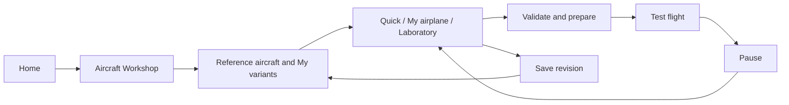

# Aircraft experiment editor plan

**Date:** 2026-10-13. **Status:** proposed; no editor implementation is claimed. **Prefix:** AE-00…AE-26. **Owner:** aircraft-editor track. **Repository baseline:** working tree inspected at `37103e0b`; concurrent physics and documentation edits remain owned by their tracks.

Build an **Aircraft Workshop** where a player can clone a catalog aircraft, make it lighter, heavier, smaller, larger or more powerful, save the result and fly it. The same workshop supports matching a real RC build and inventing a miniature trainer or a giant sport airplane. The first complete delivery includes a 50% Stik and a 200% Stik, a dedicated menu, persistent variants and a repeatable test-flight loop.

The editor compiles explicit user choices into validated aircraft data. It does not alter catalog sources or bypass the simulator's validation. A variant is always identified as experimental; a successful numerical check does not promote it to a physically validated model.

**Owns, proposed:** `app/aircraft_editor/`, `app/ui/aircraft_workshop/`, `app/data/aircraft_editor/`, `app/tests/test_aircraft_editor_*.gd`, `research/aircraft-editor/`, and this plan. Evidence belongs under `docs/research/aircraft-editor/` once it exists.

**Coordinated boundaries:** aircraft contract/loader, `app/sim/flight_session.gd`, `app/main.gd`, catalog/preferences/app root, screen stack/localization, each visual builder, ground profiles, glow/electric/turbine systems, camera/HUD/audio/crash presentation. Those files retain their existing owners. Register interfaces before editing them; do not allocate concurrent work on the same integration file.

Authoritative prerequisites: [aircraft contract](../../AIRCRAFT_CONTRACT.md), [architecture](../../STACK.md), [tools and verification commands](../TOOLS.md), [track registry](../README.md#tracks-plans-and-step-ids), [current menus](../MENU-PLAN.md), [menu redesign](../MENU-REDESIGN-PLAN.md), and [glow installations](../GLOW-ENGINES.md).

## 1. Product scope and delivery order

Three entry choices use the same variant format and compiler:

| Entry | Player intent | Default experience |
| --- | --- | --- |
| **Quick experiment** | "Give this Stik more power", "make it half size" | Six main controls: size, mass, power, balance, control travel and response; live before/after values |
| **Match my airplane** | "Mine weighs 3.4 kg, has this battery and this CG" | Guided actual dimensions, ready-to-fly mass, component positions, supported powerplant, throws and notes; measurements retain their evidence |
| **Laboratory** | "What happens with a huge lightweight wing or a tiny fast airplane?" | Expanded numeric controls, linked scaling policies, parameter locks, diagnostics, comparison and bounded random recipes |

The views differ in complexity, not in numerical safety. Laboratory never overrides finite-value, inertia, solver, contact or schema checks.

Delivery groups:

1. **V1, complete Stik loop:** create → adjust mass/power/scale → inspect → save → fly → pause → return to the same draft. Includes 50%, 100%, 150% and 200% scale targets, uniform scaling, basic controls and reference comparison.
2. **V2, personal fleet:** component balance, real-aircraft wizard, wider catalog coverage, supported electric/shaft/glow/turbine adapters, saved revisions and portable variants.
3. **V3, laboratory:** wider qualified ranges, performance experiments, deterministic recipes, advanced aerodynamic packages and cosmetic customization.

No dependency on a complete menu redesign, CAD editor, cloud account, multiplayer, helicopter or drone runtime. Nonuniform geometry editing is a separate later gate (§15).

## 2. Current repository and concrete gaps

Current source is authoritative where older guide summaries differ. In particular, the catalog contains **seven configurations across five airframes**, including two finite-fuel glow Stiks.

| Existing seam | Current behavior | Editor work required |
| --- | --- | --- |
| [aircraft_catalog.gd](../../app/app_state/aircraft_catalog.gd) | Fixed `ENTRIES`; each catalog ID selects a data file and an existing visual family | Add a separate user-variant resolver; keep the shipped catalog immutable |
| [aircraft_data.gd](../../app/physics/aircraft_data.gd) | `load_file()` hashes the bytes it parses; `validate_and_derive()` derives mass, CG, inertia and aero geometry | A compiler must create a complete candidate with provenance and an identity for its actual inputs |
| [aircraft_contract.gd](../../app/physics/aircraft_contract.gd) | Closed v2 quantities, capabilities and modules; unknown fields fail | Keep editor recipe metadata outside v2; extend an owned contract before adding a physical feature |
| [wheel_profiles.gd](../../app/physics/wheel_profiles.gd) | `load_file()` attaches ground profiles after aircraft derivation; in-memory validation does not | Carry and validate the correct effective wheel profile explicitly for a variant |
| [flight_session.gd](../../app/sim/flight_session.gd) | `setup()`, `_prepare_aircraft()`, `_commit_aircraft()` and `reload()` validate, trim, reset and preserve accepted state on failure | Add a prepared-variant launch seam with complete rollback and explicit reference/variant identities |
| Session starts | Airborne trim is required during preparation; runway starts use an explicit aircraft allowlist and the default field | Variant ancestry alone cannot authorize runway start; qualify effective geometry/profile/start together |
| [airplane.gd](../../app/render/airplane.gd) | Existing builders and aircraft-specific datum/CG/propeller handling | A presentation descriptor must scale geometry, offsets and anchors coherently |
| [app_root.gd](../../app/app_root.gd), `app/ui/`, `app/app_state/` | Home, aircraft selection, pause, settings data, modal holds and shared screens exist | Workshop screen, draft navigation, variant library and flight return context |
| [MENU-REDESIGN-PLAN](../MENU-REDESIGN-PLAN.md) | UI-20/21 delivered; general Settings/Hangar redesign is proposed | Reuse the current stack now; expose a route the future Hangar can call |
| Checkpoints and traces | Model/configuration fingerprints; input-byte identity; specialized electric/glow/turbine state | Bind variant revision and all attachments; never replay a checkpoint against a changed variant |
| Source pipelines | Aircraft/model tracks own generated geometry and physics JSON | Compile local variants into `user://`; leave generated `res://data/aircraft/` and source assets untouched |

Fleet adapter order:

| Base ID | Relevant implementation | First editor support |
| --- | --- | --- |
| `jensen-das-ugly-stik-60` | Legacy prescribed-RPM combustion propeller, fixed tricycle | V1 reference: full basic workflow and uniform scale |
| `gp-extra-300s-60` | Legacy prescribed-RPM propeller, taildragger | Next legacy adapter, with separate gear/visual acceptance |
| `p51d-mustang-120` | Gasoline hardware within the `glow_prop` solver family; shaft, wake and angled thrust | After shaft/wake transformations pass; no inference from the family name |
| `turbo-lumber-evolution` | Electric motor/ESC, finite battery model, imported GLB, taildragger | Mass and controls, then compatible powertrain changes and scaling |
| `stik-glow-55ax-2t` | Explicit 2T installation, finite fuel, thermal/charge states, moving mass properties | Installation-aware edits; no arbitrary engine-map multiplier |
| `stik-glow-fs64v-4t` | Independent 4T installation with the same lifecycle obligations | Independently qualified adapter, retaining the 4T law |
| `sebart-avanti-s-a200-p100rx` | Ventage Jet turbine, gear locked up, airborne-only route | Mass/controls, then qualified thrust/scale adapter; no runway option |

All seven may appear in the Workshop library immediately. Unimplemented edit groups show a concise reason and their original values; they do not offer inert sliders.

## 3. Dedicated menu and navigation

The English source label is **Aircraft Workshop**, translated as **Taller de aviones**. Home gets a direct action beside aircraft selection. A selected reference has **Create variant**; a saved variant has **Edit variant**. The future Hangar uses these same routes.



### 3.1 Workshop library

- Tabs: **Reference aircraft**, **My variants**, **Recipes**. Search by name; filter by base aircraft, propulsion, size, valid/draft and favorites. Sort by recent edit, name, span or mass.
- Cards show image, name, base aircraft, scale, span, ready-to-fly mass, propulsion family and one status: draft, ready for the selected start, needs review or unsupported.
- Actions: create, edit, duplicate, rename, favorite, compare, export and move to trash. Restore from local trash; permanent deletion is separate from removing a card.
- Reference cards remain reference cards. Every variant has its own ID and experimental label, even at 100% with no numeric changes.
- First-use recipes are entry points with an explained change list, not separate aircraft files to maintain by hand.

### 3.2 Editor layout

At 1280×720, use a full-screen editor with a compact navigation column, a large aircraft preview and a scrollable property column. Keep Save and Test flight in a fixed footer. At narrower widths or enlarged UI scale, the preview collapses above the fields; no essential action depends on a second monitor or horizontal scrolling.

| Region | Content |
| --- | --- |
| Header | Variant name, base, experimental badge, unsaved indicator, undo/redo, comparison toggle |
| Navigation | Overview; Size; Weight & balance; Powerplant; Controls; Aerodynamics; Landing gear; Appearance; Test & compare; Details |
| Preview | Orbit/pan/zoom; front/top/side/isometric views; neutral pose; optional control animation; dimensions; CG marker; original silhouette |
| Properties | Slider plus exact numeric entry and unit, current/reference values, per-setting reset, link/lock control where meaningful |
| Summary | Span, mass, wing loading, achieved power/thrust at a named condition, trim status, outstanding issues |
| Footer | Back, Save draft / Save revision, Test flight; error link scrolls to the affected field |

Useful preview tools: ruler, transparent airframe to locate ballast, component dots, thrust-line arrow, wheel/contact/hull overlay and control-surface excursion. Colors and arrow shapes distinguish these overlays. Use physics-derived locations transformed at the rendering boundary.

The reference silhouette has two modes: **same metres**, which makes size changes obvious, and **fit both**, which compares proportions. Label the mode. Do not let automatic camera framing conceal a 200% scale change.

### 3.3 Input and editing behavior

- Mouse and keyboard work initially; Tab order follows the visible fields, Escape returns one screen, focused sliders accept arrows and numeric entry. Radio flight controls stay disarmed while editing. Gamepad menu support follows the shell's supported input path.
- One slider drag is one undo operation. Undo/redo restores linked fields, lock states and the selected policy together. Reset field, reset section and restore base are distinct actions.
- Parse localized decimal input at the UI boundary; store finite SI numbers. Accept the locale's decimal separator without treating a comma as a thousands separator. Store display units separately.
- Show grams/kg, mm/cm/m, inches, degrees, seconds, W, RPM, N and optional lbf where appropriate. "Weight" controls mass; wing loading labels distinguish kg/m² or g/dm² from N/m².
- Cheap geometry/mass updates run while dragging. Full validation/trim is debounced and generation-tagged: a late result cannot overwrite a newer draft. Test flight forces validation of the exact displayed revision.
- Closing a dirty draft offers Save draft, Discard changes and Keep editing. Save failure leaves the dirty draft open with an actionable message. An invalid physics draft can be saved, but cannot launch.
- EN/ES strings follow the existing gettext workflow. Reuse theme, widgets, screen stack and focus holds; do not fork a second UI framework.

## 4. Editable parameters and exact meanings

Ranges below are **product targets for qualification**, not current loader guarantees. AE-01 records actual field bounds and coupled constraints; unsupported combinations remain saveable drafts. V1 targets 50–200% size and roughly 0.5–2× the policy-derived mass/power. Laboratory targets 25–400% size and 0.25–4× mass/power only after AE-23. Never widen shared bounds merely to make a slider endpoint pass.

| Group | User options | Mapping and coupling | Delivery |
| --- | --- | --- | --- |
| Identity | Name, description, notes, tags, favorite, thumbnail | Variant metadata; no physical effects | V1 |
| Uniform size | Percent or target wingspan; 50/75/100/125/150/200% buttons | One scale factor; dimensions, areas, contact and visual geometry change together | V1 |
| Scaling policy | Same wing loading; geometric mass; custom actual mass | Determines the mass proposal and corresponding inertia; §5 | V1 |
| Total mass | Lighter/heavier slider and ready-to-fly kg/g | V1 uniformly rescales the inventory, preserving normalized CG/distribution; explicitly a virtual build | V1 |
| Balance | CG location shown in mm aft of LE and, where supported, %MAC; forward/aft adjustment | Move eligible components or add explicit ballast; recompute full tensor; never write only a CG scalar | Basic display V1; edits V2 |
| Components | Battery/engine/fuel/receiver/ballast mass, position and box dimensions | Stable component keys, positive mass, symmetric moves for paired parts, validated support | V2 |
| Power | More/less power, target thrust-to-weight or a supported hardware package | Family adapter reports requested and achieved output at a declared condition; §6 | Legacy V1; other families V2 |
| Propeller | Compatible diameter/pitch/SKU package, rotor inertia summary | Diameter, mass, inertia, Ct/Cp or glow surrogate and visible blade change atomically; pitch alone is not a valid aerodynamic input | V2 |
| Engine response | Slower/faster spool or throttle response where supported | Existing lag/time fields; satisfy stiffness constraints; independent of transmitter expo | Legacy V1; family-specific V2 |
| Battery | Compatible pack, capacity, initial SOC, mass and location | Preserve battery model semantics; finite pack and fixed bus remain visibly distinct | V2 |
| Fuel | Initial fill, supported fuel/engine installation, tank placement where qualified | Finite glow mass/CG evolves; legacy/turbine prescribed fuel stays fixed unless its owning track adds finite fuel | V2 |
| Surface travel | Aileron/elevator/rudder limits and supported aileron differential | Physical throws feed both the aero and hinge animation | V1 |
| Servo speed | Neutral-to-full time | Preserve the contract definition; manufacturer seconds/60° requires a linkage conversion | V1 |
| Pilot response | Normal/full travel, per-axis rates/expo, profile comparison | Use input-layer shaping; show radio pass-through and avoid double expo on a transmitter | V2 |
| Drag | Bounded drag package: clean / reference / draggy, numeric advanced factors | Transform the relevant global and local laws together; consistent static oracle and local loads required | V3 |
| Lift and stall | Supported polar package; qualified section/stall adjustments | No universal "more lift" multiplier over derived loads; retain coefficient-reference conventions and provenance | V3 |
| Stability | View estimated static margin/trim; later select compatible tail/incidence packages | Derived diagnostics, not an artificial gyro or a hidden stabilizer | V2 diagnostics; V3 packages |
| Landing gear | Compatible wheel package, suspension softness/damping, supported brakes/steering | Explicit wheel profiles, contact geometry and support solve; respect aircraft capability | V2 |
| Appearance | Accent/covering colors, decals/name, thumbnail view | Duplicate per-variant materials; no mutation of shared resources; only supported material slots | V3 |
| Flight test | Field/conditions, airborne/runway where qualified, test speed | Session/test settings separate from aircraft definition | V1 |

A beginner control such as **Gentler controls** applies a visible recipe of travel/rate/expo changes, with a before/after list. **Slower airplane** proposes lower wing loading and a compatible power setting; it does not cap velocity secretly. **More agile** means specified control/distribution changes, not a direct angular-velocity multiplier.

### 4.1 Matching a real airplane

The wizard asks for base shape, wingspan, ready-to-fly mass, measured CG, installed propulsion, battery/fuel state and actual throws. Unknown values remain inherited/estimated. Record measurement notes and the configuration in which the aircraft was weighed.

First fit total mass and CG using explicit adjustable components. Let the user choose "measured components" or "estimated distribution from the base". A fit cannot use negative ballast, move a component outside its allowed mount, or claim measured inertia from total mass and CG alone. A target that is impossible with locked components reports the conflict and offers an explicit unlock/change.

Show both `% of S/b` and `%MAC` only when those quantities are available and correctly located. The contract's `mean_chord=S/b` is not generally MAC; tapered P-51/jet wings need a derived MAC and its datum before a %MAC input is offered.

Keep stock airfoil/engine evidence visibly separate from the user's measurements. Optional later flight notes can record "roll too slow" or "climb stronger than my model", but no automatic calibration should claim a uniquely identified physical cause from such observations.

## 5. Uniform scaling rules

Let `s = new span / base span` and `r_m = new initial mass / base initial mass`. Every rebuild starts from the pinned base snapshot, not the last scaled result. Moving a slider from 100% to 200% and back must not accumulate rounding or provenance changes in the base.

### 5.1 Three understandable policies

| Policy | Proposed mass | Meaning |
| --- | --- | --- |
| **Keep wing loading** — default for experiments | `m' = m s²` | Similar reference lift speed if the same coefficients/density apply; useful for a large, gentle Stik |
| **Geometric mass scaling** | `m' = m s³` | Uniform density/volume assumption; larger versions become more heavily wing-loaded |
| **Use my mass** | Explicit ready-to-fly mass | Suitable for a real build or an intentionally unusual experiment |

These are modeling choices, not manufacturing laws. Hardware adapters may lock motor/battery/fuel masses; in that case distribute the remaining target mass only among eligible components and report an impossible target.

### 5.2 Transformation ledger

| Quantity | Required transformation |
| --- | --- |
| Lengths | Span, chord, component positions/sizes, aerodynamic reference point, tail/wing stations, hull vertices, wheel contacts, prop hub, wake geometry, visual datum and mounts scale by `s` |
| Areas | Wing/tail/fin areas scale by `s²`; dimensionless aspect/taper ratios and geometric angles remain unchanged |
| Inventory | Initial V1 uniform mass distribution: each mass scales by `r_m`; CG scales by `s`; regenerate the derived model |
| Inertia | For uniform inventory scaling, the **entire six-entry tensor** scales by `r_m s²`, including products of inertia; component edits require a new sum |
| Propulsion application points | Reconstruct a fixed structural hub from the original CG-relative offset, transform it, then subtract the **new** CG; do the same for intake offsets. CG movement is not a physical engine movement |
| Aerodynamics | Keep supported nondimensional coefficients only under the declared borrowed-similarity assumption; derive strips, tail/fin arms, induced maps, lift offsets and stall blends again |
| Control travel | Degrees remain unchanged under geometric scaling; the scaled mesh uses the same normalized servo output |
| Time constants | Default retains actual hardware timing. An explicit virtual-similarity recipe may propose scaled servo/engine/downwash timings, followed by stiffness checks; do not multiply every time field blindly |
| Ground suspension | To keep normalized static sag: spring `k' = k r_m/s`; for the same damping ratio with uniformly scaled supported mass, `c' = c r_m/sqrt(s)`. Travel and wheel radius scale by `s`; solve support again |
| Wheel dynamics | Radius/relaxation lengths scale geometrically; inertia derives from the chosen wheel mass/shape; compatible brake torque and tire profiles are validated together. Field friction remains field-owned |
| Presentation | Model vertices/transforms, pivots, shadow/blur geometry, contact overlays, exhaust anchors, camera mounts and crash section origins must agree in metres |
| Evidence | Unchanged source values retain their evidence; transformed values become derived/estimated with base identity, policy and compiler version. A synthetic resized engine is not the manufacturer's named original |

The suspension formulas are derived from `sag = load/k` and fixed damping ratio, not a tire-material similarity claim. They preserve a ground timescale proportional to `sqrt(s)`; only the geometric-density case shares that timescale with the standard gravity-based flight similarity. Qualify small models at the unchanged 240 Hz step.

Plausibility ranges/reference inertia need a declared transformation too. A catalog mass range describes that catalog build; applying it literally to a giant variant is misleading. Preserve the original comparison in the manifest, derive a variant comparison where meaningful, and keep the loader's independent safety checks. This is not permission to erase warnings or expand numeric domains.

### 5.3 Predicting the consequences

At the same density and assumed lift coefficient, `V'/V ≈ sqrt(r_m)/s`, wing-loading ratio is `r_m/s²`, and Reynolds-number ratio is approximately `sqrt(r_m)` if viscosity is unchanged. These are initial estimates; run actual trim/performance calculations afterward. At 200% geometric mass, stall/trim speed tends toward `sqrt(2)` times the base value. At constant wing loading it tends toward the same value.

For a geometrically similar propeller with unchanged Ct/Cp at the corresponding advance ratio, a **reference thrust-to-weight target** gives:

```text
D'/D = s
T'/T = r_m
n'/n = sqrt(r_m) / s²
P'/P = r_m^(3/2) / s
Q'/Q = r_m s
```

These are compiler proposals for a reference operating point, derived from the existing `T=Ct rho n² D⁴` and `P=Cp rho n³ D⁵` laws. They do not prove that an actual engine, battery or propeller can deliver the proposal, or that two flights are dynamically identical. Shaft inertia and hardware time constants require their own adapter; a constant-wing-loading resize is not complete gravity-based dynamic similarity.

Reynolds and Mach changes can invalidate copied aero coefficients. Keep the limitation beside the estimate and record the operating domain; do not fabricate small-aircraft polars. The basis for this distinction is [NASA similarity parameters](https://www1.grc.nasa.gov/beginners-guide-to-aeronautics/similarity-parameters/). Propeller measurement conditions and coefficient conventions follow the [UIUC propeller database](https://m-selig.ae.illinois.edu/props/propDB.html). Accessed 2026-10-13; the policy equations above are project derivations, not a claim of external validation.

### 5.4 Concrete Stik examples from current data

The current [Stik source](../../app/data/aircraft/jensen_ugly_stik_60.json) has 1.524 m span and 0.464515 m² area. Summing its inventory gives **2.885058291 kg**, including the documented virtual balancing mass. These are simulator reference values, not measurements of the user's airplane.

| Variant | Span | Area | Mass at same wing loading | Mass with geometric scaling |
| --- | --- | --- | --- | --- |
| Original 100% | 1.524 m | 0.464515 m² | 2.885 kg | 2.885 kg |
| Mini Stik 50% | 0.762 m | 0.116129 m² | 0.721 kg | 0.361 kg |
| Super Stik 200% | 3.048 m | 1.858060 m² | 11.540 kg | 23.080 kg |
| Giant Stik 400%, laboratory target | 6.096 m | 7.432240 m² | 46.161 kg | 184.644 kg |

At 200%, keeping wing loading gives `I'/I=16` and reference propeller power `P'/P=4`; geometric mass gives `I'/I=32` and `P'/P≈11.314`. Merely doubling power is neither policy. A custom 200%/6 kg Stik is another valid *intent*, subject to inventory and solver checks. The 400% row illustrates consequences; it does not promise that today's loader or field accepts 184.6 kg.

## 6. Powerplant editing without ambiguous sliders

Every power page states its solver family, reference condition, requested change and achieved result. The UI must distinguish **shaft power**, **electrical input power**, **static thrust** and **thrust-to-weight**. A brochure horsepower value is not a force control.

| Family | Adapter behavior | Qualification boundary |
| --- | --- | --- |
| Legacy prescribed RPM, Stik/Extra | A virtual power request derives the maximum static RPM from propeller shaft-power demand at reference density. Preserve Ct/Cp together, adjust the declared RPM schedule/lag consistently, then evaluate achieved thrust/power | Changing `peak_power` alone does not change this solver. With fixed static Cp/diameter, `n'/n=p^(1/3)` is a static mapping only. Retain idle by default and reject an inverted idle/max range |
| Coupled shaft, P-51 | Select or derive an explicit shaft power/torque curve and friction/rotor data; recompute equilibrium with the selected propeller | Do not multiply final thrust independently of aerodynamic torque, wake, gyro and shaft reaction |
| Electric, Timber | Select a compatible motor/ESC/battery/prop package or edit supported physical fields; evaluate the actual voltage/current/torque solution | Capacity is not power; changing cell count affects voltage, mass, sag and stiffness. Do not promise ESC current limiting, braking, regeneration or thermal protection absent from the runtime law |
| Finite glow 2T/4T | Select compatible installation/profile/prop packages; expose supported fill/mixture/installation adjustments with their own constraints | Installation files and engine profiles are dependencies, not decorative IDs. Geometry/torque/fuel/heat/mass changes need one coherent adapter; never obtain a 4T curve by scaling the 2T curve |
| Turbine | Offer thrust and spool settings through an explicit synthetic or supported engine package, keeping RPM map, installed thrust, mass flow, intake/ram terms and rotor properties consistent | Do not rename thrust as shaft watts, silently add finite fuel or enable retracts. Existing airborne-only capability remains |

For finite-glow resizing, V2 first supports a resized airframe with **fixed qualified engine/prop hardware** and a refitted eligible inventory. Arbitrary scaled combustion hardware remains locked until its map/thermal/fuel/inertia transformation is qualified. For extreme fictional power, offer an explicitly named virtual powerplant conversion only as a separately validated future recipe; never change solver family invisibly.

The power/scale link has clear states: **keep hardware**, **suggest similar thrust-to-weight**, **set my powerplant**. The suggestion previews all affected fields and achieved output; the user may lock propeller size, battery or mass. Conflicts remain visible rather than silently changing a locked choice.

**Engine off / glide test** is a launch-mode request, not a power multiplier of zero. V1 still needs a supported prepared start. A dedicated unpowered start that avoids powered trim is gated separately in AE-20; do not bypass `_prepare_aircraft()` to make an underpowered design launch.

## 7. Mass, balance and aerodynamic consistency

V1 total-mass adjustment uniformly scales the full inventory and recomputes the model. This preserves CG and gives a transparent toy-model interpretation. It does not represent removing a real battery or making a real motor lighter.

V2 component editing introduces stable keys owned by an adapter manifest. Current free-text inventory names are not a general hardware API; an adapter pins a base hash and checks the expected inventory before assigning a role. Existing glow installation references must still resolve exactly.

For CG editing:

1. Lock structural geometry and the fixed engine/prop/tank mounts.
2. Move only selected adjustable components within declared ranges, or add an explicit positive ballast component.
3. Solve the inventory's first moments; show resulting total mass, CG and tensor.
4. Update the variant's declared CG/provenance to describe that actual inventory; recompute all CG-relative arms and dependent aero/ground data.
5. Reject impossible targets. Show the nearest feasible value only as a proposal requiring a new user edit.

A cosmetic CG marker never substitutes for the inventory. Rebalancing cannot drag the mesh relative to unchanged forces or alter the aerodynamic reference point accidentally. Ground support must be checked after every CG change.

Advanced aerodynamic editing uses supported **parameter packages**, not raw editing of arbitrary derived fields. Changes to the tail, incidence, fin, wing polar or drag law must preserve the global/local matching rules in the current loader and the regime-consistency tests. Broad "stability" and "lift" controls wait until their mappings are defined and verified. Existing unmodeled flaps, retract motion, structural flexibility, airframe break-up and stabilization remain outside the editor's capability set.

## 8. Variant data, compilation and identity

Use a separate, versioned **`openrc-aircraft-variant v1`** recipe. Keep the produced physical definition at `openrc-aircraft v2`; do not insert editor keys into its closed schema.

Proposed recipe sections:

| Section | Required content |
| --- | --- |
| `format`, `id`, `revision` | Variant-format version, generated stable UUID and monotonically increasing saved revision |
| `base` | Exact catalog ID, source-byte SHA-256, base snapshot reference, dependency manifest and visual adapter identity |
| `recipe` | Compiler/policy version, scale, mass policy/target, component edits, power adapter/settings, control edits, optional supported aero/gear packages |
| `locks` | Explicit hardware/mass/CG/propeller choices that the compiler may not change |
| `presentation` | Supported paint/decal choices and preview framing; never forces or coefficients |
| `metadata` | Name, notes, tags, timestamps, user measurement notes and source attribution |

All physical overrides carry value, unit, kind and source. A convenient scalar slider is serialized into this provenance-bearing structure. Do not serialize NaN, infinity, engine state, battery charge *history*, tick counters or a live checkpoint into the aircraft recipe.

Compiler order is fixed and versioned:

```text
validate recipe and resolve pinned dependencies
→ copy base authored v2 data
→ transform geometry under selected policy
→ apply compatible hardware packages and locked component changes
→ fit eligible inventory / target mass / CG
→ derive physical propulsion and control parameters
→ reconstruct datum-relative / CG-relative geometry
→ validate and derive the full v2 model
→ attach and validate effective wheel / glow / other dependencies
→ check timestep and selected start with the real session path
→ prepare render and observer descriptors
→ publish a detached immutable candidate and diagnostics
```

No step mutates a shared base dictionary or accepted flight. A failed later step returns no launchable candidate. Cached results are keyed by full recipe/base/dependency/compiler identities and test conditions; render-only changes do not invalidate physical estimates unnecessarily.

### 8.1 Identity must not collapse into the base ID

Maintain distinct identifiers:

- `variant_id` and saved revision: the user's artifact.
- `base_aircraft_id`: ancestry and the allowed visual adapter family.
- `effective_model_id`: the compiled variant's physical identity.
- exact-byte hashes for base, recipe and materialized physical input, plus dependency hashes.
- derived model/configuration fingerprint: the actual accepted solver inputs.
- presentation fingerprint: scale, geometry adapter and cosmetics for captures.

The current equality check among catalog selection, loaded model and visual ID is valuable. Replace it for variants with an equally strict **resolved descriptor**: expected effective-model ID plus explicitly allowed base visual adapter. Never pass an empty expected ID just to bypass the check, and never masquerade as the reference ID to obtain its wheel profile or runway permission.

Materialize deterministic effective v2 bytes and a manifest in a local cache, or add a byte-based loader that preserves the same parse/hash behavior. In either case, record the bytes actually parsed. The normalized model hash does not replace original-input identity. Include effective wheel/glow/profile data in checkpoint compatibility; dependency edits must invalidate old checkpoints even if the display name is unchanged.

Schema/compiler versions are separate from the simulator's existing checkpoint version. Inspect the latest checkpoint layout during implementation and extend it deliberately; this plan does not reserve a future version number.

### 8.2 Local persistence and import/export

Proposed local layout:

```text
user://aircraft_variants/<uuid>/variant.json
user://aircraft_variants/<uuid>/base.json
user://aircraft_variants/<uuid>/dependencies.json
user://aircraft_variants/<uuid>/revisions/<revision>.json
user://aircraft_variants/<uuid>/thumbnail.png
user://aircraft_variants/_drafts/<uuid>.json
user://aircraft_variants/_trash/<uuid>/...
user://aircraft_variants/_cache/<content-hash>/...
```

Exact storage limits are fixed in AE-02. Start with bounded JSON depth, bounded arrays and explicit import-size limits; library enumeration loads metadata first and compiles only selected aircraft. Keep the last successful revision while writing a temporary file, validate/read it back, then atomically replace where supported. On interrupted writes, recover a valid previous revision and explain the recovery once.

Export a **data-only portable bundle** containing recipe, base physical snapshot, required supported data dependencies, provenance and preview. Reference shipped visual assets by adapter and content identity; do not duplicate commercial/generated meshes or accept scripts, arbitrary `res://` paths or executable resources from an import. Reject unknown versions/dependencies and path traversal. Import duplicates with a new local UUID unless the user explicitly chooses to update the same lineage.

An app update never silently rebases a saved aircraft. Offer **Keep pinned version**, **Review changes**, or **Create migrated copy**. An unavailable visual adapter may permit inspection/export of the data but blocks flight if its geometry no longer matches. Migration preserves the old artifact and reports mass/CG/power/control changes before launch.

## 9. Session lifecycle and the test-flight loop

The editor owns a mutable draft; a launched session owns an immutable accepted candidate. Physics changes take effect on a **new prepared flight**, not while airborne. Paint-only preview changes are presentation data, but save/flight revision identity remains explicit.

From Home:

1. Resolve the variant revision and selected field/conditions.
2. Prepare data, attachments, start, render model and observers in isolation.
3. Refuse launch with field-specific diagnostics if any required stage fails.
4. Commit the complete flight and selected variant reference together.

From a paused flight:

1. Open Workshop under the existing pause/focus hold; retain the current flight unchanged.
2. Create a draft from the accepted revision. If editing a catalog plane, create a new variant.
3. **Back without testing** returns to that paused flight. Resume follows the existing deliberate resume/arming policy.
4. **Test changes** prepares a replacement. Failure leaves the original session, recorder, view and draft available.
5. On success, close/finalize the old recording according to existing shell policy, replace the flight, and record the new identity. Never concatenate two configurations into one trace.

A trial launched from Workshop adds **Return to Workshop** to pause and crash completion, restoring the same draft, selected section and comparison. **Restart trial** resets the same accepted recipe and selected initial fuel/SOC; it does not pick up subsequent disk edits. F5 reload on a variant must go through its resolver and pinned dependencies, not reload the base aircraft file.

Runway eligibility requires all of: adapter support, actual landing-gear capability, effective profile validation, static ground equilibrium, whole-aircraft clearance in the selected field and qualified start behavior. The current allowlist cannot simply be copied to a custom UUID. A giant plane must not spawn through the runway, pilot barrier or scenery, and a miniature plane must not inherit an oversized spawn clearance or camera near plane.

The field remains in metres. Aircraft scaling does not change runway length, obstacles, wind, gravity or pilot height. Explicit test scenarios may choose different start locations/altitudes; those belong to the test context and its trace.

## 10. Preview, flight presentation and observers

Create a render adapter that consumes the effective geometry and a base builder. A common scale wrapper is acceptable only after proving the correct datum/CG order. In general, transform a point as `p_world = pose + R (s p_base - cg_effective)` in consistent coordinates; the actual Godot builder offset must be included once. Scaling a node already offset by a base CG can scale the offset twice.

Preserve `airplane`, `propeller` and every `*_hinge` name. Check witness vertices at neutral and both throw limits. A propeller package can have its own diameter independent of airframe scale; avoid multiplying its resize twice. Imported Timber pivots/rest transforms need the same care as the procedural builders.

| Consumer | Required behavior |
| --- | --- |
| Shadows and propeller blur | Match final geometry/diameter and animated rotor; no base-size disc or footprint |
| Pilot/chase/onboard/orbit cameras | Read effective span, CG/datum and mounts; preview framing is independent of pilot-view behavior |
| HUD | Show variant name, scale and experimental status; use effective mass/power and current finite-energy telemetry |
| Audio | Use effective engine/rotor state and source anchors; size alone is not a sound-pitch multiplier |
| Smoke | Move exhaust anchors with geometry; preserve actual engine/atmosphere observer inputs |
| Collision and crash | Effective hull, wheel and prop-disc size before flight; scaled wreck geometry/section centers and coherent mass/inertia after impact |
| Crash grading | Audit absolute thresholds and contact policies; do not claim physical structural strength from geometric scaling |
| Captures | Record variant/base IDs, revision, presentation identity, scale and relevant camera settings |

For V1, an intact, correctly positioned terminal-crash presentation is preferable to a wrongly scaled fragment simulation. Enable the full wreck path only after its effective-model invariants pass; the chosen fallback must be explicit in the adapter and acceptance report, and must not change flight collision detection.

## 11. Diagnostics that help experimentation

Use three states with text and icons:

- **Ready for this test:** data, dependent modules, solver and selected start prepared successfully.
- **Ready with modeling notes:** numerical checks pass but coefficients/hardware are borrowed, resized or outside measured support. This remains experimental.
- **Cannot start:** concrete blocking errors such as invalid inertia, impossible CG, missing prop data, excessive source stiffness, trim failure or obstructed spawn.

Show requested/achieved differences, not a generic red "invalid" label. Examples: "The selected battery and motor do not reach this target thrust", "Move the battery forward or reduce the requested CG shift", "This giant configuration does not fit the selected runway start". Never silently clip a value and launch a different aircraft.

Overview comparison shows reference vs variant, absolute values and percent differences for span, mass, area, wing loading, tensor diagonals, CG, available static thrust, reference shaft/input power and throw/time settings. Add caveats at the affected metric, not an undifferentiated disclaimer wall.

Performance labels must distinguish:

| Result | How it is obtained |
| --- | --- |
| Approximate stall speed | `sqrt(2mg/(rho S CLmax))` only when a compatible CLmax is available; label the assumptions |
| Trim at chosen speed | Actual session trim result with throttle/deflections and residual/validity |
| Static thrust/power | Actual family evaluator at stated density, engine/pack state and throttle; rotating equilibrium where required |
| Maximum level speed | Later bounded force/trim search within the supported aero/prop domain; "not determined" if there is no valid bracket |
| Climb/roll/takeoff/endurance | Later scripted experiment with fixed commands/conditions and defined duration/termination; do not infer these from one ratio |

A windless A/B trial uses the same field, atmosphere, initial energy state and command tape/seed. Different mass/speed variants require their own valid starts; record these instead of pretending their initial states are identical. Keep simulated measurements separate from the user's real measurements.

## 12. Creative recipes and presets

Recipes are transparent compiler inputs with a seed/version. They do not hide forces or add a separate arcade solver. Names suggest an experience; the metrics explain what actually changed.

| Recipe | Initial intent | Observable comparison |
| --- | --- | --- |
| **Mini Stik 50** | 50% span, geometric mass proposal; compatible virtual legacy propeller/RPM | 0.762 m span, lower estimated lift speed, much lower inertia; small-scale aero caveat |
| **Super Stik 200** | 200% span, same wing loading, suggested reference thrust-to-weight | 3.048 m span; same approximate lift speed, substantially larger inertia |
| **Heavy Giant** | 200%, geometric mass, explicit power proposal | Increased wing loading and speed requirement; reject unsupported power/start combinations |
| **Featherweight** | 100% scale, 70% inventory mass, unchanged hardware only if inventory fit allows it | Lower wing loading and changed power-to-weight |
| **Cargo Trainer** | Add an explicit payload at an eligible mount | Mass, CG/inertia, trim throttle and runway distance |
| **Pocket Rocket** | 50–75%, moderately higher wing loading and qualified power | Small visual target, higher predicted speed; supported-domain checks |
| **Gentle Sunday** | Modest mass reduction, limited travel and slower command response | Lower control authority and calmer commanded inputs; no invisible stabilization |
| **Sport / 3D experiment** | Compatible power increase and larger throws | Control/propeller authority and stall behavior as simulated; no guaranteed hover capability |
| **Same weight, twice the size** | 200%, custom mass equal to the original | Extreme wing loading and inventory assumption made visible |
| **Balance classroom** | Three copies with forward/reference/aft feasible CG | Trim and stability differences, all derived from explicit inventory |
| **Battery trade-off** | Same airframe with compatible small/large packs | Mass/CG vs simulated energy use; only finite battery model offers endurance |
| **Two engines, one airframe** | Separate 2T and 4T installations on a common Stik ancestry | Different engine laws and hardware; match test conditions rather than force equal power |

**Surprise me** comes after qualified bounds: choose a seed, lock the base and any protected settings, select gentle/sport/extreme intent, then generate at most a fixed number of candidates. Show the winning recipe before saving or flying. If none pass, return an explanation; do not relax the checks or search forever. **Change one thing** generates a small parameter sweep useful for learning which adjustment causes which effect.

## 13. Proposed code boundaries

Names below are proposed files/APIs, not existing symbols.

| Proposed path | Responsibility |
| --- | --- |
| `app/aircraft_editor/variant_contract.gd` | Closed recipe format, versions, numeric/unit/provenance validation |
| `app/aircraft_editor/variant_store.gd` | Atomic local save/load, drafts, revisions, trash, import/export |
| `app/aircraft_editor/variant_compiler.gd` | Pure deterministic recipe → authored candidate/dependency/presentation manifest |
| `app/aircraft_editor/scale_policy.gd` | Explicit dimensional ledger and coupled scale/mass proposals |
| `app/aircraft_editor/mass_editor.gd` | Component keys, inventory scaling, bounded target-mass/CG fitting |
| `app/aircraft_editor/powerplant_adapters/` | Legacy, shaft, electric, 2T/4T installation and turbine-specific transformations |
| `app/aircraft_editor/variant_resolver.gd` | Immutable descriptor connecting base, revision, effective physical input and render family |
| `app/aircraft_editor/variant_diagnostics.gd` | Read-only checks/metrics and structured issue paths |
| `app/aircraft_editor/experiment_runner.gd` | Later deterministic performance/parameter-sweep trials, isolated from the live session |
| `app/ui/aircraft_workshop/` | Screen, library, sections, preview and undoable draft controller |
| `app/data/aircraft_editor/` | Versioned recipe schema, supported base-adapter manifests and reviewed recipe presets |
| `app/tests/test_aircraft_editor_*.gd` | Compiler, persistence, lifecycle, menu, geometry and observer regressions |

Keep pure calculations usable headlessly. Scalar doubles and packed float64 arrays remain the physics representation. Only the preview/presentation layer creates Godot render vectors/transforms. Do not preload visual builders from the compiler. A new dependency is not necessary for V1.

The menu/preferences owner adds only selection/reference data to saved preferences; the full recipe belongs in its own store. Direct automation still ignores player preferences. Add an explicit proposed `--aircraft-variant=<bundle-or-local-path>` route for reproducible checks, mutually exclusive with `--aircraft`; the direct path must neither migrate nor overwrite user files.

## 14. Incremental implementation and acceptance

Every row is **pending**. Evidence columns define required proof, not completed tests. Keep each step independently reviewable; split a row further if it spans too many owners.

| ID | Work and dependency | Required proof / completion gate |
| --- | --- | --- |
| AE-00 | Freeze source-backed seam audit; agree menu/session/loader/render ownership | Current seven-entry fleet, source/attachment/start/identity map and bounded interface proposal |
| AE-01 | Inventory field units, actual bounds, dimensional scaling, optional modules and every ID lookup; depends AE-00 | Machine-readable transform ledger; each supported quantity is transformed, invariant or explicitly unsupported; derive V1 feasible range |
| AE-02 | Recipe contract, base/dependency pinning, deterministic serialization and variant identity; AE-01 | Strict malformed/unknown/version cases, exact-byte identity, no source mutation, equivalent replay inputs have reproducible fingerprints |
| AE-03 | Local store, draft recovery, revisions, clone/rename/trash; AE-02 | Read-only disk, interrupted write, corrupt item, duplicate names/IDs, app restart and deleted selection cases retain usable library |
| AE-04 | Resolver and detached compiler skeleton with no-op variant; AE-02 | 100%/unchanged numeric model and fixed-command trajectory equal the base; separate variant metadata/identity; correct wheel profile preserved |
| AE-05 | Uniform inventory mass adjustment and basic throw/servo edits; AE-04 | Mass/CG/full-tensor known answers; surface physics/visual agreement; invalid ranges block launch |
| AE-06 | Legacy Stik virtual power adapter; AE-04 | Requested vs actual static power/thrust, RPM bounds, lag/idle behavior, torque consistency and low-power trim refusal |
| AE-07 | Uniform scale compiler and linked policies; AE-05/06 | 0.5×/1×/2× geometric and constant-wing-loading known answers, ledger completeness, ground-profile transformations and 240 Hz preflight |
| AE-08 | Stik preview/render/observer adapter; AE-07 | Neutral/hinge/prop/hull/contact alignment at three sizes, explicit comparison framing, shadow/blur/anchor proof and crash presentation gate |
| AE-09 | Dedicated Workshop library, draft screen, six quick controls, undo/redo and EN/ES; AE-03/08 | 720p/1080p capture and keyboard journey, no clipped footer, stale validation ignored, controls cannot reach flight while editing |
| AE-10 | Transactional variant launch, pause return, restart, F5 resolver and trace identity; AE-04/09 | Failure retains old flight/recording, success starts one new identity, save/test/relaunch works; **V1 release gate** |
| AE-11 | Effective-model runway qualification for Stik variants; AE-10 | Static equilibrium/clearance, mini contact and giant field-fit cases; unsupported starts are disabled with a reason |
| AE-12 | Component keys, ballast/mount constraints and target CG/mass fit; AE-05/10 | Independent first-moment/tensor oracles, impossible target/negative ballast rejection, fixed hub stays fixed after CG movement |
| AE-13 | Match-my-airplane wizard and diagnostic comparison; AE-12 | A measured-mass/CG example round-trips with provenance; unknown data stays estimated; MAC/reference-chord distinction |
| AE-14 | Extra adapter plus shaft/wake P-51 adapter; AE-01/12 | Separate no-op parity, scaled datum/tail/wake/load checks, topology and taildragger behavior; no blanket base-ID fallback |
| AE-15 | Electric Timber packages and imported-geometry scaling; AE-01/12 | Motor/prop equilibrium, pack mass/energy/SOC, stiffness refusal, reset/replay, GLB hinge and prop-diameter checks |
| AE-16 | Independent glow 2T and 4T installation adapters; AE-01/12 | Installation/profile/fuel-item integrity, wet-to-dry mass/CG/inertia, work/fuel accounting, thermal/reset/replay and explicit unsupported scaled-hardware cases |
| AE-17 | Turbine mass/control/thrust/scale adapter; AE-01/12 | Spool/ram/intake/gyro consistency, timestep checks, trace identity, airborne-only enforcement |
| AE-18 | Full per-family controls, gear and compatible propeller package pages; AE-14…17 per family | Physical/render travel parity, no double radio shaping, wheel/profile/brake/prop package compatibility and rollback |
| AE-19 | Data-only export/import, migration review and standalone variant CLI; AE-03/14…17 | Fresh-install round-trip, missing/newer/corrupt dependencies, path escape refusal, pinned originals preserved; **V2 gate** |
| AE-20 | Supported unpowered/glide test starts and bounded performance experiments; AE-10 plus family adapter | Start independent of powered trim only through owned session contract; scripted speed/climb/roll/energy results tied to exact initial state and conditions |
| AE-21 | Aerodynamic packages: drag, supported polars/incidence/tail variants; AE-01/20 | Global/local/regime consistency, finite stall joins and trim/domain checks; field-by-field numerical/physical limitations |
| AE-22 | Recipe gallery, one-parameter sweeps and seeded surprise generator; AE-20/21 | Deterministic finite search, locks respected, result explained, no implicit launch or validator bypass |
| AE-23 | Qualify wider 25–400% laboratory targets and combinations; AE-14…22 as relevant | Scale/mass/power boundary matrix, 240/480/960 Hz offline refinement, field-fit, failure diagnostics and bounded runtime cost |
| AE-24 | Supported paint/decal slots, thumbnails and presentation polish; AE-08/19 | Shared materials unchanged, geometry/physics/trace unaffected, export/load and EN/ES capture proof |
| AE-25 | Cross-platform/export qualification, accessibility and owner playtest; AE-19…24 | Fresh-clone tests/captures, packaged resource lookup and user-store behavior on Windows/Linux/macOS; **V3 gate** |
| AE-26 | Consolidate delivered behavior into one operating guide and remaining scope; AE-25 | Update FIRST-LAUNCH/TOOLS links and owner docs; retain required evidence and remove superseded planning text |

Critical V1 path: AE-00 → 01 → 02 → 04 → 05/06 → 07 → 08 → 09 → 10, with AE-03 available before the menu. AE-11 adds qualified runway variants after airborne V1. V2 adapters can proceed independently with disjoint files after the common compiler/session interfaces stabilize. Integrate shared files serially.

### 14.1 Test matrix and invariants

Use the repository's [canonical commands](../TOOLS.md), including `app/test.sh` and the relevant research checks; Windows uses the documented native/WSL split. Draft GDScript stays outside `app/` until it parses. Do not rerecord golden flights for adding the editor.

| Axis | Mandatory cases |
| --- | --- |
| Scale/policy | 0.5, 1.0, 2.0 × same-wing-loading, geometric and explicit mass; 0.25/4.0 later; rejected zero/negative/extreme/nonfinite inputs |
| Mass/CG | Lighter/heavier, asymmetric component, forward/aft, unchanged CG, point mass vs finite box, all six inertia entries |
| Power | Low/nominal/high, idle/max conflict, insufficient trim, unsupported prop table range, family-specific stiffness and energy cases |
| Identity | Same name/different recipe; tiny numeric difference; changed base, wheel profile or glow file; renamed-only variant; stale cache; wrong visual family |
| Lifecycle | Home create/save/fly, paused edit/cancel, failed launch, trial crash return, restart, F5, save failure, focus loss, radio disconnect/rearm |
| Presentation | Each base at accepted minimum/maximum scale; reference silhouette; hinges; propeller; hull/contact/CG; smoke/audio anchors; crash view |
| Persistence | Fresh store, corrupted single item, unknown version, interrupted write, duplicate import, offline relaunch, app upgrade, missing visual adapter |
| UI | EN/ES, 1280×720 and 1920×1080 initially; supported shell scale factors, keyboard-only, long names, decimal comma, 30% text expansion |

Proof requirements:

- No-op reference numerical arrays and fixed-input trajectories remain identical; metadata may differ only in the declared variant namespace. Catalog source hashes and generated-output checks stay unchanged.
- Independent analytic fixtures verify the scaling exponents, first moments, tensor products and suspension proposals; tests must not merely call the same helper twice.
- Invalid candidates cannot modify live model/state, selected aircraft, input-arming state, recordings, RNG, scenery damage or accepted presentation.
- Replay checks cover the full state of each supported energy/propulsion family, not just aircraft pose. A different compiled identity rejects restoration.
- Contact/spawn proof uses the actual session and selected field, including obstacles. An in-memory loader-only check cannot establish that wheel profiles reached the flight.
- Performance diagnostics use the same force laws and state conventions as the session; independently recompute representative static values and validate refinement where numerical integration matters.
- Aim for immediate cheap preview feedback (initial target under 50 ms on the owner's machine). Full preparation may take longer but must show progress and remain cancelable. No continuous second simulation or viewport remains active after leaving Workshop.
- Flight physics tick cost should be unchanged for a variant with the same modules. Measure new package extremes against the existing Gate P budget, rather than raising the budget or changing the global timestep.
- Run deliberate validation/identity mutations only in disposable copies. Publish evidence with source revision, effective recipe/dependency hashes, conditions and actual accepted range.

### 14.2 User acceptance journeys

1. From Home, create **Super Stik 200**, choose same wing loading, increase virtual power, inspect original-size overlay, save and fly. Relaunch the app and find the same variant.
2. Create **Mini Stik 50**, observe the smaller body/prop/hull and appropriate start; compare against the reference without an invisible camera-size normalization.
3. Enter actual mass and CG for a personal build; inspect which components changed and which parameters remain estimated.
4. From a trial, pause, edit mass, fail a deliberately impossible CG target, retain the previous flight, fix the draft and launch successfully.
5. Switch among legacy, electric, finite-glow and turbine variants; only supported options appear, finite energy resets/replays correctly, and no family silently becomes another solver.
6. Export to a second clean installation, import, and obtain the same physical configuration or an explicit dependency/version refusal.

## 15. Scope limits and decisions for implementation

The following are the recommended design choices for this plan, not changes already made to the runtime:

| Decision | Reason and consequence |
| --- | --- |
| Separate variants and immutable references | Players can experiment freely and return to the reference; generated source pipelines remain authoritative |
| Same-wing-loading default, other policies visible | "Twice the size" is ambiguous; state the chosen mass rule before applying it |
| Uniform geometry first | It is possible to transform the current data/builders coherently and verify exact scaling laws |
| Family-specific power adapters | One nominal horsepower slider cannot represent governor, shaft, electric, finite-glow and turbine laws honestly |
| New flight for physical changes | Avoid discontinuous mass, inertia, RPM, energy or contact state while airborne |
| Snapshot dependencies and explicit migrations | A saved experiment must not drift silently when stock data or profiles change |
| Bounded experiments at 240 Hz | Tiny or fast aircraft must fit the current solver envelope; numerical faults are never a gameplay feature |
| No automatic physical-validation badge | Simulation consistency and user measurements support different claims |

Later, independently scoped options: wing span separate from chord, tail volume/arm editing, fuselage length, sweep/dihedral/incidence geometry, custom airfoil import, hardware-library authoring and alternative structural-damage models. Each requires synchronized visual geometry, coefficient reference transformations, derived loads, hull/contact geometry and tests. The editor must not expose a wing-shape control until all affected consumers support it.

Helicopter/multirotor tabs, retract animation, functional flaps, multi-engine mixing, supersonic flight, arbitrary physics scripts, multiplayer sharing and a public aircraft marketplace are not dependencies of this plan. Coordinate them through their existing/future tracks.

The feature is complete at each delivery gate when the player can create, understand, save, fly and recover the advertised variants through the menu, with truthful diagnostics and reproducible data. A screen full of parameters without a reliable save/test/return path does not meet the gate.
