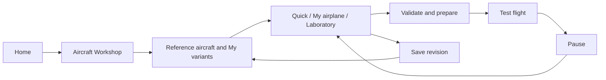

# Aircraft experiment editor plan

**Date:** 2026-10-13. **Revision:** 2 — fleet-wide authoring standard and capability-based composition. **Status:** proposed; no editor implementation is claimed. **Prefix:** AE-00…AE-26. **Owner:** aircraft-editor track. **Repository baseline:** initial working-tree audit at `37103e0b`; current catalog/loader/render seams rechecked for this revision. Concurrent work remains owned by its tracks.

Build one **Aircraft Workshop** for every compatible aircraft. A player can clone a catalog aircraft, make it lighter, heavier, smaller, larger or more powerful, save the result and fly it. The same workshop supports matching a real RC build and inventing miniature or giant airplanes. The Ugly Stik is the first numerical example and test fixture; its name must not select editing behavior. The first delivery proves the same workflow on both the Stik and Extra, including 50% and 200% Stik examples, a dedicated menu, persistent variants and a repeatable test-flight loop.

**Scaling the fleet is an acceptance requirement:** adding the twentieth airplane using existing physics and presentation capabilities requires its normal aircraft data/assets, a generated Workshop descriptor and conformance evidence. It requires **zero aircraft-specific changes to Workshop screens, compiler, transformation rules, recipes or session launch code**. A genuinely new physical capability adds one reusable module, available to every aircraft that declares that capability.

The editor compiles explicit user choices into validated aircraft data. It does not alter catalog sources or bypass the simulator's validation. A variant is always identified as experimental; a successful numerical check does not promote it to a physically validated model.

**Owns, proposed:** `app/aircraft_editor/`, `app/ui/aircraft_workshop/`, `app/data/aircraft_editor/`, `app/tests/test_aircraft_editor_*.gd`, `research/aircraft-editor/`, and this plan. Evidence belongs under `docs/research/aircraft-editor/` once it exists.

**Coordinated boundaries:** aircraft contract/loader, `app/sim/flight_session.gd`, `app/main.gd`, catalog/preferences/app root, screen stack/localization, each visual builder, ground profiles, glow/electric/turbine systems, camera/HUD/audio/crash presentation. Those files retain their existing owners. The registry assigns the proposed `app/ui/aircraft_workshop/` subtree to AE; the menu track owns the surrounding shell, shared widgets and route integration. Register interfaces before editing them; do not allocate concurrent work on the same integration file.

Authoritative prerequisites: [aircraft contract](../../AIRCRAFT_CONTRACT.md), [architecture](../../STACK.md), [tools and verification commands](../TOOLS.md), [track registry](../README.md#tracks-plans-and-step-ids), [current menus](../MENU-PLAN.md), [menu redesign](../MENU-REDESIGN-PLAN.md), and [glow installations](../GLOW-ENGINES.md).

Related continuation: [AS-06–18 aircraft standardization](aircraft-standardization.md) owns the proposed physical/model contract evolution and coordinates its Blender import/binding work with AE-08/19. Presentation bindings below should reference the model track's generated manifest instead of duplicating hinge transforms or physical values. A partial implementation now exists under `app/workshop/` and `app/ui/workshop*`; AE-00 must reconcile that source with this plan's proposed paths and acceptance status before claiming delivery.

## 1. Product scope and delivery order

Three entry choices use the same variant format and compiler:

| Entry | Player intent | Default experience |
| --- | --- | --- |
| **Quick experiment** | "Give this Stik more power", "make it half size" | Five main adjustments: size, mass, power, control travel and response; live before/after values and a CG display; component balance editing follows in V2 |
| **Match my airplane** | "Mine weighs 3.4 kg, has this battery and this CG" | Guided actual dimensions, ready-to-fly mass, component positions, supported powerplant, throws and notes; measurements retain their evidence |
| **Laboratory** | "What happens with a huge lightweight wing or a tiny fast airplane?" | Expanded numeric controls, linked scaling policies, parameter locks, diagnostics, comparison and bounded random recipes |

The views differ in complexity, not in numerical safety. Laboratory never overrides finite-value, inertia, solver, contact or schema checks.

Delivery groups:

1. **V1, reusable core demonstrated on two aircraft:** create → adjust mass/power/scale → inspect → save → fly → pause → return to the same draft. Define descriptors for all current aircraft; qualify the common loop on Stik and Extra, which share a legacy powerplant but have different geometry and gear. Include qualified 50%, 75%, 100%, 125%, 150% and 200% Stik recipes, generic uniform airframe scaling, declared virtual legacy propeller/suspension policies, basic controls and comparison. **Variant starts are airborne-only in V1**; AE-11 qualifies runway starts afterward.
2. **V2, fleet-wide standard:** component balance, real-aircraft wizard, reusable electric/shaft/glow/turbine modules, saved revisions and portable variants. Every current catalog aircraft must meet the common editing conformance gate; registering another aircraft with existing capabilities is a data/asset task. Particular hardware transformations remain explicitly limited by their module's physical support.
3. **V3, laboratory:** wider qualified ranges, performance experiments, deterministic recipes, advanced aerodynamic packages and cosmetic customization.

No dependency on a complete menu redesign, CAD editor, cloud account, multiplayer, helicopter or drone runtime. Nonuniform geometry editing is a separate later gate (§15).

## 2. Current repository and concrete gaps

Current source is authoritative where older guide summaries differ. In particular, the catalog contains **seven configurations across five airframes**, including two finite-fuel glow Stiks.

| Existing seam | Current behavior | Editor work required |
| --- | --- | --- |
| [aircraft_catalog.gd](../../app/app_state/aircraft_catalog.gd) | Fixed `ENTRIES`; each catalog ID selects a data file and an existing visual family | Add a separate user-variant resolver; keep the shipped catalog immutable |
| [aircraft_data.gd](../../app/physics/aircraft_data.gd) | `load_file()` hashes the bytes it parses; `validate_and_derive()` derives mass, CG, inertia and aero geometry | A compiler must create a complete candidate with provenance and an identity for its actual inputs |
| [aircraft_contract.gd](../../app/physics/aircraft_contract.gd) | Closed v2 quantities, capabilities and modules; unknown fields fail | Keep editor recipe metadata outside v2; extend an owned contract before adding a physical feature |
| [wheel_profiles.gd](../../app/physics/wheel_profiles.gd) | `load_file()` attaches ground profiles after aircraft derivation; in-memory validation does not | Carry and validate the correct effective wheel profile explicitly for a variant |
| [glow/installation.gd](../../app/physics/glow/installation.gd) | Aircraft derivation attaches glow installations; both installation and engine profile paths are restricted to bundled `res://data/glow/<basename>.json` files | Add a scoped, hash-bound dependency-input seam before promising editable or portable glow installations; retain all existing semantic checks |
| [flight_session.gd](../../app/sim/flight_session.gd) | `setup()`, `_prepare_aircraft()`, `_commit_aircraft()` and `reload()` validate, trim, reset and preserve accepted state on failure | Add a prepared-variant launch seam with complete rollback and explicit reference/variant identities |
| Session starts | Airborne trim is required during preparation; runway starts use an explicit aircraft allowlist and the default field | Variant ancestry alone cannot authorize runway start; qualify effective geometry/profile/start together |
| [airplane.gd](../../app/render/airplane.gd) | Existing builders and aircraft-specific datum/CG/propeller handling | A presentation descriptor must scale geometry, offsets and anchors coherently |
| [app_root.gd](../../app/app_root.gd), `app/ui/`, `app/app_state/` | Home, aircraft selection, pause, settings data, modal holds and shared screens exist | Workshop screen, draft navigation, variant library and flight return context |
| [preferences.gd](../../app/app_state/preferences.gd) | Settings schema 4 accepts only a static catalog ID for `flight.aircraft`; unknown IDs fall back | Add a separately validated variant selection; do not put custom UUIDs into the catalog-only key or reserve UI-24's proposed schema version |
| [main.gd](../../app/main.gd) research route | `--experimental-aircraft-data` permits only an `aero.wing_polar` change for the default Stik | Keep its narrow research contract; the proposed variant CLI is a distinct resolved-input route |
| [camera_rig.gd](../../app/render/camera/camera_rig.gd) | Pilot, chase, orbit and close-up flight views already exist | Reuse compatible framing helpers, but build a detached Workshop preview; a flight camera is not an existing aircraft editor |
| [MENU-REDESIGN-PLAN](../MENU-REDESIGN-PLAN.md) | UI-20/21 delivered; general Settings/Hangar redesign is proposed | Reuse the current stack now; expose a route the future Hangar can call |
| Checkpoints and traces | Model/configuration fingerprints; input-byte identity; specialized electric/glow/turbine state | Bind variant revision and all attachments; never replay a checkpoint against a changed variant |
| Source pipelines | Aircraft/model tracks own generated geometry and physics JSON | Compile local variants into `user://`; leave generated `res://data/aircraft/` and source assets untouched |

Fleet qualification matrix. These are fixtures for shared modules, not seven editor implementations:

| Base ID | Relevant implementation | First editor support |
| --- | --- | --- |
| `jensen-das-ugly-stik-60` | Legacy prescribed-RPM combustion propeller, fixed tricycle | First V1 fixture for common inventory/controls, legacy propulsion and deployed-gear modules |
| `gp-extra-300s-60` | Legacy prescribed-RPM propeller, taildragger | Mandatory second V1 fixture using the same modules; descriptor/assets differ, editor code does not |
| `p51d-mustang-120` | Gasoline hardware within the `glow_prop` solver family; shaft, wake and angled thrust | V2 fixture for reusable shaft, wake and thrust-axis modules; no fuel inference from the family name |
| `turbo-lumber-evolution` | Electric motor/ESC, fixed-voltage prescribed bus, imported GLB, taildragger | V2 fixture for reusable electric and imported-presentation modules; existing OCV/resistance regression specimens cover finite batteries |
| `stik-glow-55ax-2t` | Explicit 2T installation, finite fuel, thermal/charge states, moving mass properties | V2 fixture for the reusable finite-glow 2T module and installation bindings |
| `stik-glow-fs64v-4t` | Independent 4T installation with the same lifecycle obligations | V2 fixture for the independent reusable 4T law, sharing only appropriate installation/lifecycle interfaces |
| `sebart-avanti-s-a200-p100rx` | Ventage Jet turbine, gear locked up, airborne-only route | V2 fixture for reusable turbine/no-gear modules; no runway option |

All seven appear from catalog discovery, not a Workshop-specific list. During incremental delivery, unavailable edit groups show a concrete missing-module or qualification reason and their original values; they do not offer inert sliders. Merely appearing in the library does not satisfy the V2 fleet conformance gate. Future catalog additions automatically enter the same checks and cannot silently inherit a permanent exemption.

The base Stik has an exact wheel-profile registry entry. The two finite-glow Stiks currently use the documented `legacy_fallback`, so preserving that declared state is correct for their no-op variants; silently losing a profile from a base that had one is not. The [Stik asset guide](../../assets/aircraft/ugly-stik-60/README.md) and [model guide](../UGLY-STIK-PLAN.md) currently defer mini/giant variants. AE-07/08 therefore require the model owner's interface work; they do not assume an existing scale feature or hand-edit generated `ugly_stik_geometry.gd`.

### 2.1 Common aircraft editing standard

**This section defines the proposed authoring standard and is its authoritative home until AE-26 consolidates delivered behavior.** The physical source remains `openrc-aircraft v2`. Add a versioned companion descriptor, **`openrc-aircraft-workshop v1`**, generated alongside the aircraft's normal outputs. It describes how existing physics data and visual assets participate in common operations; it does not duplicate their masses, spans or coefficients. No proposed fields are inserted into the current closed v2 schema before an owned contract change.

Three records have different roles: the aircraft definition describes the original physical configuration; the Workshop descriptor binds its components/assets to shared operations; the variant recipe records the player's edits. Saved variants pin all three plus their dependencies.

| Descriptor group | Required information | Source of authority |
| --- | --- | --- |
| Identity/version | Descriptor version, aircraft resource identity, source/generator identity and dependency references | Existing catalog/aircraft source; resolver captures the exact bytes/hashes |
| Module expectations | Expected law/version identities for compatibility checks; optional references limited to registry-approved schema paths | Actual module selection derives from the validated physical model and closed registry. Descriptor assertions must match; they cannot select another implementation |
| Component bindings | Stable keys, semantic roles, field references, paired-group relationships, explicit movable mounts and optional locks | Aircraft generator/structural source; mass/position/size values stay in v2 |
| Presentation binding | Registered builder/asset key, datum, scale root, hinges/axes/rest transforms, rotor nodes and spin convention, optional exhaust/camera/material/crash slots | Visual builder or imported asset metadata; no copied physical constants |
| Attachment bindings | Exact wheel-profile entry or declared fallback/absence, glow installation/profile and other supported data modules | Existing attachment sources; resolver must validate identity and contact/component references |
| Operation policies | Shared policy IDs, justified per-aircraft restrictions and fixture conditions | Shared transformation registry plus source-backed limits; a descriptor can narrow a module's domain, never bypass its validation |
| Qualification/provenance | Source hashes, conformance version, checked envelope and unresolved modeling limitations | Automatically produced checks and the aircraft track's evidence |

Use semantic component keys such as `battery_main`, `engine_main` and `payload_mount`, with optional repeated instances, rather than English display names. A component can have more than one role only where the common schema allows it. Existing data lacks general stable inventory IDs: migrate through generator-emitted bindings to exact inventory entries, verified against the pinned source, as a bounded compatibility step. New authors define stable keys in their source pipeline. Renaming/reordering an inventory entry must either regenerate a valid binding or fail conformance; it cannot redirect an edit to another component. Do not hand-edit generated aircraft files or maintain a second handwritten mass table.

The core editor, compiler, operation availability, launch policy and recipes **must not branch on aircraft ID, display name, filename, maker or inventory text**. IDs remain legitimate for catalog/resource lookup, provenance, saved variants and test fixtures. Existing aircraft-ID switches in catalog/render/start/attachment seams are migration boundaries, not patterns to copy into the Workshop. Asset-specific model-building code remains with the aircraft author; it implements one presentation interface and contains no experiment physics.

### 2.2 Modules and operation availability

Implement reusable modules by physical behavior: common inventory/geometry/controls; deployed-gear/no-gear; prescribed-RPM propeller; coupled shaft; electric motor plus battery type; finite glow 2T; finite glow 4T; turbine; and optional wake/polar/ground-effect laws. Compose these independently. A taildragger does not require a new electric module, and a new .60 airplane does not require a new legacy propulsion module.

Classification derives from the validated physical model through the loader's semantic rules and a closed, versioned module registry. `propulsion.kind=glow_prop` alone cannot distinguish legacy governor, shaft/gasoline and finite glow. Neither a display name nor a descriptor's unchecked `supports_power=true` may select a law. Descriptor module IDs are consistency assertions, not dispatch authority; allow only registry-approved component/field bindings and policy selections. Reject unknown law/policy IDs, incompatible assertions and arbitrary path/rule bindings. An imported descriptor cannot substitute its own transformation for a known physical field.

Preserve the actual energy subtypes in this common interface. Electric `fixed_voltage` means an infinite prescribed bus with no charge state; `ocv_resistance` has SOC/sag/energy state and an exhaustion event. The installed motor/ESC law does not imply regeneration, BMS/current limiting or motor-temperature dynamics. Finite glow composes independent 2T/4T engine laws with the supported fuel/thermal/transport/lifecycle interface, pinned installation/profile data and moving mass properties. Existing exclusions such as legacy shaft or normal-force/P-factor/slipstream alongside that installation remain enforced. A shared standard reports these limits consistently; it does not erase them or promote experimental physics to measured fidelity. Per-subtype reset/replay and rejected-combination fixtures are mandatory.

Each registered module has a versioned interface:

| Operation | Contract |
| --- | --- |
| Describe fields | Semantic parameter IDs, units, UI group/label keys, provenance, dependencies and qualified default bounds |
| Declare transformations | Every consumed quantity is invariant, transformed by a named rule, recomputed from dependencies, or unsupported for the requested operation |
| Check operation support | Return supported/conditional/unsupported, affected fields, reason codes and dependent checks; no silent fallback |
| Propose changes | Return detached authored-data changes and derived-policy notes for the selected intent; never write a live model |
| Validate candidate | Reuse the full aircraft/module validators and start/solver checks; a local check cannot declare the whole airplane flyable |
| Supply fixtures | No-op, valid edit, rejected edit, boundary and identity/replay cases usable by the generic conformance runner |

Compose an operation over **all affected modules**. Uniform scale includes geometry, inventory, aero reference lengths, propulsion mounts, compatible rotor hardware, contacts, attachments and presentation. If any affected module lacks a transform, the result is conditional/unsupported with the exact missing piece; a whole-aircraft scale cannot silently skip a fuel tank or wake. Distinguish scaling the airframe with fixed hardware from scaling the complete virtual installation. Changing a paint slot need not require a thermal-model transform, but every launched candidate still passes complete validation.

The transformation registry is keyed by supported schema/module version and semantic field, not aircraft. Units alone are insufficient: two fields in seconds can have different scale policies. New physics quantities/modules require declared behavior for every affected operation before fleet conformance passes. Reject duplicate writers to the same field unless an explicit dependency rule resolves them. Build a deterministic dependency order; detect missing dependencies and cycles during preparation.

The UI is composed from the resulting operation descriptors. Shared curated panels explain size, balance, power and controls; this is not a raw JSON inspector exposing every coefficient. The same semantic parameter definition supplies units, bounds, undo, reset, validation paths, presets and tests. Reference the physical contract/schema's units and hard domains rather than maintaining a competing handwritten copy; editor intent limits can narrow them. New aircraft can supply legitimate limits and translations for their own names, but cannot supply executable forms or replace shared parameter semantics.

Examples: an electric plane gets the appropriate battery controls from its actual energy subtype; the jet gets thrust rather than propeller diameter; absent deployable gear removes the runway option. The standard and availability report apply to every catalog aircraft from the start; the Stik and Extra establish the first shared-module implementation proof. Capability support does not guarantee identical numeric envelopes or physical fidelity.

### 2.3 Adding aircraft 8 through 20

Once V2 is delivered, every new fixed-wing aircraft registered as flyable/experimental must satisfy this authoring sequence. Existing seven-aircraft migration is a bounded task, not an indefinite exception list.

1. Author its ordinary v2 physical data and visual assets through the owning pipelines and register its catalog entry.
2. Generate the companion Workshop descriptor by binding its component keys, mounts, visual interface and attachments. Reuse standard module/policy IDs; resolve genuinely missing physical capabilities through their owner.
3. Run the common conformance runner, which discovers catalog entries automatically and instantiates tests from capabilities and descriptors. Never add the airplane to a second hand-maintained list of editor tests.
4. Verify baseline clone/load/save/replay, mass and control edits, at least one supported size change, a supported power change/package when powered, and rejection of unsupported combinations. Use the declared module policy, including fixed qualified hardware when full hardware scaling is unsupported.
5. Review datum/hinge/prop/hull/contact alignment and the checked operating envelope. Record hardware/data limitations without labeling missing ordinary Workshop integration as a physical limitation.

If physics does not implement a capability, the descriptor cannot enable it. A new control topology or multi-engine law extends the shared physical contract and one shared Workshop module, with reusable fixtures. Existing supported capabilities need only data/bindings and normal model authoring. V2 acceptance requires each current aircraft to meet the common baseline and each physically applicable operation above; missing module support keeps the fleet gate open. Per-aircraft qualified ranges may differ and can be narrower than the aspirational 50–200% envelope.

Conformance tooling must emit the missing binding/module/field and remediation path, with a report per aircraft and an aggregate catalog result. Preview-only models stay preview-only and report which physical prerequisites are absent. A missing descriptor must not break ordinary catalog flight during migration, but it blocks the Workshop conformance claim and reports the integration gap explicitly.

### 2.4 Proof that the architecture scales

- **Second-aircraft gate, before V1:** Stik and Extra use the same legacy/gear/inventory modules and menu. Add the Extra descriptor without adding an Extra-specific branch to the editor. Different datum, proportions and wheel topology must be exercised.
- **Unseen-identity fixture:** register a synthetic aircraft with an unfamiliar ID, changed dimensions/component ordering, a different CG/datum and valid bindings. Clone, edit, scale, save and launch through the public workflow; changing its name/ID must not change operation selection.
- **Twenty-entry fixture:** create a disposable catalog of twenty valid, distinct data configurations. Cover every shipped module composition and every additional combination advertised by the release; add generated cases beyond twenty if needed rather than claim exhaustive coverage from the count. Add entry 20 after freezing the editor implementation. Allowed changes: normal catalog/asset registration, physical/visual source data, its ordinary asset generator or model builder implementing the existing presentation interface, generated descriptor and evidence. Forbidden changes: aircraft-specific Workshop/UI/operation/physics-module/recipe/launch-qualification code or new per-aircraft conformance test functions/lists/exemptions. Prefer an existing imported/procedural builder for the twentieth fixture to make the data-only proof unambiguous. This is software breadth evidence, not twenty physically validated aircraft.
- **No duplicated formula:** a corrected generic inertia, suspension, power or identity rule is implemented once; the auto-discovered affected fleet reruns its tests. Keep per-module fixtures and per-aircraft evidence, not twenty copies of the same test script.
- **Single-field drift test:** introduce an unknown physical module/quantity or remove an anchor/binding in a disposable fixture. Conformance must fail with a structured reason instead of silently leaving it at base size or falling back to Stik behavior.
- **Maintenance budget:** preparing one aircraft compiles only that candidate and its dependencies; a twenty-plane library reads bounded metadata/thumbnails lazily. List size cannot create twenty running previews or simulations. Cache keys include descriptor/module versions, and invalidation follows actual dependencies.

AE-01 specifies this contract; AE-04/08/10 prove reusable interfaces; AE-19 closes fleet conformance; AE-25 runs the twenty-entry acceptance experiment. These are release gates, not optional refactoring after the Stik implementation.

## 3. Dedicated menu and navigation

The English source label is **Aircraft Workshop**, translated as **Taller de aviones**. Home gets a direct action beside aircraft selection. A selected reference has **Create variant**; a saved variant has **Edit variant**. The future Hangar uses these same routes.



### 3.1 Workshop library

- Tabs: **Reference aircraft**, **My variants**, **Recipes**. Search by name; filter by base aircraft, propulsion, size, valid/draft and favorites. Sort by recent edit, name, span or mass.
- Cards show image, name, base aircraft, scale, span, ready-to-fly mass, propulsion family and one status: draft, ready for the selected start, needs review or unsupported.
- Actions: create, edit, duplicate, rename, favorite, compare, export and move to trash. Restore from local trash; permanent deletion is separate from removing a card.
- Reference cards remain reference cards. Every variant has its own ID and experimental label, even at 100% with no numeric changes.
- First-use recipes are capability-filtered templates with an explained change list, not separate aircraft files to maintain by hand. Selecting another base recalculates the same recipe through its modules and limits.

### 3.2 Editor layout

At 1280×720, use a full-screen editor with a compact navigation column, a large aircraft preview and a scrollable property column. Keep Save and Test flight in a fixed footer. At narrower widths or enlarged UI scale, the preview collapses above the fields; no essential action depends on a second monitor or horizontal scrolling.

| Region | Content |
| --- | --- |
| Header | Variant name, base, experimental badge, unsaved indicator, undo/redo, comparison toggle |
| Navigation | Overview; Size; Weight & balance; Powerplant; Controls; Aerodynamics; Landing gear; Appearance; Test & compare; Details |
| Preview | Orbit/pan/zoom; front/top/side/isometric views; neutral pose; optional control animation; dimensions; CG marker; original silhouette |
| Properties | Slider plus exact numeric entry and unit, current/reference values, per-setting reset, link/lock control where meaningful |
| Summary | Span, mass, wing loading, achieved power/thrust at a named condition, trim status, outstanding issues |
| Footer | Back, Save draft / Save revision, Test flight; error link scrolls to the affected field |

Useful preview tools: ruler, transparent airframe to locate ballast, component dots, thrust-line arrow, wheel/contact/hull overlay and control-surface excursion. Colors and arrow shapes distinguish these overlays. Use physics-derived locations transformed at the rendering boundary.

The reference silhouette has two modes: **same metres**, which makes size changes obvious, and **fit both**, which compares proportions. Label the mode. Do not let automatic camera framing conceal a 200% scale change.

### 3.3 Input and editing behavior

- Mouse and keyboard work initially; Tab order follows the visible fields, Escape returns one screen, focused sliders accept arrows and numeric entry. Radio flight controls stay disarmed while editing. Gamepad menu navigation is not implemented in the current shell; it follows UI-12 and is not a V1 promise.
- One slider drag is one undo operation. Undo/redo restores linked fields, lock states and the selected policy together. Reset field, reset section and restore base are distinct actions.
- Parse localized decimal input at the UI boundary; store finite SI numbers. Accept the locale's decimal separator without treating a comma as a thousands separator. Store display units separately.
- Show grams/kg, mm/cm/m, inches, degrees, seconds, W, RPM, N and optional lbf where appropriate. "Weight" controls mass; wing loading labels distinguish kg/m² or g/dm² from N/m².
- Cheap geometry/mass updates run while dragging. Full validation/trim is debounced and generation-tagged: a late result cannot overwrite a newer draft. Test flight forces validation of the exact displayed revision.
- Closing a dirty draft offers Save draft, Discard changes and Keep editing. Save failure leaves the dirty draft open with an actionable message. An invalid physics draft can be saved, but cannot launch.
- EN/ES strings follow the existing gettext workflow. Reuse theme, widgets, screen stack and focus holds; do not fork a second UI framework.

## 4. Editable parameters and exact meanings

Ranges below are **product targets for qualification**, not current loader guarantees. AE-01 records actual field bounds and coupled constraints; unsupported combinations remain saveable drafts. V1 targets 50–200% size and roughly 0.5–2× the policy-derived mass/power. Laboratory targets 25–400% size and 0.25–4× mass/power only after AE-23. Never widen shared bounds merely to make a slider endpoint pass.

| Group | User options | Mapping and coupling | Delivery |
| --- | --- | --- | --- |
| Identity | Name, description, notes, tags, favorite, thumbnail | Variant metadata; no physical effects | V1 |
| Uniform size | Percent or target wingspan; 50/75/100/125/150/200% buttons | One scale factor; dimensions, areas, contact and visual geometry change together | V1 |
| Scaling policy | Same wing loading; geometric mass; custom actual mass | Determines the mass proposal and corresponding inertia; §5 | V1 |
| Total mass | Lighter/heavier slider and ready-to-fly kg/g | V1 uniformly rescales the inventory, preserving normalized CG/distribution; explicitly a virtual build | V1 |
| Balance | CG location shown in mm aft of LE and, where supported, %MAC; forward/aft adjustment | Move eligible components or add explicit ballast; recompute full tensor; never write only a CG scalar | Basic display V1; edits V2 |
| Components | Battery/engine/fuel/receiver/ballast mass, position and box dimensions | Stable component keys, positive mass, symmetric moves for paired parts, validated support | V2 |
| Power | More/less power, target thrust-to-weight or a supported hardware package | Family adapter reports requested and achieved output at a declared condition; §6 | Legacy V1; other families V2 |
| Propeller | Automatic virtual geometric resize; later compatible diameter/pitch/SKU selector | V1's shared legacy-propeller transform is defined in §5.2 and tested first on Stik/Extra; independent package selection changes diameter, mass, inertia, tables/surrogate and visible blade atomically; pitch alone is not an aerodynamic input | Automatic resize V1; independent packages V2 |
| Engine response | Slower/faster spool or throttle response where supported | Existing lag/time fields; satisfy stiffness constraints; independent of transmitter expo | Legacy V1; family-specific V2 |
| Battery | Compatible pack, capacity, initial SOC, mass and location | Preserve battery model semantics; finite pack and fixed bus remain visibly distinct | V2 |
| Fuel | Initial fill, supported fuel/engine installation, tank placement where qualified | Finite glow mass/CG evolves; legacy/turbine prescribed fuel stays fixed unless its owning track adds finite fuel | V2 |
| Surface travel | Aileron/elevator/rudder limits and supported aileron differential | Physical throws feed both the aero and hinge animation | V1 |
| Servo speed | Neutral-to-full time | Preserve the contract definition; manufacturer seconds/60° requires a linkage conversion | V1 |
| Pilot response | Normal/full travel, per-axis rates/expo, profile comparison | Use input-layer shaping; show radio pass-through and avoid double expo on a transmitter | V2 |
| Drag | Bounded drag package: clean / reference / draggy, numeric advanced factors | Transform the relevant global and local laws together; consistent static oracle and local loads required | V3 |
| Lift and stall | Supported polar package; qualified section/stall adjustments | No universal "more lift" multiplier over derived loads; retain coefficient-reference conventions and provenance | V3 |
| Stability | View estimated static margin/trim; later select compatible tail/incidence packages | Derived diagnostics, not an artificial gyro or a hidden stabilizer | V2 diagnostics; V3 packages |
| Landing gear | Compatible wheel package, suspension softness/damping, supported brakes/steering | Explicit wheel profiles, contact geometry and support solve; respect aircraft capability | V2 |
| Appearance | Accent/covering colors, decals/name, thumbnail view | Duplicate per-variant materials; no mutation of shared resources; only supported material slots | V3 |
| Flight test | Field/conditions, airborne/runway where qualified, test speed | Session/test settings separate from aircraft definition | V1 |

A beginner control such as **Gentler controls** applies a visible recipe of travel/rate/expo changes, with a before/after list. **Slower airplane** proposes lower wing loading and a compatible power setting; it does not cap velocity secretly. **More agile** means specified control/distribution changes, not a direct angular-velocity multiplier.

### 4.1 Matching a real airplane

The wizard asks for base shape, wingspan, ready-to-fly mass, measured CG, installed propulsion, battery/fuel state and actual throws. Unknown values remain inherited/estimated. Record measurement notes and the configuration in which the aircraft was weighed.

This matches measurements **within a supported base-aircraft approximation**. A different planform, airfoil or fuselage is not reconstructed from wingspan/mass/CG. Show unmatched shape and aerodynamic data as inherited estimates; arbitrary geometry/airfoil authoring remains in §15.

First fit total mass and CG using explicit adjustable components. Let the user choose "measured components" or "estimated distribution from the base". A fit cannot use negative ballast, move a component outside its allowed mount, or claim measured inertia from total mass and CG alone. A target that is impossible with locked components reports the conflict and offers an explicit unlock/change.

Show both `% of S/b` and `%MAC` only when those quantities are available and correctly located. The contract's `mean_chord=S/b` is not generally MAC; tapered P-51/jet wings need a derived MAC and its datum before a %MAC input is offered.

Keep stock airfoil/engine evidence visibly separate from the user's measurements. Optional later flight notes can record "roll too slow" or "climb stronger than my model", but no automatic calibration should claim a uniquely identified physical cause from such observations.

## 5. Uniform scaling rules

Let `s = new span / base span` and `r_m = new initial mass / base initial mass`. Every rebuild starts from the pinned base snapshot, not the last scaled result. Moving a slider from 100% to 200% and back must not accumulate rounding or provenance changes in the base.

### 5.1 Three understandable policies

| Policy | Proposed mass | Meaning |
| --- | --- | --- |
| **Keep wing loading** — default for experiments | `m' = m s²` | Similar reference lift speed if the same coefficients/density apply; useful for a large, gentle Stik |
| **Geometric mass scaling** | `m' = m s³` | Uniform density/volume assumption; larger versions become more heavily wing-loaded |
| **Use my mass** | Explicit ready-to-fly mass | Suitable for a real build or an intentionally unusual experiment |

These are modeling choices, not manufacturing laws. Hardware adapters may lock motor/battery/fuel masses; in that case distribute the remaining target mass only among eligible components and report an impossible target.

### 5.2 Transformation ledger

| Quantity | Required transformation |
| --- | --- |
| Lengths | Span, chord, component positions/sizes, aerodynamic reference point, tail/wing stations, hull vertices, wheel contacts, prop hub, wake geometry, visual datum and mounts scale by `s` |
| Areas | Wing/tail/fin areas scale by `s²`; dimensionless aspect/taper ratios and geometric angles remain unchanged |
| Inventory | Initial V1 uniform mass distribution: each mass scales by `r_m`; CG scales by `s`; regenerate the derived model |
| Inertia | For uniform inventory scaling, the **entire six-entry tensor** scales by `r_m s²`, including products of inertia; component edits require a new sum |
| V1 virtual legacy propeller | Diameter and rendered blade dimensions scale by `s`; the propeller inventory component follows `r_m`, its box dimensions follow `s`, and the separate rotor scalar follows `J_rotor' = J_rotor r_m s²`. Retain dimensionless Ct/Cp vs J as an explicit virtual similarity assumption. The legacy schema has no independent pitch parameter: do not invent one or infer tables from a name |
| Propulsion application points | Reconstruct a fixed structural hub from the original CG-relative offset, transform it, then subtract the **new** CG; do the same for intake offsets. CG movement is not a physical engine movement |
| Aerodynamics | Keep supported nondimensional coefficients only under the declared borrowed-similarity assumption; derive strips, tail/fin arms, induced maps, lift offsets and stall blends again |
| Control travel | Degrees remain unchanged under geometric scaling; the scaled mesh uses the same normalized servo output |
| Time constants | Default retains actual hardware timing. An explicit virtual-similarity recipe may propose scaled servo/engine/downwash timings, followed by stiffness checks; do not multiply every time field blindly |
| Ground suspension | Geometric proposal: `k' = k r_m/s`, `c' = c r_m/sqrt(s)`, travel ×`s`. The V1 small-aircraft alternative below preserves the base suspension timescale instead; both are explicitly named policies, with support/clearance checked afterward |
| Wheel dynamics | Radius scales by `s`; inertia follows wheel mass/shape (`r_m s²` for uniform V1 inventory). `spin_relaxation` is **seconds**, retained by default; it is not a length. Reference brake-torque proposal is ×`r_m s` only for compatible packages. Validate effective wheel mass and relaxation at the actual tick; field friction stays field-owned |
| Presentation | Model vertices/transforms, pivots, shadow/blur geometry, contact overlays, exhaust anchors, camera mounts and crash section origins must agree in metres |
| Evidence | Unchanged source values retain their evidence; transformed values become derived/estimated with base identity, policy and compiler version. A synthetic resized engine is not the manufacturer's named original |

The suspension formulas are derived from `sag = load/k` and fixed damping ratio, not a tire-material similarity claim. They preserve a ground timescale proportional to `sqrt(s)`; only the geometric-density case shares that timescale with the standard gravity-based flight similarity. Qualify small models at the unchanged 240 Hz step.

**Known V1 blocker and selected shared policy:** current Stik suspension has total stiffness 1560 N/m and mass 2.885058 kg, giving `omega*dt≈0.097` at 240 Hz. Geometric 50% suspension gives about 0.137 and fails the loader's strict `<0.1` gate, even for an airborne start. For the shared virtual scaled recipe use `a=max(s,1)`, `k'=k r_m/a`, `c'=c r_m/sqrt(a)` and `travel'=travel a`. Each input comes from the selected airplane; the Stik's 1560 N/m, mass and relaxation time are fixture values, never defaults for other aircraft. Below 100% this retains that base's heave frequency, damping ratio, absolute static sag and travel; above 100% it matches the geometric proposal. The UI calls this **Virtual suspension, retain small-model response** and shows that the small aircraft has proportionally softer/longer-travel gear. It is not full geometric similarity. Preserve each profile's spin-relaxation time (0.03 s for the base Stik); halving the Stik value would fail `dt/tau≤0.25`. Validate per-contact support, travel, actual wheel/hull/prop clearance and all other bounds; AE-11 separately establishes whether a particular mini can start and land on the field. Do not modify the global timestep or silently soften user-selected hardware.

**Variant plausibility policy:** read `[mass_lo,mass_hi]` from the selected aircraft and compile a uniform virtual recipe's range as `[mass_lo r_m,mass_hi r_m]`, with derived provenance, while separately asserting that the inventory sum equals the explicit target mass. For the Stik this starts at `[2.3,3.4] kg`, a hard loader check; those numbers are not a universal aircraft range. Preserve the original range in the manifest and describe the new range as a compiler consistency band, not independent evidence for a real aircraft. Measured/component builds use an explicit justified range for that configuration. The current generic mass-range endpoints must remain within `[0.01,100] kg`; reject recipes outside that domain instead of clipping or widening it. Transform applicable reference-inertia comparisons consistently while retaining donor provenance. Thus 400% geometric-mass Stik remains a nonlaunchable example under today's bounds.

The body tensor and propeller rotor inertia are different quantities. The current legacy/electric parser bounds the rotor scalar at `0.1 kg·m²`; applicable shaft/electric/glow carrier-inertia checks remain mandatory. The V1 virtual rotor law is an explicit constructed mass-distribution assumption, not a measured scaled crankshaft. A fixed hardware package instead retains its measured mass/inertia/diameter and triggers a new inventory fit and different power proposal.

### 5.3 Predicting the consequences

At the same density and assumed lift coefficient, `V'/V ≈ sqrt(r_m)/s`, wing-loading ratio is `r_m/s²`, and Reynolds-number ratio is approximately `sqrt(r_m)` if viscosity is unchanged. These are initial estimates; run actual trim/performance calculations afterward. At 200% geometric mass, stall/trim speed tends toward `sqrt(2)` times the base value. At constant wing loading it tends toward the same value.

For a geometrically similar propeller with unchanged Ct/Cp at the corresponding advance ratio, a **reference thrust-to-weight target** gives:

```text
D'/D = s
T'/T = r_m
n'/n = sqrt(r_m) / s²
P'/P = r_m^(3/2) / s
Q'/Q = r_m s
```

These are compiler proposals for a reference operating point, derived from the existing `T=Ct rho n² D⁴` and `P=Cp rho n³ D⁵` laws. They do not prove that an actual engine, battery or propeller can deliver the proposal, or that two flights are dynamically identical. Shaft inertia and hardware time constants require their own adapter; a constant-wing-loading resize is not complete gravity-based dynamic similarity.

Reynolds and Mach changes can invalidate copied aero coefficients. Keep the limitation beside the estimate and record the operating domain; do not fabricate small-aircraft polars. The basis for this distinction is [NASA similarity parameters](https://www1.grc.nasa.gov/beginners-guide-to-aeronautics/similarity-parameters/). Propeller measurement conditions and coefficient conventions follow the [UIUC propeller database](https://m-selig.ae.illinois.edu/props/propDB.html). Accessed 2026-10-13; the policy equations above are project derivations, not a claim of external validation.

### 5.4 Concrete Stik examples from current data

The current [Stik source](../../app/data/aircraft/jensen_ugly_stik_60.json) has 1.524 m span and 0.464515 m² area. Summing its inventory gives **2.885058291 kg**, including the documented virtual balancing mass. These are simulator reference values, not measurements of the user's airplane.

| Variant | Span | Area | Mass at same wing loading | Mass with geometric scaling |
| --- | --- | --- | --- | --- |
| Original 100% | 1.524 m | 0.464515 m² | 2.885 kg | 2.885 kg |
| Mini Stik 50% | 0.762 m | 0.116129 m² | 0.721 kg | 0.361 kg |
| Super Stik 200% | 3.048 m | 1.858060 m² | 11.540 kg | 23.080 kg |
| Giant Stik 400%, laboratory target | 6.096 m | 7.432240 m² | 46.161 kg | 184.644 kg |

At 200%, keeping wing loading gives `I_body'/I_body=16` and reference propeller power `P'/P=4`; geometric mass gives `I_body'/I_body=32` and `P'/P≈11.314`. These power ratios assume the V1 geometrically resized virtual propeller. With fixed prop diameter, a fourfold static thrust target instead needs RPM ×2 and static power ×8 under constant Ct/Cp. Merely doubling power is neither policy. A custom 200%/6 kg Stik is another valid *intent*, subject to inventory and solver checks. The 400% row illustrates consequences; it does not promise that today's loader or field accepts 184.6 kg.

## 6. Powerplant editing without ambiguous sliders

Every power page states its solver family, reference condition, requested change and achieved result. The UI must distinguish **shaft power**, **electrical input power**, **static thrust** and **thrust-to-weight**. A brochure horsepower value is not a force control.

| Family | Adapter behavior | Qualification boundary |
| --- | --- | --- |
| Legacy prescribed RPM, Stik/Extra | A virtual power request derives the maximum static RPM from propeller shaft-power demand at reference density. Preserve Ct/Cp together, adjust the declared RPM schedule/lag consistently, then evaluate achieved thrust/power | Changing `peak_power` alone does not change this solver. With fixed static Cp/diameter, `n'/n=p^(1/3)` is a static mapping only. Retain idle by default and reject an inverted idle/max range |
| Coupled shaft, P-51 | Select or derive an explicit shaft power/torque curve and friction/rotor data; recompute equilibrium with the selected propeller | Do not multiply final thrust independently of aerodynamic torque, wake, gyro and shaft reaction |
| Electric, Timber | Select a compatible motor/ESC/battery/prop package or edit supported physical fields; evaluate the actual voltage/current/torque solution | Capacity is not power; changing cell count affects voltage, mass, sag and stiffness. Do not promise ESC current limiting, braking, regeneration or thermal protection absent from the runtime law |
| Finite glow 2T/4T | Select compatible installation/profile/prop packages; expose supported fill/mixture/installation adjustments with their own constraints | Installation files and engine profiles are dependencies, not decorative IDs. Geometry/torque/fuel/heat/mass changes need one coherent adapter; never obtain a 4T curve by scaling the 2T curve |
| Turbine | Offer thrust and spool settings through an explicit synthetic or supported engine package, keeping RPM map, installed thrust, mass flow, intake/ram terms and rotor properties consistent | Do not rename thrust as shaft watts, silently add finite fuel or enable retracts. Existing airborne-only capability remains |

For the V1 linked virtual resize, first propose `n_max'=n_max sqrt(r_m)/s²` and scale idle by the same factor, retaining the base idle/max ratio. A subsequent power-only multiplier `p` proposes a maximum-RPM factor `p^(1/3)` at the new diameter and retains that already resized idle; reject conflicting ranges. Retain base lag by default unless response is explicitly edited. Recompute achieved reference power/thrust, apply rotor/propeller/engine bounds, and call the actual trim solver. Preserve the exact original values through the no-op branch. The propeller is labeled virtual/borrowed, with no claim that an enlarged engine is an actual O.S. SKU.

For finite-glow resizing, V2 first supports a resized airframe with **fixed qualified engine/prop hardware** and a refitted eligible inventory. Arbitrary scaled combustion hardware remains locked until its map/thermal/fuel/inertia transformation is qualified. For extreme fictional power, offer an explicitly named virtual powerplant conversion only as a separately validated future recipe; never change solver family invisibly.

The power/scale link has clear states: **keep hardware**, **suggest similar thrust-to-weight**, **set my powerplant**. The suggestion previews all affected fields and achieved output; the user may lock propeller size, battery or mass. Conflicts remain visible rather than silently changing a locked choice.

**Engine off / glide test** is a launch-mode request, not a power multiplier of zero. V1 still needs a supported prepared start. A dedicated unpowered start that avoids powered trim is gated separately in AE-20; do not bypass `_prepare_aircraft()` to make an underpowered design launch.

## 7. Mass, balance and aerodynamic consistency

V1 total-mass adjustment uniformly scales the full inventory and recomputes the model. This preserves CG and gives a transparent toy-model interpretation. It does not represent removing a real battery or making a real motor lighter.

V2 component editing uses the stable bindings defined by the common Workshop descriptor (§2.1). Current free-text inventory names are not a general hardware API; the generator emits verified bindings against a pinned source. Existing glow installation references must still resolve exactly. Component behavior comes from shared role/module definitions, not an aircraft-specific mass-editor function.

For CG editing:

1. Lock structural geometry and the fixed engine/prop/tank mounts.
2. Move only selected adjustable components within declared ranges, or add an explicit positive ballast component.
3. Solve the inventory's first moments; show resulting total mass, CG and tensor.
4. Update the variant's declared CG/provenance to describe that actual inventory; recompute all CG-relative arms and dependent aero/ground data.
5. Reject impossible targets. Show the nearest feasible value only as a proposal requiring a new user edit.

A cosmetic CG marker never substitutes for the inventory. Rebalancing cannot drag the mesh relative to unchanged forces or alter the aerodynamic reference point accidentally. Ground support must be checked after every CG change.

Advanced aerodynamic editing uses supported **parameter packages**, not raw editing of arbitrary derived fields. Changes to the tail, incidence, fin, wing polar or drag law must preserve the global/local matching rules in the current loader and the regime-consistency tests. Broad "stability" and "lift" controls wait until their mappings are defined and verified. Existing unmodeled flaps, retract motion, structural flexibility, airframe break-up and stabilization remain outside the editor's capability set.

## 8. Variant data, compilation and identity

Use a separate, versioned **`openrc-aircraft-variant v1`** recipe. Keep the produced physical definition at `openrc-aircraft v2`; do not insert editor keys into its closed schema.

Proposed recipe sections:

| Section | Required content |
| --- | --- |
| `format`, `id`, `revision` | Variant-format version, generated stable UUID and monotonically increasing saved revision |
| `base` | Exact catalog ID, source-byte SHA-256, base snapshot reference, Workshop descriptor/hash, dependency manifest and visual binding identity |
| `recipe` | Compiler/module/policy versions and shared semantic operation IDs for scale, mass policy/target, component edits, power settings, controls and supported aero/gear packages |
| `locks` | Explicit hardware/mass/CG/propeller choices that the compiler may not change |
| `presentation` | Supported paint/decal choices and preview framing; never forces or coefficients |
| `metadata` | Name, notes, tags, timestamps, user measurement notes and source attribution |

All physical overrides carry value, unit, kind and source. A convenient scalar slider is serialized into this provenance-bearing structure. Do not serialize NaN, infinity, engine state, battery charge *history*, tick counters or a live checkpoint into the aircraft recipe.

Compiler order is fixed and versioned:

```text
validate recipe, Workshop descriptor and pinned dependencies
→ infer and cross-check actual capabilities through the common loader rules
→ compose registered module operations and their deterministic dependency order
→ copy base authored v2 data
→ transform geometry under selected policy
→ apply compatible hardware packages and locked component changes
→ fit eligible inventory / target mass / CG
→ derive physical propulsion and control parameters
→ reconstruct datum-relative / CG-relative geometry
→ validate and derive the full v2 model, including its glow installation if present
→ attach and validate the effective wheel profile and remaining post-derive dependencies
→ check timestep and selected start with the real session path
→ prepare render and observer descriptors
→ publish a detached immutable candidate and diagnostics
```

No step mutates a shared base dictionary or accepted flight. A failed later step returns no launchable candidate. Cached results are keyed by full recipe/base/descriptor/module/dependency/compiler identities and test conditions; render-only changes do not invalidate physical estimates unnecessarily. Introducing another aircraft must not add a stage or an ID branch to this pipeline.

Dependency resolution is an explicit implementation gate. Introduce a scoped loader input containing exact bytes for the effective aircraft and its declared dependencies; reuse existing pure semantic validators such as `GlowInstallation.prepare_value()`. The current function still reads a bundled profile, so installation **and** profile loading need coordinated input seams. Stock `load_file()` keeps its existing bundled behavior. A variant resolver may supply only manifest-declared bytes whose hashes match; it cannot globally replace resources, accept arbitrary filesystem paths or skip a failed attachment. Validate glow inside the existing aircraft derivation stage and wheels at their existing post-derive stage; do not attach a second glow module afterward.

### 8.1 Identity must not collapse into the base ID

Maintain distinct identifiers:

- `variant_id` and saved revision: the user's artifact.
- `base_aircraft_id`: ancestry and the allowed visual adapter family.
- `effective_model_id`: the compiled variant's physical identity.
- exact-byte hashes for base, recipe and materialized physical input, plus dependency hashes.
- Workshop descriptor hash and all participating module/policy versions, identifying how the same recipe was compiled.
- derived model/configuration fingerprint: the actual accepted solver inputs.
- presentation fingerprint: scale, geometry adapter and cosmetics for captures.

Separate the complete document hash from the physical-recipe hash. Rename, notes and paint can produce a saved revision without changing the effective physical bytes or model fingerprint. Trace metadata records the saved revision; checkpoint compatibility binds the variant ID, actual physical inputs/dependencies and solver configuration, rather than a cosmetic-only revision increment. The compiled v2 `id` is stable for that variant lineage; it does not embed its display name.

Testing does not require overwriting the saved variant. Before an unsaved draft launches, freeze an immutable **trial snapshot** with a trial ID, exact recipe-byte hash, base/dependency hashes, compiler version and effective-input/configuration fingerprints. Trace metadata declares `draft_trial`, records the last saved parent revision only as ancestry, and identifies the snapshot actually flown. Restart, crash return and replay use that snapshot, never a mutable draft or the old saved revision. Retain the snapshot with its recording while the user edits or discards the working draft. Add the same provenance to diagnostics and captures.

The current equality check among catalog selection, loaded model and visual ID is valuable. Replace it for variants with an equally strict **resolved descriptor**: expected effective-model ID plus explicitly allowed base visual adapter. Never pass an empty expected ID just to bypass the check, and never masquerade as the reference ID to obtain its wheel profile or runway permission.

Materialize deterministic effective v2 bytes and a manifest in a local cache, or add a byte-based loader that preserves the same parse/hash behavior. In either case, record the bytes actually parsed. The normalized model hash does not replace original-input identity. Include effective wheel/glow/profile data in checkpoint compatibility; dependency edits must invalidate old checkpoints even if the display name is unchanged.

Schema/compiler versions are separate from the simulator's existing checkpoint version. Inspect the latest checkpoint layout during implementation and extend it deliberately; this plan does not reserve a future version number.

### 8.2 Local persistence and import/export

Proposed local layout:

```text
user://aircraft_variants/<uuid>/variant.json
user://aircraft_variants/<uuid>/base.json
user://aircraft_variants/<uuid>/workshop.json
user://aircraft_variants/<uuid>/dependencies.json
user://aircraft_variants/<uuid>/revisions/<revision>.json
user://aircraft_variants/<uuid>/thumbnail.png
user://aircraft_variants/_drafts/<uuid>.json
user://aircraft_variants/_trash/<uuid>/...
user://aircraft_variants/_cache/<content-hash>/...
```

Exact storage limits are fixed in AE-02. Start with bounded JSON depth, bounded arrays and explicit import-size limits; library enumeration loads metadata first and compiles only selected aircraft. Keep the last successful revision while writing a temporary file, validate/read it back, then atomically replace where supported. On interrupted writes, recover a valid previous revision and explain the recovery once.

Export a **data-only portable bundle** containing recipe, base physical snapshot, companion Workshop descriptor, required supported data dependencies, provenance and preview. Reference installed shared modules by version and shipped visual assets by registry/content identity; do not duplicate commercial/generated meshes or accept scripts, arbitrary `res://` paths or executable resources from an import. Descriptors can bind only registered safe module/asset interfaces, not provide executable code. Reject unknown versions/dependencies and path traversal. Import duplicates with a new local UUID unless the user explicitly chooses to update the same lineage.

An app update never silently rebases a saved aircraft. Offer **Keep pinned version**, **Review changes**, or **Create migrated copy**. An unavailable visual adapter may permit inspection/export of the data but blocks flight if its geometry no longer matches. Migration preserves the old artifact and reports mass/CG/power/control changes before launch.

## 9. Session lifecycle and the test-flight loop

The editor owns a mutable draft; a launched session owns an immutable accepted candidate. Physics changes take effect on a **new prepared flight**, not while airborne. Paint-only preview changes are presentation data, but save/flight revision identity remains explicit.

From Home:

1. Resolve the variant revision and selected field/conditions.
2. Prepare data, attachments, start, render model and observers in isolation.
3. Refuse launch with field-specific diagnostics if any required stage fails.
4. Commit the complete flight and selected variant reference together.

From a paused flight:

1. Open Workshop under the existing pause/focus hold; retain the current flight unchanged.
2. Create a draft from the accepted revision. If editing a catalog plane, create a new variant.
3. **Back without testing** returns to that paused flight. Resume follows the existing deliberate resume/arming policy.
4. **Test changes** prepares a replacement. Failure leaves the original session, recorder, view and draft available.
5. On success, close/finalize the old recording according to existing shell policy, replace the flight, and record the new identity. Never concatenate two configurations into one trace.

A trial launched from Workshop adds **Return to Workshop** to pause and crash completion, restoring the same draft, selected section and comparison. **Restart trial** resets the same accepted recipe and selected initial fuel/SOC; it does not pick up subsequent disk edits. F5 reload on a variant must go through its resolver and pinned dependencies, not reload the base aircraft file.

Runway eligibility requires all of: shared start/gear-module support, actual landing-gear capability, effective profile validation, static ground equilibrium, whole-aircraft clearance in the selected field and qualified start behavior. The current allowlist cannot simply be copied to a custom UUID or grow into twenty Workshop branches. The common predicate evaluates the resolved configuration and its qualification record. A giant plane must not spawn through the runway, pilot barrier or scenery, and a miniature plane must not inherit an oversized spawn clearance or camera near plane.

The field remains in metres. Aircraft scaling does not change runway length, obstacles, wind, gravity or pilot height. Explicit test scenarios may choose different start locations/altitudes; those belong to the test context and its trace.

## 10. Preview, flight presentation and observers

Create one Workshop presentation adapter consuming effective geometry and the standard presentation binding returned by any registered builder. The aircraft author still supplies the actual procedural model or imported asset. The Workshop owns the common scale/datum/CG/hinge/rotor operations, without aircraft-ID branches. A common scale wrapper is acceptable only after proving the correct datum/CG order. In general, transform a point as `p_world = pose + R (s p_base - cg_effective)` in consistent coordinates; the actual Godot builder offset must be included once. Scaling a node already offset by a base CG can scale the offset twice.

Currently `main._render_pose()` overwrites the root transform through `Frames.root_transform()` every frame, and `Frames.cg_in_model_frame()` applies the builder datum. A one-time `root.scale` edit would be lost. Integrate the scale in a persistent geometry child or the explicit presentation transform, keep its scaled datum consistent, and verify the real flight path as well as the preview. Migrate existing glow Stik diameter/spin exceptions into checked rotor-node/axis/base-diameter bindings while preserving their numerical/visual behavior. Another propeller aircraft supplies those same metadata fields; it does not require editing a Stik-only diameter function.

Preserve `airplane`, `propeller` and every `*_hinge` name. Check witness vertices at neutral and both throw limits. A propeller package can have its own diameter independent of airframe scale; avoid multiplying its resize twice. Imported Timber pivots/rest transforms need the same care as the procedural builders.

| Consumer | Required behavior |
| --- | --- |
| Shadows and propeller blur | Match final geometry/diameter and animated rotor; no base-size disc or footprint |
| Pilot/chase/onboard/orbit cameras | Read effective span, CG/datum and mounts; preview framing is independent of pilot-view behavior |
| HUD | Show variant name, scale and experimental status; use effective mass/power and current finite-energy telemetry |
| Audio | Use effective engine/rotor state and source anchors; size alone is not a sound-pitch multiplier |
| Smoke | Move exhaust anchors with geometry; preserve actual engine/atmosphere observer inputs |
| Collision and crash | Effective hull, wheel and prop-disc size before flight; scaled wreck geometry/section centers and coherent mass/inertia after impact |
| Crash grading | Audit absolute thresholds and contact policies; do not claim physical structural strength from geometric scaling |
| Captures | Record variant/base IDs, revision, presentation identity, scale and relevant camera settings |

For V1, an intact, correctly positioned terminal-crash presentation is preferable to a wrongly scaled fragment simulation. Enable the full wreck path only after its effective-model invariants pass; the chosen fallback must be explicit in the descriptor and acceptance report, and must not change flight collision detection.

## 11. Diagnostics that help experimentation

Use three states with text and icons:

- **Ready for this test:** data, dependent modules, solver and selected start prepared successfully.
- **Ready with modeling notes:** numerical checks pass but coefficients/hardware are borrowed, resized or outside measured support. This remains experimental.
- **Cannot start:** concrete blocking errors such as invalid inertia, impossible CG, missing prop data, excessive source stiffness, trim failure or obstructed spawn.

Show requested/achieved differences, not a generic red "invalid" label. Examples: "The selected battery and motor do not reach this target thrust", "Move the battery forward or reduce the requested CG shift", "This giant configuration does not fit the selected runway start". Never silently clip a value and launch a different aircraft.

Overview comparison shows reference vs variant, absolute values and percent differences for span, mass, area, wing loading, tensor diagonals, CG, available static thrust, reference shaft/input power and throw/time settings. Add caveats at the affected metric, not an undifferentiated disclaimer wall.

Performance labels must distinguish:

| Result | How it is obtained |
| --- | --- |
| Approximate stall speed | `sqrt(2mg/(rho S CLmax))` only when a compatible CLmax is available; label the assumptions |
| Trim at chosen speed | Actual session trim result with throttle/deflections and residual/validity |
| Static thrust/power | Actual family evaluator at stated density, engine/pack state and throttle; rotating equilibrium where required |
| Maximum level speed | Later bounded force/trim search within the supported aero/prop domain; "not determined" if there is no valid bracket |
| Climb/roll/takeoff/endurance | Later scripted experiment with fixed commands/conditions and defined duration/termination; do not infer these from one ratio |

A windless A/B trial uses the same field, atmosphere, initial energy state and command tape/seed. Different mass/speed variants require their own valid starts; record these instead of pretending their initial states are identical. Keep simulated measurements separate from the user's real measurements.

## 12. Creative recipes and presets

Recipes are reusable templates over semantic operations, with a seed/version and an explicit list of required capabilities. For example, **Mini 50** requests `uniform_scale=0.5` with named mass/hardware/suspension policies; **Super 200** requests `uniform_scale=2.0`. Applied to the Ugly Stik they display as Mini Stik 50 and Super Stik 200; applied to another supported base they use its name and data. Keep one recipe definition, not one JSON recipe per airplane. They do not hide forces or add a separate arcade solver. Names suggest an experience; the metrics explain what actually changed.

Store required capability/module IDs, relative targets, preserved locks and expected diagnostics in the template. Evaluate these through the common support/proposal API; never use aircraft-ID allowlists or executable expressions. Battery Trade-off requires a finite-electric energy module, while a turbine appropriately fails that predicate. Two Engines requires compatible mount/installation packages. Such data compatibility may legitimately be aircraft-specific; the recipe engine and user interface remain shared.

V1 ships the shared Mini 50, Super 200, Heavy Giant and Featherweight templates after their Stik and Extra fixtures pass AE-10 within the recorded per-aircraft envelopes; they use the virtual legacy propeller/suspension policy and airborne starts. The Stik-specific names below are example instantiations. Cargo Trainer and Balance Classroom require AE-12, Gentle Sunday requires the supported control profile in AE-18, Battery Trade-off requires AE-15, and the engine comparison requires AE-16. Pocket Rocket, Same Weight Twice the Size and Sport/3D remain laboratory recipes until AE-20/22/23 characterize their valid envelope. No recipe name alone guarantees a speed, hover or endurance result.

| Recipe | Initial intent | Observable comparison |
| --- | --- | --- |
| **Mini Stik 50** | 50% span, geometric mass proposal; compatible virtual legacy propeller/RPM | 0.762 m span, lower estimated lift speed, much lower inertia; small-scale aero caveat |
| **Super Stik 200** | 200% span, same wing loading, suggested reference thrust-to-weight | 3.048 m span; same approximate lift speed, substantially larger inertia |
| **Heavy Giant** | 200%, geometric mass, explicit power proposal | Increased wing loading and speed requirement; reject unsupported power/start combinations |
| **Featherweight** | 100% scale, 70% inventory mass, unchanged hardware only if inventory fit allows it | Lower wing loading and changed power-to-weight |
| **Cargo Trainer** | Add an explicit payload at an eligible mount | Mass, CG/inertia, trim throttle and runway distance |
| **Pocket Rocket** | 50–75%, moderately higher wing loading and qualified power | Small visual target, higher predicted speed; supported-domain checks |
| **Gentle Sunday** | Modest mass reduction, limited travel and slower command response | Lower control authority and calmer commanded inputs; no invisible stabilization |
| **Sport / 3D experiment** | Compatible power increase and larger throws | Control/propeller authority and stall behavior as simulated; no guaranteed hover capability |
| **Same weight, twice the size** | 200%, custom mass equal to the original | Extreme wing loading and inventory assumption made visible |
| **Balance classroom** | Three copies with forward/reference/aft feasible CG | Trim and stability differences, all derived from explicit inventory |
| **Battery trade-off** | Same airframe with compatible small/large packs | Mass/CG vs simulated energy use; only finite battery model offers endurance |
| **Two engines, one airframe** | Separate 2T and 4T installations on a common Stik ancestry | Different engine laws and hardware; match test conditions rather than force equal power |

**Surprise me** comes after qualified bounds: choose a seed, lock the base and any protected settings, select gentle/sport/extreme intent, then generate at most a fixed number of candidates. Show the winning recipe before saving or flying. If none pass, return an explanation; do not relax the checks or search forever. **Change one thing** generates a small parameter sweep useful for learning which adjustment causes which effect.

For a later **Slow flyer** or **Fast sport** label, AE-20 must report the actual supported trim-speed range and a bounded performance result before AE-22 publishes it. Publish the conditions and difference from the reference; an edited start speed or a higher power slider is insufficient. If maximum speed cannot be established within the supported domain, label the recipe by its physical changes (for example, "lighter, lower power") instead.

## 13. Proposed code boundaries

Names below are proposed files/APIs, not existing symbols.

| Proposed path | Responsibility |
| --- | --- |
| `app/aircraft_editor/workshop_contract.gd` | Versioned companion descriptor, component/presentation bindings and conformance rules |
| `app/aircraft_editor/module_registry.gd` | Shared capability-to-law classification, module versions and deterministic operation composition |
| `app/aircraft_editor/modules/` | Reusable inventory/geometry/controls/gear, legacy/shaft/electric/glow/turbine and optional aero transforms/validators; no airplane-named modules |
| `app/aircraft_editor/parameter_registry.gd` | Shared semantic parameter definitions used by curated panels, recipes, diagnostics and tests |
| `app/aircraft_editor/variant_contract.gd` | Closed recipe format, versions, numeric/unit/provenance validation |
| `app/aircraft_editor/variant_store.gd` | Atomic local save/load, drafts, revisions, trash, import/export |
| `app/aircraft_editor/variant_compiler.gd` | Pure deterministic recipe → authored candidate/dependency/presentation manifest |
| `app/aircraft_editor/scale_policy.gd` | Explicit dimensional ledger and coupled scale/mass proposals |
| `app/aircraft_editor/mass_editor.gd` | Component keys, inventory scaling, bounded target-mass/CG fitting |
| `app/aircraft_editor/presentation_adapter.gd` | Common geometry/datum/hinge/rotor operations over any compliant builder binding |
| `app/aircraft_editor/variant_resolver.gd` | Immutable descriptor connecting base, revision, effective physical input and render family |
| `app/aircraft_editor/variant_diagnostics.gd` | Read-only checks/metrics and structured issue paths |
| `app/aircraft_editor/experiment_runner.gd` | Later deterministic performance/parameter-sweep trials, isolated from the live session |
| `app/ui/aircraft_workshop/` | Screen, library, sections, preview and undoable draft controller |
| `app/data/aircraft_editor/` | Versioned descriptor/recipe schemas, generator-emitted descriptors, shared module/parameter policies and capability-based recipe templates |
| `research/aircraft-editor/` | Initial conformance runner, descriptor scaffold/template, fixture generation and reproducible fleet reports; generic authoring tools can move to their canonical tools home after AE-26 |
| `app/tests/test_aircraft_editor_*.gd` | Shared compiler/persistence/lifecycle/UI checks and auto-discovered per-catalog conformance fixtures, not duplicated per-airplane suites |

Keep pure calculations usable headlessly. Scalar doubles and packed float64 arrays remain the physics representation. Only the preview/presentation layer creates Godot render vectors/transforms. Do not preload visual builders from the compiler. A new dependency is not necessary for V1.

The menu/preferences owner adds only selection/reference data to saved preferences; the full recipe belongs in its own store. Direct automation still ignores player preferences. Add an explicit proposed `--aircraft-variant=<bundle-or-local-path>` route for reproducible checks, mutually exclusive with `--aircraft`; the direct path must neither migrate nor overwrite user files.

## 14. Incremental implementation and acceptance

Every row is **pending**. Evidence columns define required proof, not completed tests. Keep each step independently reviewable; split a row further if it spans too many owners.

| ID | Work and dependency | Required proof / completion gate |
| --- | --- | --- |
| AE-00 | Freeze source-backed seam audit and migration from existing ID switches; agree menu/session/loader/render ownership | Current fleet and capability combinations, source/attachment/start/identity map, explicit boundary between data binding and shared behavior |
| AE-01 | Specify Workshop descriptor, module/parameter interfaces, generated template and conformance runner; inventory units/bounds/transform coverage; AE-00 | Descriptors for every current catalog aircraft, no duplicated physical values, each affected field classified, unknown capabilities rejected; standard §2.1–2.4 executable in fixtures |
| AE-02 | Recipe/descriptor/module versioning, dependency pinning, deterministic serialization and variant identity; AE-01 | Strict malformed/unknown/version and stale-binding cases, exact-byte identity, no source mutation, equivalent replay inputs have reproducible fingerprints |
| AE-03 | Local store, draft recovery, revisions, clone/rename/trash; AE-02 | Read-only disk, interrupted write, corrupt item, duplicate names/IDs, app restart and deleted selection cases retain usable library |
| AE-04 | Generic resolver, module composition and detached compiler with no-op variants; AE-02 | No-op numerical/trajectory parity for supported modules, explicit remaining migration gaps, unknown-ID fixture resolves by descriptor; reject module cycles/conflicting writes and preserve attachments |
| AE-05 | Shared inventory mass and conventional-control modules; AE-04 | Independent mass/CG/full-tensor and surface checks on Stik, Extra and synthetic reordered inventory; no aircraft-specific edit functions |
| AE-06 | Shared prescribed-RPM propulsion module; AE-04 | Stik and Extra requested/actual static power/thrust, RPM bounds, lag/idle, torque and failed trim; an unfamiliar aircraft ID uses the identical implementation |
| AE-07 | Shared uniform geometry, virtual propeller/suspension and plausibility policies; AE-05/06 | Six exposed Stik sizes and recorded Extra envelope under both mass policies; scalar/carrier, wheel and real 240 Hz loader/session checks; no constants borrowed silently from Stik |
| AE-08 | Common presentation interface/adapter; generator bindings for procedural and imported models; AE-07 | Stik/Extra datum/hinge/prop/hull/contact alignment and all descriptors structurally checked; imported fixture, comparison framing, shadow/blur/anchor and crash gates; no editor ID branches |
| AE-09 | Dedicated Workshop library, draft screen, Home/Pause entry routes, five quick adjustment groups, CG display, undo/redo and EN/ES; AE-03/08 | 720p/1080p capture and keyboard journey, no clipped footer, stale validation ignored, controls cannot reach flight while editing |
| AE-10 | Generic transactional launch, trial pause/crash return, restart, F5 and saved/draft identity; AE-04/09 | Stik and Extra complete the same public workflow; unknown-ID fixture works; failure preserves old flight; dirty-draft restart/replay attributed correctly; advertised recipes pass; **V1 two-aircraft gate** |
| AE-11 | Shared effective-model runway predicate and deployed-gear qualification; AE-10 | Stik tricycle and supported taildragger fixtures, equilibrium/clearance, mini contact and giant field-fit; no Workshop ID allowlist and no inferred runway permission |
| AE-12 | Component keys, ballast/mount constraints and target CG/mass fit; AE-05/10 | Independent first-moment/tensor oracles, impossible target/negative ballast rejection, fixed hub stays fixed after CG movement |
| AE-13 | Match-my-airplane wizard and diagnostic comparison; AE-12 | A measured-mass/CG example round-trips with provenance; unknown data stays estimated; MAC/reference-chord distinction |
| AE-14 | Shared coupled-shaft, angled-thrust and optional wake modules; P-51 as fixture; AE-01/12 | No-op parity, datum/tail/wake/load consistency and composition with gear; module selection independent of base/fuel display name |
| AE-15 | Shared electric motor/battery modules and compatible packages; Timber and fixed-bus fixtures; AE-01/12 | Distinct fixed-voltage/OCV-resistance semantics, motor/prop equilibrium, pack mass/energy/SOC/exhaustion, stiffness refusal, reset/replay and shared imported-geometry/hinge/rotor path |
| AE-16 | Scoped installation/profile loading and shared independent 2T/4T modules; two glow Stiks as fixtures; AE-01/12 | Component/profile integrity, pinned dependencies, wet-to-dry mass/CG/inertia, work/fuel/thermal/reset/replay; fixed-hardware airframe resize and unsupported hardware-scale cases |
| AE-17 | Shared turbine module; Ventage Jet as fixture; AE-01/12 | Spool/ram/intake/gyro/timestep/identity checks and capability-derived airborne-only enforcement; no Ventage-specific editor code |
| AE-18 | Generate supported controls, energy, gear and powerplant pages from the shared parameter registry; AE-14…17 per family | Physical/render travel parity, no double radio shaping, compatible packages/rollback and one parameter definition consumed by UI/compiler/recipes |
| AE-19 | Close current-fleet conformance; data-only export/import, migration and variant CLI; AE-03/11…18 | Every discovered catalog aircraft meets §2.3; fresh-install round-trip and missing/newer/corrupt dependency cases; adding an existing-capability aircraft changes no editor code; **V2 fleet-standard gate** |
| AE-20 | Supported unpowered/glide test starts and bounded performance experiments; AE-10 plus family adapter | Start independent of powered trim only through owned session contract; scripted speed/climb/roll/energy results tied to exact initial state and conditions |
| AE-21 | Aerodynamic packages: drag, supported polars/incidence/tail variants; AE-01/20 | Global/local/regime consistency, finite stall joins and trim/domain checks; field-by-field numerical/physical limitations |
| AE-22 | Capability-based recipe templates, sweeps and seeded surprise generator; AE-20/21 | Same template applied to multiple compatible bases; incompatible capabilities explained; deterministic bounded search, locks respected, no ID allowlists or copied per-aircraft recipes |
| AE-23 | Qualify wider 25–400% laboratory targets and combinations; AE-14…22 as relevant | Scale/mass/power boundary matrix, 240/480/960 Hz offline refinement, field-fit, failure diagnostics and bounded runtime cost |
| AE-24 | Supported paint/decal slots, thumbnails and presentation polish; AE-08/19 | Shared materials unchanged, geometry/physics/trace unaffected, export/load and EN/ES capture proof |
| AE-25 | Twenty-entry onboarding proof plus cross-platform/export/accessibility/playtest; AE-19…24 | Freeze editor before adding entry 20; only catalog/data/assets/descriptor/evidence change; auto-discovered conformance, lazy-library cost, fresh-clone and Windows/Linux/macOS package checks; **V3 gate** |
| AE-26 | Consolidate delivered Workshop and authoring-standard guidance; AE-25 | Publish canonical descriptor/module authoring template, update AIRCRAFT_CONTRACT/FIRST-LAUNCH/TOOLS links, preserve evidence and remove superseded planning text |

Critical V1 path: AE-00 → 01 → 02 → 04 → 05/06 → 07 → 08 → 09 → 10, with AE-03 available before the menu. AE-01's standard and AE-10's second-aircraft proof are prerequisites, not deferred cleanup. AE-11 adds common qualified runway starts after airborne V1. V2 module implementations can proceed independently in disjoint files after interfaces stabilize; integrate shared files serially. Current-fleet acceptance is AE-19; the additional twenty-entry growth proof is AE-25.

### 14.1 Test matrix and invariants

Use the repository's [canonical commands](../TOOLS.md), including `app/test.sh` and the relevant research checks; Windows uses the documented native/WSL split. Draft GDScript stays outside `app/` until it parses. Do not rerecord golden flights for adding the editor.

| Axis | Mandatory cases |
| --- | --- |
| Scale/policy | Every exposed V1 button: 0.5, 0.75, 1.0, 1.25, 1.5, 2.0 × same-wing-loading, geometric and explicit mass fixtures; an offline 0.05-increment sweep plus coupled boundary cases; 0.25/4.0 later; rejected zero/negative/extreme/nonfinite inputs |
| Mass/CG | Lighter/heavier, asymmetric component, forward/aft, unchanged CG, point mass vs finite box, all six inertia entries |
| Power | Low/nominal/high, idle/max conflict, insufficient trim, unsupported prop table range, family-specific stiffness and energy cases |
| Identity | Same name/different recipe; tiny numeric difference; changed base, wheel profile or glow file; renamed-only variant; stale cache; wrong visual family |
| Lifecycle | Home create/save/fly, paused edit/cancel, failed launch, trial crash return, restart, F5, save failure, focus loss, radio disconnect/rearm |
| Presentation | Each base at accepted minimum/maximum scale; reference silhouette; hinges; propeller; hull/contact/CG; smoke/audio anchors; crash view |
| Persistence | Fresh store, corrupted single item, unknown version, interrupted write, duplicate import, offline relaunch, app upgrade, missing visual adapter |
| UI | EN/ES, 1280×720 and 1920×1080 initially; supported shell scale factors, keyboard-only, long names, decimal comma, 30% text expansion |
| Fleet standard | Auto-discovered current fleet; Stik/Extra common workflow; unfamiliar-ID/reordered-inventory fixture; twentieth aircraft added with frozen editor code; unknown module, changed descriptor and broken asset binding rejection |

Proof requirements:

- No-op reference numerical arrays and fixed-input trajectories remain identical; metadata may differ only in the declared variant namespace. Catalog source hashes and generated-output checks stay unchanged.
- Independent analytic fixtures verify the scaling exponents, first moments, tensor products and suspension proposals; tests must not merely call the same helper twice.
- Every continuous-slider value still undergoes exact candidate preflight. Preset/grid coverage is regression evidence, not proof that every mass/power/scale combination inside a rectangular UI range is valid. Assert the known mini heave failure under geometric suspension and its changed sag/timing under the selected virtual policy.
- Invalid candidates cannot modify live model/state, selected aircraft, input-arming state, recordings, RNG, scenery damage or accepted presentation.
- Replay checks cover the full state of each supported energy/propulsion family, not just aircraft pose. A different compiled identity rejects restoration.
- Contact/spawn proof uses the actual session and selected field, including obstacles. An in-memory loader-only check cannot establish that wheel profiles reached the flight.
- Performance diagnostics use the same force laws and state conventions as the session; independently recompute representative static values and validate refinement where numerical integration matters.
- Aim for immediate cheap preview feedback (initial target under 50 ms on the owner's machine). Full preparation may take longer but must show progress and remain cancelable. No continuous second simulation or viewport remains active after leaving Workshop.
- Flight physics tick cost should be unchanged for a variant with the same modules. Measure new package extremes against the existing Gate P budget, rather than raising the budget or changing the global timestep.
- Run deliberate validation/identity mutations only in disposable copies. Publish evidence with source revision, effective recipe/dependency hashes, conditions and actual accepted range.
- Add an architecture guard for aircraft-ID/display-name branching in Workshop runtime modules; legitimate identity lookup and fixture use are explicitly distinguished. Review dynamic behavior with unfamiliar IDs as well, since a text scan alone cannot prove generic code. Adding another ordinary aircraft must not require a new UI/compiler test function: the discovered conformance suite supplies the common checks.

### 14.2 User acceptance journeys

1. From Home, create **Super Stik 200**, choose same wing loading, increase virtual power, inspect original-size overlay, save and fly. Relaunch the app and find the same variant.
2. Create **Mini Stik 50**, inspect the declared virtual propeller/suspension changes and smaller body/prop/hull, then use the qualified **airborne start**; compare against the reference without an invisible camera-size normalization. Runway operation requires AE-11.
3. Enter actual mass and CG for a personal build; inspect which components changed and which parameters remain estimated.
4. From a trial, pause, edit mass, fail a deliberately impossible CG target, retain the previous flight, fix the draft and launch successfully.
5. Switch among legacy, electric, finite-glow and turbine variants; only supported options appear, finite energy resets/replays correctly, and no family silently becomes another solver.
6. Export to a second clean installation, import, and obtain the same physical configuration or an explicit dependency/version refusal.
7. Select Extra and repeat the same Mini/Super workflow within its checked range, through the same controls. No airplane-specific screen or editor code is introduced.
8. Add a new conventional airplane using existing propulsion/gear modules, normal data/assets and its generated descriptor. The library, shared recipes and conformance tests discover it automatically; editing it requires no additional Workshop implementation.
9. Open the twenty-entry fixture library and edit just one aircraft. Verify bounded metadata loading, one preview, one prepared candidate and unchanged live-flight cost.

## 15. Scope limits and decisions for implementation

The following are the recommended design choices for this plan, not changes already made to the runtime:

| Decision | Reason and consequence |
| --- | --- |
| Separate variants and immutable references | Players can experiment freely and return to the reference; generated source pipelines remain authoritative |
| One authoring standard and capability-composed Workshop | The fleet grows through data/assets and generated bindings; Stik is a fixture, never a behavioral dependency |
| One implementation per physical law and shared parameter definition | A bug fix serves every aircraft with that module; adding a new airframe does not duplicate formulas, menus or recipes |
| Two-aircraft gate before V1 and automatic fleet conformance | Reusability is demonstrated before shipping; missing ordinary editor integration cannot be hidden as permanent aircraft-specific limitations |
| Same-wing-loading default, other policies visible | "Twice the size" is ambiguous; state the chosen mass rule before applying it |
| Uniform geometry first | It is possible to transform the current data/builders coherently and verify exact scaling laws |
| Family-specific power adapters | One nominal horsepower slider cannot represent governor, shaft, electric, finite-glow and turbine laws honestly |
| New flight for physical changes | Avoid discontinuous mass, inertia, RPM, energy or contact state while airborne |
| Snapshot dependencies and explicit migrations | A saved experiment must not drift silently when stock data or profiles change |
| Bounded experiments at 240 Hz | Tiny or fast aircraft must fit the current solver envelope; numerical faults are never a gameplay feature |
| No automatic physical-validation badge | Simulation consistency and user measurements support different claims |

Later, independently scoped options: wing span separate from chord, tail volume/arm editing, fuselage length, sweep/dihedral/incidence geometry, custom airfoil import, hardware-library authoring and alternative structural-damage models. Each requires synchronized visual geometry, coefficient reference transformations, derived loads, hull/contact geometry and tests. The editor must not expose a wing-shape control until all affected consumers support it.

Helicopter/multirotor tabs, retract animation, functional flaps, multi-engine mixing, supersonic flight, arbitrary physics scripts, multiplayer sharing and a public aircraft marketplace are not dependencies of this plan. Coordinate them through their existing/future tracks.

The feature is complete at each delivery gate when the player can create, understand, save, fly and recover the advertised variants through the menu, with truthful diagnostics and reproducible data. A screen full of parameters without a reliable save/test/return path does not meet the gate.
