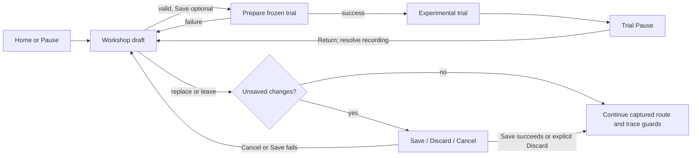

# Aircraft experiment editor plan

**Date:** 2026-10-19. **Revision:** 13 — bounded illustrative smoke preview pass. **Status:** appearance/smoke, bounded experiments and local build flows are implemented slices; detached recovery, fixed-station measured mass, named-library save boundaries and live-owned staging cleanup extend them. Full-fleet, mounting/hardware data, native performance, AE-09e/f and physical acceptance remain open. **Prefix:** AE-00…AE-26. **Owner:** aircraft-editor track.

The plan owns remaining work and acceptance. The [Aircraft Workshop guide](../AIRCRAFT-WORKSHOP.md) owns current player behavior and implementation details. The [aircraft contract](../AIRCRAFT_CONTRACT.md) owns physical and generated authoring schemas. [DECISIONS](../DECISIONS.md) owns durable rationale. Use the current repository state and linked evidence when a dated proposal differs.

For the next work: [ideas and examples](#52-idea-catalogue), [accepted profile contract](#55-accepted-presentation-contract-and-remaining-work), [ordered implementation packages](#56-implementation-packages-and-order), [test matrix](#57-required-test-matrix), [performance/evidence gates](#58-performance-and-evidence-gates), and [menu, workflow and visual design](#59-menus-workflow-and-visual-design). The [2026-10-19 source and official-documentation investigation](../research/aircraft-editor/AE-00/README.md) records current seams, diagnostic failures and a native color probe.

**Owns:** `app/workshop/`, `app/ui/workshop.gd`, `app/ui/workshop_preview.gd`, `app/data/workshop/`, `app/tests/test_workshop_*.gd`, `research/aircraft-editor/`, this plan and [AE evidence](../research/aircraft-editor/AE-01-10/README.md). Existing implementation paths are `app/workshop/` and `research/aircraft-editor/`; do not create a parallel `aircraft_editor/` subsystem.

**Coordinates:** physical schemas and generated bindings with aircraft-standardization/model owners; session and propulsion inputs with their owners; Workshop screens and preview with AE; the shared menu shell, preferences, routes and localization with UI. Check the [track registry](../README.md#tracks-plans-and-step-ids) before changing shared files. Do not edit generated aircraft geometry or physics data by hand.

## 0. Implemented slice and remaining acceptance

The guide describes the current interface, supported operations, schemas, persistence, verification commands and limitations. [AE-01–10 evidence](../research/aircraft-editor/AE-01-10/README.md) records the initial tests, later audits, native captures and limits. The table below separates delivered behavior from remaining acceptance.

| Steps | Implemented baseline | Remaining acceptance |
| --- | --- | --- |
| AE-00 | Initial source/ownership audit and implemented-path reconciliation | Keep interfaces coordinated as new aircraft families and authoring seams arrive |
| AE-01/02 | Shared compiler, catalog-discovered descriptor generator, versioned bindings, exact source/dependency/compiler pins and deterministic trial identity; eight descriptors pass the recorded generation check | Revalidate fleet behavior after Extra's finite-glow migration and P-51/Ventage finite-liquid changes; richer module composition and migration remain open |
| AE-03 | Local immutable revisions and captured delete/restore; separate debounced recovery preserves accepted build and invalid UI text, with explicit Restore/Later/Discard and source pins; 35 injected/native Windows save-boundary cases; handled first-save failures clean only their bounded, known staging layout while holding the reservation | Cross-platform process termination, interruptions within filesystem operations, orphan/crash-staging maintenance and power-loss proof remain open. [Library evidence](../research/aircraft-editor/AE-03a/README.md), [draft evidence](../research/aircraft-editor/AE-03c/README.md) |
| AE-04…07 | Detached shared compiler, conventional controls, legacy prescribed-RPM transforms and initial Stik/legacy-Extra fixtures with synthetic identities | Requalify current sources and fixtures after Extra's finite-glow migration; wider combinations/refinement and family transforms remain open |
| AE-08/09 | Inspect/Compare, scrolling library/inspector, exact numeric edits, full-payload loss guards, explicit recovery, direct trial return and EN/ES; [initial delivery](../research/aircraft-editor/AE-08b-09/README.md) | Full directional/reconnect/hardware journeys, performance, formative user acceptance and broader constrained-layout coverage remain open |
| AE-10 | Frozen airborne trials, return to the same draft, F5 identity and preservation of the previous flight on failed preparation | Full crash/replay/recording and longer-duration trial matrix |
| AE-11 | Capability-based runway/airborne start qualification from the actual frozen trial, field and weather; all eight default fixed-wing configurations pass runway and airborne, while Stik 150%/200% runway starts refuse and remain airborne-capable | Broader field/weather/configuration matrix, runtime reporting and native user-flow acceptance; refusal must stay explicit and must not fall back to another route |
| AE-12/13 | Measured masses by stable inventory ID at fixed stations; source-state total mass/CG comparison and proposal-only one-component inverse solve; distinct evaluator identity, shared history and detached new-build flow | No authored mount envelopes: component moves, added ballast, replacement hardware and automatic geometry matching remain unavailable. Broader measurement provenance/wizard and physical acceptance remain open. [Evidence](../research/aircraft-editor/AE-12-13/README.md) |
| AE-19 | Strict data-only variant bundle validation, compatibility-checked local import path and read-only `--aircraft-variant=<local-json-path>` launch | Full current-fleet conformance, fresh-install and cross-platform package/migration matrix; external dependencies remain pinned and must validate |
| AE-20 | Bounded static/session experiment evaluator, fixed-tick input tapes, bounded sweeps, seeded discovery and a source-only local-file CLI | Domain/recipe coverage, refinement cost, field/evidence integration and measured/physical claims remain open; documented invocation and limits are in [Workshop commands](../TOOLS.md#aircraft-workshop) |
| AE-24 | Shared visual/physical history; authored paint/marking/smoke profiles, isolated playback, Library reuse and cancellable copied-pixel thumbnails; profile v1 / saved record v2 / companion v2 | [AE-24 baseline](../research/aircraft-editor/AE-24/README.md) and [two-family thumbnail proof](../research/aircraft-editor/AE-24d-1/README.md) remain limited. Scrubber, complete plume framing, dense overlap, general frame budget, broader mappings, platform and user acceptance remain open |
| AE-12…18, AE-21…26 | Incomplete beyond the slices above | Work and gates are sequenced in [delivery sequence](#3-delivery-sequence-and-acceptance-gates); AE-19 remains the current-fleet gate and AE-25 remains the twenty-airframe gate |

The catalog currently has **eight fixed-wing configurations** and a separately selected rotorcraft. Identified airplane sources use stable physical IDs and Workshop v3 ID bindings; explicit readers retain ID-less v2 and historical v1/v2 behavior. The compiler must derive support from validated modules and never dispatch transformations by aircraft name or ID. The [interface delivery report](../research/aircraft-editor/AE-08b-09/README.md) records the current generator and focused-suite reruns. Earlier failures remain in the [dated diagnostics](../research/aircraft-editor/AE-00/README.md#diagnostic-checks). Neither set closes physical, fleet or user acceptance. Rotorcraft authoring and qualification stay outside airplane conformance.

The initial legacy prescribed-RPM proof used the Stik and the then-current Extra. Extra now uses finite glow and no longer qualifies for legacy size/mass/power transforms. Current fixtures and the two-aircraft V1 gate need reconciliation with the NITRO/aircraft owners; do not enable legacy transforms to satisfy a historical fixture. Other families retain registered conventional-control and tank-capacity operations where supported. Twenty synthetic IDs establish only the behavior of that recorded fixture, not current fleet or packaging acceptance.

Runway qualification assesses the exact frozen candidate through `FlightSession` against the selected field and weather; it does not use an aircraft-ID permission list. The current matrix passes runway and airborne starts for all eight default fixed-wing configurations. Stik scales 150% and 200% refuse runway while remaining available airborne; half-power airborne is refused for the tested current configurations and is not exposed by the Workshop. These bounded software results are not physical-flight acceptance. Presentation coverage is separate: the generated customization companion registers five visual families, solid paint slots and paired/show/source smoke endpoints; bounded registration mounts exist on the Stik, Extra 300S and Turbo Timber Evolution. This does not mean all eight configurations have distinct visual bindings or that the full twenty-airframe fleet is supported.

## 1. Scope and delivery gates

Aircraft Workshop creates detached, experimental local variants from a shipped aircraft. It must preserve the source, explain the requested and effective changes, save reproducible identities and prepare each trial as a new validated flight. A numerically valid candidate is not a physical-validation claim.

| Gate | Steps | Exit condition |
| --- | --- | --- |
| V1 shared experiment loop | AE-00…10 | Stik and current finite-glow Extra use their supported operations through the same save/trial/return/rollback path. AE-06/07 separately retain two compatible prescribed-RPM fixtures; Extra's historical scaling proof cannot qualify its current configuration |
| V2 current-fleet standard | AE-11…19 | Every eligible fixed-wing catalog entry passes generated-binding, module, session, persistence and conformance checks; adding an ordinary supported aircraft changes data/assets/bindings, not editor behavior |
| V3 research and scale-out | AE-20…25 | Bounded performance tools and recipes remain truthful, the editor is qualified for its declared ranges, and a twentieth ordinary airplane passes onboarding with the editor frozen |
| Documentation closeout | AE-26 | Delivered behavior, authoring contracts, evidence and remaining limitations have one linked authoritative home each |

No gate requires a CAD editor, arbitrary physics scripts, cloud sharing, multiplayer, or a new vehicle branch in the simulation kernel.

## 2. Ownership, source of truth and fleet onboarding

| Concern | Owner and rule |
| --- | --- |
| Current player workflow and implementation details | [Aircraft Workshop guide](../AIRCRAFT-WORKSHOP.md) |
| Physical v2 data, stable IDs, model manifests and generated authoring rules | [Aircraft contract](../AIRCRAFT_CONTRACT.md), with aircraft/model source pipelines |
| Descriptor generation | `research/aircraft-editor/build_descriptors.py`; regenerate after source or model-manifest changes and commit the generated descriptor |
| Runtime editing and storage | `app/workshop/`; candidates remain detached from catalog source files |
| Screen and isolated preview | `app/ui/workshop.gd`, `app/ui/workshop_preview.gd`; AE owns these screens, UI owns shared shell and routing |
| Session integration | `app/sim/flight_session.gd`; `app/workshop/start_qualification.gd` assesses the frozen candidate without introducing a vehicle-specific kernel branch |
| Presentation | `app/workshop/presentation.gd`, `app/render/aircraft_customization.gd` and `app/render/presentation_sources.gd`; the separate companion v2 pins presentation dependencies without changing physical model-manifest pins |
| Bundles and experiments | `app/workshop/bundle.gd`, `launch.gd` and `experiments.gd`; offline CLI integration and full acceptance remain coordinated with their owners |
| Dated implementation proof | `docs/research/aircraft-editor/AE-01-10/` and later AE step evidence; keep raw proof with its owning step |

### 2.1 Common aircraft editing standard

The physical aircraft remains `openrc-aircraft v2`. The generated companion descriptor uses the current `openrc-aircraft-workshop v3` format for identified sources; ID-less source and saved-record readers retain their explicitly versioned compatibility behavior. Descriptors bind source bytes, module assertions, presentation identity and generated model manifests without copying physical values into Workshop metadata. The contract owns the complete binding rules.

The validated physical model and closed module registry select available operations. Descriptor module assertions must match that classification; they do not select a solver law or provide executable transformation rules. Stable component keys survive inventory rename/reorder, while exact source and manifest pins still require descriptor regeneration. Saved variants keep their historical identity and are never silently rewritten or rebound.

The shared compiler, recipe and launch path must not branch on aircraft ID, display name, maker, filename or inventory text. Catalog/resource lookup and provenance may use IDs. A new physical capability needs an owned schema/module change and reusable tests; an ordinary aircraft using existing capabilities should need only its generated sources, bindings and conformance evidence.

### 2.2 Current fleet coverage

Physical editing and visual registration have separate coverage. The physical compiler selects transformations from validated data/module capabilities, not aircraft IDs. The generated customization companion currently serves five visual families across the eight fixed-wing configurations. Stik, Extra and P-51 have body/wing/wing-tip/tail paint; Avanti has body/wing/tail only; Timber has body/wing/wing-tip/tail. All five have paired show wing tips and show tail; only Stik and P-51 declare a physical source exhaust. Registration panels exist only for Stik, Extra and Timber, with fixed geometry and supported EN/ES text. Solid-color slots and smoke endpoints are capability data. New visual slots require authored source metadata and a regenerated companion, not runtime name matching. The [Workshop guide's coverage table](../AIRCRAFT-WORKSHOP.md#supported-adjustments) lists the exact visual-family IDs and endpoints.

| Configuration family | Current role in Workshop acceptance |
| --- | --- |
| Jensen Ugly Stik baseline | Current simple prescribed-RPM scaling path; authored paint/markings and runway/airborne assessment. Broader combinations still need qualification |
| Great Planes Extra 300S | Now finite glow; legacy scaling evidence is historical. Registered paint/markings and show endpoints; requalify supported physical operations, trim and trials |
| Three finite-glow Stik configurations | Separate 2T/4T module and installation gates; do not infer family behavior from the legacy Stik |
| Turbo Lumber Evolution | Shared imported-model bindings, registered paint/markings and show endpoints exist; electric editing and complete presentation qualification remain open |
| P-51D Mustang and Ventage Jet | Finite-liquid modules are registered; generated descriptors and fleet conformance must follow the updated sources |
| X-Cell research rotorcraft | Separate vehicle schema and qualification path; excluded from fixed-wing Workshop conformance |

Catalog discovery, not this table, defines the fleet. New catalog entries must be checked automatically; the table explains the current coverage boundary.

The start qualification test currently covers the eight default configurations and five additional Stik scale trials. All defaults pass runway and airborne qualification; Stik 150% and 200% runway requests refuse, with airborne still available. Half-power airborne requests refuse in the tested matrix. The check executes the real session and selected field/weather and verifies the route that was actually committed. This does not establish takeoff-distance or pilot acceptance for a real aircraft.

### 2.3 Fleet onboarding and twenty-airframe proof

For an airplane using existing capabilities:

1. Create physical data, model manifests and assets through the owning source pipelines.
2. Declare its vehicle class and physical identities in the source contract; do not encode editor behavior in the aircraft name.
3. Generate and check its Workshop descriptor after physical or model-manifest changes.
4. Run catalog-discovered module, compiler, persistence, session and presentation conformance.
5. Record exact source identities, commands, results and limits in the owning evidence report.

AE-25 freezes the editor before onboarding the twentieth ordinary airplane. Passing means only the aircraft's normal data, assets, generated bindings and evidence are added; no airplane-specific editor branch, compiler formula, recipe copy or screen change is needed. A genuinely new physical law follows the shared contract/module path before its aircraft is counted as supported.

## 3. Delivery sequence and acceptance gates

Dependencies are explicit. A gate may split into smaller reviews, but its acceptance condition remains required.

| ID | Work and dependency | Acceptance evidence |
| --- | --- | --- |
| AE-00 | Source audit, ownership and current implementation reconciliation | Current catalog/module/source map; agreed shared-file boundaries and migration limits |
| AE-01 | Common descriptor, parameter/module contract and conformance approach; AE-00 | Schema-backed field map, generated bindings, unknown capability refusal and no duplicated physical values |
| AE-02 | Recipe/descriptor versions, dependency pins and trial identity; AE-01 | Strict malformed/version/stale-binding cases; exact input identity; deterministic equivalent fingerprints |
| AE-03 | Local library, immutable revisions and deletion/recovery; AE-02 | Interrupted-write, corrupt-record, stale-delete, trash-generation, duplicate identity and restart cases retain a recoverable record |
| AE-04 | Generic resolver and detached no-op compiler; AE-02 | No-op numerical/trajectory parity; unsupported modules and incompatible bindings fail closed |
| AE-05 | Shared inventory mass and conventional controls; AE-04 | Independent mass, CG, inertia and surface checks; reordered/renamed inventory does not redirect edits |
| AE-06 | Legacy prescribed-RPM propulsion transform; AE-04 | Power, RPM, thrust and trim bounds on two compatible airframe fixtures; retain the original Stik/Extra proof and reconcile Extra's changed family before closing V1 |
| AE-07 | Uniform geometry, virtual propeller/suspension and plausibility policy; AE-05/06 | Six exposed Stik sizes and a second compatible airframe's declared envelope; derived geometry/mass checks and real session startup |
| AE-08 | Shared presentation binding and preview integration; AE-07 | Datum, CG, hinges, propeller, hull, contacts and imported-model cases match effective data without ID-specific editor paths |
| AE-09 | Workshop library UI, Home/Pause route, editing history and localization; AE-03/08; split into AE-09a…f in [interface delivery](#597-interface-delivery-and-verification) | Context-aware entry/return, guarded draft replacement, clear save/trial states and keyboard/controller journeys; EN/ES viewport captures and resolution of the too-small preview reported in [UI-29 evidence](../research/menu-investigations/UI-29-R3/README.md) |
| AE-10 | Transactional trial, return, restart and frozen identity; AE-04/09 | Stik/Extra workflow, failed-start rollback, retained draft and correct trace/checkpoint identity |
| AE-11 | Capability-based runway-start qualification is implemented for actual frozen trials; AE-10 | Current default-aircraft and Stik scale matrix, selected-field and bounded-time fixtures pass as listed in section 0. Broader field/weather/configuration coverage and native launch-choice UX remain open; no aircraft-ID permission list |
| AE-12 | Stable component editing, ballast and mass/CG fitting; AE-05/10 | Independent first-moment/full-tensor oracles; impossible targets, negative ballast and unsupported mounts reject cleanly; hubs stay fixed in structural coordinates while their offsets are recomputed from the new CG |
| AE-13 | Match-my-airplane wizard and measurement provenance; AE-12 | Measured mass/CG round trip; unknown inputs remain estimated; reference chord and MAC remain distinct; matched geometry stays inside source-backed limits |
| AE-14 | Coupled shaft, thrust-axis and optional wake modules; AE-01/12 | No-op parity, source-backed ranges and correct composition with geometry, gear and loads |
| AE-15 | Electric motor and battery modules; AE-01/12 | Fixed-voltage, OCV/resistance and pack-ECM behavior remain distinct; include pack mass/energy, numerical stiffness, reset/replay and unsupported combinations; coordinate with [BAT](battery-realism.md) |
| AE-16 | Scoped installation/profile inputs and independent finite-glow 2T/4T modules; AE-01/12 | Qualify fixed-hardware transforms first; cover exact dependency identity, moving mass/CG, thermal/fuel lifecycle and reset/replay; reject cross-family transforms (never apply 2T rules to 4T or vice versa) |
| AE-17 | Turbine module and start/gear qualification; AE-01/12 | Spool, intake, timestep, identity and actual start modes are validated without Ventage-specific editor behavior |
| AE-18 | Shared parameter pages generated from supported module definitions; AE-14…17 | UI/compiler/tests share bounds and labels; physical/rendered travel agrees, radio shaping is not applied twice, and unsupported operations are explained |
| AE-19 | Strict data-only bundle codec, current-compatibility import path and read-only `--aircraft-variant=<local-json-path>` launch are implemented; AE-03/11…18 | The CLI validates/freeze-prepares exact inputs without writing the library or preferences. Full fleet, migration, fresh-install and cross-platform proof remains open. Bundles reject executable resources and unsafe paths; regenerate stale descriptors before qualification |
| AE-20 | Bounded static/session experiment evaluator, fixed-tick input-tape runner, grid sweeps, seeded discovery and source-only local-file CLI are implemented; AE-10 plus family adapter | Current limits are four sweep axes, eight values per axis, 32 candidates, 64 tape spans and 28,800 ticks (120 seconds at 240 Hz). The CLI accepts exactly one catalog aircraft or local bundle, one optional recipe or sweep file, and a new output path. Bind results to exact initial state, commands, environment and termination. Domain coverage, field/evidence integration, runtime/refinement cost and measured/physical claims remain open; label static outputs separately from scripted results |
| AE-21 | Supported drag/polar/incidence/tail-law packages; AE-01/20. Optional later AE-21b adds authored wingtip/tail geometry after AS/model contracts | Domain, trim, stall-join and numerical limits are reported per field/module; optional shape packages additionally require geometry, mass, aero, hinges and contacts to agree |
| AE-22 | Capability-based shared recipes, parameter sweeps and seeded discovery; AE-20/21 | Same recipe applies to compatible bases, explains incompatibility and searches within fixed bounds |
| AE-23 | Wider scale targets and combinations; relevant AE-14…22 modules | Qualify 25–400% targets with boundary/field-clearance diagnostics, offline 240/480/960 Hz refinement and bounded runtime cost |
| AE-24 | Authored appearance/smoke profiles, isolated playback, shared history, local reuse and selected-build thumbnails are implemented with portable record v2 and separate companion/source proof | [AE-24 baseline](../research/aircraft-editor/AE-24/README.md) and [AE-24d.1](../research/aircraft-editor/AE-24d-1/README.md) cover limited native configurations. Scrubber, complete plume framing, dense overlap, general frame/GPU budget, broader mappings, package/platform proof and user acceptance stay open. Appearance preserves physical identity and trace values |
| AE-25 | Twenty-airframe onboarding plus cross-platform, accessibility and playtest acceptance; base AE-19…24 and any advertised optional extensions | Frozen editor; data/assets/bindings/evidence only for the twentieth ordinary aircraft; fresh-clone and package checks |
| AE-26 | Consolidate delivered guide, authoring standard and evidence links; AE-25 | Current contracts are linked once, dated evidence is retained, and superseded planning prose is removed |

## 4. Cross-cutting acceptance rules

- Compile from a detached copy. Never edit shipped/generated aircraft files or mutate a live flight while a draft is open.
- Classify every affected quantity as invariant, transformed by an identified rule, recomputed from dependencies, or unsupported. Reject incomplete transforms and conflicting writers.
- Validate the complete candidate with the aircraft contract, module validators, trim/start checks and selected session path. A local numerical check alone does not make a candidate launchable.
- Bind a trial to its exact base, recipe, descriptor, compiler, dependencies and resolved model. Restart, replay and checkpoint restoration must use those frozen inputs; a changed dependency refuses the trial without deleting the saved variant.
- Preserve existing aircraft/model node names and generated source ownership. Keep physics state in scalar/packed float64 representations; render transforms remain at the presentation boundary.
- Prove no-op parity, independent transform arithmetic, invalid-input refusal and rollback. Use actual session/model builders for presentation and gear claims; screenshots alone do not establish interaction behavior.
- Keep numerical/simulation consistency distinct from measured aircraft data, flight performance and pilot acceptance. Record tested envelopes and unresolved model assumptions beside each result.
- Run focused checks for the changed owner paths, then the repository's required integration checks. Keep the test report tied to the source revision and commands that produced it.
- For physics/control tuning, follow the [flight logging workflow](../FLIGHT-LOGGING.md): retain an exact-replayed baseline and compare one explicit candidate with the same tick/input tape. Check `complete` and `solver_changed`; do not rerecord golden flights for editor-only work.

### Verification dimensions

| Dimension | Required distinction |
| --- | --- |
| Transform math | Use independent fixtures for mass, CG, inertia and geometric scaling; do not validate a helper only by calling it twice |
| Identity | Test exact source/dependency pins, cosmetic-only changes, stale revisions and same-name physical changes separately |
| Capability composition | Exercise valid, unsupported and conflicting module combinations; no silent partial transform or family fallback |
| Session lifecycle | Cover launch, failed preparation, old-flight rollback, restart, crash return and checkpoint/replay against frozen inputs |
| Presentation | Compare effective datum, CG, hinge/rotor, hull and contacts in the actual flight builder; a still preview alone does not prove flight alignment |
| Usability | Cover keyboard flow, localization, constrained preview size, text scaling and status/diagnostic visibility |
| Evidence limits | Report tested envelope, solver conditions and unknown physical support; passing software checks do not establish flight validation |

## 5. Planned player-facing work

**Product target.** The shared Workshop now implements physical Flight setup/Compare plus registered appearance, marking, smoke and isolated playback controls as recorded in [section 0](#0-implemented-slice-and-remaining-acceptance). This section documents their current boundary and the remaining backlog; later physical modules remain future work. Make experimentation fun and easy: choose an aircraft, pick a supported preset, change a few understandable settings, preview, save a copy and test fly. The linked owner plans define renderer, model, fuel and session work. An idea does not become a release requirement until its bounded slice and acceptance evidence are selected.

### 5.1 A simple editor first

1. The current Workshop exposes **Appearance**, **Smoke**, **Flight setup** and **Compare** according to registered capabilities. Appearance and smoke controls remain hidden or unavailable when a model lacks the corresponding authored slot; deeper smoke controls remain under **More options**.
2. Appearance currently applies solid color to declared body, wing, tip and tail regions where present, plus bounded registration labels for the Stik, Extra and Timber. Distinguish a painted region from a wingtip shape that changes flight. Patterns, roundels, spinner and rotor accents are not implemented.
3. Use declared left/right pairs and endpoints for supported smoke controls; More options holds color-step/emission timing. Pending text cannot change targets silently. Physical and visual pages share Reset, Undo and Redo. Library supports search, favorites, reviewed compatible profile copy and isolated selected-build thumbnails. Thumbnails use copied pixels with count/byte bounds and generation cancellation; physical recipe and interactive camera stay unchanged.
4. Preview appearance and bounded smoke playback in the isolated Workshop scene. Stationary and six-second illustrative straight-pass modes use Play, Pause and Restart with a separate 240 Hz smoke clock/wind and do not advance another flight or change the retained session. Nine native captures and 30/60/144 GPU lifecycle checks establish a limited baseline; dense-overlap quality and a general frame-cost budget remain open. The aircraft path is auto-framed; a scrubber and complete wind-drifted plume framing remain future work. [Moving-pass evidence](../research/aircraft-editor/AE-24/README.md#moving-preview-pass-ae-24b2--sm-15) records the bounded follow-up.
5. Show what changed, save a named build or copy, then use the validated trial route. Keep camera/HUD choices in the trial setup, under their existing owners.

Unsupported controls stay unavailable with a short reason. Keep the supported preset list useful; advanced settings must not fill the first screen with technical parameters. Reuse free tools and licensed assets where suitable, with provenance retained.

### 5.2 Idea catalogue

The table mixes the implemented baseline with pending candidates. The implemented appearance subset is solid paint on authored body/wing/tip/tail targets and a fixed EN/ES registration panel on the Stik, Extra 300S and Timber. Smoke uses only generated show/source endpoint registrations. Changes to installed hardware or aerodynamic shape follow their physical module gates even when their controls look simple.

| Idea | Easy example | Owning gate / dependency |
| --- | --- | --- |
| Body, wing, wingtip and tail colors | Solid swatches on each declared region, where that family has the target | Implemented for registered slots; five visual families; AS authored targets |
| Registration text | Bounded EN/ES registration on two fixed panels | Implemented on Stik, Extra 300S and Timber; maximum 12 characters and fixed authored fit |
| Stripes and patterns | Select a built-in stripe, checker or roundel and adjust its accent color | Pending; bounded pattern regions/shader support |
| General name and number | Put “RC-27” or a short build name on a declared tail/body panel | Pending beyond the fixed registration mounts; no user-defined coordinates |
| Spinner and prop-tip accents | Match a spinner to the tail; color supported prop tips | AE-24a; rotor/blur presentation checks |
| Reusable palettes | Apply one palette to compatible trim slots, then reset one part | AE-24a/d; compatible slot mapping |
| One or several smoke colors | Choose colors per registered endpoint and up to eight palette steps | Implemented profile control; at most three show endpoints and one source endpoint |
| Emitter positions | Select registered paired tips, tail show mount or physical source endpoint | Implemented only where authored in the companion; no runtime name/coordinate guessing |
| Smoke amount and shape | Ribbon, cloud or fan; normalized amount and width | Implemented profile values; no physical fluid capacity or supply claim |
| Smoke bursts | Hold, bounded burst or pulse schedule | Implemented with the fixed tick schedule; no radio/AUX trigger UI |
| Smoke persistence | Puff lifetime/fade up to eight seconds | Implemented bound; renderer lifecycle and native visual qualification remain open |
| Color sequences | Step through up to eight palette colors | Implemented profile control; GPU pixel/timing tolerance remains to be measured |
| Smoke preview | Isolated Play/Pause/Restart playback | Implemented deterministic preview playhead; no user-selected wind or measured maneuver |
| Display lights | Pick a supported steady or strobe accent for a show setup | Later AE-24; AS/FW slots and bounded lighting; physical hardware separate |
| Mass and CG wizard | Enter measured mass/CG or move an allowed battery/ballast component | AE-12/13; inventory/mount constraints |
| Battery packages | Compare a lighter pack with a compatible higher-capacity pack | AE-15; BAT mass/energy laws |
| Powerplant packages | Select a compatible engine/motor/ESC installation | AE-14…17; family-specific data and validators |
| Propeller packages | Choose a qualified diameter/pitch option with matching visual blades | AE-14…17; load maps, inertia and clearance |
| Servo packages | Compare compatible servo mass, speed and control response | AE-12/18; SAV/AS actuator contract |
| Travel and response | Trainer/Sport throw presets, independent axes and supported response settings | AE-18; input shaping applied once |
| Flaps and mixed controls | Choose supported differential, flaps or airbrake settings | AE-18; qualified AS/aircraft modules |
| Wingtip shapes | Select an authored rounded tip, tip plate or winglet package | Later AE-21b; geometry/aero/mass agreement |
| Tail shapes | Compare supported fin or stabilizer packages with coherent hinges and loads | Later AE-21b; AS/model and aero owners |
| A/B comparison | See original versus candidate and a concise “what changed” list | AE-09/20; common conditions and valid starts |
| One-change experiments | Suggest one bounded change while preserving locked settings | AE-22; seeded capability-based proposals |
| Glide and bench cards | Prepare a power-off glide, or evaluate static thrust/RPM/torque | AE-20; session starts and evaluator limits |
| Goal recipes | Explore “lighter trainer” or a supported endurance comparison | AE-20/22/23; show predicted results and conditions |
| Build notes | Keep measured dimensions, weighing date and setup notes with the build | AE-03/13; provenance separate from cosmetic metadata |
| Library search and favorites | Find builds with text search and Favorites Only; favorite a saved variant without changing its revision | Delivered for saved UUIDs; separate strict-JSON metadata supports at most 256 UUIDs, uses a lock and atomic write with readback/backup, and fails closed on corrupt preferences |
| Compatible profile copy | Review and copy compatible appearance/smoke settings by readable slot names | Delivered with stale-pin refusal, safe Cancel, skipped-setting report, single Undo and unchanged physical recipe |
| Thumbnail and test view | Selected saved builds now render isolated static thumbnails; choose an existing camera/HUD preset for the trial later | AE-24d.1 thumbnail software/native slice delivered; broad resource/platform and shared-view settings remain open |
| Portable recipe cards | Validate a strict data-only bundle and launch it read-only from a local JSON file | Codec/CLI launch path implemented; export/import UI, full fresh-package matrix and platform acceptance remain open |

Changing color does not qualify a new material system or a physical aircraft part. VQ keeps its [targeted material-repair scope](global-performance-visual-quality.md#vq-02b--conditional-aircraft-repair); AE owns these per-build controls. Reuse the [model/authoring plan](aircraft-standardization.md#workbench-customization-bindings), [smoke plan](../SMOKE-PLAN.md#user-customization--sm-10-onward), [battery plan](battery-realism.md), [servo plan](savox-servos.md), [camera plan](camera-views.md) and [HUD plan](flight-overlays.md) rather than duplicating their implementations.

### 5.3 Smoke presets and understandable controls

The detailed emitter/render contract lives in SM-10…15. The Workshop offers **Clear Trainer**, **Twin Ribbons**, **Tricolor**, **Tail Comet**, **Rainbow Burst** and **Classic Exhaust** preset actions; support depends on exact registered endpoints, and an incompatible selection reports that reason. Available slots can be enabled and edited by endpoint. The profile supports up to eight palette colors, ribbon/cloud/fan shape, hold/burst/pulse scheduling, amount `[0, 1]`, width `[0.01, 2] m`, puff lifetime `[0.1, 8] s`, and bounded timing fields up to 8 s. The renderer caps total profile particle allocation at 768 across active entries, not 768 per endpoint. Smoke amount means visual fullness; physical smoke-fluid capacity in ml and supply endurance need the separate [FUEL extension](fuel-mass-balance.md).

The preset actions select simple profile values; they are not measured emissions or a promise that every aircraft supports every action:

| Preset | Proposed setup | Simple example |
| --- | --- | --- |
| Classic Exhaust | Supported authored engine outlet; source-driven operation | Faint neutral exhaust; engine state retains authority |
| Twin Ribbons | Red left wingtip and blue right wingtip, linked amount | Medium amount; 3 s burst; each puff fades within 6 s |
| Tricolor Pass | Red/white/blue across two tips and one approved center/tail mount | One button controls the enabled group; per-emitter colors remain editable |
| Tail Comet | An approved rear-fuselage or separately declared tail-surface slot | Gold soft plume; 5 s burst; 8 s puff lifetime |
| Rainbow Burst | One or more declared show emitters, discrete palette steps | Change the color of new puffs each second during a bounded burst |
| Clear Trainer | Clear the configured smoke entries | Removes show plumes from the profile; paint is not changed |

Turning emission off stops new puffs; existing puffs retain their birth color and continue to age and drift. A long lifetime is not an unlimited supply. Show plumes on electric or turbine aircraft require an explicit authored show-effect route; they do not activate healthy-engine exhaust or claim installed smoke hardware. Source endpoints carry the authored physical selectors. Keep flight physics, physical identity and physical trace values unchanged; store visual profile/seed/timing identity separately. GPU history is not reconstructed by physical `.orfl` replay.

Preview playback offers a stationary aircraft or a six-second illustrative straight pass; a separate deterministic 240 Hz smoke clock and wind drive Play/Pause/Restart. It does not compute another flight or represent a measured maneuver. Show/source route semantics remain distinct, source effects require a valid physical source gate, and the source preview is labeled illustrative. Preview time never carries into Test fly, which uses the validated frozen trial and selected start conditions. Nine native captures and a 30/60/144 GPU lifecycle run on the recorded RTX 3090 setup establish a limited baseline. Dense overlap, broader hardware/frame-cost qualification, scrubber and complete plume framing remain open. Aircraft-path framing and moving-pose checks are recorded in the [AE-24 follow-up](../research/aircraft-editor/AE-24/README.md#moving-preview-pass-ae-24b2--sm-15).

### 5.4 Small delivery slices and acceptance

| Slice | Scope and dependencies | Completion evidence |
| --- | --- | --- |
| AE-24a — simple appearance | Solid colors on authored regions and bounded fixed registration mounts on Stik/Extra/Timber are implemented; AE-08/09 plus AS bindings. Built-in patterns, spinner and prop-tip accents remain pending | Runtime tests cover per-instance materials/labels and reset/Undo. Limited native captures exist; broader layout/readability and pattern capability remain open; physical flight results and shared source materials stay unchanged |
| AE-24b — simple smoke | Versioned profile, supported endpoint presets and isolated preview playback are implemented; SM-10…12 and authored AS slots | Schema, slot/source validation and deterministic schedule tests exist. Native captures cover example colors/presets and 30/60/144 lifecycle; dense overlap, wider rendering, save/load journeys and measured frame/GPU budget remain open; source and show behavior remain distinct |
| AE-24c — airshow profiles | Multiple registered endpoints, linked pairs, bounded bursts/pulses, up to eight palette colors and 768 total allocated profile particles are implemented | Limited pause/reset/lifetime lifecycle evidence exists at 30/60/144; pixel/history behavior beyond captured cases, dense overlap, general hardware cost and no-stale-plume acceptance remain open; the capacity cap is not performance qualification |
| AE-24d — reusable profiles | Strict bundles, local CLI launch, Library reuse, import/export dialogs and isolated static thumbnails are implemented; portability builds on AE-19 | Fresh-install/platform/migration matrix and general resource acceptance remain open. Thumbnail rendering owns a temporary world and never reuses the active preview. Unsafe resources/paths are refused and originals remain intact |
| AE-21b — shape packages, later | Authored wingtip/tail options after the physical/model contracts and AE-20/21 | Visual geometry, mass/CG/inertia, aero, control hinges, hull/gear and trim/start checks agree; source-backed limits and modeling assumptions remain visible |

Local cosmetic work has proceeded under the shared profile/binding contracts. The current controls do not close the existing full-fleet, physical-module, native performance, platform or pilot gates. Keep later lights, shape packages and performance recipes behind their named owners and validation.

AE-21b is an optional follow-up to the base aerodynamic packages. It does not block AE-22 recipes or AE-25 onboarding unless the chosen recipe/release advertises those shape packages. A candidate idea is not silently added to every existing gate.

Performance displays distinguish measured user inputs, static evaluator results and scripted simulation results. Speed, climb, roll and endurance labels require a declared setup, duration/termination rule and supported domain. User mass/CG measurements retain their evidence; unknown values remain estimated. A cosmetic preset must not silently install hardware, alter weather or add stabilization.

<a id="55-presentation-contract-to-implement"></a>

### 5.5 Accepted presentation contract and remaining work

The presentation contract is implemented in the current Workshop path. New saved records use `openrc-aircraft-variant` v2 with a presentation profile v1; an explicit record-v1 reader supplies legacy defaults. Customization companion v2 binds visual families and authored slots to the physical model-manifest hash while pinning cosmetic dependencies through a separate source-proof package and `presentation_engine_version: "4.7.2"`. Companion/source changes do not alter the physical model-manifest pin. Historical profile/binding readers remain explicit; unavailable or stale bindings cannot be silently substituted.

| Requirement | Required behavior and boundary |
| --- | --- |
| Separate records | The physical recipe retains its closed allowlist. Profile v1 has registered paint, marking and smoke entries plus seed/schedule identity. Record v2 publishes recipe and profile in the same immutable revision. |
| Stable bindings | Companion v2 declares exact paint targets, bounded 1–2 fixed marking mounts and paired source/show endpoints. Each endpoint has a stable slot ID and an explicit kind/role; names, inventory labels, node order and runtime guessing cannot bind it. |
| Presentation provenance | Bind companion slots to the current physical model-manifest hash. Pin `res://render/aircraft_customization.gd`, `res://render/presentation_sources.gd`, `res://render/smoke/profile_smoke.gd`, `res://render/smoke/profile_smoke_schedule.gd`, `res://render/smoke/profile_process.gdshader`, `res://render/smoke/exhaust.gd` and `res://render/smoke/process.gdshader`, plus engine version 4.7.2, in a separate proof package. The companion `slots_sha256` covers its closed canonical fields including these pins. Stale source proof fails closed without changing physical model identity. |
| Physical identity | With the same source, descriptor, manifest, dependencies and physical recipe, changing only appearance leaves `trial_id`, physical bytes/model hashes and physical state/trace values unchanged. Retain all existing physical descriptor/model/dependency pins. A model or physical-manifest change still requires regeneration and explicit migration/refusal. |
| Presentation identity | Hash the canonical profile, binding family/model-manifest/slot hashes, seed and schedule policy separately. Display-only library names stay metadata; aircraft markings are presentation content. Physical `.orfl` replay does not reconstruct GPU particle history. |
| Strict data | Exact allowlists and numeric bounds are enforced. Smoke is limited to three show and one source endpoint, eight palette colors, amount `[0,1]`, width `[0.01,2] m`, puff life `[0.1,8] s` and bounded timing values. Marking text is 1–12 supported EN/ES letters, digits, spaces or hyphens, with fixed authored geometry. Unknown keys/versions, duplicate slots, unsafe paths and unregistered IDs are refused. |
| Color and markings | Colors use canonical sRGB `#RRGGBBAA` values and are converted at the rendering boundary. Registration uses existing project font resources with glyph checks and bounded fitting; the runtime creates/removes only its owned label nodes. Pattern/decal editing remains pending. |
| Migration | Record-v1/profile-absent input resolves to explicit legacy appearance without rewriting historical bytes. Newer versions and missing/changed pins remain readable as unavailable and cannot launch against substituted bindings. Any future migration creates a new copy/revision and reports the change. |
| Source versus show | Source exhaust retains authored physical selector and operating gates. Show profiles target an explicitly authored endpoint and do not activate engine exhaust or claim installed smoke hardware. Smoke is visual fullness/timing/shape only; fuel volume, supply endurance and hardware mass remain under FUEL. |

Godot's [Resource caching/duplication](https://docs.godotengine.org/en/4.7/classes/class_resource.html), [Color encoding](https://docs.godotengine.org/en/4.7/classes/class_color.html) and [JSON parser behavior](https://docs.godotengine.org/en/4.7/classes/class_json.html) inform these boundaries. Per-instance editable material state is isolated; bundle input uses the project strict-JSON parser with byte/depth/node bounds. Native visual quality, font layout at constrained sizes and particle performance still require their acceptance evidence. The [investigation](../research/aircraft-editor/AE-00/README.md#official-sources-and-resulting-decisions) separates engine facts from project policy.

### 5.6 Implementation packages and order

Subphase labels below belong to the existing AE parent steps; they do not close the parent automatically. Deliver one reviewable slice with its positive and negative proof before building on it. The detailed rendering implementation remains with SM and generated-slot implementation with AS.

| Subphase | Concrete deliverable / dependency | Exit proof |
| --- | --- | --- |
| AE-00a — reproducible baseline | Current compiler/trial fixtures pass the interface rerun; retain source/config identities and earlier diagnostic failures. Broader fleet gates remain separate. Retain earlier failures. | Run the owning physical/customization generators and registered focused suites against unchanged inputs; explain finite-glow carrier-mass rejection and legacy v1 launch/model-pin failures. The [diagnostic record](../research/aircraft-editor/AE-00/README.md#diagnostic-checks) advances this audit only. |
| AE-03a — first publication | Delivered: 35 injected/native Windows save-boundary cases and scope-bound cleanup of a handled first-save failure; public save API is unchanged | Independent reader sees no first build or one complete committed physical/presentation payload. Cleanup preflights at most eight entries, requires the retained reservation, and refuses links or unknown contents before deletion. Unrelated stages, published records and abrupt-exit prefixes remain untouched. [Evidence](../research/aircraft-editor/AE-03a/README.md). Cross-platform termination, partial writes, orphan-stage maintenance and filesystem power-loss proof remain open. |
| AE-03b — delete/restore targets | Delivered for current library: capture UUID/expected revision, recheck under reservation and restore the returned UUID trash token. Retain this contract for future library changes. | Selection changes cannot redirect confirmation. A newer revision refuses stale deletion. UUID generation tokens, UUID reuse and corrupt trash generations cannot restore the wrong build. |
| AE-03c — lock/draft policy | Delivered: one bounded, debounced scratch snapshot separate from Save build; accepted recipe/profile plus raw text and optional view, explicit recovery choices and detached ancestry | Eight injected first/update boundaries, stale pins, locks, backup/path collisions, unavailable UI selections and concurrent sessions are tested. Exact-byte comparison under the writer lock protects saves/discards; changed restore data requires renewed review. Invalid text still blocks named save/launch. Keep orphan-lock proof and filesystem power-loss durability open; never steal a lock by age. Modal measurement text and prior Undo history are outside recovery v1. |
| AE-02a — profile schema/identity | Profile v1, canonical identity, record-v1 legacy reader and companion binding validator are implemented; record v2 writes profile and recipe atomically. | Existing profile tests cover strict schema, stale pins and identity separation. Expand persistence cut/restart coverage and preserve physical bytes/pins when only cosmetic fields change. No visual keys enter the physical compiler. |
| AE-08a — authored slot seam | Generated companion v2 covers five visual families with exact paint, marking and source/show bindings, including procedural and imported families. | Generators and adapter validate current source proof and engine pin. Continue model-native capture review and tests for supported transforms; duplicate/dangling slots and unsupported legacy bindings refuse closed. |
| AE-24a.1 — paint vertical slice | Solid body/wing/tip/tail regions where authored, per-region reset and shared Undo/Redo are implemented; AE-02a/08a. | Instance-isolation and reset tests exist. Keep native comparison/layout and complete save/load/copy acceptance open; source materials and physical results must remain unchanged. |
| AE-24a.2 — registration | Two fixed authored EN/ES registration targets, 1–12 supported glyphs and per-instance Label3D mounting are implemented on Stik/Extra/Timber. | Focused tests cover glyphs, bounds, mounting and cleanup. Native view-side readability/fitting remains open. General user-name panels, patterns, spinner and prop-tip accents remain unimplemented. |
| AE-24b.1 — smoke profile | Profile renderer consumes up to three authored show endpoints plus one source endpoint, with bounded color/amount/shape and source gates; AE-02a/08a. | Focused tests cover profile validation and scheduling; native captures include paired red/blue tips and multicolor fan examples. Further lit-material/endpoint coverage and old-puff color retention after live edits remain open; retain the legacy exhaust path. |
| AE-24b.2 — preview clock | Stationary/six-second straight-pass poses plus isolated deterministic 240 Hz smoke clock/wind and Play/Pause/Restart are implemented; no second flight simulation. | Logic tests and preview integration exist. Nine native captures and 30/60/144 GPU lifecycle checks are recorded. [Moving-pass follow-up](../research/aircraft-editor/AE-24/README.md#moving-preview-pass-ae-24b2--sm-15) adds exact 30/60/144 FPS endpoint checks, twenty reset cycles and native captures. Aircraft-path fit is implemented; scrubber, complete plume framing, broader hidden/idle resources, hardware and dense-overlap qualification remain open. |
| AE-10a — frozen visual trial | Current trial path persists and applies the validated presentation profile with its physical draft revision before activation. | Keep pre-activation visual dependency/build failures and previous-flight restoration in the integration matrix. Return/Restart must preserve the accepted profile and original editor history; device/GPU failure after activation is outside the rollback guarantee. |
| AE-24c.1 — timing | Fixed-tick bounded schedule implements hold, burst, pulse and palette steps with one pinned schedule policy. | Deterministic scheduler tests exist. Preserve ordering and bounded event queues across supported frame rates; native GPU history/pixels need measured tolerance. |
| AE-24c.2 — multiple emitters | Registered multi-endpoint profiles, explicit pairs and total 768-slot particle allocation cap are implemented. | Current tests cover registration/allocation guards. Native double-transform, material isolation, stale effect, dense overlap and frame-cost proof remain open. |
| AE-24c.3 — lifetime | Puff lifetime/timing is bounded to eight seconds and renderer history is sized for that bound. | A limited native lifecycle/offscreen run exists on the recorded RTX 3090 setup. Expand hardware/render-rate and dense-overlap proof; do not treat the bound as proof of universal visual quality or cost. |
| AE-24d.1 — reuse | Delivered: Library search/favorites, reviewed compatible-only copy and selected-build thumbnails isolated from active draft/camera | Copied-image LRU: ≤16 entries/4 MiB, generation/cancel checks and identity invalidation. Two native families and twenty active-render cancellations pass; cache accounting excludes transient targets/readback/live consumer references. Broader fleet/platform/GPU measurements remain open. Copy retains one shared Undo and compatible-slot refusal. |
| AE-24d.2 — portability | Strict JSON bundles, Library import/export dialogs and read-only local-file CLI trial are implemented; import creates a compatible local copy | Codec/UI tests cover bounded/malformed inputs and nested file dialogs. Fresh-install/platform, dependency migration and package proof remain open; bundle paths never become ResourceLoader paths. |
| AE-21b.1 — shape feasibility, optional | For one authored wingtip or tail package, list geometry/aero/mass/contact/hinge changes, source evidence and missing data before UI work; AE-20/21 plus AS/model owners. | No unqualified winglet/tail “cosmetic” toggle. Independent mass/full-tensor calculations, trim/start and refinement tests agree with rendered geometry; absence of source-backed coefficients leaves the package experimental/unavailable. |

Remaining work can cover AE-03 cross-platform/partial-write and orphan-stage maintenance proof, broader descriptor/fleet conformance, and the separately owned presentation-source export proof. Retain the library save-boundary, bounded owned-staging cleanup, draft recovery and captured delete/restore matrices while extending recovery. Saved appearance/profile and flight presentation are wired through record v2 and the frozen trial path. Do not claim the wider fleet, performance or physical gates from these slices.

The physical roadmap also needs small proofs before exposing easy presets:

| Parent | First sub-deliveries and required proof |
| --- | --- |
| AE-06/07 | Separate current Stik/Extra common-workflow proof from the legacy scaling envelope. Select and document a second genuinely compatible prescribed-RPM airframe fixture with the aircraft owner; preserve legacy Extra evidence as history. Synthetic IDs cannot substitute for two distinct airframes. Do not close the scaling gate or re-enable Extra scaling merely to make fixtures green. |
| AE-12/13 | AE-12a/13a delivered: fixed-station measured masses, source-state comparison and derived inverse proposal, independent full-tensor oracle and preserved structural thrust/intake points. Next AE-12b authors source-pinned mount envelopes and ballast hardware; AE-13b adds richer measurement provenance/matching only after those contracts. Reject unknown mounts and never mark inferred mass measured. |
| AE-14…18 | First qualify one fixed hardware configuration per family, then supported replacements, then generated UI. Prove no-op, dependency identity, mass/energy/resource lifecycle, reset/replay and timestep limits before exposing Trainer/Sport or engine/pack presets. |
| AE-20/22/23 | Bounded experiment evaluator and source-only local-file CLI are implemented; one compatible shared recipe and broader sweeps remain. Every result records initial state, environment, tick/input tape, domain, stop condition and failure reason. Wide-scale targets and optimization wait for independent refinement/cost proof. |

#### Measured-build continuation after AE-12a/13a

| Subphase | Contract before implementation | Acceptance |
| --- | --- | --- |
| AE-12b — mounting evidence | AS owns a versioned, source-pinned mount declaration: stable component/mount IDs, LE-frame stations or permitted envelope, supported hardware/mass and dated evidence. Current v2 inventory closes unknown fields; do not add ad hoc bounds to it or trust caller-supplied envelopes. Reuse downloadable manufacturer/plan evidence and existing assets. | One real eligible battery or ballast mounting case; no new movement control until its generator/schema/descriptor/export proof exists. Boundary/outside/NaN/duplicate/reordered-ID tests; no mount inferred from a name or mesh. Legacy records stay readable and do not acquire new pins. |
| AE-12c — movement/ballast evaluator | New opt-in evaluator consumes that mount contract. Keep fuel/feed-line ownership and all structural propulsion points explicit; recompute full tensor, render datum and ground contacts from the same accepted candidate. No arbitrary negative mass or hidden replacement of estimated hardware. | Independent first moments and six tensor entries, left/right/asymmetric cases, fixed hub/intake checks, visible geometry alignment, real trim/start qualification and tick-refinement evidence. Failed candidates leave draft, flight and saved records untouched. |
| AE-13b — guided measurements | Collect units, weighing/fuel state, datum/axis convention, date/instrument and evidence; distinguish a directly measured component mass from mass inferred using total mass/CG. Unknown lateral/vertical coordinates stay unknown or estimated. Reference chord must not be called MAC. | Round trip preserves provenance and raw corrections; human-readable residuals and source tolerances; impossible, ambiguous and underdetermined targets refuse before Apply. Keyboard/ES/200% journeys and invalid-field recovery cover every new field. |
| AE-13c — expanded matching | Geometry/hardware matching depends on the relevant AS/AE-14…18 contracts; do not compensate a mismatched airframe by silently changing aero coefficients, source CG, engine power or fuel quantities. | Frozen original/candidate identities, one reviewed application/Undo, baseline replay and same-input candidate evidence. Pilot/physical measurement remains a separate acceptance gate; the current 60-tick software fixture cannot close it. |

### 5.7 Required test matrix

Focused suites now exist for presentation profiles, customization bindings, source proof, smoke schedules, bundles, bounded experiments and Workshop start qualification. The requirements below distinguish existing logic checks from the remaining native, performance, fleet and physical acceptance; consult [Workshop commands](../TOOLS.md#aircraft-workshop) for runnable entry points.

| Area / owning package | Positive and negative cases | Required evidence |
| --- | --- | --- |
| Profile / AE-02a | Omitted defaults, numeric JSON round trip, key order, minimum/maximum values, `#808080` and transparent colors; unknown keys/versions, booleans as numbers, nonfinite/overflow values, duplicate slots, unsupported presets, stale descriptor/manifest | Identical canonical identities for equivalent inputs; one changed color/text/seed changes presentation identity; physical recipe rejects appearance fields. Verify RGB conversion once and unchanged alpha, including a rendered swatch. |
| Data boundary / AE-24d.2 | Bundle suite covers strict JSON schema, invalid/duplicate/trailing input, bounds and incompatible pins; retain malicious/malformed/oversized inputs, unsafe paths and unknown IDs in the acceptance matrix | `StrictJSON` is implemented for bundle input with a 24 MiB byte cap, depth 64 and 250,000-node bound. Validate refusal leaves draft/library/original untouched; imported paths never reach `load`/ResourceLoader. Cross-platform package and fresh-install round trips remain open. |
| Store / AE-03a/b/c | First save and update cut points; corrupt current/backup; same UUID and stale revision; selected item changes while delete dialog open; clock reversal; orphan versus active lock; exact trash-generation restore | Disposable roots/processes, deterministic failure injection and restart readback. Retain original/recoverable revision; no revision overwrite, uncommitted promotion, wrong-target deletion or active-lock stealing. Test profile/recipe atomicity too. |
| Bindings/materials / AE-08a/24a | Current tests cover registered regions, markings, physical-manifest/source pins, instance isolation, cleanup and unsupported slots; extend procedural/imported and animation fixture coverage | Keep independent expected transforms and native captures. Reset/undo on preview A cannot alter B, trial or source; shared textures remain read-only. Native label fit/readability remains open. |
| One/many smoke / AE-24b/c | Current suites cover profile schema, endpoints, source selectors and deterministic hold/burst/pulse/palette scheduling. Native examples include red/blue paired tips and a multicolor fan; retain stopped/unavailable and old-puff behavior cases | Compare source/show gates and verify no automatic smoke claim on unsupported hardware. Dense low-speed overlap against sky/ground/airframe, wider material/endpoint coverage and renderer birth-color history after live edits remain unqualified. |
| Clock/lifecycle / AE-24b.2/c | Logic suites cover schedule bounds, reset/configuration and bounded allocation. Native evidence includes nine capture cases and a 30/60/144 GPU lifecycle run on RTX 3090; extend to frame discontinuities, dense overlap, long frames and broader hardware | Preserve no catch-up/double queue, no frozen or immortal plume, no stale residual after the renderer completion boundary and bounded resources. The current evidence is limited to its recorded setup. |
| Preview/input / AE-09/24b.2 | Playback is implemented with Play/Pause/Restart in an isolated scene and shared profile history; test Orbit, focus, Escape/back, scroll/drag and keyboard-only paths at EN/ES sizes | Native layout and model/emitter selection must remain usable without color alone. Preview cannot advance live session or change trial weather. |
| Trial/physical isolation / AE-10a | Two profiles, one physical recipe and exact input tape; pre-activation candidate/material/build failure; dependency replaced between freeze/build; restart/return/replay/checkpoint | Identical compiled physical bytes/model and physical state values; existing identity/pin guards remain active. Capture presentation identity separately. Restore previous flight/recorder/camera/audio/input on detectable pre-activation failure; preserve editor selection/history. |
| Portability / AE-19/24d.2 | Legacy profile absent, supported migration, newer profile, missing/changed slot/source proof, read-only bundle launch, fresh checkout/package and cross-platform path/case behavior | Explicit legacy defaults or unavailable-build diagnostic; no silent rebind. The CLI path reads a local strict bundle, freezes a candidate and does not alter library/preferences. Full platform package and migration matrix remain open. |
| Start qualification / AE-11 | Current suite freezes authentic data for all eight defaults plus Stik 50/75/125/150/200%; assesses runway, airborne and half-power through the real session | Assert all default runway/airborne pass, Stik 150/200 runway refuse while airborne stays available, half-power refuses, missing runway refuses only that choice, and refusal preserves frozen model/field. This is software qualification, not physical takeoff validation. |
| Experiments / AE-20 | Current suite covers bounded fixed-tick experiments, candidate caps, grid/seeded discovery and failure reports | The source-only CLI accepts exactly one `--aircraft=<catalog-id>` or `--bundle=<local-file>`, one optional `--recipe=<json>` or `--sweep=<json>`, and a new nonexisting `--out=<file>`. Preserve exact trial/solver/build identities and label outputs as fixed-tick software results, not physical measurements; see [Workshop commands](../TOOLS.md#aircraft-workshop). |

### 5.8 Performance and evidence gates

Keep the [global VQ/DT targets](global-performance-visual-quality.md#gates-to-freeze-in-vq-01c) authoritative. The combined new-visual allowance is **+0.5 ms frame-p95**, while the qualified 60 Hz profile still meets p95 ≤18 ms, p99 ≤25 ms and simulation/wall 0.99–1.01. It is not an allowance per emitter or preset. Preserve the existing 500 µs/tick physics gate; presentation does not receive a new simulation budget. Name target GPU/driver/resolution before any support claim; the investigation's RTX 3090 is only a reference.

The current profile renderer caps allocation at **768 GPUParticles3D slots across all active profile entries**; allocation is divided among active entries, with no per-emitter 768-slot allowance. This is an implementation bound, not a measured quality or performance envelope. Measure the actual source/show configurations and birth density on declared hardware. If the supported endpoints cannot meet quality and cost, reduce exposed choices or obtain an explicit measured budget decision. Reconfiguration must not silently recolor or erase old puffs. The separate legacy exhaust path remains governed by its own implementation and is not an extra profile budget. [GPUParticles3D reference](https://docs.godotengine.org/en/4.7/classes/class_gpuparticles3d.html).

Compatibility uses GLES3 particle processing. The [pinned 4.7.2 renderer source](https://github.com/godotengine/godot/blob/4.7.2-stable/drivers/gles3/storage/particles_storage.cpp) excludes manual `emit_particle`, subemitters, built-in ribbon trails and 3D SDF particle colliders; use the current swept-birth shader unless a separate supported-path probe justifies replacement. Keep world endpoints in world space; applying the emitter transform again would double-transform births. Do not repurpose `CUSTOM` channels without preserving their current phase/age/random/opacity meanings.

For every adopted preset, record allocation, enabled slots, maximum life, visible bounds/history, birth density, overdraw and paired baseline/candidate frame distributions. Follow the [VQ baseline protocol](global-performance-visual-quality.md#baseline-protocol): 10 s warmup + 60 s sample, at least three alternating pairs, same idle host/output/cap, plus separate uncapped diagnosis. If paired variability masks the 0.5 ms allowance, report inconclusive and improve/extend measurement. Exercise calm/gust wind, 150/300/600 m LOD boundaries, offscreen aging, dense overlap, all supported cameras and longest-life settings. Longer puff life changes occupancy, spacing and bounds; increasing only `lifetime` cannot qualify Tail Comet. Capped FPS is not an isolated GPU-cost measurement. Event ordering and physical state retain exact contracts; GPU pixels require an established same-renderer tolerance, not cross-driver bit identity.

After warmup, require no unexplained growth in 20 Home/Fly/Workshop/reset cycles; full DT-12 still separately requires 50 cycles and a 30-minute soak. Run meaningful resource/identity/lifecycle checks before broader integration. Record source/config hashes, engine/backend/GPU, exact commands, input/seed/clock, pass/failure counts, captures, timings and limits in the owning step's existing evidence home. Keep original failed attempts. A software or visual pass does not establish measured smoke emissions, physical aircraft validation or real-radio acceptance.

### 5.9 Menus, workflow and visual design

**Interface contract with a delivered physical-editor slice.** The current screen has separate Flight setup/Compare pages, large inspection, on-demand library, pinned Save/Test fly and guarded draft replacement/exit. See [current delivery and limits](../research/aircraft-editor/AE-08b-09/README.md). The [reviewed native capture](../research/menu-investigations/UI-29-R3/captures/es-1920x1080-100-workshop.webp) documents the small model and dense form; it records the superseded screen; keep it as dated evidence. The [menu/source audit](../research/aircraft-editor/AE-00/README.md#menu-and-workflow-audit) records the verified seams and external guidance.

AE owns this workflow and its screens. Reuse the [shared menu shell](../MENU-REDESIGN-PLAN.md#7-screen-flows-and-behavior), `Screen`/`ScreenStack`, `ui_theme.gd`, `ui_scale.gd`, localization and selected-menu-device routing. UI owns shared changes. Do not introduce a second theme, modal manager, input router or preferences store. The first delivery improves today's physical editor; later pages appear only after their owning capability is implemented.

#### 5.9.1 Information hierarchy and destinations

| Surface | Contents and interaction |
| --- | --- |
| Header | Aircraft Workshop, current build name or “Unsaved build”, base aircraft and saved/changed state. A labeled Back action names Home or Pause according to the opener. Keep hashes, paths and compiler versions in Details. |
| Library | One on-demand destination with Stock aircraft and My builds. Browsing/highlighting does not replace the editor. Search and Favorites Only filter saved variants; favorite toggles update separate UUID metadata, never immutable variant records. Open/New build is explicit and passes the replacement guard. Show base aircraft, readable revision/status and active-build selection distinctly. Empty library offers New build, not an error. While this surface owns input, Open/New build is its primary action and underlying Test fly is inactive; closing restores the Library opener. |
| Page navigation | Stable order: Appearance, Smoke, Flight setup, Compare. Unimplemented pages are absent. Keep an implemented but unsupported page labeled unavailable with a reachable explanation, without editable controls. After an explicit aircraft change, retain the chosen page if supported there; otherwise select the first supported page and explain why. Reopening within this editor visit follows the same rule. Today's first delivery has Flight setup and Compare. |
| Inspector | One selected page and part/emitter at a time. Presets precede individual controls; More options reveals supported advanced fields. Named part/mount lists provide the same selection as model picking. No mandatory wizard before Test fly. |
| Preview | Dominant aircraft view with named view controls, selected part/mount indication and optional bounded playback. Selecting a part changes the inspector, not the build. Hide annotations that are irrelevant to the current page. |
| Action bar | One primary Test fly. Save build is secondary and always discoverable; Save a copy and Delete live with library/build actions. Status remains beside its action. Per-page reset and Undo/Redo stay near editing; Back remains reachable at every text size. |

Keep one active build across pages. Do not make “Appearance build”, “Smoke build” and “Flight build” separate records. Starting a new build never changes Home's selected aircraft or the retained flight. Saving is optional before a trial; naming is required for a saved build, not for Test fly.

#### 5.9.2 Layout and inspection

Start with this wide-screen composition; dimensions below are prototype targets to verify, not measured acceptance already achieved:

```text
+----------------------------------------------------------------------------+
| Back to Home/Pause   Aircraft Workshop   Build name · Unsaved changes        |
| Library              Appearance | Smoke | Flight setup | Compare            |
|------------------------------------------------+---------------------------|
|                                                | Selected page / part      |
|                                                | Preset                    |
|             LARGE AIRCRAFT PREVIEW              | Main controls and values  |
|                                                | More options              |
|                                                | Reset this page           |
| Views · Inspect / Compare size · Reset view     | Undo · Redo               |
|------------------------------------------------+---------------------------|
| Ready for an experimental trial                 Save build     [ Test fly ] |
+----------------------------------------------------------------------------+
```

At 1920×1080 logical reference size, begin with a 480–560 px inspector; give the remaining body width to the preview. Allow this workspace to grow beyond the current 1480 px panel within a starting 48 px safe inset; Home's narrow navigation proportions do not constrain an editing workspace. Keep the library closed while editing rather than adding a permanent third column. Aim for a preview rectangle of at least 900×520 at default text. At 1280×720, first test a compact split with a preview of at least 560×320 and short page content. If content does not fit, use View/Edit destinations sharing the same draft, with a clearly labeled Preview action from Edit. At 150–200% text, prefer this reflow over shrinking controls or aircraft. The header/actions remain reachable; only the inspector or library body scrolls, with no horizontal form scrolling or scrolling panel inside another scrolling panel.

Use the shared logical canvas scale once; do not apply another DPI multiplier. Resize, language and text-scale changes preserve page, draft, selected part and logical focus. Refit only presentation bounds, never physical recipe values. Ultrawide adds inspection space rather than stretching controls; fullscreen 4K follows the same logical composition. Small-window recovery prioritizes editing and exits over simultaneous preview. Reconcile final breakpoints with measured content fit, including translated errors.

| View mode | Required distinction |
| --- | --- |
| Inspect | Fit the effective model with margin, aiming for roughly 55–75% of usable width while retaining all tips/tail/gear. Offer orbit, zoom, standard views and Reset view with keyboard/controller equivalents. Clamp zoom and avoid clipping. No automatic continuous orbit. |
| Compare size | Original/Draft toggles use the same camera, pose, world-unit grid and zoom, fitted to the larger member of the pair. Do not independently normalize both models and imply equal size. Show size and span labels. Switching view mode never changes the build or Undo history. |
| Part/mount selection | Outline plus readable name identifies selection; color alone is insufficient. Keep selected panels/mounts visible without hiding the airframe. Pointer picking is optional convenience; the inspector list is authoritative and works without a mouse. |
| Smoke playback | Implemented explicit Play/Pause/Restart on the isolated preview playhead. Orbit does not start playback. Keep any effect view clearly illustrative; it does not reconstruct operating exhaust history. Preview time never changes trial conditions. |

#### 5.9.3 State and action rules

Track these dimensions separately: **draft origin** (new/saved and exact baseline revision), **changed content**, **validation** (checking/blocked/ready), **operation** (idle/loading/saving/preparing), and **preview** (loading/ready/unavailable). A stored build can be readable but unavailable for a new trial. A preview failure and a physical-validation failure are different states; if the accepted trial requires a missing presentation dependency, block that trial explicitly rather than inferring success from a thumbnail.

Changed content compares the full canonical persisted build payload with its baseline: base aircraft ID and exact source snapshot/identity, physical recipe, presentation profile, saved name, descriptor/dependency pins and persisted compiler/version data. Assigned revision/timestamps are baseline metadata, not user edits. Camera, page, scroll, part selection and playback position do not count as build edits. Undo clears Unsaved changes only when the complete editable payload matches its baseline; an empty undo stack alone cannot determine cleanliness. Check the outgoing draft before replacing its source or baseline, even if the target has the same defaults/name. External dependency drift marks availability/staleness; it never silently rebases the payload. No autosave or invalid-draft persistence is implied by this design.

| Situation / action | Required result |
| --- | --- |
| Edit a field, drag or apply preset | Update only its declared scope; one drag/preset is one undo operation. Preserve exact loaded intermediate values. Show current value, unit and default; numeric entry is an alternative to dragging. Invalid text stays visible with a reason until corrected or cancelled; never silently coerce it into a launchable value. |
| Checking / preparation pending | Identify the pending operation, disable repeated Save/Test fly and stop stale results overwriting a newer draft. Keep selection/focus stable. Offer Cancel only where cancellation exists; a cancelled request cannot later activate a flight. A synchronous operation must remain bounded before it can be advertised as responsive. |
| Save new / Save existing | Ask for a name when needed; update the captured UUID/expected revision when existing. Mark saved only after successful storage publication. On stale/save failure, retain the full draft and offer review/reload or Save a copy when supported; never reload automatically. |
| Valid unsaved draft → Test fly | Freeze and prepare that exact draft without forcing Save. Keep the editor instance/history and original flight. Show Airborne start and the actual inherited flight conditions; preview wind is separate. Use AE-10a's pre-activation rollback guarantee. |
| Invalid draft → Test fly/Save | Explain the first actionable blocking reason beside the action; Review issues navigates to the field/page on request. Do not auto-scroll or steal focus on every edit. An invalid draft cannot overwrite a valid build; invalid-draft recovery remains separately gated. |
| Trial → Pause → Return to Workshop | Resolve trial trace saving through the recovery contract below, then restore the same draft, page, selection, scroll and focus. The retained original flight stays paused until explicit Resume. A failed trace save cannot silently authorize trace discard or route to Home; it can leave the recorder stopped. |
| Switch page, inspect, browse library | Keep the current draft; no loss confirmation. Opening a different stock/saved build requires the replacement guard below. |
| Favorite or copy appearance/smoke profile | Favorite toggles update only local UUID preferences. Profile copy lists settings to apply and skip by readable name before Apply; stale pins refuse, Cancel preserves the draft, untouched target settings remain, and Apply is one undoable visual edit without changing the physical recipe. |
| Reset | Label its scope: Reset this page/part versus Reset entire build. A local reset is undoable without a confirmation; an entire changed build requires a clear scope confirmation. Resets never delete saved revisions. |

Trial Pause keeps Resume trial as its primary action and exposes one direct Return to Workshop action, with Restart trial/quit in their appropriate destinations. Remove the duplicate Return entries in separate disclosures. The flight hint must say Escape opens Pause, then Return to Workshop; trace-save recovery must name the actual visible action. Never tell users to press a hidden or renamed End flight button. AE/UI coordinate this narrow route change without redesigning normal-flight Pause.

Route **Open another build, New build, Back/Close, menu quit and window-manager close** through one loss guard whenever they would abandon a changed draft. Capture the intended destination/build before prompting. Offer Save and continue, Discard changes and Cancel; Cancel is the safe initial choice. Invalid builds cannot use Save and continue; keep Review issues, Discard and Cancel available. A failed save stays in the editor and does not execute the pending destination. Discard authorizes the captured transition; erase the draft only when that transition commits, so a later trace-save cancellation still preserves it. Leaving a clean draft requires no confirmation. For quit/WM-close, inspect the retained editor even while it is detached during a trial; resolve its draft decision before stopping recorders or changing sessions. Cancelling here preserves recorder state too. Then run the trace-recovery stage below. Coalesce repeated close events and do not stack duplicate prompts. No exit route bypasses draft or trace protection.

**Trace recovery is coordinated with UI/trace owners.** `recorder.stop()` stops before attempting save. AE-09c now tracks an explicit pending-save outcome separately from that boolean; another Return/Quit press cannot imply discard. On failure, say recording has stopped and keep the editor/flight and retained trace data alive. Offer Stay, Retry save for the retained manual trace where supported, or explicit Discard trace and continue; Stay is the safe default. Retry must not restart/clear the trace. A second Accept/Back/WM-close cannot count as discard. Track trial and retained-flight recorder outcomes independently during quit; a successful earlier save remains saved. Cancelling after a stop preserves the draft/session and pending trace, but does not restart recording automatically. Streaming `.orfl` failures retain their owning recovery/complete-prefix semantics; this menu work cannot label them complete or retryable by assumption.



Delete is a distinct library action: show the captured build name/revision, default to Cancel and apply AE-03b's revision-bound delete/trash-generation contract. Deleting the loaded saved build must retain its in-memory draft, mark its saved ancestry unavailable and require Save a copy for further persistence. Confirmation never follows a newly highlighted library row.

#### 5.9.4 Page design and understandable copy

| Page | First visible controls and explanation |
| --- | --- |
| Appearance | Solid swatch → registered region; show concise scope and per-region reset. Registration text is limited to fixed authored Stik/Extra/Timber panels and the supported EN/ES alphabet. Patterns, general decals and spinner/prop-tip controls remain pending. |
| Smoke | Preset → supported registered endpoint → color → Smoke amount. More options group shape, emission (hold/burst/pulse), burst duration, palette steps and puff lifetime. Show source and show endpoint semantics separately; missing mounts explain incompatibility. |
| Flight setup | Group Size and mass, Powerplant and Controls by validated capability; supported current controls first. Defaults and effective changes are visible. Hardware packages, CG wizard and response controls appear only after their physical gates. Do not infer flight performance from a preset's name. |
| Compare | Show changed values first in aligned Original / Draft / Difference columns with units; All values is secondary. Keep visual-only versus physical changes explicit. Missing values are unavailable with a reason, never zero. Static thrust/RPM remain evaluator outputs; speed/climb/endurance require AE-20's declared experiment. |

Status text answers what happened and what to do next: “Saved”, “Unsaved changes”, “Checking build”, “Ready for a trial”, or a specific blocking reason. “Ready” means accepted for this experimental session, not physically validated. Keep one persistent blocking summary, field-level corrections and optional technical Details; success notices are quiet and never cover an action. Do not expose raw JSON, stack traces or solver vocabulary as the normal editing journey. Preserve technical identity/diagnostics in Details for review.

#### 5.9.5 Visual language, feedback and motion

Reuse charcoal `#111A20`, warm white `#F3F1EB`, secondary `#B8C4C9` and amber `#EABF66` from the shared theme. Amber identifies the primary action/focus; selection also has an underline, border or label so it differs from keyboard focus. Reserve danger styling for deletion, discard or blocking errors. Avoid repeated nested cards; use quiet aligned rows and one separating edge between preview and inspector. No decorative gauges, invented workshop props or blur dependency. Keep a neutral, well-lit inspection background and a readable grid; optional existing field context cannot obscure a small model or turn into another scene-authoring project.

Use the existing type roles and spacing rhythm (4/8/12/16/24/32/48 logical px); prototype 48–56 px control rows and 56–64 px primary actions at the reference scale, expanding for text. Measure rendered glyphs rather than assuming nominal font size proves legibility. Essential values/reasons stay at readable body size; do not squeeze text to make the layout fit. Inputs have visible labels, units, selected value, focused/error/disabled states and a reachable explanation for unavailable controls. Additional state cues accompany color.

Retain the shared 140 ms entrance behavior and reduced-motion/opaque preferences. Part highlight and tab changes give immediate feedback; optional fades never delay input or validation errors. Avoid camera travel on each slider change, forced orbit, animated smoke when idle and sound on automatic focus. Use the shared optional menu-audio policy. All motion/preview costs remain inside [section 5.8's combined budget](#58-performance-and-evidence-gates), with no new per-screen allowance.

#### 5.9.6 Input, focus and accessibility

Tab/Shift+Tab follow meaningful groups; directional navigation stays within the current list/tab/inspector until an explicit region transition. Define focus neighbors after reflow rather than relying on geometric guesses. Lists consume navigation, sliders consume value adjustment and text fields consume typing; Enter activates only the focused action. Keep Test fly out of implicit form submission. Orbit/zoom has labeled buttons and a reset action. The chosen menu gamepad follows the existing controller owner; radio flight channels never drive menu selection or leak held AUX into the trial.

Back/Escape resolves the topmost popup/dialog first, then any uncommitted field edit or expanded inspection/library view, then the Workshop exit guard. Every event is consumed once. Cancel returns focus to the opener; Back must not also activate Test fly or resume the retained flight. If reflow or capability changes remove the focused control, focus moves to the nearest meaningful visible group. An unavailable field's reason has a reachable Details/Why unavailable control; do not assume a disabled button can receive focus.

Test EN/ES and 30–40% text expansion at 100/150/200% text. Keep long names, signed deltas, units and errors readable. Preserve the shared menu targets of ≥4.5:1 essential text and ≥3:1 focus/essential boundaries on the actual composited background; swatches/selection have names/shapes as alternatives. Reduced motion and opaque mode retain the same operations. Use [XAG 112 focus/navigation](https://learn.microsoft.com/en-us/xbox/accessibility/xbox-accessibility-guidelines/112), [XAG 102 contrast](https://learn.microsoft.com/en-us/xbox/accessibility/xbox-accessibility-guidelines/102), [W3C focus-order](https://www.w3.org/WAI/WCAG22/Understanding/focus-order.html) and [error-identification guidance](https://www.w3.org/WAI/WCAG22/Understanding/error-identification.html) as design evidence; these native-menu targets do not establish WCAG certification or untested assistive-technology support.

#### 5.9.7 Interface delivery and verification

| Subphase / dependencies | Deliverable | Required proof |
| --- | --- | --- |
| AE-09a — screen/state contract | Final page map, full-payload baseline/dirty rules, action-state table, exit/trace-recovery order and source-backed labels; coordinate UI/AE/SM | Cases cover clean/dirty, valid/invalid, new/saved/unavailable and idle/pending; source switches with equal default values cannot mask outgoing changes. Camera/page changes do not dirty; complete undo-to-baseline clears dirty; no duplicate trial/exit. |
| AE-08b — inspection, parallel with AE-09a | Large independent preview, Inspect versus Compare size, standard views/orbit/zoom/reset; Appearance and Smoke pages now use the same preview scene | Procedural/imported fixtures at supported size; only scale-capable fixtures at qualified extremes. Others retain unsupported scale values unchanged. Record viewport/projected bounds; all tips remain visible, Compare preserves world scale, camera fit never edits the recipe, pointer-free controls work and idle redraw stops. Broader family coverage and constrained-layout review remain open. |
| AE-09b — shell/library reflow; AE-09a/08b | Header, on-demand library, one inspector/page, pinned Save/Test fly and compact View/Edit fallback using current physical controls | EN/ES 720p/1080p/4K captures and Control rectangles prove fit, readable aircraft, no horizontal scrolling, reachable exits/actions and consistent layout after resize. No unimplemented placeholder pages. |
| AE-09c — loss guards and library operations; AE-09a, AE-03a/b for persistence, UI/trace-owner recovery contract | Unified replace/close/quit guard, captured targets, pending/error states, save/copy/delete feedback and explicit failed-trace decisions | Dirty source/load/Close/Escape/WM-close, detached editor/repeated close, stale save/delete and delete-current/restore. Before trace stop, Cancel preserves recorder state. After failed save, draft/flight and pending trace remain with an honest stopped state; retry/discard is explicit. Test two-recorder quit and repeated inputs; no silent discard or revision overwrite. |
| AE-09d — inspector feedback/history; AE-09b/c | Page/part reset, exact numeric entry, grouped preset edits, changed-only comparison and actionable issue navigation; appearance/smoke pages use the same history | One drag/preset/reset gives one undo; invalid input stays recoverable; focus/scroll stays stable; field/page/baseline names are clear. Rename does not recompile physics. Appearance/smoke controls have native layout captures; broader constrained-size readability remains under AE-09f. |
| AE-09e — input/localization; AE-09b/d and UI/D6 owners | Focus map, keyboard/menu-pad equivalence, loss/reconnect recovery, reduced motion/opaque and translated copy | Keyboard-only end-to-end journey plus selected Xbox/DualSense synthetic routing; focus at every breakpoint and popup; held Accept/Back/AUX isolation. Physical hardware claims require actual device testing. |
| AE-09f — native/user acceptance; AE-09b…e and AE-10/10a for the advertised trial scope | Native geometry/capture review and formative task report; extend existing UI/Workshop tests and capture tools | Complete the tasks/matrix below. Resolve the small-preview defect with measured bounds and owner review. Verify direct trial-return action, accurate Escape/trace-recovery labels and internal focus restoration. Keep remaining gates explicit. |

**Current delivery:** AE-09a baseline/navigation rules, AE-08b inspection, AE-09b shell/library, AE-09c draft/trace guards and AE-09d physical/presentation edits with shared history are implemented in the current application. AE-09e/f remain partial: synthetic input and native geometry do not close hardware, accessibility, performance or user acceptance. The [AE-24 native report](../research/aircraft-editor/AE-24/README.md) records nine captures and 30/60/144 GPU lifecycle checks; wider constrained-size copy/layout, dense overlap and target-hardware performance acceptance remain open. Compact inspection temporarily hides the editing heading/status to give the model space; Edit and Save/Test fly remain reachable.

Native matrix: EN/ES at 1280×720 and 1920×1080 with 100/150/200% text; actual fullscreen 3840×2160 and ultrawide at default text; one small-window recovery case at 200%. Include opaque/reduced-motion, long labels, empty library, unavailable model, invalid build, pending/failure state and open popup. Record actual output/DPI/logical canvas and keep screenshots outside timing measurements. Do not infer physical fullscreen 4K from a requested window size.

Required journeys: (1) stock → one supported physical or appearance edit → Undo/Redo → Save copy → reload; (2) Twin Ribbons → change an emitter → isolated preview playback → reset/undo; (3) unsaved valid edit → choose a qualified start → Test fly → Pause → return to the same editor; (4) dirty build → browse another → Cancel; (5) invalid edit → review/correct or discard without losing the saved build; (6) stale save/delete and failed trial preserve the right target. Exercise every journey by keyboard and supported menu pad; assert retained simulation ticks/state, recording ownership, draft/page/focus and correct destination. Headless tests prove logic; native captures/manual interaction prove visual fit and picking. Use existing [Workshop commands](../TOOLS.md#aircraft-workshop).

Formative review uses at least three first-time users and the physical plus appearance/smoke journeys. Record completion, assistance, wrong turns, data loss and whether users distinguish Save, Test fly, puff lifetime and burst duration. Target ≥90% unassisted task completion across recorded attempts, no critical loss/incorrect launch, and owner approval of model visibility/copy; report small-sample limits. Separate warm page/part switching from cold model loads using the shared UI/VQ measurement protocol. The [AE-08b/09 report](../research/aircraft-editor/AE-08b-09/README.md) records the earlier physical-editor native evidence; full directional/reconnect journeys, broader target-hardware timing, three-user formative review and physical-device acceptance remain open beyond the limited [AE-24 capture/lifecycle evidence](../research/aircraft-editor/AE-24/README.md).

## 6. Evidence and references

[AE-01–10 evidence](../research/aircraft-editor/AE-01-10/README.md) is a dated record of the initial implementation, robustness follow-ups, reproduced issues, verification and limits. Preserve its logs, captures, original failed attempts and source audit. Do not rewrite historical results as current behavior.

For each later delivery, keep the concise report, source/config identities, reproduction commands, raw logs and captures under its owning AE step in `docs/research/aircraft-editor/`; keep generators and reproducible tooling in `research/aircraft-editor/`. Link each report from the [research index](../research/README.md). Do not create archives or cleanup reports.

Each step report should state whether its gate is complete or partial, identify the source/config revision and dependencies, list exact commands and retain failed attempts alongside successful reruns. Keep summaries readable; raw logs and captures remain beside that report, while reusable source tools stay in the root `research/` tree.

Authoritative references:

- [Aircraft Workshop guide](../AIRCRAFT-WORKSHOP.md) — current interface, supported operations and implementation details.
- [Aircraft contract](../AIRCRAFT_CONTRACT.md#workshop-authoring-standard) — physical schema, generated descriptor and authoring rules.
- [Kernel boundaries](../STACK.md#boundaries-and-data-flow) — shared simulation ownership.
- [Track registry](../README.md#tracks-plans-and-step-ids) — file ownership and step IDs.
- [DECISIONS](../DECISIONS.md) and [LEARNINGS](../LEARNINGS.md#keeping-this-useful) — durable decisions and reusable lessons.
