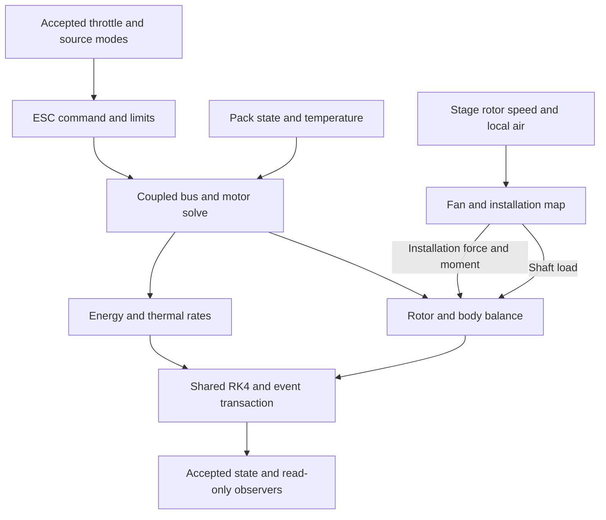

# Electric ducted fan propulsion and the Vantage Jet EDF experiment

**Owner:** propulsion/energy lead, with AS, BAT, AV, NK, FL, GP, AUD and UI owners.
**Step prefix:** `EDF-00…15`. **Research date:** 2026-11-21.
**Audited baseline:** `main` at `57abea025f62b20233ca281d58d2acbee4ab8b8e`.
**Delivery branch:** `research/edf-propulsion-2026-11-21`.

**Status:** EDF-00 delivers research, a source audit, reproducible planning
arithmetic and this implementation plan. No EDF runtime, generated aircraft,
physical calibration or flight qualification is delivered by this branch.
Steps EDF-01…15 remain pending. The [research index](../research/edf-propulsion/README.md)
owns actual verification results; [physics and sources](../research/edf-propulsion/physics-and-sources.md),
[repository audit](../research/edf-propulsion/repository-audit.md) and
[validation matrix](../research/edf-propulsion/validation-matrix.md) supply the
engineering handoff.

## 1. Goal and first playable slice

Add a reusable **electric ducted fan** propulsion family, then make a separate
experimental EDF variant of the current **Vantage Jet / SebArt Avanti S A200**.
Retain the existing `sebart-avanti-s-a200-p100rx` turbine sibling and its identity.
The experiment keeps the same airframe scale, wing, tail, retracts and control
layout, with explicitly authored EDF installation and mass changes. It is not
the smaller Avanti XS or a Freewing foam Avanti.

Use a **128 mm Schübeler DS-98 / DSM6036-600 class** as the first identified
reference. Study **152 mm DS-130** and **195 mm DS-215** configurations through the
same architecture. These actual sizes, published power ranges, source
disagreements and unproven fit are documented in the
[candidate comparison](../research/edf-propulsion/physics-and-sources.md#2-large-fan-candidates).
The 195 mm case is the deliberate oversized experiment; start it on a propulsion
stand, then admit an A200 installation only after its explicit geometry and mass
assumptions pass the corresponding software checks. Physical fit remains a
separate measurement gate.

**First playable research slice:** one forward-facing internal fan, one electrical
bus/pack, fixed blade pitch, fixed duct geometry, one declared rotation sense,
coupled rotor/body RK4, finite battery, bounded throttle-off/windmill behavior,
runway and airborne starts, gear/flaps, HUD, explicit audio routing and exact
checkpoint/replay. Its estimated quantities and unsupported regimes remain
visible. Physically unmeasured parameters do not prevent a clearly labeled
simulation experiment, but cannot support a realism or manufacturer-equivalence
claim. A validated numeric model is required even for experimental admission.

Multiple fans, differential throttle, thrust vectoring, general compressor
surge/rotating stall, active braking/regeneration, blade structural failure and
automatic conversion of imported EDF aircraft are separate later extensions.
Do not expand the first slice into a general power-distribution framework.

## 2. Architectural decisions

### 2.1 Add a distinct family, reuse the existing contracts

Proposed `propulsion.kind = "electric_ducted_fan"` makes the difference visible
to admission and consumers. Final spelling/module version is frozen in EDF-01.
Keep `electric_prop` semantics and identities intact. Prefer retaining the
geometric `single_centerline_jet` layout while explicitly extending its currently
turbine-only family/energy admission, and add an internal-fan contact capability.
The layout name does not itself mean fuel-burning. EDF-01 must document a real
semantic need before adding another layout enum; never disguise EDF as
`single_tractor` or infer exposed blades from its diameter.

Reuse the stateless electrical conventions, battery law, simultaneous rotor/body
solver and existing session transaction. The fan/duct law belongs in a model
adapter and pure evaluation helpers. **Simulation must not branch on EDF.**
Design the native C++ stage alongside the GDScript reference from the start;
production admission follows the existing native policy, not a new shortcut.

The main data flow is:

This is a dependency diagram, not a new update loop. Every stage evaluates its
own detached state, atmosphere and operating point; observers consume only
accepted results. No stage updates modes, RNG, telemetry history or presentation.

### 2.2 Separate shaft load from installation force and moment

The current propeller path uses rotor aerodynamic torque both as a shaft load
and as an external body roll moment. A ducted fan's stators can recover much of
that external torque. The EDF stage must return both:

| Output | Consumer / meaning |
| --- | --- |
| `fan_shaft_load_nm` | Rotor equation; load opposing the selected positive spin convention, with separately defined windmill signs. |
| `installation_wrench_body` | Six body-frame force/moment values about the current reference, including the chosen inlet/nozzle/stator boundary exactly once. |
| Electrical quantities | Motor and pack current, terminal voltage, DC power, shaft power and explicit losses, with units and conventions. |
| Domain/quality state | Measured/interpolated/estimated continuation, source/map identity and out-of-support flags. |

The existing `RotorCoupling` solver supplies relative-spin reaction and the
rigid-body derivative supplies gyro terms. Do not add them again. Keep thrust
axis and spin axis distinct. See the
[equation contract](../research/edf-propulsion/physics-and-sources.md#5-shaft-torque-stators-and-the-rigid-body)
and EDF-A03 for exact source integration points.

### 2.3 Choose one force representation per law

The first coupled model uses a calibrated or explicitly estimated map returning
rotor shaft load and installed wrench. Map metadata declares whether the force
is isolated net thrust or installed net thrust, its reference planes, support
tare, duct/nozzle geometry and external-airframe exclusions. Measured DC power
is not measured shaft power; loss-based inference must retain provenance.

A pressure-rise/flow/nozzle solver is an alternative when sufficient data exists,
not a required CFD project and not an additional force applied beside the map.
Do not add ram drag, pressure thrust, a shroud multiplier or stator torque already
included in a measured net force/moment. Airframe/installation drag ownership
must be explicit before flight tuning.

### 2.4 Do not hide missing identification with a turbine governor

The preferred law solves motor torque, fan torque, voltage sag and rotor inertia.
An independently fitted black-box RPM/thrust/DC-power response is useful as a
stand comparison when motor parameters are not identifiable. Such a model needs
its own law identity and energy treatment; it cannot masquerade as a measured
shaft model or be inserted inside that model as a second RPM governor. The first
flight slice uses the coupled law with clearly labeled parameter estimates until
matched measurements improve them.

### 2.5 Support the experiment without changing its sibling

Proposed catalog ID: `sebart-avanti-s-a200-edf128-experimental`, display name
**Vantage Jet · EDF 128 (Experimental)**. EDF-01 must confirm uniqueness and the
project's naming rules before adoption. Larger candidates get separate IDs and
installation manifests if promoted; a stand configuration is not automatically
a catalog aircraft.

Share immutable airframe sources and suitable visual assets. New component
inventory, fan maps, pack bytes, installation geometry and generator output are
independent. Recompute mass, CG, inertia, trim and ground-support consequences.
State of charge does not deplete battery mass. Preserve stock turbine data,
goldens and recordings on their matching law/backend identities.

## 3. Ownership and proposed file boundaries

Existing files below are integration points, not permission to rewrite all their
consumers at once. Proposed paths are deliberately shown as code until created.

| Owner | Existing boundary | Proposed focused additions |
| --- | --- | --- |
| EDF/physics | `app/physics/propulsion.gd`, `dynamics.gd`, `rotor_coupling.gd` | `app/physics/edf/fan_map.gd`, `installation.gd`, `operating_point.gd`; pure kernels, explicit units and moments. |
| EL/BAT | `electric_motor.gd`, `electric_supply.gd`, `battery/pack_ecm.gd`, `battery/esc_supervisor.gd` | Reusable bounded motoring controller behavior only where needed; measured controller config under owning data sources. |
| AS/data | `aircraft_modules.gd`, `aircraft_data.gd`, `app/data/schema/`, `research/aircraft-standardization/build_schema.py` and schema tools under `research/aircraft-data/schema/` | Explicit EDF branch, conditional modules, quantity/unit/domain and failure-path coverage. |
| Session/FL | `flight_session.gd`, `aircraft_propulsion_runtime.gd`, `trace.gd`, electric battery step and recorder identity | A narrow EDF adapter/helper where warranted; no second transaction or uncheckpointed state. |
| NK | `app/sim/native_stage.gd`, `research/native-kernel/src/` and qualification tools | `nk_edf*.hpp` helpers, prepared map/layout and guards with actual native call receipts. |
| AV/data | `research/avanti-s/av06/`, `assets/aircraft/avanti-s-a200/` | `research/edf-propulsion/avanti128/` input/derivation pipeline and separate generated aircraft output. |
| Catalog/model/UI | `app/app_state/aircraft_catalog.gd`, `app/aircraft/model_registry.gd`, aircraft adapter, Home and HUD | Separate experimental variant and installation presentation; preserve stable control/hinge names. |
| GP/CR/AUD | Hull/prop contact, crash metadata, `app/audio/` | Internal-fan contact semantics, correct LiPo source, explicit EDF observers and safe audio fallback. |
| AE/scenarios | Workshop descriptors, failures, Natural Random, Creator imports | Support with owning tests or explicitly exclude; no silent migration. |

The [source audit](../research/edf-propulsion/repository-audit.md) includes exact
symbols and current assumptions. Consult scoped `AGENTS.md` before each future
edit. Materialize required sources/imports in the implementation checkout; a
sparse checkout is sufficient for this research, not for claiming runtime tests.

## 4. Data contract to freeze before coding the flight path

EDF-01/02 must define a closed versioned schema, with quantities following
`{value, unit, kind, source}`. A conceptual grouping is:

| Group | Required information / checks |
| --- | --- |
| Identity | Family and law versions, map/installation hashes, exact hardware and firmware context, source format and generator receipt. |
| Geometry | Actual rotor tip/hub/casing dimensions, FSA convention, blade/stator count, clearance, fan/intake/nozzle reference positions, thrust/spin axes and duct identity. |
| Motor/ESC | Kv and resistance convention, loss context, inertia, valid voltage/RPM/current limits, command mapping, ramp/current supervisor and cutoff policy. |
| Pack | Existing generated pack/template identity, series/parallel wiring, mass-matched inventory mount, initial charge/temperature and LVC. |
| Map | Input/output units, interpolation and endpoint policy, shaft versus DC-power basis, net/gross force boundary, moment datum, uncertainty and supported domain. |
| Continuation | Finite stopped, windmill, high-advance-ratio and reverse-inflow behavior; explicit unsupported reverse-spin/brake/regeneration modes. |
| Presentation/contact | Internal fan rather than exposed propeller, installed component metadata, observer/audio capabilities and source-loss behavior. |

Admission must reject mismatched energy kinds, missing maps, invalid axes,
nonphysical inertia, impossible annulus areas, unit mismatches, nonmonotone axes,
NaN/Inf, duplicate or missing identity fields, unsafe time constants and
unsupported mode combinations. Reference and native must agree on refusal.
Bounds must cover the chosen experiment without blanket relaxation of existing
aircraft limits. Update offline validation and runtime normalization together.

## 5. Step register

The order below defines reviewable changes. A step is complete only when its
specific proof exists; producing source or a document is not a passed flight gate.

| Step | Work | Required proof / status |
| --- | --- | --- |
| EDF-00 | Research, repository audit, candidates and plan | Delivered in this branch; actual check record in research index. |
| EDF-01 | Freeze model/data/interface and experiment specification | Pending; reviewed force/torque/energy ownership and compatibility decisions. |
| EDF-02 | Acquire, identify and prepare map/installation data | Pending; reproducible source-to-map receipt and uncertainty/domain. |
| EDF-03 | Implement pure fan and installation reference law | Pending; analytic, limits, units and signed-load checks. |
| EDF-04 | Electrical limits, thermal admission and coupled operating point | Pending; energy/current closure, startup limits and stable integration. |
| EDF-05 | Integrate session state, events and replay | Pending; atomic lifecycle, refinement and exact replay. |
| EDF-06 | Native evaluator and admission | Pending; prescribed parity, guards, actual call coverage and package scope. |
| EDF-07 | Generate A200 EDF sibling and mass/geometry | Pending; generator freshness, identity, balance and turbine preservation. |
| EDF-08 | Catalog, controls, HUD, sound and contact behavior | Pending; actual product flow and internal-fan contact checks. |
| EDF-09 | Reproduce stand data and calibrate within domain | Pending; matched held-out physical data, separate from numerical checks. |
| EDF-10 | Qualify experimental aircraft flight and power-off handling | Pending; controlled flight cards, replay, pilot and uncertainty evidence. |
| EDF-11 | Run 152 mm and 195 mm scale experiments | Pending; each installation independently specified and admitted. |
| EDF-12 | Cross-platform/package/performance gates | Pending; target OS/backend identities and production workload evidence. |
| EDF-13 | Optional Workshop/failure/scenario integration | Pending; explicit consumer gates, no silent import/seed migrations. |
| EDF-14 | Physical promotion and documentation closeout | Pending; physical claims match evidence, reproducible delivered sources. |
| EDF-15 | Bounded inherited turbine repair | Pending; AV-owned low-speed defect reproduced and separately reviewed. |

### EDF-01 — Freeze the experiment and contracts

1. Record turbine baseline source/config/model/backend identities and the exact
   preservation surface. Confirm the new sibling's catalog/display IDs.
2. Specify reference planes, thrust/spin axes, map power basis, external wrench
   and shaft-load ownership. Review the ideal-stator and windmill counterexamples.
3. Select one pack, controller mode and rotation sense for the first slice;
   distinguish provisional estimates from measured values.
4. Freeze schema/module versions, state blocks, observer fields and unsupported
   consumer choices. Give native and reference the same inputs and error contract.
5. Prototype domain-diagnostic transport before promising all-stage coverage.
   Current `VehicleModel` stage context reaches the k1 substep selector, not a
   general accepted-stage reducer. Qualify a generic accepted-path receipt
   extension or compatible owner-controlled step policy that retains only final
   accepted stages/substeps, preserving event bisection and rollback. Keep EDF
   dispatch outside Simulation. An endpoint-only first version is permissible
   only with an explicit limitation: it cannot certify intermediate-stage support.
6. Have the Good Enemy review physical consistency and the smallest viable
   architecture. Resolve concrete findings before runtime coding.

**Proof:** signed-off specification and T01/T02/T04/T06 test designs with independent
expected results. EDF-A11 identifies a concrete transport limitation; prove the
smallest compatible design before extending a kernel protocol.

### EDF-02 — Build an auditable data package

1. Record manufacturer part/revision, rotor/stator and controller setup; resolve
   DS-215 motor-name and old/new cell-range disagreements.
2. Preserve source URL, date, page/figure, exact acquired-file hash and allowed
   reuse. Digitize plots with uncertainty; retain source points and conversion.
3. Obtain or bound rotor inertia, equivalent motor resistance/no-load loss,
   shaft load and installation residual moment. Do not derive all from static
   thrust alone or call DC input a measured mechanical load.
4. Survey inlet/outlet open areas, duct bends, mounting and battery envelopes.
   Start with a labeled virtual installation if physical measurements are absent.
5. Split fit and validation cases by operating point, voltage/SOC, incidence,
   temperature and step history. Store each map's domain and finite continuation.

**Proof:** reproducible map generator and held-out dataset manifest; each absent
quantity has an explicit estimate/bound or blocks the corresponding physical claim.

### EDF-03 — Implement pure fan/duct mechanics

1. Add pure scalar/packed-float64 map evaluation with explicit units and deterministic
   interpolation. Evaluate thrust, shaft load and installation wrench together.
2. Add finite stopped/freewheel and windmill behavior without dividing by zero RPM;
   retain physical negative net thrust and distinguish reverse inflow.
3. Compute local stage inflow at declared stations and transform force/moment to
   the current datum. Do not add measured ram/duct effects twice.
4. Feed shaft load and complete external wrench separately to the existing
   body/rotor balance. Validate carrier inertia and rotation convention.
5. Establish limits, characterize continuity and derivative discontinuities at
   map knots, and prove finite outputs, passivity/energy behavior by regime and
   diagnostic domain flags before session integration.

**Proof:** T02–T06, including nonzero shaft power and nonzero opposing rotor/stator
fluid moments with zero net external axial torque of the whole installation,
opposite-sense symmetry and signed-flow limit cases.

### EDF-04 — Integrate electrical behavior and numerical admission

1. Reuse the single-bus pack/motor solve, respecting duty-dependent motor versus
   battery current. Check terminal, DC, shaft, loss and rotor-energy ledgers.
2. Add the selected current/ramp behavior with explicit state/sample convention;
   current limiting must affect torque/effective duty and voltage consistently.
3. Repair the battery thermal admission omission under BAT ownership. Bound
   mechanical, fan-load, RC, electrical/thermal feedback and controller rates.
4. Keep the ideal prescribed-bus mode a separately identified lab mode. Qualify
   finite-pack launch, weak-cell cutoff and low-SOC infeasible operating points.
5. Add motor/ESC thermal states only with an explicit estimated or measured model;
   otherwise report their temperatures/derating as unmodeled and restrict claims.

**Proof:** T07–T10. No hidden power/current clipping, no post-step temperature
clamp used to conceal stiffness, and no presumed manufacturer current capability.

### EDF-05 — Own state, events and replay transactionally

1. Add explicit continuous/sampled blocks to the fixed-wing adapter; pin state
   layout and law identity. Store every new dynamic state in checkpointed data.
2. Extend steady/airborne initialization and runway spin-up. A trim point must
   solve the admitted fan/electrical system, or return a precise refusal.
3. Compose stop/exhaustion/source-loss/current/LVC events with existing contact
   subdivisions. Sample discrete supervisors at their declared boundary only.
   A one-sided rotor must refuse unsupported reverse breakaway atomically rather
   than invent a holding reaction. Qualify forward breakaway and static hold.
4. Verify reset, pause, rejected reload, fault, rollback and restore preserve the
   whole accepted frame and source identities. Publish observer state once.
5. Extend trace and `.orfl` metadata with map/installation/controller identity;
   reject mismatched playback rather than substituting a sibling/backend.
   Implement the diagnostic scope frozen in EDF-01. An all-stage claim needs the
   qualified accepted-path transport; rejected trials publish nothing. Test a
   k2-only excursion, rejected subdivisions and rollback. An endpoint-only mode
   must disclose its narrower scope. Every stage still refuses evaluations beyond
   the separately bounded continuation envelope.

**Proof:** T11–T15 and 240/480/960 Hz convergence cases with events, including two
near-coincident boundaries and deliberately invalid native/reference inputs.

### EDF-06 — Native evaluation from the same specification

1. Prepare immutable EDF map/geometry/electrical data and explicit layout checks.
   Keep per-stage evaluation bounded and avoid new steady-state searches inside
   every stage when only a direct map/bus evaluation is required.
2. Port the same arithmetic order and discontinuity policy; preserve strict
   floating-point behavior and do not enable fast-math to gain parity tolerance.
3. Extend source/configuration/live-context guards and backend identity. Verify
   supported native selection, prepare refusal/fallback and live tick refusal.
4. Run the existing native policy: at least 10,000 states, required byte parity
   on matching engine/toolchain, exact kernel trajectories, invalid-input,
   fault/restore and actual native-call coverage.
5. Bind platform engine/library/source/data/toolchain receipts. A fallback pass
   does not count as native coverage; do not claim cross-platform byte identity
   from a same-platform comparison.

**Proof:** T16/T17 and the [native guide](../../research/native-kernel/README.md).
Reference-only experimental development remains selectable and explicitly labeled.

### EDF-07 — Generate the A200 EDF installation

1. Create a dedicated EDF source/generator path that reuses airframe inputs,
   preserves existing node names and cannot overwrite turbine outputs by default.
2. Remove the documented turbine/fuel-only components, resolve bundled avionics,
   add fan, motor, controller, packs, ducts, wiring and mounts, and regenerate
   mass/CG/inertia. Do not inherit automatic fuel-specific ballast or balance.
3. Check internal and external envelopes, duct-area ratios, cooling paths and
   thrust line. Record any virtual inlet/outlet modification on the same airframe.
4. Regenerate contact/gear support and affected physical/model descriptors; run
   fresh-loader consumers, not only generator freshness.
5. Preserve turbine generator `--check`, source bytes, catalog IDs and matching
   baseline recordings; independently trim the EDF at its own mass/power.

**Proof:** T18/T19 and a mass/geometry report showing unknowns. The current
72 mm surrogate exit is a fit investigation input, not a ready EDF nozzle.

### EDF-08 — Make the experimental variant usable

1. Add a distinct catalog/model entry, Home description and direct-flight route;
   use the same logical radio commands, gear and flap controls.
2. Show pack charge, volts, battery amps, power and fan RPM from accepted state;
   distinguish ideal-bus mode, estimated maps and unmodeled thermal quantities.
3. Add explicit EDF audio selection. Rotor blade-pass frequency can inform sound
   design, but sound must never feed back into physics; preserve licensing and
   use a safe labeled fallback until a matched recording is available.
4. Exclude the internal rotor from exposed-prop strike inference and update
   crash energy metadata. Retain hull collisions and honest failure scope.
5. Verify actual Home → select → runway/airborne → pause/reset → Home → restart
   flows, controller arming and source-off behavior. Preserve saved selection.

**Proof:** T20–T23, real rendered 1080p review under the shared display policy,
audio listening when available, and explicit evidence gaps otherwise.

### EDF-09 — Calibrate and independently validate the stand

1. Match fan/motor/controller, intake/nozzle, voltage measurement point, firmware,
   cooling and atmosphere to the source dataset.
2. Fit only the calibration subset. Report thrust, DC power/current, RPM, residual
   moment, transient timing and temperature with uncertainty and domain limits.
3. Test independent voltage/SOC, wind-on and incidence points, not just static
   full throttle. Keep rotor shaft torque measurements separate from balance torque.
4. Reject unsupported physical claims when error plus uncertainty exceeds the
   predefined limit; report inconclusive results explicitly.

**Proof:** V01–V05. A plot fit and native parity do not close physical validation.

### EDF-10 — Fly controlled experiment cards

1. Preserve baseline recordings separately for turbine and EDF; exact replay is
   checked within each matching model/law/backend.
2. Run runway takeoff, trim, partial/full throttle acceleration, climb, go-around,
   throttle-off descent, windmill restart, approach with flaps and landing.
3. Test high incidence, gusts, hot/high density, low-SOC cutoff and repeated
   flight/reset. Record T/W, power, mass, duration, ground roll and domain flags.
4. Compare sibling flights with controlled conditions and separately trimmed
   starts. A single post-conditioned input tape does not retrim the aircraft or
   model pilot adaptation; do not force an incompatible turbine replay into EDF.
5. Obtain pilot acceptance separately from software and physical parameter gates.

**Proof:** T24/V06, complete recordings, identities and outcome-specific limits.

### EDF-11 — Expand to 152 mm and the oversized 195 mm experiment

1. Run each exact manufacturer's static setup in the stand with its own map and
   power budget. Do not scale the 128 mm coefficients by diameter alone.
2. Build a separate virtual installation manifest: casing/mount envelope, inlet,
   nozzle, cooling, actual or bounded pack mass, CG and full inertia.
3. Apply the same schema, energy, event and numeric gates. Sweeps may vary pack
   mass, impedance and installation losses, but must label assumptions.
4. Admit an A200 flight only with an internally consistent explicitly modeled
   installation. If it requires a larger airframe, create a separately named
   vehicle concept rather than alter the reference A200's scale.

**Proof:** a per-size feasibility matrix: supported simulation experiment,
unresolved physical fit, or different-airframe requirement. Physical promotion
always requires the actual installation's evidence.

### EDF-12 — Qualify packages and performance

1. Run required CI unchanged, inspect actual tested commit/merge SHA and capture
   engine diagnostics as well as process exit codes.
2. Verify native/reference preparation, recording, restore and source selection
   in actual Windows/Linux/macOS exported artifacts under each supported route.
3. Measure matched production flights on target hardware: physics p50/p95,
   event-tick tails, frame pacing and allocations. The existing 500 µs physics
   target remains a gate, not a claim made by this plan.
4. Keep renderer/display/hardware identity and the shared 1080p/Retina policy.
   Headless, software-rendered or emulated results do not qualify hardware feel.

**Proof:** T25–T27, unchanged sibling regressions, required CI and package receipts.

### EDF-13 — Extend optional consumers deliberately

1. For Workshop, regenerate descriptors and qualify new fan/intake/nozzle offset
   rebasing under mass edits, finite-pack trial policy, save/export/load and restart.
2. For failures, explicitly implement/test source-loss semantics or keep EDF out
   of that catalog; no turbine flameout substitution.
3. For Natural Random, retain old v1 ordering and seed results; a new EDF-aware
   policy is versioned. Audit companion/trim assumptions before admission.
4. Keep Creator's imported-EDF-as-turbine approximation labeled. Automatic
   conversion needs its own hardware/data and migration plan.

**Proof:** T28 and the owning AE/EM/NR/AC acceptance gates. Exclusion is a valid
first-slice decision when clearly communicated and enforced.

### EDF-14 — Promote only what the evidence establishes

1. Review the complete evidence chain from source and generator to package and
   flight. Record supported operating domains and remaining estimates.
2. Keep the variant experimental until physical and pilot gates pass. A research
   aircraft may remain useful indefinitely without a manufacturer-validation claim.
3. Consolidate completed implementation instructions into the owning guides;
   retain valuable sources, maps, assumptions, receipts and open work.

**Proof:** a scoped promotion record, not a blanket “all tests passed” statement.

### EDF-15 — Repair the inherited turbine boundary separately

1. Reproduce EDF-A02 in the pure reference/native laws with accepted A200 rows.
2. Establish actual source-on/off/start reachability and the intended low-RPM
   domain, then choose a finite continuation or explicit rejection.
3. Verify stopped/idle/full endpoints, finite fuel, native parity and matching
   turbine replay. Review this AV repair independently from the EDF conversion.

**Proof:** T29. No repair, new golden or broadened turbine realism claim is
implied by discovering the issue in this research.

## 6. Acceptance boundaries and stop conditions

| Gate | What can be claimed | What still cannot be claimed |
| --- | --- | --- |
| Research delivery | Sources, equations, audit and implementable sequence reviewed | EDF implemented or flyable. |
| Pure numerical stand | Defined equations, signs, domains and conservation verified | Correct hardware parameters or installed performance. |
| Experimental playable sibling | Coherent generated data, lifecycle, controls, native/reference scope and ordinary flight work | Measured A200 fit, endurance or pilot realism without the separate evidence. |
| Physically qualified installation | Stated measured outputs satisfy predefined uncertainty-aware limits within a named domain | Universal EDF accuracy, arbitrary scaling, untested controller modes or other aircraft. |
| Package/target qualification | The measured platform/backend/renderer route passes its gates | All hardware, fallback paths or other OS architectures. |

Stop promotion when the energy ledger cannot close, maps require unsupported
extrapolation without a declared continuation, new dynamics exceed qualified
integration bounds, admission silently routes to another family, or evidence is
missing for the claim being made. Preserve the current accepted state and explain
the concrete reason. This does not require asking again for permission to carry
out already authorized branch work.

## 7. Immediate next implementation change

Start with **EDF-01 plus the analytic stand portion of EDF-03**: freeze a minimal
map/interface, implement the separate shaft-load/installation-wrench outputs and
prove zero-swirl, spool, windmill and zero-speed cases. In parallel prepare the
EDF-02 source package and BAT thermal-admission regression. Do not begin by
copying the turbine aircraft JSON or globally broadening `is_electric()`; those
shortcuts bypass the actual contract changes this investigation identified.
