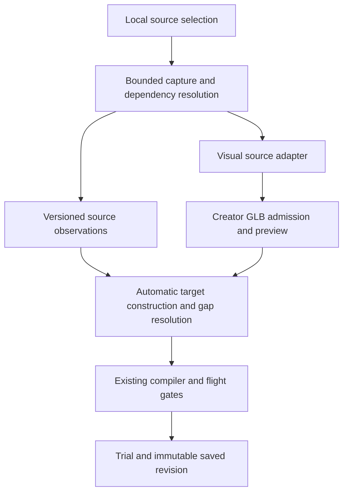

# Flight Simulator aircraft import and RC conversion plan

**Date:** 2026-11-16. **Status:** proposed feature; research and design delivered, no Flight Simulator importer implemented or aircraft qualified. **Owner:** Aircraft Creator / Workshop. **Steps:** AC-FS-00…15, under AC. **Source baseline:** `6dfe1b9179af408f6b765b91ca164e626570db9f` on `main`. This plan owns scope, implementation order and acceptance. The [dated investigation](../research/aircraft-creator/flight-simulator-2026-11-16/README.md) owns repository observations, version compatibility and evidence; [conversion and scaling](../research/aircraft-creator/flight-simulator-2026-11-16/conversion-and-scaling.md) owns the proposed mathematical mapping; [sources and examples](../research/aircraft-creator/flight-simulator-2026-11-16/sources-and-examples.md) owns external references and inspected aircraft.

The [24-investigation follow-up](../research/aircraft-creator/flight-simulator-2026-11-16/follow-up-24-investigations/README.md) adds GitHub, aircraft-author and specialist-forum evidence. Its [tool and fixture backlog](../research/aircraft-creator/flight-simulator-2026-11-16/follow-up-24-investigations/tooling-and-fixtures.md) is incorporated below as proposed acceptance work, not installed tooling or demonstrated conversion.

The [2026-11-17 code investigation](../research/aircraft-creator/flight-simulator-2026-11-16/code-investigations-2026-11-17.md) adds 26 concrete cases from pinned aircraft/tool/importer source and current OpenRC seams. The [milestones and contingency evidence](flight-simulator-import-milestones.md) group the existing AC-FS work into eight delivery outcomes with entry/exit/stop criteria, independent fixtures, finite-budget records and change invalidation. Those documents deepen this plan; they do not create implemented compatibility or new parallel track owners.

The [20 additional game and asset-pipeline studies](../research/aircraft-creator/flight-simulator-2026-11-16/game-repository-survey-2026-11-17.md) inspect actual code from games, RC simulators, engines and asset libraries. Their G01–G20 cases add metadata-first discovery, transitive dependency readiness, content/recipe-based reuse, source-located help and staged resource ownership. These are proposed extensions of existing Creator services; no external engine/framework or converter is selected by the survey.

## 1. Product result

**Owner clarification, 2026-11-16: automatic in-app conversion is the default product goal.** The player selects a supported Flight Simulator aircraft source; OpenRC detects, interprets, translates, converts and constructs the target RC aircraft automatically. The application asks only for genuinely unresolved choices or missing information and presents an editable aircraft ready for the supported flight experience. The [automatic import wizard](flight-simulator-import-wizard.md) owns the detailed resolution policy, conditional screens, sliders, editing and readiness contract.

The normal journey is **select source → automatic conversion → answer only unresolved questions, if any → editable preview → save and fly**. A complete, unambiguous supported source with an applicable declared RC profile requires zero follow-up questions. Source selection and final save/launch are ordinary actions; mandatory per-field or per-control confirmation screens are not part of that successful path. All meaningful automatic inputs remain editable before completion and later in Workshop, with their origins and dependent recomputation preserved.

The feature has three distinct outputs: an imported visual model, attributed source observations, and an OpenRC flight configuration. Each has its own status and identity. Automation produces and validates those outputs; visual success alone cannot authorize flight or establish real-aircraft calibration.

### First completed feature and development increments

The first completed release must automatically handle a **documented, bounded MSFS 2020 source profile inside OpenRC**, including readable configuration and its qualified visual/material dependencies. The player must not need an external converter, manual CFG editing or a separately prepared GLB for an advertised automatic source. AC-FS-04 selects an app-owned conversion implementation and exact admitted source subset; unsupported forms retain explicit outcomes.

Readable CFG plus a Creator-compatible prepared GLB remains an early engineering/report milestone and an optional advanced/recovery route. It does not by itself complete the automatic-import feature. Existing research recommending that route first records the earlier delivery assumption; this clarified product contract takes precedence for release acceptance.

The first flyable target remains a conventional aft-tail, single-tractor electric RC airplane inside a qualified Creator domain, with a finite battery and Airborne/Hand-launch starts. A declared, editable **Create an RC version** profile may automatically select target span, estimated construction and a supported electric installation for an eligible source. A qualified ideal/estimated power profile is permitted, with borrowed data and unmodeled ratings disclosed; it is not validation of a real hardware combination. This is a new RC design with its own identity, not a claim of identical source behavior. Preserve the source facts and disclose estimates in the result. Do not silently remove another engine, reshape the wing/tail, invent unsupported controls or clamp explicit user values to fit a package.

### Availability states

| State | Player result | Required evidence |
| --- | --- | --- |
| Analyzing/converting | Responsive progress while OpenRC resolves and converts | Bounded owned source and jobs, cancellation and stage identity |
| Needs input | Only actionable unresolved choices, with appropriate sliders/selectors | Exact missing/conflicting dependency or target decision; no repetitive resolved questions |
| Converted/editable | Admitted exterior and a preserved draft with origins and limitations | Valid supported visual/authoring result; any remaining blocker named |
| Ready for supported flight | Editable result, save and checked flight in the stated mode | Frozen candidate and checked launch identity, complete domain and applicable numerical/start/lifecycle gates; an unsaved trial is allowed |
| Saved usable aircraft | Home selection; restart, reopen, edit a new revision and fly | Creator publication/resolver/portable and packaged-platform gates |
| Calibrated RC configuration | Bounded handling claim for a real installation | Independent RC measurements and held-out evidence |

Reports, previews and editable drafts can be delivered as partial milestones. The completed automatic feature requires the ready/saved journey for an exact supported source; unavailable physics or unsupported source content must retain its limited status. Runtime checks use qualified recipes/profiles and the candidate's exact identities; they do not run an entire research qualification campaign on every import.

## 2. Existing foundations and dependencies

The [Creator plan](aircraft-creator.md) and [ClearView subplan](clearview-aircraft-import.md) remain authoritative. At the inspected baseline:

| Existing seam | Reuse | Constraint on this feature |
| --- | --- | --- |
| `creator/source_importer.gd`, `inspected_source.gd` | Capture once, content-based admission, immutable owned bytes | Direct inputs remain STL or the supported GLB subset; FS CFG/glTF/MDL is not already admitted |
| `glb_preflight.gd`, `png_check.gd`, `visual_builder.gd` | Checked self-contained visual boundary and fresh runtime instances | No external buffers/images, animation/skin pass-through, unknown required extensions or arbitrary engine import |
| `clearview/archive.gd`, `deflate.gd`, `cancellation.gd` | Review bounded ZIP and cancellation primitives for reuse | Current limits and dialect belong to ClearView; share only after explicit versioning and regression checks |
| `clearview/observations.gd`, Creator `source_observations`, source-report UI | Source declarations separate from emitted physics | Current report is ClearView-specific, closed and read-only; it cannot accept FS dictionaries unchanged |
| `placement.gd`, `visual_parts.gd` | Size, orientation, leading-edge datum and confirmed rigid controls | Positive uniform scale, finite supported transforms, restricted role/node/pivot bindings |
| `definition.gd`, `compiler.gd`, `packages.gd`, `record_loader.gd` | Complete definition → ordinary `openrc-aircraft v2` → accepted candidate | Current estimated trainer/power package and evidence vocabulary constrain adoption |
| `trial.gd`, existing root/Main Creator route | Frozen reference-backend test flight and return | Exact start/check/launch receipt and lifecycle coverage remain owning AC work |
| `store.gd`, AC-18 resolver, AC-19 bundle | Immutable versions, publication, later Home and portability | Existing Store source is a bounded converted-model blob, not a full simulator package |
| Stock Workshop transforms | Capability-based prior art and reference formulas | Size/weight/virtual power scaling is restricted to prescribed-RPM propellers; it does not authorize arbitrary imported electric/fuel/gear transformations |

**Flight dependency:** AC-12 did not pass its preregistered numerical campaign. Retain that evidence and close the gate for the selected domain, or qualify a separately specified domain through the physics owner. Do not change thresholds after observing results and then relabel the old campaign as passing. A source parser or a successful trim cannot close this dependency.

Creator Home integration, portable `.orcaircraft`, imported `.orskin` and exported-target qualification remain open. Existing stock `.orskin` paint and Workshop variant bundles have different contracts. This feature must use the owning AC work instead of creating a second store, a parallel Home catalog or an incompatible package format.

Keep the 240 Hz float64 kernel, ordinary aircraft loader and stock aircraft generators unchanged for importer work. Imported trials start with `gdscript_reference`; stock native-backend qualification does not transfer to a new configuration.

## 3. Compatibility policy

Compatibility is recorded per source form, dialect, aircraft revision and achieved result. Installation name and filename extension are insufficient detection.

| Family | Planned useful route | Boundary |
| --- | --- | --- |
| MSFS 2020 editable/source aircraft | First automatic target: readable CFG and qualified source glTF/material closure; prepared GLB is an optional route | Detect actual accessors/extensions, texture formats, model XML, LOD and dependency closure |
| MSFS 2020 built Community aircraft | Read accessible data; probe visuals or request authorized author export | Built glTF is not guaranteed ordinary source glTF; the official authoring importer explicitly excludes package-built input |
| FSX boxed/Acceleration/Steam | Later bounded legacy automation; CFG/prepared geometry is an interim or recovery route | `.mdl` and `.air` need separate coverage; Steam branding does not prove model-dialect equivalence |
| Prepar3D | Later version-qualified adapter; observations/prepared geometry remain partial routes | Record actual P3D version/model dialect; custom systems, PBR and AIR behavior are not automatically converted |
| FS2004/FS9 | Later bounded legacy adapter; interim CFG/exterior preparation is partial | Older MDL/AIR and animation dialects; no universal native reader commitment |
| MSFS 2024 running a legacy package | Route by detected legacy source form | The host being 2024 does not make the aircraft a native modular 2024 source |
| MSFS 2024 native modular authoring source | Dedicated later adapter | Resolve common/preset/attachment/livery composition, parameter substitution and supported texture/material forms |
| Livery or enhancement mod | Report its separately supplied base dependencies | A repaint or performance patch may contain no complete aircraft |
| Encrypted/protected package or incomplete stream cache | Explain the missing/unsupported source and request an authorized export | No decryption, cache reconstruction, installer execution or access-control workaround |

The [research matrix](../research/aircraft-creator/flight-simulator-2026-11-16/README.md#version-and-source-matrix) carries evidence and uncertainty. This table is a roadmap, not a current supported-formats list.

Initial exclusions from flight conversion: helicopters, VTOL/tiltrotor, custom WASM/DLL flight models, multiengine aircraft, jets/turboprops, unsupported mixers, biplane/compound lifting systems, flexible surfaces, flight-control computers, and full cockpit/gauge systems. Some can be previewed; each flight capability requires its own AS/AC/physics work. Fixed gear, flaps, other powerplants and retracts follow existing Creator ordering; retracts remain last.

## 4. Architecture

Adapters stay upstream of Creator. They never install simulator scripts, modify global weather/control settings, create runtime GDScript, or put simulator-specific branches in `Simulation`. Visual metadata proposes bindings; actual OpenRC control/shaft state drives flight presentation.

### 4.1 Source capture and dependency graph

Select a local source directory or a supported ZIP; automatically select an unambiguous aircraft/variant and ask only if the choice is unresolved. An optional prepared GLB can be explicitly paired with the source information; record that association as user-declared unless common source evidence establishes it. Keep all operations offline after selection.

Inventory and capture a bounded selected dependency closure, preserving source-relative paths and SHA-256 for every file. For directories, use rooted no-follow access or an equivalently reviewed mechanism to refuse symlink/reparse escapes and path-replacement races. Verify both per-file stability and the whole dependency closure before/after capture, including additions/removals and content or trustworthy version identities; refuse observed changes. A file changing after its own capture while another is read is a required counterexample. Ordinary checks cannot prove a globally atomic revision against every concurrent writer: label the receipt as the exact independently captured files unless an actual snapshot or otherwise established quiescent source supports a stronger claim. For ZIPs, reuse proven structure/CRC/actual-expansion checks only within their supported compression and limits. Never extract paths blindly. Capture once; later validation and conversion consume owned bytes rather than reopening original paths.

Resolve `manifest.json`/`layout.json` where present, selected `[FLTSIM.n]`, `model.cfg`, exterior XML/LOD references, buffers, textures, texture fallbacks and `base_container`/aliases. Legacy aircraft may have no manifest. Hashes in our receipt establish byte identity, not authorship or permission; a package file list is not an authenticity signature.

Record the selected base aircraft, ordered overlays, variant, livery, exterior LOD, declared host build and resolution-policy version. An enhancement patch is not a complete aircraft. Retain effective and overridden declarations; a directory enumeration is not a load-order rule. Resolve only documented version-qualified precedence, and keep ambiguous or unsupported global overrides unresolved. Native 2024 requires its later menu/flight composition evaluator, indexed-key handling, aliases, rebind/substitution and attachment transforms. [R07/R08](../research/aircraft-creator/flight-simulator-2026-11-16/follow-up-24-investigations/aircraft-mod-cases.md), [R19/R20/R23](../research/aircraft-creator/flight-simulator-2026-11-16/follow-up-24-investigations/packages-and-tools.md)

All dependencies must resolve within explicit selected roots. Source dependency references may contain `..` to reach a sibling within an authorized root: normalize separators and resolve relative to the declaring file under the pinned dialect, then prove containment with rooted no-follow access. Reject actual root escapes, absolute/UNC/URL dependencies and cycles. A captured file's identity includes its selected root/origin and normalized relative path: reject normalized collisions within a root/archive and unresolved same-tier candidates, while retaining distinct origins across roots for a version-qualified overlay rule. Ambiguous same-name packages remain unresolved. Archive member names retain their stricter path rules; accepting an in-root dependency reference never permits extraction traversal. Use exact names first; a case-insensitive fallback is allowed only when unique and recorded. A missing base or texture stays missing; do not search an installation, download a file, or borrow another aircraft silently. When multiple aircraft remain unresolved, show a picker; preserve per-model outcomes even when a unique source or retained selection avoids the question. [Pinned sibling-reference counterexample C01](../research/aircraft-creator/flight-simulator-2026-11-16/code-investigations-2026-11-17.md#c01)

Model selection follows active parsed declarations, not commented-out XML or filename ranking. Identify generated behavior and model-assembly dependencies separately from authored source ingredients; a base glTF is not necessarily the built exterior. Do not execute source build scripts or substitute authored expressions for generated output. Report missing artifacts and unsupported semantics separately: supplying an authorized generated file resolves its file dependency, while its expressions still need a qualified adapter or a limited result. [C02–C07](../research/aircraft-creator/flight-simulator-2026-11-16/code-investigations-2026-11-17.md#aircraft-and-build-system-cases)

Freeze filename encodings and comparison/normalization rules for both directories and ZIPs. ClearView currently admits ASCII paths only; reuse of its ZIP primitive does not establish Unicode support. Preserve original name bytes and explain unsupported names or collisions. Test NFC/NFD and case-fold cases with the actual target filesystem's representability recorded; a narrow initial policy must still admit the exact real W01 source. [C25](../research/aircraft-creator/flight-simulator-2026-11-16/code-investigations-2026-11-17.md#c25)

Where the dialect allows it, build a bounded per-import candidate index from captured metadata before decoding selected images/meshes. Reuse those captured bytes in the finalized closure and retain the existing whole-capture stability check; an index is neither content admission nor a complete snapshot. Resolve exact visual, livery and physical-configuration choices independently, with their qualified compatibility rules. A removed or invalid explicit selection stays unresolved instead of becoming the first array item. Source changes create a new capture/generation. [G02/G04/G12](../research/aircraft-creator/flight-simulator-2026-11-16/game-repository-survey-2026-11-17.md#g02)

Each dependency edge retains its declaring file/location, logical target, selected/overridden candidates, role, applicable rule and affected capabilities. Required/optional/conflicting roles exist only where the adapter/profile defines their semantics. Diagnose missing nodes, cycles among present nodes, conflicting declarations and ambiguous same-tier sources distinctly. Group downstream failures by their actual shared cause without hiding independent errors. A qualified optional absence creates no question. A fallback rule for optional absence does not cover an unreadable/corrupt required overlay: retain the failure and the limited/refused outcome unless a separately qualified alternative demonstrably satisfies that required capability. Retain invalid declarations and all bounded effective-value provenance before deriving lookup maps. [G03/G06/G08–G14/G16](../research/aircraft-creator/flight-simulator-2026-11-16/game-repository-survey-2026-11-17.md#reuse-decisions-carried-into-the-plan)

Freeze parser budgets before the production corpus campaign: source aggregate and per-file bytes, entry and dependency counts, path length, nesting/recursion, expansion ratio plus actual expanded bytes, numeric/table tokens, decoder workspace and cancellation latency. Start the ZIP investigation with ClearView's existing 64 MiB compressed / 256 MiB expanded policy; **do not treat these as established MSFS capacity or raise them to accept a large download**. Directory capture needs its own bounded policy. The normalized Creator source still must meet its current 32 MiB, 200,000 triangle, 512 node, 32 material, 16 image and 16,777,216 aggregate pixel ceilings. Within the separate bounded source/decoder budgets, qualified in-app LOD selection or reduction may bring a larger source into those output limits. If the normalized result still exceeds them, report it unavailable or offer optional author-prepared recovery; raising the limits requires a separately measured policy revision.

### 4.2 CFG/XML readers and source observations

Implement a small bounded data parser with complete numeric-token validation, finite values, explicit encoding/BOM policy, comments, case-insensitive keys, quoted strings, indexed/repeated records and line references. Preserve raw text and ordering. Unknown keys remain observations. Duplicate conflicts are diagnosed; simulator-specific override rules require documented, tested precedence, never accidental last-write wins.

Keep three identities separate: declared simulator family/version, detected package/model dialect, and CFG section version. For example, a `[VERSION] major=6.0` in a configuration file does not identify FS6 or MSFS 2024. Classify indistinguishable legacy inputs as `fsx-family/unknown` until better evidence is supplied.

Modern aircraft may split sections into `flight_model.cfg`, `engines.cfg`, etc., or keep them in `aircraft.cfg`. Resolve the documented effective configuration. Record modern/legacy flight-model selectors, CFG defaults, version conditions and custom-flight-logic indicators before proposing any physical mapping. Do not read human-readable performance prose as a numeric physics authority.

Use a conditional semantics registry keyed by source family/build, section/field, mode, flags, defaults and subsystem role. Sign, magnitude, normalization and possible autopilot use can differ for the same field. For example, `pitch_moment_delta_elevator` is not wholly inactive in the modern model, and zero-based `point.N[9]` changes from ratio to feet with `set_max_compression`. Unsupported or disputed roles remain unknown. Capture source-declared or player-confirmed discrepancies between model, CFG and runtime reports; do not infer blade count, source completeness or hidden shaft state from arbitrary geometry. [R10/R11](../research/aircraft-creator/flight-simulator-2026-11-16/follow-up-24-investigations/aircraft-mod-cases.md), [R16/R18](../research/aircraft-creator/flight-simulator-2026-11-16/follow-up-24-investigations/physics-and-calibration.md)

XML processing must reject DTDs/entities and external resolution, bound depth/text/references, and parse only supported declarative structures. Behavior expressions, RPN, HTML/JavaScript gauges, WASM, DLLs and executable installers remain inert/unexecuted. If they determine an essential neutral pose, control behavior or FDM, report that dependency instead of claiming complete conversion.

Extend the shared Creator provenance contract with AC-CV ownership. Prefer a versioned provider-discriminated observation envelope and provider-specific validators over copying a second store/report implementation. Old readers must refuse unfamiliar versions without dropping evidence. The current `source_observations` report stays outside physical v2 emission. Extraction status, evidence kind and flight qualification are different fields.

Field adoption requires another explicit contract: today's Definition accepts only `manual`, `measured` and `estimated` authoring evidence and synthesizes generic source strings. AC-FS-02/07 must version and extend Authoring, Definition, Compiler, UI, Store and round-trip readers to preserve each adopted field's source identity, mapping history and supported evidence kind into the emitted v2 quantity. Keep the detailed history outside the closed quantity shape, with a stable reference in `source`. Recompilation must preserve that evidence and exact physical bytes. Until this path is delivered, source values remain read-only observations; adding a provider envelope alone does not enable attributed adoption.

Ownership/override state is separate from evidence and applies at independently editable property granularity. Current inventory items have one `kind` and may be replaced wholesale by estimation; preserving one manually entered mass must not freeze or falsely relabel the same item's estimated position/size. AC-FS-02/07 must extend stable component/property identities, merge rules and reader round trips according to the [wizard editing contract](flight-simulator-import-wizard.md#5-editable-results-and-coupled-recomputation).

### 4.3 Visual normalization

The default product adapter normalizes its qualified source glTF/material subset inside OpenRC and sends its result through existing admission. A prepared GLB uses that same boundary as an engineering or optional recovery route. Inspect container, accessors, buffers, graph, material/texture extensions and actual compiled encodings before allocating or invoking an engine decoder. A directory named `src` does not prove ordinary glTF.

Automatically choose a uniquely justified suitable exterior LOD under the recorded profile, preserving its full hierarchy and qualified source-node identities; otherwise ask the player to choose. List every candidate's role, closure, geometry/image cost and unsupported features; an empty or cheapest LOD is not an automatic exterior choice. Completeness/loss claims require an independently declared expected inventory, source correspondence or player confirmation; otherwise report unknown completeness. Exclude cockpit interiors, collision helpers and effects by role, not by arbitrary filename or mesh size. Reducing detail is permitted only with a recorded conversion profile; never merge parts with different motion or lose required silhouette/UV features silently.

Normalize supported materials into the Creator core PBR subset and images into checked embedded PNG. DDS decoding, normal-map handedness, packed channels, linear/sRGB treatment, transparency and alpha modes need separate known-answer and visual evidence. A DDS decoder is not an MSFS material converter. Standard 2024 KTX2 needs another decoder/format gate; proprietary/streaming variants are not admitted by extension alone. Required unsupported glTF extensions block complete conversion; optional effects can be omitted only with a valid fallback and an explicit report.

Define material profiles by source extension/codec, channel semantics, color space, UV transform, normal convention and alpha. Use independently authored asymmetric UV/normal/ORM/alpha fixtures; a generic DDS flip is not a conversion policy. Preserve captured originals and source-to-output node/part/material correspondence through explicit transformations. Compare optimizer stages against a bounded independently inspectable reference where feasible; controlled fixtures can use already-admitted references. Do not merge different moving parts or assume preservation flags suffice. Larger originals must not bypass runtime limits to provide a reference. Standards validation, Creator admission, visual fidelity and flight are distinct verdicts. [R01–R05](../research/aircraft-creator/flight-simulator-2026-11-16/follow-up-24-investigations/visual-and-legacy.md), [R21/R22](../research/aircraft-creator/flight-simulator-2026-11-16/follow-up-24-investigations/packages-and-tools.md)

Qualify actual accessor encodings, index slice/base-vertex semantics, scene selection and matrix/TRS transforms; do not infer a packed encoding solely from an integer storage type. Preserve source image indices across missing files and distinguish zero material factors from absent fields. A successful tool result with missing selected meshes, repaired-away references or substituted textures is not complete conversion. Every permitted repair/omission needs a rule and independent expected inventory. The normalized GLB must satisfy limits for all retained/engine-built nodes and unreferenced meshes, not just visible scene counts. [C09–C19](../research/aircraft-creator/flight-simulator-2026-11-16/code-investigations-2026-11-17.md#converter-and-validator-cases), [C23](../research/aircraft-creator/flight-simulator-2026-11-16/code-investigations-2026-11-17.md#c23)

When a standards-validator report is used as evidence, pin its version/options and require complete policy-relevant checks. `issues.numErrors == 0` does not prove source-extension support: unknown extensions may be informational and `issues.truncated` marks incomplete reporting. Independently check the converter's required-extension registry and final Creator admission; retain a partial report only as diagnostic evidence. [C15](../research/aircraft-creator/flight-simulator-2026-11-16/code-investigations-2026-11-17.md#c15)

Do not bundle SDK compilers or SDK sample aircraft. Compare independently licensed tools before writing new converters. Asobo's separately licensed Blender plugin, normal Blender/Khronos export, ModelConverterX and DirectXTex are candidates for **optional author-operated preparation**; each has scope, platform and licensing limits in the [tool assessment](../research/aircraft-creator/flight-simulator-2026-11-16/sources-and-examples.md#tool-assessment). The advertised automatic path must ship its required qualified conversion runtime and work without authoring tools installed. Optional author preparation remains a recovery/reference path. Select licensed libraries or app-owned bounded workers and pin exact versions only after a successful spike, dependency review and clean exported-build verification. [Wizard execution contract](flight-simulator-import-wizard.md#2-automatic-pipeline-and-responsibilities)

### 4.4 Placement, dimensions and articulation

Resolve nose/up/right, source physical span, target span, neutral pose and leading-edge datum automatically where qualified source rules or the selected RC profile provide them. Show visible landmarks and ask only for unresolved calibration or target intent. A total mesh bounding box can include a propeller, antennas or folded wings; it is not automatically wingspan. Keep CFG datum, mesh origin, leading-edge datum, ARP and loaded CG distinct.

Use one documented chain: source units/frame → source physical coordinates → target scale → OpenRC leading-edge frame. Record the model-unit calibration separately from the RC scale ratio. Apply compatible transforms to vertices, normals, winding, pivots, controls, physical landmarks and contact proposals. Bake reflections correctly before the strict positive-scale GLB boundary, or refuse them; do not smuggle a left-handed transform through `Placement`. Final trials retain the existing unit presentation scale, preventing a second physics or visual scale.

Source animation names and XML SimVar references contribute to qualified role mappings. Apply uniquely supported bindings automatically and check neutral, midpoint, endpoints and propeller direction against their rule/fixture contract. Ask the player only about ambiguous mappings or needed corrections; a name alone is insufficient evidence. Current bindings rotate mesh-bearing nodes or proper-subset groups about their own origins and selected local cardinal axes, with limited role counts and no overlapping bound ancestors/descendants. Reuse those supported groups. An unrepresentable hinge needs explicit re-pivoting/rigid normalization or a versioned AC-17 extension. Static preview is available only for an admitted rigid result; skin, morph and animation data cannot pass directly through the current preflight. Otherwise refuse the affected preview or motion result. [Binding contract](../../app/workshop/creator/visual_parts.gd) Do not claim that copying keyframes reproduces control mechanics.

Track source-file/node/instance correspondence through graph optimization, normalized indices and actual engine instances. Duplicate names and reordered siblings must not swap bindings; unprovable reimport correspondence needs remapping. Conditional visibility/motion and hydraulic or custom-FDM dependencies remain distinct from a rigid RC target's own control law. [C03/C07](../research/aircraft-creator/flight-simulator-2026-11-16/code-investigations-2026-11-17.md#c03), [C24](../research/aircraft-creator/flight-simulator-2026-11-16/code-investigations-2026-11-17.md#c24)

### 4.5 Dependency readiness and reuse of derived work

**Ownership:** AC-FS-02/03/04/05/10/11 within M1–M4/M7; field recomputation remains AC-FS-07. Reuse current [Authoring revision caching](../../app/workshop/creator/authoring.gd), the [result envelope](../../app/workshop/creator/result.gd) and [immutable Store](../../app/workshop/creator/store.gd). Do not introduce a parallel catalog, source loader into Simulation, or a general asset framework merely to copy another engine's design. The [20-repository decisions](../research/aircraft-creator/flight-simulator-2026-11-16/game-repository-survey-2026-11-17.md#reuse-decisions-carried-into-the-plan) provide the source evidence.

Record a stage's own outcome separately from the state of its required transitive dependencies. A parsed model descriptor with a missing nested texture is not a complete visual closure; neither state establishes flight readiness. Pending/failed edges retain causal paths and generation identity. Terminal outcomes wake only the matching consumers; a stale completion cannot satisfy a newer graph. A required dependency cannot be satisfied by a placeholder, sanitized-away record or a successful log line. Bounded diagnostics must report incomplete analysis if their budget is exhausted.

Establish a correct uncached pipeline before adding measured-useful reuse. A stage key uses the existing versioned exact-byte encoding policy over: stage/schema identity; exact relevant input and dependency identities; selected variant/LOD and interpretation context where relevant; resolution-rule version and relevant positive/negative dependency observations; converter/codec/tool/engine versions and effective options actually used by that stage; and target-profile/producer inputs only for stages that consume them. Include source reference context where identical bytes can mean different dependencies. A filename, UUID, timestamp, declared source version or watcher event is insufficient. A new capture re-establishes membership and absence observations, including an optional file that has appeared since the previous capture.

A reusable entry contains a completed stage's bounded output bytes/observations, their identities and recipe/validation versions. Its output integrity and applicability must be verified before reuse, and current admission owners must validate/reconstruct the required accepted handles. A serialized `ok` flag or old ready receipt grants no admission. Failed/cancelled stages are not successful cache entries. Changing the input, rule, relevant option or producer invalidates affected entries; invalid raw edits still block readiness even if an earlier accepted numeric input has a cached result.

If reuse is justified, begin with job-local deduplication and reuse of completed verified stages; no cross-generation sharing of running tasks is required. A correct uncached importer may recompute an exact retry and still pass when it meets the same frozen limits. Bound entry count, bytes and lifetime, and include retained cache/old-preview bytes in peak accounting. A disposable cache may evict only its own unreferenced derived entries. Accepted Store objects, drafts and historical revisions remain under Store's preservation contract. Corrupt/incompatible entries rebuild from available captured inputs; missing inputs produce recovery guidance, never an automatic replacement download. Persistent derived caching is optional and requires its own scoped ownership/quota proof if selected.

Share immutable decoded geometry only when content, conversion semantics and options match. Preserve every selected instance's identity, transform and control mapping; isolate mutable paint/material/node state. Defer GPU allocation for data that serves only a separate physical/collision role, but retain required source inputs and account for all normalized/engine-built resources. Local paint-only or physical-property edits recompute their declared dependent stages; do not infer independence from names or numeric coincidence. Any selected cache must prove semantic output equivalence to the uncached result before measuring benefit. The [resource contract](flight-simulator-import-milestones.md#resource-and-responsiveness-contract) still controls active jobs, native calls, preview creation and full drain.

## 5. Flight data and RC conversion

The default workflow is **automatic RC construction from attributed observations and a declared target profile**. Preserve original full-scale geometry, mass roles, inertia and performance as reference. Translate supported facts, use qualified geometry inference, and populate the target inventory, equipment, control inputs and supported aerodynamic package without requesting already resolvable data. Use versioned estimates where appropriate; ask only for remaining decisions. Validate the complete coupled result. Source tuned coefficients are not measurements of the RC aircraft. The [wizard resolution and editing contract](flight-simulator-import-wizard.md#3-resolution-policy-and-provenance) distinguishes source facts, target intent, estimates, overrides and unavailable capabilities.

The default mode creates an RC version; the following modes remain visible choices without requiring an extra mode-selection screen when the profile is already resolved:

| Choice | Meaning | Initial availability |
| --- | --- | --- |
| Keep source as reference | Inspect source dimensions/data and visual model | Planned source-report/preview milestone; no full-scale flight promise |
| Create an RC version | Automatically populate target span, inventory, supported motor/prop/battery, controls and aero inputs; show estimates, conditional questions and editable controls | Default automatic workflow, gated by AC/package/numerical evidence |
| Dynamic-similarity estimate | Froude-based dimensional scaling with unchanged coefficient assumptions | Later research option; visibly estimated, never a guarantee of RC similarity |
| Calibrate to RC evidence | Fit only identifiable supported parameters against measurements and held-out flights | Later calibration milestone |

The [mapping specification](../research/aircraft-creator/flight-simulator-2026-11-16/conversion-and-scaling.md) defines units, axes/tensors, mass inventory, aerodynamic normalization, scaling powers and worked counterexamples. Its key obligations are:

- Scale geometry uniformly, but derive final mass/CG/inertia once from the target inventory. A source aggregate tensor is a comparison/fit target, not another component to add on top.
- Preserve every active/inactive/unknown source-field decision. Modern MSFS ignores many legacy derivative magnitudes while some signs or subsystem uses remain active; `.air` tables, CFD and custom code cannot be replaced by matching key names.
- Resolve moments about their actual reference point. OpenRC already transfers ARP loads to CG; do not apply that transfer twice.
- Choose a supported, attributed RC propulsion law/data combination. Rated full-scale horsepower or maximum thrust does not define an electric motor/ESC/battery/propeller law. Keep qualified ideal/estimated simulation profiles distinct from real-installation validation and enforced ratings; equipment edits must remain in their coupled qualified envelope. Finite energy and depletion remain mandatory where the selected capability requires them.
- Keep aspect ratio, taper, wing loading, static margin, tail volumes and thrust/weight inside the selected package's complete domain. Passing mass and span separately is insufficient.
- Explain low-Reynolds uncertainty, especially stall, drag, control effectiveness and post-stall behavior. Similarity equations provide estimates under stated assumptions, not measured handling.
- Preserve requested target values and user overrides on reimport. A revised compiler, scale or equipment choice creates a new configuration; it must not alter a saved revision in place.

Runtime stock support for turbines, fuel, retracts or a flying wing is not evidence that Creator can author those modules. Keep unsupported combinations as drafts until their owners deliver the complete authoring/lifecycle path.

## 6. Records, persistence and user flow

Propose an adapter receipt, `openrc-flight-simulator-receipt v1`, inside the versioned Creator dependency model; this name is a design proposal, not an accepted runtime schema. It references captured source files/hashes and selected aircraft/variant/LOD, source/detected versions, dependency and rights declarations, converter/limits versions, normalized GLB, source-to-target transforms, source observations, adopted field mappings, user overrides, producer/profile versions, dependency invalidation and validation evidence. Reuse the common exact-byte policy rather than inventing a second canonical JSON scheme.

Preserve separate original-source, visual, authoring-definition, emitted-physics and full-trial identities. Paint-only edits do not rewrite physical bytes. A manifest/hash can bind bytes; it cannot authenticate authorship, archive membership without retained originals, permission or physical truth. State those distinctions in the report.

Validate the semantic definition-to-physics relationship independently of hashes: regenerate the physical record with the pinned compiler/package versions and compare exact bytes, or use an equivalently reviewed compatibility proof. Refuse a stored definition paired with unrelated physical bytes even when both hashes are internally consistent. A migration creates a new version instead of silently recompiling an old flight identity. The current Store does not establish this relationship merely by accepting both records.

Do not put a multi-file simulator package into Store's single 32 MiB source slot or `raw` records. AC-FS-02/10 must coordinate a bounded immutable source-closure record with AC-CV-07 and AC-19, including quota accounting, object/reference validation, migration, CAS and failure recovery. Before that extension, preserve original source externally with its identity and state that the saved draft is not an archive of the original package. A compiled visual/configuration closure and the restricted original package may have different export permissions.

Home uses AC-18's exact source resolver, not an entry appended to the stock catalog. Missing or corrupted dependencies produce an unavailable aircraft with recovery guidance. Reimport must offer an explicit new version/copy and retain old overrides; never silently substitute a different aircraft. Portability tests require a clean profile/machine with the original source absent. Exact physics replay and reconstruction of the same visual model are separate checks.

Reimport performs a three-way comparison of old captured source, newly captured source and the current authored target. Retain manual overrides, expose same-field conflicts and invalidate renamed/removed node or attachment bindings until remapped. Tool, compiler and source changes create a new conversion revision. Equal numeric values do not guarantee equal emitted bytes when provenance changes. [R23 and fixture F23](../research/aircraft-creator/flight-simulator-2026-11-16/follow-up-24-investigations/tooling-and-fixtures.md#twenty-four-concrete-fixture-proposals)

Player flow: **Workshop → Import Flight Simulator aircraft → select source → automatic analysis/conversion/RC construction → conditional unresolved-input screen → editable result → save and checked flight/Home.** Skip the conditional screen when nothing needs an answer. [Wizard controls](flight-simulator-import-wizard.md#4-conditional-wizard-and-controls) specify size/weight sliders, exact entry, units, source selectors, balance and control previews. Every meaningful automatic input has a supported editor/selector; derived values expose their governing inputs. Preserve invalid raw edits, recompute dependencies, invalidate stale readiness and publish changes as new versions. Keep CFG keys/hashes in expandable reports and qualify responsive cancellation, recovery and keyboard/controller use at 1080p first.

The zero-question path includes a valid editable default aircraft name from source metadata or a bounded fallback, separate from the UUID. Every raw edit participates in dirty/history/draft recovery, including rejected inventory, size and datum text; saving a draft must not discard a blocking edit. Publication and flight revalidate the exact current edit state. AC-FS-02/07/10 must complete the applicable AC-14 history/recovery slice instead of relying on current UI-only buffers. [Naming policy](flight-simulator-import-wizard.md#3-resolution-policy-and-provenance), [edit persistence](flight-simulator-import-wizard.md#5-editable-results-and-coupled-recomputation)

A Store publication and its subsequent draft update are separate operations. A failure before the commit point means no publication; a confirmed commit remains saved even if the following draft update fails; uncertain readback requires reopen/reconciliation before retry. Preserve the intended UUID/revision and exact record identities across recovery, handle concurrent changes with the existing CAS contract, and never treat post-commit cancellation as rollback. The [wizard outcome table](flight-simulator-import-wizard.md#6-execution-recovery-and-publication) owns the UI/retry states and W18 owns the fault cases.

## 7. Work packages

Only AC-FS-00 is delivered by this documentation change. All executable implementation and qualification remain open.

| ID | Work | Acceptance / dependency |
| --- | --- | --- |
| AC-FS-00 | Repository audit, version/source matrix, examples, scaling research and feature design | **Research/design delivered 2026-11-16, deepened 2026-11-17.** Pinned source inspection, 24 additional investigations, automatic-wizard clarification and contract audit, 26 aircraft/converter cases, eight delivery milestones and 20 additional game/asset-pipeline repository studies; primary references and proposed fixture/reuse decisions; no imported/test-flown aircraft |
| AC-FS-01 | Rights-aware fixture inventory and compatibility/resource manifest | Project-authored synthetic fixtures first; inventory exact authorized real-source revisions before first feature completion; per-model/per-stage outcomes; rights, budgets and original fixtures for the initial source/report spike and automatic source profile; assign applicable F/C/G assertions to existing owners without duplicate tests; no SDK samples |
| AC-FS-02 | Shared source/provenance, automatic resolution, overrides and dependency contracts | Coordinate AC-CV-05/07 and AC-13/14/19; version Authoring/Definition/Compiler/UI/Store/readers; provider/producer/profile validation, dependency graph, property-level ownership/evidence, raw edits/dirty/history recovery, exact-byte evidence, old-reader refusal, bounded originals, quota and publication reconciliation identities |
| AC-FS-03 | Automatic CFG/package/variant/dependency resolution; optional GLB pairing | Bounded metadata discovery, version-qualified base/overlay graph and effective configuration; independent selection identities, source-located causal help, required/optional edges, transitive readiness, missing/ambiguous/cyclic outcomes and conditional fields; source-to-GLB association explicit; capture-once tests; W15 display-name defaults separate from identity |
| AC-FS-04 | App-owned visual/texture normalization and runtime selection spike | Asymmetric geometry, real glTF dialects, material/normal/ORM/alpha rules, extensions, independent validator/converter comparison and optimizer correspondence; captured-only I/O, measured resource/drain bounds; correct uncached candidate before optional content/recipe-keyed reuse; redistributable runtime and exact source profile |
| AC-FS-05 | Automatic MSFS 2020 source-subset visual conversion | W01/W13: supported source converts in-app to admitted exterior/paint without player preparation; precise limited results; no source execution or decoder bypass |
| AC-FS-06 | Automatic controls/pivots/propeller binding with targeted fallback | AC-17; neutral/midpoint/full-deflection/rotation fixtures, supported groups and unsupported hinge/overlap counterexamples, independent instances, consistent signs; W05 automatic unique mapping and ambiguity-only questions |
| AC-FS-07 | Automatic RC profile, scale, evidence adoption and editable fallback wizard | Closed mapping registry with field/version-specific axes; scale-once/unit/frame known answers; target inventory; emitted evidence and independent definition-to-physics correspondence; no unproved coefficient adoption; distinct pilot/actuator/travel/aerodynamic mappings; AC-14 undo/redo; W03/04/06/07/08/16/17 property-level overrides, invalid-edit recovery and recomputation; W19 equipment-law/data qualification |
| AC-FS-08 | One supported experimental RC flight configuration | Passing AC-12 or a passing separately preregistered numerical campaign for the selected domain, with physics-owner review; complete v2 record; supported topology/finite energy; declared differences from source installation; executable qualification predicate including permitted CG/inertia, equipment and actuator edits; exact-candidate readiness separate from compiler acceptance; W17/19 out-of-envelope cases |
| AC-FS-09 | Trial, starts, recorder and lifecycle | AC-09/11/FL; exact check/launch context; reset, return, crash, logs/checkpoints/replay; no stock golden replacement |
| AC-FS-10 | Editable saved revisions, Home and portable closure | AC-13/14/18/19; clean-profile restart; corrupted/missing/conflicting dependencies; W15/16/17 name/identity, raw-edit and property-evidence round trips; W18 pre-commit/uncertain/post-commit outcomes, quota and reconciliation without duplicate revisions; three-way reimport/conflict, binding invalidation and source-rights export policy |
| AC-FS-11 | Packaged desktop, UX and resource qualification | Windows/Linux/macOS exported builds without authoring tools; W01/W09/W13/W14/W18: zero-question supported journey, conditional screens, editing and truthful publication/recovery outcomes; 1080p-first evidence, resource/cancel bounds and localization |
| AC-FS-12 | FSX/FS2004/P3D adapter expansion and interim external workflow | Exact model/dialect cases, AIR missing-data report, permitted converter outputs, animation-loss diagnostics; bounded AIR whitelist only as a separately evidenced increment |
| AC-FS-13 | Native MSFS 2024 source adapter | Menu/flight common/preset/attachment/livery composition, indexed renumbering, aliases/rebind/substitution, parameter precedence, complete local closure, new material/texture/inertia tests; streamed/protected refusal |
| AC-FS-14 | Dynamic-similarity and evidence-based aerodynamic fitting | Documented invariants/assumptions; parameter identifiability; low-Re solver/data provenance; measured versus modeled prop curves; timing-aware measurement envelope and separate held-out RC evidence; no telemetry-rights or fidelity presumption |
| AC-FS-15 | Additional supported aircraft/installation families and release matrix | AC-21…25 and AS/GP/energy owners; each layout/law individually qualified; published exact source/revision/outcome manifest |

### Execution sequence and stop points

The [eight delivery milestones](flight-simulator-import-milestones.md#completion-rules) make the following sequence executable: each records prerequisites, artifacts, independent expected results, pass/fail/blocked evidence and invalidation causes. M1–M5 are partial engineering outcomes, M6 qualifies an exact trial, M7 closes the complete saved/packaged automatic journey, and M8 expands capabilities. No milestone is passed by this planning revision.

1. AC-FS-01/02 establish rights, bounded source capture, profile/field provenance, property-level overrides, raw-edit persistence and publication reconciliation identities before wiring automatic recomputation to UI or Store. Coordinate the AC-14 history slice. AC-FS-03 can deliver a source report and optional prepared-GLB draft as engineering increments.
2. AC-FS-04 selects and qualifies an app-owned normalization implementation for a narrow advertised source profile. If a broader decoder remains infeasible, narrow that profile; an external manual conversion does not satisfy automatic-feature completion.
3. AC-FS-05…07 integrate automatic model/paint conversion, qualified bindings, RC profile construction and conditional editable questions. Exercise the independently testable visual/draft/input slices of W01…W19 here, including question-free resolution when data suffice; qualified-flight and immutable-save/restart assertions close under their later owners and the complete M7 suite.
4. AC-FS-08/09 require a passing owning numerical/lifecycle path and exact-candidate readiness, including W17/19's inventory/equipment envelope. AC-FS-10/11 complete save, Home, restart, editing and clean packaged-target operation with app-owned dependencies; W18 closes publication ambiguity and post-commit recovery.
5. AC-FS-12…15 expand legacy/native-2024 compatibility and calibration. Their later corpus assertions do not delay the bounded first automatic release or weaken source/flight gates.

Re-estimate delivery after AC-FS-04 bounds the actual conversion runtime, source profile and platform costs. Earlier prepared-GLB/report estimates do not cover the newly clarified automatic product acceptance. Keep development reports/previews, first complete automatic journey and later format expansions as separate milestones; no schedule is established by this documentation change.

## 8. Verification and release contract

Use the [tool index](../tools/README.md) and [focused verification policy](../tools/shared.md#verification-scope). The implementation tests should exercise public boundaries, with project-authored known answers rather than duplicating converter formulas. Third-party binaries stay out of required CI unless their exact redistribution rights are established.

| Boundary | Required cases |
| --- | --- |
| Capture/dependencies | Source changes within and between file captures; whole-closure additions/removals; path-replacement/reparse escape; duplicate/case/Unicode names; incomplete livery/base; cycles; cross-root reference; cancelled/stale worker result |
| CFG and numbers | Split/embedded sections; duplicate conflict/override; unknown version; missing versus zero; NaN/overflow/partial token; table axis units; role-conditional legacy key; ratio/feet contact switch; build/normalization flags; unresolved 2024 parameter |
| Models/images | Ordinary versus optimized glTF; unsupported required extension; DDS variants; alpha/normal/color-space known answers; oversized textures; truncated/accessor overflow; unsupported animation; declared cockpit/LOD completeness; same-name texture collisions; optimizer node/UV/hinge loss |
| Frames/scaling | Field/version-specific tuple order, including 2024 physics-object counterexamples; nonzero mesh/datum/LE offsets; asymmetric landmarks; reflections/winding; off-diagonal inertia; independent mass ratio; unit-scale identity; round trip and scale applied once |
| RC authoring | Inventory total/CG/inertia; no aggregate double count; per-property override/evidence under recomputation; unsupported topology; complete package/numerical envelope; ideal/estimated power profiles, rated-limit profiles when advertised, and edited coupled datasets; source comments not authority; declared visual/physical discrepancies; distinct pilot/actuator/surface/aerodynamic signals |
| Flight | Exact environment/energy/backend/start identity; control signs; trim, glide, throttle steps, upsets; preregistered refinement at 240/480/960 Hz; finite states; depletion and replay |
| Persistence | Adopted per-property evidence and rejected raw edits survive save/reopen/recovery; definition regenerates the same physical bytes with pinned dependencies; unrelated record pair refused; reimport/new revision/overrides; old-reader refusal; missing/corrupt closure; W18 commit-point fault outcomes, quota and retry without duplicates; save→restart→Home→fly on clean exported targets |
| Presentation and wizard | W01…W19; no questions for complete supported input including automatic naming, conditional questions only, visible/editable estimates, exact entry and sliders, retained invalid edits, no stale background overwrite, static versus bound-control status, 1080p keyboard/controller usability |

The [tool and fixture campaign](../research/aircraft-creator/flight-simulator-2026-11-16/follow-up-24-investigations/tooling-and-fixtures.md) proposes independent standards diagnostics, strict Creator admission and semantic visual checks. Evaluation candidates are not adopted dependencies. The normal automatic route requires its selected app-owned runtime to pass exact-version, license/dependency, bounded-recipe and known-answer checks; optional author tools remain recovery paths. Recreate reported forum failures as original fixtures; a forum workaround is not a production rule. Low-Re tools and telemetry belong to AC-FS-14, with data/solver provenance, time resolution and held-out RC measurements.

For flight changes use the [flight-log workflow](../FLIGHT-LOGGING.md): preserve baseline `.orfl`, verify exact replay, compare the same tick/input tape, retain configuration and backend identity and distinguish incomplete or solver-changed runs. Numerical stability, reference-simulator agreement and physical RC calibration are separate outcomes.

Applicable required repository CI remains a release gate alongside focused checks and the Creator G09/exported-platform campaign. This documentation change does not claim those implementation gates have run or passed.

Record import wall time, longest main-thread stall, cancellation latency, peak RAM/decoder workspace, decoded texture/GPU residency, triangles/draw calls and 1080p frame cost on named hardware. Freeze acceptance thresholds from measured baseline capacity before the production campaign. Changing visual quality must not change physical geometry or forces. No exact performance or physical-fidelity percentage is promised by this plan.

The [resource contract and 26-case contingency matrix](flight-simulator-import-milestones.md#resource-and-responsiveness-contract) cover serialization, ordinary GLB/PNG re-admission, main-thread preview construction, stale jobs, source/output mutation and check-to-launch context as separate boundaries. The initial pipeline allows one active import and one latest pending selection, with bounded internal workers; ignoring stale results does not release their resources. Every required numeric budget must be frozen on named hardware before its gate can pass. C26 requires actual startup to consume the same frozen field/weather/backend/energy/start context that was checked, or to refuse/recheck without losing the previous flight.

**First feature completion:** one exact permitted real source in the advertised automatic profile plus original fixtures completes **source selection → in-app translation/conversion → automatically constructed editable RC aircraft → required questions only, if any → qualified physics and checked flight → save → Home → restart → edit/new version → flight** on every advertised packaged desktop target. W01 must succeed without follow-up questions or external preparation when source/profile inputs suffice. Missing-data, conflict and unsupported cases must pass the [wizard acceptance journeys](flight-simulator-import-wizard.md#8-acceptance-journeys). Publish exact tested source forms, target/profile limits and unavailable cases.

## 9. Ownership and unresolved decisions

Proposed adapter paths are `app/workshop/creator/flight_simulator/`, schemas under `app/data/creator/` and `app/tests/test_creator_flight_simulator_*.gd`; these paths do not exist as implementation in this change. Offline corpus tooling, if needed, belongs under `research/aircraft-creator/flight-simulator/`. Keep accepted textual evidence here in `docs/research/aircraft-creator/`.

AC owns authoring/import/UI integration; AC-CV co-owns shared source records/readers; AE owns Workshop/Trial/Store seams; AS owns physical and visual contracts; physics/SF/FL owns solver, trial and replay; EL/BAT/NITRO/FUEL owns energy; GP/CR owns contact/crash; UI/DT owns Home and packaged-platform qualification. Shared changes need coordinated review, not per-aircraft exceptions.

Still to resolve with evidence: a suitable authorized first conventional aircraft/source profile; app-owned material/DDS conversion and bounded workspace; the default RC profile and editable mass/equipment proposal policy; actual source closure budgets; source declaration adoption version; shared original-package storage; numeric-domain campaign closure; and the cost/benefit of an AIR reader versus RC reauthoring. The investigation identifies these decisions rather than treating unknowns as implementation work already completed.
