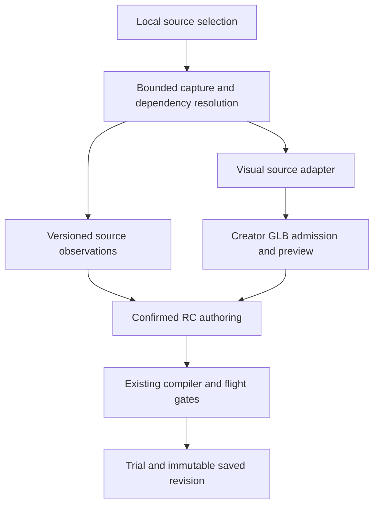

# Flight Simulator aircraft import and RC conversion plan

**Date:** 2026-11-16. **Status:** proposed feature; research and design delivered, no Flight Simulator importer implemented or aircraft qualified. **Owner:** Aircraft Creator / Workshop. **Steps:** AC-FS-00…15, under AC. **Source baseline:** `6dfe1b9179af408f6b765b91ca164e626570db9f` on `main`. This plan owns scope, implementation order and acceptance. The [dated investigation](../research/aircraft-creator/flight-simulator-2026-11-16/README.md) owns repository observations, version compatibility and evidence; [conversion and scaling](../research/aircraft-creator/flight-simulator-2026-11-16/conversion-and-scaling.md) owns the proposed mathematical mapping; [sources and examples](../research/aircraft-creator/flight-simulator-2026-11-16/sources-and-examples.md) owns external references and inspected aircraft.

## 1. Product result

A player brings an authorized local Microsoft Flight Simulator aircraft source into Aircraft Creator, selects its model and variant, sees an exterior preview with its paint, sets an RC wingspan, reviews the detected source information, and authors a supported RC installation. The resulting aircraft has a complete OpenRC physical definition, confirmed moving parts and a conversion report. After the applicable Creator gates pass, the player can test-fly it, save an immutable version, select it in Home and reopen it after restarting an exported build.

The feature has three distinct outputs: an imported visual model, attributed source observations, and an OpenRC flight configuration. Each has its own status and identity. A visually successful import does not authorize flight; a saved draft does not establish compatibility with the original simulator or a real aircraft.

### First useful release

Start with **readable MSFS 2020 configuration plus an author-provided, Creator-compatible exterior GLB**. This gives players source information, scale and RC authoring without waiting for a universal geometry converter. Then add automatic normalization of a measured subset of local authoring glTF, buffers and textures. Both routes converge on the existing bounded GLB admission and Creator compiler.

The first flyable configuration is a conventional aft-tail, single-tractor electric RC airplane inside a qualified Creator domain, with a finite battery and Airborne/Hand-launch starts. Its source aircraft may have been full-sized and piston-powered, but selecting an electric RC installation is an explicit new design with a new identity. No automatic engine replacement, hidden removal of a second engine, or substitute tail topology is allowed.

### Availability states

| State | Player result | Required evidence |
| --- | --- | --- |
| Source report | View aircraft/variant, dependencies and readable configuration | Bounded readers; source bytes and selectors retained; unresolved values identified |
| Visual preview | View an admitted exterior and original paint, or an explicitly limited static preview | Complete selected visual closure; supported normalization; existing GLB preflight; omissions disclosed |
| RC draft | Set real span, geometry, inventory, power and controls | Versioned evidence-bearing authoring; complete field validation; original observations retained |
| Experimental trial | Fly the exact generated configuration in the stated domain | Applicable numerical, package, start and identity gates; supported laws and topology |
| Saved usable aircraft | Select in Home; restart, reopen and fly | Creator publication, resolver, lifecycle, replay and packaged-platform gates |
| Calibrated RC configuration | Make a bounded handling claim about a real installation | Independent RC measurements and held-out flight evidence |

Source report, preview and draft can be delivered before flight qualification. Corrupt geometry cannot receive a preview by bypassing preflight; unavailable physics must not be disguised as an accepted flight configuration.

## 2. Existing foundations and dependencies

The [Creator plan](aircraft-creator.md) and [ClearView subplan](clearview-aircraft-import.md) remain authoritative. At the inspected baseline:

| Existing seam | Reuse | Constraint on this feature |
| --- | --- | --- |
| `creator/source_importer.gd`, `inspected_source.gd` | Capture once, content-based admission, immutable owned bytes | Direct inputs remain STL or the supported GLB subset; FS CFG/glTF/MDL is not already admitted |
| `glb_preflight.gd`, `png_check.gd`, `visual_builder.gd` | Checked self-contained visual boundary and fresh runtime instances | No external buffers/images, animation/skin pass-through, unknown required extensions or arbitrary engine import |
| `clearview/archive.gd`, `deflate.gd`, `cancellation.gd` | Review bounded ZIP and cancellation primitives for reuse | Current limits and dialect belong to ClearView; share only after explicit versioning and regression checks |
| `clearview/observations.gd`, Creator `source_observations`, source-report UI | Source declarations separate from emitted physics | Current report is ClearView-specific, closed and read-only; it cannot accept FS dictionaries unchanged |
| `placement.gd`, `visual_parts.gd` | Size, orientation, leading-edge datum and confirmed rigid controls | Positive uniform scale, finite supported transforms, restricted role/node/pivot bindings |
| `definition.gd`, `compiler.gd`, `packages.gd`, `record_loader.gd` | Complete definition → ordinary `openrc-aircraft v2` → accepted candidate | Current estimated trainer/power package and evidence vocabulary constrain adoption |
| `trial.gd`, existing root/Main Creator route | Frozen reference-backend test flight and return | Exact start/check/launch receipt and lifecycle coverage remain owning AC work |
| `store.gd`, AC-18 resolver, AC-19 bundle | Immutable versions, publication, later Home and portability | Existing Store source is a bounded converted-model blob, not a full simulator package |
| Stock Workshop transforms | Capability-based prior art and reference formulas | Size/weight/virtual power scaling is restricted to prescribed-RPM propellers; it does not authorize arbitrary imported electric/fuel/gear transformations |

**Flight dependency:** AC-12 did not pass its preregistered numerical campaign. Retain that evidence and close the gate for the selected domain, or qualify a separately specified domain through the physics owner. Do not change thresholds after observing results and then relabel the old campaign as passing. A source parser or a successful trim cannot close this dependency.

Creator Home integration, portable `.orcaircraft`, imported `.orskin` and exported-target qualification remain open. Existing stock `.orskin` paint and Workshop variant bundles have different contracts. This feature must use the owning AC work instead of creating a second store, a parallel Home catalog or an incompatible package format.

Keep the 240 Hz float64 kernel, ordinary aircraft loader and stock aircraft generators unchanged for importer work. Imported trials start with `gdscript_reference`; stock native-backend qualification does not transfer to a new configuration.

## 3. Compatibility policy

Compatibility is recorded per source form, dialect, aircraft revision and achieved result. Installation name and filename extension are insufficient detection.

| Family | Planned useful route | Boundary |
| --- | --- | --- |
| MSFS 2020 editable/source aircraft | First target: readable CFG plus prepared GLB; then supported source glTF normalization | Detect actual accessors/extensions, texture formats, model XML, LOD and dependency closure |
| MSFS 2020 built Community aircraft | Read accessible data; probe visuals or request authorized author export | Built glTF is not guaranteed ordinary source glTF; the official authoring importer explicitly excludes package-built input |
| FSX boxed/Acceleration/Steam | Limited CFG observations plus externally prepared geometry | `.mdl` and `.air` need separate coverage; Steam branding does not prove model-dialect equivalence |
| Prepar3D | Version-qualified legacy observations and external geometry | Record actual P3D version/model dialect; custom systems, PBR and AIR behavior are not automatically converted |
| FS2004/FS9 | Later, limited CFG and externally converted exterior | Older MDL/AIR and animation dialects; no universal native reader commitment |
| MSFS 2024 running a legacy package | Route by detected legacy source form | The host being 2024 does not make the aircraft a native modular 2024 source |
| MSFS 2024 native modular authoring source | Dedicated later adapter | Resolve common/preset/attachment/livery composition, parameter substitution and supported texture/material forms |
| Livery or enhancement mod | Report its separately supplied base dependencies | A repaint or performance patch may contain no complete aircraft |
| Encrypted/protected package or incomplete stream cache | Explain the missing/unsupported source and request an authorized export | No decryption, cache reconstruction, installer execution or access-control workaround |

The [research matrix](../research/aircraft-creator/flight-simulator-2026-11-16/README.md#version-and-source-matrix) carries evidence and uncertainty. This table is a roadmap, not a current supported-formats list.

Initial exclusions from flight conversion: helicopters, VTOL/tiltrotor, custom WASM/DLL flight models, multiengine aircraft, jets/turboprops, unsupported mixers, biplane/compound lifting systems, flexible surfaces, flight-control computers, and full cockpit/gauge systems. Some can be previewed; each flight capability requires its own AS/AC/physics work. Fixed gear, flaps, other powerplants and retracts follow existing Creator ordering; retracts remain last.

## 4. Architecture

Adapters stay upstream of Creator. They never install simulator scripts, modify global weather/control settings, create runtime GDScript, or put simulator-specific branches in `Simulation`. Visual metadata proposes bindings; actual OpenRC control/shaft state drives flight presentation.

### 4.1 Source capture and dependency graph

Select a local source directory or a supported ZIP and one aircraft/variant. A second prepared GLB can be explicitly paired with the source information; record that association as user-declared unless common source evidence establishes it. Keep all operations offline after selection.

Inventory and capture a bounded selected dependency closure, preserving source-relative paths and SHA-256 for every file. For directories, use rooted no-follow access or an equivalently reviewed mechanism to refuse symlink/reparse escapes and path-replacement races. Verify both per-file stability and the whole dependency closure before/after capture, including additions/removals and content or trustworthy version identities; refuse observed changes. A file changing after its own capture while another is read is a required counterexample. Ordinary checks cannot prove a globally atomic revision against every concurrent writer: label the receipt as the exact independently captured files unless an actual snapshot or otherwise established quiescent source supports a stronger claim. For ZIPs, reuse proven structure/CRC/actual-expansion checks only within their supported compression and limits. Never extract paths blindly. Capture once; later validation and conversion consume owned bytes rather than reopening original paths.

Resolve `manifest.json`/`layout.json` where present, selected `[FLTSIM.n]`, `model.cfg`, exterior XML/LOD references, buffers, textures, texture fallbacks and `base_container`/aliases. Legacy aircraft may have no manifest. Hashes in our receipt establish byte identity, not authorship or permission; a package file list is not an authenticity signature.

All dependencies must resolve within explicit selected roots. Use exact names first; a case-insensitive fallback is allowed only when unique and recorded. Reject cycles, duplicate normalized paths, ambiguous same-name packages, traversal, absolute/UNC paths and URL dependencies. A missing base or texture stays missing; do not search an installation, download a file, or borrow another aircraft silently. Multi-aircraft sources need a picker and per-model outcomes.

Freeze parser budgets before the production corpus campaign: source aggregate and per-file bytes, entry and dependency counts, path length, nesting/recursion, expansion ratio plus actual expanded bytes, numeric/table tokens, decoder workspace and cancellation latency. Start the ZIP investigation with ClearView's existing 64 MiB compressed / 256 MiB expanded policy; **do not treat these as established MSFS capacity or raise them to accept a large download**. Directory capture needs its own bounded policy. The normalized Creator source still must meet its current 32 MiB, 200,000 triangle, 512 node, 32 material, 16 image and 16,777,216 aggregate pixel ceilings. Larger aircraft need an author-prepared exterior/LOD or a separately measured policy revision.

### 4.2 CFG/XML readers and source observations

Implement a small bounded data parser with complete numeric-token validation, finite values, explicit encoding/BOM policy, comments, case-insensitive keys, quoted strings, indexed/repeated records and line references. Preserve raw text and ordering. Unknown keys remain observations. Duplicate conflicts are diagnosed; simulator-specific override rules require documented, tested precedence, never accidental last-write wins.

Keep three identities separate: declared simulator family/version, detected package/model dialect, and CFG section version. For example, a `[VERSION] major=6.0` in a configuration file does not identify FS6 or MSFS 2024. Classify indistinguishable legacy inputs as `fsx-family/unknown` until better evidence is supplied.

Modern aircraft may split sections into `flight_model.cfg`, `engines.cfg`, etc., or keep them in `aircraft.cfg`. Resolve the documented effective configuration. Record modern/legacy flight-model selectors, CFG defaults, version conditions and custom-flight-logic indicators before proposing any physical mapping. Do not read human-readable performance prose as a numeric physics authority.

XML processing must reject DTDs/entities and external resolution, bound depth/text/references, and parse only supported declarative structures. Behavior expressions, RPN, HTML/JavaScript gauges, WASM, DLLs and executable installers remain inert/unexecuted. If they determine an essential neutral pose, control behavior or FDM, report that dependency instead of claiming complete conversion.

Extend the shared Creator provenance contract with AC-CV ownership. Prefer a versioned provider-discriminated observation envelope and provider-specific validators over copying a second store/report implementation. Old readers must refuse unfamiliar versions without dropping evidence. The current `source_observations` report stays outside physical v2 emission. Extraction status, evidence kind and flight qualification are different fields.

Field adoption requires another explicit contract: today's Definition accepts only `manual`, `measured` and `estimated` authoring evidence and synthesizes generic source strings. AC-FS-02/07 must version and extend Definition, Compiler, UI, Store and round-trip readers to preserve each adopted field's source identity, mapping history and supported evidence kind into the emitted v2 quantity. Keep the detailed history outside the closed quantity shape, with a stable reference in `source`. Recompilation must preserve that evidence and exact physical bytes. Until this path is delivered, source values remain read-only observations; adding a provider envelope alone does not enable attributed adoption.

### 4.3 Visual normalization

First accept an independently prepared GLB through existing admission. The automatic adapter then handles only the qualified source glTF subset. Inspect container, accessors, buffers, graph, material/texture extensions and actual compiled encodings before allocating or invoking an engine decoder. A directory named `src` does not prove ordinary glTF.

Select one suitable exterior LOD explicitly, preserving its full hierarchy and qualified source-node identities. Exclude cockpit interiors, collision helpers and effects by role, not by arbitrary filename or mesh size. Reducing detail is permitted only with a recorded conversion profile; never merge parts with different motion or lose required silhouette/UV features silently.

Normalize supported materials into the Creator core PBR subset and images into checked embedded PNG. DDS decoding, normal-map handedness, packed channels, linear/sRGB treatment, transparency and alpha modes need separate known-answer and visual evidence. A DDS decoder is not an MSFS material converter. Standard 2024 KTX2 needs another decoder/format gate; proprietary/streaming variants are not admitted by extension alone. Required unsupported glTF extensions block complete conversion; optional effects can be omitted only with a valid fallback and an explicit report.

Do not bundle SDK compilers or SDK sample aircraft. Compare independently licensed tools before writing new converters. Asobo's separately licensed Blender plugin, normal Blender/Khronos export, ModelConverterX and DirectXTex are candidates for **optional author-operated preparation**; each has scope, platform and licensing limits in the [tool assessment](../research/aircraft-creator/flight-simulator-2026-11-16/sources-and-examples.md#tool-assessment). No player installation of those tools is assumed for the prepared-GLB route. Pin exact versions only after a successful spike and license/component review.

### 4.4 Placement, dimensions and articulation

Confirm nose/up/right, source physical span, target span, neutral pose and leading-edge datum with visible landmarks. A total mesh bounding box can include a propeller, antennas or folded wings; it is not automatically wingspan. Keep CFG datum, mesh origin, leading-edge datum, ARP and loaded CG distinct.

Use one documented chain: source units/frame → source physical coordinates → target scale → OpenRC leading-edge frame. Record the model-unit calibration separately from the RC scale ratio. Apply compatible transforms to vertices, normals, winding, pivots, controls, physical landmarks and contact proposals. Bake reflections correctly before the strict positive-scale GLB boundary, or refuse them; do not smuggle a left-handed transform through `Placement`. Final trials retain the existing unit presentation scale, preventing a second physics or visual scale.

Source animation names and XML SimVar references propose roles. The player verifies neutral, full-left/right, up/down and propeller direction. Current bindings rotate mesh nodes about their local origin, with limited local axes and role counts; arbitrary grouped, oblique, nested or multiple hinges need a re-pivoting conversion or a versioned AC-17 extension. Until then, retain a clearly static preview or refuse the affected moving-part result. Do not claim that copying keyframes reproduces control mechanics.

## 5. Flight data and RC conversion

The first workflow is **guided RC authoring from attributed observations**. Original full-scale geometry, masses, inertia and performance remain reviewable. Unit-convert supported facts, propose geometry where semantics are known, then require a target component inventory, CG, equipment installation, control throws/timing and qualified aerodynamic package. Source tuned coefficients are not measurements of the RC aircraft.

Expose these choices separately:

| Choice | Meaning | Initial availability |
| --- | --- | --- |
| Keep source as reference | Inspect source dimensions/data and visual model | Planned source-report/preview milestone; no full-scale flight promise |
| Configure an RC aircraft | Target span, real/estimated component masses and locations, supported motor/prop/battery, controls and aerodynamic assumptions | First flight workflow, gated by AC/package/numerical evidence |
| Dynamic-similarity estimate | Froude-based dimensional scaling with unchanged coefficient assumptions | Later research option; visibly estimated, never a guarantee of RC similarity |
| Calibrate to RC evidence | Fit only identifiable supported parameters against measurements and held-out flights | Later calibration milestone |

The [mapping specification](../research/aircraft-creator/flight-simulator-2026-11-16/conversion-and-scaling.md) defines units, axes/tensors, mass inventory, aerodynamic normalization, scaling powers and worked counterexamples. Its key obligations are:

- Scale geometry uniformly, but derive final mass/CG/inertia once from the target inventory. A source aggregate tensor is a comparison/fit target, not another component to add on top.
- Preserve every active/inactive/unknown source-field decision. Modern MSFS ignores many legacy derivatives; `.air` tables, CFD and custom code cannot be replaced by matching key names.
- Resolve moments about their actual reference point. OpenRC already transfers ARP loads to CG; do not apply that transfer twice.
- Choose actual RC propulsion. Rated full-scale horsepower or maximum thrust does not define an electric motor/ESC/battery/propeller law. Finite energy and depletion remain mandatory where the selected capability requires them.
- Keep aspect ratio, taper, wing loading, static margin, tail volumes and thrust/weight inside the selected package's complete domain. Passing mass and span separately is insufficient.
- Explain low-Reynolds uncertainty, especially stall, drag, control effectiveness and post-stall behavior. Similarity equations provide estimates under stated assumptions, not measured handling.
- Preserve requested target values and user overrides on reimport. A revised compiler, scale or equipment choice creates a new configuration; it must not alter a saved revision in place.

Runtime stock support for turbines, fuel, retracts or a flying wing is not evidence that Creator can author those modules. Keep unsupported combinations as drafts until their owners deliver the complete authoring/lifecycle path.

## 6. Records, persistence and user flow

Propose an adapter receipt, `openrc-flight-simulator-receipt v1`, inside the versioned Creator dependency model; this name is a design proposal, not an accepted runtime schema. It references captured source files/hashes and selected aircraft/variant/LOD, source/detected versions, dependency and rights declarations, converter/limits versions, normalized GLB, source-to-target transforms, source observations, adopted field mappings, user overrides and validation evidence. Reuse the common exact-byte policy rather than inventing a second canonical JSON scheme.

Preserve separate original-source, visual, authoring-definition, emitted-physics and full-trial identities. Paint-only edits do not rewrite physical bytes. A manifest/hash can bind bytes; it cannot authenticate authorship, archive membership without retained originals, permission or physical truth. State those distinctions in the report.

Validate the semantic definition-to-physics relationship independently of hashes: regenerate the physical record with the pinned compiler/package versions and compare exact bytes, or use an equivalently reviewed compatibility proof. Refuse a stored definition paired with unrelated physical bytes even when both hashes are internally consistent. A migration creates a new version instead of silently recompiling an old flight identity. The current Store does not establish this relationship merely by accepting both records.

Do not put a multi-file simulator package into Store's single 32 MiB source slot or `raw` records. AC-FS-02/10 must coordinate a bounded immutable source-closure record with AC-CV-07 and AC-19, including quota accounting, object/reference validation, migration, CAS and failure recovery. Before that extension, preserve original source externally with its identity and state that the saved draft is not an archive of the original package. A compiled visual/configuration closure and the restricted original package may have different export permissions.

Home uses AC-18's exact source resolver, not an entry appended to the stock catalog. Missing or corrupted dependencies produce an unavailable aircraft with recovery guidance. Reimport must offer an explicit new version/copy and retain old overrides; never silently substitute a different aircraft. Portability tests require a clean profile/machine with the original source absent. Exact physics replay and reconstruction of the same visual model are separate checks.

Player flow: **Workshop → Import Flight Simulator aircraft → choose source/variant → inspect preview and report → set RC wingspan and datum → review geometry/balance/power → confirm moving parts → check and test flight → save version → Home.** Unavailable steps remain visible with practical reasons. Keep raw CFG keys, hashes and conversion details in expandable developer/source panels. Integrate progress/cancel, dirty/recovery guards, keyboard/controller navigation and localized messages; qualify actual 1920×1080 first, higher resolutions next, 720p last.

## 7. Work packages

Only AC-FS-00 is delivered by this documentation change. All executable implementation and qualification remain open.

| ID | Work | Acceptance / dependency |
| --- | --- | --- |
| AC-FS-00 | Repository audit, version/source matrix, examples, scaling research and feature design | **Delivered as research/design, 2026-11-16.** Pinned source inspection and linked primary references; no imported/test-flown aircraft |
| AC-FS-01 | Rights-aware fixture inventory and compatibility/resource manifest | Project-authored synthetic fixtures plus exact authorized real-source revisions; per-model outcomes; frozen parser/resource budgets; no SDK samples |
| AC-FS-02 | Shared source observation, adopted-field evidence and dependency-closure contracts | Coordinate AC-CV-05/07 and AC-13/19; version Definition/Compiler/UI/Store/readers; provider validation, exact-byte evidence round trips, old-reader refusal, bounded originals and quota semantics |
| AC-FS-03 | CFG/package detection and dependency report; prepared-GLB pairing | Effective configuration, variants/aliases, missing base/texture, ambiguity/cycles, inactive fields; source-to-GLB association explicit; capture-once tests |
| AC-FS-04 | Modern source visual/texture normalization spike and tool decision | Asymmetric geometry, real glTF JSON dialects, materials/normal maps, required extensions, independent converter comparison, measured resource/cancellation bounds |
| AC-FS-05 | Production MSFS 2020 source-subset preview | Complete selected exterior/paint, actual admitted GLB, clear refusal/partial report, no live source execution or decoder bypass |
| AC-FS-06 | Confirmed controls, pivots and propeller bindings | AC-17; neutral/full-deflection/rotation fixtures, oblique/grouped counterexamples, independent instances, consistent visual/physical signs |
| AC-FS-07 | Guided RC scale and attributed field adoption | Closed mapping registry with field/version-specific axes; scale-once/unit/frame known answers; target inventory; emitted evidence and independent definition-to-physics correspondence; no inactive-field/coefficient copy; preserves manual overrides |
| AC-FS-08 | One supported experimental RC flight configuration | AC-12 or separately preregistered domain; complete v2 record; supported topology/finite energy; declared differences from source installation |
| AC-FS-09 | Trial, starts, recorder and lifecycle | AC-09/11/FL; exact check/launch context; reset, return, crash, logs/checkpoints/replay; no stock golden replacement |
| AC-FS-10 | Saved revision, Home and portable closure | AC-13/18/19; clean-profile restart; corrupted/missing/conflicting dependencies; quota, interruption and source-rights export policy |
| AC-FS-11 | Packaged desktop, UX and resource qualification | Windows/Linux/macOS exported builds without authoring tools; 1080p-first rendered evidence; parser/decoder peaks, stalls, cancellation and localization |
| AC-FS-12 | FSX/FS2004/P3D observations and external geometry workflow | Exact model/dialect cases, AIR missing-data report, permitted converter outputs, animation-loss diagnostics; bounded AIR whitelist only as a separately evidenced increment |
| AC-FS-13 | Native MSFS 2024 source adapter | Common/preset/attachment/livery resolution, parameter precedence, complete local closure, new material/texture/inertia tests; streamed/protected refusal |
| AC-FS-14 | Dynamic-similarity and evidence-based aerodynamic fitting | Documented invariants/assumptions; parameter identifiability; separate calibration/held-out RC evidence; no telemetry-rights or fidelity presumption |
| AC-FS-15 | Additional supported aircraft/installation families and release matrix | AC-21…25 and AS/GP/energy owners; each layout/law individually qualified; published exact source/revision/outcome manifest |

### Execution sequence and stop points

1. AC-FS-01/02 establish fixtures, rights, budgets and shared records. AC-FS-03 can deliver a useful report and prepared-GLB draft independently of automatic model conversion.
2. AC-FS-04 decides whether a small built-in source-glTF normalizer is justified. If faithful normalization is too broad, retain the prepared-GLB product path and the optional external workflow; do not turn an unproven converter into a required dependency.
3. AC-FS-05…07 complete the authoring experience. If a source needs unsupported geometry, animation or physics, preserve the limited result and a correction report.
4. AC-FS-08/09 require the existing numerical and lifecycle owners. AC-FS-10/11 complete an actually reusable player feature; a one-off editor test is insufficient.
5. AC-FS-12…15 expand compatibility. Work on 2024 or exotic aircraft must not delay the bounded first release or weaken its source/flight gates.

Planning ranges, not delivery commitments: 1–2 engineer-weeks for fixture/record design and configuration-report spike; 2–4 additional weeks for one prepared-GLB/source-normalization preview path and confirmed controls; 2–4 for RC authoring and one numerical campaign; 2–4 for persistent Home/export/lifecycle completion once the underlying Creator dependencies are available. These ranges are judgement estimates, exclude permission acquisition/new flight laws/failed campaigns, and must be re-estimated after AC-FS-04. Legacy binary readers and native 2024 modular compatibility are separate projects until their spikes bound the work.

## 8. Verification and release contract

Use the [tool index](../tools/README.md) and [focused verification policy](../tools/shared.md#verification-scope). The implementation tests should exercise public boundaries, with project-authored known answers rather than duplicating converter formulas. Third-party binaries stay out of required CI unless their exact redistribution rights are established.

| Boundary | Required cases |
| --- | --- |
| Capture/dependencies | Source changes within and between file captures; whole-closure additions/removals; path-replacement/reparse escape; duplicate/case/Unicode names; incomplete livery/base; cycles; cross-root reference; cancelled/stale worker result |
| CFG and numbers | Split/embedded sections; duplicate conflict/override; unknown version; missing versus zero; NaN/overflow/partial token; table axis units; inactive legacy key; unresolved 2024 parameter |
| Models/images | Ordinary versus optimized glTF; unsupported required extension; DDS variants; alpha/normal/color-space known answers; oversized textures; truncated/accessor overflow; unsupported animation; cockpit/LOD role |
| Frames/scaling | Field/version-specific tuple order, including 2024 physics-object counterexamples; nonzero mesh/datum/LE offsets; asymmetric landmarks; reflections/winding; off-diagonal inertia; independent mass ratio; unit-scale identity; round trip and scale applied once |
| RC authoring | Inventory total/CG/inertia; no aggregate double count; unsupported topology; complete package-domain boundary; fixed power package mismatch; source comments not authority |
| Flight | Exact environment/energy/backend/start identity; control signs; trim, glide, throttle steps, upsets; preregistered refinement at 240/480/960 Hz; finite states; depletion and replay |
| Persistence | Adopted evidence survives compile/save/reopen; definition regenerates the same physical bytes with pinned dependencies; internally valid but unrelated record pair refused; reimport/new revision/overrides; old-reader refusal; missing/corrupt closure; quota and interruption; save→restart→Home→fly on clean exported targets |
| Presentation | Static versus bound-control report; separate instances; paint does not change physics; actual 1080p controls/text, accessibility and higher-resolution follow-up |

For flight changes use the [flight-log workflow](../FLIGHT-LOGGING.md): preserve baseline `.orfl`, verify exact replay, compare the same tick/input tape, retain configuration and backend identity and distinguish incomplete or solver-changed runs. Numerical stability, reference-simulator agreement and physical RC calibration are separate outcomes.

Applicable required repository CI remains a release gate alongside focused checks and the Creator G09/exported-platform campaign. This documentation change does not claim those implementation gates have run or passed.

Record import wall time, longest main-thread stall, cancellation latency, peak RAM/decoder workspace, decoded texture/GPU residency, triangles/draw calls and 1080p frame cost on named hardware. Freeze acceptance thresholds from measured baseline capacity before the production campaign. Changing visual quality must not change physical geometry or forces. No exact performance or physical-fidelity percentage is promised by this plan.

**First feature completion:** one identified, permitted source and explicitly authored RC installation completes **source → report → exterior/paint → scale → confirmed controls → qualified OpenRC physics → test flight → save → Home → restart → flight**, on every advertised packaged desktop target. Publish the exact tested source forms, limitations and unavailable cases alongside it.

## 9. Ownership and unresolved decisions

Proposed adapter paths are `app/workshop/creator/flight_simulator/`, schemas under `app/data/creator/` and `app/tests/test_creator_flight_simulator_*.gd`; these paths do not exist as implementation in this change. Offline corpus tooling, if needed, belongs under `research/aircraft-creator/flight-simulator/`. Keep accepted textual evidence here in `docs/research/aircraft-creator/`.

AC owns authoring/import/UI integration; AC-CV co-owns shared source records/readers; AE owns Workshop/Trial/Store seams; AS owns physical and visual contracts; physics/SF/FL owns solver, trial and replay; EL/BAT/NITRO/FUEL owns energy; GP/CR owns contact/crash; UI/DT owns Home and packaged-platform qualification. Shared changes need coordinated review, not per-aircraft exceptions.

Still to resolve with evidence: a genuinely suitable authorized first conventional aircraft; material/DDS decoder and bounded workspace; actual source closure budgets; source declaration adoption version; shared original-package storage; numeric-domain campaign closure; and the cost/benefit of an AIR reader versus RC reauthoring. The investigation identifies these decisions rather than treating unknowns as implementation work already completed.
