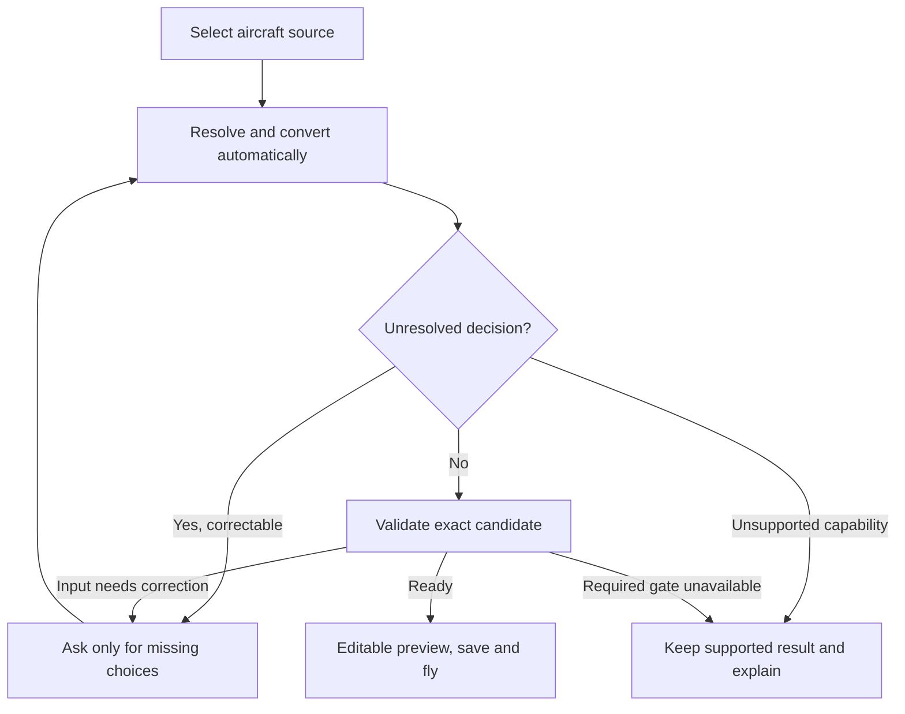

# Automatic Flight Simulator import wizard

**Owner:** Aircraft Creator / AC-FS. **Direction clarified:** 2026-11-16. **Status:** proposed product and engineering contract; no automatic importer implemented. The [feature plan](flight-simulator-aircraft-import.md) owns scope, work packages and release gates. This document owns automatic orchestration, conditional questions and editing behavior. The [conversion specification](../research/aircraft-creator/flight-simulator-2026-11-16/conversion-and-scaling.md) owns mathematical semantics; the [24 investigations](../research/aircraft-creator/flight-simulator-2026-11-16/follow-up-24-investigations/README.md) supply evidence.

## 1. Product contract

The player selects a Flight Simulator aircraft source. OpenRC detects its supported format and dependencies, interprets its configuration and visual structure, translates units and coordinates, converts model/materials, constructs an RC installation, binds supported moving parts and checks the result **inside the application**. The desired outcome is an editable aircraft ready for the supported OpenRC flight experience.

The wizard asks only for information or choices that cannot be resolved from the selected source, retained user choices or an applicable declared RC profile. A complete, uniquely resolvable supported source with an applicable profile reaches the final result with **zero follow-up questions**. Source selection and the final **Save aircraft / Fly** action are not missing-data questions. The user can always inspect or change automatically resolved values before finishing or later in Workshop.

Readable configuration plus a prepared GLB remains a useful development fixture and optional advanced/recovery input. The first completed automatic feature must also accept an advertised supported Flight Simulator source directly, including its qualified buffers, textures and declarative model references, without requiring the player to install a converter, run a script, edit CFG or export a GLB manually. Narrow the advertised source profile when necessary; optional manual recovery cannot satisfy this automatic acceptance journey.

“Understand” means versioned semantic adapters, checked conversions, qualified geometric/rig inference and explicit target-construction policies. No cloud service or generative model is required for the first feature. Application-owned scripts, libraries or bundled workers may implement the pipeline; imported source code remains inert.

## 2. Automatic pipeline and responsibilities

| Stage | Application responsibility | When a question is needed |
| --- | --- | --- |
| Select and capture | Inspect a directory/ZIP or selected package roots, detect supported content, capture a bounded immutable dependency closure | Several indistinguishable aircraft/variants; required base or texture outside selected roots |
| Resolve source | Apply the version-qualified package/overlay/variant rules; retain effective and overridden values and actual source identity | Conflicting declarations or unresolved precedence affect the chosen result |
| Normalize visuals | Select a uniquely evidenced suitable exterior/LOD; convert qualified buffers, textures, materials, transforms and neutral pose; re-admit the output GLB | Unresolved model/pose/paint choice with a supported alternative; an unsupported essential feature instead yields its specific limited/unavailable result |
| Translate and construct | Map known geometry/units/frames; choose the applicable RC profile and target scale; build target inventory, power, controls and supported aerodynamic inputs | No applicable profile or an unresolved target choice, missing geometry or conflicting requested value |
| Bind movement | Use qualified node/behavior mappings and preserve pivots; verify source-to-output correspondence and expected signs/poses | Ambiguous role, hinge, direction or unsupported binding; no arbitrary name-based guess |
| Check candidate | Validate the whole authoring document, compile/load exact physical bytes, evaluate coupled domain and readiness, prepare the preview | A correctable input conflict remains; unsupported capability instead yields its specific unavailable result |
| Finish | Show the editable result, estimates and material omissions; save through the existing immutable Store/Home path; use existing checked launch | User chooses to change a value or start; no repetitive confirmation of already resolved fields |

Dependencies are searched deterministically only within the roots the player selected. Selecting an encompassing package root permits bounded lookup within it. Ask to locate another root only when needed; do not scan the whole installation or download missing aircraft automatically.

The normal product path owns its required conversion runtime. AC-FS-04 must select and qualify redistributable libraries or packaged workers, exact builds and recipes; AC-FS-11 proves them in clean exported builds without authoring tools installed. Existing Blender/MCX/manual workflows remain references and optional recovery routes. External tool availability must not decide whether an otherwise advertised automatic source works. Reuse the existing [tool evaluation](../research/aircraft-creator/flight-simulator-2026-11-16/follow-up-24-investigations/tooling-and-fixtures.md), and keep all normalized outputs behind Creator admission.

The adapter owns source inspection and visual normalization; an automatic target planner owns typed value resolution, dependencies and unresolved decisions; the existing Authoring/Definition/Compiler path owns accepted target inputs and physical emission. The wizard controller sends intents and renders the planner's questions/readouts; UI widgets never contain independent physics or conversion formulas. A readiness coordinator composes the existing candidate, trial and Store/Home contracts. These are proposed responsibilities under AC-FS-02…11, not new implemented APIs.

Resolution uses deterministic dependency order and finite profile/candidate choices. Any numerical fitting or repeated candidate search needs an explicit iteration/time budget and stop reason. Stop with the specific unresolved decision when bounded resolution cannot finish; do not cycle presets or alter locked values until a candidate happens to pass.

## 3. Resolution policy and provenance

Resolve a typed field or capability in this order, subject to validity and matching semantics:

1. Preserve the user's explicit target override or selection, then revalidate it against changed dependencies. An override does not turn an unsupported topology into a supported one.
2. Use unambiguous source declarations that actually describe the target quantity. Retain units, frame, active conditions and provenance.
3. Apply documented unit/frame conversions, deterministic derivations and qualified geometric or rig inference. Preserve the entire source-to-target transformation and uncertainty chain.
4. Apply an applicable versioned RC profile or estimator for target design choices and missing target data. Every supplied value is visible and editable through its supported authoring control; estimates remain estimates.
5. Ask the smallest actionable question that resolves the remaining decision, or report a capability that the implementation cannot provide.

Precedence does not override field roles: full-scale source mass is not an RC inventory mass, and a full-scale span does not specify the player's desired RC size. For the first conventional target, an explicit default mode such as **Create an RC version** may supply a declared target-size policy, estimated airframe construction and supported finite-electric package. Show the resulting span, flying mass, equipment and estimated behavior at the final preview. The user's clarified automatic-RC workflow permits this disclosed design policy without separate permission dialogs for every estimate. A generic replacement wing/tail or silent deletion of another engine is outside that policy.

The profile is versioned data, not constants scattered through UI code. Its target-size/default equipment choices, estimator assumptions, supported source/target topology, units, dependency versions and qualified coupled domain must be fixed before its acceptance campaign. A user preference may choose another supported profile. If no profile fits the actual geometry and selected intent, report why; changing uniform scale cannot repair an out-of-range aspect ratio. A package matching only mass and span is insufficient.

| Condition | Behavior |
| --- | --- |
| Valid and uniquely translated | Apply automatically and show its origin in the editable result |
| Valid estimate from applicable RC profile | Apply automatically with an estimated origin and visible profile; preserve assumptions |
| Genuinely absent source field | Use a documented version-specific source default only where its semantics permit, otherwise a valid target estimate or a focused question |
| Several valid choices | Use an explicitly selected/persisted policy if it resolves the choice; otherwise ask with the alternatives |
| Invalid token, conflicting units/overlays or invalid user edit | Keep the diagnostic and raw value; resolve or explicitly exclude it from the target mapping with a recorded decision. Never silently relabel it missing |
| Unsupported encoding, topology, source runtime dependency or physical law | Explain the unavailable capability; sliders cannot manufacture support. Preserve an editable limited result only where valid |

Each automatic field records its producer rule/profile and version, input identities, evidence kind, mapping assumptions, current override and dependent outputs. Numerical precision is not confidence: exact arithmetic on estimated inputs retains its estimated ancestry. Do not add informal confidence percentages that imply measurement.

Current [Definition](../../app/workshop/creator/definition.gd) and [Authoring](../../app/workshop/creator/authoring.gd) do not implement this full contract: evidence is restricted, omitted evidence can become manual, and `_origin` mainly tracks estimates. AC-FS-02/07 must version the shared authoring/observation contract and readers, preserving source/derived/estimated/manual origins into emitted quantities. Raw template compilation must not falsely label automatic inputs player-entered. Source observations remain immutable; an edit changes the target override, not the original source.

## 4. Conditional wizard and controls

This is a branching wizard, not a fixed tour through every Creator page. Show progress while work runs. If everything is resolved, go directly to the result. Otherwise group related unresolved values into the smallest useful screen, in dependency order: source/variant and units → orientation/source scale → target size → mass/equipment/balance → ambiguous controls. Recompute remaining questions after each accepted answer; never ask for a value that the previous answer now determines.

| Question / editable value | Preferred control | Expected behavior |
| --- | --- | --- |
| Aircraft, variant or livery | Thumbnail selector with detected/default choice | Skip if uniquely resolved; changing it refreshes dependent source closure |
| Missing base or texture root | Locate folder/file action with the missing item named | Resume only affected resolution; keep earlier valid choices |
| Source physical scale or orientation | Unit selector, exact dimension entry and axis/landmark preview | Ask only for ambiguous calibration; keep model-unit calibration distinct from target RC scale |
| Target wingspan or scale | Wingspan slider plus precise numeric entry and unit toggle; ratio readout | An applicable RC profile prepopulates it. Choose one independent size input; show the other as derived |
| Flying mass / estimated construction | Total-mass target slider plus numeric entry; component summary | Use the supported inventory proposal policy described below; expose conflicts rather than clamping |
| Balance | Battery-position slider/3D marker and component-position controls | Show computed CG and margin; respect confirmed mounting bounds and locked components |
| Power | Supported motor/propeller/battery package selector, with declared editable parameters | Filter by actual supported laws; show estimated versus measured evidence; re-evaluate loading and power together |
| Surface role, hinge or direction | Highlighted model picker, direction toggle and animated neutral/endpoints | Ask only about unresolved bindings; exact supported mappings can be applied and checked automatically |
| Control travel/timing | Unit-aware sliders and exact entry within represented laws | Preserve source limits versus target RC choices; do not conflate servo speed with aerodynamic effectiveness |

Each control shows the unit, current value, origin, useful bounds, a brief reason when it needs attention, and **Use automatic value** where applicable. Changes support undo/redo and preserve exact typed values. Slider bounds come from the selected profile and dependencies, not arbitrary universal limits. Numeric input may retain an out-of-domain request for correction; never silently clamp it or discard invalid text. Keyboard/controller interaction and readable units are part of the 1080p-first UI acceptance.

Ordinary users see meaningful choices such as **Wingspan**, **Flying weight**, **Balance** and **Power**. Raw CFG keys, hashes, rule traces and detailed conversion diagnostics live in an expandable report. The final preview shows which values came from source, which were derived/estimated, any required omissions, and the available flight/start modes. It must be possible to expand and edit a known field even when its fallback question was skipped.

## 5. Editable results and coupled recomputation

Automatic conversion creates an ordinary versioned Creator authoring document. Editing is available before finalization and through **Workshop → Edit aircraft** after saving. A saved version stays immutable; edits publish a new revision. Reimport compares old source, new source and current target overrides using the existing planned three-way policy.

Maintain a dependency graph and a generation token. A user edit updates its typed input and origin, invalidates affected automatic proposals/checks, and recomputes only dependent work. A background result for an older source/profile/document generation cannot overwrite a newer answer. Invalid raw edits block finalization even when the authoring object retains an older accepted numeric value.

- **Size:** One uniform source-to-target transform updates source-derived geometry, landmarks, pivots and eligible layout values exactly once. Recompute estimated airframe construction and aerodynamic/package checks. Preserve target values entered in metres and locked hardware choices; do not multiply those by the source scale again. Surface changed dependencies as conflicts where a manual value no longer fits.
- **Mass:** A total-mass slider is a target constraint, not an extra mass component or a patch to emitted physics. A versioned proposal policy may redistribute only eligible estimated airframe items. Preserve measured/manual items and the selected motor, propeller, ESC and battery masses; include every item once. Show component contributions and remaining infeasibility. Do not add hidden ballast or rescale fixed hardware to force the requested number.
- **Balance and inertia:** Derive them from the resulting inventory and supported mounting changes. A CG control manipulates represented inputs, such as battery position; the readout is computed. Direct tensor/CG overrides require a separately reviewed authoring contract and are not implied by the slider design.
- **Power and controls:** Select/edit only represented equipment and actuator parameters. Recheck finite energy, installation geometry, thrust/weight, control topology and the complete package domain. Size does not automatically scale battery capacity, hardware mass, servo timing or engine horsepower.
- **Paint and visual bindings:** They update the presentation identity and affected visual checks. They do not rewrite physical quantities merely because a livery or hinge label changes. Changes that also alter physical geometry are classified accordingly.

The minimum editing scope includes target size/scale, flying-mass request and component distribution, balance/mounts, power installation and represented equipment parameters, control travel/timing, and model/part choices. Each player-meaningful generated configuration value needs a typed editor, a coherent governing-input/constraint route, or a validated override supported by its law; document that route in the field registry. Derived readouts remain internally consistent with edited inputs. A selector with only one fixed package does not satisfy an equipment-editing promise. The current fixed estimated power package and generated aero values require explicit AC-FS-02/07 authoring extensions; any remaining fixed parameter is a visible temporary limitation/open owner task, not fulfillment of unrestricted editing. Raw coefficient/tensor overrides require their own validated contract rather than bypassing the compiler. Reuse existing [compiler readouts and diagnostics](../../app/workshop/creator/compiler.gd) and [package inventory proposals](../../app/workshop/creator/packages.gd), but never overwrite resolved source geometry with a whole-model bounding-box trainer estimate.

## 6. Execution, recovery and publication

Use owned captured bytes and bounded jobs with stage receipts, cancellation and resource budgets. Progress reports completed work; do not claim an exact remaining time without measurement. Parsing, image conversion and mesh processing must not monopolize the UI. Keep supported preview operations available while later nondependent work runs, but publish only an exact accepted candidate.

Keep the previous accepted aircraft and its saved versions intact while preparing the new result privately. Cancellation drains/stops owned work before releasing resources and ignores stale completions. A failed conversion retains actionable diagnostics and any valid draft without replacing a working aircraft. Retry resumes only verified stages whose source, recipe, profile and input identities still match; otherwise recompute them. Draft persistence and quota recovery use the existing Creator owners.

Saving and launching use the normal Store/Home and checked launch route; no second catalog or direct solver load is introduced. The finalized source, normalized visual, authoring definition, physical bytes, profile/rule versions and ready receipt must describe the same revision. A partial Store failure cannot show a successful saved aircraft. A later edit invalidates readiness until the affected checks pass again.

## 7. Meaning of ready

**Ready for the stated OpenRC flight mode** means the exact configuration passes whole-document validation, source/visual/physical closure, loader and complete package-domain checks, supported controls/start/energy constraints, and the applicable numerical, start and lifecycle gates. The final preview names the supported start and estimated/calibrated status. A source report, static model or compiler-accepted experimental draft has a distinct status.

An exact frozen candidate may be ready for a checked **unsaved test flight** before final publication, preserving Creator's existing trial contract. Its candidate/launch identity is required; a Store publication ID is required only for the separate **saved usable aircraft** state. Release acceptance must still qualify the full saving/Home/restart pipeline. A save failure cannot retroactively claim a successful publication or alter the frozen trial.

The development/release campaign qualifies the supported profiles, conversion recipes, laws and numerical domains. Runtime import checks each generated candidate against that qualified envelope and its exact identities; it does not rerun a whole 240/480/960 Hz research campaign on every import. A changed candidate outside the envelope cannot inherit readiness. If a required owning gate is unavailable, show the converted/editable result with its specific remaining requirement. That is useful partial progress, but it does not satisfy the completed automatic-feature journey.

The current AC-12 campaign did not pass. Existing `compile_candidate()` loader/domain acceptance alone therefore cannot prove the ready claim. AC-FS-08/09/10/11 must deliver and enforce the missing readiness path. This is a planned feature contract, not a statement that the current app already has it.

## 8. Acceptance journeys

These are proposed tests, not executed results. They extend the 24 research fixtures and are assigned to the existing AC-FS work packages.

| ID | Independent setup / action | Required result | Owner |
| --- | --- | --- | --- |
| W01 | Complete, permitted, uniquely resolvable supported Flight Simulator source; applicable qualified RC profile | Select source → in-app model/paint/control/physics conversion → editable result with zero follow-up questions → save, Home, restart and checked flight; no prepared GLB or installed authoring tool required | 03…11 |
| W02 | Two equally valid variants, or a missing base outside selected roots | Only the relevant picker/locate action appears; prior valid decisions survive and conversion resumes | 02/03/11 |
| W03 | Missing target-size preference with valid default profile; then a case without applicable size policy | First applies the visible editable default; second asks for size once. A synthetic 10 m → 1.5 m case scales independent landmarks by 0.15 exactly once | 06/07 |
| W04 | Missing target mass versus invalid/conflicting source mass and invalid edited text | Applicable estimator handles missing target data; invalid data remains diagnosed, cannot fall through to a hidden default or stale number | 02/03/07 |
| W05 | Uniquely documented rigid control mapping versus two plausible hinges | Automatic binding and independent pose/sign checks for the first; one targeted mapping question for the second; no arbitrary candidate selection | 06 |
| W06 | Edit wingspan, total-mass request, battery position and supported equipment | Independently verify emitted inventory, CG, inertia, loading, margin and thrust/weight; fixed/locked items survive; infeasible request remains visible | 07/08 |
| W07 | Uniformly scale a source outside the supported aspect-ratio or topology domain | Detect invariant incompatibility; no reshaped wing, deleted engine or misleading size-only repair | 03/07/08 |
| W08 | Edit a resolved automatic field, undo, restore automatic, save/reopen | Correct origin/history and exact revision survive; dependencies recompute; source observations stay unchanged | 02/07/10 |
| W09 | Cancel, retry, source change or user edit during asynchronous conversion | No stale result overwrites edits, no partial publication, previous aircraft intact, bounded cleanup and responsive UI | 02/04/10/11 |
| W10 | Livery-only edit, followed by a true geometry edit | Paint preserves physical bytes; geometry invalidates affected physical/visual checks and readiness | 05/07/10 |
| W11 | Unsupported decoder/law, absent closure or unavailable numerical gate | Specific limited/unavailable result; no ready label or launch enabled by a generic fallback template | 03/08/09/11 |
| W12 | Reimport changed source after manual edits and renamed control nodes | Three-way conflicts, retained overrides, invalidated bindings, new immutable revision and access to old version | 02/06/10 |
| W13 | Clean exported desktop install without separately installed Blender, MCX, Python CLI or Microsoft SDK | Advertised source conversion and conditional wizard work with app-owned dependencies, within measured memory/time/cancellation bounds | 04/05/11 |
| W14 | Keyboard/controller interaction, unit changes and rejected numeric input at 1080p | Sliders and exact entry agree; units do not change physical values; focus/errors remain usable; no compulsory skipped screens | 07/11 |

Before claiming release completion, bind W01 to an exact authorized real source in addition to original fixtures, publish its supported source profile and target envelope, and retain its complete end-to-end evidence. Question count is a workflow metric, not a reason to suppress uncertainty. Measure completion rate, required-question count and conversion time by source/profile and outcome, without claiming universal compatibility.
