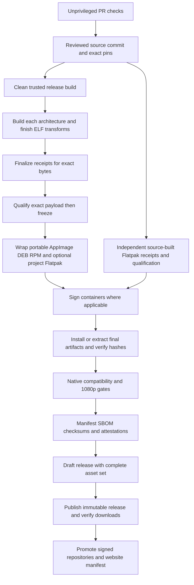

# Linux support and distribution plan

2026-10-28 · **DT-LNX-00…13**, desktop-delivery subtrack · **Status: research complete; implementation and native acceptance pending.**

Make Linux installation predictable before expanding the download catalog. First qualify an x86_64 payload and portable distribution, then add managed installation, native packages and ARM64 through the same evidence gates. Retain Compatibility as the baseline renderer. A Linux export, successful headless test or container run alone does not establish a supported desktop.

This is the authoritative Linux execution plan under [desktop delivery](../DESKTOP-DELIVERY-PLAN.md). The [dated audit and primary-source ledger](../research/desktop-delivery-investigations/DT-LNX-00/README.md) explains the findings and source limits. Commands for delivered functionality remain in [TOOLS](../TOOLS.md#release-sequence), [FIRST-LAUNCH](../FIRST-LAUNCH.md) and the [tool index](../tools/README.md); instructions below describe proposed deliverables, not packages already available.

## Ownership and scope

DT owns packaging, release manifests, Linux compatibility evidence and the installation lifecycle. Coordinate changes to `app/export.sh`, presets, engine acquisition and `.github/workflows/ci.yml` with their maintainers. NK/SF own native evaluator admission and numerical contracts; GDU owns engine upgrades; VQ owns render profiles; UI/D6 own display, update notices and controllers; AE owns Workshop; WEB owns `site/` and translated downloads. No vehicle-specific change belongs in the shared simulation kernel for this work.

Proposed new implementation homes: `tools/release/` for orchestration, manifests and final-artifact checks; `packaging/linux/` for desktop metadata, AppImage recipe, Debian packaging, RPM spec and project-hosted Flatpak material. Follow the existing tool index before adding helpers. Reuse free maintained tools: `appimagetool`, Flatpak Builder, debhelper/dpkg, rpmbuild/Mock, lintian, rpmlint, desktop-file-utils, AppStream, readelf/objdump, diffoscope and existing Godot/debug tools. Select exact versions and hashes in DT-LNX-02; this plan does not invent a current version lock. A future Flathub submission has separate policy and authorship requirements described in the research.

## Delivery strategy and support policy

The initial recommendation is **AppImage for a convenient direct download, with a permissions-preserving tar.gz fallback**. Continue offering the existing ZIP during transition so existing links keep working. Recommend **Flatpak for managed desktop installation only after sandbox, controller, lifecycle and remote-update gates pass**. Provide `.deb` and `.rpm` for users who prefer their distribution's package manager; a downloaded package is not an update repository. ARM64 is a distinct qualification project.

| Channel | Intended experience | Update owner | Admission gate |
| --- | --- | --- | --- |
| AppImage | Download, mark executable if needed, run without elevation; optional desktop integration | Initially manual verified replacement; later evaluated AppImageUpdate integration | Mounted and extraction-mode launch, ABI, desktop and hardware checks |
| tar.gz; transitional ZIP | Extract the complete directory and run; diagnostic/recovery fallback | Manual replacement of the complete directory | Permissions, sidecars, read-only installation and final-archive smoke |
| Flatpak | Software-center integration, scoped permissions and managed updates | Flatpak signed remote; Flathub only after acceptance | Runtime/source-build policy, portals, radios, graphics, lifecycle and distribution eligibility |
| `.deb` | Software installer or APT local-package installation on qualified Ubuntu/Debian versions | APT only when the official signed repository is configured | Generated dependencies, clean installs/upgrades/removals on each named series |
| `.rpm` | Software installer or DNF local-package installation on qualified Fedora releases | DNF only when the official signed repository is configured | Signed package, distro dependencies, SELinux-enforcing lifecycle tests |
| Arch | AppImage or Flatpak; tar.gz fallback | Corresponding channel | Current fully updated Arch snapshot; no partial-upgrade assumption |

An optional reviewed AUR recipe can follow demand, but it is community packaging, not an official Arch repository release. Do not tell Arch users to install the RPM/DEB or translate it with conversion tools. Arch Linux ARM is a separate project; official Arch x86_64 coverage does not establish ARM64 support.

### Proposed qualification matrix

Freeze exact image IDs, kernel, desktop and package versions in DT-LNX-01. These are **targets**, not current claims. Resolve Fedora's currently supported N/N−1 at each release rather than embedding a permanently moving runner label.

| Family | Initial x86_64 desktop candidates | Extra coverage and limits |
| --- | --- | --- |
| Ubuntu | 24.04 LTS and 26.04 LTS, GNOME Wayland/XWayland | 22.04 LTS as an explicit older-floor gate if native toolchain/ABI work succeeds; true Xorg where available; interim releases best effort |
| Debian | 13 stable, GNOME and an Xorg session | 12 oldstable/LTS as an older-floor gate; LTS coverage and desktop/driver suitability must be checked separately |
| Fedora | Current supported Workstation and previous supported release | KDE Plasma and SELinux enforcing; immutable variants prefer Flatpak and get separate testing |
| Arch | Fully updated official x86_64 snapshot dated in evidence | KDE Wayland plus Xorg where available; weekly rolling-canary checks; no indefinite version guarantee |
| ARM64 | Native Ubuntu/Debian host with a named GPU and desktop | Additional Fedora ARM host when available; board/vendor/driver-specific evidence, no blanket Raspberry Pi or Asahi claim |

Do not advertise an exact glibc floor yet. The old `GLIBC_2.28` observation predates today's native sidecars and does not characterize this payload. DT-LNX-03 measures every ELF and its runtime closure, then selects the oldest maintained build root capable of satisfying the declared targets. If Ubuntu 22.04/Debian 12 cannot pass without unsafe bundling, publish the narrower floor and offer a qualified Flatpak where its host requirements are met.

Support labels must be explicit:

1. **Built:** export and static/package checks passed.
2. **Native smoke tested:** exact installed/downloaded package launched and completed the specified checks on a named native OS/architecture.
3. **Qualified:** native display, GPU, controller, lifecycle and sustained 1080p evidence passed on the stated hardware/profile.
4. **Experimental / best effort:** known limitations remain; package metadata and website identify them.

Maintain the currently supported upstream distro series selected for the matrix; reassess on every distro/engine/runtime upgrade. An upstream support window is not an OpenRC guarantee. Give advance notice before raising a floor, retain the previous release and its hashes, and document the last compatible version. Review dependency advisories and runtime end-of-life monthly; triage critical exploitable release issues immediately and publish status with the fix or mitigation.

## Build, dependency and architecture contract

### Pinning and build roots

The current engine is `4.8.beta1.official.4d10419ca`. Do not silently downgrade or replace the owner-authorized development pin. Before calling a Linux channel production-qualified, GDU/DT must either approve that exact beta's residual risks with evidence or qualify a chosen stable engine as a separate upgrade. Version numbers in application releases and engine stability are different facts.

Release builds use an immutable source commit/tag, clean fresh checkout, exact engine/editor and export-template digests, pinned godot-cpp/toolchain inputs and build images by digest. Reject unexpected source files, stale generated artifacts, cache mismatches and dirty release inputs. Verify cached unpacked tools/templates, not only the archive when initially downloaded. Build assets through their owners; no generated geometry/data edits.

Use a native x86_64 and eventually native ARM64 build/test lane. QEMU may help compile or check packaging, but is insufficient for ARM numerical, device or performance acceptance. Hosted native ARM runners can supply software evidence; they do not provide desktop GPU/radio qualification. Pin compiler flags, floating-point mode and ISA baseline; prohibit accidental `-march=native`, unqualified AVX-only output, fast-math or changed contraction behavior. Resolve all Python/Node/build dependencies in the build environment; players should not install Godot, Python, Node, a compiler or .NET to run this GDScript application.

### ABI and runtime dependencies

Audit the exported engine **and every GDExtension**, not just the launcher. Record ELF architecture/interpreter, `DT_NEEDED`, RPATH/RUNPATH, highest required GLIBC/GLIBCXX/CXXABI symbols, executable-stack flags, CPU instructions and dynamically loaded libraries. Use trusted build outputs with `readelf`, `objdump` and dependency analysis; do not execute arbitrary downloaded ELF with `ldd` during inventory. An ELF dependency list misses `dlopen` requirements, graphics drivers and desktop services, so confirm them through native launch diagnostics.

Separate four sets in the release manifest:

| Set | Examples / policy |
| --- | --- |
| Build only | Godot editor/templates, compiler, godot-cpp, Flatpak SDK, Python tools, packagers and validators; exclude from player requirements |
| Private payload | Exported Godot executable, embedded PCK, exact native libraries/descriptors/receipts, required resources and notices |
| Host desktop | libc/loader, compatible GL/EGL or Vulkan loader/ICD, X11/XWayland or Wayland libraries, keyboard/font and audio libraries, udev/session device access; actual names/minima derived per distro |
| Flatpak runtime | Pinned Freedesktop runtime and matching graphics extensions plus app modules; host kernel/GPU/driver and portal requirements remain |

For portable/AppImage and native DEB/RPM payloads, do not bundle the kernel, glibc/loader or vendor GPU drivers to paper over a too-new build. Flatpak obtains libc/loader from its pinned runtime. Do not replace the host Mesa/NVIDIA stack or ship a global `LD_LIBRARY_PATH`. Bundle only justified redistributable private libraries, use narrowly scoped paths and test for conflicts. Let debhelper's shlibdeps and RPM dependency generation establish ELF requirements, then add documented dynamic dependencies they cannot discover. Avoid speculative lists of apt/dnf packages presented as universal minimums.

### One qualified payload per build environment and architecture

The current NK-3 receipt records executable, embedded-manifest, native-library and tool/template hashes; runtime admission separately checks the descriptor against its expected contents and the solver identity. These are consistency checks, not publisher signatures. Finish any permitted ELF transformations **before** generating the final receipt and qualifying it. Preserve executable-relative sidecars; current NK-3 uses `native/kernel/`, while the ground extension is exported beside the executable. Do not move libraries to a global system directory merely to satisfy a packaging convention.

For the project-built AppImage/tar/deb/rpm family, wrap the same qualified payload unchanged. Disable packager stripping, RPATH rewriting and automatic debug extraction after finalization; preserve separate matching symbols from the controlled build. Flatpak Builder can extract debug information even with stripping disabled, so its post-processing also needs explicit control and final hash checks. Test the **installed or extracted final bytes**, including signed packages. Signing a package changes its container hash; checksum and attest afterward.

A source-built Flathub package is a separate environment, not the same byte stream as an official-template export. It needs its own engine/template build identity, receipt finalization, source provenance, exact replay/parity checks and native qualification. All channels can share a source release and schema; they cannot share unearned binary-equivalence claims.

ARM64 requires extending engine acquisition, export presets, both native build pipelines, architecture admission, receipt schema/validation and test coverage. Refactor the existing all-platform export and Linux/Windows ground-receipt coupling deliberately; retain other platforms' gates and test old receipts plus mismatched-architecture rejection. A deliberate GDScript-reference ARM64 preview is an alternative only after its exported fallback path and performance are tested; omit unsupported native libraries and label the backend. Never make a native backend mandatory for a catalog entry or weaken SF/FL tolerances to enable a platform.

## Graphics, desktop and device behavior

### Renderer and drivers

Compatibility/OpenGL is the current baseline. Vulkan is **not** a prerequisite for that baseline. Linux High/Forward+ remains experimental until VQ/GDU clear its feature, resource-lifetime and performance gates. Engine minimum API support is not a promise that this scenery and profile meet frame budgets.

The [graphics guide](../../tools/graphics/README.md) records a beta1 stock ReflectionProbe texture-RID shutdown leak on the tested Windows/NVIDIA host; Linux reproduction is untested. VQ/GDU must decide whether to limit High or offer it explicitly experimental, with repeated world creation/destruction and unsuppressed Linux shutdown diagnostics in its gate.

| Stack | Required coverage / installation policy |
| --- | --- |
| Intel + Mesa | Qualified iGPU generation, distribution Mesa/OpenGL; separately validate the Vulkan driver for High |
| AMD + Mesa | Integrated and discrete representative GPUs; distro RADV/OpenGL stack for the tested renderer; record actual loaded driver |
| NVIDIA | Named supported proprietary driver, kernel module and userspace match; Wayland/XWayland, suspend, hybrid and Flatpak GL-extension alignment; separate Nouveau/NVK claims |
| ARM graphics | Named GPU, kernel, Mesa/vendor driver and API capabilities; CPU architecture alone says nothing about supported rendering |
| Hybrid laptops | Default and discrete selection with the desktop/vendor-supported mechanism; report actual selected GPU, power state and external-monitor routing |
| Software rendering | Functional CI fallback only; never count llvmpipe/lavapipe/Xvfb results as target-hardware performance |

Provide a short Troubleshooting view/export containing build/channel, architecture, renderer, display server, GPU/driver, resolution/scale, backend and diagnostic location. Preserve existing tools; do not create a privileged driver installer. Direct users to their distro/vendor-supported driver procedure, including Secure Boot/module enrollment where applicable. Never prescribe disabling Secure Boot, SELinux or AppArmor as a routine fix.

### Wayland, X11 and recovery

Test **native Wayland**, **XWayland in a Wayland session**, and **native Xorg** as different configurations. Preserve the pinned engine's default until comparative evidence supports changing it; record the actual Godot display server rather than inferring it from `XDG_SESSION_TYPE`. Provide documented engine display-driver overrides and a Compatibility/windowed recovery path verified against the exported launcher. Never loop indefinitely through automatic restarts or silently change a saved graphics profile.

The exact beta pin has a known crash when X11 is unavailable during fallback to Wayland; [TOOLS](../TOOLS.md#developer-setup) links the upstream issue and later fix. Add a specific Wayland-only/no-X11 gate. Qualify an explicit display-driver mitigation, a reviewed engine backport or upgrade, or state that configuration is unsupported. An ordinary Wayland-session launch with XWayland present does not exercise the failure.

Also test forced Wayland → High → Standard restarts with X11 unavailable. Current `high_graphics_profile.gd` reconstructs restart arguments without preserving `--display-driver wayland`; the mitigation can therefore be lost. This is a source-identified risk, not a reproduced OpenRC crash. Preserve only reviewed applicable engine arguments through restart, and verify the pinned binary's `--display-driver` syntax rather than copying a different version's documentation.

At 1920×1080 test startup, Home→Fly→Home, fullscreen/windowed transitions, resize, alt-tab/focus loss, minimized CPU/GPU use, multiple monitors, hot-unplug, fractional scaling, mixed DPI, clipboard and file/browser dialogs. Then test 1440p/4K; 720p is a fallback check. Keep/Revert, suspend/resume and focus recovery must preserve existing arming/pause contracts, with no unexpected flight resumption. Define HDR/VRR/multi-monitor claims only from dedicated tests; initial qualification can be SDR 60 Hz.

Use PulseAudio/PipeWire compatibility on current desktops, with ALSA fallback only where tested. Check missing audio device, device switch, Bluetooth/headphone reconnect, suspend and quit. Ordinary playback does not need recording, but Flatpak's PulseAudio socket permission also exposes audio input; document the actual permission tradeoff rather than describing it as playback-only. Measure startup and audio failures without blocking flight indefinitely.

### Radios, sandbox and files

Exercise a normal USB gamepad and real RC USB-HID radio: discovery, axes/buttons, calibration, polarity, arming, hotplug, reconnect identity, duplicate devices, focus loss and suspend. Use existing D6 diagnostics and a clean unprivileged account. A scripted axis injection is not device qualification. SDL/udev and sandbox visibility need real testing; avoid `chmod 666 /dev/*`, broad input-group membership or running the game as root. If a particular device needs a udev rule, scope it by verified VID/PID and session access, document why, and test removal.

Flatpak starts from minimal graphics, audio and display access, plus the verified controller permission supported by the chosen Flatpak floor. Modern `--device=input` needs Flatpak 1.15.6 or later; determine an explicit older-host policy rather than silently granting all devices. X11 access has weaker isolation than native Wayland; document the compatibility tradeoff. Enable network only for a declared feature; an offline Flatpak can delegate updates to its remote and disable the app's GitHub check. Use the portal for external URLs and chosen files; do not grant host/home filesystem or unrestricted session-bus access as a shortcut.

Pinned Godot source automatically selects a native picker in detected sandboxes when the display server supports it, even if `use_native_dialog` is false. Therefore existing skin/Workshop dialogs are **integration risks, not demonstrated failures**. Verify GTK and KDE portals, cancel/Escape/focus, MIME/extension filters, overwrite confirmation, UTF-8 paths, persisted grants and unavailable-portal errors. Native dialogs do not share every embedded Window property/signal. A user must be able to import/export `.orskin`, supported image/archive files and Workshop JSON without exposing their entire home directory.

## Packaging, metadata and installation lifecycle

### Shared identity and files

Retain the already-used identity **`io.github.bultodepapas.openrcsimulator`**, subject to store identity verification; use `openrc-simulator` for the command/package name and “OpenRC Simulator” for display. Generate desktop entry, AppStream metadata, hicolor icons, package descriptions and download metadata from one maintained source. Reuse the repository's official branding and licensed assets. Set game/simulation categories, English plus maintained translations, support/homepage/release-note links and truthful maturity/requirements. Validate both desktop-file and AppStream schemas. Match the Wayland application ID and X11 window identity to the desktop entry; test launcher grouping and pinned icons.

Do not register file associations until the application can safely accept and validate that format from its command line. A desktop launcher needs a correctly quoted `Exec`, `Terminal=false` and stable icon; it must work from any current directory and paths with spaces/non-ASCII characters. The shell wrapper should resolve its own installation root and `exec` the application with intact arguments and exit status.

| Format | Proposed layout and behavior |
| --- | --- |
| Portable | Versioned top-level directory containing launcher, executable, exact sidecars/receipts, readable README/licenses/credits and manifest; tar preserves executable modes |
| AppImage | AppDir with `AppRun`, desktop metadata/icon and private payload under `usr/lib/openrc-simulator/`; mounted image is read-only; application data stays in `user://` |
| Debian | `/usr/bin/openrc-simulator` launcher; private payload `/usr/lib/openrc-simulator/`; desktop/icons/metainfo in standard `/usr/share` locations; notices in `/usr/share/doc/openrc-simulator/` |
| RPM | Same public launcher/metadata; private architecture-dependent payload under `%{_libdir}/openrc-simulator/`, with its relative sidecars intact; `%license`/`%doc` ownership |
| Flatpak | `/app/bin/openrc-simulator` launcher and private payload `/app/lib/openrc-simulator/`; app-ID desktop/metainfo/icons and per-module licenses; application-owned data in the sandbox |

Expose engine, godot-cpp, library, font, artwork and audio notices offline, not only inside the PCK or behind a website. Track actual shipped dependencies in an SPDX or CycloneDX SBOM and retain source/license origins. A free download is not sufficient redistribution evidence. Release archives exclude tests, tools, source-only assets, credentials, debug servers and local evidence unless explicitly required; prove an allowlist rather than assuming `all_resources` is minimal. Preserve the six receipt-bound NK-3 qualification scripts deliberately embedded by `app/addons/native_kernel/export_plugin.gd`; current exact-package checks require that explicit exception.

### Format-specific requirements

**AppImage.** Pin the tool and runtime independently. Inspect whether that runtime requires FUSE2/FUSE3 or bundles its userspace support; do not assume a generic AppImage behavior. Validate normal mount/run and extraction without FUSE, a `noexec` download location, missing executable bit, read-only storage, spaces and long paths. Provide a tested extraction/tar fallback. Ubuntu 24.04's FUSE2 library name differs from older releases; instructions must match the actual runtime and distro. Never remove FUSE3 to make an image work. Desktop integration is optional, per-user, records what it installed and can remove only those files. Do not make an unverified third-party integration daemon a hard prerequisite.

**Flatpak.** Prefer the maintained Freedesktop runtime/SDK suitable at implementation time, lock the exact build inputs and plan runtime upgrades before EOL. Validate host NVIDIA extension matching, both desktop portal backends, input and external-file flows. A project-hosted signed remote is a viable pilot; a standalone `.flatpak` bundle is not a complete offline distribution with dependencies or an automatic-update service. For Flathub, complete its current eligibility/source/authorship review first; acceptance is external and is not promised by this plan. A future source-build recipe must consume pinned publicly retrievable inputs offline, including the compatible Godot engine/templates and native modules; no network fetch during compilation. Restrict advertised architectures until their gates pass.

**Debian/Ubuntu.** Use debhelper/dpkg with generated shlib dependencies, lintian and clean-install/upgrade/removal checks (piuparts/autopkgtest where appropriate). `amd64` and `arm64` are package architecture names. A first-party binary package can preserve the finalized payload with stripping disabled; distribution archive submission would need separate source-build/policy work. Test local-package installation through APT so dependencies are resolved; do not make `dpkg -i` plus manual repair the primary UX. Avoid maintainer scripts when standard helpers/triggers suffice; scripts must be idempotent, noninteractive and safe after interruption.

**Fedora/RPM.** Use rpmbuild and Mock against the declared release roots, generated dependencies, rpmlint and signed RPMs. Architecture names are `x86_64`/`aarch64`. Control build-root post-processing so immutable payload hashes survive, and verify SELinux-enforcing operation without policy relaxation. Different RPM distributions are not automatically compatible; RHEL/openSUSE are out of the initial claim. Official Fedora repository admission is a separate process from providing an upstream RPM.

### Versioning, data, updates and removal

Keep one SemVer source version plus a package revision; prereleases sort below their corresponding final release in each package manager. For example, an illustrative source `1.2.3-rc.1` maps to Debian `1.2.3~rc.1-1` and an RPM-supported tilde prerelease version with an explicit release field; verify ordering with the selected tools. Packaging-only fixes increment the package revision, never replace a published asset. Keep stable/preview channels distinct. Architecture aliases are explicit: manifest `x86_64`/`arm64`, DEB `amd64`/`arm64`, RPM and Flatpak `x86_64`/`aarch64`.

Proposed names, not existing downloads:

| Artifact | Naming contract |
| --- | --- |
| tar.gz / AppImage / project Flatpak | `openrc-simulator-vX.Y.Z-pR-linux-{x86_64,aarch64}.{tar.gz,AppImage,flatpak}` |
| DEB | `openrc-simulator_<deb-version>_{amd64,arm64}.deb` |
| RPM | `openrc-simulator-<rpm-version>-<release>.{x86_64,aarch64}.rpm` |
| Transitional ZIP | Preserve existing published `openrc-simulator-vX.Y.Z-linux-x86_64.zip` links; version new naming deliberately |

`R` is the packaging revision. Managed-repository revisions may advance independently, but an immutable GitHub release cannot accept additional files after publication. Under the current tag/version/notes checks, new GitHub download bytes require a new application release/tag; a separate packaging-tag scheme would require an explicit export/updater contract change first. Never silently invent such tags or append assets to a frozen release.

Current non-sandbox Linux data is under the Godot user-data root, normally `~/.local/share/godot/app_userdata/OpenRC Simulator/`, respecting the applicable XDG environment. Preserve it initially. Flatpak normally redirects data under `~/.var/app/<app-id>/data/`; measure the resolved Godot path inside the installed app. Do not silently change `config/name` or enable a new custom user directory. Future migration must be explicit, backup-first, transactional and idempotent, with schema validation and rollback. Do not indiscriminately copy a whole host home directory into a sandbox.

Protect settings/display preferences, controller profiles and rollback copy, legacy calibration, statistics, aircraft variants/recovery, skins and flight logs/traces. Identify each path from its owner during DT-LNX-04. Test full disk, unwritable paths, interrupted writes, concurrent instances and future-version data. Do not let a downgraded application overwrite an incompatible new schema. Stable/preview side-by-side data isolation needs an explicit policy and tested import, not accidental shared writes.

| Installation | User action and update behavior | Removal and retained data |
| --- | --- | --- |
| Portable/AppImage | Extract/run or mark executable/run; close app, verify new complete package, install alongside, switch launcher; retain previous version for rollback | Delete that version and its recorded optional launcher/icon files; preserve user data |
| Flatpak | Software center or `flatpak install`; `flatpak update` from the configured signed remote | `flatpak uninstall <app-id>` preserves data by default; `--delete-data` is a separate explicit destructive option |
| DEB | Software installer or `sudo apt install ./<file>.deb`; future `apt upgrade` only with repository configured | `sudo apt remove openrc-simulator`; purge affects package-managed configuration, not an excuse to delete users' personal files |
| RPM | Software installer or `sudo dnf install ./<file>.rpm`; future `dnf upgrade` only with repository configured | `sudo dnf remove openrc-simulator`; preserve user content |

Commands containing placeholders above are design examples. Publish exact, versioned instructions only when those artifacts exist. Native packages use the system package manager as the uninstaller; do not ship a second root-level uninstaller. A separate “Reset local data” flow can explain and back up the affected data before an explicit user deletion. Never remove another user's files, common directories or shared package-manager keys/remotes without ownership checks.

The application must know `distribution_channel`, `package_revision`, architecture and payload/build identity. Carry format-specific information in a separately packaged read-only descriptor covered by the release manifest, preserving the shared executable/PCK bytes; validate allowed values and treat unknown/tampered metadata conservatively. It must never alter native admission or provide an arbitrary command/URL to execute. Flatpak/APT/DNF builds delegate updates to their manager and show the relevant action; portable builds keep nonblocking release notices/manual replacement. The current ZIP-only asset classifier and ten-release API window need architecture/channel-aware tests before expansion. Handle offline operation, rate limits, withdrawn releases and absent compatible assets without prompting a wrong download.

For a project APT repository, use a dedicated keyring and `Signed-By`, signed InRelease/Release metadata, bounded validity and a documented key-rotation path; do not use `apt-key` or `curl | sudo sh`. Stage immutable package/index objects first, support Acquire-By-Hash with old indexes retained, and publish InRelease last. RPM distribution needs package signatures plus signed repository metadata and configured `gpgcheck`/`repo_gpgcheck`. Separate signing roles/keys from ordinary CI and test expired/unknown keys, rollback and interrupted repository synchronization. Flatpak remotes need their own authenticated trust/bootstrap and rotation. Keep the previous known-good version reachable; an emergency fix must not mutate immutable published assets. Publication is atomic only at each supported channel's root/index switch, not across GitHub, repositories, mirrors and Pages; reconcile partial promotion and independently propagating caches.

## Download system

Extend the existing static website and preserve all eleven languages. Spanish source is `site/index.html`, English is in `site/content.js`, and the other nine dictionaries are in `site/locales/`; use `site/build_locales.py` for the ten translated pages. Generate release/download data from a validated **published-artifact manifest**, not hand-copied filenames or a browser guess. Show one recommended route for the chosen architecture with “Other formats” nearby. Architecture detection can suggest, never silently decide; display x86-64 (Intel/AMD) and ARM64 distinctly, with an optional `uname -m` explanation.

Every available row includes version/channel, package revision, architecture, format, download size, tested distro/renderer scope, install/update/removal instructions, release notes, checksum/signature verification and known limitations. Label unsupported combinations explicitly; never show a dead ARM64/AppImage/Flathub button before it exists. Separate stable software tagging from the simulator's early-alpha/experimental vehicle status. Keep permanent versioned release links and an archive/rollback route.

Use direct immutable GitHub asset URLs for project artifacts and the actual Flatpak/store/repository endpoints for managed channels. Do not add a mandatory account, new download telemetry, installer advertising, root shell bootstrap or custom download manager. Retain useful static links when JavaScript/API access fails. Test keyboard navigation, mobile layout, language parity, architecture toggles, wrong-architecture recovery and stale browser/CDN caches. Publish a consistent manifest and generated-page set through one website deployment only after every referenced asset exists and its digest matches; retain the old set for cache/rollback recovery.

### Release manifest contract

DT-LNX-02 defines a versioned schema with:

- Source commit/tag, clean-tree result, source archive identity, application and package versions, channel and build timestamp semantics.
- Engine/editor/template versions and hashes; native ABI/solver/source/compiler/flags and library/executable/receipt hashes; target ISA and ABI floors.
- Build environment image/SDK digest, Actions run/workflow identity, import/generated-resource identities and tool lock.
- Each final artifact's filename, format, architecture, byte size, SHA-256, URL, package-manager version, runtime/host dependencies and payload identity.
- SBOM/notices/symbol references, signature/provenance verification material and support/test evidence with explicit incomplete gates.

The manifest cannot include its own checksum. `SHA256SUMS` hashes final packages, manifest and SBOM; it excludes itself, its detached signature and external attestation envelopes. The detached signature signs `SHA256SUMS`; attestations bind the final subject digests without circular references. A checksum detects corruption; authenticity needs a trusted signature/attestation identity or trusted distribution channel. Verify signer/repository/workflow identity, not merely that some signature exists.

## CI/CD and release promotion

Use the current checked Godot runner and existing source, native, replay, resource and build-identity checks. Extend them; do not replace strong current checks with a launch-only test. The debug bridge is for opt-in debug-build automation; final release bytes deliberately disable it. Final-package evidence uses the existing shipped qualification/trace commands plus native black-box or manual desktop checks, never an enabled release debug server. Scope Linux format work so it does not accidentally weaken Windows/macOS exports.

1. **Pull request:** read-only token, no release secrets. Run relevant/full source checks, generated-data freshness, schema/metadata validation and package smoke in isolated jobs. No untrusted PR code or PR-produced executable runs in signing/publishing jobs. Do not combine privileged `pull_request_target` with untrusted checkout.
2. **Trusted build:** pin Actions by full commit, containers by digest, tool downloads by reviewed hashes. Use per-run staging under the runner's temporary directory with validated cleanup boundaries; remove the current shared `dist/` deletion. Cache only verifiable inputs; keys include engine/template, architecture, toolchain, source/asset changes and import configuration. Do not share PR-writable build caches with trusted releases.
3. **Build/qualify:** generate source receipts, build native modules and import/export with the pinned engine. Run each architecture/backend's required numerical/fallback gates. Build package formats in parallel after payload freeze. For source-built Flatpak, run the same logical gates against its independent payload.
4. **Package checks:** validate expected asset inventory; inspect every ELF/notices/metadata and compare inner payload hashes. Install/extract the final signed packages on fresh distro roots, then exercise the actual launchers with isolated XDG directories and no repository mounted. Preserve nonzero/error-log failures and checked-run completeness.
5. **Native acceptance:** use disposable native OS/VM accounts for desktop lifecycle and real GPU/radio hosts for qualification. Never run untrusted fork workflows on persistent hardware runners with secrets or personal data. GPU benchmarks run without competing builds.
6. **Promote:** aggregate only successful required jobs for the same source/run and expected artifact set. Sign final package/repository data at the right stage; generate SBOM/checksums and build attestations for final bytes. Use minimal job permissions, OIDC where appropriate, protected release environments and immutable tags.
7. **Publish:** create a draft, attach the complete checked set, verify it, then publish with immutable releases enabled where supported. Build attestations and release immutability are different controls. GitHub publication is a future authorized release operation, not an action performed by this planning task.
8. **After publication:** download from public endpoints and recheck digest/asset set; rehearse clean-account installation. Promote signed repositories and WEB references only to verified bytes. Retain release evidence and previous versions; failures quarantine the affected channel, stop its promotion and produce a new version/revision rather than overwriting assets.

Normalize archive order/ownership/timestamps and use `SOURCE_DATE_EPOCH` where supported. Compare two isolated builds and investigate differences with diffoscope before claiming reproducible binaries. Signed containers and changing metadata may require separately compared deterministic payloads; provenance is not itself reproducibility.

## Compatibility and performance acceptance

Reduce the matrix intelligently: every distro/format/architecture gets structural and lifecycle checks; representative desktop/GPU/session pairs get complete interactive coverage. Do not substitute pairwise sampling for a missing required architecture or packaging mode. Nightly/weekly canaries detect rolling distro/driver changes; release gates freeze exact identities.

| Layer | Required evidence |
| --- | --- |
| Static/package | Correct architecture/ISA and ABI closure; no unintended payload; executable modes; exact sidecar/receipt hashes; offline licenses; desktop/AppStream lint; clean user-data root |
| Installed smoke | Final tar/AppImage mount and extract, DEB/RPM install, Flatpak remote install; Home and flight launch without repository; build/backend identity and required field resources |
| Numerics | Existing native/reference oracle, kernel trajectory/fleet/discrete-event checks, exact replay on each claimed environment; missing/corrupt/mismatched native fallback; `complete` and `solver_changed` inspected |
| Desktop | GNOME/KDE; Wayland/XWayland/Xorg; 1080p fullscreen/windowed, focus/display recovery, UTF-8 paths, menus/dialogs, suspend/audio/close; then high DPI and 1440p/4K; 720p fallback last |
| Devices | Real gamepad and USB RC radio with unprivileged device access, calibration, arming, hotplug/reconnect and focus/suspend safety; Flatpak-specific permission checks |
| Lifecycle | Fresh install, upgrade from previous supported version, interrupted/failed update, downgrade with schema protection, uninstall/reinstall and optional data deletion; test two users and no network |
| Security/trust | Invalid checksum/signature, incorrect architecture, absent dependency/portal, tampered native receipt, debug bridge absent in release, no unexpected listening ports; SELinux/AppArmor normal policies |
| Sustained use | Cold/warm startup; 30-minute active flight soak and 50 Home/flight cycles; RAM/VRAM growth, shutdown diagnostics, storage and cache growth; artifact/hardware/source identity |

Run native numerical checks across claimed libc/CPU baselines: preserved binaries do not guarantee the same libm behavior on every host. Do not re-record goldens to make a platform green. Cross-architecture reproducibility and physical realism remain separate claims.

At **1920×1080**, use the DT workload definition: 10 s warm-up and at least 60 s active sample per named scene/aircraft/quality case, repeated paired runs with cold/warm cache distinguished. Existing proposed budgets are warm Home ≤3 s / cold ≤5 s, Fly ≤2 s, process-loop p95 ≤18 ms / p99 ≤25 ms at 60 Hz, simulation/wall ratio 0.99–1.01; freeze hardware and methodology before acceptance. These are not measured Linux results. Include CPU/GPU timing, memory and loading distributions, resolution and scaling, power state and observed backend. Process-loop timing is not displayed-frame or input-to-photon latency. Preserve the 240 Hz kernel and validate frame pacing without changing physics or hiding startup work.

Evidence belongs in `docs/research/desktop-delivery-investigations/DT-LNX-<step>/`, with lightweight reports plus hashes and retained/regenerable raw evidence. Store large logs/captures as CI/release artifacts with documented retention; do not add unnecessary images to Git. Each record states which tests ran, skipped, failed or remained manual.

## Prioritized implementation roadmap

Effort sizes are planning estimates for engineering work, excluding hardware procurement, upstream fixes and external store review: **S** 1–2 days, **M** 3–5 days, **L** 1–2 weeks. Re-estimate after the initial ABI/native tests. DT-LNX-00 is the only completed step here.

| ID / priority | Work, owner and likely files | Dependencies | Proof / status |
| --- | --- | --- | --- |
| **00 / done** | Current source audit, primary research and Linux plan; DT | None | This plan + dated research; no new runtime qualification |
| **01 / P0 / S** | Freeze distro/architecture/renderer/hardware claims, engine release decision and retained evidence; DT + GDU/VQ | 00 | Signed-off test matrix and engine risk decision; every support claim has a gate; pending |
| **02 / P0 / M** | Isolated staging, exact tool/template/cache verification and release-manifest schema; export/CI + DT | 01 | Two concurrent builds cannot delete/mix outputs; wrong hashes/dirty tags fail; fresh-checkout receipt; pending |
| **03 / P0 / L** | ELF/runtime closure and oldest compatible build root, native libm/ISA validation; NK/SF + DT | 01, 02 | Every payload ELF inventoried; proposed floor passes exact native checks or is narrowed explicitly; pending |
| **04 / P0 / M** | Shared desktop/AppStream/license metadata, launcher and user-data/upgrade contract; DT + UI/AE | 02 | Lints, arbitrary-CWD/read-only launch, notices and data preservation; pending |
| **05 / P0 / M** | Final-package harness using checked runner/shipped qualification routes and native desktop checks; debug bridge only in separate debug builds; DT | 02–04 | Fresh install/extract and tamper/fallback cases on named OS; no source-tree leakage or release debug bridge; pending |
| **06 / P1 / M** | AppImage + tar.gz and transitional ZIP, FUSE/extraction and integration lifecycle; DT | 03–05 | Same payload hashes in all forms, native launch and clean removal; pending |
| **07 / P1 / L** | Flatpak pilot: pinned runtime/source pipeline, portals/device/update/data policy; DT + UI/D6/AE | 03–05 | GTK/KDE native sandbox checks, real radio, signed-remote update/rollback; Flathub eligibility/human-maintainer gate separate; pending |
| **08 / P1 / M** | DEB/RPM recipes and distro-specific dependency/lifecycle checks; DT | 03–05 | lintian/rpmlint plus install/upgrade/interruption/remove/reinstall on each series; byte preservation; pending |
| **09 / P2 / M** | Signed APT/DNF/Flatpak repository operations, trust bootstrap/rotation and rollback; DT/security maintainer | 07/08 as applicable | Atomic repo promotion, wrong/expired-key rejection and previous-version recovery; pending |
| **10 / P1 investigation, P2 release / L** | Native ARM64 editor/preset/native builds/receipts/fallback and numerics; NK/SF + GDU/DT | 01–05 | Native ARM CI, exact installed-payload software checks, named GPU/radio host and 1080p proof; pending |
| **11 / P1 / M** | Manifest-driven website and architecture/channel-aware update notice; WEB + UI/DT | 02, actual 06–10 artifacts | All eleven locales, static fallback, package-manager ownership, no absent/wrong-arch downloads; pending |
| **12 / P0 release gate / L** | Full native compatibility/performance and lifecycle campaign; DT + VQ/D6/AUD/UI | Candidate package from each offered channel | Frozen 1080p matrix, soak and 50 cycles, unresolved limitations per channel; pending |
| **13 / P0 release gate / M** | Trusted promotion, signatures/attestations, immutable draft-to-release and downloaded rehearsal; DT + WEB | All required gates for offered channels | Same tested hashes published/downloaded, channel-safe promotion and rollback drill; DT-13 owner acceptance remains required; pending |

Execution waves: **foundation 01–05 → portable 06 + native campaign 12 → download integration 11 + promotion 13**. In parallel after the foundation, develop Flatpak 07 and native packages 08; introduce their managed repositories 09 only when maintenance ownership and trust tests exist. Start ARM feasibility 10 early enough to expose toolchain issues, but do not delay an honest x86_64 release for an unqualified ARM promise. Each later channel repeats 12/13 for its exact bytes. Reuse verified components; do not create a custom installer framework or force every user through every format.

The first implementation PR should address **DT-LNX-02** without changing physics: isolated export output and authenticated input-cache validation, preserving existing native qualification checks. Follow with **DT-LNX-03**'s measured ABI report before deciding a compatibility floor. No production-ready Linux support claim is closed by this planning document.
