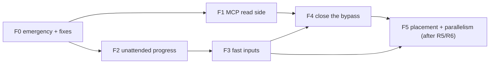

# Agent-first test fleet: audit and phased plan

Owner: **TQ shared-host test admission**, steps **TQ-05-F0…F5**. Parents:
[agent test orchestrator](agent-test-orchestrator.md) and the safety-focused
[resilience subplan](mcp-queue-resilience.md) (TQ-04-R1…R9). Operating contract:
[queue guide](../../tools/testqueue/README.md).

This plan covers what R1–R9 leave open: agent ergonomics, end-to-end speed,
unattended progress and smarter use of the four machines. Every R-plan invariant
(its §2) remains binding. In particular, no change may duplicate an accepted
attempt, kill a foreign process, release a claim without proof, let unverified
evidence pass or contaminate a performance measurement. Where a step touches an
R step, that R step's gate also applies (§6).

**Status: proposed.** Nothing here is implemented. An independent review
challenged the first draft; its accepted corrections are folded in.

## 1. Audit, 20 November 2026

Read-only audit of `main` at `e9fe3f923` plus the live authority
(`C:\ProgramData\OpenRC\testpool`, `C:\ProgramData\OpenRC\testqueue`). Other
agents were using the fleet during the audit. Nothing was cancelled, restarted,
recovered or deleted. Numbers come from the 115 MCP batches (14–19 November),
their receipts, the System event log and live probes.

### 1.1 Measured baseline

| Measure | Value |
| --- | --- |
| MCP batches / jobs | 115 / 232; median **1 job per batch** (agents iterate one test at a time, e.g. eight versions of one fixture) |
| Batch result | 31 `PASSED`, 47 `FAILED`, 25 `INCOMPLETE`, 12 never produced a batch |
| Batches left unfinished | **37 (32 %)**, none with a live supervisor: 11 still claim `RUNNING` 1–5 days later, 10 hit the 1-hour supervisor cap, 14 `ERROR`, 1 `SNAPSHOTTING`, 1 `WAITING` |
| Finished rows by outcome | 78 passed, 51 test failed, 28 `INFRA_FAILED` (18 %; on remotes this also includes an incomplete check such as a missing marker or parse error, `remote_agent.py:1051-1053`), plus 11 `COLLECTION_BLOCKED` and 2 `BLOCKED/UNKNOWN` |
| End-to-end wall time, finished batches | p50 **156 s**, p90 3,164 s |
| Remote stage p50 (ANGEL / ANGELA) | snapshot 30 / 43 s, freeze→accepted 48 / 49 s (p90 303 / 865 s), import 17 / 6 s, **execution 2.4 / 2.8 s**, finish→batch done 42 / 40 s (p90 168 / 431 s) |
| Windows snapshot p50 | 44 s (p90 69 s) |
| `sim_test_status` reply | 0.7–50 KB; local read 2–4 ms |
| Host probe (`pool hosts`) | 2.3 s with all four hosts online; ANGEL load 9.7 on 8 cores, still offered work |
| Storage on `C:` | **~117 GB** of queue data (56.7 GB local snapshots, 40.2 GB attempts, 11.4 GB pool snapshots, 8.4 GB archives); **1.9 GB free**. `D:` 104 GB free, `U:` 22.6 GB free |
| Windows pool capacity at audit time | **0**: `busy_reason: an unmanaged simulator is running` |
| Godot processes outside the queue | Six headless runs launched directly from agent shells (`timeout … Godot --script …`). One started 19 November 20:50 had consumed **9,100 CPU-seconds** and was still running 14 hours later |
| Unexpected shutdowns (Event 6008) | 14, 15 and 17 November. Supervisors alive then stopped with empty logs and were never resumed; others died without a reboot |

Test execution is a few seconds out of minutes of waiting. The rest goes to
snapshotting, serial probing/transfer, fixed polling and collection. Agents
respond rationally and run Godot directly. Those runs count as "unmanaged
simulators", which removes Windows from the pool. That makes the queue slower
still and reinforces the bypass.

### 1.2 Findings

Severity: **S1** blocks or loses work, **S2** wastes most time or capacity,
**S3** ergonomics. Line references are `tools/testqueue/` unless noted.

| ID | Sev | Finding | Evidence |
| --- | --- | --- | --- |
| A1 | S1 | **Nobody restarts dead supervisors.** Each batch has its own detached supervisor. A crash, reboot or client teardown leaves `RUNNING` forever, and a slow batch stops at the 1-hour cap. Only an agent calling `sim_test_recover` resumes it. Nothing documented restarts `testctl serve` after a reboot either. | `pool_mcp.py:61-72, 251-302`; 37 orphaned batches; Event 6008 |
| A2 | S1 | **The disk is full and retention is manual.** ENOSPC, `snapshot needs … reserve` and `insufficient disk` appear among supervisor and row errors. `local_gc.py` and `pool gc` exist but nothing runs them. | §1.1; `worker.py:952`; `local_gc.py` |
| A3 | S1 | **Any process named `*godot*` blocks all local work**, including headless functional jobs and the agents' own direct runs. A late appearance turns an already copied attempt into `INFRA_FAILED`. | `worker.py:87-97, 825-832, 1011-1019` |
| A4 | S1 | **A transfer failure wedges a remote host.** Remote `mkdir`, hash check, `scp` (1,800 s), verify and publish run outside the `try` with `check=True` and without `BatchMode`/`ConnectTimeout`. The receipt stays `PREPARING`, a repeated ID returns that receipt instead of retrying, and the host stays reserved until `reconcile --operator-confirm`. | `pool.py:495-500, 585-603, 297-304, 638-642` |
| A5 | S1 | **The circuit breaker cannot tell causes apart and has no timeout.** Two `INFRA_FAILED` results for one source digest close that host to unpinned work on that digest. That includes host-transient refusals (external Godot, low disk) and incomplete checks. It reopens only for a new digest or pinned work. | `pool.py:253-279, 534-539`; `remote_agent.py:1030, 1051-1064` |
| A6 | S1 | **`UNKNOWN` quarantines a whole host.** Only a reboot or an owner-held `abandon` clears it. Worker restarts convert in-flight attempts to `UNKNOWN`. Agents see only a bare `BUSY`. | `store.py:59-61, 146-150`; `worker.py:373-391, 554-568` |
| A7 | S2 | **Every pool job is exclusive.** `_preflight` sends `workload: 'auto'` ("unclassified", exclusive). The pool also treats any claim or queued row as host-busy. For pool work DEVIL (24 cores, 32 GB free) runs one test at a time, and `--headless-slots` has no effect on it. MCP cannot declare `functional`. | `pool.py:455-456, 199-207`; `presets.py:131-156`; `pool_mcp.py:43-46` |
| A8 | S2 | **Snapshots and imports are redone every time.** Each batch freezes a fresh full snapshot (30–54 s). Each local attempt copies and re-hashes ~3 GB. Remotes re-import each job. Source archives are already reused by digest; snapshots, local materialization and imports are not. | `pool.py:313-318, 595-596`; `snapshots.py:311-393`; `worker.py:943-965`; `adapter.py:51-60` |
| A9 | S2 | **One batch's loop is serial and slow to notice progress.** Submits, statuses and collections run one after another, and collection uses one SSH per artifact. A first upload blocks that batch's other hosts (`dispatch.lock` is released, so other batches proceed). The MCP supervisor works in 30 s windows with 5 s sleeps, re-verifies finished rows and re-runs `pool.recover` over SSH for `BLOCKED` rows every cycle. | `pool_batch.py:159-199, 230-308`; `collection.py:178-190`; `pool_mcp.py:280-297` |
| A10 | S2 | **Every placement re-probes the whole fleet.** Every `submit()` probes every host (remote: SSH plus a full engine hash), and a remote selection probes twice. An offline Mac costs 8–45 s per row. Receipts are globbed and parsed on every pass, and `jobs/` is never pruned. | `pool.py:136-155, 249-304, 522, 562`; `remote_agent.py:604-663` |
| A11 | S2 | **Placement ignores the facts that matter.** Transfer rate is a constant 10 MiB/s. `cached_inputs` is always empty. Busy hosts are excluded rather than scored by when they free. There is no speed class, no Mac power/sleep state and no foreground-user headroom. | `pool.py:206-227`; `pool_policy.py:162-170`; live probe |
| A12 | S2 | **The fleet is invisible from the default path.** The MCP default platform is the caller's OS, and status never mentions idle hosts. Agents pinned `darwin` 125 times and `windows` 85 times; whether Windows being blocked drove that is not established. | `pool_mcp.py:40`; request history |
| A13 | S2 | **Sessions, queued jobs and reservations never expire.** `debug-session` is exclusive for up to 30 min even when idle. Queued requests never expire and are not cancelled when their client disappears. Reservations and drain have no expiry. | `presets.py:34, 147`; `worker.py:352-370, 806-843` |
| A14 | S2 | **Snapshot inputs break easily.** Sources under `tmp/` (nested worktrees, `node_modules`) change during capture or fail `git rev-parse`. `__pycache__/*.pyc` enters archives, which remotes then refuse (`unsupported archive path`). | supervisor and row errors |
| A15 | S3 | **Agents cannot see the fleet or why they wait.** No MCP tool shows hosts, queue depth, quarantine, drain or disk. Placement reasons stay in `rows[].status.decision`. `next_action` says "poll" for: `WAITING` with no eligible host, a silent `RETRY_WAIT` (e.g. coordinator archive space), a stuck `SUBMITTING`, or a lone `COLLECTION_BLOCKED`. | `pool_mcp.py:151-229`; `pool.py:369-372, 555-559` |
| A16 | S3 | **The common case costs too many calls and too much text.** It takes launch plus N polls of up to 50 KB each. There is no wait, cancel, list or inline failure excerpt. `sim_test_launch` and `sim_test_recover` share the ordered lane with 600 s bridge calls, so they can wait behind a simulator action. | `mcp_server.py:115-131, 559` |
| A17 | S3 | **Collection can report a raw `KeyError` as its reason** (`'log'`, 3 rows). | row errors |

R1–R9 already plan guardians, physical-domain reservations, verified cache
inventory, measured concurrency and evidence-ownership-first retention. They do
not cover:

- A1's supervision model.
- A3.
- A4's path and A5's cause typing.
- A7's MCP declaration.
- A12, A13's leases, A15 or A16.

These are the main subject here.

## 2. Goals and measures

An agent should get a trustworthy result for one short test faster through the
fleet than by running Godot itself, in one or two tool calls, without babysitting.
Targets are proposals. Measure them against §1.1 with the same scripts and report
sample counts, cache state and competing load.

| Measure | Baseline | Target |
| --- | --- | --- |
| One short test, warm inputs, idle eligible host | 156 s p50 | ≤ 30 s p50 after F3; ≤ 20 s once F2+F3 are both in |
| Unfinished batches without a typed terminal or `NEEDS_OPERATOR` state | 32 % | 0 for batches with a frozen manifest, after a crash, reboot or client exit. Pre-manifest batches report "resubmit" |
| Rows ending with an untyped failure cause | most `INFRA_FAILED` | 0. Every non-pass carries a cause code (test, incomplete evidence, host transient, transfer, disk, unknown) |
| Agent calls to run and read one test | ≥ 3 + polls | 1–2 |
| Default status size | up to 50 KB | ≤ 3 KB, with failing lines inline |
| Fleet view | CLI only, 2.3 s | MCP, ≤ 100 ms from cache, freshness stated |
| Unmanaged Godot sightings by agent tooling | 6 at audit time | trend to 0 per day after F4 |
| Authority volume free space | 1.9 GB | above an explicit admission floor, with a typed pause instead of ENOSPC |
| Batch of N jobs on H free hosts | not measured | makespan ≤ 1.5 × (longest-first lower bound from history medians + one warm setup) |

## 3. Design principles

1. **Agents submit intent and read results.** They never keep work alive or
   triage infrastructure.
2. **Make the queue the fastest correct path.** Reuse frozen inputs by content
   address. A reused input is still an exact verified identity.
3. **Every wait has a typed reason, an alternative and an estimate.** "Poll" is
   never the whole answer.
4. **Score hosts, don't just filter them.** Offline hosts cost nothing after the
   first miss.
5. **Exclusive stays the default for unknown work.** Parallelism comes from
   explicit declarations backed by canary evidence.
6. **Bounded retry for proved transients, quarantine with a reason for
   uncertainty, and a stop state instead of endless polling.**
7. **Smallest mechanism first.** Use Python, SQLite and SSH. Add a watchdog
   before a new daemon, and fix loops before new protocols.

## 4. Phases

**D** marks a step that needs an owner decision (§7). Each step is one small,
reviewable change with focused fixtures.

### F0: emergency and correctness fixes

| ID | Work | Proof |
| --- | --- | --- |
| TQ-05-F0.1 | Restore headroom on `C:`. The existing `local_gc.py` found 0 candidates, so `retention.py` adds reference-checked removal of redundant attempt sources, snapshots and archives. See the [queue guide](../../tools/testqueue/README.md#operator-storage-and-reconciliation-tools). | **Done 20 Nov:** 6 fixtures; owner-approved run removed 101.5 GB with 0 errors (C: 1.9 → 93 GB free), held 31 inputs of unfinished work; worker `READY` afterwards. Journal `testpool/retention/retention-20261120-102314.json` |
| TQ-05-F0.2 | Snapshot hygiene: exclude `__pycache__`, `*.pyc` and `node_modules` from snapshot scope. Refuse, before freezing and with a clear message, a source that is not its own checkout root (e.g. a worktree nested in another checkout's `tmp/`). | Snapshot fixtures; no `unsupported archive path` refusals |
| TQ-05-F0.3 | Remote transfer path (A4 only): move `mkdir`/hash/`scp`/verify/publish inside the guarded section. Use one shared `ssh_options()` (BatchMode, ConnectTimeout, ServerAliveInterval) for every ssh/scp. A failure proved before `run` records a typed `TRANSFER_DEFERRED` receipt state. A repeated ID re-enters the transfer on the same bound host instead of returning `PREPARING`. | Fault fixtures (scp timeout, auth prompt, remote ENOSPC); retry on the same host; no operator reconcile needed |
| TQ-05-F0.4 | Typed causes: remote and local outcomes carry `cause` (`TEST`, `INCOMPLETE_EVIDENCE`, `HOST_TRANSIENT`, `TRANSFER`, `DISK`, `UNKNOWN`). The circuit breaker counts only source-specific causes and goes half-open after a TTL with one probe attempt. | Fixtures: a transient refusal never opens it; a real import failure does |
| TQ-05-F0.5 | Make deferrals visible: coordinator archive space and other `RETRY_WAIT` causes surface as typed reasons in status. They remain deferrals, not failures. | Status fixture |
| TQ-05-F0.6 | Typed collection errors instead of raw exception text (A17). | Regression fixture |
| TQ-05-F0.7 | **D** Relocate the authority and pool roots to a larger local volume, after F0.1 and with no `UNKNOWN`/unresolved attempts. Receipts bind absolute roots and the config digest (`pool.py:418, 570`; `pool_mcp.py:236, 269`), so finish or close old batches through supported recovery first, or keep the old root readable for them. Back up SQLite with the supported mechanism. | `hosts` reports the new volume; an old batch still recovers or is closed with a reason |

### F1: agent-facing MCP, read side first (A12, A15, A16)

These steps change no execution path. Existing tools keep working.

| ID | Work | Proof |
| --- | --- | --- |
| TQ-05-F1.1 | `sim_fleet`: per host `online`, typed `busy_reason`, free slots, queue depth, disk/RAM, load, `last_seen`, rough expected wait. Also unmanaged Godot processes (PID, age, CPU, command line via the existing optional `psutil`), and quarantine, drain and reservation with the command that clears each. Served from a short-TTL cache with freshness shown. | MCP fixture; ≤ 100 ms cached |
| TQ-05-F1.2 | Compact status by default (`detail: "summary"`, ≤ 3 KB). It gives per-test outcome, cause, host, duration, failing check lines and log tail inline, and a typed `waiting_reason` (`NO_ONLINE_HOST_FOR_PLATFORM`, `HOST_BUSY`, `DISK_FLOOR`, `QUARANTINED`, `CIRCUIT_OPEN`, `TRANSFER_DEFERRED`, …) with the alternative, e.g. "`linux` free now; portable checks may use `platform:any`". `detail: "full"` returns today's rows. | Size and content fixtures |
| TQ-05-F1.3 | `sim_test_list`: recent batches with one-line results, so a new session can find its own work. | Fixture |
| TQ-05-F1.4 | Lanes: give `sim_test_launch`/`sim_test_recover`/`sim_fleet` their own bounded lane, so they never wait behind a 600 s simulator call. Ordered simulator mutations keep their FIFO. | Lane fixture under a long bridge call |
| TQ-05-F1.5 | `sim_test_run`: launch plus wait up to `wait_s` (default 60, so it stays under typical client tool timeouts; max 300) in the test lane. It returns the compact result, or the ticket plus estimate. `request_id` is optional; when omitted the server generates a fresh one and returns it, so an explicit rerun is a new attempt. Reusing an ID stays idempotent. | Fixtures: lost reply, timeout, rerun |
| TQ-05-F1.6 | Rewrite server `INSTRUCTIONS`, [`tools/debug/README.md`](../../tools/debug/README.md), the `openrc-tools`/`openrc-debug` skills and AGENTS tool notes around the one-call flow and `sim_fleet`. | Doc check; trial with a fresh agent session |

### F2: unattended progress and a responsive loop (A1, A9, A10)

| ID | Work | Proof |
| --- | --- | --- |
| TQ-05-F2.1 | Start at logon and watch: a scheduled task starts `testctl serve` with the pinned engine, plus a watchdog. Every minute the watchdog calls the existing idempotent `pool_mcp.recover` for any batch with a frozen manifest, a non-terminal result and no live supervisor. Pre-manifest batches are marked "resubmit", never recovered. Per-batch isolation is unchanged. | Kill/reboot campaign: every manifest batch resumes with the same IDs and no rerun |
| TQ-05-F2.2 | Replace the 1-hour cap with progress rules. Keep observing while any row is queued, running or collecting. Rows `BLOCKED`/`COLLECTION_BLOCKED` with no change for a bounded number of cycles become `NEEDS_OPERATOR`, with a reason and the exact command. The supervisor then stops polling them. An optional owner batch deadline ends observation, never execution. | Fixtures: no endless SSH recover loop; status names the action |
| TQ-05-F2.3 | Per-host concurrency inside one batch: bounded per-host workers for submit, status and collection, so a slow upload or collection on one host does not idle the others. | Fixture with one stalled host |
| TQ-05-F2.4 | Probe cache: a host-state cache (≈ 10 s TTL, exponential backoff up to 5 min for offline hosts). Cache engine hashes by (path, size, mtime) and confirm them at admission. One fresh probe of the **selected** host just before dispatch; a typed `BUSY` after transfer requeues without counting as a failure. Remove the second probe; prune or index `jobs/` receipts after terminal collection. | Offline host adds ≤ one backoff check per pass; placement latency measured |
| TQ-05-F2.5 | Collection and polling: one bounded archive stream per remote job instead of one SSH per artifact. Wake the supervisor on state change (store/receipt mtime) instead of fixed 5 s + 30 s windows. Stop re-verifying already verified rows each cycle. | finish→result p50 ≤ 5 s |
| TQ-05-F2.6 | Stage timing: record snapshot, transfer, queue, import, execution and collection durations per row and show them in status and `sim_fleet`. This baseline feeds F3–F5. | Status fixture; daily JSON summary outside Git |

A persistent SSH channel per host (Windows OpenSSH lacks ControlMaster) is
deferred until F2.6 shows handshakes are a material share of wait time. A
remote protocol change also requires R-plan invariant 10 pinning on every host.

### F3: fast inputs (A8, A14)

| ID | Work | Proof |
| --- | --- | --- |
| TQ-05-F3.1 | Content-addressed snapshots: a read-only verified file store keyed by hash. Each snapshot is a manifest over it: base tree plus dirty/untracked overlay. A warm re-snapshot hashes only files whose size/mtime changed. The manifest digest remains the exact identity. | Warm snapshot ≤ 3 s; identical manifests for identical bytes; store files read-only |
| TQ-05-F3.2 | Remote base plus overlay: each remote keeps verified base archives. Only changed files are sent and assembled into the job's private tree on the remote. Measure real bandwidth per host. | Warm transfer ≤ 2 s; `cached_inputs` from verified remote inventory (R8) |
| TQ-05-F3.3 | Attempt materialization stays a real copy for anything Godot can write (`res://` sidecars such as `.import`/`.uid`, `.godot`, profile, output). Hard links are allowed only for files proved unwritten, with read-only permissions tested on NTFS, APFS and ext4. Otherwise keep copying but skip the second full re-hash when the store already verified the bytes. | Isolation fixtures, including a sidecar write attempt; local setup time measured |
| TQ-05-F3.4 | Import cache keyed by engine identity plus the digest of every input that affects import and class/UID caches (assets, `.import`, scripts, `project.godot`). Warm hits only for identical inputs; a miss imports and populates; a mismatch is never used. | Remote import p50 measured cold/warm; stale-cache negative fixture |

### F4: close the bypass (A3)

| ID | Work | Proof |
| --- | --- | --- |
| TQ-05-F4.1 | **D** Owned dev lane: `sim_test_run mode:"dev"` (and a `testctl devrun` CLI) runs one script against the caller's live checkout through the local authority. The process is owned, bound to a deadline (default 300 s), counted and quickly killed. Results are labelled `evidence: UNFROZEN` and cannot qualify a batch, release or CI gate. It writes only to its own profile and output directories. | Within ±15 % of a direct run; no process outlives its deadline; cannot pass a batch |
| TQ-05-F4.2 | **D** External Godot by role: use `psutil` command lines to classify unmanaged processes as headless or rendered. Unmanaged headless processes stop blocking functional slots, but still block exclusive, rendered and performance work, and every one is reported in `sim_fleet`. Never kill or adopt them. A late conflict requeues the attempt before launch instead of `INFRA_FAILED`. | Fixtures; native check with one unmanaged headless run |
| TQ-05-F4.3 | After F4.1 meets its target, update AGENTS/CLAUDE and the skills so agents prefer the dev lane over raw `Godot --script` on enrolled hosts. Repository launchers (`app/test.sh`, `tools/ci/check-local.sh`) keep their existing admission. | Sighting metric trends down |

### F5: placement, parallelism and fairness (A7, A11, A13), after R5/R6

| ID | Work | Proof |
| --- | --- | --- |
| TQ-05-F5.1 | Let MCP and pool jobs declare `workload: "functional"` per job; today it cannot reach the authority. Unknown stays exclusive. **D** Seed a reviewed allowlist from R6 canary evidence (no timing thresholds, fixed ports or shared devices). | Exclusive and timing fixtures unchanged |
| TQ-05-F5.2 | Capacity from measurement, as R6 specifies: trial two Windows functional slots and observe RAM/CPU/IO and the owner's foreground experience before raising. Linux needs R5 physical-parent identity first. Macs stay at one. Lower DEVIL slots automatically while the owner has a rendered session or high foreground load. | Native canary report |
| TQ-05-F5.3 | Placement v2: expected completion = time until a slot frees + measured transfer (0 when verified cached) + warm/cold setup + per-host duration median. Use longest-first across the batch and deterministic ties. Add Mac power/sleep/battery (`pmset`), a per-host flakiness penalty, and load that excludes the queue's own work. Most batches have one job, so the main gains are host choice and cache warmth. | Decision records show components; replayed batches vs. current placement |
| TQ-05-F5.4 | Fair share: owner identity per agent session, round-robin with aging, and the eligible-exclusive barrier preserved. | Two-owner fixture |
| TQ-05-F5.5 | Leases: interactive sessions renew while their MCP server lives. Idle timeout (default 10 min) or client exit ends them through owned cancellation. Queued requests take an optional queue deadline; reservations take an expiry. | Dead-client fixture; no orphan exclusive |
| TQ-05-F5.6 | `sim_test_cancel`: queued and local running jobs through existing owned cancellation now. Remote running jobs only once R4 provides owned remote cancel; until then the reply says the remote job continues. | Fixtures; R4 gate for remote |
| TQ-05-F5.7 | Agent scenario suite: five scripted concurrent agents cover one-call runs, a host going offline, a sleeping Mac, the disk floor, a watchdog restart, a reboot and a cancel race. It runs on every queue/MCP change and feeds R9's native campaign. | Suite in `tools/testqueue/`; Windows workflow coverage |

## 5. Sequencing

Start with F0.1 (an owner operation) and F1.1/F1.2, which change no execution
path and give the largest visible improvement to agents. F2.1 (watchdog)
follows immediately. F5 must not precede R5 physical-domain identity and the
R6 canary.

## 6. Relation to TQ-04-R1…R9

| This plan | R step | Relationship |
| --- | --- | --- |
| F0.3, F0.4, F0.5 | R1 | Additional proved-predispatch and cause-typing paths; same outcome contract and invariants |
| F1.4, F1.5 | R3 | Extends the bounded lane model; ordered simulator mutations unchanged |
| F2.1, F2.2 | R3, R4 | Watchdog restarts controllers only; guardians (R4) remain separate |
| F2.3–F2.5, F3.2 | R6, R8 | Planned per-host async preparation, slow-host circuit and verified cache inventory |
| F0.1, F0.7 | R8 | Uses existing GC only. Broader retention remains R8's evidence-ownership-first sequence; this plan adds none |
| F5.1–F5.3 | R5, R6 | Gated on physical-domain identity and measured canaries |
| F5.6 | R4 | Remote running-job cancel requires guardian ownership |
| F5.7 | R9 | Feeds the native fault campaign; does not replace it |

## 7. Decisions needed

| ID | Question | Recommendation |
| --- | --- | --- |
| D1 (F0.7) | Which volume holds the authority and pool roots? | `D:` (104 GB free) after F0.1, unless the owner wants the `U:` cache drive and it has room. Confirm the volume is local, never network, for SQLite. |
| D2 (F4.1) | Offer an owned, unfrozen dev lane that can never qualify results? | Yes. It removes the reason agents bypass the queue and bounds their runaway runs. |
| D3 (F4.2) | Should unmanaged headless Godot block only exclusive, rendered and performance work? | Yes, with reporting. Never kill. |
| D4 (F5.1) | Seed a functional allowlist from canary evidence? | Yes. Keep unknown exclusive. |
| D5 (F1.2) | Should status suggest `platform:any` when caller-OS hosts are unavailable, keeping the caller-OS default? | Yes. Coverage remains explicit. |

## 8. Limits

These are software observations from one authority over five days, read
statically and from retained receipts. They establish no throughput gain, no
Mac/Linux containment qualification and no rendered or performance acceptance.
§2 targets are proposals until measured with matched inputs. The classification
of the 37 unfinished batches is from cached state and was not re-observed at
their authorities. The physical parent of the Linux host remains unverified (R5).
