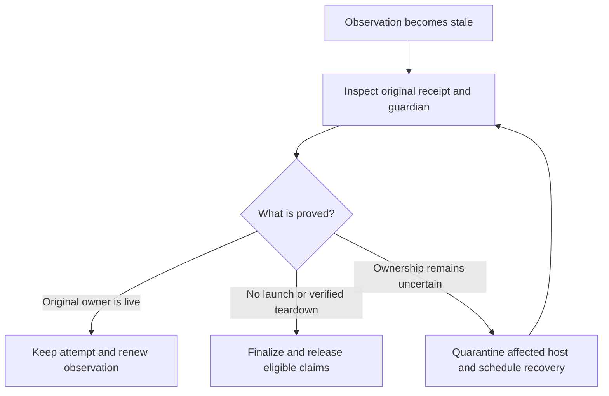

# MCP queue resilience and efficient fleet execution

Owner: **TQ shared-host test admission**. Parent:
[agent test orchestrator](agent-test-orchestrator.md). Evidence:
[15 November 2026 audit](../research/testqueue/2026-11-15-resilience/README.md)
at `c048a4e6834646400070a488b293344dc1e1fd80`.

**Status: partial implementation under senior review.** R1/R2 and bounded slices
of R3/R7/R8, plus execution-volume observations for R5, have a tested candidate on the audit branch; see the
[implementation handoff and evidence](../research/testqueue/2026-11-15-resilience/implementation.md).
The 16 November re-audit integrates `main` at `6dfe1b9179af408f6b765b91ca164e626570db9f`,
adds immutable collection and Windows background-console controls, and reproduces
the post-launch journal failure that could stop a healthy owned process. The
17 November integration onto `main` closes that defect for the local worker and
remote supervisor in fixtures: storage is observation, a per-attempt watchdog
enforces the admitted deadline, terminal journals are ordered and claims stay held
until they are durable. It also adds the first Windows-native run of every group
([evidence](../research/testqueue/2026-11-15-resilience/implementation.md#17-november-windows-integration-and-continuity-repair)).
Native deployment, a separate guardian process, higher capacity, required-check
policy changes and fleet efficiency qualification remain open. Current source commands and limits
are in the [operating guide](../../tools/testqueue/README.md); the dated
[runbook](../research/testqueue/2026-11-15-resilience/runbook.md) is preserved for
the original audited baseline.

## 1. Goal and acceptance boundary

Make queue progress and failures observable, recover avoidable stalls, and use
Windows, Linux and both Macs efficiently **without interrupting healthy work or
freeing capacity whose owner may still be running**. Queue reliability comes
before adding concurrency. The first release repairs known control-flow defects;
later releases qualify more parallelism using real resource measurements.

The design retains Python, local SQLite, typed requests, verified snapshots,
per-attempt isolation and native process containment. Four computers do not by
themselves require Redis, Celery, Kubernetes or a new generic scheduler framework.
The parent plan's backend comparison remains a bounded TQ-00 question, not a
dependency for repairing the reproduced defects.

Success must establish all of these separately:

- **Safety:** no duplicate accepted attempt, foreign process termination,
  premature claim release, stale-owner launch or invalid passing result.
- **Liveness:** known nonlaunch failures finalize, transient nondispatch failures
  recover, a dead dispatcher cannot advertise readiness, and an observer gets a
  bounded response with a durable next action.
- **Utility:** eligible machines perform useful independent work; exact-OS and
  performance requirements remain intact; users retain interactive headroom.
- **Evidence:** exact source, runtime, engine, attempt, host, cleanup and artifact
  identities accompany every verdict. Recovery of collection is not execution
  of another test.

The audit does not attribute Sergio's live symptom to a specific incident. Capture
one redacted incident bundle during rollout to compare actual failure frequency
and recovery time with the reproduced mechanisms.

## 2. Invariants

1. Every accepted request has one durable identity and immutable input binding.
   An execution retry creates a new attempt under that request, with an explicit
   reason and retained predecessor. Replaying a lost submission reply recovers
   the original attempt rather than creating a retry.
2. The physical host is the authority for execution capacity. A planner's score,
   stale probe, SSH alias or different worktree cannot grant resources.
3. Only a transactional grant for the exact attempt permits crossing its launch
   gate. Cancellation/expiry and dispatch race through the same serialized state.
4. `UNKNOWN`, a stale heartbeat, absent PID, silent log, disconnected observer,
   missing Job name, timeout or lease expiry **never** establishes cleanup.
5. A proved `NOT_CREATED` result or witnessed process-tree teardown permits
   execution-capacity release only after every actor capable of crossing that
   attempt's launch gate is stopped or durably fenced. If a preparation helper
   or collector remains, retain the resources it can still touch and revoke every
   launch capability; a late helper cannot recreate executable authority.
6. A healthy long-running job is not stopped because its observer or coordinator
   timed out. A hard execution budget is a separately declared policy accepted
   with the job; it initiates owned cancellation and verified teardown.
7. Quarantine affects the physical resource domain that cannot be proved free.
   Existing local host-wide quarantine remains until narrower isolation is
   qualified. Other independent physical hosts can run other eligible jobs.
8. Performance comparisons remain on the same reserved physical host with no
   competing imports, preparation, transfer-to-the-same-volume or execution.
9. A successful test needs its required completion evidence and confirmed
   cleanup. Missing/corrupt artifacts, a launcher exit code or cached output
   alone cannot create a pass.
10. Deployed protocols/runtime identities are pinned. Upgrade an idle or drained
    boundary; an active attempt keeps the exact runtime that owns it.

The concurrent upstream `abandon` command is an explicit administrative exception
to proof-based capacity release: it preserves `UNCONFIRMED/INCOMPLETE` evidence and
requires an operator decision. The candidate preserves that exception, additionally
blocking it while attempt journals/fences remain pending. Automatic recovery and
timeouts must never invoke it. See the implementation handoff for its boundaries.

## 3. Architecture and ownership

### Keep the layers small and explicit

| Layer | Responsibility | Persistence and boundary |
| --- | --- | --- |
| MCP/CLI/CI client | Submit immutable intent, observe, recover, request owned cancellation. | Stable request ID and receipt. No authority inferred from a bridge port or process ID. |
| Coordinator | Durable job order, placement explanation, quotas and recovery scheduling. | One authoritative scheduler journal; local SQLite remains local. Transport to remote hosts is structured and authenticated. |
| Host admission broker | Atomically grant CPU/memory/volume/GPU/desktop resources for one physical domain. | Canonical host identity/root, lease generation, reservation ledger and workload policy. |
| Attempt guardian | Own preparation/launch/process handles, monotonic budgets, cancellation and teardown. | Private attempt journal and native containment; independent of client/observer lifetime. |
| Collector | Verify reports and copy artifacts; retry collection without rerunning execution. | Attempt-bound manifests, content hashes, explicit complete/incomplete result. |

Do not move the coordinator to Linux as part of the first repair. Evaluate that
deployment later if the Linux host is independently powered, reliably reachable
and has verified backups/monitoring. A control-process restart must be separable
from a guardian restart before either placement is advertised as resilient.

### A durable launch boundary

Persist request validation and input identity, then `PREPARING`, then a
transactional dispatch intent with attempt/generation. Native launch must report
one of `NOT_CREATED`, `CREATED_OWNED` or `CREATION_UNCERTAIN`. Persist the identity
and ownership proof before publishing readiness. Failure classification is owned
by the native launch adapter, which knows whether any create/gate operation ran.
The coordinator must not guess from an exception message.

Use compare-and-update transitions keyed by request, attempt and generation.
Controller leader epoch and attempt generation are separate: replacing a
controller does not invalidate a still-owned healthy attempt or authorize its
replacement. Reject stale launch/control commands, while accepting a valid final
receipt for the original registered attempt after a controller restart. Test
durable-write/launch crash windows and stale actors explicitly.

### Guardian continuity and platform limits

- **Windows:** preserve launch gates, Job Object containment, retained process
  handles and observed exit. A guardian keeps the relevant handles while a
  coordinator restarts. Do not remove kill-on-close or weaken `confirm_stopped()`
  to manufacture same-boot recovery. If the guardian itself is lost, retain the
  conservative outcome until a qualified proof path exists.
- **Linux:** retain the existing cooperative POSIX boundary initially. Qualify a
  delegated cgroup/systemd scope for stronger accounting/containment if available
  on the actual host; record permissions and escape tests. Do not assume root or
  cgroup delegation exists.
- **macOS:** keep an owned guardian and cooperative process-group limitation
  explicit. Linux cgroups are not a Mac solution. Qualify sleep/wake, SSH loss,
  detached children and native GUI ownership separately on both Macs.

Controller restart survival is a goal; uninterrupted execution through machine
or guardian failure is not a guarantee. Existing live attempts are never
retroactively moved into a new containment implementation.

## 4. State, observation and recovery

Keep execution state, observation freshness and result completeness separate.
Retain legacy `state`/`result` fields during a versioned transition; add structured
fields rather than silently changing what current clients consider terminal.

| Dimension | Proposed values/examples | Interpretation |
| --- | --- | --- |
| Lifecycle phase | accepted, snapshotting, queued, preparing, importing, running, cancel_requested, cleaning, collecting, finished | What the owner is doing. |
| Dispatch certainty | not_dispatched, may_have_dispatched, dispatched | Determines safe retry, never inferred solely from a missing file. |
| Observation | fresh, stale, unreachable, recovery_required | Whether the coordinator can currently substantiate its view. |
| Cleanup | not_started, unconfirmed, confirmed | Whether executable work and relevant helpers are proved gone. |
| Outcome | passed, test_failed, invalid_input, infra_failed, canceled, expired_before_dispatch, timed_out | Why a completed attempt ended. |
| Evidence | pending, complete, collection_blocked, incomplete | Whether the result is independently verifiable. |

The API should return `request_id`, `job_id`, `attempt_id`, host/physical-domain ID,
source and runtime identities, phase, dispatch certainty, state version/event
sequence, owner-visible reason code, last observed/progress timestamps, retry
count, next recovery time and `safe_next_action`. Redact capabilities, tokens,
private paths and keys from shared diagnostic bundles.

The recovery decision is proof-based:

Reconciliation is automatic and bounded in **effort per cycle**, not in how long
it may safely keep a claim. After a bounded diagnostic window, publish an
actionable quarantined result and escalation reason. An unreachable host cannot
be proved empty just to meet a recovery SLA.

### Retry and cancellation matrix

| Situation | Required behavior |
| --- | --- |
| Definitive invalid request/unsupported host or schema | Reject before costly preparation, or finalize `invalid_input` with explicit nonacceptance proof. No retry loop. |
| Transient failure proved before dispatch | Keep the same job/request; back off, preserve attempt history and retry within the queued-job budget. |
| Normal capacity `WAITING` | Reconsider eligible hosts; preserve age/priority. This path already exists and must keep working. |
| Lost submit reply / transport failure after dispatch may have occurred | Reconcile the original ID on the original host. No replacement or cross-host failover. |
| Original input disappears/changes after an ambiguous reply | Recover accepted identity before revalidating/replaying inputs. A later validation exception cannot prove nonacceptance or cleanup. |
| Test failed with valid evidence | Retain failure. An explicitly requested retry gets a new attempt and never erases the first verdict. |
| Finished execution, artifact transfer failed | Retry collection only; keep execution identity and result. |
| Cancel before acceptance/dispatch | Persist a request-bound tombstone before acknowledging; a delayed original submission cannot start. |
| Cancel while preparing/running | Authorized owner requests cancellation; the guardian owns safe stop and reports cleanup. Repeat cancel is idempotent. |
| Client disconnects or gives up waiting | End observation; retain the accepted durable work. |
| Supervisor/guardian lost | Mark uncertainty and retain claims; do not equate a missing lock, PID or process name with exit. |

Unify local/MCP/remote request limits and structured errors. In particular,
completion-marker limits must agree, and an authenticated remote `INVALID` refusal
must not be flattened into a generic SSH error. Bind refusal to the exact request
and guarantee its no-execution semantics; network errors remain ambiguous.

## 5. Time limits that preserve healthy jobs

The following are **initial design targets**, not new production settings or
measurements. Reconcile them with actual per-preset distributions before rollout.
Do not change accepted jobs' limits after admission except through an explicit,
authorized extension recorded in their history.

| Boundary | Proposed starting policy | On expiry |
| --- | --- | --- |
| MCP acknowledgement | Persist validated intent and return a ticket; target p95 under 1 s on a healthy local authority. | Return/recover the same receipt. No duplicate job. Snapshot readiness remains explicit. |
| Cached ping/status/control intake | Target p95 under 250 ms while a long job runs; bounded 2 s client observation budget in fixtures. | Show stale/unavailable observation and the stable ID; do not wait behind execution or network probes. |
| Host/guardian heartbeat | Start with 10 s sampling and a suspect threshold of three misses; use monotonic freshness locally. | Mark stale, probe identity, pause new grants for that host. A heartbeat is not progress or a kill authorization. |
| Queue wait | Warn after 10 min; permit an owner-defined queue deadline. No automatic expiry for accepted interactive work by surprise. | Expire only through an atomic transition proving the job was never dispatched. |
| Preparation/import/transfer soft threshold | Stage-specific progress targets derived from bytes and measured setup; import is executable work. | Diagnose and report overrun while retaining ownership. A quiet or slow healthy import continues. |
| Preparation/import/transfer hard budget | Optional, explicitly accepted stage limit or owner cancellation, separate from a progress/SLO threshold. | Fence new launch, request owned cleanup and retain relevant claims until every launch-capable actor is stopped or fenced and teardown/nonlaunch is proved. |
| Execution soft threshold | Use measured per-host p95/p99 plus a documented margin after enough samples. Preserve existing preset limits initially. | Diagnose progress/process health, report overrun, keep healthy work running under its declared hard budget. |
| Execution hard limit | Explicit per-preset/job maximum; present it at acceptance. The current 90 s MCP checked default and six-hour validated ceiling are not silently changed. | Request owned graceful stop, then contained termination under the qualified policy. Claims stay until cleanup is witnessed. |
| Cleanup observation | Initial 30 s reporting window, adapted to adapter evidence. | Report `UNKNOWN`/quarantine and continue bounded reconciliation. Do not forcibly free the slot. |
| Collection | Separate transport/verification deadlines and capped retries; preserve remote artifacts and manifests. | Return `collection_blocked`/incomplete evidence; retry collection without executing again. |
| Recovery cycle | Start a diagnostic attempt within 60 s of detected loss; publish a reason and operator action within 5 min if unresolved. | Continue safe quarantine with backoff; never convert the deadline into nonexecution proof. |

Use `deadline = monotonic_now + budget` and propagate the remaining budget to
connect, read, lock and subprocess operations. A 30 s batch budget cannot permit
an inline 1,800 s transfer. If progress must continue after the observer returns,
delegate it to a bounded owned background actor and report the durable phase.
Do not accumulate a new full timeout on each nested call.

Distinguish useful progress (verified bytes, phase completion, tick/check markers)
from mere liveness (a heartbeat or high CPU). A legitimate test can be silent;
an unhealthy loop can consume CPU. Neither signal alone justifies a hard stop.
Apply jitter and capped backoff to unreachable hosts and repeated storage errors;
rate-limit duplicate events instead of recording the same failure every 100 ms.

## 6. One resource pool across the actual machines

### Inventory and capacity domains

Enroll canonical host identity, boot identity, OS/architecture, physical parent,
CPU topology, memory/commit availability, volumes, GPU/VRAM, user-session state,
power/thermal state, pinned engine and deployed agent protocol/content identity.
Each observation carries a timestamp, source and freshness limit. Configuration
errors such as an unknown host ID fail clearly instead of waiting forever with
zero candidates.

Verify whether the Linux host is physically independent of Windows. If it is a
VM/WSL guest sharing CPU, RAM, a volume or GPU, enforce a parent resource budget.
Two SSH aliases or state roots must not create two capacities for one machine.
Provisioned identities need clone/duplicate detection; guest machine IDs alone
do not establish independent hardware.

### Workload routing

| Work class | Eligible placement | Initial concurrency policy |
| --- | --- | --- |
| Reviewed portable functional headless | Any qualified Windows/Linux/Mac host matching engine and architecture requirements. | Existing one attempt per remote host; after R5/R6, trial two Windows functional slots, then higher counts only when measured. |
| Windows-specific behavior and process containment | Windows native authority/CI runner. | Functional sharing only where the test's contract allows it. Hosted process fixtures and personal-desktop qualification remain distinct. |
| macOS/ARM64 correctness | ANGEL and/or ANGELA_AIR, with the required matrix entries. | One attempt per 8 GiB Mac initially; fresh memory/disk/power checks. A pass on one Mac is not automatically a two-host campaign. |
| Linux-specific/build work | Qualified remote Linux or Linux hosted CI. | Begin with observed safe capacity; raise after CPU/memory/I/O and physical-parent checks. |
| Studio aircraft stills | Qualified rendered adapter, primarily the Windows RTX 3090; later separately qualified Mac graphics. | Capture slot stays one until the native parallel 1080p campaign passes. |
| Interactive debug, GOD TEST, composite suites, unknown scripts | Existing supported native workflow and owned desktop. | Exclusive; do not turn them into portable pool jobs by relabeling them. |
| Performance, latency, memory/soak comparisons | Explicit fixed physical host, engine, driver and power state. | Whole-host exclusive reservation including preparation/collection interference. |

The RTX 3090 is valuable for native rendered work; a GPU does not automatically
accelerate CPU-bound headless tests. Preserve Windows headroom for Sergio rather
than filling every CPU thread. Start ANGELA_AIR with small cached work only when
its current free space supports the full reservation; its dated 6 GiB observation
is not today's admission value. Keep each Mac's accounts, profiles and frozen
campaigns isolated.

### Atomic resource requests

Workload classes obtain reviewed resource envelopes: CPU permits, memory bytes,
target-volume bytes, preparation/import/transfer permits, and optional GPU,
VRAM, desktop or physical device exclusivity. Caller-supplied arbitrary resource
numbers must not bypass policy. Unknown requirements use a conservative class.

Admission reserves the complete anticipated footprint: retained archive/cache,
writable project, import expansion, output allowance and usable free-space margin.
Reserve on the actual target volumes, including the separate coordinator and
worker roots. Commit reservations atomically with attempt creation; reconcile
them after restart. Reservations do not control unrelated user allocations, so
continuously recheck headroom and stop new admission safely when it shrinks.

When a test has stopped but collection continues, keep separate I/O/storage
claims only after proving teardown and revoking launch permissions. Preserve
whole-host performance exclusion while collection can distort another measurement.
Garbage collection must consult live/unknown claims and durable evidence leases;
it never removes active snapshots, frozen campaigns or sole failure evidence.

### Storage cleanup and retention acceptance

The current R8 candidate removes only its own failed coordinator archive temporary
or a verified redundant remote `input.tar` after a complete, confirmed success. It
pins a recovery archive, journals deletion separately from process cleanup and
leaves unresolved deletion blocked or explicitly pending. Worker-reported disk
capacity fixes the volume observation but does not reserve that space. The
[implementation handoff](../research/testqueue/2026-11-15-resilience/implementation.md#storage-cleanup-follow-up)
owns findings and fault evidence; the [queue guide](../../tools/testqueue/README.md#storage-after-a-remote-checked-job)
owns the supported command. No general retention sweep is implemented.

The re-audit adds immutable collection generations, an explicit collection format,
verification of report/log membership and bytes, original-identity migration of old
unverified batch collections, and a cap of three retained failed collection stages.
It protects previous generations during interrupted transfer/publication. Its
manifest covers the declared checked/import diagnostics, not every workspace
artifact. Consequently it still cannot authorize retirement of an entire attempt,
especially when source-contained captures or failed preparation outputs exist.
Directory-entry durability is synchronized on POSIX; Windows power-loss behavior
and physical-space accounting remain separate qualification work.

Broader cleanup must proceed in this order:

1. **Make evidence ownership explicit.** Inventory source-contained captures,
   profile/temp outputs and failed preparation directories. Define completeness
   per preset and preserve unknown or abandoned attempts. Collection must publish
   a fresh verified manifest and completion receipt atomically; a partial overwrite
   or an infrastructure report cannot authorize deleting the remote originals.
2. **Give shared readers durable lifetimes.** Bind queued/batch snapshot references,
   archive uploads and retained recovery anchors to owner identities. A cache-build
   lock is not a reader lease. Transfer `.pending` files need their own identity,
   progress and proof of nonuse before retirement. A restart or TTL alone cannot
   establish that a reader or upload has stopped.
3. **Add bounded, reviewable retention.** Provide inventory/dry-run selection with
   reason codes, protected references and planned logical bytes. Successful,
   failed and pinned campaigns need separate policy. Execute small resumable
   batches under the relevant ownership locks with durable intent/results;
   measure actual volume headroom separately. Qualify Windows handles/reparse
   points and macOS/Linux filesystem behavior on the native hosts.
4. **Prevent pressure before cleanup is necessary.** Reserve full peak footprints
   by physical volume, account for import/output expansion, pause new admissions
   on insufficient space and retain enough diagnostic capacity for a disk-full
   incident. Bound logs/events/status bytes without truncating the sole failure
   evidence. Demonstrate crash, permission, ENOSPC, stale-reference and concurrent
   reader behavior before enabling periodic cleanup.

Acceptance requires no deletion of live/unknown or sole evidence, no repeated
temporary growth after an unresolved failure, stable same-ID recovery, and no
inference that reported logical bytes equal physical space savings. The real
Windows, Linux and both Mac baselines remain to be collected read-only at their
original authorities; this development workspace is not a fleet measurement.

## 7. Efficient, explainable scheduling

Use a deterministic policy whose decision and exclusions can be inspected. It
does not require an LLM in the dispatch path.

1. Validate job/platform/host/protocol requirements before snapshot work.
2. Exclude stale, unhealthy, unqualified, reserved or quarantined resource domains.
3. Apply hard OS/architecture/engine/GPU/desktop/affinity constraints and enforce
   atomic host reservations. Portable `any` is an explicit reviewed declaration.
4. Choose eligible work by priority class, bounded aging and per-owner fair share.
   Preserve the existing eligible-exclusive barrier until replacement fairness is
   proven. Reserve scarce Windows/Mac capabilities for pending pinned work.
5. Within eligible choices, minimize estimated completion using queue delay,
   verified cache state, measured transfer, preparation/import cost and execution
   distribution. Deterministic host-ID tie breaks make decisions reproducible.
6. Prepare independent hosts concurrently through bounded executors. Keep global
   transactions short; do not hold dispatch locks across SSH or file hashing.
   Slow/offline hosts are isolated with a circuit breaker and freshness reason.
7. Record actual phase durations and prediction error. Key history by workload,
   relevant source/tool/engine identity, platform and hardware class. Use a robust
   rolling distribution, not only the last sample or execution timeout as runtime.

Cache presence must come from verified remote inventory. Reuse immutable source
archives and compatible read-only artifacts; each attempt keeps private mutable
imports, profiles and output. Cache miss falls back to a verified cold path.
Do not retry failed correctness tests to improve a scheduling score or utilization.

Track queue wait, busy time, cold/warm preparation, transfer bytes, execution,
collection and end-to-end completion separately. Higher utilization is only useful
when it lowers validated time-to-result without harming the foreground user,
correctness or performance comparability.

## 8. CI integration

Follow the existing [release and CI efficiency plan](release-ci-efficiency.md).
Repair native queue coverage independently of its larger optimization rollout.

- Inventory the direct/transitive inputs of every Windows queue fixture and MCP
  registration. Use an always-scheduled stable gate with explicit internal
  selection; include selected Windows results in the same trusted decision graph.
- Validate failure, timeout, cancellation, missing result, unrelated-file
  nonselection, deleted dependencies, mixed changes, main, PR, tag and manual
  events. Inspect actual repository rules before migrating required-check settings.
- Preserve full required production coverage while selective policy remains in
  shadow. Promote duration-balanced shards or visual groups only with exact
  roster reconciliation, provenance and equivalent full-run controls.
- Keep public/untrusted PR execution in isolated hosted environments. For trusted
  main/research work, an optional CI-to-pool adapter must submit through the same
  host admission as MCP/CLI; `runs-on` labels or a workflow concurrency group do
  not reserve the desktop across tools.
- In a future adapter, treat CI cancellation as ending observation separately
  from job cancellation. If a trusted workflow policy cancels its owned work,
  send durable per-request cancellation and wait/report verified cleanup. Do not let a runner
  teardown erase ownership evidence.
- Retain existing superseded-PR cancellation, while preserving tag/publication
  identity and same-run artifact provenance. Do not assume default GitHub
  concurrency groups retain every pending run.
- Give bulky successful captures/builds an explicit retention policy after
  verifying downstream consumers; preserve failures, compact receipts and tagged
  release evidence. Measure provider cost separately from artifact byte counts.

This plan does not enroll personal computers as GitHub runners or route public PR
code to them. The trusted-pool adapter is gated by identity, isolation, ownership
and native cleanup qualification.

## 9. Implementation sequence and ownership

Each row is a reviewable change with a gate. The parent TQ-00…04 statuses remain
authoritative at track level; these are the operational-refinement substeps.

| Step | Work and primary owner | Paths/interfaces | Proof/status |
| --- | --- | --- | --- |
| **TQ-04-R1** | Repair false nonexecution during accepted-request recovery, proven nonlaunch classification, pre-receipt recovery and schema/error disagreement. Queue/process and pool owners coordinate the shared outcome contract. | `processes.py`, `worker.py`, `pool.py`, `pool_batch.py`, `pool_mcp.py`, `presets.py`, `remote_agent.py` and focused tests. | Bounded candidate with desired-behavior regressions, version-2 batch migration, input/result binding and corrected checked-adapter completeness. Old unverified collections reobserve the original identity. The post-launch journal failure is closed in local/remote fixtures (17 November): non-fatal newest-wins journals, watchdog deadline, durable-terminal claim retention, stale-transition refusal. Process-restart guardian continuity (R4), native campaign and deployment remain open. |
| **TQ-04-R2** | Recover scheduler liveness in-place; guard diagnostic writes and expose real readiness. Queue owner. | `worker.py`, `store.py`, host/status schema. | Candidate implemented for dispatcher/diagnostic faults, pending journals and health reporting. Running-loop storage continuity and a bounded `hosts` response under a held worker lock and a stalled capacity volume are implemented (17 November). |
| **TQ-04-R3** | Responsive MCP intake, asynchronous expensive launch preparation, immutable session context and observer deadline propagation. MCP owner. | `mcp_server.py`, `integration.py`, `common.py`, MCP tests. | Partial candidate: bounded lanes, stalled-output handling and socket observation deadlines. Session mutations/stop remain ordered; snapshot/transfer/filesystem bounds and immutable session context remain open. |
| **TQ-04-R4** | Independent guardians, phase budgets, owned remote cancel and proof-based reconciliation. Native process/transport owners. | Guardian protocol; local/remote worker lifecycle; versioned receipts and migration. | Proposed, highest native risk. Controller restart preserves a healthy guardian; guardian loss never grants duplicate execution. |
| **TQ-04-R5** | Enforce physical-host/parent identity and atomic per-volume/memory/preparation reservations. Host admission owner. | `pool.py`, `pool_policy.py`, local/remote admission and private configuration schema. | Worker execution-volume observation implemented; unknown capacity is ineligible. Reservations/physical-domain identity remain proposed: two roots/aliases must not double-admit or double-count shared volumes. |
| **TQ-04-R6** | Reviewed functional concurrency, global fair order, bounded asynchronous preparation and measured placement. Scheduler owner. | Pool/batch policy and capacity schema. | Proposed after R1–R5. Same-host parallel checks pass under real budgets; exclusives never overlap. Advisory slice landed 17 November: rolling-median durations with peer estimates, longest-first batch order and saturated-constraint probe skipping; no concurrency change and no measured benefit claimed. |
| **TQ-04-R7** | Windows dependency/registration coverage and reliable required-result selection; optional trusted CI adapter later. CI owner. | Workflows, `tools/ci/`, registration fixtures and release receipts. | Partial candidate: five missing trigger paths and a registration fixture. Stable required-gate integration/rules and trusted personal-fleet delegation remain open; the latter waits for R4/R5/native gates. |
| **TQ-04-R8** | Status/metrics, verified cache inventory, retention and incident bundles. Queue/CI/storage owners. | Status/event schema, cache/collector/diagnostics, existing storage and CI plans. | Partial candidate: failed archive temporary ownership, redundant successful remote input reclamation, durable cleanup status, identity-bound retry and immutable checked-evidence collection. Shared GC, full artifact ownership/reader leases, bounded diagnostics, atomic per-volume reservations and native retention qualification remain open. |
| **TQ-04-R9** | Native fault campaign, staged rollout and measured utilization/latency comparison. TQ acceptance owner. | Dated evidence under `docs/research/testqueue/`; private machine artifacts. | Open. Separate Windows, Linux, ANGEL and ANGELA_AIR results; no fixture-to-hardware inference. |

Implementation can parallelize R1's pool validation work, R2 and R7 only with
explicit file ownership and a stable shared contract. R3/R4 need coordinated
request/lifetime design. R6 cannot leapfrog physical-domain safety or native
qualification. The lead integrates and verifies the exact combined candidate.

### Required regression and fault matrix

| Case | Expected proof |
| --- | --- |
| Log open fails before any create call | `INFRA_FAILED` with witnessed nonlaunch; claims released; next job dispatches. |
| Creation/containment assignment or launch-gate acknowledgement is ambiguous | `UNKNOWN`; no second conflicting attempt. |
| Scheduler operation and diagnostic write both fail | Degraded readiness; bounded fallback/backoff; one in-place scheduler recovers; running attempt remains owned. |
| Dispatch lock times out before receipt | Typed nondispatch retry; original request progresses after recovery; no duplicate acceptance. |
| Invalid input / 129 markers / invalid host ID / incompatible protocol | Consistent preflight rejection with a terminal actionable result; no endless `UNKNOWN`. |
| Submit accepted but reply lost | Same ID and host are recovered; exactly one actual execution. |
| Accepted local attempt runs, reply is lost, then original source/snapshot becomes invalid | Pool recovers the existing authority job; no false `NOT_DISPATCHED`/confirmed cleanup, no cached terminal shortcut, no replacement or claim release. |
| Cancel races delayed acceptance/start | Durable tombstone or cancellation fence wins; no late launch after acknowledged pre-dispatch cancel. |
| Blocked preparation helper resumes after cancellation | Durable fence rejects its stale launch/publish; no new process, even after coordinator restart; touched resources remain reserved until safe. |
| Long tool plus ping/status/stop intake | Control response meets target; no global stdout/environment race; ordered session mutations remain correct. |
| Snapshot/transfer/import/collection hangs | Observer returns bounded ticket/status; phase and progress explain blockage; no early claim release. |
| Healthy long test, no new logs, delayed heartbeat | Diagnostic warning only until explicit execution policy applies; no mistaken kill. |
| Healthy import exceeds its soft progress threshold | Import continues under its accepted hard budget; an observer timeout cannot cancel it. |
| Owned hard budget expires | Graceful/contained cancellation, cleanup verification and retained evidence; foreign process survives. |
| Controller restarts with live guardian | Same attempt continues; no duplicate; state reconciliation accepts its final bound receipt. |
| Guardian dies / stale PID / PID reused / escaped POSIX child | Never adopt or kill unrelated work; quarantine if teardown cannot be proved. |
| Reboot / different host / cloned identity | Only qualified host-and-boot proof reconciles; foreign or ambiguous identity is refused. |
| Two aliases/roots, Windows/guest overlap, two simultaneous submitters | One physical capacity authority; transactional claims and consistent volume budgets. |
| Exclusive benchmark waiting behind functional work | Existing work drains; younger work cannot starve it; preparation/collection cannot contaminate measurement. |
| Disk full during snapshot, state update, logging or result transfer | Typed failure, preserved owner/evidence, no scheduler death or optimistic capacity release. |
| One host offline/slow while others are healthy | Other independent jobs progress; uncertain dispatched job remains pinned. |
| Batch with portable and OS-pinned work from several owners | Required platform coverage preserved; bounded aging/fairness; no execution preemption to improve placement. |
| Corrupt/missing cache or artifact | Verified cold fallback or incomplete/failure; never cached false success. |
| CI dependency-only change, skipped/missing/failed native result | Correct workflow selection and gate result; no pending-check trap or false green. |

Run logic/fault fixtures on Linux and Windows where their semantics apply. Native
Job Object, macOS sleep/GUI and Linux containment behavior require their actual
platforms. Rendered qualification uses **1920×1080 first**, then higher resolutions;
720p does not substitute for the project's primary acceptance target.

## 10. Rollout, rollback and measurement

1. **Baseline:** capture current deployed runtime/config identities, a redacted
   real incident if available, queued/active/unknown attempts, host topology,
   stage timings and representative cold/warm workloads. Preserve original
   receipts and frozen sources. Do not restart occupied workers to collect data.
2. **Logic canary:** apply R1/R2 in a private authority and one idle native host.
   Retain existing capacities. Demonstrate every safety negative control before
   enabling automatic recovery of proved nondispatch failures.
3. **Control canary:** enable responsive MCP/diagnostics with legacy fields intact.
   Test concurrent sessions and disconnects; measure response latency during long
   jobs and blocked transfers.
4. **Guardian/admission canary:** drain each old host boundary, preserve/backup the
   authority with the supported SQLite backup mechanism, migrate versioned state
   and qualify the new guardian/host protocol. Never swap code beneath a live
   attempt. Expand one host at a time after its fault campaign passes.
5. **Concurrency canary:** increase only reviewed functional capacity. Trial two
   Windows slots, observe real memory/CPU/I/O and foreground impact; raise further
   only if end-to-end useful throughput improves. Keep Macs at one until their
   independent evidence supports a change; leave capture capacity one until its
   separate native campaign passes.
6. **Efficiency canary:** compare representative identical-source batches and CI
   shadow controls over at least five comparable repetitions for an initial
   median comparison, recording cold/warm cache and competing activity. Collect
   enough independent observations for any p95/p99 claim; report sample count and
   uncertainty, and label small-sample tails exploratory. Report completion and
   queue wait, total CPU/runner minutes, transfer/storage and failures; do not
   publish a percentage speedup without matched results.

Rollback triggers include duplicate execution, an unowned stop, premature claim
release, stale actor crossing launch, false success, missing platform coverage,
lost receipt/history, unexplained resource overcommit or unacceptable foreground
impact. Pause new admissions and disable the new feature for future work. Let
healthy original guardians finish. Preserve unknown claims and evidence.

An old binary must refuse an unsupported newer state schema. Rollback does not
mean loading old code over a newer live database or restoring an old backup on
top of current owners. Use a documented compatible migration after draining, or
leave the compatible guardian/broker running while disabling new scheduling
features. Backups and their restore drills must include receipts and artifact
references, with consistent database state and no credentials in Git.

### Reported measures and release gate

| Measure | Release interpretation |
| --- | --- |
| Duplicate/foreign execution or premature release | Zero in adversarial/native campaigns; any occurrence blocks rollout. |
| Avoidable `UNKNOWN` from proved nonlaunch | Zero in reproduced failure cases; track real incident rate separately. |
| False nonexecution/cleanup after an accepted request | Zero; identity recovery must observe the original job despite unavailable original inputs. |
| Dead dispatcher advertised ready | Zero; storage/thread failure must surface degraded condition. |
| MCP acknowledgement/control latency | Meet the proposed target under the defined workload, with recorded percentiles and hardware. |
| Reconciliation | Every unresolved attempt gets a bounded diagnostic action and truthful status; no age-based release. |
| End-to-end batch result | Complete roster, intended OS coverage, exact provenance, cleanup and verified artifacts. |
| Throughput and resource headroom | Measured improvement over matched baseline with no loss of safety, correctness or usable desktop headroom. |

The audit branch closes the research/planning task. R1–R9 remain open until their
individual evidence is committed and the owning native/CI gate passes.
