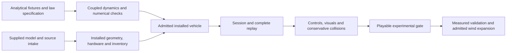

# Generic 5 m RC blimp: integration plan

**Status: first playable experimental gate reached in software, 2026-11-10 ([§14](#14-implementation-status)); physical, pilot and target-hardware gates remain open.** User requirement: a generic radio-controlled blimp, 5 metres long, built from the 3D model the user provided. Other dimensions, mass and hardware are not yet specified. This is a non-rigid helium airship unless the delivery establishes otherwise; the word “Zeppelin” does not imply a rigid historical airship or a wing-supported airplane.

Owner/prefix: **RC airship, BL-00…18**, registered in the ownership index. This document owns implementation scope and gates. The [initial physics investigation](../research/rc-airship/physics-2026-11-08.md) retains its original scientific sources and limits. The follow-up investigations in §13 examine 24 distinct decisions and amend this plan. Shared contracts remain with SF, AS, M5, EL/BAT, GP/CR, input/UI, FL, CAM/AUD and the asset pipeline.

## 1. Recommended outcome and scope

Build one explicitly **experimental Generic RC Blimp 5 m**, with six-degree-of-freedom motion, helium buoyancy, physical mass and balance, added mass, hull/fin aerodynamics, installed electric thrusters, actuator response, battery behavior and RC controls. Reuse the shared simulation kernel and existing presentation/environment infrastructure. Import the user's model through a reproducible source pipeline; do not create or buy a substitute airship mesh.

The first useful physics milestone is a released airborne blimp in calm air. The first player-facing milestone additionally needs controls, arming, conservative collision handling, restart, recording/replay, a clear flight envelope and 1080p presentation. It must not quietly inherit airplane stall warnings, runway launch, motor mixing or default weather.

The generic model can use clearly labeled engineering estimates where measurements do not exist. That permits an experimental release, not a claim that it reproduces a particular commercial blimp. A model becomes physically validated only against independent measurements for the declared configuration and operating range. Software, visual, pilot and hardware gates are separate.

**Initial exclusions:** flexible-envelope finite-element simulation, gas slosh/internal circulation, automatic ballast dropping, moving-mass control, full thermal/pressure/leak evolution, tether/mooring dynamics, autopilot/position hold, aerodynamic wall effects, arbitrary hull morphing, Workshop editing, companion AI and a native backend. Add these only through the conditional work below; none is needed merely because a full-size airship has it.

## 2. What the simulator actually provides

Audit baseline: `41ce5af6f4a148b4ea101b08883fd4e03878bb07`, checked 2026-11-08. Existing unrelated working-tree edits were present in `app/physics/ground_vehicle/airfield_track.gd`, `app/physics/rc_track_crossing.gd`, `app/sim/flight_session.gd` and `app/tests/test_rc_track_crossing.gd`; this plan does not modify them. Graph symbol/text searches returned insufficient GDScript coverage, so current source was read directly. Recheck these boundaries when implementation starts.

| Existing boundary | Verified behavior | Consequence for the blimp |
| --- | --- | --- |
| [Simulation](../../app/sim/simulation.gd), [VehicleModel](../../app/sim/vehicle_model.gd) | One installed model; pure stage callbacks; fixed 240 Hz RK4; transactional validation, events, checkpoints and publication | Add an airship adapter, not vehicle branches in the kernel or a parallel Godot rigid-body flight solver. |
| [RigidBody](../../app/physics/rigid_body.gd) | 13 float64 values: NED position, body FRD ground velocity, body-to-NED quaternion, body rates; ordinary law uses scalar mass and 3×3 inertia | The ordinary force-only route cannot represent a general coupled 6×6 added-mass system. |
| `VehicleModel.stage`, `Simulation.step` joint evaluation | Joint evaluator can return a complete `body_derivative[13]`; requires a nonempty continuous block | Use real motor/servo/energy states and a model-owned coupled solve. This is a usable interface, not existing airship qualification. The replacement derivative owns kinematics and gravity too. |
| [Helicopter session](../../app/sim/helicopter_flight_session.gd), [ground session](../../app/sim/ground_vehicle/session.gd) | Specialized readers, state layouts and session adapters already install the shared model | Follow this separation; do not force airship data through the fixed-wing loader. |
| [Environment](../../app/sim/environment.gd), [weather reference](../WIND-ATMOSPHERE-REFERENCE.md) | Stage-position/time wind, thermodynamic atmosphere and ground queries; no shared wind-acceleration/gradient interface | Reuse density and calm/steady wind first. Unsteady and spatial added-mass coupling needs a separate derivation and interface decision. |
| [Aircraft catalog](../../app/app_state/aircraft_catalog.gd), [AppRoot](../../app/app_root.gd), [airplane presentation](../../app/render/airplane.gd) | Several branches treat non-rotorcraft entries as fixed-wing | An entry alone is insufficient. Add explicit airship routing and audit Home, preview, launch, camera, help and asset consumers. |
| [Aircraft contract](../AIRCRAFT_CONTRACT.md) | Closed fixed-wing v2 contract; repeated propulsion and new capabilities cannot be invented by JSON alone | Propose a dedicated versioned airship reader/schema; reuse quantity/provenance rules, not airplane-required fields. |
| [Flight log](../../app/sim/flight_log.gd), [CLI](../../app/tools/flight_log_cli.gd), [rotorcraft recorder](../../app/sim/rotorcraft_recorder.gd) | `.orfl` exact/candidate path constructs fixed-wing sessions; rotorcraft recorder is a separate CSV trace | Airship exact/candidate replay is new work. Neither CSV nor matching channel counts proves compatibility. |
| [Frames](../../app/render/frames.gd), input, field, audio and asset pipelines | Existing presentation and device boundaries can be reused | Render detached accepted state. Reuse suitable APIs only after checking assumptions and supported capabilities. |

The current engine is pinned by [get-godot.sh](../../app/get-godot.sh); [STACK](../STACK.md) records 4.8-beta2 at this audit. Older Blender handoffs mention earlier engines: use the actual project pin. Initial airship backend is `gdscript_reference`; no existing native receipt admits an airship.

## 3. Freeze a configuration before tuning

### Required configuration dossier

| Information | Needed for | Initial evidence/decision |
| --- | --- | --- |
| Meaning of 5 m: envelope length or overall nose-to-tail length | Scale, clearance, gas volume | Confirm during model intake; provisionally interpret as envelope length and record this assumption. |
| Maximum width/height and longitudinal cross-sections | Volume, CB, projected areas, drag, added mass | Measure supplied geometry; distinguish envelope volume from gondola, fins and mesh bounding box. |
| Envelope material, fill shape, helium purity, reference pressure/temperature | Gas mass and buoyancy domain | Unknown. Select an explicit short-flight constant-fill approximation and label assumptions. |
| Envelope, fins, gondola, motors, servos, wiring, battery, payload and ballast mass/locations | Total mass, CG, full inertia | Component inventory; estimates are allowed but cannot be relabeled measured. Include lifting gas exactly once. |
| Propeller count, hubs, axes, rotation senses, vector pivots and travel | Force/moment allocation and animation | Must match the installed configuration and visible hardware. Decorative props are not force generators. |
| Motor/ESC/propeller/battery types and thrust/current curves | Acceleration, braking, authority and endurance | Reuse applicable free published measurements where possible; record installation/Reynolds limits. |
| Fins: fixed or moving, area, section, root position, hinge axis, deflection | Stability and control | Do not assume every tail fin is an actuated rudder/elevator. |
| Radio topology, channel semantics, reversibility, neutral/deadband | Actual pilot controls and arming | Define independently of mesh and of airplane controls. |
| Indoor/outdoor intent, wind and altitude domain | Weather admission and collision environment | Still unknown; qualify calm air first. A calm outdoor scene is not an indoor HVAC model. |
| Geometry license and editable source/materials | Legal redistribution and reproducible imports | Preserve supplied bytes and provenance; inspect before conversion. |

For a generic design, the team may author a self-consistent estimated inventory and installation after intake. Document the choices as design assumptions. If buoyancy is below weight, calculate the sustained upward thrust or speed-dependent lift needed, its energy cost, remaining maneuver authority and loss-of-power behavior. A slightly heavy blimp can legitimately fly under power. Reject configurations that cannot meet their claimed start/flight mode; never multiply buoyancy secretly to satisfy the budget.

### Why diameter matters

An illustrative prolate ellipsoid has `V = π L D² / 6`. With **L = 5 m**, D = 1.5 m gives about **5.89 m³**, whereas D = 2.0 m gives **10.47 m³**. At the illustrative dry reference densities 1.225 kg/m³ air and 0.169 kg/m³ helium, the available mass allowance for everything except helium is about **6.22 kg** versus **11.06 kg**. These are geometry/gas calculations, not payload specifications or chosen simulator parameters; subtract envelope, equipment and ballast to obtain payload allowance. The actual hull need not be ellipsoidal.

I01/I02 show that uncertainty must enter admission and calibration: for an illustrative 5×1.8 m ellipsoid, diameter uncertainty of ±0.1 m changes volume by approximately −10.8%/+11.4%. At 20 °C/one atmosphere, an illustrative 95% helium/5% air mixture loses about 0.44 kg of support allowance compared with pure helium in that volume; 50% ambient humidity changes displaced-air mass by about 45 g. These are sensitivity examples, not selected fill conditions. Retain shape, gas-composition, atmospheric and mass uncertainties together and declare which errors matter against the intended small net lift.

Published products confirm that “5 m” is insufficient identification: [TCH's envelope](https://www.tchofficial.com/product/rc-blimp-envelope-5m-with-dual-layer-nylon/) lists 2 m width and 10.5 m³, but this is an envelope specification, not a complete aircraft inventory. The [RC-Zeppelin 5 m page](https://www.rc-zeppelin.com/5m-indoor-RC-Blimp.html) currently conflicts with itself: prose gives 10–11 m³, while its table gives about 6.5 m³, and payload ranges also differ. Do not blend or adopt these values. They are comparison leads, not calibration data.

### Proposed hardware choice, pending the supplied model

The preferred starting topology is **two electric main propellers on a common pitch-vectoring axis plus a reversible lateral tail thruster**, if the model supports it. It offers powered climb/descent and low-speed yaw without assuming useful fin authority. This arrangement is described in the [RC-Zeppelin operating manual](https://www.rc-zeppelin.com/manuals.html). It is a proposal, not a user-confirmed specification.

Specify actual axle travel and independent motor control before promising backward flight or separate yaw/heave commands. With positive thrust, vector travel limited to ±90° reaches vertical but never rearward axial thrust; reversal needs a larger qualified travel range or a reversible drive. Publish the per-actuator wrench and achievable-force/moment set, with zero-thrust singularities and saturation priorities (I09).

Other legitimate layouts are twin independently driven fixed propellers plus a vertical thruster, or forward propulsion with elevator/rudder controls. The [Tichuan manual, pp. 4–6](https://www.tch-offical.com/wp-content/uploads/2024/02/2m_rc_blimp-manual_2016.pdf) illustrates separately oriented thrust functions. Each layout needs its own control allocation, state identity and admission tests; do not ship all variants before one works. ArduPilot's [Blimp documentation](https://ardupilot.org/blimp/docs/getting-started.html) concerns a flapping-fin platform and does not supply a ready-made propeller-airship physics model.

## 4. Motion and handling requirements

All six degrees of freedom must evolve, even when the pilot cannot command all of them independently. `u/v/w` are surge/sway/heave in body FRD; `p/q/r` are roll/pitch/yaw rates. Altitude and ground-relative track are separate from body attitude and airspeed.

| Situation or command | Expected physical behavior | Implementation/acceptance implication |
| --- | --- | --- |
| Motors off, balanced, still air | Near-neutral vertical force; no automatic position correction | Small imbalance produces rise/sink. Neutral buoyancy is not position hold. |
| Forward command | Gradual acceleration to thrust/drag balance | Velocity persists after reducing throttle; no direct stick-to-velocity overwrite. |
| Stop/reverse | Coasting drag, then hardware-supported reverse braking | Finite stopping distance and motor transition; never assume reverse thrust equals forward thrust. |
| Climb/descent | Depends on vertical thrust, vectored thrust or powered pitch plus airflow | Pitch alone need not climb at zero airspeed. Distinguish vertical velocity from nose angle. |
| Yaw command | Tail thrust/differential thrust and/or fin moment; often coupled sideways drift | Turn radius depends on speed and hardware. Do not force airplane-style banked coordinated turns. |
| Sideways motion | Wind or lateral thrust accelerates a broad projected area | A tail thruster can generate both yaw and translation; no invented independent strafe axis. |
| Roll/pitch disturbance | CB above CG usually restores attitude, with damping and possible oscillation | Do not lock roll or animate artificial wobble over a different physics attitude. |
| Low/zero speed | Buoyant support persists; freestream fin authority vanishes | No airplane stall speed; fins themselves can separate/stall at finite local flow. |
| Backward/crossflow | Hull, fins and propellers encounter different regimes | Use bounded dimensional laws or explicit domain limits; forward-flight tables cannot be mirrored blindly. |
| Crosswind | Drift, drag and stability moments according to geometry | No extra position drift term or “wind push” added on top of modeled airflow forces. |
| Wind beyond control authority | Unable to hold ground position despite full command | Report authority limit; never increase thrust to preserve player position. |
| Motor/battery loss | Buoyant/heavy/neutral motion continues; control authority changes | Cut power does not freeze or necessarily land the blimp. |
| Ground/obstacle approach | Envelope may contact before gondola or datum | Full-size proxy and continuous/swept contact checks; no flight through terrain. |

## 5. Physical model and numerical contract

### Buoyancy, weight and balance

Use `B = rho_air * g * V_displaced` in newtons. In NED, buoyancy is `[0, 0, -B]`, weight is `[0, 0, m_total*g]`. Convert these to body coordinates once. About datum O, apply moments `r_CB × F_buoyancy` and `r_CG × F_weight`; if O is CG, the latter is zero. The chosen dynamics formulation must use the same datum throughout.

Total physical mass includes gas, envelope, equipment, payload and ballast. When gas is already in total mass, do not also use `(rho_air-rho_He)*g*V` as the applied buoyancy force: that subtracts its weight twice. Added mass is neither weight nor extra displaced volume. A uniform ambient density approximation evaluates at the declared representative point; a future density-volume integration is a separate fidelity choice.

For the first release, hold gas mass, envelope shape/volume, inventory and inertia fixed during a flight; admit a shared **uniform atmosphere approximation** with fixed representative density and thermodynamic pressure/temperature inputs. Retain the implicit hydrostatic pressure gradient that produces `B=rho*V*g`; “uniform” must not mean a physically gradient-free static pressure field. This keeps the density-dependent added-mass matrix constant. Changing the setup atmosphere requires a new admitted model/reset. Altitude-dependent density and added mass require the corresponding momentum/property-derivative terms or an explicitly bounded approximation at BL-14; sampling density alone does not qualify that law. Do not recompute gas mass from ambient density every tick. A flexible, partially filled envelope and a full taut constant-volume envelope have different thermodynamic behavior. Later expansion/leak laws must enforce a consistent equation of state, pressure/shape limits, venting and mass-property changes together.

Place CB from displaced envelope volume and CG from mass inventory. Model the gondola as rigidly attached initially. Whole-vehicle restoring oscillation is already present in 6DOF; a separately swinging gondola requires another articulated model and evidence. Longitudinal ballast affects pitch trim, lateral ballast affects roll trim, and ballast quantity affects rise/sink.

Fit translation and attitude together during restoring-motion tests. A freely translating blimp and one constrained at CB have different effective pitch inertia; one pendulum period cannot uniquely identify rigid inertia, added inertia, damping and CB–CG separation. Record constraints, track the measurement datum, and use independent mass/ballast observations plus held-out releases (I03/I08).

### Added mass and the coupled 6DOF solve

An accelerating hull also accelerates surrounding air. For a near-neutral airship, displaced-air mass is comparable to physical mass, so omitting this can substantially change acceleration, stopping and oscillation. Use a model-owned spatial inertia formulation:

```text
nu = [u, v, w, p, q, r]                  # ground/inertial velocity expressed in body frame
nu_r = nu - nu_w                         # declared relative-flow convention
M_RB * nu_dot + C_RB(nu)*nu
  + M_A * nu_r_dot + C_A(nu_r)*nu_r = tau_external
```

This is the **constant-property, locally uniform-flow formulation to derive and verify**, not a universal unsteady-wind equation. `M_RB` includes physical CG/inertia about O; `M_A` includes added translation/rotation and any required coupling about the same O. Gravity, buoyancy, propulsion, viscous aerodynamics and contact belong in the complete external wrench. Potential-flow/Munk moments and aerodynamic crossflow moments need a documented accounting convention so they are not counted twice.

For calm/constant uniform wind, derive frame transport consistently and solve the resulting linear system at every RK stage; factor a constant positive-definite matrix once where valid. Do not add `-M_A*a` using a previous-frame acceleration, enlarge scalar mass, or clamp acceleration to simulate inertia. Check matrix symmetry, units, nondimensional conditioning and positive kinetic energy; raw matrix condition numbers mix translational and rotational units unless scaled by declared reference quantities.

The `body_derivative` replaces the ordinary derivative completely. It must emit position/quaternion kinematics, body-frame transport, translational/angular accelerations and gravity exactly once. Simulated state remains float64. Use real integrated motor/servo/energy variables for the required continuous block. A pure zero-propulsion numerical fixture can exercise the airship derivative directly; do not invent a meaningless production state solely to pass the kernel contract.

Assess reuse of [generalized_coordinates.gd](../../app/physics/generalized_coordinates.gd)'s float64 Cholesky factorization/solve before writing another matrix library. Its factorizer reads the lower triangle: the reader must independently validate all entries, symmetry and physical admissibility. The kernel still requires valid physical mass and 3×3 rigid inertia even with a custom derivative. [ControlActuators](../../app/physics/control_actuators.gd) supplies bounded prescribed-angle motion, but its ideal/massless assumptions do not establish servo torque or power behavior.

A spheroid potential-flow estimate is an acceptable **estimated starting law**, with analytic limits and uncertainty. It is not measured drag, nor a substitute for the actual hull shape. The physics investigation owns the primary derivations and comparable RC experiments.

Begin the numerical laboratory before the supplied model arrives. Use analytical sphere/spheroid fixtures, not a replacement visual asset. For an ideal rigid sphere in unbounded inviscid incompressible fluid, translation has `m_A=0.5*rho*V`; centered horizontal force with drag/contact off and no rotation gives `a=F/(m+m_A)`. The installed hull remains a separate configuration. Include nonzero three-axis rotation in datum-shift tests and compare the same physical point, kinetic energy and wrench power. For a constant world velocity boost applied to craft and wind, compare air-relative motion and appropriately translated world trajectories; rotating body-frame velocity derivatives need not be equal. See I22 for the explicit invariants and scope.

### Hull, fins and local flow

For a station at body offset `r`, evaluate local flow using stage attitude/position:

```text
v_air_local = v_body,O + omega × r - R^T*wind_world(x_station,t) + declared_induced_flow
```

Define the induced-flow sign consistently as fluid velocity or velocity relative to fluid. Use this same convention for fins and propulsion. Aerodynamic coefficients need explicit reference areas, lengths, axes, units, reference point, Reynolds range and evidence. Do not import airplane wing/tail derivatives or full-scale airship coefficients without applicability analysis.

Begin with a smooth dimensional hull law for axial/transverse drag and angular damping, plus bounded fin forces where present. A per-axis drag term `-0.5*rho*Cd*A*v*abs(v)` is a useful verification case, not sufficient proof of full hull behavior. Cover hull lift/crossflow and destabilizing/stabilizing moments as required by the chosen source model. Validate continuity at zero speed; never divide by airspeed to create damping there. Apply forces at their physical locations and transfer moments once.

Fins use local dynamic pressure, deflection, aspect ratio and applicable low-Re coefficients. Fixed fins stabilize only where their flow permits; an elevator is not a vertical thruster. Propwash can provide authority only to the surfaces actually immersed in it. Avoid duplicating body moments already represented by the added-mass/potential-flow law. Large sideslip and reverse flight must either have a qualified model or a visible operating-domain limit.

Declare component-specific Reynolds domains and moment decomposition before choosing coefficients. With illustrative kinematic viscosity `1.5e-5 m²/s` and speeds 0.5–3 m/s, a 5 m hull has length-based Reynolds number about 0.17–1.0 million; a 0.3 m fin chord has about 10,000–60,000. The whole vehicle cannot be assigned one generic “low-Re” polar. Record hull surface roughness/seams and installation effects. For each hull-moment source, state whether it includes ideal Munk moment or is a residual, and test its combination with the added-mass law explicitly (I05/I06).

### Propulsion, energy and actuator state

Represent each installed motor with stable ID, hub, direction, rotation sense, propeller map, command domain and applicable lag/RPM state. `F_i = T_i*d_i`; moment is `r_i × F_i` plus documented shaft reaction. Vector direction comes from actual servo angle. Include rate/travel limits, neutral/deadband, saturation and asymmetric response when supported by data.

Reverse requires actual reversible ESC/motor behavior or mechanically vectored thrust. A spinning motor cannot reverse instantaneously. Counter-rotating propellers cancel torque only when their loads match. Moving-axis rotor momentum introduces extra reaction terms: include and qualify them if significant, or document a bounded approximation; the existing fixed-axis rotor/wheel qualification does not automatically cover vectored shafts.

Reuse EL/BAT laws only for admitted hardware/regimes. Several motors on one pack share voltage/current and depletion; do not allocate a full independent pack to each motor. Calibrate thrust/current at matched propeller, voltage and inflow. Use a documented simple power map where full electromechanical data are absent, with explicit evidence status. No implied regenerative charging during reverse/braking. Battery energy falls while battery mass remains constant in this approximation. Depletion, cutoff, servo behavior and asymmetric motor failure must be deterministic events with matching replay state.

Freeze the shared electrical-bus formulation and its failure behavior before selecting the integrator/event policy: at an RK stage all motors must use a mutually consistent pack voltage and combined load. Define how repeated ESC/motor boundaries compose with pack cutoff and contact substeps; the current kernel does not combine an arbitrary custom step policy with requested substeps greater than one. Reverse/windmilling and moving-axis momentum require explicit installed-law admission, not sign-flipping forward maps or reusing a fixed-axis qualification. I09–I16 supply the detailed hardware/reuse decisions.

The existing ordinary propeller path is not a signed-RPM four-quadrant model, and the pack ECM solves one-quadrant single-motor motoring. A UIUC point with negative thrust but positive shaft power does not establish reverse rotation or regeneration. State the usable forward/reverse/stopped/windmilling branches separately. For vector servos, no-load transit speed and stall torque are different operating points; do not combine them into a continuous-load rating. Existing prescribed-angle and rotor-system utilities need a coordinated partition of carrier inertia, changing rotor momentum, shaft reaction and servo load before an airship coupling is qualified (I10–I13).

### Wind and atmosphere

Begin with calm and constant uniform wind using the existing environment. A freely drifting blimp can have nonzero ground velocity and zero air-relative velocity. This is a key acceptance case.

Before admitting gusts/shear/spatial turbulence, derive the added-mass response to relative acceleration, ambient pressure-gradient/displaced-fluid acceleration and spatial transport. Distinguish the derivative along the vehicle trajectory from the fluid material acceleration. Merely replacing `v` with `v-wind` in drag is not complete unsteady-fluid physics. Decide with M5 whether to add pure analytic wind derivatives to the shared environment or a bounded, documented numerical derivative adapter; never use last-frame observer differences or extra RNG draws.

Pin wind-law/version/seed/domain and any sampled turbulence interpolation state in checkpoints. Verify stage-time/stage-position sampling and rollback. Strong existing weather presets are not automatically suitable for a 5 m blimp. First launch must select an explicit admitted airship preset; do not silently modify global weather preferences. Indoor HVAC, wall/ceiling flow and outdoor terrain shelter remain unsupported until modeled; visual walls do not block the physical wind field.

Before admitting accelerating uniform wind, use a neutral ideal sphere moving with the fluid as an independent limiting case: physical mass `m=rho*V` and added mass `0.5*rho*V` imply `(m+0.5*rho*V)*a_body=(rho*V+0.5*rho*V)*a_air`, hence `a_body=a_air`. Omitting displaced-fluid acceleration predicts only one third of the acceleration. This future BL-14 equation check does not admit spatial shear or establish measured gust behavior (I07/I22).

## 6. Data, state, sessions and product integration

Propose `openrc-airship v1` as a **new** closed contract, with the existing `{value, unit, kind, source}` quantity discipline and stable component IDs. Its name/version and exact fields are decisions for BL-02, not implemented formats. Keep authored quantities, derived model and runtime state separate.

| Proposed module | Required content and rejection rules |
| --- | --- |
| Identity/convention | Unique ID, law versions, source/model hashes, explicit fixed datum; no fabricated wing-leading-edge datum. Explicit conversion to FRD/NED/render axes. |
| Envelope/gas | Geometry descriptor, displaced volume, CB, fill model and domain; reject nonpositive volume, inconsistent dimensions and unsupported pressure/shape laws. |
| Mass properties | Complete component inventory, gas, ballast, derived mass/CG/full inertia; reject duplicated gas/IDs, nonfinite quantities, impossible inertia and inconsistent inventory totals. |
| Fluid dynamics | Added-mass matrix or generator parameters, hull/fin laws, references and domains; reject invalid matrices, incompatible units/references and unsupported crossflow tables. |
| Propulsion/controls | Bounded instance count, stable motor/surface/vector IDs, hardware laws, mixer, command roles, limits and shared pack bindings; reject missing or unused references. |
| Contact/presentation | Geometry-aligned hull/gondola/prop proxies, supported start modes, model/animation bindings; each moving node has a physical owner. |
| Qualification | Evidence classification and declared usable weather/flight domain; estimates remain visible in developer diagnostics and aircraft information. |

State layout: retain the 13 body values; append only installed continuous states, such as per-motor response/RPM, vector servo angles, surface angles, battery states and any later gas states. Sampled controls/turbulence remain aux where appropriate; arming, cutoff, failure and start modes are discrete. Explicit sizes and semantic identity must agree at setup/reset/checkpoint/replay. Freeze the first layout before recording calibration data.

Proposed code/data homes, **not existing APIs**:

- `app/physics/airship/`: reader/derivation, buoyancy, hull/fin/added-mass laws, propulsion assembly and joint-stage adapter.
- `app/sim/airship/`: session, input allocation, state layout, checkpoint and recorder/replay adapter.
- `app/vehicles/airship/`: activity and visual adapter, subject to catalog-owner agreement.
- `app/data/airships/` and a versioned schema: generated accepted configuration(s).
- `assets/aircraft/<airship-id>/`: source manifest, reproducible preparation/export and model bindings; original delivery indexed through the existing source-delivery workflow.
- `research/rc-airship/`: authored physical inputs, generator, measurement reduction and maneuver cards; `docs/research/rc-airship/BL-xx/` for retained evidence; `app/tests/test_airship_*.gd` for focused tests.

Shared integration changes are limited to explicit seams: catalog type/activity route, command-role support, preview/model factory, help/HUD/camera/audio, replay dispatch, test/resource registration and export inclusion. Reuse the landscape registry and field collision data. Reject unsupported scenarios, failure modules and Workshop actions instead of treating the blimp as an airplane. Audit default assumptions in radio arming, airspeed/AGL labels, aircraft selection, reset and presentation before offering the catalog entry. The source review specifically found binary rotorcraft-versus-airplane assumptions in Home, preferences, Workshop bundle admission, companion profiles, FlightSession and the debug bridge; use positive type/capability checks for the affected consumers.

Session loading/preparation is atomic: malformed candidates retain the accepted old session; successful reset publishes one complete frame, closes old observers correctly and initializes all motor/battery/weather states. Pause freezes physics time. Resume, focus loss, controller reconnect, faults and leaving the activity must not retain stale commands or orphan recorders/audio.

## 7. RC controls, starts and player feedback

Start with manual actuator control. Define semantic roles such as main thrust, vector angle, yaw request and arm; map them to the chosen hardware. Do not name an altitude-hold request “throttle” or reuse aircraft roll/pitch channels without clear labels. A common vectoring axle couples forward and vertical thrust; the mixer cannot promise both independently at full magnitude. Use a deterministic bounded mixer and state which command has priority under saturation. Test the available force/moment directions and underactuation at zero thrust and limiting vector angles.

Signed reversible thrust uses centered neutral; unidirectional throttle uses minimum neutral. Arming must check the correct neutral condition for every energized channel and valid calibration. Check keyboard, gamepad and radio pathways, axis inversion, trim/expo ownership, deadband, reconnect, focus loss and mode changes. Do not apply transmitter mixing or expo twice. A controller profile change needs fresh input-pipeline evidence, not merely open-loop physics replay.

The current radio path arms absolute throttle near its low endpoint. Therefore simply mapping its output with `signed=2*throttle-1` is unsafe for a centered reversible installation: the existing arming endpoint becomes full reverse. BL-10 must introduce an explicit semantic neutral/arming policy, coordinate transmitter and simulator mixing, and test all channels together. Real ESC signal-loss behavior and simulator ownership/focus/reconnect behavior are different contracts; identify both rather than assuming motor cutoff guarantees a latched safe restart.

Provide airborne release and a reset action first. Show selected ballast/lift balance before release. Do not invoke fixed-wing runway trim or hand-launch speed. A positive-buoyancy blimp cannot stay on the ground without a real restraint; a “parked” menu display is presentation, not a physical equilibrium. A later ground start needs valid support/hold-down conditions and release semantics.

HUD priorities: altitude/clearance, vertical speed, ground speed, air-relative speed when useful, heading, wind, battery, armed state and control authority. Developer diagnostics add buoyancy minus weight, CG/CB, per-motor commands/actual thrust, vector angle, force/moment breakdown and law/evidence identity. Avoid an airplane stall indicator. Say “experimental physics” and identify disabled weather/features without exposing developer internals in routine controls.

Motor stop/failsafe leaves buoyancy active. Low charge and a failed motor reduce authority; they do not automatically mean descent. Tutorials should teach inertia, early braking, balance, wind-relative motion, vectoring and gentle docking. Position hold, if later requested, needs a distinct controller/sensor/state contract, authority limits and saturation handling.

## 8. Model intake, movement, rendering and sound

Apply the repository [Blender workflow](../../tools/blender/README.md) and the relevant [delivery requirements](../BLENDER-AIRCRAFT-DELIVERY.md), adapted for an airship instead of copying airplane-required sections. The delivery is not here yet, so no geometry, license, pivot or performance claim is established.

1. Preserve original package bytes and license; hash and inventory source/texture files. Work in a derived copy. Record source-to-runtime scale and confirm what “5 m” measures.
2. Import the envelope, gondola, fins, motors and guards; measure silhouette, width/height, volume and origin. Use a closed envelope measurement mesh or a documented geometric approximation when the visual mesh is open, overlapping or decorative. Never derive gas volume from all scene objects.
3. Separate each moving propeller, vector mount and actuated fin. Supply node path, parent, rest transform, pivot, unit axis, positive direction and travel. Static stabilizers stay static. No named cosmetic part implies a physical capability.
4. Declare explicit conversions: simulation FRD/NED to Godot +X right, +Y up, nose -Z through the existing boundary. Root scale is one; preserve existing public `airplane`, `propeller` and `*_hinge` interfaces where reused. Extend bindings for multiple motors rather than renaming shared wrappers.
5. Export self-contained GLB through the generator with materials/textures/provenance. Prefer compatible free tools and published data; do not build a new DCC/exporter or duplicate the user's model. No studio cameras/lights in the runtime model.
6. Drive all articulation from accepted physical state: actual vector angle, fin deflection, shaft phase/RPM and stopped/failed states. Render interpolation must not alter physics. Propeller blur is visual only and respects stopped/reverse states.
7. Match collision probes to inflated envelope, gondola, fins and propeller/guard reach; maintain separate physics and visual geometry. Verify all actuator extremes and combinations for intersections.
8. Verify side/front/top/underside views, motion and ground approach in the real app at **1920×1080 first**, then 1440p/4K as desirable follow-up; 720p last. Test pilot, chase and close inspection distances, the large envelope occluding the camera, clipping, shadows and orientation cues. Record budgets from the actual delivery before optimizing.

Materials should preserve envelope curvature, seams and surface finish without heavy transparent layers. Do not use an airplane breakup preset for an inflatable hull. Initial impact presentation can stop flight and show a bounded impact cue; elastic denting/deflation requires an explicitly scoped physical/visual relationship.

Use existing audio infrastructure and properly licensed free motor/propeller recordings where suitable. Multiple motors have independent RPM/load sources and spatial positions; no combustion loop. Include qualified servo/contact sounds only when supported. Verify pause, reset, power cutoff, rapid reversal and distance attenuation; a floating vehicle may be quiet but is not generically silent. Keep raw captures and unnecessary images out of Git.

The current airplane model manifest is not a generic multi-motor manifest: it has airplane datum selectors and one `bindings.rotor`. Resolve its versioned extension or a dedicated airship adapter before asset binding; do not invent a wing datum or central propeller. The camera rig similarly scales from a single span. Define a conservative visual bound/target for the long hull, test self-occlusion and near-plane clearance, and review orientation broadside and nose/tail-on with auto-zoom recorded. I20/I21 give the contract and projection checks.

## 9. Ground contact, obstacles and optional fidelity

The physics laboratory may start above the field without landing support. Before a public experimental route, a conservative swept proxy must detect terrain/obstacles and enter a deterministic terminal/pause state rather than pass through them. This early collision behavior must be labeled; it is not compliant-envelope landing physics. Water entry can similarly terminate as unsupported until qualified.

Existing hull-crossing reconstruction is explicitly not general continuous collision detection or RK dense output. Test a thin-obstacle/rotating-envelope case where both accepted tick endpoints are clear but the intervening motion intersects. Define a conservative sweep/subdivision bound and refusal behavior for motion beyond it; reusing point probes alone does not prove a 5 m inflated hull's clearance (I15).

Subsequent landing support should distinguish gondola/skids from the envelope. Use reusable field queries with airship-owned contact locations and a bounded dissipative response. Test unloaded contact, static support for a slightly heavy configuration, lifting away, grazing, sideways impacts, slopes and limited penetration at 240 Hz. Check ground-relative contact velocity; added mass is not an automatic multiplier for material strength. Do not reuse tire friction, wheel suspension or rigid-airplane crash thresholds for fabric.

Tether/mooring is optional later work: tension-only behavior, attachment moment, slack/taut transition, anchor identity, rope damping/energy, stiffness/substeps, release and checkpoint state. A rigid position lock is not a tether. Indoor halls should reuse a suitable licensed free asset if needed, through the landscape contract; walls and ceilings need registered collisions. Aerodynamic proximity effects are a separate gate from collision geometry.

Conditional fidelity: moving gondola/mass; gas leakage and temperature; envelope pressure/volume/shape; puncture/deflation; propwash/hull interaction; sensor noise and hold modes. Each requires an actual benefit or observed discrepancy, a declared model and new validation cases. The baseline must remain usable without them.

## 10. Recording, measurements and validation

Implement airship recording/replay before tuning the first playable candidate. Reuse container/checksum/bounded-writer utilities where compatible, with versioned dispatch and airship-specific checkpoints/control roles. Preserve source/configuration/engine/backend/environment identity, continuous/discrete states, events, markers and complete termination. Define exact replay and an explicit compatible candidate path; changed topology/layout is not silently accepted as a parameter experiment.

Extend or preserve complete source-identity coverage: existing source fingerprints walk `physics`, `sim` and `failures`, so moving force-relevant mixing to an activity folder can omit it. Mark sample boundaries explicitly: accepted tick-end body/actuator state and interval-start RK4 k1 loads are not simultaneous endpoint measurements. Current stage/integration receipts are not general recorder feeds; any additional observation needs pure bounded sampling or a designed accepted-state transport. Measure maximum-layout storage and observer cost, and test byte/packet/disk termination; a one-hour tick ceiling does not guarantee one-hour recording capacity. See I19/I23.

Once qualified, follow [flight-log discipline](../FLIGHT-LOGGING.md): keep a complete baseline, verify exact replay, then compare one candidate with the same tick/input tape. Check `complete` and `solver_changed`; recovered prefixes and candidate runs are not exact equivalence. Existing fixed-wing CLI commands do not become airship commands until the adapter is implemented. Preserve raw observations separately from simulated output and separate fitting maneuvers from held-out validation.

### Required verification matrix

| Gate | Discriminating case | Required evidence |
| --- | --- | --- |
| Data/admission | Invalid units, IDs, gas accounting, matrices, topology, limits and NaN; failed reload | Explicit errors, no usable invalid model, old accepted session unchanged. |
| Hydrostatics | Neutral/heavy/light; multiple attitudes; CB=CG and known offsets | Force/moment known answers and signs; no double gravity/gas weight; no artificial yaw restoring torque in still air from vertical CB/CG alone. |
| Added mass | Analytic sphere/spheroid limits, isolated thrust pulse, off-datum matrix transform, zero-added-mass limit | Reference solution, matrix/energy invariants and reduction to ordinary rigid body; physical mass unchanged. |
| Aerodynamics | Zero flow, all axis signs, crossflow, reverse flow, pure rotation | Finite continuous loads, drag dissipates relative-flow energy in the isolated drag test; moment signs and domain behavior explicit. |
| Stability | Small pitch/roll release, displaced ballast, controlled yaw perturbation | Oscillation period/decay and stability agree with the declared linearization in its small-angle domain; no global “always stable” assumption. |
| Controls/propulsion | Each actuator separately, symmetric pair, one failed motor, vector limits, zero-speed rudder, reverse transition | Actual force/moment allocation, lag, authority and rendered motion match; saturation and command signs documented. |
| Energy/events | Shared-pack load, zero charge, cutoff/reversal and simultaneous events | Nonnegative admitted energy, bounded event timing, no power duplication; replay and reset reproduce events. |
| Weather | Still air; matched body/wind translation; steady head/crosswind; later analytic gust/shear | Frame invariance and steady-drift check; independent unsteady-flow oracle before advanced-weather admission. |
| Numerics | Same-duration cases at 240, 480 and 960 Hz; coast, oscillation, driven turn and event cases | Justified absolute/relative tolerances, convergence and bounded energy error. Fourth-order behavior expected only in smooth regimes, not across untreated switches. |
| Transactions/replay | Mid-transient save/restore; rejected tick/reset; wrong law/control/environment; complete/recovered logs | Exact same-build continuation where promised, no hidden state or extra RNG; wrong identities refused. Cross-platform byte identity is not assumed. |
| Collision | Envelope-first impact, grazing, coarse rendered frame, pause/reset, positive lift near ground | No tunneling through qualified proxies; one committed event; finite state and clean restart. Separate later contact support evidence. |
| Product/render | Home → setup → arm → fly → pause → record → reset → Home; all supported inputs | Actual navigation/focus/reconnect and 1080p visual evidence, clean audio/observer teardown, exported resource loading. |
| Regression | Existing airplane, helicopter and ground routes after shared changes | Focused boundary tests plus required CI; no arbitrary golden re-recording. |
| Performance | Typical and worst admitted envelope/fin/motor/weather/contact/recorder loads | Target-host physics p50/p95 against the shared 500 µs budget, full-app frame-time/memory evidence at 1080p; no benchmark on competing workloads. |

Numerical thresholds must be chosen before fitting, with reference calculations and error budgets. No universal percentage establishes physical fidelity. For physical comparisons, use measurement uncertainty, repeatability and a declared practical tolerance for each observable. A missing measurement leaves its physical gate open rather than allowing a fabricated “pass.”

Select existing checks by changed boundary: `test_sf_vehicle_model.gd`, `test_simulation.gd`, `test_continuous_state.gd`, `test_endpoint_transition.gd`, `test_sf_event_protocol.gd`, `test_sf_event_refinement.gd`, `test_sf_generalized_coordinates.gd`, `test_checkpoint_integrity.gd` and `test_sf_environment.gd` cover kernel seams; `test_aircraft_catalog.gd`, `test_controller_integration.gd`, `test_camera_route.gd` and `test_flight_log.gd` cover relevant consumers. Add airship-specific cases rather than claiming those checks validate a blimp. Run through the [checked runner](../tools/shared.md#one-godot-script); use the [debug bridge](../../tools/debug/README.md) for actual app interaction. Broad local verification belongs on a stable cross-cutting candidate, and required CI remains required.

### Measurement and maneuver cards

Use the existing [measurement/flight tools](../tools/physics.md) where their contracts fit, extending airship cases only when necessary; reuse free plotting tools. Record geometry, installation, ballast, battery voltage/charge, temperature, pressure, humidity/wind and measurement uncertainty.

| Card | Observation | Parameters or claim tested |
| --- | --- | --- |
| BL-T01 mass/balance | Component weights/locations, total lift balance and level trim | Total mass, displaced volume/gas assumptions, CG/CB offset. |
| BL-T02 thrust bench | Per-motor thrust/current vs command/voltage, both supported directions, step response | Maps, deadband, lag, reverse asymmetry and shared-pack sag. |
| BL-T03 restoring motion | Small pitch/roll release, repeated time histories | Effective inertia and restoring stiffness/decay; use independent mass/balance to reduce fitting ambiguity. |
| BL-T04 surge/heave/sway | Acceleration pulse followed by coast-down | Separate thrust/added-mass transient from drag; coast alone cannot identify both independently. |
| BL-T05 yaw and vectoring | Left/right steps, stop, powered vector sweep | Yaw inertia/damping, coupling, mixer signs, servo rate and braking. |
| BL-T06 trim/cruise | Still-air steady speed, climb/descent and turn at several inputs | Thrust/drag balance, fin authority and sustained power. |
| BL-T07 disturbance | Controlled steady wind, then qualified gust/airflow cases | Drift, weathercock stability and authority boundary. |
| BL-T08 validation mission | Held-out gentle circuit, figure eight, stop near marker, approach/landing if supported | Predictive handling and pilot workload beyond the fitted maneuvers. |

For a generic model without matching hardware, perform numerical and source-range comparisons and clearly report that no matching flight dataset exists. Research airships with different shapes or actuators inform equations and plausible regimes; their fitted coefficients are not the generic blimp's measurements.

## 11. Incremental delivery sequence

Every step is independently reviewable and records its proof under the owning evidence directory. All implementation steps below are **pending**. BL-00 research/planning is delivered with this document; configuration acceptance remains open until intake/design decisions are recorded. Do not begin with catalog or artwork integration and then tune missing physics until it “looks right.”

| Step | Work and dependency | Exit proof/status |
| --- | --- | --- |
| BL-00 | Repository/source investigation, generic 5 m scope, risks and ownership | This plan and dated research; configuration questions explicitly retained. Planning delivered. |
| BL-01 | Intake supplied model/license; distinguish overall/envelope length, dimensions, parts and control hardware | Immutable source manifest, dimension/pivot inventory, chosen generic configuration and documented evidence gaps. No runtime claim. |
| BL-02 | Specify schema, datum, law/domain and layout using analytical fixtures now; freeze installed state/control IDs, mass/volume/topology after BL-01; coordinate AS/SF/M5/BAT | Laboratory spec/rejection fixtures can precede delivery; installed configuration needs a viable lift/authority/energy budget and declared uncertainty. |
| BL-03 | Early coupled-derivative spike through VehicleModel with an explicitly modeled actuator state; laboratory calm/steady-flow fixtures need no delivered mesh | Sphere/spheroid known answers, rotating datum/boost invariance, gravity/kinematic and zero-added-mass checks; resolve seam risk before installed integration. |
| BL-04 | Pure buoyancy, inventory/CB/CG and restoring dynamics | Hydrostatic, attitude and ballast checks; source-driven generation. Depends BL-02/03. |
| BL-05 | Hull/fin aero and added-mass baseline with explicit overlap accounting | Zero/reverse/crossflow, damping/stability and convergence evidence. Depends BL-04. |
| BL-06 | Chosen thrusters, vector/fin actuators, mixer and EL/BAT integration | Thrust/torque/lag/energy/authority tests and state/event coverage. Independent asset preparation may proceed from BL-01. |
| BL-07 | Airship session, admitted weather, airborne release, pause/reset/load/fault lifecycle | Transaction and state-layout tests; headless continuous run. Depends BL-04…06. |
| BL-08 | Versioned trace/checkpoint/complete exact and compatible candidate replay | Mid-transient complete replay, identity rejection and baseline/candidate report. Depends BL-07; required before handling tuning. |
| BL-09 | Reproducible model import/bindings and physical articulation | GLB reimport, scale/pivot/parity/clearance evidence; no hand-edited generated assets. Depends BL-01/02/06. |
| BL-10 | Explicit catalog/activity route, input/arming/profile support, calm start and HUD/help | Keyboard/gamepad/radio pipeline checks; unsupported airplane features fail clearly. Depends BL-07/09. |
| BL-11 | Full-envelope terrain/obstacle swept collision with deterministic terminal behavior | Envelope-first/grazing/pause/reset cases and no tunneling in admitted domain. Depends BL-07/09. |
| BL-12 | Camera/preview/audio and integrated experimental player flow | 1080p rendered and actual-flow review, scoped regression, replay baseline and packaged resources. Depends BL-08…11. **First playable experimental gate.** |
| BL-13 | Collect applicable thrust/balance/motion observations, fit one candidate at a time | BL-T01…06, held-out BL-T08, uncertainty and source identities. Generic experimental status remains if matching measurements unavailable. |
| BL-14 | Derive and qualify unsteady/spatial wind/atmosphere coupling with M5 | Analytic transient/shear tests, deterministic replay, declared wind/altitude limits and cost; then expose admitted presets. |
| BL-15 | Ground support/landing/docking, envelope/gondola collision refinement | Dissipation/support/penetration/clearance checks and pilot landing review. Tether is a separately scoped substep only if requested. |
| BL-16 | Optional fidelity driven by evidence: thermal/leak, deformation, moving mass, assisted modes | Each feature has its own law, state, replay, validation and performance proof; no implicit commitment to all. |
| BL-17 | Stable-candidate regression, target-host 1080p performance and package/native-platform checks | Required CI plus relevant device/GPU/export acceptance; labels accurately describe open physical gates. Native solver work only under SF policy if measured need exists. |
| BL-18 | Update player/authoring guides and evidence; consolidate completed plan at completion | Operational guide, source/generator references and retained gates; no duplicate permanent status documents. |

Two paths can start independently: **analytical specification/fixtures → coupled-law qualification**, and **delivered model intake → installed geometry/topology/inventory**. They join at installed-model admission, followed by complete session/replay, visuals/controls/collision and the first playable experimental gate. Tuning waits for replay and configuration identity. Schedule estimation should follow BL-01…03 because asset quality, hardware choice and the coupled-law spike dominate uncertainty; a precise date before those steps would be unreliable.



## 12. Risks and decisions to close

| Risk | Early discriminator | Decision/response |
| --- | --- | --- |
| Model is decorative, open or physically implausible at 5 m | Dimension/volume and inventory lift budget | Prepare a documented envelope proxy/configuration; do not hide impossible physics. |
| Inertia is represented as ordinary mass | BL-03 known-answer transient/coupling | Use qualified model-owned derivative; review any generic kernel change separately. |
| Manufacturer/library data conflict or describe another scale | Original source, conditions and geometry comparison | Retain conflicts; use explicit estimated ranges and measurements. |
| Controls promise impossible motion | Per-actuator wrench and saturation sweep | Respect underactuation; pick one hardware topology and matching UI. |
| Gust behavior is convincing but physically incomplete | Independent accelerated-flow derivation/test | Restrict weather until BL-14; no double-counted drift or fluid acceleration. |
| Default app branches load the airplane path | Catalog/preview/CLI/return-to-Home checks | Explicit family routing and affected-consumer review. |
| Log omits motor/servo/weather state | Save/restore during a transient | Freeze layout and implement a complete replay adapter before tuning. |
| Generic feel gets marketed as measured realism | Evidence audit at each milestone | Keep experimental/surrogate labels until matching independent validation. |
| Multi-motor/contact/wind costs exceed budget | Stage and whole-app profiling at stable milestones | Bound instances and allocations; optimize measured hot paths without altering laws/goldens. |

Open configuration choices are diameter/shape, envelope versus total 5 m, installed propulsion/control layout, mass/ballast/battery inventory, environment intent and supplied model structure/license. These do not prevent planning or an explicitly estimated generic prototype. They do prevent claiming a particular real aircraft's behavior or final performance before the corresponding evidence exists.

## 13. Twenty-four follow-up investigations and resulting decisions

Completed 2026-11-08. Each investigation records its question, actual method/evidence, finding, plan change, discriminating acceptance and remaining limit. This is completed research and planning; the implementation and physical gates remain open. Evidence is in three reports:

- [I01–I08: physics, atmosphere and identification](../research/rc-airship/investigations-physics-2026-11-08.md).
- [I09–I16: propulsion, controls, contact and operating envelope](../research/rc-airship/investigations-propulsion-controls-2026-11-08.md).
- [I17–I24: simulator contracts, assets, numerics and delivery](../research/rc-airship/investigations-integration-2026-11-08.md).

Priority **P0** means a decision/check needed before the first admitted playable installation, **P1** before the corresponding expanded/physical claim, and **P2** conditional fidelity only. An investigation can establish an early restriction while leaving an advanced feature conditional. These priorities do not assert that hardware evidence already exists.

| ID | Distinct investigation and finding | Decision added to the plan | Priority / step |
| --- | --- | --- | --- |
| I01 | Geometry uncertainty: the same maximum bounds can hide different volume/CB; illustrative ±0.1 m diameter around 1.8 m changes volume by roughly 11% | Envelope-only cross-section/closed-proxy volume, CB and correlated uncertainty in the lift budget | P0, BL-01/02 |
| I02 | Gas/fill/atmosphere: sealed fixed volume and compliant expansion have different laws; purity/humidity matter near neutral lift | Named fill regime/composition, property-domain bounds, conserved gas and implicit hydrostatic gradient; dynamic regime transitions later | P0, BL-02/04; P2, BL-16 |
| I03 | Restoring oscillation: free translation changes the pitch mode; a constrained pendulum period is not free-air inertia | Joint translation/attitude fit, known ballast offsets, stated constraints and held-out releases | P0 design, BL-04; P1 measurement, BL-13 |
| I04 | Added-mass source/equation check: a datum shift generates translation/rotation coupling; manufactured energy agrees at both datums | Full matrix/wrench/velocity congruence, scaled conditioning and reference-origin tests | P0, BL-03 |
| I05 | Reynolds applicability: hull, fin chord and blade section occupy different regimes | Component-specific local Reynolds ranges, roughness and extrapolation admission | P0, BL-02/05/06 |
| I06 | Hull moment bookkeeping: Munk moment may already be included in a total empirical load | Declare total/residual moments and avoid duplicate potential-flow terms; local fin-flow/reverse checks | P0, BL-05 |
| I07 | Accelerating air: wind velocity alone omits displaced-fluid forcing; fluid and vehicle derivative paths differ | Calm/steady initial domain; neutral-sphere acceleration oracle and pure derivative/gradient contract before gust/shear | P0 restriction; P1, BL-14 |
| I08 | Identifiability: scaling effective mass, thrust and drag together can preserve the same trajectory | Independent thrust/mass/ballast anchors, experiment observability check and held-out data; use applicable free datasets | P0 design, BL-02/08; P1, BL-13 |
| I09 | Propulsion topology: available wrench is coupled and depends on thrust/vector angle; ±90° does not create reverse axial thrust | Per-actuator wrench, bounded allocation and failure/saturation/zero-thrust authority checks | P0, BL-02/06 |
| I10 | Propeller quadrants: measured negative thrust is not evidence for reverse rotation, windmilling or charging | Signed speed/inflow/torque/power conventions and separately admitted forward/reverse/stopped branches | P0, BL-06 |
| I11 | Vector mechanics: changing rotor momentum can load the servo/body; stall torque and no-load speed cannot be combined | Moving-mass/rotor/servo partition, no double inertia/reaction and a loaded-sweep/energy test or bounded omission | P0, BL-02/06 |
| I12 | Shared battery: independent single-motor solves give inconsistent bus voltage/capacity | One simultaneous stage bus/load solution and one pack state; one-motor reduction, permutation and energy checks | P0, BL-06 |
| I13 | ESC behavior: aircraft controllers have different neutral, reverse, timing, signal-loss and cutoff semantics | Select/version a hardware or explicitly estimated state machine; define timer/event priorities and recovery | P0, BL-02/06/10 |
| I14 | RC ownership: legacy low-throttle arming mapped to centered reverse can authorize full reverse; USB does not necessarily expose RF loss | Vehicle neutral/arming policy, named roles, capability-aware failsafe and explicit reconnect rearm | P0, BL-10 |
| I15 | Contact/tether: current hull crossing is not general CCD; point probes do not bound a long rotating envelope | Swept full-hull admission and endpoint-clear/intermediate-hit case; fabric support and unilateral tether remain separate | P0, BL-11; P1/P2, BL-15 |
| I16 | Outdoor authority: drag/power and vertical trim compete; a force-only wind threshold omits moment, stability and reserve | Directional force/moment/energy feasibility with separate drift, return and station-keeping claims | P0 claim limits; P1, BL-13/14 |
| I17 | Application admission: family assumptions affect preload, fleets, Help, failure/companion options and restart as well as launch | Explicit family/capability matrix with positive admission and unknown/unsupported refusal cases | P0, BL-02/10 |
| I18 | Loader reuse: current aircraft reader adds wheel profiles and stable-airplane coefficient constraints | Dedicated closed airship loader with shared quantity discipline, independent admissibility and exact one-read source hash | P0, BL-02 |
| I19 | Replay observations: physics fingerprints cover selected directories; k1 loads and endpoint state have different timestamps | Identify authoritative mixer/law code, command semantics and all state; label observation boundaries and forbid trial-stage cache leakage | P0, BL-08 |
| I20 | Import contract: valid glTF does not ensure unique names or fit singular-rotor/airplane-datum manifests | Versioned multi-instance presentation design or dedicated adapter, signed transform/landmark checks, independent physics inventory | P0, BL-02/09 |
| I21 | Camera/readability: one span cannot capture all long-hull clearance and apparent-size needs | Declared visual bounds/target, self-occlusion and near-plane review, 1080p nose/tail/broadside captures with auto-zoom identity | P0, BL-09/12 |
| I22 | Numerical oracle: finite matrices do not prove correct datum/body transport; event policy/substeps have composition limits | Sphere known answer, rotating datum/boost invariance, smooth/event refinement and actuator/contact time-scale admission | P0, BL-03/06/07 |
| I23 | Resource qualification: wrong-vehicle fallback/batch averages can mislead; storage ceiling does not guarantee an hour | Explicit airship workload identity, actual per-tick latency and serialized-size/observer budgets; complete limit-stop tests | P0, BL-08/12; P1 target hardware, BL-17 |
| I24 | Work sequencing/fidelity: supplied art need not block analytical law checks; feature breadth can make validation unbounded | Parallel lab/intake paths, applicability/error ledger, scoped first playable gate and evidence-driven advanced fidelity | P0, BL-02/03/12; P2, BL-16 |

### Required gate artifacts after the investigations

Before installed-model coding, BL-02 produces a compact **applicability ledger** for each subsystem: admitted regime, reference datum/units, parameter provenance/uncertainty, available controls, omitted effect and the observation/threshold that would require more fidelity. It also produces the capability matrix, dimensional lift/authority/energy budget, supported state/event layout and presentation-contract choice. Analytical fixtures and the independent BL-03 equation checks can proceed while those installed values await the model.

For outdoor scope, calculate force **and moment** equilibrium with thrust-versus-inflow, sustained energy and trim, then establish stability/recovery and reserve. Distinguish drift, return and ground-position hold. Manufacturer wind advice with inconsistent configuration context is not a rating for this blimp. A neutral/light/heavy power-loss card and an exhausted-authority case must be included before outdoor handling claims. Constant-force calculations do not admit gust/shear behavior.

The research inspected sources around `4bda2e4540fc07ebe8eb63d35072fd5aead39cbe`; the repository advanced to `2465abc4b2def4cc9d6e3a175f4196a2b755236c` during the work. A scoped comparison found no committed changes between them to the integration source paths examined. Reports retain their actual source/access identities; later implementation must recheck changed consumers.

This task delivers documentation and analytical investigation only. No simulation tests, rendered asset checks, flight measurements or performance qualification are claimed by these reports or this plan.

## 14. Implementation status

Checked 2026-11-10. [BL-12 evidence](../research/rc-airship/BL-12/README.md) retains the test results, the review resolution, the divergence probe and the capture inventory. The asset guide is [assets/aircraft/rc-blimp-5m](../../assets/aircraft/rc-blimp-5m/README.md).

| Step | Delivered | Remaining |
| --- | --- | --- |
| BL-01 | Owner delivery preserved in [assets/source-deliveries/rc-blimp-5m](../../assets/source-deliveries/rc-blimp-5m/README.md). "5 m" is the envelope length (scale 0.0688). Topology: two side props on 0–120° vectoring pivots, a 0–90° vectored stern pusher, a reversible stern lateral thruster, and three inverted-Y fins with ±20° moving surfaces. | — |
| BL-02 | Closed `openrc-airship v1` reader ([airship_data.gd](../../app/physics/airship/airship_data.gd)), [design inputs](../../research/rc-airship/design/rc-blimp-5m.json) and a [generator](../../research/rc-airship/build_data.py) that checks the lift budget and solves the keel ballast position for CG under CB. | Applicability ledger beyond the quantity sources |
| BL-03…06 | [Stage law](../../app/physics/airship/airship_dynamics.gd) with analytical oracles. I06 decision: ideal Munk via C_A plus the Hopkins afterbody loss, declared as `afterbody_loss_factor`; crossflow strips are viscous only. | Moving-axis rotor momentum (omitted, bounded); reverse-flow afterbody |
| BL-07 | [Session](../../app/sim/airship/session.gd): calm or steady wind ≤ 4 m/s; airborne or two-wheel stance start; pause, reset and reconfiguration; terminal events. Resume needs low throttle and a centred yaw stick (the stern lateral motor is energized directly). Losing window focus pauses behind the menu. Only a full, sealed gas fill is admitted. | Lake and water entry (the field lake is not water for the blimp) |
| BL-08 | Opt-in [flight log](../../app/sim/airship/flight_log.gd) (F10/F11) in the `.orfl` container under its own `openrc-airship-flight-log v1` format. A [CLI](../../app/tools/airship_flight_log_cli.gd) replays a complete file byte-exactly from its mid-flight checkpoint and exports CSV. Identity, divergence, corruption and truncation are refused. See [flight logging](../FLIGHT-LOGGING.md#rc-blimp-logs). | Candidate (changed-law) comparison report |
| BL-09 | Three baked skins as GLB; [visual adapter](../../app/vehicles/airship/airship_visual.gd) poses vectors, fins and rotors from accepted state. [Parity test](../../app/tests/test_airship_assets.gd): for every skin, posed rotor axes, physics thrust directions and hub positions match the Blender inventory at 0/45/90/120° within 1 µm. | Prop blur art, LOD budgets on target hosts |
| BL-10 | Garage choice "RC blimp — skin" and Fly RC blimp. Radio, gamepad and keyboard through the shared RC reader with low-throttle arming. HUD and help. `--airship=<skin>` route. | Radio calibration UI inside the activity |
| BL-11 | Penalty gear and envelope contact against terrain; terminal propeller strike and hard envelope impact. The envelope is tested exactly against every nearby box and capsule proxy (axis samples ≤ 5 cm with a Lipschitz margin, inflated by one tick of travel). It catches 12 mm wires, off-axis intrusions and crossings between clear endpoints. Appendages use point witnesses. Every response class is terminal for the fabric envelope. | Appendage (fin) tests against proxies thinner than the witness spacing; speeds above 10 m/s |
| BL-12 | Activity scene with chase, pilot and orbit cameras, CC0 electric motor audio, pause menu (skin, start, ballast weigh-off, wind, camera). 1080p captures reviewed. | Real-radio pilot review; target-host 1080p performance |

Stick semantics (Mode 2):

- **Throttle:** thrust of the side props and the stern pusher.
- **Pitch back:** vectors the side props up to 120° (climb, hover and brake), with the elevators nose-up.
- **Pitch forward:** elevators nose-down, and the stern pusher vectors up to lift the tail.
- **Yaw:** the reversible stern thruster, coupled with the rudders.
- **Roll:** ±35 % differential side thrust.

Accepted-tick cost (reference GDScript, real field with obstacles, Ryzen 9 5900X development host, Godot 4.8-beta2, p50/p95):

- Flight: 406–426 / 610–650 µs.
- Lift-off: 432–497 / 662–743 µs.
- Resting on the gear: 717–756 / 1064–1097 µs.

Air flight now meets the 500 µs median target on this host. Ground contact does not, and about 200 µs of every step is shared-kernel overhead. Target-host qualification remains BL-17 ([evidence](../research/rc-airship/BL-12/README.md#performance)).
