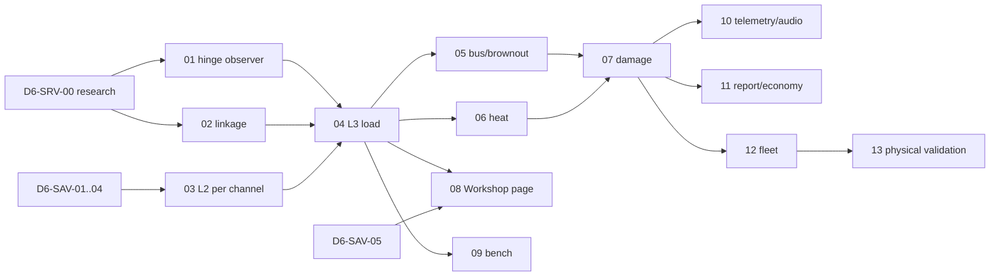

# Servo load, power and failure plan

**Updated:** 2026-10-27. **Revision:** 2 — decisions OD1–OD7 resolved with [D6-SRV-00 evidence](../research/servos/D6-SRV-00/README.md); holding and voltage laws corrected from datasheets. **Status:** planned; nothing implemented. Extends the [Savox servo plan](savox-servos.md) (D6-SAV) past its speed/mass MVP into loaded response, receiver power, heat and overload failure. **Owner:** physics/input track D6. **Prefix:** `D6-SRV-00…15`. A repo-wide grep on 2026-10-27 found no other use; D6-SRV-00 registers it in the [track registry](../README.md#tracks-plans-and-step-ids).

**Owns (proposed):**
- `app/physics/servo/`
- `app/tests/test_servo_*.gd`, except the existing `test_servo.gd`
- servo load and bench scripts under `research/servos/`
- `docs/research/servos/D6-SRV-*`

**Coordinates (owners keep their seams):**
- **AS:** surface hinge geometry, installation, linkage and supply contract.
- **AE:** Workshop page, recipe, compiler and saved builds.
- **EM:** failure episodes, receiver outage (EM-17/18) and the linkage-disconnect surrogate.
- **CR:** incident cause and repair economics (CR-37).
- **BAT:** `pack_ecm` supply.
- **HUD** and **AUD**.
- **Flight-test battery.**

Shared runtime files stay with their owners: `app/sim/flight_session.gd`, `app/main.gd` and `app/ui/workshop.gd`.

Line references were checked on 2026-10-27, after NK-2a moved `flight_session.gd` lines (uncommitted at the time). Re-verify them by symbol before editing.

## 1. Outcome

In the Aircraft Workshop, a player chooses the servo for each installed control. In flight, each product behaves as its physics dictates:

- **Response.** Each servo has its own speed, deadband, small-signal lag and frame rate. Analog and digital servos feel different on small corrections.
- **Force.** Aerodynamic hinge moments load the servo. A loaded servo slows down. Past its holding torque it is pushed back (*blowback*) and the surface reaches less deflection than commanded. This is visible in a dive. The same servo behaves very differently on a Stik and on a 1/4-scale P-51.
- **Failure.** A servo that is too small for the airframe, or for a Workshop-scaled airframe, can strip its gears, overheat or burn out. The consequence follows from the cause: a stripped elevator floats; a burnt servo stops holding.
- **Receiver power.** The player chooses a receiver pack or BEC. Several loaded digital servos can pull the bus voltage down and reboot the receiver (*brownout*), a classic real failure.
- **Linkage.** Choosing the servo-arm hole and control-horn hole trades torque against speed and resolution, as on a real airplane.
- **Tools around it:**
  - a sizing advisor;
  - a servo bench that runs the same physical law;
  - in-flight telemetry;
  - a post-flight stress report;
  - a probable cause in the accident report;
  - the repair cost (gear set versus replacement).

**Initial non-goals:**
- simulating flutter;
- pushrod flex or buckling;
- persistent wear between flights;
- swapping hardware in flight;
- helicopter cyclic, truck steering, flaps, retracts and throttle (these come later through the same law).

[EM excludes flutter, persistent wear and arbitrary free-surface physics from its default scope](failure-mode.md#15-risks-dependencies-and-decisions-to-keep-visible). This plan respects that exclusion; the free surface in 5.6 is a *stated surrogate*, which EM allows for `surface.linkage_disconnect`.

## 2. Boundaries with existing plans

| Plan | Keeps | This plan adds or uses |
| --- | --- | --- |
| [D6-SAV](savox-servos.md) | Catalog import, product/installation contract, mass/CG substitution, catalog speed, Workshop selector (D6-SAV-01…05) | Requires D6-SAV-01…04. Expands the single D6-SAV-06 row (torque/load/deadband/current) into D6-SRV-01…07 and D6-SRV-13. Once accepted, D6-SAV-06 links here instead of keeping its own status. |
| [EM failure mode](failure-mode.md) | Episodes, notices, recovery, independent-actuator topology (EM-03b/13/14), receiver link (EM-17), brownout (EM-18) | Supplies **causal** load and electrical laws instead of random draws. EM-18 demands "a qualified electrical model for causal voltage claims"; D6-SRV-05 provides it. |
| [Crash economics](crash-damage-economics.md) | Incidents, component resolution, repair quotes, CR-37 actuator dependencies | Emits accepted servo events with a cause chain. Prices come from the existing economy catalog. |
| [Aircraft editor](aircraft-editor.md) | Recipe, compiler, saved builds, pages (AE-12/18) | Laws, advisor data and bench. The "Servo packages" idea in the AE catalogue is realized here together with D6-SAV-05. |
| [Aircraft contract](../AIRCRAFT_CONTRACT.md) | v2 format, capabilities, generators | Proposes a conditional `actuation` module (section 7.2). AS decides its form. |

## 3. Current state

| Area | Fact | Source |
| --- | --- | --- |
| Actuators | Three logical servos (`srv_roll`, `srv_pitch`, `srv_yaw`) share **one** rate `servo_rate = 1/servo_full_throw_time`. Throttle is not a servo. Flaps have their own law. | [flight_session.gd:4629](../../app/sim/flight_session.gd#L4629), [aircraft_data.gd:2161](../../app/physics/aircraft_data.gd#L2161) |
| Kernel | `step_normalized` (per-channel rates and factors) has no production caller. Ground steering uses the prescribed-angle law. | [control_actuators.gd](../../app/physics/control_actuators.gd) |
| Loads | **No hinge moment, torque, current, temperature or bus voltage anywhere.** The tail builds local flow and an effective angle, then returns only body loads. | [aero.gd:722](../../app/physics/aero.gd#L722) |
| Tick seam | `_pre_step` already reads the committed state (`sim.state`) to sample propulsion inflow once per tick, frozen through RK4. | [flight_session.gd:4611](../../app/sim/flight_session.gd#L4611) |
| Failures | `roll/pitch/yaw_jam`, `*_bias` and `roll_slow` are seeded random draws, one per flight. Nothing is triggered by load. | [catalog.gd](../../app/failures/catalog.gd), [runtime.gd](../../app/failures/runtime.gd) |
| Electrical | No receiver, BEC or bus model. Electric aircraft prescribe a constant `auxiliary_current_a`. Glow aircraft have no electrical model. | [pack_ecm.gd:151](../../app/physics/battery/pack_ecm.gd#L151) |
| Damage precedent | Versioned threshold law labelled `experimental_unvalidated`. CR-35a has an analytic lumped thermal law. | [gear_damage.gd:5-9](../../app/physics/gear_damage.gd#L5-L9), [CR-35a](../research/crash-damage-investigations/CR-35a/README.md) |
| Workshop | Closed recipe, versioned compiler, immutable saves. Pages are hard-coded with no registry. Scaling multiplies every inventory mass, servos included, by `mass_ratio`. Travel edits keep normalized timing. `mass_edits` are refused together with scaling. | [parameters.gd](../../app/workshop/parameters.gd), [workshop.gd:20](../../app/ui/workshop.gd#L20), [compiler.gd:250](../../app/workshop/compiler.gd#L250), [:332](../../app/workshop/compiler.gd#L332), [:74](../../app/workshop/compiler.gd#L74) |
| Economy | The catalog already prices Savox servos, HS-311 and ES3054, plus gear sets, marked `not_established_by_price_catalog`. Incidents come only from contact events; `cause_kind` accepts `accepted_event`. | `app/data/economy/catalog.json`, [incident.gd:225](../../app/economy/incident.gd#L225), [component_resolver.gd:239](../../app/economy/component_resolver.gd#L239) |
| Audio | Mechanical audio already accepts an optional `load` field. Nothing feeds it. | [mechanical_motion.gd:164](../../app/audio/mechanical_motion.gd#L164), [servo/retract audio](../servo-retract-audio-implementation.md) |
| Prior research | Hinge-moment model, Roskam C_h ranges, datasheets, measured τ ≈ 0.075 s, levels L0–L4. | [Investigation 06 §4](../research/roadmap-investigations/06-radio-input-servos-latency.md#4-servo-model) |

### Fleet (inventory data)

| Aircraft | Servos declared | `servo_full_throw_time` | Receiver supply |
| --- | --- | --- | --- |
| Stik family (10 files) | 3 fuselage (grouped, 135 g) + 1 aileron (45 g) | 0.14 s | 4.8 V NiMH, 600 mAh |
| Extra 300S 60 | 3 fuselage (grouped) + 2 aileron (grouped) | 0.14 s | 4.8 V |
| P-51D 120 cc | 9, individual (80–100 g) | 0.18 s placeholder | 2 × 2S LiFe |
| F4U 250 | about 11, including dual flaps and steering | 0.18 s placeholder | 2 × 2S LiFe |
| Avanti S | 8 (DS8411/DS8911) | 0.11 s | 2 × 2S + PowerBox |
| X8 | 2 elevons, 17 g | 0.075 s | Telemetry receiver |
| Lumber | Folded into the wing; tail 18 g | 0.14 s | BEC (prescribed current) |

## 4. Findings that shape the plan

1. **The Stik elevator is smaller than research 06 assumed.**
   - Investigation 06 used an estimated 0.08 × 0.6 m elevator and predicted blowback above about 34 m/s.
   - The traced geometry in [ugly_stik_geometry.gd](../../app/aircraft/ugly_stik_geometry.gd) gives an elevator chord of 36.8 mm and a span of 0.559 m. That is consistent with the aero tail area of 0.0956 m² (about 0.171 m mean chord, elevator about 20 %).
   - Since H ∝ S·c ∝ c², the load is about 5× lower. The trim aileron (`hinge_fraction` 0.888, about 34 mm) also falls below the 0.06 m estimate.
   - D6-SRV-00 must re-derive every surface from generated geometry before any blowback claim.
2. **Bus voltage.** D6-SAV's first deliverable declares 6.0 V. The Stik's inventory declares a **4.8 V NiMH** pack. Catalog speeds and torques are published per voltage, so the supply must be chosen explicitly. It is a Workshop item, not an assumption.
3. **Shared rate.** One shared rate makes per-servo hardware impossible. The per-channel path (`step_normalized`) exists but has no callers. D6-SRV-03 adopts it before any load is added.
4. **Topology.** The Stik's visual model has two aileron servos ([ugly_stik_controls.gd](../../app/aircraft/ugly_stik_controls.gd)). Physics and economy have one central servo. The installation must declare the real count; for the stock Stik that is one, per D6-SAV.
5. **Scaling.** Workshop scaling is the natural "undersized servo" scenario: at equal airspeed, H ∝ s³. Today it scales servo **mass** like any part (`compiler.gd:250`). Real hardware does not scale: it keeps its mass, torque and speed. This changes the physics for new compilations only; saved builds keep their identity.
6. **Mass edits.** `mass_edits` are refused together with scaling (`compiler.gd:74`). Substituting a servo on a scaled airplane needs that restriction lifted, under explicit rules.
7. **Events.** No in-flight failure produces an incident or a probable cause. A stripped servo needs an accepted event that CR can consume.
8. **Already wired.** The audio load input and the gear-set prices already exist. Reuse them; do not create them again.

## 5. Physics model

Levels, extending investigation 06:

| Level | Content | Status |
| --- | --- | --- |
| L1 | One slew limit, one full-throw time | Current. Legacy parity is mandatory. |
| L2 | Deadband → first-order lag τ → slew at catalog speed × linkage; optional receiver/servo frame hold | D6-SRV-03 |
| L3 | L2 plus load: torque–speed line, holding torque, blowback equilibrium, back-drive | D6-SRV-04 |
| E | Current per servo, bus source, sag, brownout and receiver reboot | D6-SRV-05 |
| T | One lumped motor thermal node, protection and burnout | D6-SRV-06 |
| D | Overload/thermal damage with explicit consequences | D6-SRV-07 |
| L4 | Loop dynamics, linkage compliance, flutter | Research only (D6-SRV-14) |

### 5.1 Hinge moment

For each surface:

`H = q · S_f · c_f · C_h`, where `C_h = C_h0 + C_hα · α_s + C_hδ · δ + C_h,tab · δ_tab`

- `q` and `α_s` come from the **same local-flow functions** the aero uses: wing strips for the ailerons, `_tail_surface_from_flow` for the elevator, the fin for the rudder. There must be no second aerodynamic model.
- They are evaluated at the tick boundary from the committed state, like propulsion inflow, and held through the stages.
- **Coefficients.** Use the Roskam/DATCOM methods digitized in FAST-GA (investigation 06, [S19]):
  - plain surface: C_hδ from −0.5 to −0.9 /rad, C_hα from −0.2 to −0.5 /rad;
  - corrections for aerodynamic balance, horn and gap.
  - Every coefficient carries `{value, unit, kind, source}`. The uncertainty band travels with the value and feeds the advisor (section 8).
- **No double counting.** H is internal to the airframe. The surface loads already enter the rigid body; the hinge moment only loads the servo.
- Signs follow the existing `aero.conventions` (elevator positive = trailing edge down, and so on).

### 5.2 Linkage

- Approximate geometry: `δ = asin((r_s / r_h) · sin θ)`. This is within 0.5° of the four-bar linkage for typical arms.
- The exact four-bar linkage is used whenever there is differential or a raked arm. Investigation 06 shows −22°/+15° with a 20° raked arm.
- Servo torque by virtual work: `T_s = H · dδ/dθ / η_link`.
- Derived quantities the advisor shows:
  - required servo travel for each throw, in both directions;
  - resolution in surface degrees per µs;
  - surface speed.
- The trade-off becomes visible: a longer horn lowers the torque the servo needs but costs it rotation, so it runs slower and with less resolution.

### 5.3 Servo drive (per servo, once per tick)

1. **Signal.**
   - Normalized command → pulse in µs (centre 1500, ±100 % ≈ 1100–1900 µs).
   - Optional sample-and-hold at the receiver/servo frame rate (analog 50 Hz, digital up to 333 Hz).
   - The frame phase is fixed at session start and **recorded**, so replay stays exact. Nothing is drawn at random.
2. **Deadband.** Per product, in µs (analog 5–8 µs, digital 1–4 µs; investigation 06), converted to an angle.
3. **Small signal.**
   - First-order lag τ per class, using the exact update `x += (1 − e^(−dt/τ))(u − x)`.
   - τ is not published. It comes from manufacturer step-response data (OD6); until then it is an `estimated` class value. The reference is the measured HD-1810MG at 0.075 s.
4. **Large signal under load.**
   - Opposing load: `ω = ω₀(V) · max(0, 1 − T_opp / T_stall(V))`.
   - An aiding load does not raise speed above ω₀. No overrun is claimed.
5. **Hold (proportional band) and back-drive.**
   - Holding torque depends on position error: `T = T_stall · min(1, e/e_sat)`, where e is the shaft position error.
   - `e_sat` comes from the published standing torque or from manufacturer data. The HS-755HB gives 8.8 kg·cm at 5° hold-out, 80 % of stall, so e_sat ≈ 6.25°.
   - Under partial load the surface settles off command by `e = (T_load/T_stall) · e_sat`, times dδ/dθ.
   - Above T_stall the servo is pushed back. The quasi-static equilibrium is δ_eq, where `T_s(δ_eq) = T_stall`. That equilibrium is an analytic oracle for the tests.
   - There is no fixed "holding multiplier". Back-drive torque is not published; it comes from manufacturer data or stays outside the model.
6. **Voltage** (law `servo-voltage-twopoint-v1`).
   - Between published voltage points: a straight line through the published speed, stall torque and stall current. On the HS-755HB, pure proportional scaling overstates these by about 4 % (1.20× measured for a 1.25× voltage ratio).
   - Below the lowest published point, during sag only: proportional scaling from that point, labelled `derived`, down to the servo cut-out. The cut-out comes from manufacturer data, with Spektrum's "most servos stop below 3.8 V" as a `borrowed` fallback.
   - **The nominal bus voltage must lie inside the published range.** Otherwise the installation is refused. Brownout is a separate state (5.4).
   - The linear line through no-load speed and stall torque reproduces the KST HS08 rated point (0.195 versus 0.20 s/60° published).
7. **Numerics.**
   - Closed form per tick, no extra state integrated inside the RK4 stages. That keeps 240 Hz stable without a stiff loop.
   - Convergence is checked at 240, 480 and 960 Hz.

Speed is no-load and torque is stall. They are the two ends of a line, not a measured curve. That line is a declared approximation (`derived`) until bench data exist (D6-SRV-13).

### 5.4 Receiver power (E)

- **Current per servo:** `I = I_idle + I_stall · |T_motor| / T_stall(V)`. `I_stall` comes from the product when published; otherwise it is an `estimated` class value.
- **Source:**
  - a receiver pack, reusing `pack_ecm` (NiMH/LiFe parameters as BAT intake);
  - or a linear/switching BEC with a current limit and thermal foldback;
  - plus wiring and switch resistance.
- **Bus voltage:** `V_bus = V_src(SOC, T) − Σ I · R`. It feeds back into ω₀ and T_stall.
- **Brownout:** below the receiver's `V_min` for longer than its glitch tolerance, the receiver drops into outage. Once the voltage recovers, it reconnects after `t_reconnect`.
  - These are per-receiver data, not constants. Spektrum DSMX AR6335: 3.5 V and about 0.04 s with the transmitter on. Spektrum DSM2 AR6110: up to several seconds.
  - Futaba, Jeti and FrSky publish only a 3.5 V minimum. Their reconnect time comes from manufacturer data; without it, that receiver cannot model brownout.
  - Measured current peaks (5–9.3 A on one digital servo) are shorter than one 4.17 ms tick. The per-tick bus sees averages, so a peak-driven brownout needs its own law or manufacturer data.
  - During the outage, the EM-17 receiver profiles apply (hold or failsafe).
  - The cause is recorded. There is no random draw. This realizes EM's causal cascade ("servo overload → bus sag → receiver reboot") without inventing three independent faults.
- **Electric aircraft:** the computed bus current replaces the prescribed `auxiliary_current_a`, but only when the capability is active.

### 5.5 Heat (T)

- One lumped motor node: `C · dT/dt = I²R_m + P_friction − (T − T_amb)/R_th`, with the analytic exponential per tick (the CR-35a pattern). `T_amb` comes from the atmosphere.
- **Thermal protection** (only if the product declares it): derating, then shutdown. **Burnout:** an unpowered servo that holds only by gear friction.
- **Binding:** when the mechanical end of travel exceeds the surface stop, the servo sits at stall current indefinitely. This is a real beginner mistake: it heats the servo and drains the bus. The Workshop flags it before flight.

### 5.6 Damage and consequences (D)

| Mode | Trigger | Surface behaviour | Repair (CR) |
| --- | --- | --- | --- |
| Stripped gears | `|T_load| > k_strip(material) · T_stall`; later also contact impulses on the surface (CR part mapping) | Free with residual friction: quasi-static float at `C_h = 0` → `δ_float = −(C_h0 + C_hα·α_s)/C_hδ` | Gear set if a compatible kit exists, otherwise replace |
| Spline or horn stripped | As above, with a horn/spline threshold | Same float; servo intact | Horn/arm |
| Clevis disconnected | Pushrod load > clip strength (setup-dependent) | Same float (EM `surface.linkage_disconnect` surrogate) | Clevis |
| Motor burnout | Temperature > limit | Unpowered: holds below `k_unpowered · T_stall`, otherwise floats | Servo |
| Thermal shutdown | Declared protection | Temporary loss of torque | None |
| Brownout | Section 5.4 | Every servo on the bus unpowered during the outage | Inspection |

- **A damage mode exists for a product only when its threshold comes from manufacturer data** (`manual` or `measured`; OD2). Strip, back-drive and thermal thresholds are not published in any datasheet reviewed, and none is estimated for a named product.
  - A product without that data still stalls and blows back from its published stall torque, but cannot break.
  - The law is versioned and, until physical validation, carries `QUALIFICATION := "experimental_unvalidated"`, like `gear_damage.gd`. Tests use synthetic fixtures.
- **The massless float is an explicit surrogate.** It is not free-surface dynamics with inertia; that belongs to L4.
- **Partner product wording.** A Savox product only fails when its **published** rating is exceeded. Copy and the accident report describe an undersized installation for that airframe, never a product defect.

### 5.7 Explicitly not modeled

- flutter (OD7);
- per-unit variation (OD3: units of the same reference are identical);
- pushrod buckling or flex;
- backlash with dynamics;
- dynamic interaction between servo position loops;
- two servos fighting on one surface;
- potentiometer wear and jitter;
- persistent wear (OD4);
- water or contamination;
- temperature effects on the receiver pack beyond what `pack_ecm` already models.

Each one goes to D6-SRV-14 with its own evidence gate.

## 6. Worked example (derived, not measured)

Assumptions: C_hδ = −0.7/rad (upper end of the band), C_hα ignored, sea level, linear torque–speed line, catalog values at 6.0 V (HS-311 at 4.8 V). Geometry is from the repository generators.

**1/4-scale P-51, one elevator half.**
- Geometry ([p51d_geometry.gd](../../app/aircraft/p51d_geometry.gd)): c_f ≈ 0.35 × 0.2525 = 0.088 m, span 0.503 m.
- δ = 15°, linkage dδ/dθ = 15/45.
- The real horn balance lowers H. This example does not credit it.

| V | H at hinge | At servo | SH-0255MG+ 3.9 kgf·cm | SA-1258TG+ 12 | SA-1230SG+ 36 | HS-311 3.0 (4.8 V) |
| --- | --- | --- | --- | --- | --- | --- |
| 45 m/s | 9.1 kgf·cm | 3.0 | 78 %, 0.59 s/60° | 25 %, 0.11 s/60° | 8 %, 0.17 s/60° | 101 %: stalls, δ_eq ≈ 15° |
| 55 m/s | 13.6 kgf·cm | 4.5 | **116 %: blowback, δ_eq ≈ 13°** | 38 %, 0.13 s/60° | 13 %, 0.18 s/60° | **151 %, δ_eq ≈ 10°** |

**Stik elevator** (c_f 36.8 mm, δ 20°, dδ/dθ 20/45, HS-311 at 4.8 V):

| Case | Load at servo | Result |
| --- | --- | --- |
| Stock size, 35 m/s | 0.63 kgf·cm (21 %) | 0.24 s/60°: slowed, holds |
| Workshop ×2, 35 m/s | 5.0 kgf·cm (168 %) | Blowback, δ_eq ≈ 12° |
| ×2 at a similar wing loading (V ∝ √s → 49.5 m/s) | 10.1 kgf·cm (336 %) | δ_eq ≈ 6°; stripping is plausible in a pull-out |

**The crossover is the reason to model load.** With the linear line, SA-1258TG+ (0.08 s/60°, 12 kgf·cm) is only faster than SA-1230SG+ (0.16 s/60°, 36 kgf·cm) while the servo load stays below **7.2 kgf·cm**. Above that, the servo that is "slower" on paper moves the surface faster. The Workshop must show this instead of ranking servos by their catalog speed alone.

## 7. Architecture

### 7.1 Modules

Each module is pure, static, float64 and uses `PackedFloat64Array` only: no `Vector3` or `Basis`, as `test.sh` checks. Each follows the `prepare(raw) → {ok, identity, values, errors}` + `step(...)` pattern of the prescribed-angle law in [control_actuators.gd](../../app/physics/control_actuators.gd). Invalid input is refused; it is never clamped silently.

| File | Responsibility |
| --- | --- |
| `app/physics/servo/hinge_moment.gd` | C_h, H per surface from local flow and geometry; uncertainty band |
| `app/physics/servo/linkage.gd` | Approximate/exact four-bar, dδ/dθ, required travel, resolution, mechanical limits/binding |
| `app/physics/servo/servo_drive.gd` | Pulse/frame, deadband, τ, torque–speed, hold/back-drive, voltage |
| `app/physics/servo/servo_bus.gd` | Currents, source (via `pack_ecm`/BEC), V_bus, receiver state machine |
| `app/physics/servo/servo_thermal.gd` | Lumped node, protection, burnout |
| `app/physics/servo/servo_damage.gd` | Thresholds, transitions, consequences, events |
| `app/physics/servo/servo_installation.gd` | Validates and derives the contract into prepared arrays; law identity |

### 7.2 Data

- **Product** (extends the D6-SAV-01 record), all optional and refused if invalid:
  - `stall_current`, `idle_current`, motor (`cored | coreless | brushless`), gears (material), `analog | digital`;
  - `deadband_us`, accepted frame rates, `thermal_protection`, voltage range.
  - Unpublished values are absent or `estimated` class records with a source. The UI labels them "estimated".
- **Aircraft** (proposed AS conditional module `actuation`; AS decides):
  - `surfaces[]`: hinge geometry (chord, span, hinge fraction, balance/horn ratio, tab) and C_h coefficients;
  - `installations[]`: product, logical channel, driven surfaces and sign, linkage geometry, mounting position, bus;
  - `buses[]`: source, nominal V, R, BEC limit, receiver and `V_min`.
  - Capability: `actuation.servo_load`. **Without it, the L1 path stays byte-identical.**
- **Generators.** Hinge geometry comes from each aircraft's generators. Generated data is never hand-edited.

### 7.3 Runtime seam (respects SF-01)

- **The kernel does not change.** The servo law runs inside the airplane `pre_tick` (`_pre_step`, [flight_session.gd:4571](../../app/sim/flight_session.gd#L4571), called by `_kernel_pre_step` at `:4553`). It replaces the three-axis loop (`:4629`) only when the capability is present. There are no vehicle branches in `Simulation`.
- **Per-tick memo (NK-2a).** `_kernel_pre_step` arms a memo of pure aircraft-data answers, and `_on_sim_stepped`/`_on_sim_faulted` drop it. The servo law reads the committed state and its prepared installation directly. Only values that are pure functions of `aircraft` may join the memo. Tests that call `_pre_step` directly never arm it.
- **Order inside `pre_tick`** (documented and tested):
  1. flaps and mix;
  2. EM `effective_inputs`;
  3. receiver/bus state;
  4. frame and deadband;
  5. drive under load (H sampled from `sim.state`);
  6. heat;
  7. damage transitions and events;
  8. outputs.
- **State:**
  - continuous sampled values (position per servo, temperature, accumulated energy) in `aux`;
  - discrete states (servo health, receiver up/rebooting) in `modes`, which change only at tick boundaries (H8);
  - an explicit `state_layout_identity` (checkpoint v2) when the capability is present. The legacy layout does not change.
- **Several servos per channel.** Until topology EM-03b/14 exists, a channel with N real servos shares one position and splits the summed load by installation. This is a documented surrogate. Pitch derivatives are not halved (EM-14).
- **Events.**
  - `servo_overload`, `servo_stripped`, `servo_thermal_shutdown`, `servo_burnout`, `receiver_brownout`.
  - They are recorded on the existing event path, then reach EM (notice), the flight log (markers) and CR (`cause_kind: accepted_event`).
- **Determinism.**
  - No RNG anywhere in the servo laws. There is no per-unit scatter (OD3).
  - The frame phase is fixed at session start and recorded in identity and in the log.
  - Checkpoint, restore and replay are exact.
- **Identity.** Law versions (`servo-dc-linear-v1` torque–speed line, `servo-voltage-twopoint-v1`, `servo-thermal-lumped-v1`, `servo-damage-v1`) are pinned in `VehicleModel.identity` and in the Workshop compiler version.
- **Performance.**
  - Budget: ≤ 1 % of the airplane tick at 240 Hz, measured with the tick-performance tools in the [tool index](../tools/README.md).
  - Loops are allocation-free; the hinge moment uses one local-flow evaluation per surface per tick.
  - HUD and log observers sample instead of recomputing. Observers already cost about half of a tick.

### 7.4 Workshop (AE)

- **Recipe.** New closed keys `servo_installations` (installation → product, arm/horn holes) and `servo_supply` (source, voltage point).
  - They are validated in `parameters.gd` and compiled by a `servo_hardware` capability with a new compiler version. The descriptor pins the catalog bytes.
- **Mass.** Substitution at fixed stations through `mass_edit`, which requires D6-SAV to split grouped items first.
  - New compiler rule: real hardware keeps its mass, torque and speed under virtual scaling. Linkage and surfaces scale with the airframe. This lifts the `mass_edits` + scale restriction for servos only.
- **Compatibility.** Saved builds are immutable and keep their old identity and L1. There is no silent migration.
- **Page.** A new `servos` page in `PAGE_IDS` and `draft_store.PAGES`, following the current pattern (there is no page registry). It migrates when AE-18 generates pages. Its selector is the D6-SAV-05 one; there is no parallel UI.

## 8. Workshop experience

**Servos page, three columns:**

1. **Installations.** One card per real servo (for example "Elevator · 1 servo · 4.8 V"). Each card has a margin badge (green / amber / red / *estimated*).
2. **Comparison.** Compatible candidates at the installation's **actual voltage**: catalog speed, **loaded speed at V_ref and V_dive**, holding torque, margin, deadband, gears, mass, ΔCG, dated price. Unavailable candidates show the reason: voltage, mounting, travel or topology.
3. **Preview and bench.** Described below.

**Sizing advisor.**
- `margin = T_stall(V_bus) / T_required(V_dive, δ_max, upper C_h band)`. The advisor also shows the steady holding error under that load.
- `V_dive` must be explicit per aircraft: no aircraft declares it today. Until it is declared, it is `estimated` or derived from the battery's terminal dive.
- Colour thresholds are a documented, sourced rule (D6-SRV-00). They are not hard-coded heuristics.
- The advisor always explains: "at 55 m/s this servo holds 10° of the 15° commanded".

**Linkage.**
- Choose arm and horn holes; see throw, required servo travel, resolution and torque factor.
- Warnings for binding (travel beyond the stop) and lost resolution (too little servo travel).
- Qualitative flutter guidance only, sourced to RC practice: slop combined with long horns increases risk at speed, and static balance helps. There is no score and no simulation (OD7).

**Receiver power.**
- Receiver pack or BEC, voltage point, estimated peak current (every servo at blowback) and margin to `V_min`.
- Warning: "HV servos on a 4.8 V bus" is refused. An HV propulsion battery does not establish an HV servo bus (D6-SAV).

**Servo bench.**
- Step and sine response with load set either by an airspeed slider or by weight on the arm. Plots of angle/time, current and temperature.
- It runs **the same module** as in flight: bench–session parity is a test.
- An overload test can break the servo on the bench, with no economic cost and no change to the draft.

**Flow.** Apply to the draft → undo/reset → save → trial through the existing transactional path. The original aircraft stays available.

**Accessibility and resolution.**
- Keyboard and controller navigation; EN/ES plus the existing `.po` files.
- Captures first at **1920×1080**, then 1440p/4K, and 720p last.

## 9. Flight and after the flight

- **HUD.** A servo page in the overlay presets: load %, temperature, bus V, receiver state. EM failure notices are reused.
- **Trace and flight log.** Load, temperature, V_bus and state channels, added to a versioned schema, plus event markers.
- **Audio (AUD).** The load fraction feeds the existing `load` input. Buzz at stall or binding; silence during brownout.
- **Visual.** Rendering already consumes the accepted angles, so blowback and float are visible without new render logic.
- **Accident report (CR).** A probable-cause chain built from recorded events, for example "elevator: gears stripped at 52 m/s, load 2.7× rated → loss of pitch → impact". Line items: gear set versus servo.
- **Post-flight summary.** Peak load %, time above 100 %, maximum temperature, minimum V_bus, events.

## 10. Steps

| ID | Work | Proof / status |
| --- | --- | --- |
| D6-SRV-00 | **Research and governance.** Decisions OD1–OD7, sources, holding/voltage/brownout data. Then: re-derive surface geometry from the generators (finding 1), C_h method and bands, advisor rule, `V_dive` per aircraft, manufacturer data-request template. Register the prefix. | **Partial:** decisions and evidence in the [dated record](../research/servos/D6-SRV-00/README.md) and the [manifest](../research/servos/D6-SRV-00/sources.json); [DECISIONS](../DECISIONS.md) entry. Geometry, C_h, advisor, `V_dive`, template, registry and an independent check of the section 6 numbers are pending. |
| D6-SRV-01 | **Hinge-moment observer** (read-only). Contract geometry with AS. H per surface from the same local flow as the aero. Trace/log channels. | Pending. Analytic oracle per surface, signs per `aero.conventions`, **golden flights byte-identical** (observer only), 240/480/960 Hz consistency. |
| D6-SRV-02 | **Linkage kinematics.** Approximate and exact four-bar, dδ/dθ, required travel, resolution, binding. | Pending. Four-bar oracle, investigation 06's −22°/+15° differential case, both directions, refused invalid geometry. |
| D6-SRV-03 | **L2 per channel without load.** Adopt `step_normalized`; deadband, τ, slew at catalog speed × linkage, recorded frame hold. Opt-in capability. | Pending. Analytic step, small-signal lag, legacy L1 byte-identical, exact replay, goldens unchanged for aircraft without the capability. |
| D6-SRV-04 | **L3 load.** Torque–speed line, aiding/opposing load, hold and back-drive, δ_eq. Stik first, P-51 second. | Pending. Analytic δ_eq, monotonicity, no energy from nothing, dt convergence, [flight-log](../FLIGHT-LOGGING.md) candidate per aircraft (`solver_changed`, `complete`). |
| D6-SRV-05 | **Receiver power.** Currents, receiver pack via `pack_ecm`, BEC, V_bus, voltage law validated against two-point products, receiver state machine with EM-17/18. | Pending. Analytic sag, two-point catalog check, reproducible causal brownout, no RNG, rollback. |
| D6-SRV-06 | **Heat.** Lumped node, protection, burnout, binding. | Pending. Analytic exponential, fixed-tick idempotence, endpoint-binding scenario. |
| D6-SRV-07 | **Damage.** Manufacturer-data thresholds only, float surrogate, burnout, clevis. Events toward EM and CR. Active with the capability, independent of the random-failure probability; notices use `notify` (OD2). | Pending. Thresholds and transitions on synthetic fixtures, no mode for a product without data, deterministic replay, checkpoint/rollback across the transition, event emitted once. |
| D6-SRV-08 | **Workshop Servos page** (with AE and D6-SAV-05). Advisor, linkage, supply, comparison at actual voltage, scaling rules. | Pending. Workshop tests (recipe, compiler, save/load, failed launch, undo); captures 1080p → 1440p/4K → 720p; EN/ES; navigation. |
| D6-SRV-09 | **Servo bench.** Same module, load sliders, plots, overload test. | Pending. Bench = session parity for identical inputs; bench breakage does not touch the draft or the economy. |
| D6-SRV-10 | **Telemetry and presentation.** HUD page, log schema, audio `load`. | Pending. HUD capture at 1080p, audio mapping test, versioned log schema test, debug-bridge field. |
| D6-SRV-11 | **Report and economy.** Cause chain, servo incident via CR-37, gear-set versus replacement quote. | Pending. Incident tests, report capture, a price edit leaves the trajectory identical. |
| D6-SRV-12 | **Fleet adoption.** Installations for Stik, Extra, P-51, F4U, Vantage, X8 and Lumber. Battery tests `servo_authority_dive`, `servo_blowback_recovery`, `rx_bus_sag`. | Pending. Goldens re-recorded with an explained physics change, `--shared-tests` comparison, per-aircraft evidence. |
| D6-SRV-13 | **Manufacturer data intake and validation** (OD6). Request template, import with `manual`/`measured` provenance, publication permission per file. Confidential raw files stay in gitignored `references/`. The owner bench is an optional cross-check. | Pending. Tolerances fixed **before** fitting, comparisons on held-out traces; closes physical claims separately from software. Pilot feel stays a separate gate. |
| D6-SRV-14 | **Research-gated extensions.** Pushrod flex/buckling, two servos per surface, flaps/retracts/steering/throttle, helicopter cyclic. Flutter (OD7), wear (OD4) and per-unit scatter (OD3) are excluded by decision. | Each extension needs its own evidence; none is enabled without it. |
| D6-SRV-15 | **Consolidation.** Update the Workshop guide and the contract; release notes; close this plan. | Pending. |

Every step is a small, working, independently reviewable change. The commit message carries the proof: test, trace or measurement.

## 11. Verification

- **Oracles.**
  - H analytic per surface;
  - exact four-bar;
  - catalog speed with no load (reproduces s/60°);
  - zero speed at T_stall;
  - δ_eq;
  - voltage law against two-point products;
  - thermal exponential;
  - thresholds;
  - δ_float with C_h = 0.
- **Session.** L1 parity without the capability; exact checkpoint/restore/replay; rollback of rejected ticks; 240/480/960 Hz; recorded frame phase.
- **Flight changes.**
  - Follow [FLIGHT-LOGGING](../FLIGHT-LOGGING.md): baseline `.orfl`, exact replay, one candidate with the same input tape.
  - Re-record goldens only at intentional adoption (D6-SRV-12).
- **Battery.** New tests appended to the card through the existing process. They do not change existing tests.
- **App.** `python3 tools/debug/debugctl.py smoke` and a Workshop UI crawl through the debug bridge. `app/test.sh` complete.
- **Evidence.**
  - Summaries plus JPEG captures where views are the evidence. **Do not commit unnecessary images.**
  - Software verification does not establish physical validation.

## 12. Risks

| Risk | Mitigation |
| --- | --- |
| C_h uncertainty (±40 %) penalizes the stock fleet | Band visible in the advisor; damage only above the **upper** band; fleet qualification in D6-SRV-12 |
| Wrong geometry (finding 1) | D6-SRV-00 re-derives from generators before any claim |
| Layout change breaks checkpoints and logs | Explicit `state_layout_identity`; legacy layout untouched; versioned schemas |
| Loss of determinism (frame phase) | Phase fixed at session start and recorded; no RNG; no per-unit scatter |
| Manufacturer data never arrives for a product | That product still flies with published speed/stall torque; its damage modes stay unavailable, and the Workshop says so |
| The Workshop overwhelms beginners | Progressive disclosure: badge and sentence first, curves in "advanced" and on the bench |
| A partner product appears to "fail" | Failure thresholds come only from that manufacturer's data; "undersized installation" wording; plain-text names, no logos or likeness without permission (OD5) |
| Conflict on hot shared files (`flight_session.gd`, `workshop.gd`) | Small, coordinated diffs; inspect `git status` before editing; one writer per path |
| Price contaminating physics | Price outside physical identity (D6-SAV rule) |

## 13. Decisions (resolved 2026-10-27)

The owner delegated these decisions and settled OD3, OD4 and OD6 directly. Grounds and sources: [D6-SRV-00](../research/servos/D6-SRV-00/README.md#decisions). Durable record: [DECISIONS](../DECISIONS.md).

| # | Decision |
| --- | --- |
| OD1 | Loaded response belongs to an aircraft's physics. It is adopted per aircraft through `actuation.servo_load` after D6-SRV-12 qualification, with an explained golden re-record. There is no global "ideal servo" toggle. Aircraft without the capability keep L1 byte-identical. |
| OD2 | Damage is caused physics, not an injected failure. The random-failure probability does not gate it, and notices use `notify`. A damage mode exists only for products whose threshold comes from manufacturer data. Stall and blowback are always active with the capability. |
| OD3 | Units of the same reference are identical. There is no scatter. (Owner) |
| OD4 | No wear or persistent servo state between flights. (Owner) |
| OD5 | Real products are named in plain text, with source and data date. Logos, stylized lettering or 3D likeness need written permission; Savox has it. Comparisons are objective, with no "better" or endorsement labels. A failure is called an "undersized installation". A stock aircraft installs the product its source names when data exist, otherwise a brand-neutral class record. |
| OD6 | Manufacturer data is the primary parameter and validation source (owner). Publish only what the manufacturer authorizes; keep raw confidential files in gitignored `references/`. The owner bench is optional. |
| OD7 | Flutter is out of scope: no simulation and no numeric score. The Workshop may show sourced qualitative setup guidance. |

## 14. Sources

- [D6-SAV-00: permission, catalog and prices](../research/servos/D6-SAV-00/README.md).
- [D6-SRV-00: decisions, holding/voltage/brownout data, simulator practice, flutter and naming evidence](../research/servos/D6-SRV-00/README.md), with its [source manifest](../research/servos/D6-SRV-00/sources.json).
- [Investigation 06 §4: servo model, datasheets, hinge moments, levels](../research/roadmap-investigations/06-radio-input-servos-latency.md#4-servo-model). This includes [S10–S19]: Hitec/Futaba/Savox datasheets, measured HD-1810MG and DS610, JSBSim/ArduPilot as read-only references, and Roskam/DATCOM via FAST-GA.
- [EM failure mode](failure-mode.md): EM-03b/04/13/14/17/18/25, `surface.linkage_disconnect` and causal cascades.
- [Crash economics](crash-damage-economics.md): servo/linkage repair criteria and CR-37.
- Repository geometry: [ugly_stik_geometry.gd](../../app/aircraft/ugly_stik_geometry.gd) and [p51d_geometry.gd](../../app/aircraft/p51d_geometry.gd).
