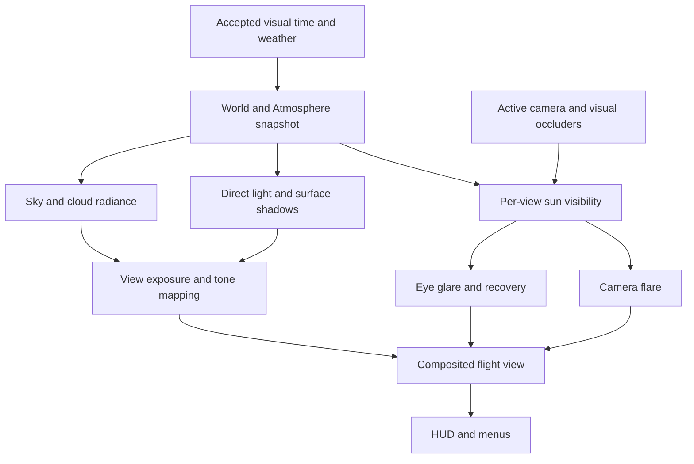

# Sun: realistic disc, glare and dazzle

2026-11-15 · Revision 2 · **Implementation plan** · Step prefix: **SUN**

**Status:** SUN-00…05, -02b, -05b, -06 (command line) and -09 have delivered software and historical rendered evidence. The SUN-07 source handoff to moon glare exists in `SunGlare.source()`; FW-MOON-08 owns its remaining qualification. SUN-08 owner flight acceptance and the eyewear preference (SUN-D1) remain open. **SUN-10…19 below are a new, documentation-only improvement program; no new runtime effect is delivered by this revision.** SUN-10's source research is complete, while its current native baseline remains pending.

This revision audits `main` at `273a7e4c0617fdf4cacc39c360796fd79afa5f2c`, application 0.2.8, official Godot `4.8.beta2.official.cafc17a19`. See the [dated code audit](../research/sun/SUN-10/README.md), [official sources and engine capability matrix](../research/sun/SUN-10/sources.md), and [implementation examples, experiments and acceptance cards](../research/sun/SUN-10/experiments.md). Existing evidence stays in [SUN-00](../research/sun/SUN-00/README.md), [SUN-01…05](../research/sun/SUN-01-05/README.md), and [SUN-02b/05b/06/09](../research/sun/SUN-02b-06-09/README.md); its original engine, resolution and hardware limits still apply.

**Owner:** Visual quality and landscape (the sun's look), with LU (`sun_glare.*` began as LU-04) and Field world (shared `sky.gdshader`, `atmosphere.gd`; moon glare is FW-MOON-08). CAM sets the optics hint on its camera.

**Owns:**

- `app/render/sun/` (optics math, CPU cloud mirror)
- `app/render/landscape_upgrade/sun_glare.gd`, `sun_glare.gdshader` (taken over from LU-04 with LU's interface: node name `SunGlare`, `--sun-glare=0..2|off`, `OPENRC_SUN_GLARE`)
- `app/tests/test_sun_optics.gd`, the `glare_offset_*`, `glare_afterimage*` and `glare_lens*` cases of `app/tests/capture_landscape_upgrade.gd`
- `tools/landscape/glare_contrast.py`; evidence in `docs/research/sun/`

Hooks in shared files: the solar block and `sun_*` uniforms of `app/render/sky.gdshader`; `Atmosphere._set_sun_uniforms`; one metadata line in `app/render/camera/camera_rig.gd`.

## 1. Goal

The pilot stands at the field and follows the model. A close solar crossing should produce a convincing, localized loss of contrast and a short recovery period. The aircraft stays rendered and simulated throughout; its visibility changes through light and the view's response. The sun should have a readable disc when conditions allow, a bright atmospheric surround, and coherent cloud transmission, shadows and colour through the day. Chase and orbit views retain camera optics; the pilot view retains eye-like glare.

Non-goals: changing flight physics, medical or display photometric calibration, and an engine upgrade as a prerequisite. Godot 4.8 beta 2 has reduced Compatibility glow; the old blanket exclusion of bloom is no longer an engine capability statement. Glow remains an optional, measured part of this plan, separately from glare and afterimage.

## 2. Model (what is implemented)

The original model, sources and rejected alternatives are in [SUN-00](../research/sun/SUN-00/README.md). The implementation combines a steady contrast veil with a separate temporary local masking effect. These are game presentation approximations with calibrated and estimated constants; they do not establish the response of a particular person's eyes. In particular, `AFTER_RECOVER_S = 8` is an exponential time constant, not a guaranteed eight-second disappearance or recovery duration.

| Part | Physics | Where |
| --- | --- | --- |
| Disc | Quadratic limb darkening near 550 nm, mean-preserving; refraction flattening (Sæmundsson, as the moon's; 0.84 on the horizon) | `sky.gdshader` `sun_disc_profile`; `SunOptics.limb`, `.squash` |
| Aureole | Krisciunas & Schaefer (1991) aerosol term anchored to the sun's illuminance (B/E in sr⁻¹), flat inside 1°, only above its 45° value, kept below 0.4 of the disc's mean radiance (under its limb) and faded out over the last 2° above the horizon (the sky must meet the ground's fog colour there) | `sky.gdshader` `sun_aureole`; `SunOptics.aureole_*` |
| Eye veil | CIE 146:2002 general disability-glare equation (age 40, pigment 0.5) above its 45° value, over the luminance behind the model (sky plus aureole): r = Ψ·S/(1 + S_b·g). S = E/B, the sun's illuminance over the sky's luminance around it, read from the live sky (≈ 9 on the calibrated day, 1–3 for a low sun, < 0.5 at the horizon), times the disc's visible fraction, clouds and strength; S_b = E/B times clouds only (the aureole is sky light). Overlay alpha q/(1+q), q = κ·r, so displayed contrast falls by 1/(1 + r) | `sun_glare.gdshader` pass 0; `SunOptics.veil_*`; `SkyMirror.background_luminance` |
| Visibility | Clouds from the CPU mirror of the sky's own decks (classic and layered), cached until they change; the disc's visible fraction from 9 depth samples on screen (the flown aircraft included); off screen and for bleaching, the field's skyline from the pilot's eye (SUN-09), else a 3° prior | `SkyMirror.transmission`; `Skyline`; pass 0 |
| Ciliary corona | Fine radial needles near the source, drifting slowly on the shader clock | pass 0, eye |
| Bleaching | Up to eight fixed retinal cells of 1.15° (disc plus its bleaching halo), fixed to the view; the sun's image feeds each by a Gaussian of its distance, dD/dt = e(1−D)/0.05 s − D/8 s on simulation time, exact per step, with e the sun's absolute illuminance relative to the day sun. A sweep leaves a streak, a stare one saturated cell. Drawn on a canvas layer under the interface: the image blurred over twice the cell's size (lost acuity) with masking up to 0.95, violet-dark once the sun has left the cell | `SunOptics.afterimage_*`, `bleach`; `sun_afterimage.gdshader` |
| Veil colour | The disc's, raised per channel to 1.1 × the sky around the source, so the mix only brightens (straylight adds light); no veil on sky pixels inside the source's own disc | `SunOptics.veil_colour`; pass 0 |
| Eyewear | Cap brim shades a source > 25° above the line of sight (veil and dose); light-brown sunglasses pass 25 % (dose only) | `SunOptics.eyewear_factors`; `--pilot-eyewear` |
| Lens | 0.2 × the eye's veil, six-blade starburst, five ghosts through the frame centre (pass 1); no bleaching | passes 0 and 1, `openrc_optics = "lens"` |

## 3. Steps

| ID | Work | Proof / status |
| --- | --- | --- |
| SUN-00 | Audit of the LU-04 glare and the sky's disc; physiology, optics and prior-art research. | Delivered: [SUN-00](../research/sun/SUN-00/README.md). |
| SUN-01 | Disc limb darkening and refraction flattening; sun aureole (background pass only, so the calibrated radiance cubemap is unchanged). | Delivered: unit checks, native captures noon/sunset ([SUN-01…05](../research/sun/SUN-01-05/README.md)). |
| SUN-02 | Eye veil (CIE over sky plus aureole, E/B from the live sky), display mapping, per-camera projection in the shader (no frame lag, any FOV), CPU mirror of the sky (fixes LU-04's glare under layered weather), horizon prior. | Delivered: `test_sun_optics.gd`; `glare_offset_*` captures measured by `glare_contrast.py`. |
| SUN-03 | Bleaching and afterimage on simulation time (pause and replay hold it; a jump rests the eye). | Delivered: exact-integration and patch checks; `glare_crossing*` and `glare_afterimage` captures. |
| SUN-04 | Optics per view: eye (pilot) vs lens (chase, orbit, close-up): starburst and ghosts. | Delivered: `glare_lens` capture. |
| SUN-05 | Regression: LU glare checks updated for the new physics (13/13), whole unit set, review fixes. | Delivered; 548/570 unit tests pass, the 22 failures traced to other tracks or parallel runs ([SUN-01…05](../research/sun/SUN-01-05/README.md#2-measurements)). Target-GPU cost belongs to SUN-08. |
| SUN-02b | The veil never darkens: target colour ≥ the sky around the source; disc exclusion and ALBEDO encoding (with FW-MOON-08). | Delivered: 0 darkened sky pixels at golden hour (was 195); Day unchanged ([SUN-02b…09](../research/sun/SUN-02b-06-09/README.md)). |
| SUN-05b | The optics inside the real flight scene (`main.gd`): layering, process order, bleaching, pause, lens, restart, strength, skyline, eyewear. | Delivered: `test_sun_flight.gd` 22/0. |
| SUN-06 | Pilot eyewear: cap brim and light-brown sunglasses, `--pilot-eyewear` / `OPENRC_PILOT_EYEWEAR` (default none). | Delivered as a command-line/environment option; an interface preference and the default need the UI owner and the owner (SUN-D1). |
| SUN-07 | Moon glare through the same overlay (FW-MOON-08 owns it). | Sun-side handoff implemented in `SunGlare.source()` and covered by `test_world_moon_glare.gd`; this is source selection, not simultaneous two-source glare. Retain FW-MOON qualification gates. |
| SUN-09 | The field's skyline from the pilot's eye for bleaching and the off-screen veil, built incrementally from the field's geometry. | Delivered: `test_sun_skyline.gd` 14/0 (opengl3), in-flight checks; default-field profile and cost in the evidence. |
| SUN-08 | Owner flight acceptance: fly across the sun on Day, golden hour and sunset; judge how long the model is lost, the afterimage streak, the veil and the lens flare. Tune `AFTER_RECOVER_S`, `AFTER_MAX_ALPHA`, the patch blur and the `--sun-glare` default from it. | Open (Gate). |

## 4. Controls

`--sun-glare=0..2` (or `off`) and `OPENRC_SUN_GLARE` scale the veil's straylight and the bleached patches' masking; `--pilot-eyewear=none|cap|sunglasses|cap+sunglasses` (or `OPENRC_PILOT_EYEWEAR`) sets what the pilot wears; `--landscape-upgrade=off` removes it. The camera rig marks its view (`openrc_optics` metadata). Commands: [tools/landscape](../../tools/landscape/README.md).

## 5. Limits

- The bleaching dose sees clouds and the field's static skyline (SUN-09), not the aircraft or other moving objects; lens views and other eye positions keep the constant 3° prior. The on-screen veil uses the real depth buffer.
- Bleaching is eight 1.15° cells, not a per-pixel retina: a sweep longer than eight cells stops leaving new ones until a cell fades; the minutes-long faint tail of a real afterimage is not drawn.
- The veil's display mapping assumes a background near 0.75 of the veil's displayed colour (a day sky near the sun, measured within 0.05); a forced dark exposure over-veils.
- E/B comes from the sky table's gradient; near the horizon that sky is bright, so a low sun veils little (as observed), but the absolute numbers carry the table's and KS91's 2–4× uncertainty.
- Transparent canopies do not write depth; nine depth samples can step during a small-object transit (LU-04 limits).
- One source at a time; the moon is FW-MOON-08's.
- Constants marked estimate in `sun_optics.gd` wait for SUN-08.

## 6. Owner decisions

| ID | Decision | Default until answered |
| --- | --- | --- |
| SUN-D1 | What the pilot wears by default (none, cap, sunglasses, both) and whether Settings offers it. RC pilots commonly wear a cap and light sunglasses; a cap removes glare from a high sun while flying low, never when looking at the sun. | none (the glare as measured in SUN-01…05) |
| SUN-D2 | The calibrated Day's disc and aureole changed within 45° of the sun ([DECISIONS](../DECISIONS.md), 2026-10-19). | accepted unless reverted |

## 7. Improvement strategy and visual direction

**Improve coherence first, then richness.** Keep the existing sun, weather, camera, cloud cache and shadow owners. The strongest immediate opportunities are shared spatial sampling, consistent cloud transmission, correct occlusion of each effect, renderer-aware exposure, and controlled recovery. A larger solar disc or stronger bloom alone will not solve these boundaries.

The [source audit](../research/sun/SUN-10/README.md#2-findings-and-disposition) distinguishes code-proven limitations from visual hypotheses. None of the proposed appearance improvements has been qualified by a new native capture in this research.

| Situation | Intended result | Main work |
| --- | --- | --- |
| Clear noon | Small brilliant solar core, smooth aureole, blue sky, believable aircraft highlights; local glare close to the source | SUN-12, SUN-14 |
| Thin cirrus | Solar disc remains partly visible, softened and attenuated; a broad cloud halo replaces a hard artificial ring | SUN-13 |
| Broken cumulus | Bright sun-facing/backlit edges where the light path permits, shaded cloud bodies, coherent openings and moving sun patches | SUN-11, SUN-13, SUN-15 |
| Thick overcast | Diffuse sky, suppressed direct solar disc/ghosts and softer, weaker direct shadows; no permanently sharp white sun through opaque cloud | SUN-13…15 |
| Sunrise and sunset | Warm direct light, cooler sky/shadow fill, long bounded shadows and continuously changing cloud illumination; no whole-screen orange filter | SUN-12, SUN-15 |
| Haze with broken light | Restrained shafts and aerial depth that agree with cloud/geometry obstruction | SUN-16 |
| Aircraft crosses the sun | Local contrast reduction, brief masking and smooth reacquisition; the effect follows view optics and accumulated exposure | SUN-14, SUN-08 |
| Rapid pan or weather edit | No detached flare, stale shadow patch, sky flash, one-frame exposure jump or persistent temporal trail | SUN-11…19 |

These are art-direction targets, not observations of current failures. Use the same aircraft, camera path, accepted time and weather seed for comparisons. Preserve the familiar calibrated Day as a reference look until an explicitly reviewed replacement is accepted.

## 8. Integration architecture

### 8.1 Extend the current presentation boundary

`World.update` and `Atmosphere` already coordinate accepted time, lighting and cloud state. Extend their detached snapshots and consumer interfaces; do not create another time-of-day manager, weather RNG, camera controller or global exposure loop. The existing `SkyMirror`, `SunOptics` and shader implementations remain the reference paths while candidates are evaluated.

This is a dependency diagram, not a claim that every current effect has the same GPU pass order. SUN-12/14 must verify actual scene-linear, transparent, post-processing and canvas ordering.

| Contract | Owner and proposed addition | Invariant |
| --- | --- | --- |
| Solar identity | `Atmosphere` / `SkyState`: apparent disc direction, geometric/light direction, angular radius, colour, scene-relative radiance, selected sun/moon source | Do not confuse the sun with the directional light when the moon is selected. Render axes and radians/degrees are explicit. |
| Cloud identity | Extend `cloud_state_snapshot()` with the optical model revision and declared observer/world mapping, using existing layers, seeds and transport | A visible cloud, its sun transmission and its shadow reference the same accepted field; quality changes do not select different weather. |
| Per-view visibility | SUN-owned adapter: cloud transmission, opaque disc visibility, transparent-bank transmission, view identity and sample age | Factors have distinct meanings; never apply the same obstruction twice or reuse another camera's result. |
| Exposure | Keep `World.adapt` as the baseline owner; any native auto-exposure experiment replaces that owner's contribution for the trial | One exposure authority per view. A new camera attribute must not silently override RC FOV, zoom or clipping. |
| Cloud shadows | Existing VQ-04b/FW receivers, extended from one eligible layer where justified | Attenuate the selected sun/moon directional illumination; preserve diffuse sky fill and local lights. Receiver position and twilight source handoff matter. |
| Temporal state | Accepted presentation time, explicit camera-cut/seek/reset handling | Pause holds, replay/restore follows the documented policy, and shader code never uses wall-clock `TIME`. |

### 8.2 Spatial coherence

The current sky and CPU cloud mirror sample angular decks without the observer's world position. Ground shadows start at `world_pos`; storm impostors have world-space centres. SUN-11 should first reproduce the effect of translation in pilot, chase and onboard views. A shared plane intersection is the starting candidate, with layer altitude, receiver height, scale, seed and periodic offset all explicit. Its formula and numerical checks are in [experiment E1](../research/sun/SUN-10/experiments.md#e1-one-cloud-field-in-world-space).

Adding camera position to a sky shader can force radiance-cubemap updates. `AT_CUBEMAP_PASS` alone does not avoid invalidation. Compare the current shared-sky route with a separately updated visible-cloud pass and a slower lighting representation. Select only after measuring camera translation, reflection consistency, sky seams and total frame cost. Keep High's existing realtime 256-pixel radiance path and Standard's incremental policy until evidence supports a change.

SUN-11 also makes solar-disc occlusion policy explicit at the `Atmosphere` boundary instead of relying on `SunGlare` to force the sky flag when attached. Compare fixed classic lighting with the landscape-upgrade option both on and off, plus TOD/layered modes. Preserve the deliberately unobscured classic reference asserted by `test_sky_render.gd` until a separately reviewed appearance migration is accepted; moving ownership alone is not permission to change those pixels.

### 8.3 Cloud light transport

Preserve the current `exp(-8 * (density + cirrus_amount))` mapping as `legacy` reference behavior, including classic cirrus; `SkyMirror.optical_density()` contains their combined proxy. A new optical model should distinguish authored coverage, extinction/thickness, view transmission, solar transmission and scattered cloud radiance. For successive layers, optical depths add and transmissions multiply. The sky's existing composited alpha is not a physical path length.

For the affordable path, improve the existing 2.5D relief with bounded self-shadow sampling and an angular forward-scattering lobe. Use the same layer shape for its rim and its body. Treat a Henyey–Greenstein lobe as an approximation; declare vector signs and keep energy bounded. The [worked examples](../research/sun/SUN-10/experiments.md#e2-transmission-and-scattering) and [PBRT/Guerrilla references](../research/sun/SUN-10/sources.md#3-light-transport-and-production-references) guide the implementation.

Transparent storm lobes need a separate, shared-opacity visibility contribution because their current material does not write depth. Use their actual scene-local transforms and texture-opacity convention, or an explicitly validated approximation. Do not create unrelated CPU noise that sometimes disagrees with the bank being drawn. Do not multiply the bank twice if its opacity becomes part of a future unified cloud field.

Cloud motion currently advances in one-second steps. Reuse FW-81-R1's experiment: separate smooth visible motion from expensive radiance refresh only if sky, glare, stars, shadow receivers, storm placement and reflection behavior stay coherent. Interpolate unwrapped phase or velocity from the accepted transport, never naively interpolate across the 64-cell wrap.

### 8.4 Eye and camera response

Keep local veiling glare, accumulated afterimage state, global exposure and lens artifacts as separate contributions. Retain the eye/lens hint from `camera_rig.gd`. A pilot-eye view should not acquire the camera's coloured ghost chain by default.

Current veil visibility uses nine GPU depth samples; afterimage dose uses clouds and a static skyline. SUN-14 should compare a bounded, render-derived CPU occluder approximation for the flown aircraft/selected geometry with a GPU-resident visibility/state prototype. The first can preserve the current cross-renderer CPU state; the second can improve visible-mask agreement but has additional lifecycle and replay costs. Do not use a synchronous full-frame GPU readback in the frame loop. A collision ray alone is not proof of visible mesh or transparent-canopy occlusion.

Any delayed visibility result carries camera, frame/time, projection, source and scene-generation identity; stale results cannot feed a new view or restarted flight. Keep an explicit fallback and a measured error bound. Do not describe CPU and GPU visibility as identical until matched masks establish that claim.

Retain the existing exact constant-input dose integrator. Add a moving-crossing check at 30/60/120 fps: exact integration of constant input does not remove temporal sampling error during a sweep. If the check fails, integrate a bounded view-history trajectory on presentation time. This does not add a new aircraft physics tick.

Prototype separate controls for **sun glare**, **temporary afterimage**, **camera flare** and **eyewear**, with Reduced/Off choices and saved overrides. Tune after a brief crossing using measured contrast-recovery time, not `AFTER_RECOVER_S` alone. A proposed normal-play target is recognizable aircraft detail returning within approximately 2–4 seconds after a brief crossing; the existing stronger profile remains the comparison. This is a gameplay target for SUN-08 review, not a physiological assertion or an accepted default.

### 8.5 Exposure and compositing

The current sky and veil include SDR-era compression and display mapping. Improve scene-referred solar highlights and cloud light in a controlled profile, preserving reference output while measuring the new tone response. Avoid multiplying an already attenuated sun by weather/cloud attenuation again. Keep direct illumination, ambient sky fill and visible solar-disc intensity separately named.

On Forward+, optional native exposure must not run alongside an independently adapting `World.adapt` multiplier. Prefer `CameraAttributesPractical` for a prototype that preserves existing FOV behavior; assigning `CameraAttributesPhysical` to a camera overrides camera geometry properties. The default plan retains scripted exposure across all supported renderers.

For an optional Mobile/Forward+ compositor, `POST_TRANSPARENT` is **before** built-in post-processing, not after tone mapping. Add radiance-domain veil/bloom there only with the correct color-space contract; keep display-domain local afterimage and UI composition explicitly separate. Request resolved depth/color when required with MSAA. Coordinate the existing `LensStack`, rain, impact and grime ordering so the sun pass does not unexpectedly brighten menus or create duplicate screen copies.

### 8.6 Shadows and shafts

Reuse `ShadowSettings`; it already owns cascades, atlas/filter settings, distance and solar PCSS selection. High already sets a 0.53-degree angular solar diameter. Do not introduce another shadow-quality owner or describe PCSS as a new missing feature.

Extend local cloud attenuation from the existing ground/near-grass receivers only after a receiver inventory. Evaluate aircraft direct diffuse/specular light, runway, vegetation, buildings and lake reflections separately. Preserve cloud attenuation of the selected directional light through the sun-to-moon handoff; the current receivers also attenuate directional moonlight. A screen-space dark overlay can incorrectly dim ambient light, emissive lamps and HUD; it is not the default design. Imported aircraft materials require an AS/material-owner adapter; do not regenerate or hand-edit aircraft assets merely to add clouds.

Godot beta 2 has no directional-light projector. An arbitrary cloud texture cannot be assigned to the sun to solve scene-wide shadows. Compare narrowly scoped receiver-shader sampling with a separately budgeted engine-level experiment only if material coverage cannot be achieved acceptably. Keep useful planar aircraft cues distinguishable from physically directed shadows, especially at low sun.

Forward+ volumetric fog can provide nearby haze and geometry-shadowed shafts. Cloud-driven shafts additionally need the cloud's light-path transmission inside the scattering calculation; the sky shader and cloud-darkened ground do not feed that automatically. Native fog plus an explicit integration, or a custom bounded scattering pass, are experiments. Ship shafts only when they follow cloud openings, disappear under dense cover, respect foreground blockers and remain stable during fast camera motion.

## 9. Renderer and quality policy

The exact beta 2 [capability evidence](../research/sun/SUN-10/sources.md#2-godot-capabilities-at-the-pinned-engine) controls this table. Renderer availability is not hardware acceptance.

| Feature | Standard: Compatibility | Standard: Apple Silicon Mobile/Metal | High: Forward+ |
| --- | --- | --- | --- |
| Existing sky, glare and afterimage | Baseline to retain and qualify | Baseline to retain and qualify | Baseline to retain and qualify |
| Improved 2.5D cloud appearance | Primary implementation | Primary implementation, separate color calibration | Shared implementation |
| Native glow | Reduced engine implementation; optional | Available, lower-range calibration needed | Available, optional HDR calibration |
| Native auto-exposure | Unavailable; retain scripted response | Unavailable; retain scripted response | Available, optional exclusive-owner trial |
| Native solar PCSS | Unavailable; existing PCF/cue policy | Unavailable; existing PCF/cue policy | Already present; tune through shadow owner |
| CompositorEffect | Unavailable | Available, experimental API | Available, experimental API |
| Native volumetric fog | Unavailable | Unavailable | Optional shaft/haze experiment |
| Volumetric cloud raymarcher / atmosphere LUTs | No baseline dependency | Separate measured feasibility decision | Optional FW-85/SUN-17 research |

Provide **Off, Low, Medium and High effect budgets** within the existing product/profile system; these labels must not silently switch renderers. An effects-Off choice removes its passes, history textures and updates when no other live consumer needs them. Setting glare to zero must not cancel moon/cloud work owned by another effect. Cache ownership, failed/pending/over-capacity analytic fallbacks, scene teardown and user overrides remain intact.

No new asset pack is required for the first implementation. Reuse existing noise, cloud textures, masks and provenance. Official demos and research implementations are evaluation material; pin engine compatibility and license before importing any code or asset.

## 10. Phases, dependencies and reviewable changes

Each row is a separate candidate PR or smaller series. Paths not already present are proposals. All implementation and rendered acceptance rows are pending at this revision.

| Phase / ID | Work and main owner | Required proof / exit |
| --- | --- | --- |
| 0 · **SUN-10** | Source audit, official research and reproducible native baseline; SUN with FW/VQ | Research delivered here. Capture current 1080p looks and timings for the three rendering routes; retain identity, seed, camera, output/internal dimensions and limits. Independently verify the renderer or qualify the capture report's hard-coded-label repair (audit L). |
| 1 · **SUN-11** | Extend the existing solar/cloud snapshot, map spatial coordinates and exposure ownership; SUN/FW/TOD/CAM | Cardinal and translated-view cases agree; no new clock/RNG; correct source selection and scene lifecycle; quantify any compatibility-look change before adopting it. |
| 2a · **SUN-12** | Solar disc/highlight, atmosphere palette, renderer-specific exposure/tone response; SUN/FW/VQ | Matched day, low-sun and twilight captures; no clipping jump, double exposure, horizon seam or moon/night regression. |
| 2b · **SUN-13** | Optical cloud model, edge/body scattering and transparent-bank visibility; FW-79/80/83, with FW-81-R1 motion study | Shared field/transmittance evidence at thin/partial/thick cover; no ghost through the opaque portion of the bank; deterministic transport; measure cubemap cost. |
| 3 · **SUN-14** | Dazzle, afterimage recovery, dynamic-occlusion trial and camera flare refinement; SUN/CAM/LENS/UI | Matched moving crossing at 30/60/120 fps; projection/occlusion continuity; independent effect controls; no whole-screen blackout or hidden HUD. |
| 4 · **SUN-15** | Layered cloud-shadow/receiver coherence and low-sun shadow tuning; VQ-04b/FW/AS | Ground/aircraft/scene receiver inventory and matched samples; preserve ambient/local lights; no double attenuation; native shadow quality/cost evidence. |
| 5a · **SUN-16** | Optional Forward+ haze and cloud-aware shafts; VQ-07/FW | Real cloud occlusion, fast-pan and offscreen tests, zero shafts under no-light/no-density controls; measured budget and fallback. |
| 5b · **SUN-17** | Time-boxed FW-85 experiment: richer volumetric clouds and/or scalable atmosphere LUTs | Compare against enhanced 2.5D on the same flight. Adopt only a visible improvement with acceptable full-scene time/memory; a negative result is a valid exit. |
| 6 · **SUN-18** | Presets, saved overrides, camera/scene lifecycle, disabled-path work and performance; UI/VQ/DT-MAC | Apply/revert/restart/restore cases; no allocation growth; actual effect-off receipts; Standard remains supported. Start instrumentation in phase 0, not here. |
| 7 · **SUN-19** | Integrate accepted slices and close applicable SUN-08 gates; SUN/VQ/DT/owner | Production flight, platform/pixel evidence, unchanged physics/replay, required CI at the integrated source and explicit remaining hardware limits. |

Core dependency: SUN-10 → SUN-11 → SUN-12/13 → SUN-14/15 → SUN-18/19. SUN-16/17 are optional branches after coherent light/occlusion; they do not block the affordable sun improvement. Shared UI work can be prepared alongside SUN-14 after the settings contract is defined.

**First implementation packet:** capture the existing real-flight solar-crossing and translated-cloud cases, add the minimum identity/visibility diagnostics to existing tools, then prototype the shared spatial mapping and transparent-bank attenuation behind an opt-in profile. Do not start with a new raymarcher.

Planning estimate for one experienced graphics developer with target machines available: **24–41 engineering days for the core program**, plus **3–5 days for shafts** and **5–10 days for the bounded advanced-backend experiment**. Art iteration, material coverage and hardware review dominate uncertainty; these are estimates, not measured velocity or a delivery promise. Re-estimate after SUN-10/11 and stop an expensive branch when the comparison fails.

## 11. Acceptance and performance

Use [experiments and acceptance cards](../research/sun/SUN-10/experiments.md#4-acceptance-matrix) for exact scenarios. **1920×1080 is primary; higher resolutions follow; 720p is fallback.** Existing 720p/llvmpipe reports are regression evidence only.

| Gate | Required result |
| --- | --- |
| Solar appearance | Disc, aureole, cloud edge and foreground form a coherent image at noon, low sun and twilight. Angular size follows FOV; exposure does not change geometry. |
| Aircraft tracking | Reduced contrast near the sun, deliberate short recovery after a crossing, and prompt reacquisition away from it; measure against an effects-off pair and obtain owner flight judgment. |
| Occlusion | Full/partial opaque blockers, transparent bank, terrain, leaves and offscreen sources follow the declared model; known approximations are recorded rather than hidden by a hard cull. |
| Light transport | Clear/thin/dense layer order is monotonic, direct light/shadows match world position and no attenuation is counted twice. |
| Temporal behavior | Fast pan, camera switch, zoom, resize, accelerated time, weather edit, pause, seek and restart have no unexplained history or exposure discontinuity. |
| Simulation independence | Matched accepted inputs preserve the existing physics, RNG and checkpoint/replay contracts with all effects/quality choices. No new goldens for a visual-only change. |
| Product flow | Controls use existing preferences, preview/revert and translation routes; Off really disables its workload; no saved override is overwritten by auto-quality. |

The following are **provisional incremental budgets**, to freeze against named native hardware in SUN-10. They are not measured gains or permission to exceed the whole-flight target:

| Candidate at native 1080p | Proposed allocation above the matched baseline |
| --- | --- |
| Core Standard sun/2.5D-cloud improvements combined | ≤0.5 ms median and ≤1.0 ms p95 GPU increment; ≤0.2 ms p95 presentation CPU increment |
| Optional High shafts | Additional ≤1.5 ms p95 GPU; report active-shaft frames and worst bursts separately |
| Advanced cloud/atmosphere experiment | Separate ≤3.0 ms p95 GPU envelope and ≤64 MiB incremental resident graphics resources, subject to actual whole-frame headroom |
| Off / no live consumer | No effect draw/dispatch, no visibility rebuild or new history allocation; release effect-owned resources through existing lifetime rules |

Report whole-frame median/p95/p99/max, count and duration of >33.3 ms and >50 ms bursts, physics catch-up/real-time ratio, loading/compilation spikes, CPU/GPU attribution and resident memory. The 60 Hz objective is a **16.67 ms whole-frame target**. An already over-budget baseline is not qualified by staying within an incremental allowance. Differences of p95 values are diagnostic budget comparisons, not a distribution of paired frame deltas.

Start with matched short screens, then use five alternating baseline/candidate pairs with 30 s warmup and 120 s sampling for finalists. Qualify sustained behavior separately on target hosts, following existing VQ/Apple Silicon gates. Keep profiler/capture sessions separate from clean timing runs. Record native frame rate separately from reconstructed/generated presentation. Do not extrapolate an RTX result to an M1, or a low-resolution result to 1080p.

## 12. Tools, sources and delivery boundaries

Reuse [graphics tools](../tools/graphics.md), [atmosphere tools](../../tools/atmosphere/README.md), [landscape glare tools](../../tools/landscape/README.md), [world tools](../../tools/world/README.md), [shadow tools](../../tools/shadows/README.md), [graphics profile launcher](../../tools/graphics/README.md) and the [debug bridge](../../tools/debug/README.md). Use `glare_contrast.py` and `verify_glare.py` for paired contrast checks, then inspect actual sequences. Their current mathematical oracle is not independent evidence of human perception.

The [source catalog](../research/sun/SUN-10/sources.md) links immutable beta 2 API evidence, official Godot tutorials/demos, PBRT transmission/scattering, production cloud/atmosphere papers, RenderDoc and Apple's Metal tools. It states what each source supports and what it does not establish for OpenRC.

Before each implementation slice, re-read current source and the [consolidated audit queue](../../external%20Audits/CONSOLIDATED-AUDITS.md). Reuse A28/DT-MAC-06b and FW-81-R1 investigations; preserve A34's repaired seed binding/publication. Source research, a numerical check, a rendered image, a GPU measurement and owner flight acceptance remain separate evidence categories.

This branch delivers the plan and research only. Proposed settings, budgets, optical-model changes and backend choices are reviewable recommendations. Defaults remain subject to the existing owner acceptance process; this document does not claim they are already implemented or qualified.

