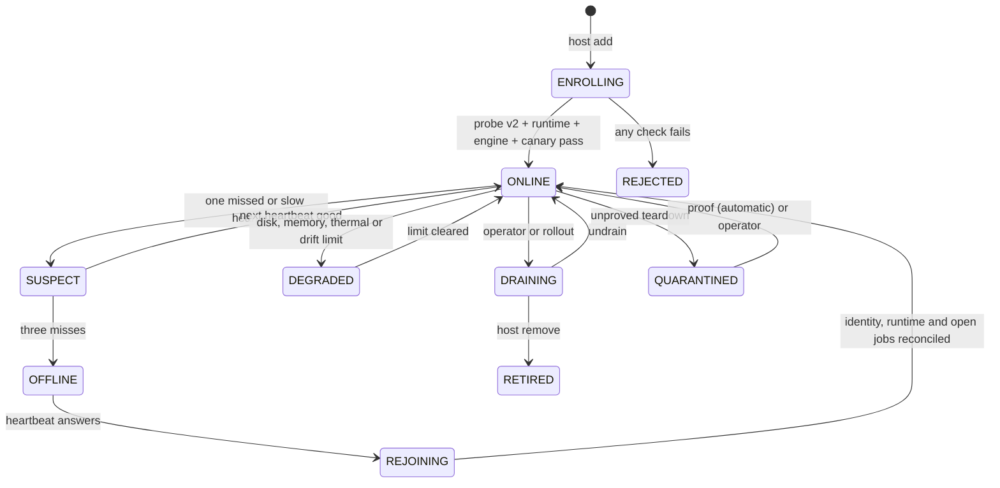
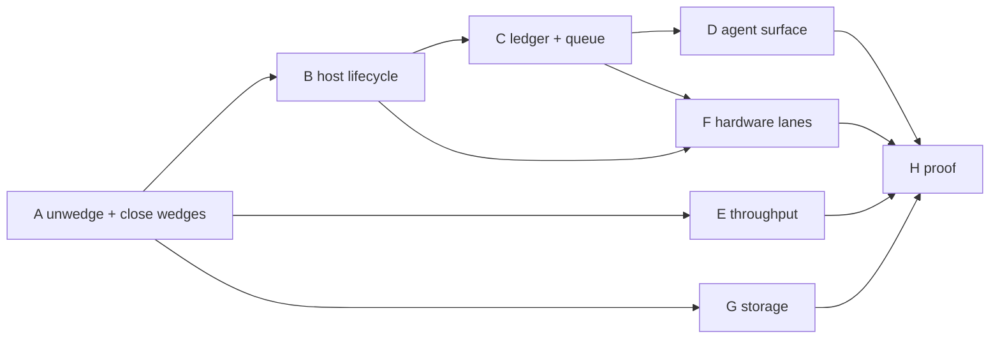

# Test fleet autopilot: a pool that routes itself and never waits for a human

Owner: **TQ shared-host test admission**, steps **TQ-07-A…H**. Parents:
[agent test orchestrator](agent-test-orchestrator.md),
[resilience subplan](mcp-queue-resilience.md) (TQ-04-R1…R9),
[agent-first fleet plan](mcp-agent-fleet.md) (TQ-05-F0…F5) and
[PRIMIS host](primis-intel-test-host.md) (TQ-06). Operating contract:
[queue guide](../../tools/testqueue/README.md).

**Status: in progress, 28 November 2026.** A0–A8 and A9a are implemented with fixtures
(rows below) and the agent is deployed to `linux` and `angela`; `angel` and `primis` were
unreachable. A9b–f, A10 and the later phases remain. This plan
does not restate the earlier plans. It records what a fresh audit found still
broken after four repair rounds, names the structural causes, and orders the work
that removes them. Where an open TQ-04 or TQ-05 step is the same work, this plan
links it and tightens its acceptance; that step keeps its own status (§8).

## 1. The contract we are building

An AI agent hands the MCP a test and a statement of what the test needs. The
fleet does the rest.

1. **One call.** `sim_test_run` with scripts and, at most, requirements. No host
   names, no platform guesses, no timeouts copied from memory.
2. **The MCP places the work.** A check that may run on Windows or Linux goes to
   whichever has a free slot. A check that needs the RTX 3090 goes to DEVIL. A
   performance measurement on Apple Silicon reserves a Mac exclusively.
3. **Hosts come and go.** An offline host costs nothing. Work that had not
   started there moves at once. A host that returns rejoins without an operator.
4. **Every request ends.** It ends in `PASSED`, `FAILED` with a typed cause, or a
   typed infrastructure outcome that says what happens next. A request never
   stops in a state that only a human can leave.
5. **A new machine is one command.** A new computer or virtual machine is
   enrolled, verified by a canary and scheduled within fifteen minutes, without
   touching work in flight.
6. **The queue is the fast path.** A short check through the fleet finishes
   sooner than the same check started by hand, so agents stop bypassing it.

The [resilience invariants](mcp-queue-resilience.md#2-invariants) stay binding:
no duplicate accepted attempt on a host, no foreign process killed, no claim
released without proof, no pass without verified evidence, no contaminated
performance measurement. §5 lists every decision. Three of them (D1, D2, D9)
narrow an existing rule and take effect only with the owner's recorded approval;
until then the step that depends on each keeps today's behaviour.

## 2. Audit, 28 November 2026

### 2.1 Method

Read-only. Source at `e0df79784`: the pool, batch, MCP, policy, history, agent
view and watchdog modules were read in full; two independent reviewers read
`remote_agent.py` and the local authority (`worker.py`, `store.py`, `presets.py`,
`adapter.py`, `integration.py`, `processes.py`), and their material findings were
checked against the cited lines. History: 51 commits to `tools/testqueue/` and
`tools/debug/mcp_server.py` between 6 and 25 November. Live state: `sim_fleet`,
`testctl hosts`, the pool root `C:\ProgramData\OpenRC\testpool`, and read-only SSH
to the two reachable remotes. Other agents were using the fleet. Nothing was
cancelled, recovered, reconciled, deployed or deleted. The numbers in §2.3 come
from a read-only audit probe over the pool records; it is not committed yet (A0).
An independent challenge of this plan corrected five citations and eleven steps;
its accepted points are folded in.

Findings marked **(R)** come from static review and still need a failing fixture
before any fix. An unmarked finding was confirmed in source and, where stated,
in the live records.

### 2.2 The fleet at 10:45 Bogotá

| Host | Hardware | State | What actually limits it |
| --- | --- | --- | --- |
| `windows` (DEVIL) | 24 threads, RTX 3090, 37 GB RAM free | Online, busy | One headless slot (`capacities: headless 1, rendered 1, exclusive 1`). `C:` has 28.9 GB free. The authority twice reported `external_simulators: true` while the only Godot processes were its own attempt's (N8). |
| `angel` (M1) | 8 cores | **Offline**, SSH connect timeout | Five receipts have reserved it for 192–264 h. Fifty more are open with `request not found`. |
| `angela` (M1) | 8 cores, 2 GB RAM free | Online, **unusable** | Two receipts have reserved it for 262–264 h. 5.3 GB free of 228 GB; 46 GB in 84 job directories. Agent is the 20 November build, not `main`. The last automatic sweep reclaimed 0 of 30 candidates. |
| `linux` | 12 cores, 8 GB RAM free, load 0.3 | Online | One slot. 12 GB free of 96 GB; 12 GB in 50 job directories. Agent equals `main`. |
| `primis` (CT 405, UHD 630) | 6 cores | **Offline**, no route through the jump host | The only Linux GPU lane is gone with it. |

Five configured hosts gave **two usable slots**. The pool's own view was worse:
`sim_fleet` showed every online host busy and `angela` with 29 active jobs, all
of them stale records (N7).

### 2.3 Measured baseline

From the 252 MCP requests retained since 14 November and their 596 receipts.

| Measure | Value |
| --- | --- |
| Requests, all time | 252: 73 `PASSED` (29 %), 93 `FAILED` (37 %), **86 without a verdict (34 %)** |
| Requests, 21–28 November | 92: 23 `PASSED`, 32 `FAILED`, **24 `NEEDS_OPERATOR`, 10 `ERROR` before any dispatch**, 3 in flight. 37 % ended needing a human |
| `NEEDS_OPERATOR` causes, all time | 20 "no progress" (six-hour idle rule), 8 "blocked without change" |
| Pre-dispatch `ERROR` causes | source changed during snapshot (6), Git command failed (6), no space on device (4), snapshot reserve (3) |
| Executed attempts by outcome | 293 passed, 71 test failed, 67 `INFRA_FAILED`, 10 `TIMED_OUT`: **17 % of executed attempts failed for infrastructure** |
| Coordinator placement time per row (n = 74, since 23 November) | p50 **1,142 s**, p90 6,148 s, max 30,996 s |
| Snapshot time (n = 17) | p50 122 s, p90 195 s |
| Collection time (n = 49) | p50 5.6 s |
| Request to finished, by host | `angela` p50 127 s; `angel` 352 s; `linux` 1,408 s; `primis` 6,373 s |
| Placement refusals on rows still waiting | `windows` BUSY 40; `linux` disk 40; `angela` disk 35; `angel` disk 18; `primis` disk 14; offline 30 |
| Jobs per request | median 2, mean 2.4, maximum 14 |
| Platform requested (610 jobs) | `any` 198, `darwin` 186, `windows` 150, `linux` 76; 216 jobs pinned a host |
| Receipts reserving a host with no live owner | 7, aged 192–264 h |
| Test scripts in `app/tests/` | 1,218 `test_*.gd` |

Execution of a check takes seconds. Placement takes nineteen minutes at the
median. The 20 November target of 30 s for a warm short test is unmet by a factor
of about forty.

### 2.4 Findings

Severity: **S1** blocks or loses work, **S2** wastes most time or capacity,
**S3** ergonomics. Paths are under `tools/testqueue/`. N-findings are new;
the last block lists earlier findings that remain open.

| ID | Sev | Finding | Evidence |
| --- | --- | --- | --- |
| N1 | S1 | **Editing the host list orphans work and can wedge a host for good.** Every receipt binds the digest of the whole `config.json`. After any edit, `status`, `recover`, `reconcile` and `sim_test_recover` all refuse with "pool configuration changed". `status` then rewrites the receipt to `SUBMISSION_UNCONFIRMED`, which reserves its host in every later placement. The automatic settling added on 25 November covers local receipts only. | `pool.py:740-750`, `:1090`, `:1316-1332`, `:425`, `:588-589`; `pool_mcp.py:339-340`, `:413`. Live: 7 receipts bound to the pre-PRIMIS config hold `angel` and `angela`; 9 open receipts bind a digest that is not the current one |
| N2 | S1 | **A remote uncertainty has no automatic exit.** A remote `run` has no tombstone, so a receipt that never reached the agent is released only by `reconcile --operator-confirm`. On the agent, an `UNKNOWN` job quarantines the whole host and `reconcile` requires a recorded process; a supervisor that dies before `process.start()` leaves none. | `pool.py:1114-1116`; `remote_agent.py:654-659`, `:764`, `:1460-1464`. Live: 76 open receipts on the Macs answer `request not found` |
| N3 | S1 | **Automatic reclaim starves.** The sweep sorts failures first, spends its 120 s budget on the first few, and forgets what it skipped. A host whose agent refuses those candidates makes the same candidates fail in every sweep, so reclaimable passes behind them are never reached. | `pool.py:1246`, `:1252-1271`, `:1165-1166`. Live: `angela` 0 reclaimed, 27 deferred, 3 skipped; `angel` 3 reclaimed, 152 deferred |
| N4 | S1 | **Nothing detects or repairs agent drift.** The agent reports only `PROTOCOL = 1`; the coordinator never compares a source identity. Deployment is a hand copy. An old agent rejects a request carrying a newer option as `INVALID`, and that refusal also leaves a host-reserving receipt. Collection verifies remote reports with the *coordinator's* command builder, so an older agent's valid run can fail collection. | `remote_agent.py:29`, `:578`, `:596`; `collection.py:321-323`. Live: `angela` runs the 20 November agent; `primis` unknown |
| N5 | S1 | **A lost host stalls its batch for six hours, then asks for a human.** Rows bound to an unreachable host stay `BLOCKED` or `TRACKING`; the batch stops after 15 minutes or six hours as `NEEDS_OPERATOR`. No rule gives a functional check a second attempt elsewhere. The watchdog never resumes `ERROR` and wakes `NEEDS_OPERATOR` only for one proved case. | `pool_mcp.py:355-391`; `watchdog.py:41`, `:110-136`. Live: 28 `NEEDS_OPERATOR` requests |
| N6 | S1 | **A worker restart quarantines DEVIL.** Opening the store turns every in-flight attempt into `UNKNOWN`, and any `UNKNOWN` refuses all allocation. Same-boot recovery needs a reboot proof or a strict directory shape; an attempt interrupted before launch has no Job name, so `abandon` cannot close it either. `hosts` still answers `READY`. | `store.py:60-61`, `:160-162`; `worker.py:456-458` |
| N7 | S2 | **The fleet view misreports load.** `pool_jobs_active` counts every receipt whose last status is not `FINISHED`, except three settled states, with no age limit. A receipt whose host forgot the job is counted forever. | `agent_view.py:60-70`. Live: `angela` 29, `angel` 50, none real |
| N8 | S2 | **Suspected false `EXTERNAL_SIMULATOR` on the authority's own work.** Twice during the audit the authority reported an external simulator while the only Godot processes were the wrapper and child of its own attempt, less than two minutes old. The image-name scan and the managed-PID set are read at different instants. Unproved; needs a fixture. | `worker.py:89-99`, `:226-248` |
| N9 | S2 | **The watchdog restarts the authority with default slots.** Its `serve` command carries no slot flags, so a qualified higher capacity silently reverts to one. | `watchdog.py:164-168`; `testctl.py:24-25` |
| N10 | S2 | **Routing is by OS string, defaulting to the caller's OS.** Every agent on DEVIL defaults to the one host that is most contended. A portable check waits there while `linux` idles, unless the agent knows to say `any`. There is no record of which scripts are portable, what marker proves completion or how long they take. | `pool_mcp.py:45`; refusal counts in §2.3 |
| N11 | S2 | **There is no fleet scheduler.** Each batch runs its own supervisor, probes every host over SSH for every row, and competes for one `dispatch.lock`. There is no shared queue, order, fairness or slot ledger; placement reads every receipt file on each pass. | `pool.py:316-322`, `:867`, `:409-440`; `pool_batch.py:183-195` |
| N12 | S2 | **The 3090 and the Macs' GPUs are unreachable through the pool.** Only a POSIX remote with a valid `graphics.json` advertises `graphics`; the local host advertises `headless` only, a graphics job pinned to it is refused, and no macOS lane exists. Performance work is refused outright. | `pool.py:260`, `:784-793`; `remote_agent.py:719-723` |
| N13 | S2 | **The test budget pays for the import.** On a remote host import and check share one deadline, so a cold import consumes the default 90 s; the admission wait before them is bounded by the same number again. The local side is reported to behave alike (R). | `remote_agent.py:1048`, `:1354-1358`; `adapter.py:95` **(R)**. Live: 10 `TIMED_OUT` on `windows` |
| N14 | S2 | **A host cannot describe itself.** The probe has no agent identity, slot count, CPU model, GPU adapter, display state, power or thermal state, boot identity or cache inventory. `cached_inputs` is hard-coded empty, so transfer is always charged. A Mac without `psutil` is unschedulable (`MEMORY_UNKNOWN`). | `remote_agent.py:683-699`, `:716-724`; `pool.py:293-295` |
| N15 | S2 | **A Windows machine cannot be a remote host.** On Windows the agent advertises only its OS and architecture tags, never `checked` or `headless`, and its engine check refuses to run there. A second Windows computer or VM cannot join. | `remote_agent.py:719-720`, `:1029-1031` |
| N16 | S3 | **No cancel, no priority, no dry run.** The agent has no cancel action; the MCP has no cancel, retry, priority, deadline or "where would this run" tool. | `remote_agent.py:1679`; tool list in `tools/debug/mcp_server.py` |
| N17 | S1 | **A full disk blocks its own recovery (R).** The terminal journal gets six tries in about 8 s; if all fail, the job reads `UNKNOWN` and quarantines the host, and `reconcile` needs the same write. | `remote_agent.py:141-180`, `:1418`, `:1482` |
| N18 | S2 | **A slow process listing can quarantine a remote host (R).** The supervisor lists processes every 0.1 s with a 2 s timeout and does not handle the timeout. | `processes.py:626-628`, `:668`; `remote_agent.py:1102-1116` |
| N19 | S2 | **A long sweep can strand a new job (R).** The supervisor waits 30 s for the host lock, then exits leaving `STARTING`, which becomes quarantine. A sweep holds that lock while it hashes and removes a job; the coordinator allows such a call up to 300 s. How long the lock is really held is unmeasured. | `remote_agent.py:1299-1309`; `pool.py:1140` |
| N20 | S2 | **A killed launch wedges its ID (R).** The job directory is created before its journal; a death in between makes every retry fail on `mkdir` while `status` says `NOT_FOUND`. | `remote_agent.py:774-777` |
| N21 | S1 | **Every new snapshot uploads the whole project.** The input is one uncompressed 1.02 GB tar sent by `scp`; a host reuses it only when that exact archive is already there. Yet consecutive snapshots of one commit differ by 6–14 files, 0.2–0.5 MB, and 96 % of a snapshot's bytes are identical to the Git commit it names. This upload is the placement time of §2.3. | `pool.py:699-738`; manifests of six snapshots, 23–28 November (§2.6) |
| N22 | S2 | **The transfer rate is a constant, and it is wrong.** `primis` is configured at 11 MB/s and measured at 1.1 MB/s; the other hosts default to 10 MiB/s. Placement therefore ranks hosts on a transfer cost that is off by up to ten times. | `pool.py:295`; §2.6 |
| N23 | S2 | **Nothing records which network path a host is on.** Same site, another site or a relay look alike to placement and to `sim_fleet`, and parallel uploads share one uplink unseen. | `pool.py:90-105`; §2.6 |

Still open from earlier audits, with their owning step:

| Earlier finding | Owning step | State on 28 November |
| --- | --- | --- |
| Every pool job is exclusive locally; one job per remote host | TQ-05-F5.1/F5.2, TQ-04-R6 | Open. `_preflight` still sends `workload: auto` (`pool.py:782-783`); the local host is busy on any claim (`pool.py:254-256`) |
| Any process named `*godot*` blocks all local work | TQ-05-F4.2 | Open (`worker.py:874-881`); the remote agent applies the same name match (`remote_agent.py:1036-1039`) |
| Snapshots, local copies and local imports are redone every time | TQ-05-F3.1–F3.3 | Open. Snapshot p50 122 s; local import cold |
| Serial loop, one SSH per artifact, fixed polling | TQ-05-F2.3–F2.5 | Partly: OS and host lanes exist; a batch with `any` still uses one lane |
| Placement ignores bandwidth, cache state and time until free | TQ-05-F5.3 | Open; rate is a constant (`pool.py:295`) |
| Sessions, queued jobs and reservations never expire | TQ-05-F5.5 | Open |
| Pool and authority roots on `C:` | TQ-05-F0.7 | Open; `C:` 28.9 GB free, `F:` 87.7 GB |
| Guardians and owned remote cancel | TQ-04-R4 | Open |
| Physical-parent identity and atomic reservations | TQ-04-R5 | Open; disk checks are still unreserved observations |

### 2.5 Why four repair rounds did not converge

The history shows the pattern the 25 November review already named: each round
fixed its recorded incidents and proved them in fixtures. The failures kept
coming back because four properties of the design produce them.

1. **Uncertainty holds capacity forever.** Failing closed is right. Staying
   closed until a person arrives is the defect. Each uncertain record (an
   unconfirmed receipt, an `UNKNOWN` job, a changed config) permanently removes a
   host, and each round added one more special-case release.
2. **Hosts are static text, not observed things.** There is no health state, no
   version identity, no self-description and no lifecycle. Reachability is
   rediscovered by every row of every batch.
3. **There is no scheduler.** Independent supervisors cannot share slots, order
   work, move it or account for it.
4. **The request names a place, not a need.** The MCP cannot route what it was
   never told is movable.

Phases B, C and D remove these four causes. Phase A first frees the capacity
that is wedged today and closes the paths that re-wedge it.

### 2.6 Network paths and input transfer

Checked the same day: are hosts on the same network reached directly, and would
a LAN route be faster than Tailscale? Sources: `tailscale status` and `ping`, a
route trace, the Mac's own interface report, the `transfer_seconds` of 69
receipts since 23 November, and six snapshot manifests. The live throughput
samples were taken while another agent streamed a tar to `angela` and a pool
upload to `linux` was running, so they are lower bounds, not link capacity.

| Host | Path from DEVIL | Recorded uploads of the 1.02 GB input | Live sample, 200 MB |
| --- | --- | --- | --- |
| `angela` | Same site, but behind a second Wi-Fi router that does NAT. Its own address is on another subnet and is not routable from DEVIL (the trace leaves through the ISP). Tailscale is **direct** through that router, 6 ms, not relayed. Link: 802.11ac, 866 Mbit/s, −33 dBm | 130 s (7.8 MB/s), n = 2 | 2.0 MB/s up, 2.5 MB/s down |
| `angel` | Offline; its last recorded path was a DERP **relay** | 369 s (2.8 MB/s), n = 1 | none |
| `linux` | Another site, Tailscale direct over the Internet, 13 ms | p50 149 s (6.8 MB/s), p90 952 s (1.1 MB/s), n = 15 | 1.8 MB/s up, 1.3 MB/s down. The host itself downloads from GitHub at 9.1 MB/s |
| `primis` | Another site, direct to its jump host, 12 ms | p50 970 s (1.1 MB/s), n = 7 | none |

What this shows:

1. **A raw LAN route is not the missing piece.** Where two machines share a
   site, Tailscale already connects them directly. For the Macs a plain LAN
   address is not even reachable, because of the second router. A relayed path
   is the real risk, and nothing reports it (N23).
2. **The cost is sending a gigabyte that the host already has.** A new snapshot
   of the same commit changes 0.02–0.04 % of the bytes. At the measured rates
   the full upload takes 2 to 16 minutes per host; the missing bytes would take
   under a second.
3. **The remote sites have better links to GitHub than to DEVIL.** 96 % of a
   snapshot is the committed tree, which `linux` can fetch itself six times
   faster than DEVIL can push it at the p90.
4. **The Macs' route is slower than their radio.** 7.8 MB/s at best against a
   link rate that should carry several times more. The second router is the
   suspect (unproved). It matters only for cold transfers once step E4a lands.
5. Compression is a small gain: a fast setting shrinks the archive to 0.66 of
   its size (sample of 192 MB), because models and images dominate it.

## 3. Targets

Every target is measured from the retained records with the script that produced
§2.3, reporting sample counts, cache state and competing load. A target is met
on seven consecutive days of real agent use, not in a fixture. At about ninety
requests a week a percentage is one or two events, so each report gives counts.
"Compatible slot free" is read from the keeper's fleet snapshots (B3) and, later,
ledger events (C1); it cannot be reconstructed from today's records.

| Measure | 28 November | Target | Phase |
| --- | --- | --- | --- |
| Requests ending in a state only a human can leave | 37 % (7 days) | **0** for every cause the fleet can act on (offline, busy, disk, drift, stopped supervisor, changed config). Unproved teardown is counted separately: at most one request in a week, each naming the missing proof | A, C |
| Receipts reserving a host without a live owner | 7, up to 264 h | 0 older than 15 min | A |
| Time to first placement when a compatible slot is free | p50 1,142 s | p50 ≤ 5 s, p90 ≤ 30 s | C |
| One short check, warm inputs, free slot, end to end | not met (target 30 s) | p50 ≤ 30 s, p90 ≤ 90 s | E |
| Pre-dispatch `ERROR` from the shared checkout changing | 6 in two weeks | 0 | E |
| Bytes sent for a new snapshot of a commit the host has seen | 1.02 GB | ≤ 5 MB | E |
| Input transfer, warm | p50 149 s (`linux`), 970 s (`primis`) | p50 ≤ 5 s, ≤ 15 s | E |
| Placement's transfer estimate against the real transfer | constant, off by up to 10× | within 25 % for 20 consecutive jobs | E |
| Infrastructure share of executed attempts | 17 % | ≤ 3 %, none untyped | A, B, E |
| Rows waiting on an offline or wedged host while a compatible host has a free slot | routine | 0 | C, D |
| Offline detection / rejoin after reachability returns | per-row SSH timeout / manual | ≤ 60 s / ≤ 60 s, no operator | B |
| Agent runtime behind the coordinator on a reachable idle host | 8 days (`angela`) | ≤ 1 h | B |
| New host: SSH reachable to first passing canary | hours, hand-edited config, in-flight work at risk | ≤ 15 min, one command, no effect on work in flight | B |
| Usable concurrent slots, all hosts online | 5 | the measured ceilings of E7; §4.3 proposes up to 13 functional | E |
| Hosts below their disk watermark for more than 30 min | 3 of 4 remotes on 25 November | 0 | G |
| `sim_fleet` truth | 29 phantom jobs on one host | every count reconciles with the host's own answer | A, C |
| Calls for an agent to run and read one check | 1–2 plus polls | 1, or 2 when the wait exceeds `wait_s` | D |

## 4. Design

### 4.1 Layers

Keep Python, the standard library, SQLite and SSH. No new framework.

| Layer | Today | After this plan |
| --- | --- | --- |
| MCP and CLI | Validate, start a per-batch supervisor, read files | Unchanged role; requirements instead of platform strings (D) |
| **Fleet keeper** | A watchdog loop that restarts dead supervisors | The one long-lived fleet process: host health, agent rollout, receipt settling, scheduled reclaim, the queue (B, C). It grows out of `watchdog.py` and its existing logon task; it is not a second daemon |
| **Fleet ledger** | Receipt files globbed under a global lock | One SQLite database with the durable records (D4): hosts, slots, leases, queue, events. Receipts stay as files; the ledger indexes them (C) |
| Host authority | `worker.py` on Windows; `remote_agent.py` over SSH | Same two authorities, versioned, self-describing, multi-slot, with a tombstone and a cancel action on the remote (A, B, E) |
| Collector | Per-job verified generations | Unchanged contract; one stream per job (E) |

The host authority still decides admission (invariant 2). The ledger is the
coordinator's plan and its record; a lease in the ledger never launches anything.

There is one coordinator, on DEVIL. Two coordinators over one fleet are refused:
each host file names its coordinator, and the agent refuses a `run` from another.
When DEVIL is off there is no fleet; remote work already accepted finishes under
its host and is collected when DEVIL returns (§10).

### 4.2 Host lifecycle

- One heartbeat per host every 15 s, from the keeper only. Offline hosts back
  off to 5 min. Placement reads the ledger and makes one fresh probe of the host
  it selected.
- `DEGRADED` narrows what a host may take (for example no new work below the
  disk watermark, no performance work on battery or under thermal pressure); it
  never hides the host.
- `QUARANTINED` stays host-wide, as invariant 7 requires. Per-slot quarantine
  is switched on for a platform only by its own qualification step (E6).
- A host that returns with a different engine binary, or an older runtime, is
  `DEGRADED` for new work. Its open jobs are still observed and collected; today
  the engine mismatch makes the whole host read as offline (`pool.py:289-290`).
- A laptop that sleeps is `OFFLINE`, then `REJOINING`. The agent holds a
  sleep-prevention assertion while a job runs. Coordinator deadlines use the
  coordinator's wall clock; a host's own stage budgets use its monotonic clock; a
  reported clock skew above 60 s makes the host `DEGRADED` with that cause.
- Every transition is an event with a cause code. `sim_fleet` shows the state,
  its cause, since when, and the action that clears it.

### 4.3 Capacity

Slots are a per-host, per-class number, set by a canary and never by core count.
The numbers below are **ceilings** for the canary (E7), which starts every host at
its current count, DEVIL at two as TQ-05-F5.2 says, and raises one at a time:

| Host | Functional headless | Rendered functional | Performance |
| --- | --- | --- | --- |
| `windows` | 6, falling to 2 while the owner has a rendered session or foreground load is high | 1 (RTX 3090) | Exclusive, whole host |
| `linux` | 4 | none | none |
| `primis` | 1 (6 GiB) | 1 (UHD 630), shared with the headless slot | Indicative only |
| `angel`, `angela` | 1 each (8 GB) | 1 each, only with an unlocked GUI session | Exclusive, whole host, on mains power |

### 4.4 Requirements, not places

A job states `needs`. The MCP resolves the eligible hosts.

| Field | Values | Default |
| --- | --- | --- |
| `os` | list of `windows`, `linux`, `darwin`, or `portable` | from the routing registry; else the caller's OS |
| `arch` | `x86_64`, `arm64` | any |
| `workload` | `functional`, `graphics`, `performance` | from the registry; else unclassified, which stays exclusive |
| `gpu` | a class such as `nvidia-rtx3090`, `apple-m1`, `intel-uhd630`, or `real` | none |
| `renderer` | `vulkan`, `d3d12`, `metal`, `opengl3` | none |
| `host` | a host ID | none; a pin remains possible and is reported as one |

The **routing registry** is a reviewed file in `tools/testqueue/` that maps
script patterns to `os`, `workload`, the completion marker and a timeout class.
It is the single place where "this check is portable" or "this check is
functional" is asserted, by a person, once. History may *suggest* an entry (a
script that has passed on three operating systems); it never adds one.

Coverage stays honest: a result always names the host, OS, architecture and GPU
it ran on, and a pass on Linux never claims Windows.

### 4.5 When a host is lost with work on it

| Situation | Behaviour |
| --- | --- |
| Row not yet dispatched to the lost host | Its lease is released and it is placed again at once. No operator, no wait. |
| Row dispatched, host unreachable, workload `functional` | After the grace period the attempt is marked `HOST_LOST` (infrastructure, evidence incomplete). It stays tracked and its slot on that host stays held. If the request allows it, a **new attempt with a new ID** runs on another host. The row's verdict is the first attempt to finish with verified evidence, it names that attempt and host, and it is never rewritten. A later result from the lost host is collected as evidence; if it differs, the request gains a `DIVERGENT_ATTEMPT` record that `sim_test_status`, `sim_test_list` and the fleet report show. |
| Row dispatched, host unreachable, any other workload | Ends `HOST_LOST` with the reason. No second attempt: exclusive, rendered and performance work is never moved. |
| The lost host returns | `REJOINING` observes its open jobs under their original IDs, records what they did, and releases only what is proved. |
| The lost host never returns | An operator retires it (`host remove --lost`). Its capacity leaves the fleet with it, so nothing stays reserved. Its open attempts end `HOST_RETIRED`, uncertain and with incomplete evidence. This is the one operator act the plan keeps, because only a person knows a machine is gone. |

The second row needs an owner decision (§5, D1). Until it is approved, a
dispatched row on a lost host ends `HOST_LOST` and is not retried.

Initial budgets, to be tuned from the stage timings and shown at acceptance:

| Boundary | Initial value | On expiry |
| --- | --- | --- |
| Heartbeat interval / `OFFLINE` after | 15 s / three misses | Host state change, no kill |
| `HOST_LOST` grace after `OFFLINE` | 120 s | Attempt marked `HOST_LOST`; slot stays held |
| Lease without a receipt | 60 s | Lease released (nothing was dispatched) |
| Transfer | 30 min, and no stall over 60 s | `TRANSFER_DEFERRED`; binding released after three |
| Admission wait on the host | 600 s | `ADMISSION_EXPIRED`, nonlaunch recorded |
| Import | 900 s | `IMPORT_TIMEOUT` |
| Check | the job's `timeout` | `TIMED_OUT`, owned teardown |
| Collection | 120 s per try, capped retries | `COLLECTION_BLOCKED`; execution is never repeated |

## 5. Decisions needed

| ID | Question | Recommendation |
| --- | --- | --- |
| D1 | May a `functional` check whose host was lost run as a new attempt on another host? The [retry matrix](mcp-queue-resilience.md#retry-and-cancellation-matrix) says no cross-host failover after a possible dispatch. | **Yes, for `functional` only.** The rule protects host capacity and a single verdict. A new attempt ID on a different host, with the original still tracked and its slot still held, breaks neither. Invariant 1 already allows a retry as a new attempt with a reason. Record it in [DECISIONS](../DECISIONS.md) **and amend that matrix row in the same change**, so the two binding documents never disagree. |
| D2 | May the pool release a remote receipt without an operator when the agent holds a durable tombstone for that request? | **Yes.** It is the same proof the local authority already gives (`pool.py:531-562`). |
| D3 | May receipts bind their own destination instead of the whole config file? | **Yes.** The destination is the host ID, the machine identity the host reports and the remote root; not the SSH alias, and not the engine digest, which the request already carries and which would orphan work on every engine update. The binding exists to stop replay at a different machine; this keeps that and lets the host list change. |
| D4 | Where do the pool and authority roots live? | **Split them.** Durable records (receipts, ledger, collected evidence, the authority database) are small and stay on `C:`. Reproducible bulk (snapshots, archives, attempt workspaces, import caches) moves to a local cache volume; `F:` has 87.7 GB free and is a disposable store by repository policy, which suits bulk that can be rebuilt and nothing else. Follow TQ-05-F0.7: settle or close old work first, supported SQLite backup, never a network volume. |
| D5 | May the keeper deploy the agent runtime to an idle remote host by itself? | **Yes**, from committed bytes only, with an atomic swap, a canary and automatic rollback (§6, B4). |
| D6 | Starting slot counts in §4.3. | Approve as canary ceilings; the canary may lower them. |
| D7 | May unmanaged *headless* Godot stop blocking functional slots (TQ-05-F4.2 D3)? | **Yes**, still reported, never killed; it keeps blocking exclusive, rendered and performance work. |
| D8 | May a performance request reserve a Mac or DEVIL exclusively through the MCP? | **Yes**, as admission around the existing native workflows, with a visible reservation and an expiry. |
| D10 | Network. (a) May each remote host hold a read-only credential to fetch the repository from its origin (E4b)? (b) Should the Macs join DEVIL's subnet, by putting the second Wi-Fi router in bridge mode or by a wired adapter? | (a) **Yes**, a read-only deploy key per host. (b) **Measure first**: after E4a the Macs receive megabytes, not gigabytes, so this pays only for cold starts. E4d gives the number on a quiet link. |
| D9 | After a worker restart on the same boot, may the authority close an attempt whose journaled Job Object and launch gate are both absent, without an operator? Today that evidence is accepted only for explicit `abandon`, and the invariants say automatic recovery must never use it. | **Owner's call; default no.** The Job is kill-on-close, so a dead worker's tree is very probably gone, but "absent" is not a witnessed teardown. Without D9, a worker killed during import or a check leaves DEVIL truthfully `QUARANTINED` until the reboot proof or an operator. |

## 6. Phases

Each step is one reviewable change. Each starts with a fixture that fails on the
current source and ends with the proof in its row. A step that touches process
ownership, receipts or evidence gets an independent challenge before merge.

### Phase A: free the wedged capacity and close the wedges

Goal: every host that is reachable is schedulable again, and the six paths that
wedged it cannot recur. No architecture change. Run this phase first and alone.

| ID | Work | Proof |
| --- | --- | --- |
| TQ-07-A0 | **Commit the measurement.** The audit probe behind §2.3 becomes `tools/testqueue/fleet_report.py`: read-only, one JSON and one text summary, the same definitions every time. Every later step reports with it. | Its output on the 28 November records reproduces §2.3. **Done 28 Nov:** `fleet_report.py` (read-only; refuses `--json` under the pool root) reproduced 92 requests, 37 % needing a person, placement p50 1,134 s, snapshot p50 122 s, collection p50 5.5 s and 8 reserving receipts. `test_fleet_report` (2). |
| TQ-07-A1 | **Destination binding (N1, D3).** New receipts and MCP requests bind the destination of D3, and the agent's `probe` and `run` replies carry the machine identity. `_destination` compares that binding and ignores unrelated config edits. A failed destination check **leaves the receipt untouched**: today the refusal lands inside the status handler and demotes a submitted receipt to one that reserves its host. A legacy receipt has no destination of its own, so it is resolved from a retained config file whose bytes hash to the digest it bound (the two backups in the pool root match 9 of the open ones); with no such file it stays observation-only and its settlement stays an operator act. | Fixture: add a host, change another host's bandwidth, remove an unused host; an in-flight receipt on an untouched host still observes, recovers and collects. A host ID re-pointed to another machine is refused with the field that differs, and the receipt is byte-identical afterwards. **Done 28 Nov:** `destination` in new receipts; `_destination` compares it and reloads an edited config as one validated snapshot; refusals return `DESTINATION_CHANGED` without writing; `config-history/` plus `config.json*` backups resolve legacy digests; an SSH alias change needs the bound store identity even to observe; MCP request and batch state follow config edits (`config_history`). `test_pool_destination` (9); updated recovery/MCP/collection fixtures keep their refusal half. |
| TQ-07-A2 | **Remote tombstone (N2, D2).** Agent action `fence` for one request ID. It must work while another job runs, so it does not take the host lock that a supervisor holds for a whole job: `fence` creates the tombstone with an exclusive create, then checks for the job directory; `run` creates the job directory, then checks for the tombstone. Whichever way they interleave, the request is either fenced and never launched, or accepted and reported, never both. A later `run` of a fenced ID is refused `FENCED`. The pool settles an overdue unconfirmed remote receipt with `status` → `NOT_FOUND` → `fence`. Only a typed `FENCED` reply that names the request and the machine identity settles anything: a transport error, a non-JSON reply or an agent too old to know `fence` settles nothing. | Fixtures: both interleavings; fence during a running job of another ID; fence on an accepted ID returns the job; old agent and transport failure settle nothing. Native run on `linux`. **Done 28 Nov (not deployed):** agent `fence` and `store-id.json`/machine digest in `probe`; tombstones are never withdrawn (review finding: two fencers); `run` re-checks after `mkdir`. Pool settles on `FENCED` with a matching identity (`REMOTE_FENCED`) from `status`, `reconcile` and the watchdog sweep; `recover` never replays a settled receipt. A `PREPARING` receipt under its job lock becomes `TRANSFER_DEFERRED` (legacy ones after 1 h). `test_remote_fence` (14, including both interleavings and a mutation-checked race), `test_pool` PREPARING fixtures. |
| TQ-07-A3 | **Settle today's orphans.** On each host, after A11 has put a fence-capable agent there, settle the reserving receipts and the open `request not found` receipts through A1 and A2. Unbound legacy receipts are settled in one operator-confirmed pass. An unreachable host is drained with its reason and its receipts stay listed until it returns. One dated record of each ID, its proof and its outcome. | On every reachable host, `sim_fleet` shows no `RESERVED_BY_RECEIPT` older than 15 min. No receipt is deleted or edited by hand. **Partly done 28 Nov:** the first sweep with A1 settled all three `angela` receipts: they were jobs that had finished (`INFRA_FAILED`) 8–11 days earlier, hidden by the config-digest wedge. The five `angel` receipts wait for that host to return; the watchdog now observes them every pass. |
| TQ-07-A4 | **Fair, remembered reclaim (N3).** Persist each candidate's last refusal and skip it for 24 h. Order by reclaimable bytes within outcome class. Give each sweep a floor of passes as well as failures. An agent that refuses a class (older runtime) is recorded once per host, not rediscovered per job. | Fixture: three permanently refused failures ahead of twenty passes; the passes are reclaimed in the first sweep. Live: `angela` rises above its watermark. **Done 28 Nov:** refusals are remembered per job for 24 h (`retention/gc-refusals-<host>.json`); an agent that refuses failures as a class is asked once per day; failures and passes alternate. `test_pool_reconcile` fixture with three refused failures ahead of four passes: all passes reclaimed in the first sweep. |
| TQ-07-A5 | **Truthful activity counts (N7).** `pool_jobs_active` counts only receipts whose last observation is a live state younger than its freshness limit. Stale open receipts appear separately as `unsettled`, with their age. | Fixture; live counts equal each host's own `probe`. **Done 28 Nov:** only fresh live receipts count; others appear as `unsettled_receipts` with their age. `test_agent_view` fixture. |
| TQ-07-A6 | **The authority restarts as configured (N9).** `serve` persists its slot settings in `policy.json`; a start without flags reuses them; the keeper never passes capacity. | Fixture: start with two slots, kill, keeper restarts, `hosts` reports two. **Done 28 Nov:** flags are remembered in `capacity.json` (not `policy.json`, which the worker rewrites); a bare `serve` reuses them. `test_serve_capacity` (2). The live authority still runs with one slot until it is restarted with a qualified count. |
| TQ-07-A7 | **Reproduce or dismiss N8.** A fixture that starts a managed wrapper-and-child pair while the occupancy probe runs. If it reproduces, read the image list and the managed set under one observation, and treat a PID whose parent is managed as managed. | Fixture fails before, passes after; or a recorded dismissal with the evidence. **Done 28 Nov:** reproduced by reading: the listing is cached up to 1 s while the owned set was read fresh, so the import engine that just exited read as external. Owned now includes every member whose handle the attempt retains (Windows does not reuse an ID while a handle is open) and a finished attempt's IDs for 2.5 s. `test_processes` real-process fixture and `test_worker` fixture; no native Godot run yet. |
| TQ-07-A8 | **The import leaves the test budget (N13).** `timeout` bounds the check only. Import and admission wait get the stage budgets of §4.5 and their own typed outcomes (`IMPORT_TIMEOUT`, `ADMISSION_EXPIRED`). Status names the stage that expired. Local and remote. | Fixtures both sides: a 300 s import with a 90 s test timeout passes; an import over its own budget ends `IMPORT_TIMEOUT`, never `TIMED_OUT`. **Done 28 Nov:** remote import budget 900 s, check bounded by `timeout`; `IMPORT_TIMEOUT`/`CHECK_TIMEOUT` reason codes without a new outcome value (collection accepts only known outcomes); local hard stop `timeout + 660 s` for checked attempts. Fixtures in `test_remote_agent` and `test_worker`. |
| TQ-07-A9 | **Agent self-recovery (N17–N20, N2).** Six separate changes, A9a–A9f, each after its failing fixture and each with its own challenge. (a) Make a half-created job directory resumable: a directory without a journal is a request that was never accepted. **A9a done 28 Nov** (cleared under the host lock by the next `run` or `fence`; fixture in `test_remote_fence`). (b) **Launch order.** Today a supervisor that dies leaves the same record whether it died before, during or after process creation, so nothing can be proved. Journal the gate and process-group identity *before* the release byte that lets the engine start; a record without a released gate is then a nonlaunch proof that `reconcile` accepts. This reorders launch. (c) Treat a process-listing timeout as "observation unavailable": retry, never tear down on it. (d) A sweep takes the host lock per job and yields between jobs; the supervisor waits for one job's bound. (e) Preallocate a small reserve file per job and release it immediately before the terminal journal write, so a full disk can still record the end. (f) Agent action `recover-boot`, called by the keeper while a host is `REJOINING`: close every `UNKNOWN` job whose recorded boot differs from the current one. The agent has no start hook; this is an explicit write, never a side effect of `probe`. | One fixture per letter; native run on `linux` and one Mac. The reboot proof and the released-gate rule are the only proofs added |
| TQ-07-A10 | **Authority self-recovery (N6).** At startup, close automatically what the invariants already accept as proof: a recorded boot that differs; an attempt whose journal shows a single dispatch and never `RUNNING` (nonlaunch), without today's directory-shape rule. Journal the Job name before `Popen`, so an operator's `abandon` works for an attempt interrupted before launch. `hosts` reports `QUARANTINED` with the attempt IDs whenever a durable `UNKNOWN` exists. Closing on an absent Job and gate is **not** automatic unless D9 is approved. | Fixtures for each proof and each refusal (same boot, live Job, missing name). Kill-and-restart of the real worker: during source copy the host is `READY` within 60 s; during import or a check it is truthfully `QUARANTINED` with the attempt and the missing proof named |
| TQ-07-A11 | **Bring the reachable fleet to `main`.** Deploy the current runtime to `angela`; reclaim its disk; restore `angel` and `primis` reachability or mark them drained with the reason. Operator work, recorded. | Each reachable host: agent digest equals the committed bytes; one canary passes. **Partly done 28 Nov:** `linux` and `angela` run the committed agent (SHA-256 verified, previous kept as `remote_agent.py.prev-20261128`); both report identity and `fence`. `angel` (SSH timeout) and `primis` (jump host refused) remain. |

**Exit gate A.** Every reachable host takes a canary. No reachable host is
reserved by a record older than 15 minutes; an unreachable one is drained with
its reason. A config edit leaves the fleet schedulable, and a worker restart
leaves it schedulable or truthfully quarantined with the proof it lacks. The seven-day share of requests needing a human is below 10 %.

### Phase B: hosts as observed, versioned, self-enrolling things

Goal: the fleet knows what each machine is, whether it is healthy and what it
runs, and adding or losing a machine needs no editing of shared state.

| ID | Work | Proof |
| --- | --- | --- |
| TQ-07-B1 | **Probe v2 (N14).** The agent reports: runtime digest over its own files, protocol, feature list; boot identity, uptime, clock; OS, version, normalized architecture, CPU model, physical and logical cores; memory without `psutil` on macOS (`vm_stat`, `sysctl`); every volume it uses with free bytes and inodes; slot totals and the running job IDs; GPU adapters as the engine names them, renderers available, display state (headless, virtual compositor, logged-in unlocked desktop); power source, battery and thermal pressure on laptops; import-cache and incoming-archive inventory. Each fact carries its source and age. Unknown is `null`, never a guess. | Schema fixture; native probes on all five hosts filed as one dated record. `cached_inputs` is real, so a cached archive costs no transfer in placement |
| TQ-07-B2 | **Host registry.** One file per host under `hosts.d/` beside the pool root, holding only what cannot be observed: ID, SSH target, root, labels, slot ceilings, drain flag. Everything else comes from B1. The single `config.json` is read as a legacy source and migrated once. | Fixture: add, edit and remove host files while a batch runs; nothing in flight changes. Unknown host ID fails at validation |
| TQ-07-B3 | **Health state machine (§4.2).** The keeper heartbeats each host, applies hysteresis and backoff, writes transitions as events and publishes one fleet snapshot. Placement, `sim_fleet` and the batch runner read that snapshot; none of them probes the whole fleet again. | Fixtures: flapping host does not oscillate; offline host costs one backoff check per interval; rejoin within 60 s. Live: `sim_fleet` cached reply ≤ 100 ms with the snapshot age |
| TQ-07-B4 | **Runtime identity and rollout (N4, D5).** A committed manifest lists the runtime files and their Git blob digests. The keeper compares each host's reported digest with it. Rollout to one host at a time: take the host's maintenance lock, which `run` honours on the host itself (a drain flag in the coordinator alone cannot stop a dispatch already on its way); require no open and no `UNKNOWN` job; stage from `git` blob bytes (never the working tree, whose line endings differ on Windows); verify, swap the runtime directory atomically so a launch never mixes versions, keep the previous one, run a canary, release the lock; roll back automatically if the canary fails. Versions move forward only, from the manifest on `main`; a coordinator started from another worktree never deploys. A host behind `main` keeps taking the work its features support and is shown as `DEGRADED: RUNTIME_BEHIND`. | Fixtures: mismatch detected; a request needing a missing feature is never sent to that host; failed canary rolls back. Native: `angela` goes from the 20 November agent to `main` with no operator step |
| TQ-07-B5 | **Compatibility instead of rejection.** The coordinator sends only fields the host's feature list declares. Collection verifies a report against a command builder that the coordinator itself holds for that runtime version, from a reviewed table keyed by the manifest's version; the host never supplies its own verifier, and an unknown version collects as diagnostic only. A refusal that carries the request ID and a typed code is a proved non-acceptance and never reserves a host. | Fixture matrix: coordinator at `main` against the two previous agents; no `INVALID`, no reserving receipt, collection passes |
| TQ-07-B6 | **One-command enrollment.** `testctl pool host add <id> --ssh <target> [--label …]` creates the root, installs the runtime from the manifest, installs the pinned engine from the repository's own pin and verifies its digest, runs probe v2, runs a headless canary and, where a GPU is declared, a rendered canary, then writes the host file as `ONLINE`. Any failure leaves the host `REJECTED` with the failing step and changes nothing else. `host remove` drains, waits for open work, then retires. | Native: a fresh Linux VM and a fresh macOS account enrolled from zero, each ≤ 15 min, during a running batch. The record lists every command a person typed |
| TQ-07-B7 | **Windows as a remote host (N15).** On demand: build it when a second Windows machine or VM is to be enrolled. The agent runs on Windows under SSH with Job Object containment from `processes.py`, advertises its capabilities and refuses nothing by platform. An enrolled workstation keeps its local authority; the two never both own one machine. | Fixtures on a hosted Windows runner; native enrollment of one Windows VM |
| TQ-07-B8 | **Physical-parent identity** (TQ-04-R5). A host file may name a `parent`. Hosts that share a parent share a CPU, memory and volume budget, and performance work on one excludes work on the others. Enrollment refuses a duplicate machine identity under two IDs. | Fixture: two aliases of one machine give one capacity. The parent of `linux` is established and recorded |

**Exit gate B.** Unplug a host mid-batch: `OFFLINE` within 60 s. Reconnect it:
`ONLINE` within 60 s. Enroll and retire a machine during a batch. No step edits a
file that in-flight work depends on.

### Phase C: one ledger, one queue, bounded waits

Goal: placement is a transaction over known slots, work moves when its host
cannot take it, and every wait ends.

**Entry check.** After A and B3, measure placement again with A0. The ledger's
leases (C1, C2) are needed in any case: more than one slot per host and reserved
bytes cannot be made correct by reading receipt files under one lock. The central
queue (C3) is built only if the new measurement still shows rows waiting while a
compatible slot is free, or two requests competing unfairly; otherwise it is
deferred and the supervisors keep placing through the ledger.

| ID | Work | Proof |
| --- | --- | --- |
| TQ-07-C1 | **Fleet ledger.** SQLite (WAL, full sync, local volume) with hosts, slots, leases, queue entries and events. A lease is taken in one transaction and names its request, host, slot class, disk and memory bytes and expiry. Receipts remain the per-job evidence files; the ledger indexes them and is rebuilt from them if lost. `dispatch.lock` and the receipt glob leave the hot path. | Fixtures: two processes cannot lease one slot; a crash between lease and receipt is repaired on the next pass; rebuild from receipts reproduces the leases. Placement decision ≤ 50 ms with 5,000 receipts |
| TQ-07-C2 | **Leases expire by proof, not by age.** A lease without a receipt expires after its grace. A lease with a receipt is released only by a terminal observation, a tombstone, or a host-side proof. Disk and memory are reserved in the lease, so concurrent placements cannot all pass the same free-space reading. | Fixtures for each release path and for each refusal. Two simultaneous large jobs on a nearly full host: one waits |
| TQ-07-C3 | **One queue.** Batches enqueue rows; the keeper places them. Order: priority class, then age, with per-owner fair share and bounded aging. Longest expected check first inside one request. A waiting exclusive or pinned job reserves its scarce host ahead of younger movable work. Batch supervisors become observers of their own rows. | Fixtures: two owners share fairly; a pinned Mac job is not starved by portable work; an exclusive job drains its host and runs. Time to first placement p50 ≤ 5 s on the live fleet |
| TQ-07-C4 | **Move undispatched work.** A row whose selected host goes `OFFLINE`, `DEGRADED` for its class or `DRAINING` before dispatch is placed again immediately. A transfer that is deferred three times releases the binding and competes again. | Fixture: host drops during upload; the row finishes on another host with no operator and one execution |
| TQ-07-C5 | **`HOST_LOST` and the second attempt (N5, D1).** Implements §4.5. `on_host_lost` is `retry_elsewhere` (default for `functional`) or `fail`. Each attempt has its own ID, receipt and evidence; the request's row lists all attempts and which one is the verdict. Without D1 the default is `fail`. | Fixtures: host lost before and after dispatch; a late result from the lost host agrees, and disagrees (verdict unchanged, `DIVERGENT_ATTEMPT` recorded and shown); non-functional work is never retried; the lost host's slot is released only by its own proof or by retirement |
| TQ-07-C6 | **Every wait has a deadline and an exit.** Queue wait, placement, transfer, admission, import, check and collection each have a budget and a typed outcome on expiry. The six-hour idle stop and `NEEDS_OPERATOR` are removed for causes the keeper can act on: an offline host, a full disk, a busy host, a stopped supervisor. `NEEDS_OPERATOR` remains only for unproved teardown, and names the proof that is missing. A queued request takes an optional `deadline_s`. | Replay of the 28 `NEEDS_OPERATOR` requests against fixtures: each ends in a verdict or a typed outcome without an operator. `ERROR` from a transient cause is retried within its budget |
| TQ-07-C7 | **Cancel** (TQ-05-F5.6). `sim_test_cancel` for queued rows, leased rows and running rows. Queued and leased rows first. For a running remote job the agent's `cancel` only writes a durable request that the job's own supervisor reads; the supervisor, which holds the process handles, performs the owned stop and verified teardown and writes outcome `CANCELED`. This is the "owned remote cancel" slice of TQ-04-R4 done inside the existing supervisor; it gets that step's challenge, and the separate guardian stays open. A cancel that cannot be proved leaves the truth: `CANCEL_REQUESTED`, slot held. | Fixtures: cancel in each phase and racing dispatch; native cancel of a running check on `linux`, a Mac and Windows |
| TQ-07-C8 | **Leases for people and sessions** (TQ-05-F5.5). Interactive sessions renew while their MCP server lives and end after an idle timeout. Reservations and drains carry an owner and an expiry. | Dead-client fixture: no orphan exclusive claim after the timeout |

**Exit gate C.** With all hosts online and one free compatible slot, first
placement p50 ≤ 5 s over a day of real use. Zero requests end needing a human
for a cause in C6's list. A host removed mid-batch costs the batch at most its
grace period.

### Phase D: the agent-facing surface

Goal: an agent says what it needs once and reads one answer. D1–D3, D6, D7 and
D10 are the core. D4, D5 and D8 are conveniences; build them after exit gate C
holds.

| ID | Work | Proof |
| --- | --- | --- |
| TQ-07-D1 | **`needs` (§4.4, N10).** `sim_test_run` and `sim_test_launch` accept `needs` per job and per request. `platform` and `host` keep working and map onto it. Validation rejects a requirement no enrolled host can ever meet, before any snapshot. | Fixtures for each field and for the legacy mapping. An unmeetable need fails in under a second with the nearest host and what it lacks |
| TQ-07-D2 | **Routing registry.** The reviewed file of §4.4 plus a checker: every entry matches at least one script; a `portable` entry has a pass on record for each OS it claims; a `functional` entry has no timing assertion, fixed port or shared device (TQ-05-F5.1). Seed it from scripts with passes on three operating systems, reviewed in groups. | Checker in CI. First seed covers the scripts behind 80 % of the last month's jobs |
| TQ-07-D3 | **Spill.** A job whose registry entry allows several operating systems runs on the first free one. The reply says which, and why the preferred one was skipped. A job without an entry keeps today's behaviour and its status says how to make it movable. | Fixture: Windows busy, Linux free, portable check runs on Linux within the placement target |
| TQ-07-D4 | **Selection.** `select` accepts script lists, patterns and `changed` (scripts touched or referenced by the working change). The MCP expands it, orders by expected duration and shards across free slots. The 64-job limit becomes a per-request row limit that the queue enforces fairly. | Fixture and one live run of 100 short checks across the fleet; makespan ≤ 1.5 × the longest-first lower bound from history |
| TQ-07-D5 | **`sim_test_plan`.** A dry run: for these jobs, which hosts are eligible, which is chosen, expected start and finish, and for each excluded host the reason. Read-only, from the ledger. | Fixture; the plan's chosen host equals the real placement when nothing changes between them |
| TQ-07-D6 | **`sim_fleet` v2.** Per host: lifecycle state and cause, since when, slots free and total per class, queue depth, expected wait, runtime digest and drift, disk against its watermark, GPU and display facts, and the action that clears any block. Fleet line: what can run right now, per requirement class. | Size ≤ 3 KB for five hosts; every number traces to a ledger row or a probe fact |
| TQ-07-D7 | **Status that explains itself.** Per row: phase, attempt list, host and why it was chosen, stage timings, expected finish, and for a wait its code, the limiting host and the alternative. `next_action` is never "poll" alone. Typed causes on every non-pass (TQ-05-F0.4): `TEST`, `INCOMPLETE_EVIDENCE`, `IMPORT`, `HOST_LOST`, `HOST_TRANSIENT`, `TRANSFER`, `DISK`, `CANCELED`, `UNKNOWN`. | Fixture table of every phase and cause. Zero untyped non-pass rows in a week of real use |
| TQ-07-D8 | **`sim_test_retry`.** A new attempt of named rows of an earlier request on the same frozen snapshot, allowed only for infrastructure causes. A failed test is never retried by this tool. | Fixtures: retry of `HOST_LOST` runs; retry of `TEST` is refused with the reason |
| TQ-07-D9 | **Admin tools, CLI first.** `testctl pool host add/remove/drain/undrain/show`, `fleet events`, `fleet doctor` (one read-only report of every wedge class in §2.4, with the command that clears each). MCP exposes `drain`/`undrain` only. | `fleet doctor` on the 28 November state names N1, N2, N3, N4 and N7 without help |
| TQ-07-D10 | **Guidance.** Server `INSTRUCTIONS`, tool descriptions, the queue guide, the tool index and the `openrc-tools`/`openrc-debug` skills describe the one-call flow and `needs`. A fresh agent session, given only the tool list, runs a portable check, a Windows-only check and a GPU check correctly. | Transcript of that trial, reviewed |

**Exit gate D.** In a week of real use, at most 10 % of jobs pin a host (35 %
today) and no portable check waits on a busy OS while another eligible OS is
free.

### Phase E: throughput

Goal: the queue is the fastest correct way to run a check. Each step reports
before-and-after stage timings on the live fleet. E may start once A is done; it
does not wait for C.

| ID | Work | Proof |
| --- | --- | --- |
| TQ-07-E1 | **Declared functional work reaches the authority** (TQ-05-F5.1). Needs the registry (D2), which depends on nothing in C and is done first. The pool sends `workload: functional` when the registry says so. The local host is busy for a class only when that class has no free slot. | Fixture; two registry-functional checks run together on Windows; an unclassified one still runs alone |
| TQ-07-E2 | **Local import cache.** The Windows authority seeds `.godot/imported` per engine as the remote agent does, with a copy-on-write clone where the volume supports it and a plain copy otherwise. | Cold and warm import times on DEVIL; the six-day run of `TIMED_OUT` results does not recur |
| TQ-07-E3 | **Snapshots that survive a busy checkout** (TQ-05-F3.1). Capture through a private Git index and a private object directory, with filters off so the bytes are the working-tree bytes and nothing is written into the shared object store. Each file is one consistent version, but a tree captured while several files change together could be a mix that never existed. So a second pass re-reads size, time and identity of every file; files that moved are captured again; the capture is accepted only after one pass with no change, within a bound, and otherwise fails as it does today. Ignored inputs that must travel (installed native libraries) are listed explicitly. The manifest digest stays the identity. A warm re-capture hashes only changed files. | Fixtures: a single file rewritten mid-capture is absorbed; a continuous multi-file writer makes the capture fail typed, never pass. Warm capture ≤ 5 s. "Source changed during snapshot" falls to cases where the tree really never settled |
| TQ-07-E4a | **Send only what the host lacks (N21; TQ-05-F3.2).** Each remote keeps a content-addressed file store keyed by the SHA-256 the manifest already records. The coordinator sends the manifest; the host answers with the digests it lacks; one stream carries those files; the host builds the job's private tree from the store by copy-on-write clone or copy (never a hard link into a tree the engine writes) and verifies every file against the manifest. The manifest digest stays the identity; the whole-archive `scp` goes. The store is bounded by G3. | A second snapshot of the same commit sends ≤ 5 MB. Warm transfer ≤ 5 s on `linux`, ≤ 15 s on `primis`; `primis` request-to-finished p50 falls from 6,373 s to under 120 s. Fixture: a corrupted store file is detected and fetched again |
| TQ-07-E4b | **Cold bytes from the fastest source (D10).** Missing files may come from the host's own Git mirror, fetched from the origin over the host's own link; from a peer in the same site that already has them; or from DEVIL. Every file is verified against the manifest whatever its source, so no source has to be trusted. A commit that is not pushed simply leaves more digests for DEVIL to send. | Cold start on a host after an engine or asset change, timed against a full upload. No file enters a job unverified |
| TQ-07-E4c | **Compress the stream only where it wins.** `zstd` when both ends have it, otherwise a fast `zlib` level, and only on a route whose measured rate is below the compressor's. | Bytes on the wire and wall time for one cold transfer per host; kept per route only if faster |
| TQ-07-E4d | **Know the path and its speed (N22, N23).** The keeper records for each host the Tailscale path class (direct in the same site, direct over the Internet, relayed), the round-trip time, and a rolling median of bytes per second from real transfers in each direction. Placement uses that rate times the bytes actually missing; the configured constant is removed. A relayed path makes the host `DEGRADED: RELAYED_PATH` for large transfers. Uploads that share an uplink run one at a time per route, so they stop splitting it. | `sim_fleet` shows path, round trip and rate per host. The estimate is within 25 % of the real transfer for 20 consecutive jobs. Two simultaneous cold uploads to one site finish sooner in sequence than they did in parallel |
| TQ-07-E5 | **One prepared workspace per request and host.** Scripts of one request on one host share a materialized, imported workspace, **one script at a time per workspace**; a second slot gets its own copy-on-write clone of the prepared workspace. Each script still gets its own profile, temp and output directories, and its process group is proved gone before the next starts. After each script the whole tree is checked against its inventory: source files, added files and the import state, except paths the registry declares as that script's outputs. Any difference flags the script, discards the workspace, and every result obtained in it after the difference is run again in a fresh one before it counts. | Fixtures: a script that writes into the source, one that adds a file and one that leaves a child process are each caught; a follower that passed only because of residue fails on its isolated rerun. Live: ten-check request on one `linux` slot ≤ the sum of its checks plus one warm setup |
| TQ-07-E6 | **Remote slots.** Needs C2. The agent replaces the host-wide lock with a short admission lock and a per-job lock, with a liveness rule for a job whose supervisor died that replaces today's "host lock is free" test. Quarantine stays host-wide; per-job quarantine is a separate qualification per platform, with escape tests, and is off until it passes. The external-engine check excludes pool-owned process groups; the import cache publishes atomically under its own lock; sweeps take per-job locks. | Fixtures: two jobs overlap; an `UNKNOWN` job still stops new admission on the whole host; concurrent publication keeps a consistent cache. Native overlap on `linux` |
| TQ-07-E7 | **Capacity canaries** (TQ-04-R6, D6). For each host and class, raise slots one at a time under a fixed mixed workload. Record CPU, memory, I/O, per-check duration against the single-slot run and, on DEVIL, the owner's foreground frame pacing. Keep the highest count with no failed check, no duration more than 25 % worse and no foreground regression. | One dated report per host. The enabled count is the measured one |
| TQ-07-E8 | **External Godot by role** (TQ-05-F4.2, D7). Classify unmanaged engine processes by command line: headless ones stop blocking functional slots and are still reported; rendered ones keep blocking exclusive, rendered and performance work. Never killed or adopted. Same rule in the remote agent. | Fixtures; native check with one unmanaged headless run and one unmanaged editor |
| TQ-07-E9 | **Owned dev lane** (TQ-05-F4.1). Only if agents still start the engine by hand after exit gate E. One script against the live checkout, owned, bounded and labelled `UNFROZEN`; it can never qualify a batch. | Within 15 % of a direct run; no process outlives its deadline |
| TQ-07-E10 | **Collection in one stream** (TQ-05-F2.5). Low priority: collection is 5.6 s at the median today. One bounded archive per job instead of one SSH per artifact; the supervisor wakes on a state change. | Finish to verified result p50 ≤ 3 s |

**Exit gate E.** One warm short check on a free slot: p50 ≤ 30 s end to end,
measured over a day. Thirteen functional slots enabled or a measured reason for
each one withheld.

### Phase F: the lanes that need specific hardware

Goal: a check or a measurement that needs a real GPU or a specific machine is
requested the same way as any other. Each lane keeps its owning track's
acceptance; the pool supplies admission, routing and evidence handling only.

| ID | Work | Proof |
| --- | --- | --- |
| TQ-07-F1 | **RTX 3090 rendered functional lane (N12).** A `graphics` job with `gpu: nvidia-rtx3090` runs on DEVIL through the local authority's rendered slot at 1920×1080: unlocked desktop required, adapter verified from the engine's device line, a software or wrong adapter is `INFRA_FAILED`, as on the Linux lane. `vulkan` first, then `d3d12`. | Native: one rendered check passes with the adapter recorded; the same check with the desktop locked ends typed, not hung |
| TQ-07-F2 | **macOS Metal rendered functional lane** (TQ-03). A logged-in, unlocked GUI session on the Mac, discovered by the probe; the agent launches into that session; adapter verified; native Retina pixels recorded as output, drawable and internal sizes. | Native on one M1: a rendered check passes; with no GUI session the host does not advertise the lane |
| TQ-07-F3 | **Performance lane (D8).** `workload: performance` with a host or GPU class. The keeper drains the host, takes a whole-host lease (and its parent's, B8), checks preconditions (mains power, thermal state nominal, no unmanaged engine, no other user load above a threshold, display configuration as requested), runs the existing native measurement entry point unchanged, and releases. Results carry the machine, GPU, driver, OS, power and thermal facts and the display sizes, and are labelled with the hardware they qualify. A failed precondition ends `PRECONDITION_FAILED` and measures nothing. | Native: one measurement on DEVIL and one on a Mac requested through `sim_test_run`; the Mac one is refused on battery; nothing else ran on the host during the measurement |
| TQ-07-F4 | **Capability classes.** GPU and renderer classes come from probe facts, not operator labels; a new GPU host needs no code change to be routable. | Enrolling a host with a different adapter makes `gpu: real` and its own class match |

**Exit gate F.** The three requests in point 2 of §1 (movable check, 3090 check,
Mac performance run) each succeed from one MCP call with no host name except where
the request is about that machine.

### Phase G: storage that looks after itself

Goal: no host ever refuses work for disk while it holds reclaimable bytes, and no
disk fills.

| ID | Work | Proof |
| --- | --- | --- |
| TQ-07-G1 | **Watermarks.** Each host has a low and a high watermark per volume. Below the low mark the host is `DEGRADED: DISK` for new work; reclaim runs until the high mark. Needs B3. The keeper schedules it; placement no longer triggers it. | Fixture; live: no host below its low mark for 30 min |
| TQ-07-G2 | **Collect, then reclaim, on finish.** As soon as a job's evidence is collected and verified, its reproducible inputs go: source, archive copies, `.godot`, bytecode, and the `profile` and `temp` directories once their declared artifacts are inventoried. Evidence stays. Failures keep their residue, as today. | Per-job retained bytes after a pass ≤ 10 MB; after a failure, evidence plus residue only |
| TQ-07-G3 | **Bounded caches.** Import caches for engines no longer pinned are removed; incoming archives and base trees are least-recently-used within a byte budget; leaked compositor directories are swept. | Fixture; cache bytes stay under budget across an engine change |
| TQ-07-G4 | **Coordinator retention on a schedule.** `retention.py` runs from the keeper with its existing reference checks; snapshots and archives of settled requests go after their age floor. The bulk directories move per D4. | `C:` queue data stays under a stated budget for two weeks |
| TQ-07-G5 | **Receipts and locks.** Terminal receipts are compacted into the ledger and their per-job lock files removed once collection is verified and reclaim is recorded. | Lock files in the pool root fall from 1,195 to those of open work |

**Exit gate G.** Two weeks of real use with zero `INSUFFICIENT_DISK` refusals on
a host that held reclaimable bytes, and zero `ENOSPC`.

### Phase H: proof

| ID | Work | Proof |
| --- | --- | --- |
| TQ-07-H1 | **Fault suite** (TQ-05-F5.7). Scripted agents against a private authority: host offline before and after dispatch, flapping host, sleeping Mac, full disk, agent drift, config edit, worker kill, keeper kill, reboot, cancel race, lost reply, late result. Runs on every queue or MCP change. | In `tools/testqueue/`, in the Windows workflow |
| TQ-07-H2 | **Native campaign** (TQ-04-R9). The same faults on the real hosts, one host at a time, with the dated results filed under `docs/research/testqueue/`. | Separate results per host; no fixture-to-hardware inference |
| TQ-07-H3 | **Daily fleet report.** The §2.3 measures computed each day from the ledger and kept outside Git, with a seven-day view in `sim_fleet`. | The targets of §3 are read from it |
| TQ-07-H4 | **Close-out.** When §3 holds for seven days, fold the still-true parts of TQ-04, TQ-05 and this plan into the queue guide and retire what is done. | One guide, no plan describing finished work |

## 7. Order of work

- **A is first and alone.** It is small, it restores three hosts, and every
  later measurement is meaningless while they are wedged.
- **B before C.** A scheduler over hosts it cannot observe repeats today's
  defect with more machinery.
- **E2, E3, G2 and the registry (D2) may run beside B.** They touch different
  files and each moves a §3 number on its own. E1 follows D2; G1 follows B3.
- **E6 and E7 need C2.** More than one slot per host needs reserved disk and
  memory.
- **F needs B1 and C3.** A lane is a capability the probe reports and a slot the
  queue reserves.

The first changes to make, in order: A0, A1, A2, A9a–A9b, A11 (deploy), A3, A4,
A8, then E4a. The first eight address the causes behind the stalled requests in
the last week's records, except the snapshot errors, which E3 addresses. E4a
removes the gigabyte upload that makes up most of the nineteen-minute placement.

## 8. Relation to the earlier plans

| Earlier step | This plan |
| --- | --- |
| TQ-04-R4 guardians | Unchanged and still open. A9 and A10 add proofs the current supervisors can already give; they do not replace a guardian |
| TQ-04-R5 identity and reservations | B8 (parent identity), C2 (reserved disk and memory) |
| TQ-04-R6 concurrency and fairness | C3, E6, E7 |
| TQ-04-R8 retention | G1–G5 |
| TQ-04-R9 native campaign | H2 |
| TQ-05-F0.4 typed causes | D7 |
| TQ-05-F0.7 root relocation | G4, D4 |
| TQ-05-F2.3–F2.5 loop and collection | B3, C3, E10 |
| TQ-05-F3.1–F3.3 inputs | E3, E4a–E4d, E5 |
| TQ-05-F4.1–F4.2 bypass | E9, E8 |
| TQ-05-F5.1–F5.7 placement and fairness | E1, E7, C3, C8, C7, H1 |
| TQ-06 PRIMIS | Unchanged. F4 makes its GPU class come from the probe |

A step listed here is done once, under the ID on the left where one exists; the
TQ-07 row adds the acceptance in §6.

## 9. Risks

| Risk | Control |
| --- | --- |
| The keeper becomes a single point of failure | It holds no execution. If it stops, running work continues under its host authority and receipts; the ledger is rebuilt from receipts; the existing logon task restarts it. H1 kills it mid-batch |
| A second attempt (D1) hides a flaky test or a platform difference | Only `functional` work, only after `HOST_LOST`; every result names its host and OS; both are kept, and a disagreement is recorded and reported, never dropped |
| More slots disturb the owner's desktop | E7 measures foreground pacing; slots fall automatically while a rendered session runs |
| Automatic rollout breaks a host | One idle host at a time, committed bytes only, canary, automatic rollback, previous runtime kept |
| A shared workspace lets one script poison another | E5 runs one script at a time, verifies the whole tree after each and reruns every later result in a fresh workspace |
| Automatic settlement releases capacity that is still in use | Every automatic release rests on a proof the invariants already accept (tombstone, different boot, nonlaunch journal), bound to the machine identity. Evidence accepted only for operator abandonment stays operator-only unless D9 says otherwise. No release by age |
| The coordinator machine is off | Out of scope: the fleet needs DEVIL. Accepted remote work finishes and waits for collection. Moving the coordinator to an always-on host is a later question, as the resilience plan already says |
| Scope | Phases are independently useful. A alone restores the fleet; A and B alone make it self-maintaining |

## 10. Limits of this audit

One authority, one day of live observation, fourteen days of retained records
read from cached state. The classification of unfinished requests was not
re-observed at their authorities. `angel` and `primis` were unreachable, so
their agents and disks are unknown. The throughput samples of §2.6 were taken
under competing transfers, and the uplink capacity of DEVIL's site was not
measured. N8 and the findings marked (R) are not
reproduced. The §3 and §4.3 numbers are proposals until measured with matched
inputs. Nothing here qualifies physics, performance or a platform.
