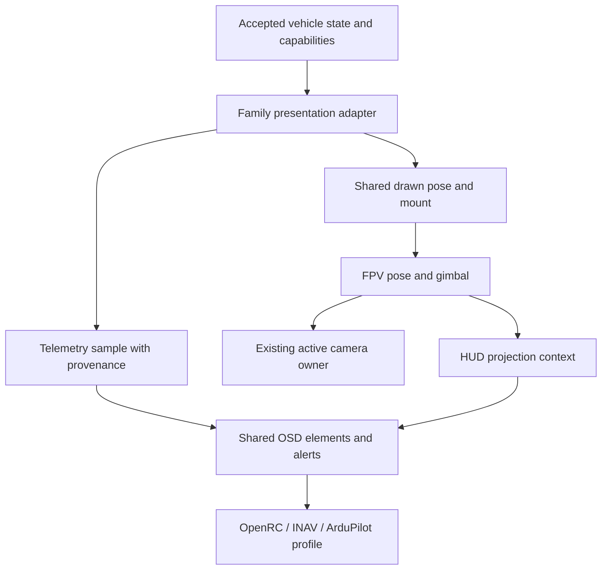

# Universal FPV, gimbal and autopilot-style OSD

**Implementation status, 2026-11-28.** The stock Jensen Ugly Stik .60 has a nose view with manual yaw and pitch. Press **3** to enter FPV, hold the right mouse button and drag to look, and press **Backspace** to recenter. The stock HX-700, blimp and both RC cars have rigid forward views in their camera selectors. The quad retains its own FPV controls, tilt and OSD.

The shared rig composes the drawn body and mount with Godot's built-in transform operators. The expanded-axis reference is selectable in the comparison fixtures. The Stik assigns mouse input to the next flight tick after the current batch of physics steps. The joints advance on committed ticks. The cadence fixture replays the same tick-stamped commands at 30, 60 and 144 Hz. Live mouse delivery still depends on when the window receives an event. A separately packaged C++ evaluator, the other airplane mounts, cockpit art, stabilization, fleet qualification and the INAV-style and ArduPilot-style screens remain open. [Source and native delivery audit](../research/universal-fpv/2026-11-28-main.md).

**First playable milestone.** Establish the legacy quad picture, then fly the stock Ugly Stick with a fixed nose camera on the shared rig. Use the same flight tape for the external view, the FPV reference path and the C++ candidate. Extend to the two ground vehicles, helicopter and blimp through their existing camera owners. The fleet, cockpit and pilot gates below apply to the full release.

**Owner:** CAM, with HUD, UI/input and each vehicle owner. **Prefix:** `CAM-FPV-00…08`, with lettered implementation packets. This is the execution subplan for universal onboard presentation under CAM-11/13 and the shared successor to the reusable parts of DR-31. CAM-12 continues to own optional lens distortion. Existing CAM, HUD, DR, RCV, HELI, BL and firmware-integration work keeps its identifiers and authority. [Registry](../README.md#tracks-plans-and-step-ids), [source audit and references](../research/universal-fpv/2026-11-22-audit.md).

**Code-research supplement:** the [20-repository GitHub survey](../research/universal-fpv/2026-11-22-github-code-survey.md) pins inspected implementations, including Kite Ground Control, and records adopted patterns, counterexamples and license evidence. Its findings inform the implementation packets below; source inspection does not establish upstream compatibility or OpenRC runtime acceptance.

**OSD implementation evidence:** the [focused OSD audit](../research/universal-fpv/2026-11-22-osd-deep-dive.md) traces all 27 drone elements, widget data/alert owners, renderer/settings behavior and four firmware/editor implementations. It specifies extraction boundaries and independent cases for the same packets; the current HD/analog choices are legacy treatments, not completed INAV/ArduPilot profiles.

**Aircraft-position expansion:** the [per-aircraft mount audit](../research/universal-fpv/2026-11-22-aircraft-camera-mounts.md) reviews all 8 selectable airplanes and 3 hidden technical airplane configurations. Nose, cockpit and tail positions now have explicit eligibility, asset preparation, two-axis cockpit control and glass requirements. These are required delivery targets; exact lens transforms and rendered qualification remain pending.

## 1. Product outcome and scope

Add **FPV** as an onboard view usable by fixed-wing aircraft, helicopters, multirotors, RC cars and airships. The same presentation components must also serve a future vehicle after its adapter supplies an admitted pose and mount. The user can choose a rigid camera or a gimbal, select an **OpenRC**, **INAV-style** or **ArduPilot-style** OSD, and configure useful telemetry and layouts for that vehicle.

The existing drone FPV is already implemented. The work is to generalize its useful camera/OSD components, connect the other vehicle routes, and add the missing gimbal and separate firmware-style profiles. An aircraft's existing physical validation status remains unchanged by adding a camera.

### 1.1 User-facing configuration

| Choice | Initial behavior |
| --- | --- |
| View | FPV joins each activity's available view list; existing defaults and shortcuts retain their behavior. |
| Mount | Select Nose, Cockpit or Tail only when admitted for this aircraft; other families supply their own useful installations. Store per-vehicle/mount overrides without rewriting aircraft physics. |
| Camera | Fixed or manual pan/tilt; every offered cockpit supports yaw/pitch. Stabilized modes appear only for axes and orientations the admitted mount can achieve. |
| OSD | OpenRC, INAV-style, ArduPilot-style; style selection changes presentation only. |
| Screen | Minimal, piloting, navigation and custom starting layouts, adapted to vehicle capabilities. Profile-specific screen identities remain distinct. |
| Presentation | Horizontal FOV, permitted mount tilt, character-grid/HD treatment, safe area, element visibility/position, text scale and units. |
| Cockpit glass | Clear or Realistic; keep structural posts, frames and the useful interior visible. Realistic tint/reflections are optional and scalable. |
| Gimbal controls | Angle or rate input, sensitivity/inversion, axis limits, recenter, follow/lock and active source. |
| Telemetry | OpenRC simulation is the initial source. Show unavailable fields honestly; a later external source must identify its actual firmware and connection. |

Use the existing camera/settings and Flight overlays flows, with preview and controller navigation. Keep the normal FPV setup compact; advanced placement and gimbal calibration belong in expanded settings. Camera view, gimbal mode, OSD screen and vehicle flight mode are four separate choices.

### 1.2 Delivery boundaries

The required first release includes universal fixed FPV, the aircraft positions in §3.2, usable cockpit structure/glazing, gimbal operation, both requested OSD styles, persistence and family coverage. A useful intermediate release can expose fixed FPV with reliable core telemetry before the full editor and profile fidelity are complete; it does not satisfy the final aircraft-position gate.

The earlier cockpit deferral is narrowed: the interior shell, posts/frames, coaming and glazing needed for a credible inside view are included for eligible stock aircraft. Interactive cockpit instruments/switches, VR/stereo, a second simultaneous video viewport, a video transmitter model, automatic navigation/RTH, physical gimbal mass/inertia, and live firmware control are separate work. Cosmetic analog noise is optional and must not create invented link measurements. Head tracking and ROI tracking have explicit extension seams; neither blocks manual gimbal FPV. No change to the 240 Hz float64 physics kernel is required for the presentation feature.

Read-only external-log inspection and recorded-video comparison are optional diagnostic extensions to 06c/08b. They may reuse the same telemetry elements and time-selection interface; a new ground-control application, logbook database or replacement flight recorder is not a prerequisite for the first release.

## 2. What to reuse, adapt and keep separate

The [dated audit](../research/universal-fpv/2026-11-22-audit.md#2-reuse-and-gap-inventory) identifies the inspected symbols and their limitations. Current source wins over older plan status.

| Existing component | Reuse | Required adaptation |
| --- | --- | --- |
| [Multirotor camera](../../app/vehicles/multirotor/multirotor_camera.gd) | Rigid mount transform, full roll, normalized quaternion rotation, horizontal-to-vertical FOV, horizon geometry and one-camera policy. | Move family-neutral math to CAM-owned helpers. Replace the tilt-only assumption with the full resolved optical pose. Preserve the existing drone picture during extraction. |
| [Shared camera rig](../../app/render/camera/camera_rig.gd), [math](../../app/render/camera/camera_math.gd), [frames](../../app/render/frames.gd) | Existing view selection, frame conversion, projection, camera history and established pilot/chase/orbit behavior. | Add admitted FPV selection and a narrow common pose/cut interface. Extend family owners rather than introducing another update loop. |
| [Drone OSD model](../../app/vehicles/multirotor/osd_model.gd) and [painter](../../app/vehicles/multirotor/osd_painter.gd) | Outlined text and strokes, compass/tapes, ladder, battery gauge, home arrow, units, layout validation and conditional elements. | Extract drawing primitives and pure calculations. Isolate quad controller constants, motor arrays, arm-home logic and race/statistics policy behind adapters. |
| [Drone HUD](../../app/vehicles/multirotor/multirotor_hud.gd) and [OSD panel](../../app/vehicles/multirotor/osd_settings_panel.gd) | Existing settings interaction, cache/redraw optimizations, visible save failures and OSD experience. | Keep race results, countdown, quad arming help and crash messages in the activity. Share the presentation layer without moving race authority into a HUD. |
| [Overlay telemetry](../../app/render/overlays/telemetry.gd), [units](../../app/render/overlays/units.gd) and [navigation data](../../app/render/overlays/navigation_data.gd) | SI calculations, groundspeed versus airspeed, altitude datums, heading/course distinction and bounded efficiency estimates. | Feed detached common samples. `OverlayManager.snapshot()` is fixed-wing-specific and cannot be called unchanged for a car or airship. |
| [Player](../../app/render/overlays/player_instrument.gd), [classic](../../app/render/overlays/classic_instrument.gd), [navigation](../../app/render/overlays/navigation_instrument.gd) and [training](../../app/render/overlays/training_instrument.gd) instruments | Formatting, availability rules, instrument semantics and reusable derivations. | Share data and selected drawing primitives. The firmware OSD needs its own compact composition; existing framed widgets remain usable independently. |
| [Overlay manager](../../app/render/overlays/overlay_manager.gd), [settings](../../app/render/overlays/overlay_settings.gd) and [dialog](../../app/ui/overlays_dialog.gd) | Normalized positions, lock/reset controls, presets, units, live preview, bounded refresh and hidden-widget work avoidance. | Add an FPV layout context without replacing the player's current non-FPV layout; establish one alert/audio owner. |
| [Battery sensors](../../app/render/overlays/battery_sensors.gd), [alert policy](../../app/render/overlays/alert_policy.gd), [alert audio](../../app/render/overlays/alert_audio.gd) | Observable battery readings, existing alert priorities and single-playback semantics. | Adapt family-specific battery/fuel sources; retain provenance and avoid copying drone voltage thresholds to every pack. |
| [Controller actions](../../app/input/controller_actions.gd), [camera settings](../../app/render/camera/camera_settings.gd), [display preferences](../../app/app_state/display_preferences.gd) | Semantic actions, capabilities, validation, interactive/direct route separation and saved overrides. | Add continuous gimbal commands and context arbitration; current press actions alone are insufficient. Camera preferences must reach every activity. |
| [Aircraft presentation adapter](../../app/render/airplane.gd), [model registry](../../app/aircraft/model_registry.gd), authored builders/assets | Validated visual family, datum, real structural nodes, existing canopy/frame/cockpit geometry, material/paint provenance and import transforms. | Add optional presentation mount/visibility bindings through the owning source pipeline. Exterior glazing is not evidence of an admitted cockpit; prepare the missing interior and view-specific materials. |

`app/telemetry/` owns opt-in application analytics, not the onboard instrument bus. This plan adds no analytics collection or consent changes. Physical models, session recorders, race scoring and native backend selection keep their current owners.

Use the OSD audit's [complete element disposition](../research/universal-fpv/2026-11-22-osd-deep-dive.md#all-27-elements-disposition) and [widget reuse map](../research/universal-fpv/2026-11-22-osd-deep-dive.md#2-reuse-the-widget-data-preserve-its-owners) for 01c/03/05. The drone painter, retained tapes and selected pure formatters are extraction candidates; the full HUD, quad warnings, arm/home/statistics observer and dedicated settings-file writer require separate treatment. Its Custom elements currently have hidden parent dependencies, analog retains some color accents, speed is 3-D magnitude, and home/G/statistics observe rendered updates. Preserve those facts in the extraction baseline instead of assuming the stronger universal contracts already exist.

## 3. Architecture and engineering contracts

Use three existing ownership boundaries. The family owns the drawn body and accepted flight observations. A pure FPV calculation supplies the optical pose and achieved joint angles. Godot’s active `Camera3D` owns the rendered projection, and `CanvasItem` draws the OSD. CAM-FPV-01b/01e and 04a pair the C++ calculation with a selectable GDScript reference. The FPV interfaces below are proposed.

### 3.1 One adapter per vehicle family

Define `FpvVehicleAdapter` as a read-only presentation boundary. It supplies vehicle identity/family, session generation, accepted tick/time, pause/crash state, the family's already resolved drawn pose, mount metadata, available measurements and existing lifecycle notifications. A future vehicle implements this boundary; it must not copy an OSD or inherit an airplane session solely to obtain a camera.

The adapter never changes actuator inputs, integrates another physical plant, samples a second flight controller, computes a second render interpolation, or rewrites the recorded command tape. A failed vehicle replacement leaves the previous adapter/camera intact; an accepted replacement retires old subscriptions and invalidates their generations.

Keep each current activity's camera owner during migration. The shared rig already queues camera-history resets until final placement. Add an equivalent final-pose handoff for ground and multirotor and test their startup and view changes. Shared helpers return a pose/projection; the owning activity applies it once. Fixed-wing, helicopter and airship already use `CameraRig`. Ground and multirotor have dedicated camera writers. Pass the computed pose to each writer and keep per-vehicle capability checks at the point where selectable views are built. The ground route currently interpolates its displayed quaternion into a separate `basis`, while `drawn[6..9]` retain the current tick's quaternion: its adapter must use the final displayed basis/transform, not those un-interpolated slots. A wholesale conversion of unrelated chase/orbit behavior is not a prerequisite. Preserve deliberate route restrictions such as `fixed_pilot_eye` calibration and synthetic-pose capture admission. Universal flight support does not override a calibration route that requires a fixed eye.

### 3.2 Mounts, frames and optical geometry

An admitted `FpvMountDescriptor` needs a stable mount ID, vehicle/model revision, position, declared datum/frame, structural attachment, mounting orientation, available gimbal axes and joint order, neutral orientation, mechanical limits, permitted rates, lens projection/FOV, near plane, view-specific mesh/material bindings and provenance (`authored`, `derived`, `estimated`, `user_override`). Keep capability/eligibility, asset readiness and qualification status distinct. Authoring uses metres and degrees with explicit meanings; runtime uses SI and a normalized orientation. The following mount IDs are proposed presentation metadata, not existing manifest fields.

Use the existing NED world, FRD body and body-to-NED quaternion conventions. Convert to Godot at `frames.gd`. Compose vehicle, mount, actual gimbal and optical orientation in a documented order. Preserve the distinction between the structural model datum and CG: a camera bolted to the fuselage must not move through the mesh as fuel changes CG. Imported presentation transforms and Workshop scale must be applied exactly once.

Specify independent expected optical axes and positions for translated/asymmetric mounts and noncommuting rotations, including a 90° bank with nonzero mount yaw/pitch. Verify `q` and `-q` equivalence and reject zero/invalid quaternions. A conversion round trip alone cannot expose two mutually compensating frame mistakes. AirSim, FlightGear and Gazebo use different engine/world conventions; their transforms are design evidence, not formulas to transplant.

Preserve the drone's existing valid imported `camera_mount` precedence over its prepared fallback. For other families, prefer authored mounts, then a bounded estimated mount from admitted visual bounds/datum metadata. Expose a preview and override. Missing trustworthy bounds yields an actionable unsupported-mount state, not a camera at an arbitrary origin. This is an admission limitation for that asset, not a new physics restriction. Every currently flyable catalog entry must receive an authored or explicitly estimated, validated mount before the universal release; an unresolved current entry blocks that release. A new or invalid imported asset may remain refused until its mount is admitted. Each current family also needs a validated virtual pan/tilt installation; additional stabilization axes are advertised only when its mount supports them.

#### Aircraft positions and catalog coverage

Apply the owner's geometry-dependent rule: an aircraft with a cabin/canopy and a suitable conventional fin/rudder receives **Nose + Cockpit + Tail**; a cabin-equipped aircraft without a suitable tail receives **Nose + Cockpit**; a cabinless aircraft receives **Nose only**, including the Ugly Stick configurations and MoonRunner X99. Do not create wing or winglet cameras to fill missing slots. The cabinless exception also excludes the Stik's otherwise structurally possible tail position.

| Current selectable airplane | Required position IDs | Specific preparation |
| --- | --- | --- |
| Ugly Stick (`jensen-das-ugly-stik-60`) | `front` | Clear forward installation; no cabin in the procedural builder. |
| Ugly Stick Electric 6S (`stik-electric-6s`) | `front` | Check its electric nose/prop installation independently of glow variants. |
| Extra 300S (`gp-extra-300s-60`) | `front`, `cockpit`, `tail` | Reuse canopy/frame/floor and fittings; qualify eye space, pilot occlusion and paint-dependent glass. |
| P-51D Mustang (`p51d-mustang-120`) | `front`, `cockpit`, `tail` | Reuse windscreen/hood frames, tub and fittings; qualify pilot/armour/coaming and large prop envelope. |
| F4U-1D Corsair (`f4u-corsair-250`) | `front`, `cockpit`, `tail` | Reuse imported cockpit/frame/glass bindings; inspect inward faces and all offered liveries. |
| Vantage Jet (`sebart-avanti-s-a200-p100rx`) | `front`, `cockpit`, `tail` | Use its active imported V2 scene, cockpit/frame/glass and fixed fin; no physical propeller. |
| Turbo Lumber Evolution (`turbo-lumber-evolution`) | `front`, `cockpit`, `tail` | Cabin glass exists, but usable interior/posts need an explicit asset preparation and admission step. |
| MoonRunner X99 (`moonrunner-x99`) | `front` | Forward nose ahead of the wing; rear pusher and `canopy_hatch` do not create a cockpit or conventional tail. |

The hidden `stik-glow-61fx-2t`, `stik-glow-55ax-2t` and `stik-glow-fs64v-4t` each require `front`, with their own installation/prop clearance check. They stay hidden in ordinary stock selection. The legacy `skywalker-x8` alias resolves to the X99 physical identity but retains a legacy visual-family path in the current catalog; test both resolution paths without counting an extra aircraft. The [audit matrix](../research/universal-fpv/2026-11-22-aircraft-camera-mounts.md#2-complete-airplane-matrix) records the source chain and remaining asset work. This makes 18 required position/configuration pairs across the 8 selectable airplanes, plus 3 hidden-configuration pairs. The rotorcraft and other universal families retain their own coverage gates. Player imports and lab-only data files are not additional reviewed stock airplanes.

These are release requirements, not a claim that any mount has passed. Insufficient current stock cockpit geometry is work to finish, especially on Turbo Lumber; it cannot silently reduce the promised stock position list. New or changed external imports use separate mount admission and may expose only the positions they can support.

#### Placement, cockpit control and glass

- **Nose (`front`):** a virtual optical point at the front of the structural airframe, clear of the spinner/propeller swept volume and other nose parts in the neutral forward picture. Qualify the whole offered forward FOV, not just the center ray. The intended picture contains no obstructing wing/fuselage. Additional pan/tilt must respect its separately checked look envelope; looking back need not remain free of the aircraft. Never attach the lens to a rotating propeller/spinner or move it with the chase collision boom.
- **Cockpit (`cockpit`):** an eye position inside the actual cabin/canopy volume, with the solid posts/frames and useful coaming/interior visible. Supply inward-facing surfaces where exterior-only geometry is inadequate. Each offered cockpit has **two mechanical look axes, yaw then local pitch**, with authored neutral/travel/rates, recenter and achieved-angle feedback. There is no independent roll axis; neutral roll follows the airframe and achieved orientation follows the full joint composition. Limit the look envelope to usable interior coverage instead of hiding the whole aircraft. Any own-pilot head/seat occlusion rule uses explicit camera-specific bindings.
- **Tail (`tail`):** a forward-facing point high on the fixed vertical fin near the rudder tip, clear of the moving rudder and other articulated parts. It shows the airplane ahead as an orientation cue. Bind to fixed structure, never `rudder_hinge`; rudder input must not yaw the camera. No conventional tail means no such mount. Tail pan/tilt is an optional admitted capability; cockpit yaw/pitch is required.

**Clear glass** removes glass tint/reflections from the cockpit picture, or omits only the bound glazing surfaces there, while retaining opaque posts/frames and interior. **Realistic glass** adds restrained tint, highlights and supported environment/reflection cues with an independent strength/quality setting. Both options are part of cockpit setup; an expensive reflection technique is not mandatory. Keep glass separate from structure, use instance-local material variants, and restore the exact prior materials/visibility when leaving the view. Existing builders cache materials and paints/skins can replace surface overrides; global edits would corrupt other aircraft/views. A camera cull mask alone does not supply per-camera materials. Use explicit view layers/variants and the existing one-camera owner; do not add a second scene render for glass.

Coordinate layer assignments with the existing magnifier and crash-debris layers, and preserve auxiliary-camera/shadow/reflection consumers. When paint or asset identity changes during FPV, recompose against the newly accepted base appearance; never restore an obsolete material snapshot. Bind glass versus opaque frames at surface granularity or split the authored mesh when they share one node. The current model manifest has a closed field set: add a compatible versioned presentation extension or identity-bound companion through CAM-13/AS, not undeclared fields in today's manifest or physical data.

Realistic glass must remain readable from inside and outside and compose correctly with prop blur, smoke, lighting and exposure. Standard alpha transparency has sorting/reflection limitations in the [official renderer guidance](../research/universal-fpv/2026-11-22-aircraft-camera-mounts.md#5-renderer-evidence-and-limits); do not promise transparent screen-space reflections on every backend. Qualify the project's pinned engine on Forward+, Mobile/Metal and retained Compatibility as applicable. Clear remains a useful fallback. Source/builder or converter changes, semantic bindings and generated identities go through the owning asset pipeline; no heuristic makes every transparent or dark mesh into glass.

Horizontal FOV is the user-facing optical value; derive vertical FOV from the active video rectangle. Keep body pose, actual camera pose and desired gimbal pose separate. The current quad's 1.5 cm near plane is installation-specific; qualify clipping and far-field depth per mount. Do not push a rigid onboard camera away from the vehicle using the chase boom's terrain clearance. Model-interior visibility changes affect render meshes only, never colliders or other cameras. Preserve props, smoke, glass, lighting, shadows and audio behavior deliberately.

Start with rectilinear projection. CAM-12 owns optional overscan/distortion and its extra viewport cost. Any later distortion must transform world-aligned cues consistently; text drawn after the video warp remains legible. Never label a wide rectilinear FOV as calibrated fisheye optics.

### 3.3 Telemetry contract

`FpvTelemetryFrame` contains schema version, vehicle/session identity, source identity and generation, accepted tick, sample time and capabilities. Each measurement has a numeric/structured value, unit, availability (`valid`, `unavailable`, `stale`, `failed`), provenance (`simulation`, `sensor_model`, `estimate`, `external`) and, when relevant, a reference frame/datum and last-valid timestamp. Estimation and availability are independent properties. Measurement identity includes its component/sensor instance and semantic kind; two batteries, GPS receivers or attitude estimators cannot overwrite each other by arrival order. External adapters also retain protocol/dialect/firmware identity and any raw encoding needed to interpret the sample later.

| Field group | Required distinction and initial behavior |
| --- | --- |
| Motion | Horizontal groundspeed, 3-D speed magnitude, signed body-forward speed/reverse, and vertical speed remain distinct. The current drone speed readout uses 3-D magnitude. Airspeed carries an explicit kind (TAS/EAS/IAS/CAS or source-unknown). The inspected ArduPilot OSD requests EAS; OpenRC TAS cannot silently acquire that meaning. A conversion needs an admitted model/input and estimate provenance, otherwise retain the actual kind and declare the profile deviation. |
| Orientation | Vehicle heading, course over ground, body pitch/roll and camera heading/pitch/roll are separate. Course is unavailable near zero horizontal motion; reverse/slip does not turn vehicle heading into course. |
| Height | Local datum altitude, AGL and home-relative altitude carry their own references. MSL requires an admitted georeference. Existing drone AGL must not silently become ArduPilot-style home altitude. |
| Home/navigation | Store origin, policy and generation. Quad home follows the accepted arm event; initial non-autopilot vehicle home is the accepted session start. External navigation home belongs to its source. Reset/restore policy is explicit. A pilot-station distance is a different measurement. |
| Energy | Pack/cell voltage, current, consumed charge, power, fuel and remaining estimates are capability-aware and instance-keyed. Preserve BAT sensor-derived warnings and distinguish estimated remaining time from measured quantities. A pack voltage in a protocol's first array slot does not establish a one-cell pack. |
| Derived instruments | Specific-force magnitude and signed body-normal load factor have different meanings. Instantaneous current-per-ground-distance and a rolling energy/charge-per-distance estimate have different windows and validity thresholds. Retain kind, inputs, window and completeness; a common label cannot silently alias them. |
| Mode/control | Display actual active controller/mode, arming/interlock state and throttle/collective/steering with their defined meanings. OSD style cannot invent ACRO, AUTO, RTL or a firmware connection. |
| Optional sensors | GPS fix/satellites, latitude/longitude, RSSI, LQ, VTX, ESC and rangefinder data appear only when supported by an explicit source. A connected USB radio is not an RF link measurement. |
| Activity data | Race gates/laps, ground drivetrain and helicopter rotor state are optional extension groups. Race scoring remains authoritative in the race session. |

Unknown values never become zero. Each element declares whether absence hides it or shows a placeholder and explanation; stale data has a visible stale state and cannot retain a healthy badge. Reject non-finite/invalid values at the adapter boundary. Source changes clear incompatible estimates and references atomically.

Decode protocol-specific sentinels before scaling and distinguish a legitimate zero from absent data: north heading, zero angular delta, zero current and coordinates on the equator/prime meridian can all be valid. Preserve per-field availability through recording and replay. Never infer arming from a nonempty mode name, GPS fix from satellite count alone, RSSI units from magnitude, or body heading from course without an explicitly labelled estimate. Raw mode bits and canonical display labels retain the source/version that defines them. Freshness is per contributing stream: a fresh GPS packet must not refresh stale attitude or gimbal feedback.

Read and format continuous numerical measurements at a bounded rate, initially retaining the existing 10 Hz cadence. Camera-aligned horizon/markers use the same frame's drawn pose and actual optical projection. Do not label interpolated display geometry as a fresh sensor sample. Observe committed arm, fault, crash and alert transitions independently of numeric polling: consume the session's accepted event stream or latch transitions until consumed, so an event lasting less than 100 ms is not lost. Bounded event storage needs an explicit overflow indication and must not block physics. Alert truth and bounded flight aggregates continue while an element is hidden; hidden elements stop formatting and drawing work.

Local sample age follows accepted simulation time and freezes during pause. External source freshness follows its reception/monotonic clock even while simulation is paused. Rewind/restart changes generation; it cannot turn a future cached sample into a valid current one.

Keep accepted simulation time, source boot/epoch time, monotonic reception, imported-log time and optional video time separate. Store the mapping and its uncertainty with the source generation. Widen integer clocks before unit conversion; distinguish wrap, out-of-order delivery and reboot using the admitted protocol and surrounding evidence, not one backward timestamp. Time gaps and source changes break interpolation. Numeric display may interpolate compatible valid samples; orientations use quaternion interpolation and discrete modes, home/configuration changes and faults use ordered state transitions.

Share one stateful observation owner per source/instance with existing widgets. OSD and widgets consume detached readings; neither creates a second battery integrator, warning stream or flight-statistics credit. Optional rolling estimates/history exports use explicit consumer demand: closing a widget cannot reset an estimate still used by the OSD, while no-consumer optional work can stop. Essential alerts and admitted bounded flight aggregates continue under the hidden-element contract. Preserve the current battery sensor's stale timestamp when it returns a held reading; the adapter owns unavailable/stale state. Do not convert simulator SOC into a radio observation. Keep legacy source/formatting behavior in the extraction wrapper and admit any subsequent change explicitly.

### 3.4 Gimbal and input authority

| Mode | Reference and intended behavior |
| --- | --- |
| Fixed FPV | Camera is rigidly attached; full vehicle roll and fixed installation tilt. No stabilization or extra smoothing. |
| Manual pan/tilt | User changes available axes relative to the mount; roll follows the vehicle unless that mount exposes roll control. |
| Stabilized, yaw follow | Pitch/roll targets use the world horizon; yaw follows vehicle heading plus the user's commanded offset. |
| Stabilized, yaw lock | Pitch/roll stabilization plus a world-referenced yaw target; vehicle turns are compensated within actual travel/rate limits. |
| Neutral/recenter | Return toward the declared neutral target with the configured slew; explicit reset/teleport may snap under the cut contract. |

The cockpit's required yaw/pitch installation supports manual pan/tilt and recenter. A two-axis mount cannot generally cancel arbitrary airframe roll while independently retaining yaw and pitch targets. Offer only achievable stabilization behavior for that mount, with residual error/limits shown; full pitch/roll stabilization modes above require the corresponding admitted axes. An independently qualified three-axis installation elsewhere does not silently upgrade every cockpit.

Use quaternions/bases for composition and continuity through inversion/vertical flight. Mechanical axis limits still have an explicit joint convention. Track desired versus achieved orientation, angular rate and saturation; show a small gimbal mode/limit indicator. Stabilization must respect actuator travel and rate limits instead of remaining magically locked beyond them. Defaults are simulator mount presets with provenance, not claims of matching a particular commercial gimbal.

Commands have a selected source and a session generation. Priority is active modal UI capture, then the explicitly selected camera source, with existing flight input retaining its own authority. Keyboard/mouse, spare radio axes, gamepad controls and later head tracking feed this same camera command interface. Never steal the primary flight sticks by default. Check button, held action and AUX conflicts within the active vehicle context; extend the existing registry's family-sharing rules rather than inventing parallel bindings.

Angle input requests an angle; rate input integrates bounded angular velocity. Releasing a rate control stops the requested rate; disconnect/focus loss clears held commands and holds the last valid target. Camera recovery must not resume stale movement or rearm a vehicle. Input to layout editing never also commands steering, throttle or the gimbal.

Test simultaneous release of multiple axes, asymmetric joint limits and switching between angle/rate sources. An optional external gimbal adapter namespaces link, system, manager and device identity. A sent acquisition request, a command acknowledgement, observed control ownership and achieved device attitude are separate states; permit controlling commands only after the admitted ownership policy is satisfied. Negotiate supported/current frame semantics, preserve valid zero offsets, refuse contradictory flags and expire stale rate authority. Firmware-specific update rates or timeout constants do not replace OpenRC's local accepted-tick contract.

Gimbal motion is presentation state. Advance it through an ordered, bounded observer of each family's fully accepted tick, using that tick's pose and camera commands timestamped/quantized to the same timeline. In the ground family, use the session's post-acceptance `tick_advanced`, not the kernel's provisional `stepped`: the session can still roll back a stepped frame after telemetry/damage validation. Each adapter must identify its equivalent final-acceptance boundary. Refused/rolled-back ticks consume neither commands nor gimbal motion; catch-up ticks retain their order. Keep the previous/current presentation states and render them with the family's existing interpolation fraction. This adds no independent physics loop, second body interpolation or integration from variable render `delta`.

The normal paused view freezes live gimbal motion. Settings preview has isolated state and commits only the chosen configuration/target. Resume clears held rates. Later external gimbal feedback becomes the actual pose through one selected authority; it must not compete with the local mount controller. Camera observer failure or buffer overflow holds a declared last-valid view and records a presentation fault without refusing or changing an otherwise accepted physical tick.

### 3.5 OSD profiles and projection

Create one element registry and one telemetry/alert pipeline. A profile chooses element names, glyph treatment, grid, formatting, layout defaults and warning/statistics presentation. It does not replace physics, sensor availability or controller authority.

#### Shared pipeline and element boundaries

| Layer | Contract and reuse |
| --- | --- |
| Observation/derivation | Family adapters and shared widget services supply detached values, validity, generation and accepted events. Pure geometry/formatters may be extracted from the drone model; quad controller constants, race scoring and arm/trip lifecycle remain with their owners. |
| Element evaluation | A stable ID declares semantic input kind, required capabilities, availability/placeholder policy, explicit dependencies or compound options, formatter, footprint, refresh class and layer. Evaluation cannot read a session or mutate source state. |
| Profile/screen composition | A versioned profile maps supported elements to formatting, units, layout, style and declared screen/message/statistics policy. Preserve user intent for unsupported elements and expose why they cannot currently display. |
| Rendering | Reuse the drone painter for the OpenRC vector/canvas path. Add a character-cell path for admitted firmware-style grids/glyph pages. Both consume the same evaluated measurements; their geometry and glyph rules are explicit, with no renderer per vehicle family. |
| Editor/preview | Use the same element evaluation, formatting, glyph choice, footprint and layer composition as live rendering for identical supplied state. Representative preview states are isolated from flight and clearly identified; their footprint envelope is verified separately. |

Every independent new-profile element must work with its own data requirements. Enabling current, power, efficiency, vario or up/down must not silently require another visible sibling solely because the old HUD nests its draw call there. A deliberate compound control is declared in the registry/editor and migration. Keep the legacy dependency behavior during 01c until a separate reviewed change replaces it.

Treat profile, backend, screen, grid, palette and units as distinct configuration dimensions with an admitted combination manifest. A system-font vector HUD at 12 Hz is not proof of a character OSD. Glyph asset pixels, character-cell coordinates and output pixels have separate transforms; missing pages, wrong glyph aspect or unsupported combinations produce an explicit result. New monochrome profiles cover every primitive, including compass north, stick indicators and actuator bars; legacy color exceptions remain part of its baseline.

Provide an INAV-style character layout with the documented default and three alternate screens. ArduPilot-style layouts use its documented positioned panels, selectable screens and unit choices, including aviation units. Profile-specific defaults must be verified against pinned reference versions; a generic monochrome overlay alone does not establish close visual parity. The existing drone style remains a separately identified OpenRC/legacy preset during migration.

A profile manifest identifies its schema, firmware/configurator reference pair, element-ID/coordinate encoding, grid/cell geometry, glyph-page/font asset versions and provenance. Independently inspected default-branch heads are not an admitted compatible pair. Store canonical layout fields internally; translate packed coordinates/visibility only at a versioned boundary. Retain unimplemented fields for a lossless round trip where their meaning is known, or refuse the unsupported write with a visible explanation. Validate font dimensions/page count and missing glyphs; substituted assets require a declared fidelity deviation.

Keep these two horizon concepts explicit:

- **Vehicle attitude instrument:** displays vehicle roll/pitch according to the selected profile's documented convention and compensation settings.
- **Camera/world alignment:** projects the level plane, home or waypoint using the actual optical pose, viewport and lens, including gimbal movement.

Do not silently substitute one for the other. A stabilized gimbal can show a level world while the aircraft attitude instrument reads a bank. Home direction relative to the nose is also different from a marker projected into the camera. Behind-camera, off-screen and near-vertical cases require intentional indicators rather than invalid projection coordinates.

The layout editor supports grid snapping, safe margins, visibility, text scale, per-screen reset and preview. Preview each element's full footprint across representative signed/large values, units, warnings and localization, highlight overlaps and right/bottom overflow, and preserve dirty state when a save fails. Preserve existing non-FPV widget positions. Reserve interaction regions for critical activity messages and prevent duplicate alert audio. Color is supplementary to symbols/text; retain outlines, high contrast, reduced motion and localization fallback glyphs. Exact font/artwork reuse requires retained provenance and redistribution permission.

The actual displayed image rectangle owns conformal projection, including letterboxing and panel insets; a fixed 16:9 canvas or constant pixels-per-degree ladder is insufficient. Validate zero-size/resize transitions before projection. Screen-aligned text may use a different scale from world-aligned geometry. Optional MSP DisplayPort is a distinct ordered character-screen source: maintain a bounded staging grid, admit dialect-specific options/glyph pages, and publish completed draws independently of transport packet boundaries. Malformed or interrupted updates cannot expose an unvalidated partial screen as a fresh completed frame.

#### Screens, messages and postflight state

Each qualified profile records a deterministic screen-transition table: user selection, supported alternate switches, temporary override ownership/expiry, applicable arm/disarm/failsafe events, recovery and disabled/invalid targets. Qualify simultaneous requests against the selected source/backend; do not assume a universal priority order from a firmware name. Editor preview uses its own selection and cannot leave the live OSD stuck on a preview screen. A screen change cannot change vehicle control mode, camera or source generation.

Use one source of alert truth and the existing audio owner. Normalize alert identity/source/severity before profile text treatment; retain family-specific meanings and action text. Persistent conditions and expiring notifications are separate. Critical active conditions retain presentation through screen/statistics changes; a brief committed event may have a declared notice lifetime after its condition clears. Lower-priority text cannot displace a critical warning; equal-priority rotation is bounded and fair, duplicates coalesce and overflow is explicit. Respect existing user sound/category controls and activity-message ownership. Blink, inversion, truncation and scrolling are profile policies on the declared presentation clock, not warning truth.

Flight/trip aggregates have an explicit family start/end/reset and source generation. Do not impose quad arming/airborne thresholds or throttle-stick dismissal on cars and unrelated activities. Consume the existing statistics service read-only where admitted; never create a second flight record from an OSD screen. Define sample cadence, partial/gap status and extrema semantics; render-sampled G or speed cannot promise per-tick peaks. Postflight selection, pagination, timeout, dismissal, rearm and reset are presentation policies and do not clear other consumers' aggregates. ArduPilot generic-screen statistics and backend-specific panel overrides require separate reference qualification. Optional replay adds restoration proof only when it ships.

#### Redraw, layout and settings correctness

Preserve the useful split between recorded static tapes, moving optical geometry, changed numeric text and event-driven messages. Start common numeric refresh at the existing 10 Hz service cadence; drawn-pose geometry remains frame-synchronous. Hardware OSD transfer loops and the legacy 12/30 Hz treatments are reference behavior, not the universal scheduler. Use the selected presentation clock for deterministic OSD animation; wall-clock UI notices remain separate. Showing a hidden element requests an immediate refresh from current admitted data.

Invalidate content for its complete dependency key: value/availability, source generation, profile/screen/backend, grid/font/glyph/palette, units/locale, scale, actual image rectangle and projection where relevant. Moving, hiding or shrinking content must clear its previous footprint; removing an overlapping item restores the content beneath it. Recompose the affected layer or invalidate the union of old/new footprints with a stable z-order. Do not add a complex dirty-cell scheduler before profiling justifies it. Bound text/geometry/history caches and release RIDs/subscriptions with their owner. An Off or hidden screen skips unnecessary formatting/drawing while mandatory observations continue.

Validate occupied two-dimensional cells/pixels before flattening storage. A two-cell value at x=29 on a 30-column grid overflows; it must not wrap silently into the next row. Test negative/left/top extents, multi-row last-row values, signed/large/localized text, placeholders, warnings and moving horizon footprints. Preview/live equivalence for one sample and coverage of the full representative envelope are separate proofs.

Extend the existing focus, preview, drag/lock/reset and preference owners with an FPV layout context. Keep non-FPV widget positions and legacy OSD preferences intact. Read the dedicated drone configuration through an explicit migration; its current known-key rewrite cannot preserve a future schema. Validate the entire candidate, retain unsaved edits on failure, provide explicit retry, and do not overwrite newer unsupported data. Unit/profile changes may refresh the OSD without rebuilding unrelated widget themes or resetting observation windows. See the [OSD evidence and acceptance cases](../research/universal-fpv/2026-11-22-osd-deep-dive.md#5-verification-to-reuse-and-add).

### 3.6 Settings, lifecycle and replay

Use the existing preferences owners. Add a versioned FPV/mount/profile section without replacing unrelated `[hud]` or `[camera]` values. Preserve each family's first-view default, including drone FPV, and apply a saved override only where supported; an incompatible saved choice falls back explicitly to that family's existing default. Migrate old drone OSD settings once and preserve them on failed save. A failed write leaves a clearly identified session-only selection and a retry path. Newer unsupported schemas are not overwritten. Direct/automation launches use explicit arguments/fixtures and ignore personal preferences as they do today.

Store the selected stable mount ID per canonical vehicle identity and qualify it against the resolved visual/model revision; preserve alias-specific visual admission where the current catalog requires it. Store FOV, allowed gimbal settings and cockpit glass separately per mount. The selector lists only admitted positions, retaining unavailable-reason information in setup. Switching `front`/`cockpit`/`tail` stages the new pose, optics and view-specific bindings atomically; refusal preserves the previous view. On a successful switch clear held camera rates, restore that mount's validated settings and neutral target, and make one cut after the final pose. An invalid saved mount never reuses another model's coordinates. Required stock positions must all be admitted before release.

A mount or glass change preserves the shared telemetry subscriptions, home, battery/efficiency windows, alerts and trip/flight statistics. Only optical projection/layout caches that depend on the new view are invalidated. Every mount uses the same selected OpenRC/INAV-style/ArduPilot-style OSD; cockpit posts may occlude the world but do not turn the 2-D OSD into an unrequested physical windshield display.

Every phase that changes a route must already cover pause, reset and refusal behavior; phase 6 expands that coverage across the complete feature rather than deferring correctness until the end.

| Event | Required result |
| --- | --- |
| Enter/leave FPV or change mount/FOV | Apply the final camera pose, then issue one reconstruction-history reset through the current owner. Update the audio listener through AUD's existing contract. |
| Pause/menu/focus loss | Hold accepted pose and local telemetry time, stop live camera rates, preserve alert truth; menu capture owns input. |
| Reset/respawn/accepted vehicle replacement | New generation; reset mount dynamics, relevant home/statistics and camera histories; snap to the new admitted pose. No blend across the field. |
| Refused reset/replacement | Preserve the previous vehicle, camera, preferences, recording and presentation identity. |
| Crash/recovery | Existing crash director and activity own the outcome. Preserve quad graded-impact/aftermath behavior; for new onboard routes follow CAM's cut-to-orbit policy, and always use an existing inspection/orbit fallback when the live mount disappears or a wreck mount is unavailable. Retaining FPV on a moving wreck requires an admitted wreck pose and an explicit CAM policy change. Never fight a second camera writer. |
| Replay seek/restore | Reconstruct or explicitly reset presentation state, clear stale generations and commit one camera cut after the final pose. Preserve the family's physical replay rules. |

Physical replay must remain unchanged by view, profile, widget or gimbal commands. Reproducing the same camera movement is a separate visual-replay feature: a versioned optional presentation sidecar records stable mount/configuration identity, glass/visibility configuration, commands, achieved camera state/checkpoints, cuts and source timing without modifying old physical tapes. Bind it to the physical log/session identity and applicable profile/asset versions. A log without camera data uses a declared default/current view where playback exists. Verify exact physical replay with the original matching engine, backend and solver or package identity. A changed executable, bundle or shared extension may require candidate comparison even when trajectories agree. Test view invariance inside one build with the same backend and tape. [Flight-log identity and comparison](../FLIGHT-LOGGING.md). Record deterministic OSD animation time separately from wall-clock UI notifications.

For optional telemetry/log inspection, retain original data and decoder identity; build cancellable, bounded indexes or disposable high-rate caches outside the tick observer. A seek restores sparse home, mode, parameter/configuration and gimbal state as well as pose, and marks undecodable/gapped ranges explicitly. Generation-tagged decode results cannot replace a newly selected flight. All displayed elements sample the same chosen presentation time. Recorded-video alignment carries origin, units, offset and any admitted drift model/uncertainty; cover missing or not-yet-decoded frames instead of showing an old image as current. Visual/telemetry replay is not evidence of exact physical replay or closed-loop firmware correctness.

### 3.7 External-code adoption boundary

The [code survey](../research/universal-fpv/2026-11-22-github-code-survey.md#integration-decisions) maps every accepted lesson to an existing packet and separates shared code lineage from independent corroboration. Adopt small contracts and test ideas through OpenRC's current owners. No external source, font, dependency or ground-control stack is imported by this plan. Record file/asset-specific license provenance before any future reuse; repository metadata alone is insufficient.

Optional live/log/DisplayPort ingress uses bounded parsing and queues with explicit malformed-data, overflow, cancellation and reconnect behavior. The decoder selects protocol/dialect/version and source identity before producing measurements. Unknown IDs, unsupported flags, partial packets, invalid checksums/signatures and source clock changes have deliberate policies; a convenient SDK's scaled values do not establish validity. Never perform socket waits, file decode, video conversion, settings saves or blocking SDK calls inside an accepted-tick presentation observer. Obsolete visual frames may be discarded by a declared latency policy; accepted ticks, ordered gimbal commands and committed events keep their separate guarantees. Recorded sensor injection and a controlled SITL session are different modes owned by the firmware track.

### 3.8 Native pose, gimbal and OSD work

| Work | Proposed boundary | Admission evidence |
| --- | --- | --- |
| Rigid pose and optics (01b/01e) | Compose datum, mount and optical frame in one pure C++ call per displayed pose. Accept the family’s final position and orientation in a declared frame. A route that already supplies a rendered basis composes from that basis once. Use double precision for SI quantities up to the render boundary. Return the pose and lens parameters to the existing camera writer. | Keep the GDScript oracle selectable. Compare the full pose/FOV, the final active camera and projected landmarks. Count calls and allocation/conversion cost at the boundary. |
| Gimbal (04a/04b/04d) | Given prior joint state, accepted body attitude, elapsed accepted time, limits and the camera command for that tick, return achieved joints, rates and saturation in one call. The adapter commits that result once. At draw time compose the interpolated joints with the already drawn body. | Identical commands at 30/60/144 render Hz must give equivalent achieved angles on each accepted tick. Refusal consumes zero commands. Compare native and reference through recenter, rollover, pause and source loss. |
| OSD and telemetry (03a/05a/05e) | Reuse guarded native endpoint readings where the requested measurement matches. Use the final Godot projection for visible markers and its behind-camera test. Batch visible cue transforms or character-cell layout in C++ only if the measured call/copy/draw cost supports the change. Keep text, controls, resources and drawing with the scene owner. | Toggle individual native paths and compare the entire consumer output on identical inputs. Preserve the 27-element drone baseline. Count visible and hidden work, including the blimp’s lazy telemetry reader and existing painter caches. |

**Packaging decision for 00d.** Prefer a small set of independently selectable presentation methods in the existing GDExtension if CAM and NK can load a verified artifact from a cold start in every intended activity, without preparing or selecting a physical model. A changed shared binary requires the NK identity, installer and package gates even for a visual-only method. If the shared loader couples presentation to physical admission or would disturb recorded-backend selection, use an independently identified presentation extension for qualified targets. Keep reference FPV available wherever the native presentation payload is absent or refused. Record the camera backend, physics backend, build/receipt and refusal reason separately. Test the installed export with and without the optional payload. [Delivery constraints and source owners](../research/universal-fpv/2026-11-28-main.md#native-delivery-constraints).

**Independent geometry fixture.** Start at NED (100, 200, −20) m, yaw 90° east, pitch and roll zero. A structural offset of (0.5, 0.2, −0.1) m FRD from this origin puts the lens at NED (99.8, 200.5, −20.1) m. A neutral lens faces east. With zero shake and centered optics, a point directly ahead projects to image center. Repeat with a banked translated mount, a target behind the eye and a non-square content rectangle. For a known nonzero shake, calculate the expected pixel from the composed optical axes, then compare it to the active camera after layout and shake. Freeze numeric and pixel tolerances against the pinned precision and viewport in 00d. Record the largest error and the case that produced it.

## 4. Phases and subphases

**Status key:** `reviewed` means source/document inspection only; `pending` means implementation and its proof are still required. Each row is an independently reviewable packet. Commit messages carry its `CAM-FPV` ID, what changed and the actual verification scope.

### Phase 0 — Baseline and acceptance contract

| ID | Work and dependency | Proof / status |
| --- | --- | --- |
| CAM-FPV-00a | Inventory all five family routes, camera owners, HUD widgets, mount sources and relevant tests at the pinned commit; trace all 27 drone elements and widget service ownership. Audit every aircraft's real cabin, glass, fin, propulsion and source pipeline. | [Source inventory](../research/universal-fpv/2026-11-22-audit.md), [OSD audit](../research/universal-fpv/2026-11-22-osd-deep-dive.md) and [11-configuration aircraft audit](../research/universal-fpv/2026-11-22-aircraft-camera-mounts.md); reviewed. No runtime execution. |
| CAM-FPV-00b | Review primary INAV/ArduPilot references and 20 strategically selected GitHub implementations; deepen OSD registry, grid/canvas, screens, messages, statistics and editor paths. | [Reference register](../research/universal-fpv/2026-11-22-audit.md#4-primary-reference-register), [code survey](../research/universal-fpv/2026-11-22-github-code-survey.md) and focused OSD evidence; reviewed. Compatible release/backend pairs and executable/capture fixtures remain pending. |
| CAM-FPV-00c | First capture the legacy drone, the Ugly Stick external view and a matching input tape. Before changing the OSD, add the legacy layouts, Custom dependencies, HD/analog, Off, alerts, statistics and menu cases. Before changing each remaining model or car route, capture its baseline exterior and proposed lens space. | 1080p images with asset, font, renderer, clock/cadence and camera parameters, saved/unsaved behavior and matching physical trace identities. Each packet requires the baseline for the route it changes. Pending. |
| CAM-FPV-00d | Freeze the per-family acceptance boundary, frame contract, native package choice and test tolerances in §3.8. Specify missing-source behavior and a way to force the camera reference independently of physics. | Known pose/pixel fixtures and a cold-launch loader matrix for each proposed OS/architecture and physics selection. Record availability, refusal and fallback. Pending. |

**Exit:** a reproducible baseline and explicit acceptance cases; the code review alone does not satisfy this gate.

### Phase 1 — Shared presentation foundation

| ID | Work and dependency | Proof / status |
| --- | --- | --- |
| CAM-FPV-01a | Define detached pose, mount, capabilities, camera command and telemetry schemas, including measurement instances, semantic kinds and clock/source generations. Specify stable position IDs, structural attachments, two-axis order, semantic glass/structure bindings and model-revision admission; prepare one validated stock-aircraft mount fixture for 02a. Depends on 00d. | Valid/invalid descriptors, cabinless/tailless capability fixtures, independent noncommuting-frame fixtures, units/datum/instance tests and no retained mutable session arrays; pending. |
| CAM-FPV-01b | Extract the drone rigid-pose reference and wrap its existing default view. Preserve imported marker origin versus fallback offset, existing tilt and post-placement shake. | Compare both mount sources, pose/FOV and legacy picture against 00c. Extend `test_mr_camera` and `test_mr_activity`. Pending. |
| CAM-FPV-01c | Extract painter/formatter primitives, parameterize style/font inputs and retain a legacy wrapper before adding the shared evaluator/renderer seam. Keep quad arming, racing and statistics authority. | All 27 IDs, legacy dependencies, values/layout/save/cadence and rendered baseline preserved; existing OSD/redraw assertions extended; bounded caches and RID teardown; pending. |
| CAM-FPV-01d | Add the presentation lifecycle/cut interface, final-acceptance event boundary and adapter registration. Keep one final camera writer per activity and bounded nonblocking work. | Attach/detach, stale async result rejection, refused ticks, failed replacement preservation and one final-pose cut; blocked transport/decode/UI/save cannot delay acceptance; pending. |
| CAM-FPV-01e | Implement the C++ rigid-pose candidate behind the 00d package decision and the 01a/01b reference. Bind once per active adapter and report the path that actually served the frame. | Compare reference/native on the same drawn poses, including invalid inputs, independently expected axes/pixels and the first frame after replacement. A refused candidate keeps the admitted reference view. Record paired end-to-end costs and run the relevant native export gates. Pending. |

**Exit.** The quad preserves its legacy picture and vehicle behavior. A second adapter fixture consumes the same pose contract. A qualified native package and a cold reference-only run each identify the path they executed.

### Phase 2 — Universal fixed FPV

| ID | Work and dependency | Proof / status |
| --- | --- | --- |
| CAM-FPV-02a | Add FPV to shared-rig selection, supported settings, CLI and first-frame handling; wire a stock fixed-wing aircraft. Depends on 01b/01d and the validated stock mount fixture from 01a; general mount admission follows in 02b. | Implemented for the stock Stik. The normal route checked the tick-zero nose pose, switching, crash fallback and 48 identical physical checkpoints for pilot and both FPV optical paths. |
| CAM-FPV-02b | Add authored position sets through CAM-13/AS and a validated estimated fallback/override. Implement the complete stock/hidden matrix in §3.2, selector and per-mount settings; cover CG, imported datum/scale, nose/prop clearance and fixed-fin attachment. | All 11 airplane configurations accounted for; X99 alias and cabinless exceptions explicit; no lens on spinner/rudder; lens stays fixed to geometry under fuel/CG/scale changes; invalid mount switch preserves previous view; legacy models still load; pending. |
| CAM-FPV-02c | Connect RC car FPV using the existing ground camera owner and its final displayed basis/chassis transform. Preserve garage/overview behavior. | Implemented on both stock chassis. The mounted camera passed clearance through steer/travel limits, interpolated attitude, garage and cut checks. Pilot and target-hardware qualification remain open. |
| CAM-FPV-02d | Extend the shared rig to the helicopter and airship and adapt the drone’s dedicated writer. Resolve offered IDs against each route’s capabilities and HUD choices. | Stock mounts are connected on HX-700 and all three blimp skins. Camera, activity and OSD checks passed on the quad. Fleet and legacy-image qualification remain open. |
| CAM-FPV-02e | Prepare usable cockpit shells/posts/coamings and camera-specific pilot visibility for all five cabin-equipped stock families, especially Turbo Lumber. Implement Clear/Realistic glass through owned source/material bindings; qualify optics, image rectangles, prop/interior visibility and cuts, including imported/donor visuals. | Inside/outside, day/night, both glass modes, paints/liveries and restoration checks; 4:3/16:9/ultrawide, zero-size/resize, inverted/look-limit views, near/far clipping and transparent overlap captures on the pinned renderer; pending. |

During staged delivery, 02b registers all target position IDs, but a cockpit remains unavailable with its setup reason until its 02e interior/glass and 04a/04c/04d two-axis look/control prerequisites are admitted. Nose fixed FPV may ship earlier; registering a future cockpit in metadata does not make it player-selectable or complete. Optional stabilization from 04b does not block the required manual yaw/pitch installation.

**Exit:** selectable fixed FPV works on an admitted representative of every existing family. Admitted estimated mounts retain their provenance; unqualified candidates appear only in setup with their reason, not as selectable FPV positions. Universal fleet qualification follows in phase 7.

### Phase 3 — Shared telemetry and widget data

| ID | Work and dependency | Proof / status |
| --- | --- | --- |
| CAM-FPV-03a | Implement family telemetry adapters on 01a/01d. For fixed-wing, share the existing observation owner and request native endpoint fields only when their time, state and meaning match. Use the current composed-terrain AGL path. | All five families. Compare hook on/off and full reference. Include spatial weather, invalid terrain, TAS versus unavailable IAS/EAS, vertical-only motion, multiple sources and an unchanged hidden airship HUD sampling budget. Pending. |
| CAM-FPV-03b | Share unit/height/home derivations, observed battery readings, fuel and explicitly typed efficiency estimates through one service owner and consumer demand. | Wind/zero/reverse/slow motion, AGL/home separation, instantaneous versus rolling efficiency, close one of two consumers, no duplicate charge integration and preserved legacy units; pending. |
| CAM-FPV-03c | Add per-measurement/per-stream validity, accepted-event home/timers, generation-aware filters/aggregates, typed interpolation and bounded numeric sampling independent of formatting. | Mixed validity, valid zero/north/equator, stale attitude with fresh GPS; arm at A versus later drawn B, short events, same-tick generation reset, overflow/pause/rewind; optional clocks add wrap/reboot/reorder; pending. |
| CAM-FPV-03d | Connect basic OSD elements to the shared alert/audio owner; separate active conditions, expiring messages and family trip/flight summaries while retaining activity/race authority. | All-family numbers; critical warning during stats, expiry without clearing truth, bounded fair text/overflow, hidden observations, one audio/statistics credit and unchanged physical state; pending. |

**Exit:** an airplane, car and drone can share the same element implementation and still display correct vehicle-specific meaning. This is the first useful fixed-FPV/core-OSD delivery.

### Phase 4 — FPV gimbal and controls

| ID | Work and dependency | Proof / status |
| --- | --- | --- |
| CAM-FPV-04a | Implement the C++ and reference joint step from §3.8 on the admitted mount contract. Each cockpit provides manual yaw then local pitch. Output desired/achieved pose, rates, limits and recenter state. | The Stik has a manual body-relative yaw/pitch gimbal. Known angles, timing and both stops passed in the shared rig. Cockpits, asymmetric installations and the dedicated C++ candidate remain open. |
| CAM-FPV-04b | Add horizon stabilization, yaw follow and yaw lock with explicit per-axis body/world frames and achievable-axis admission. | Two-axis cockpit cannot claim full roll cancellation; banked-plane/turning-car cases, residual error, asymmetric travel/rate limits, noncommuting turns, zero/invalid quaternion and valid-zero versus unknown frame deltas; pending. |
| CAM-FPV-04c | Extend semantic input with continuous camera axes and source arbitration; integrate existing Controls setup/help. | Keyboard/mouse, spare radio/gamepad axes; modal conflicts, simultaneous multi-axis release, unplug/reconnect and angle/rate source changes; no stolen flight axes; pending. |
| CAM-FPV-04d | Add gimbal settings/indicator and accepted-tick update/reset policy. | Matched 30/60/144 Hz command replay, catch-up and refused/rolled-back tick cases, pause/focus/recenter/reset behavior and truthful achieved-angle indication; pending. |

**Exit:** fixed FPV remains rigid by default; the requested gimbal modes work consistently on planes, cars and the other admitted families. Optional head tracking can later plug into the same command source.

### Phase 5 — INAV and ArduPilot profiles and layout editing

| ID | Work and dependency | Proof / status |
| --- | --- | --- |
| CAM-FPV-05a | Build the capability/dependency registry, versioned profile/grid/glyph manifest, shared element evaluation and canvas/character rendering paths. Depends on phase 3 and camera-pose contract; can overlap phase 4. | Independent element cases, style/glyph pages, monochrome coverage, deterministic layer/old-footprint invalidation, hidden-work/cache bounds and no physical/mode change; pending. |
| CAM-FPV-05b | Implement INAV-style typography/symbols, default/alternate screens, formatting, warning treatment and postflight policy from a qualified firmware/configurator/backend reference. | Grid/glyph captures; simultaneous screen choices/expiry/disabled target, stats pages and message states; declared substitutions/deviations; pending. |
| CAM-FPV-05c | Implement ArduPilot-style screens/panels, altitude/airspeed kinds, aviation units and qualified screen/message/statistics policy. | Source-specific arm/disarm/failsafe/user arbitration and recovery; generic versus backend-specific stats qualified; missing EAS not relabelled TAS; reference captures/deviations; pending. |
| CAM-FPV-05d | Add per-screen editor using shared live evaluation/composition, isolated preview, full footprint, overlap/bounds feedback, reset, defaults and schema migration. | Same-input live/preview parity plus independent footprint envelope; no row wrap at x=29/width=30, malformed assets, failed save/retry/newer schema, old settings and controller focus preserved; pending. |
| CAM-FPV-05e | Generalize horizon/home/waypoint projection for actual gimbal pose and optional profile compensation across nose/cockpit/tail. Completion depends on achieved-pose interfaces from 04a/04b and the end-to-end control fixture from 04c/04d. | Banked vehicle versus stabilized picture, looking sideways/backwards, behind-camera arrows, aspect/FOV and no-reference cases; mount/glass changes preserve observations, home, alerts, efficiency and statistics; pending. |

**Exit:** both requested styles are independently selectable and visibly recognizable, with a documented parity/deviation matrix. OpenRC-provided data remains clearly identified; firmware execution is not claimed.

### Phase 6 — Complete lifecycle, recording and environment integration

| ID | Work and dependency | Proof / status |
| --- | --- | --- |
| CAM-FPV-06a | Exercise Home, direct launch, Workshop/imported trial, vehicle/mount switch, alias/revision change, failed load, restart, crash recovery and menu routes together. Depends on phases 2–5. | Route matrix; exact exterior material/visibility restoration, no cross-instance paint changes, no invalid saved mount reuse, leaked subscriptions, stale home, camera writer conflict or incorrect input focus; pending. |
| CAM-FPV-06b | Finish reconstruction, exposure/lens and audio-listener handoff through existing owners. | One cut after final pose, no stale motion history, no gain dip from inappropriate observer reset, paused effects policy; pending. |
| CAM-FPV-06c | Preserve each family’s existing recording and replay contract when switching camera/profile. Add an identity-bound sidecar only if visual replay ships. | Check fixed-wing, blimp and quad logs on matching identities, ground control/action replay, and helicopter recorder rows on the same inputs. Verify historical logs with their original matching artifacts. Camera data is optional. Visual seek, sparse restoration and external-log alignment apply only to shipped extensions. Pending. |
| CAM-FPV-06d | Qualify camera-local world detail using the existing DR tree promotion and card suppression on the quad. Survey terrain, grass, water, clouds, fog and transparencies on other moving-camera routes. | Front/rear view handoffs at near/far transitions, unchanged collision events and race identity on the same tape, and per-field admission for supported camera motion. Pending. |

**Exit:** complete player journeys are coherent. Scenery limitations are recorded per field; a camera feature cannot qualify geometry/parallax that the scenery does not provide.

### Phase 7 — Fleet, platform and product qualification

| ID | Work and dependency | Proof / status |
| --- | --- | --- |
| CAM-FPV-07a | Enumerate every currently flyable catalog ID, family and distinct visual/mount combination; include all 18 selectable-airplane position pairs, 3 hidden Stik pairs, the X99 legacy alias, remaining vehicle families and imported-provider fixtures. Reconcile any newly added catalog entries before release. | Every required current position selectable and qualified; source/model/paint identity, lens/look limits and clear/realistic cockpit captures recorded. Missing stock cockpit/tail work blocks release rather than reducing the matrix. Verify every cockpit's yaw/pitch, each family's virtual pan/tilt and every advertised extra mode; pending. |
| CAM-FPV-07b | Run numerical input-invariance, lifecycle, camera/projection and HUD suites, including the survey and focused OSD audit's independent semantic, composition, consumer-ownership and preview fixtures for shipped features. | Actual test identities and zero engine script errors; deferred optional log/video/protocol features add no release gate; an inspected test filename alone is not a pass; pending. |
| CAM-FPV-07c | Compare the legacy view, fixed FPV, gimbal and full OSD in matched production captures. Alternate C++ and reference with the same tape, mount, renderer, graphics preset and warm-up. | Log actual presentation/physics backends, CPU/GPU frame p50/p95/p99, per-call cost including marshalling, allocations and sim/wall ratio. Record target hardware and output/drawable/internal pixels, starting at 1080p or native Retina. Pending. |
| CAM-FPV-07d | Perform visual/pilot review and accessibility/localization checks; complete Help and FIRST-LAUNCH guidance. | Day/night, bright sky/dark terrain, small/large text, controller editing and comfort review; higher resolutions next, 720p last; pending. |
| CAM-FPV-07e | Ship through independently reversible packets, preserving the previous view/profile during rollout. | Applicable CI/package gates and honest supported-vehicle/mount notes; pending. |

**Exit:** software, visual, pilot and hardware evidence are reported separately. Reuse current PT/VQ budgets; propose a provisional shared added-visual allowance of **+0.5 ms p95** in a matched capture, to be reconciled with the current target-host budget before implementation. This is a target, not a measured result or a per-component allowance. OSD-off must avoid ongoing draw/format work while retaining only required bounded observations.

### Phase 8 — Optional real telemetry and firmware interoperability

| ID | Work and dependency | Proof / status |
| --- | --- | --- |
| CAM-FPV-08a | Coordinate with the firmware-integration owner; version adapters/capabilities and distinguish passive observation, recorded injection and admitted control. | Explicit link/system/component/instance identity, source authority, clock/frame/datum mapping and compatible versions; pending, outside first-release requirement. |
| CAM-FPV-08b | Add admitted read-only MAVLink/MSP sources or log adapters with bounded decode, original-data/decoder provenance and deliberate unknown-message policies. | Per-field sentinels before scaling, battery instances, wrap/reboot/reorder, stale constituent streams, partial/corrupt/unknown packets, recovery, cancel/overflow and reconnect; pending. |
| CAM-FPV-08c | Consider DisplayPort screen rendering and MAVLink gimbal-manager control as separate optional integrations. | Ordered incremental screen updates, including a draw without clear, and draw completion across packet splits; glyph/grid/capacity bounds; manager/device matching, request/ACK/observed-owner distinction, conflicting frame flags, denied/stale ownership and rate-stop tests. Offered source/video pairings also require end-to-end timestamp/latency and pose/optics alignment, or an explicit unsupported/uncertain state; pending. |

These packets cannot be substituted for the firmware track's plant/control, lockstep, rollback, SITL or safety gates. A MAVLink data stream is not a rendered DisplayPort screen, and neither establishes that ArduPilot or INAV controls the vehicle. Preserve the current single authoritative OpenRC physical plant.

## 5. Acceptance matrix

Core cases apply to the first release. Cases explicitly marked optional apply only when that extension is admitted and shipped; deferring visual replay, external-log/video inspection or protocols does not add a phase 0–7 release dependency. Mandatory physical replay preservation still applies.

| Scenario | Required evidence |
| --- | --- |
| Plane banks 45° with stabilized FPV | Camera/world horizon stays level within mount capability; vehicle attitude still reports the bank. |
| Car turns 90° | Yaw follow turns with the car; yaw lock holds its world target until a documented limit/rate is reached. |
| Hover, reverse, sideslip and stopped car | Heading remains body orientation; course/groundspeed remain separate; no false navigation direction at zero motion. |
| Vertical pitch, inverted roll, ±180° crossing | Continuous optical pose, no Euler flip, invalid horizon projection handled explicitly. |
| CG/scale/imported visual change | Lens remains attached to the declared structural mount; no duplicate scale/CG offset. |
| Ground vehicle halfway between accepted ticks | Camera uses the same interpolated chassis basis as the body; no turn/roll jitter from current-tick quaternion slots. |
| Readings without sensors or georeference | No invented GPS satellites, link quality, MSL altitude, airspeed sensor or firmware mode. |
| Uneven terrain and home at a different elevation | AGL and home-relative altitude differ correctly; camera direction and nose-relative home arrow are not confused. |
| Menu editing and device loss | No unintended vehicle or camera motion, no duplicate binding ownership, no automatic rearm. |
| Pause, reset at the same tick, refused replacement and replay seek | Correct generation/state preservation or reset, no stale values, one final camera cut. |
| Session rejects a provisional tick; several accepted ticks catch up | No gimbal state/command consumption on refusal; identical ordered mount evolution across render rates. |
| Critical event begins and ends between numeric refreshes | Accepted transition is retained and presented under its policy, including after a hidden-OSD interval; no fabricated persistent active fault. |
| Cold export with reference physics, absent or refused presentation library | Same vehicle and admitted camera remain usable. Diagnostic records the actual presentation path. A native pass requires actual calls on the installed target package. |
| Crash event before or after a family's accepted tick notification | Associate events with the tick and generation by the family contract. One notification per accepted event, including on catch-up. Rebuild or clear the observer after signal-suppressed ground replay. |
| Blimp changes skin while paused in FPV | Rebind the optical attachment and the HUD choice to the accepted visual. Check all three skins and preserve the previous view on rejection. |
| Same accepted command tape with every view/profile | Physical output/checkpoint identities match within the same build, family and backend; visual replay has separate evidence. |
| Resize, letterbox, 4:3/16:9/ultrawide and Retina | Optical FOV/projection and OSD safe area stay consistent; no clipped warnings or misaligned markers. |
| Hidden OSD and long session | Bounded observations, no history growth or unnecessary text churn; visible alert truth retained. |
| Complete current catalog | Reconcile the [13 Home IDs and 5 families](../research/universal-fpv/2026-11-28-main.md#coverage-and-camera-ownership). All 11 airplane configurations meet §3.2: 18 selectable and 3 hidden position/configuration pairs, X99 alias checked, five usable two-axis cockpits, all other families still covered. Missing required positions block release. |
| Nose FOV and propulsion variants | Entire neutral forward picture clears skin/spinner/prop swept geometry; check every offered FOV, prop variant and scale without changing colliders, rotating the mount with the shaft or using chase push-out. |
| Cockpit pan/tilt at limits and during a bank | Eye stays in admitted cabin space; frames/posts and inward surfaces remain coherent; yaw/pitch follows the declared joint order, recenter works and no independent roll axis is invented. |
| Full rudder deflection in tail view | Lens remains on fixed structure, looks forward over the aircraft and does not inherit rudder motion; articulated geometry remains intact. |
| Clear/Realistic glass, then exterior view | Posts/frames remain opaque; glass/prop/smoke compose under the qualified backend; prior materials, livery and visibility restore exactly; another instance is unchanged. |
| Cabinless or tailless selection | Stiks and X99 offer front only; X99 hatch/winglets do not create extra positions. A future cabin-equipped tailless aircraft may offer front/cockpit only after separate admission. |
| Switch mount or reject stale saved model revision | Successful change applies one final-pose cut and correct settings; rejection preserves the previous view. OSD source, home/alerts/estimates/statistics persist and projected cues use the new lens. |
| Multiple sources and legitimate zeros | Battery/estimator instances stay separate; north heading and equator/meridian coordinates remain valid; unknown fields and stale contributing streams remain unavailable/stale. |
| Airspeed supplied as TAS while a profile expects EAS | Preserve the supplied kind or use an admitted, labelled conversion; never change the meaning through typography alone. |
| Noncommuting mount rotations and quaternion sign | Independently known optical axes/position match; `q` and `-q` agree, invalid/zero quaternions fail admission, and no model/world inverse is guessed. |
| Both gimbal axes released; optional external ownership change | Local requested rates clear together. If external control ships, request, acknowledgement, observed ownership and achieved pose remain distinct; stale authority cannot continue motion. |
| Profile/version/font change and full-width values | Element footprint stays inside the admitted grid/safe area or reports the conflict; unsupported fields/assets are preserved or refused; failed writes retain dirty state. |
| Optional visual/telemetry replay seeks across home/configuration changes | Admitted sparse state restores at the selected time; no interpolation across gaps/generations and no late decoder result replacing the new selection. |
| Optional protocol chunks or screen frames are malformed | Length/checksum/sentinel and capacity rules reject the affected data; a subsequent valid frame recovers; a transport packet is not assumed to be a complete screen. |
| Slow optional video/SDK/decode consumer | Bounded presentation queues and explicit stale/gap state preserve accepted physics timing; events and ordered commands are not discarded as visual frames. |
| New-profile Custom singleton or declared compound | Current/power/efficiency/vario/updown renders with its required source, or exposes a declared requirement; no accidental dependence on another visible sibling. |
| Vertical-only motion and two G/efficiency kinds | 3-D speed, horizontal groundspeed, climb, signed load/magnitude and instantaneous/rolling estimates retain distinct meanings and invalidity rules. |
| Widget and OSD share an observation, then one closes | One battery integration and alert stream; a remaining consumer retains its estimate window; optional work stops only when its demand permits. |
| Screen change and critical warning during summary | Deterministic selection/restore, expired notification distinct from active truth, critical presentation retained, no duplicated sound or statistics credit. |
| Long value shrinks or overlapping element moves/hides | Old footprint cleared, content beneath restored, stable layer ordering and no ghost cells/pixels. |
| Two-cell text at the last column; editor/live comparison | Explicit overflow instead of row wrap; identical supplied state produces identical formatting/glyph/geometry, with a separately verified representative envelope. |
| Legacy migration and profile/font/palette/locale change | Old configuration and unsaved edits retained on failure; invalid/newer schema refused safely; complete invalidation, no unwanted observer reset or resource growth. |

Extend focused existing suites listed in the [audit](../research/universal-fpv/2026-11-22-audit.md#3-existing-verification-to-reuse), adding fixtures that test these independent expected outcomes. Do not create tests that merely mirror a new implementation. Full application runs are not required for the planning-only commit; implementation packets must use the project's [verification scope](../tools/shared.md#verification-scope) and relevant native/render/device gates.

## 6. Integration map and release order

| Area | Proposed implementation home | Coordination |
| --- | --- | --- |
| FPV pose and gimbal | CAM reference/wrapper in `app/render/camera/`, pure C++ behind the 00d package choice, existing camera writers | CAM and NK own binding, receipts and parity. AS and family owners admit mounts. |
| Stock mount bindings and cockpit/glass preparation | Owning aircraft authoring sources, model bindings/generator, procedural builders and imported scene pipeline | CAM/AS/aircraft owners; publish semantic node/surface identities, regenerate manifests/hashes, preserve collision/physics and paint contracts. |
| Detached adapters and telemetry contract | `app/render/fpv/` with narrow family adapters | HUD/presentation; sessions remain with their current owners. |
| OSD registry, profile data and renderer | `app/render/fpv/osd/`; shared primitives extracted from drone OSD | HUD + DR; preserve compatibility wrapper during migration. |
| Controls, settings and persistence | Existing `app/input/`, `app/ui/`, `app/app_state/` owners | UI/D6; keep direct routes deterministic and settings transactional. |
| Family hooks | `main.gd`, `helicopter_main.gd`, ground/multirotor/airship activity owners | Small integration patches; avoid unrelated vehicle-system refactoring. |
| Verification and evidence | Existing affected suites plus focused `test_fpv_*`; `docs/research/universal-fpv/` | CAM/HUD/family tests; PT/VQ/DT retain qualification gates. |

The first playable slice joins the 00c/00d baseline, 01a/01b/01d reference and lifecycle, 01e native comparison, and 02a Ugly Stick nose view. OSD extraction (01c) can proceed independently using its own drone baseline. The other family adapters follow in 02c/02d. Shared telemetry (03) and mount controls (04) can proceed together once their input contracts are stable. Full profile projection (05e) needs achieved gimbal pose. Lifecycle and fleet qualification close phases 6/7. Phase 8 is optional.

Stock multi-position authoring runs through 02b/02e. Expose each required cockpit after its interior, glass and two-axis controls pass. Ship the common core OSD before the two firmware-style profiles and editor if their gates close at different times.

**Continue from the playable routes.** Reuse the [stock geometry fixture](../../app/tests/test_fpv_stock_mounts.gd), [camera route and checkpoint tape](../../app/tests/test_camera_route.gd), [gimbal](../../app/tests/test_fpv_gimbal.gd), [quad camera](../../app/tests/test_mr_camera.gd), [ground camera](../../app/tests/test_ground_fpv.gd), [helicopter](../../app/tests/test_helicopter_fpv.gd) and [blimp](../../app/tests/test_airship_presentation.gd) for subsequent changes. Complete baseline picture comparisons and package qualification before promoting 01e. Continue 02b/02e with separately admitted mounts and cockpit assets. Record pilot and target-hardware evidence on their respective configurations.
