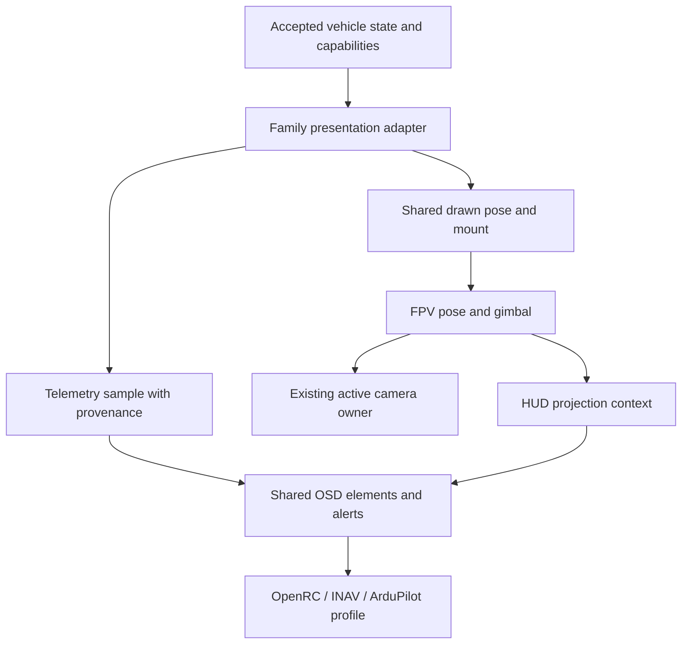

# Universal FPV, gimbal and autopilot-style OSD

**Date:** 2026-11-22. **Status:** source review and implementation plan only; no runtime changes or new runtime validation. **Baseline:** `main` at `7940a4081e10994f34c858c4acac3d7a1a271464` (v0.3.3 preparation). **Planning branch:** `plan/universal-fpv-gimbal-2026-11-22`.

**Owner:** CAM, with HUD, UI/input and each vehicle owner. **Prefix:** `CAM-FPV-00…08`, with lettered implementation packets. This is the execution subplan for universal onboard presentation under CAM-11/13 and the shared successor to the reusable parts of DR-31. CAM-12 continues to own optional lens distortion. Existing CAM, HUD, DR, RCV, HELI, BL and firmware-integration work keeps its identifiers and authority. [Registry](../README.md#tracks-plans-and-step-ids), [source audit and references](../research/universal-fpv/2026-11-22-audit.md).

**Code-research supplement:** the [20-repository GitHub survey](../research/universal-fpv/2026-11-22-github-code-survey.md) pins inspected implementations, including Kite Ground Control, and records adopted patterns, counterexamples and license evidence. Its findings refine the existing 38 packets below; source inspection does not establish upstream compatibility or OpenRC runtime acceptance.

## 1. Product outcome and scope

Add **FPV** as an onboard view usable by fixed-wing aircraft, helicopters, multirotors, RC cars and airships. The same presentation components must also serve a future vehicle after its adapter supplies an admitted pose and mount. The user can choose a rigid camera or a gimbal, select an **OpenRC**, **INAV-style** or **ArduPilot-style** OSD, and configure useful telemetry and layouts for that vehicle.

The existing drone FPV is already implemented. The work is to generalize its useful camera/OSD components, connect the other vehicle routes, and add the missing gimbal and separate firmware-style profiles. An aircraft's existing physical validation status remains unchanged by adding a camera.

### 1.1 User-facing configuration

| Choice | Initial behavior |
| --- | --- |
| View | FPV joins each activity's available view list; existing defaults and shortcuts retain their behavior. |
| Mount | Select an authored installation or a clearly identified estimated virtual mount. Store per-vehicle overrides without rewriting aircraft physics. |
| Camera | Fixed; manual pan/tilt; stabilized pitch/roll with yaw follow; stabilized pitch/roll with yaw lock. Available axes follow the mount. |
| OSD | OpenRC, INAV-style, ArduPilot-style; style selection changes presentation only. |
| Screen | Minimal, piloting, navigation and custom starting layouts, adapted to vehicle capabilities. Profile-specific screen identities remain distinct. |
| Presentation | Horizontal FOV, permitted mount tilt, character-grid/HD treatment, safe area, element visibility/position, text scale and units. |
| Gimbal controls | Angle or rate input, sensitivity/inversion, axis limits, recenter, follow/lock and active source. |
| Telemetry | OpenRC simulation is the initial source. Show unavailable fields honestly; a later external source must identify its actual firmware and connection. |

Use the existing camera/settings and Flight overlays flows, with preview and controller navigation. Keep the normal FPV setup compact; advanced placement and gimbal calibration belong in expanded settings. Camera view, gimbal mode, OSD screen and vehicle flight mode are four separate choices.

### 1.2 Delivery boundaries

The required first release includes universal fixed FPV, gimbal operation, both requested OSD styles, persistence and family coverage. A useful intermediate release can expose fixed FPV with reliable core telemetry before the full editor and profile fidelity are complete.

Full cockpit interiors, VR/stereo, a second simultaneous video viewport, a video transmitter model, automatic navigation/RTH, physical gimbal mass/inertia, and live firmware control are separate work. Cosmetic analog noise is optional and must not create invented link measurements. Head tracking and ROI tracking have explicit extension seams; neither blocks manual gimbal FPV. No change to the 240 Hz float64 physics kernel is required for the presentation feature.

Read-only external-log inspection and recorded-video comparison are optional diagnostic extensions to 06c/08b. They may reuse the same telemetry elements and time-selection interface; a new ground-control application, logbook database or replacement flight recorder is not a prerequisite for the first release.

## 2. What to reuse, adapt and keep separate

The [dated audit](../research/universal-fpv/2026-11-22-audit.md#2-reuse-and-gap-inventory) identifies the inspected symbols and their limitations. Current source wins over older plan status.

| Existing component | Reuse | Required adaptation |
| --- | --- | --- |
| [Multirotor camera](../../app/vehicles/multirotor/multirotor_camera.gd) | Rigid mount transform, full roll, normalized quaternion rotation, horizontal-to-vertical FOV, horizon geometry and one-camera policy. | Move family-neutral math to CAM-owned helpers. Replace the tilt-only assumption with the full resolved optical pose. Preserve the existing drone picture during extraction. |
| [Shared camera rig](../../app/render/camera/camera_rig.gd), [math](../../app/render/camera/camera_math.gd), [frames](../../app/render/frames.gd) | Existing view selection, frame conversion, projection, camera history and established pilot/chase/orbit behavior. | Add admitted FPV selection and a narrow common pose/cut interface. Extend family owners rather than introducing another update loop. |
| [Drone OSD model](../../app/vehicles/multirotor/osd_model.gd) and [painter](../../app/vehicles/multirotor/osd_painter.gd) | Outlined text and strokes, compass/tapes, ladder, battery gauge, home arrow, units, layout validation and conditional elements. | Extract drawing primitives and pure calculations. Isolate quad controller constants, motor arrays, arm-home logic and race/statistics policy behind adapters. |
| [Drone HUD](../../app/vehicles/multirotor/multirotor_hud.gd) and [OSD panel](../../app/vehicles/multirotor/osd_settings_panel.gd) | Existing settings interaction, cache/redraw optimizations, visible save failures and OSD experience. | Keep race results, countdown, quad arming help and crash messages in the activity. Share the presentation layer without moving race authority into a HUD. |
| [Overlay telemetry](../../app/render/overlays/telemetry.gd), [units](../../app/render/overlays/units.gd) and [navigation data](../../app/render/overlays/navigation_data.gd) | SI calculations, groundspeed versus airspeed, altitude datums, heading/course distinction and bounded efficiency estimates. | Feed detached common samples. `OverlayManager.snapshot()` is fixed-wing-specific and cannot be called unchanged for a car or airship. |
| [Player](../../app/render/overlays/player_instrument.gd), [classic](../../app/render/overlays/classic_instrument.gd), [navigation](../../app/render/overlays/navigation_instrument.gd) and [training](../../app/render/overlays/training_instrument.gd) instruments | Formatting, availability rules, instrument semantics and reusable derivations. | Share data and selected drawing primitives. The firmware OSD needs its own compact composition; existing framed widgets remain usable independently. |
| [Overlay manager](../../app/render/overlays/overlay_manager.gd), [settings](../../app/render/overlays/overlay_settings.gd) and [dialog](../../app/ui/overlays_dialog.gd) | Normalized positions, lock/reset controls, presets, units, live preview, bounded refresh and hidden-widget work avoidance. | Add an FPV layout context without replacing the player's current non-FPV layout; establish one alert/audio owner. |
| [Battery sensors](../../app/render/overlays/battery_sensors.gd), [alert policy](../../app/render/overlays/alert_policy.gd), [alert audio](../../app/render/overlays/alert_audio.gd) | Observable battery readings, existing alert priorities and single-playback semantics. | Adapt family-specific battery/fuel sources; retain provenance and avoid copying drone voltage thresholds to every pack. |
| [Controller actions](../../app/input/controller_actions.gd), [camera settings](../../app/render/camera/camera_settings.gd), [display preferences](../../app/app_state/display_preferences.gd) | Semantic actions, capabilities, validation, interactive/direct route separation and saved overrides. | Add continuous gimbal commands and context arbitration; current press actions alone are insufficient. Camera preferences must reach every activity. |

`app/telemetry/` owns opt-in application analytics, not the onboard instrument bus. This plan adds no analytics collection or consent changes. Physical models, session recorders, race scoring and native backend selection keep their current owners.

## 3. Architecture and engineering contracts

The following names and paths are proposed interfaces, not existing classes. Prefer a small GDScript presentation layer and Godot's existing camera/CanvasItem facilities. No new native library is justified until a measured bottleneck warrants it.

### 3.1 One adapter per vehicle family

Define `FpvVehicleAdapter` as a read-only presentation boundary. It supplies vehicle identity/family, session generation, accepted tick/time, pause/crash state, the family's already resolved drawn pose, mount metadata, available measurements and existing lifecycle notifications. A future vehicle implements this boundary; it must not copy an OSD or inherit an airplane session solely to obtain a camera.

The adapter never changes actuator inputs, integrates another physical plant, samples a second flight controller, computes a second render interpolation, or rewrites the recorded command tape. A failed vehicle replacement leaves the previous adapter/camera intact; an accepted replacement retires old subscriptions and invalidates their generations.

Keep each current activity's camera owner during migration. Shared helpers return a pose/projection; the owning activity applies it once. Fixed-wing and helicopter use `CameraRig`; ground, multirotor and airship call the same FPV helper through their existing owners. The ground route currently interpolates its displayed quaternion into a separate `basis`, while `drawn[6..9]` retain the current tick's quaternion: its adapter must use the final displayed basis/transform, not those un-interpolated slots. A wholesale conversion of unrelated chase/orbit behavior is not a prerequisite. Preserve deliberate route restrictions such as `fixed_pilot_eye` calibration and synthetic-pose capture admission. Universal flight support does not override a calibration route that requires a fixed eye.

### 3.2 Mounts, frames and optical geometry

An admitted `FpvMountDescriptor` needs a stable mount ID, vehicle/model revision, position, declared datum/frame, mounting orientation, available gimbal axes, neutral orientation, mechanical limits, permitted rates, lens projection/FOV, near plane and provenance (`authored`, `derived`, `estimated`, `user_override`). Authoring uses metres and degrees with explicit meanings; runtime uses SI and a normalized orientation.

Use the existing NED world, FRD body and body-to-NED quaternion conventions. Convert to Godot at `frames.gd`. Compose vehicle, mount, actual gimbal and optical orientation in a documented order. Preserve the distinction between the structural model datum and CG: a camera bolted to the fuselage must not move through the mesh as fuel changes CG. Imported presentation transforms and Workshop scale must be applied exactly once.

Specify independent expected optical axes and positions for translated/asymmetric mounts and noncommuting rotations, including a 90° bank with nonzero mount yaw/pitch. Verify `q` and `-q` equivalence and reject zero/invalid quaternions. A conversion round trip alone cannot expose two mutually compensating frame mistakes. AirSim, FlightGear and Gazebo use different engine/world conventions; their transforms are design evidence, not formulas to transplant.

Preserve the drone's existing valid imported `camera_mount` precedence over its prepared fallback. For other families, prefer authored mounts, then a bounded estimated mount from admitted visual bounds/datum metadata. Expose a preview and override. Missing trustworthy bounds yields an actionable unsupported-mount state, not a camera at an arbitrary origin. This is an admission limitation for that asset, not a new physics restriction. Every currently flyable catalog entry must receive an authored or explicitly estimated, validated mount before the universal release; an unresolved current entry blocks that release. A new or invalid imported asset may remain refused until its mount is admitted. Each current family also needs a validated virtual pan/tilt installation; additional stabilization axes are advertised only when its mount supports them.

Horizontal FOV is the user-facing optical value; derive vertical FOV from the active video rectangle. Keep body pose, actual camera pose and desired gimbal pose separate. The current quad's 1.5 cm near plane is installation-specific; qualify clipping and far-field depth per mount. Do not push a rigid onboard camera away from the vehicle using the chase boom's terrain clearance. Model-interior visibility changes affect render meshes only, never colliders or other cameras. Preserve props, smoke, glass, lighting, shadows and audio behavior deliberately.

Start with rectilinear projection. CAM-12 owns optional overscan/distortion and its extra viewport cost. Any later distortion must transform world-aligned cues consistently; text drawn after the video warp remains legible. Never label a wide rectilinear FOV as calibrated fisheye optics.

### 3.3 Telemetry contract

`FpvTelemetryFrame` contains schema version, vehicle/session identity, source identity and generation, accepted tick, sample time and capabilities. Each measurement has a numeric/structured value, unit, availability (`valid`, `unavailable`, `stale`, `failed`), provenance (`simulation`, `sensor_model`, `estimate`, `external`) and, when relevant, a reference frame/datum and last-valid timestamp. Estimation and availability are independent properties. Measurement identity includes its component/sensor instance and semantic kind; two batteries, GPS receivers or attitude estimators cannot overwrite each other by arrival order. External adapters also retain protocol/dialect/firmware identity and any raw encoding needed to interpret the sample later.

| Field group | Required distinction and initial behavior |
| --- | --- |
| Motion | Horizontal groundspeed, signed body-forward speed/reverse, and vertical speed remain distinct. Airspeed carries an explicit kind (TAS/EAS/IAS/CAS or source-unknown). The inspected ArduPilot OSD requests EAS; OpenRC TAS cannot silently acquire that meaning. A conversion needs an admitted model/input and estimate provenance, otherwise retain the actual kind and declare the profile deviation. |
| Orientation | Vehicle heading, course over ground, body pitch/roll and camera heading/pitch/roll are separate. Course is unavailable near zero horizontal motion; reverse/slip does not turn vehicle heading into course. |
| Height | Local datum altitude, AGL and home-relative altitude carry their own references. MSL requires an admitted georeference. Existing drone AGL must not silently become ArduPilot-style home altitude. |
| Home/navigation | Store origin, policy and generation. Quad home follows the accepted arm event; initial non-autopilot vehicle home is the accepted session start. External navigation home belongs to its source. Reset/restore policy is explicit. A pilot-station distance is a different measurement. |
| Energy | Pack/cell voltage, current, consumed charge, power, fuel and remaining estimates are capability-aware and instance-keyed. Preserve BAT sensor-derived warnings and distinguish estimated remaining time from measured quantities. A pack voltage in a protocol's first array slot does not establish a one-cell pack. |
| Mode/control | Display actual active controller/mode, arming/interlock state and throttle/collective/steering with their defined meanings. OSD style cannot invent ACRO, AUTO, RTL or a firmware connection. |
| Optional sensors | GPS fix/satellites, latitude/longitude, RSSI, LQ, VTX, ESC and rangefinder data appear only when supported by an explicit source. A connected USB radio is not an RF link measurement. |
| Activity data | Race gates/laps, ground drivetrain and helicopter rotor state are optional extension groups. Race scoring remains authoritative in the race session. |

Unknown values never become zero. Each element declares whether absence hides it or shows a placeholder and explanation; stale data has a visible stale state and cannot retain a healthy badge. Reject non-finite/invalid values at the adapter boundary. Source changes clear incompatible estimates and references atomically.

Decode protocol-specific sentinels before scaling and distinguish a legitimate zero from absent data: north heading, zero angular delta, zero current and coordinates on the equator/prime meridian can all be valid. Preserve per-field availability through recording and replay. Never infer arming from a nonempty mode name, GPS fix from satellite count alone, RSSI units from magnitude, or body heading from course without an explicitly labelled estimate. Raw mode bits and canonical display labels retain the source/version that defines them. Freshness is per contributing stream: a fresh GPS packet must not refresh stale attitude or gimbal feedback.

Read and format continuous numerical measurements at a bounded rate, initially retaining the existing 10 Hz cadence. Camera-aligned horizon/markers use the same frame's drawn pose and actual optical projection. Do not label interpolated display geometry as a fresh sensor sample. Observe committed arm, fault, crash and alert transitions independently of numeric polling: consume the session's accepted event stream or latch transitions until consumed, so an event lasting less than 100 ms is not lost. Bounded event storage needs an explicit overflow indication and must not block physics. Alert truth and bounded flight aggregates continue while an element is hidden; hidden elements stop formatting and drawing work.

Local sample age follows accepted simulation time and freezes during pause. External source freshness follows its reception/monotonic clock even while simulation is paused. Rewind/restart changes generation; it cannot turn a future cached sample into a valid current one.

Keep accepted simulation time, source boot/epoch time, monotonic reception, imported-log time and optional video time separate. Store the mapping and its uncertainty with the source generation. Widen integer clocks before unit conversion; distinguish wrap, out-of-order delivery and reboot using the admitted protocol and surrounding evidence, not one backward timestamp. Time gaps and source changes break interpolation. Numeric display may interpolate compatible valid samples; orientations use quaternion interpolation and discrete modes, home/configuration changes and faults use ordered state transitions.

### 3.4 Gimbal and input authority

| Mode | Reference and intended behavior |
| --- | --- |
| Fixed FPV | Camera is rigidly attached; full vehicle roll and fixed installation tilt. No stabilization or extra smoothing. |
| Manual pan/tilt | User changes available axes relative to the mount; roll follows the vehicle unless that mount exposes roll control. |
| Stabilized, yaw follow | Pitch/roll targets use the world horizon; yaw follows vehicle heading plus the user's commanded offset. |
| Stabilized, yaw lock | Pitch/roll stabilization plus a world-referenced yaw target; vehicle turns are compensated within actual travel/rate limits. |
| Neutral/recenter | Return toward the declared neutral target with the configured slew; explicit reset/teleport may snap under the cut contract. |

Use quaternions/bases for composition and continuity through inversion/vertical flight. Mechanical axis limits still have an explicit joint convention. Track desired versus achieved orientation, angular rate and saturation; show a small gimbal mode/limit indicator. Stabilization must respect actuator travel and rate limits instead of remaining magically locked beyond them. Defaults are simulator mount presets with provenance, not claims of matching a particular commercial gimbal.

Commands have a selected source and a session generation. Priority is active modal UI capture, then the explicitly selected camera source, with existing flight input retaining its own authority. Keyboard/mouse, spare radio axes, gamepad controls and later head tracking feed this same camera command interface. Never steal the primary flight sticks by default. Check button, held action and AUX conflicts within the active vehicle context; extend the existing registry's family-sharing rules rather than inventing parallel bindings.

Angle input requests an angle; rate input integrates bounded angular velocity. Releasing a rate control stops the requested rate; disconnect/focus loss clears held commands and holds the last valid target. Camera recovery must not resume stale movement or rearm a vehicle. Input to layout editing never also commands steering, throttle or the gimbal.

Test simultaneous release of multiple axes, asymmetric joint limits and switching between angle/rate sources. An optional external gimbal adapter namespaces link, system, manager and device identity. A sent acquisition request, a command acknowledgement, observed control ownership and achieved device attitude are separate states; permit controlling commands only after the admitted ownership policy is satisfied. Negotiate supported/current frame semantics, preserve valid zero offsets, refuse contradictory flags and expire stale rate authority. Firmware-specific update rates or timeout constants do not replace OpenRC's local accepted-tick contract.

Gimbal motion is presentation state. Advance it through an ordered, bounded observer of each family's fully accepted tick, using that tick's pose and camera commands timestamped/quantized to the same timeline. In the ground family, use the session's post-acceptance `tick_advanced`, not the kernel's provisional `stepped`: the session can still roll back a stepped frame after telemetry/damage validation. Each adapter must identify its equivalent final-acceptance boundary. Refused/rolled-back ticks consume neither commands nor gimbal motion; catch-up ticks retain their order. Keep the previous/current presentation states and render them with the family's existing interpolation fraction. This adds no independent physics loop, second body interpolation or integration from variable render `delta`.

The normal paused view freezes live gimbal motion. Settings preview has isolated state and commits only the chosen configuration/target. Resume clears held rates. Later external gimbal feedback becomes the actual pose through one selected authority; it must not compete with the local mount controller. Camera observer failure or buffer overflow holds a declared last-valid view and records a presentation fault without refusing or changing an otherwise accepted physical tick.

### 3.5 OSD profiles and projection

Create one element registry and one telemetry/alert pipeline. A profile chooses element names, glyph treatment, grid, formatting, layout defaults and warning/statistics presentation. It does not replace physics, sensor availability or controller authority.

Provide an INAV-style character layout with the documented default and three alternate screens. ArduPilot-style layouts use its documented positioned panels, selectable screens and unit choices, including aviation units. Profile-specific defaults must be verified against pinned reference versions; a generic monochrome overlay alone does not establish close visual parity. The existing drone style remains a separately identified OpenRC/legacy preset during migration.

A profile manifest identifies its schema, firmware/configurator reference pair, element-ID/coordinate encoding, grid/cell geometry, glyph-page/font asset versions and provenance. Independently inspected default-branch heads are not an admitted compatible pair. Store canonical layout fields internally; translate packed coordinates/visibility only at a versioned boundary. Retain unimplemented fields for a lossless round trip where their meaning is known, or refuse the unsupported write with a visible explanation. Validate font dimensions/page count and missing glyphs; substituted assets require a declared fidelity deviation.

Keep these two horizon concepts explicit:

- **Vehicle attitude instrument:** displays vehicle roll/pitch according to the selected profile's documented convention and compensation settings.
- **Camera/world alignment:** projects the level plane, home or waypoint using the actual optical pose, viewport and lens, including gimbal movement.

Do not silently substitute one for the other. A stabilized gimbal can show a level world while the aircraft attitude instrument reads a bank. Home direction relative to the nose is also different from a marker projected into the camera. Behind-camera, off-screen and near-vertical cases require intentional indicators rather than invalid projection coordinates.

The layout editor supports grid snapping, safe margins, visibility, text scale, per-screen reset and preview. Preview each element's full footprint across representative signed/large values, units, warnings and localization, highlight overlaps and right/bottom overflow, and preserve dirty state when a save fails. Preserve existing non-FPV widget positions. Reserve interaction regions for critical activity messages and prevent duplicate alert audio. Color is supplementary to symbols/text; retain outlines, high contrast, reduced motion and localization fallback glyphs. Exact font/artwork reuse requires retained provenance and redistribution permission.

The actual displayed image rectangle owns conformal projection, including letterboxing and panel insets; a fixed 16:9 canvas or constant pixels-per-degree ladder is insufficient. Validate zero-size/resize transitions before projection. Screen-aligned text may use a different scale from world-aligned geometry. Optional MSP DisplayPort is a distinct ordered character-screen source: maintain a bounded staging grid, admit dialect-specific options/glyph pages, and publish completed draws independently of transport packet boundaries. Malformed or interrupted updates cannot expose an unvalidated partial screen as a fresh completed frame.

### 3.6 Settings, lifecycle and replay

Use the existing preferences owners. Add a versioned FPV/mount/profile section without replacing unrelated `[hud]` or `[camera]` values. Preserve each family's first-view default, including drone FPV, and apply a saved override only where supported; an incompatible saved choice falls back explicitly to that family's existing default. Migrate old drone OSD settings once and preserve them on failed save. A failed write leaves a clearly identified session-only selection and a retry path. Newer unsupported schemas are not overwritten. Direct/automation launches use explicit arguments/fixtures and ignore personal preferences as they do today.

Every phase that changes a route must already cover pause, reset and refusal behavior; phase 6 expands that coverage across the complete feature rather than deferring correctness until the end.

| Event | Required result |
| --- | --- |
| Enter/leave FPV or change mount/FOV | Apply the final camera pose, then issue one reconstruction-history reset through the current owner. Update the audio listener through AUD's existing contract. |
| Pause/menu/focus loss | Hold accepted pose and local telemetry time, stop live camera rates, preserve alert truth; menu capture owns input. |
| Reset/respawn/accepted vehicle replacement | New generation; reset mount dynamics, relevant home/statistics and camera histories; snap to the new admitted pose. No blend across the field. |
| Refused reset/replacement | Preserve the previous vehicle, camera, preferences, recording and presentation identity. |
| Crash/recovery | Existing crash director and activity own the outcome. Preserve quad graded-impact/aftermath behavior; for new onboard routes follow CAM's cut-to-orbit policy, and always use an existing inspection/orbit fallback when the live mount disappears or a wreck mount is unavailable. Retaining FPV on a moving wreck requires an admitted wreck pose and an explicit CAM policy change. Never fight a second camera writer. |
| Replay seek/restore | Reconstruct or explicitly reset presentation state, clear stale generations and commit one camera cut after the final pose. Preserve the family's physical replay rules. |

Physical replay must remain unchanged by view, profile, widget or gimbal commands. Reproducing the same camera movement is a separate visual-replay feature: a versioned optional presentation sidecar records mount/configuration, commands, achieved camera state/checkpoints, cuts and source timing without modifying old physical tapes. Bind it to the physical log/session identity and applicable profile/asset versions. Logs without a sidecar still replay physically and use a declared default/current view; they cannot promise the original gimbal movie. Record deterministic OSD animation time separately from wall-clock UI notifications.

For optional telemetry/log inspection, retain original data and decoder identity; build cancellable, bounded indexes or disposable high-rate caches outside the tick observer. A seek restores sparse home, mode, parameter/configuration and gimbal state as well as pose, and marks undecodable/gapped ranges explicitly. Generation-tagged decode results cannot replace a newly selected flight. All displayed elements sample the same chosen presentation time. Recorded-video alignment carries origin, units, offset and any admitted drift model/uncertainty; cover missing or not-yet-decoded frames instead of showing an old image as current. Visual/telemetry replay is not evidence of exact physical replay or closed-loop firmware correctness.

### 3.7 External-code adoption boundary

The [code survey](../research/universal-fpv/2026-11-22-github-code-survey.md#integration-decisions) maps every accepted lesson to an existing packet and separates shared code lineage from independent corroboration. Adopt small contracts and test ideas through OpenRC's current owners. No external source, font, dependency or ground-control stack is imported by this plan. Record file/asset-specific license provenance before any future reuse; repository metadata alone is insufficient.

Optional live/log/DisplayPort ingress uses bounded parsing and queues with explicit malformed-data, overflow, cancellation and reconnect behavior. The decoder selects protocol/dialect/version and source identity before producing measurements. Unknown IDs, unsupported flags, partial packets, invalid checksums/signatures and source clock changes have deliberate policies; a convenient SDK's scaled values do not establish validity. Never perform socket waits, file decode, video conversion, settings saves or blocking SDK calls inside an accepted-tick presentation observer. Obsolete visual frames may be discarded by a declared latency policy; accepted ticks, ordered gimbal commands and committed events keep their separate guarantees. Recorded sensor injection and a controlled SITL session are different modes owned by the firmware track.

## 4. Phases and subphases

**Status key:** `reviewed` means source/document inspection only; `pending` means implementation and its proof are still required. Each row is an independently reviewable packet. Commit messages carry its `CAM-FPV` ID, what changed and the actual verification scope.

### Phase 0 — Baseline and acceptance contract

| ID | Work and dependency | Proof / status |
| --- | --- | --- |
| CAM-FPV-00a | Inventory all five family routes, camera owners, HUD widgets, mount sources and relevant tests at the pinned commit. | [Source inventory](../research/universal-fpv/2026-11-22-audit.md); reviewed. No runtime execution. |
| CAM-FPV-00b | Review primary INAV/ArduPilot references and 20 strategically selected GitHub implementations; separate style, telemetry transport, log replay and control integration. | [Reference register](../research/universal-fpv/2026-11-22-audit.md#4-primary-reference-register) and [pinned code survey](../research/universal-fpv/2026-11-22-github-code-survey.md); reviewed. Compatible release pairs and executable/capture fixtures remain pending. |
| CAM-FPV-00c | Capture existing drone OSD/camera and representative aircraft/car sessions with the pinned engine, renderer and input fixture. | 1080p baseline images, camera parameters and matching physical trace identities; pending. |
| CAM-FPV-00d | Agree packet boundaries with CAM/HUD/input/family owners; freeze the adapter, source/clock, mount and lifecycle contracts in §3. | Contract fixtures and implementation reference versions, including known unavailable fields; pending. |

**Exit:** a reproducible baseline and explicit acceptance cases; the code review alone does not satisfy this gate.

### Phase 1 — Shared presentation foundation

| ID | Work and dependency | Proof / status |
| --- | --- | --- |
| CAM-FPV-01a | Define detached pose, mount, capabilities, camera command and telemetry schemas, including measurement instances, semantic kinds and clock/source generations; prepare one validated stock-aircraft mount fixture for 02a. Depends on 00d. | Valid/invalid descriptors, independent noncommuting-frame fixtures, units/datum/instance tests and no retained mutable session arrays; pending. |
| CAM-FPV-01b | Extract shared rigid FPV/projection math from the drone; retain a compatibility wrapper and the same default camera. | Existing `test_mr_camera` and activity mount checks plus before/after pose/picture comparison; pending. |
| CAM-FPV-01c | Extract reusable OSD painter/formatters without moving quad arming, racing or flight statistics authority. | Existing `test_mr_osd`, layout/save behavior and no output change on the legacy preset; pending. |
| CAM-FPV-01d | Add the presentation lifecycle/cut interface, final-acceptance event boundary and adapter registration. Keep one final camera writer per activity and bounded nonblocking work. | Attach/detach, stale async result rejection, refused ticks, failed replacement preservation and one final-pose cut; blocked transport/decode/UI/save cannot delay acceptance; pending. |

**Exit:** the drone still behaves as before, with shared code used by a second adapter fixture and no physics changes.

### Phase 2 — Universal fixed FPV

| ID | Work and dependency | Proof / status |
| --- | --- | --- |
| CAM-FPV-02a | Add FPV to shared-rig selection, supported settings, CLI and first-frame handling; wire a stock fixed-wing aircraft. Depends on 01b/01d and the validated stock mount fixture from 01a; general mount admission follows in 02b. | Pilot/chase/orbit and fixed-eye calibration restrictions preserved; first FPV frame is the admitted spawn pose; view toggles leave physical trace unchanged; pending. |
| CAM-FPV-02b | Add optional authored mounts through CAM-13/AS and a validated estimated fallback/override. Cover CG, imported datum and scale. | Mount stays fixed to geometry under fuel/CG changes; invalid mounts refused locally; legacy models still load; pending. |
| CAM-FPV-02c | Connect RC car FPV using the existing ground camera owner and its final displayed basis/chassis transform. Preserve garage/overview behavior. | Driving, reverse, slope, jump, rollover and pause fixtures; half-tick yaw/roll confirms camera and body alignment; dashboard and steering still work; pending. |
| CAM-FPV-02d | Connect helicopter and airship; move the drone through its compatibility adapter. | Named adapters for all five families, with independent mount admission and no duplicate interpolation; pending. |
| CAM-FPV-02e | Qualify optics, actual image rectangles, interior/prop visibility and camera cuts for representative mounts, including imported/donor visuals. | 4:3/16:9/ultrawide, letterboxing/panel insets, zero-size/resize, noncommuting/inverted poses, near/far clipping and per-camera visibility captures; pending. |

**Exit:** selectable fixed FPV works on an admitted representative of every existing family. Estimated and unqualified mounts remain visible as such; universal fleet qualification follows in phase 7.

### Phase 3 — Shared telemetry and widget data

| ID | Work and dependency | Proof / status |
| --- | --- | --- |
| CAM-FPV-03a | Implement family telemetry adapters around existing observations, not `FlightSession` assumptions. Preserve source/instance and airspeed kind. Depends on 01a/01d. | Mapping for all five families; multiple batteries/estimators, source switching and unavailable EAS/IAS versus supplied TAS; no fabricated values; pending. |
| CAM-FPV-03b | Share units, motion/height/home derivations, battery readings and fuel/efficiency availability with existing widgets. | Windy-flight airspeed/groundspeed distinction, zero/reverse/slow motion, separate AGL/home altitude, battery/fuel variants; pending. |
| CAM-FPV-03c | Add per-measurement validity/freshness and per-stream freshness, accepted-generation home/timers, typed interpolation, bounded numeric sampling and committed-event observation independent of formatting. | Same-packet mixed validity, missing/failed/stale versus valid zero/north/equator/meridian, stale attitude with fresh GPS, sub-100 ms events, overflow, pause/rewind and source changes; optional source clocks add wrap/reboot/reorder cases; pending. |
| CAM-FPV-03d | Connect basic OSD elements and shared alert ownership; keep activity safety messages and race extensions. | Core FPV numbers on all families, no duplicate alerts/audio, closed-widget work bounded, physical state unchanged; pending. |

**Exit:** an airplane, car and drone can share the same element implementation and still display correct vehicle-specific meaning. This is the first useful fixed-FPV/core-OSD delivery.

### Phase 4 — FPV gimbal and controls

| ID | Work and dependency | Proof / status |
| --- | --- | --- |
| CAM-FPV-04a | Implement manual pan/tilt and optional roll, actual/desired pose, limits/rates and neutral/recenter. Depends on phase 2 mount/pose contract. | Known transforms, joint-order limits, rate saturation, no wrap/inversion jumps and no movement of the physical vehicle; pending. |
| CAM-FPV-04b | Add horizon stabilization, yaw follow and yaw lock with explicit per-axis body/world frames. | Banked-plane/turning-car cases, asymmetric travel/rate limits, noncommuting turns, zero/invalid quaternion and valid-zero versus unknown frame deltas; pending. |
| CAM-FPV-04c | Extend semantic input with continuous camera axes and source arbitration; integrate existing Controls setup/help. | Keyboard/mouse, spare radio/gamepad axes; modal conflicts, simultaneous multi-axis release, unplug/reconnect and angle/rate source changes; no stolen flight axes; pending. |
| CAM-FPV-04d | Add gimbal settings/indicator and accepted-tick update/reset policy. | Matched 30/60/144 Hz command replay, catch-up and refused/rolled-back tick cases, pause/focus/recenter/reset behavior and truthful achieved-angle indication; pending. |

**Exit:** fixed FPV remains rigid by default; the requested gimbal modes work consistently on planes, cars and the other admitted families. Optional head tracking can later plug into the same command source.

### Phase 5 — INAV and ArduPilot profiles and layout editing

| ID | Work and dependency | Proof / status |
| --- | --- | --- |
| CAM-FPV-05a | Build a profile-driven element registry, versioned profile/glyph/grid manifest and shared renderer. Depends on phase 3 and the camera-pose contract; can overlap phase 4. | One implementation per element; encoding, missing/wrong font page and capability fixtures; profile switches leave physical state/flight mode unchanged; pending. |
| CAM-FPV-05b | Implement INAV-style typography/symbols, default/alternate screens, element formatting and warnings from a qualified firmware/configurator reference pair. | Versioned layout/coordinate/glyph fixtures and reference captures, including declared substitutions/deviations; pending. |
| CAM-FPV-05c | Implement ArduPilot-style screens/panels, altitude/home and airspeed-kind semantics, aviation units, messages and statistics. | Distinct reference captures; missing EAS is not groundspeed or relabelled TAS; sourced estimates and deviations visible; pending. |
| CAM-FPV-05d | Add per-screen editor, complete element-footprint preview, overlap/bounds feedback, reset, per-vehicle defaults and persistence migration. | Lossless admitted-schema round trip or explicit refusal; malformed assets, partial/failed saves, retained dirty state, large/signed/localized values, preserved old settings and controller navigation; pending. |
| CAM-FPV-05e | Generalize horizon/home/waypoint projection for actual gimbal pose and optional profile compensation. Completion depends on achieved-pose interfaces from 04a/04b and the end-to-end control fixture from 04c/04d. | Banked vehicle versus stabilized picture, looking sideways/backwards, behind-camera arrows, aspect/FOV and no-reference cases; pending. |

**Exit:** both requested styles are independently selectable and visibly recognizable, with a documented parity/deviation matrix. OpenRC-provided data remains clearly identified; firmware execution is not claimed.

### Phase 6 — Complete lifecycle, recording and environment integration

| ID | Work and dependency | Proof / status |
| --- | --- | --- |
| CAM-FPV-06a | Exercise Home, direct launch, Workshop/imported trial, vehicle switch, failed load, restart, crash recovery and menu routes together. Depends on phases 2–5. | Route matrix; no leaked subscriptions, stale home, camera writer conflict or incorrect input focus; pending. |
| CAM-FPV-06b | Finish reconstruction, exposure/lens and audio-listener handoff through existing owners. | One cut after final pose, no stale motion history, no gain dip from inappropriate observer reset, paused effects policy; pending. |
| CAM-FPV-06c | Preserve family replay; if visual replay ships, add the identity-bound presentation sidecar and indexed sparse-state restoration. Optional external-log/video comparison shares the sample interface without replacing the recorder. | Required: physical identity with all views, family replay/seek and no-sidecar/old-log behavior. If visual replay ships: camera/configuration checkpoint restoration. If external-log/video inspection ships: sparse home/mode/config seek, gaps, stale decode cancellation and rate/offset alignment; pending. |
| CAM-FPV-06d | Survey moving-camera world readiness and cost with scenery owners. | Camera-height ground/grass, tree cards/LOD, clouds/fog, transparencies, water and distant terrain checked; fixed-eye photo fields admitted only when they support this activity/view; pending. |

**Exit:** complete player journeys are coherent. Scenery limitations are recorded per field; a camera feature cannot qualify geometry/parallax that the scenery does not provide.

### Phase 7 — Fleet, platform and product qualification

| ID | Work and dependency | Proof / status |
| --- | --- | --- |
| CAM-FPV-07a | Enumerate every currently flyable catalog ID, family and distinct visual/mount combination; include stock, electric, fuel, rotorcraft and imported-provider fixtures. | Coverage fixture/report requires a validated authored or explicitly estimated mount and selectable fixed FPV for every current entry; unresolved current entries block universal release. Verify each family's virtual pan/tilt installation and each advertised gimbal axis/mode; pending. |
| CAM-FPV-07b | Run numerical input-invariance, lifecycle, camera/projection and HUD contract suites on the integrated candidate, including the survey's independent expected-value/counterexample fixtures applicable to admitted, shipped features. | Actual test identities and zero engine script errors; deferred optional log/video/protocol features add no release gate; an upstream test filename alone is not a pass; pending. |
| CAM-FPV-07c | Measure production rendering on target hardware, baseline versus fixed FPV, gimbal and both full OSD profiles. | 1080p first; native pixels on Apple Silicon Retina; Forward+, Mobile/Metal and retained Compatibility paths as applicable; p50/p95/p99, CPU/GPU, allocations and simulation/wall ratio; pending. |
| CAM-FPV-07d | Perform visual/pilot review and accessibility/localization checks; complete Help and FIRST-LAUNCH guidance. | Day/night, bright sky/dark terrain, small/large text, controller editing and comfort review; higher resolutions next, 720p last; pending. |
| CAM-FPV-07e | Ship through independently reversible packets, preserving the previous view/profile during rollout. | Applicable CI/package gates and honest supported-vehicle/mount notes; pending. |

**Exit:** software, visual, pilot and hardware evidence are reported separately. Reuse current PT/VQ budgets; propose a provisional shared added-visual allowance of **+0.5 ms p95** in a matched capture, to be reconciled with the current target-host budget before implementation. This is a target, not a measured result or a per-component allowance. OSD-off must avoid ongoing draw/format work while retaining only required bounded observations.

### Phase 8 — Optional real telemetry and firmware interoperability

| ID | Work and dependency | Proof / status |
| --- | --- | --- |
| CAM-FPV-08a | Coordinate with the firmware-integration owner; version adapters/capabilities and distinguish passive observation, recorded injection and admitted control. | Explicit link/system/component/instance identity, source authority, clock/frame/datum mapping and compatible versions; pending, outside first-release requirement. |
| CAM-FPV-08b | Add admitted read-only MAVLink/MSP sources or log adapters with bounded decode, original-data/decoder provenance and deliberate unknown-message policies. | Per-field sentinels before scaling, battery instances, wrap/reboot/reorder, stale constituent streams, partial/corrupt/unknown packets, recovery, cancel/overflow and reconnect; pending. |
| CAM-FPV-08c | Consider DisplayPort screen rendering and MAVLink gimbal-manager control as separate optional integrations. | Ordered incremental screen updates, including a draw without clear, and draw completion across packet splits; glyph/grid/capacity bounds; manager/device matching, request/ACK/observed-owner distinction, conflicting frame flags, denied/stale ownership and rate-stop tests. Offered source/video pairings also require end-to-end timestamp/latency and pose/optics alignment, or an explicit unsupported/uncertain state; pending. |

These packets cannot be substituted for the firmware track's plant/control, lockstep, rollback, SITL or safety gates. A MAVLink data stream is not a rendered DisplayPort screen, and neither establishes that ArduPilot or INAV controls the vehicle. Preserve the current single authoritative OpenRC physical plant.

## 5. Acceptance matrix

Core cases apply to the first release. Cases explicitly marked optional apply only when that extension is admitted and shipped; deferring visual replay, external-log/video inspection or protocols does not add a phase 0–7 release dependency. Mandatory physical replay preservation still applies.

| Scenario | Required evidence |
| --- | --- |
| Plane banks 45° with stabilized FPV | Camera/world horizon stays level within mount capability; vehicle attitude still reports the bank. |
| Car turns 90° | Yaw follow turns with the car; yaw lock holds its world target until a documented limit/rate is reached. |
| Hover, reverse, sideslip and stopped car | Heading remains body orientation; course/groundspeed remain separate; no false navigation direction at zero motion. |
| Vertical pitch, inverted roll, ±180° crossing | Continuous optical pose, no Euler flip, invalid horizon projection handled explicitly. |
| CG/scale/imported visual change | Lens remains attached to the declared structural mount; no duplicate scale/CG offset. |
| Ground vehicle halfway between accepted ticks | Camera uses the same interpolated chassis basis as the body; no turn/roll jitter from current-tick quaternion slots. |
| Readings without sensors or georeference | No invented GPS satellites, link quality, MSL altitude, airspeed sensor or firmware mode. |
| Uneven terrain and home at a different elevation | AGL and home-relative altitude differ correctly; camera direction and nose-relative home arrow are not confused. |
| Menu editing and device loss | No unintended vehicle or camera motion, no duplicate binding ownership, no automatic rearm. |
| Pause, reset at the same tick, refused replacement and replay seek | Correct generation/state preservation or reset, no stale values, one final camera cut. |
| Session rejects a provisional tick; several accepted ticks catch up | No gimbal state/command consumption on refusal; identical ordered mount evolution across render rates. |
| Critical event begins and ends between numeric refreshes | Accepted transition is retained and presented under its policy, including after a hidden-OSD interval; no fabricated persistent active fault. |
| Same accepted command tape with every view/profile | Physical output/checkpoint identities remain unchanged on the matching family/backend; visual replay has separate evidence. |
| Resize, letterbox, 4:3/16:9/ultrawide and Retina | Optical FOV/projection and OSD safe area stay consistent; no clipped warnings or misaligned markers. |
| Hidden OSD and long session | Bounded observations, no history growth or unnecessary text churn; visible alert truth retained. |
| Complete current catalog | Every currently flyable entry has selectable FPV and a validated mount; each family has working virtual pan/tilt. Unsupported current entries block the universal release. |
| Multiple sources and legitimate zeros | Battery/estimator instances stay separate; north heading and equator/meridian coordinates remain valid; unknown fields and stale contributing streams remain unavailable/stale. |
| Airspeed supplied as TAS while a profile expects EAS | Preserve the supplied kind or use an admitted, labelled conversion; never change the meaning through typography alone. |
| Noncommuting mount rotations and quaternion sign | Independently known optical axes/position match; `q` and `-q` agree, invalid/zero quaternions fail admission, and no model/world inverse is guessed. |
| Both gimbal axes released; optional external ownership change | Local requested rates clear together. If external control ships, request, acknowledgement, observed ownership and achieved pose remain distinct; stale authority cannot continue motion. |
| Profile/version/font change and full-width values | Element footprint stays inside the admitted grid/safe area or reports the conflict; unsupported fields/assets are preserved or refused; failed writes retain dirty state. |
| Optional visual/telemetry replay seeks across home/configuration changes | Admitted sparse state restores at the selected time; no interpolation across gaps/generations and no late decoder result replacing the new selection. |
| Optional protocol chunks or screen frames are malformed | Length/checksum/sentinel and capacity rules reject the affected data; a subsequent valid frame recovers; a transport packet is not assumed to be a complete screen. |
| Slow optional video/SDK/decode consumer | Bounded presentation queues and explicit stale/gap state preserve accepted physics timing; events and ordered commands are not discarded as visual frames. |

Extend focused existing suites listed in the [audit](../research/universal-fpv/2026-11-22-audit.md#3-existing-verification-to-reuse), adding fixtures that test these independent expected outcomes. Do not create tests that merely mirror a new implementation. Full application runs are not required for the planning-only commit; implementation packets must use the project's [verification scope](../tools/shared.md#verification-scope) and relevant native/render/device gates.

## 6. Integration map and release order

| Area | Proposed implementation home | Coordination |
| --- | --- | --- |
| FPV pose/mount/gimbal helpers | `app/render/camera/fpv_*.gd`; small extensions to `camera_rig.gd` | CAM; AS and vehicle owners admit mount metadata. |
| Detached adapters and telemetry contract | `app/render/fpv/` with narrow family adapters | HUD/presentation; sessions remain with their current owners. |
| OSD registry, profile data and renderer | `app/render/fpv/osd/`; shared primitives extracted from drone OSD | HUD + DR; preserve compatibility wrapper during migration. |
| Controls, settings and persistence | Existing `app/input/`, `app/ui/`, `app/app_state/` owners | UI/D6; keep direct routes deterministic and settings transactional. |
| Family hooks | `main.gd`, `helicopter_main.gd`, ground/multirotor/airship activity owners | Small integration patches; avoid unrelated vehicle-system refactoring. |
| Verification and evidence | Existing affected suites plus focused `test_fpv_*`; `docs/research/universal-fpv/` | CAM/HUD/family tests; PT/VQ/DT retain qualification gates. |

Critical path: **phase 0 → phase 1 → phase 2 → phase 3 → phases 4 and 5 → phase 6 → phase 7**. Gimbal math/input work may overlap telemetry/profile work after the shared contracts are stable. Phase 8 is independent follow-on work.

Recommended integration slices are: (A) shared extraction with unchanged drone behavior; (B) fixed FPV on plane/car plus the remaining adapters; (C) common telemetry and minimal OSD; (D) gimbal; (E) both reference profiles/editor; (F) integrated qualification. Each slice retains its prerequisite pause/reset/input-invariance checks and can be reviewed without waiting for optional optics or protocols.

**First implementation packet:** `CAM-FPV-00c/00d`, then `01a/01b`. Establish the reproducible current drone picture and adapter fixtures before moving camera code. The planning branch intentionally stops at this reviewable plan.
