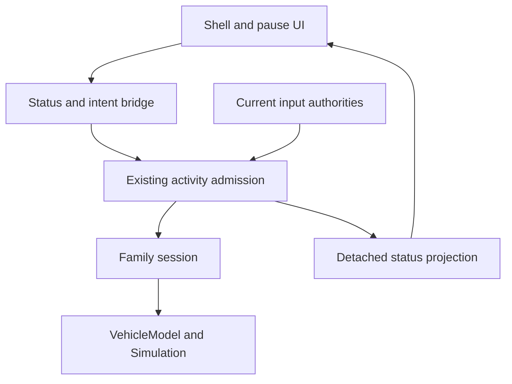

# OpenRC Simulator — consolidated repository and vehicle-runtime plan

**Updated:** 2026-11-28 (America/Bogota). **Status:** the original controls cohort remains open; section 6.1 tracks the bounded native/recording consolidation cohort. **Coordination steps:** VRC-00…VRC-11 and their named repair substeps. Existing D6/UI/DR/HELI/BL/RCV/AS/AE/AC/TELEM/PT/VQ/DT owners retain their implementation and acceptance authority.

**This is the single execution and dependency plan for repository consolidation on this branch.** It absorbs the refined controls/VRC proposals and the vehicle/repository unification audit. Dated branch reports retain evidence, counterexamples and detailed contract definitions; they are not parallel execution plans. Domain specifications retain their technical gates and domain status, linked from the work packets below. VRC status is maintained only in section 6; this document does not create a replacement feature-ID namespace.

| Identity | Scope |
| --- | --- |
| Planning source baseline | `2bfb4dc7b6176a643a0a31d020a5c9f75571a024` on `main`; application tree `1fd33c6016fd0f6b117c3736b26f4c134808d08b` |
| Publication main check | `0f859b5f358f4807877ec8bd7fe8009bc3856d3f`; same application tree as planning main. TA22-R01/O01 telemetry source repairs landed during review; see section 10.7. |
| Current audit branch before reconciliation | `e6dc52ddbf74ed0e421e4d6e0bc305d874c92b7e`; documentation is integrated here without importing the other branches' runtime code |
| Refined controls delivery | `3095afd95220232e8e659d53635acab5104ee94c`, containing the `2e812ef2b8184733f7dd45b7bfd50e119c5ae82c` adversarial refinement; supersedes initial proposal `542d92b304fc3b82678c4a90b848a88d82df0b22` |
| Historical controls runtime baseline | `57abea025f62b20233ca281d58d2acbee4ab8b8e`; old receipts remain bounded to that source |
| Vehicle/repository source audit | [U01–U10 and R01–R17](../research/vehicle-system-unification-2026-11-22.md), originally at `7940a4081e10994f34c858c4acac3d7a1a271464`; [inventory and branch reconciliation](../research/vehicle-system-unification-2026-11-22-source-inventory.json) |
| Acceptance definitions | [C01–C40](../research/vehicle-system-unification-2026-11-22-control-cases.json), preserved byte-for-byte from the refined controls delivery; all executions remain UNRUN |

**Read first:** sections 1–9 preserve and reconcile the accepted controls design; section 10 resolves branch precedence and new cross-branch findings; section 11 maps the whole consolidation backlog to surviving owners; sections 12–14 define integration order, acceptance and retirement. Start with the real fixed-wing PauseMenu/Continue characterization and separately owned repairs; unrelated display, Creator, contract and tool work may proceed on disjoint paths. Optional runtime concurrency follows measured benefit and correctness of its touched boundary.

**Priority:** preserve and improve player control, truthful publication and reliable evidence while reducing duplicated rules. Keep the existing float64 240 Hz kernel and family laws. A successful extraction removes an independent decision/body from actual consumers; a contract or provenance repair can complete without production deduplication. No speedup, repaired gameplay, hardware compatibility or release readiness is implied by publication of this plan.

## 1. Engineering decision

Retain the existing float64, 240 Hz `Simulation`, `VehicleModel`, aircraft v2 contract and `AircraftModules` registry. The opportunity is narrower coordination between the shell, activity and input owners. A second simulation engine, universal vehicle base class, capability registry or checkpoint format would increase risk.

The first implementation should characterize the existing **fixed-wing PauseMenu controller-status/recovery display and Continue chain**, while prioritizing confirmed controls repairs in their owners. A flat controller-attention projection is a concrete candidate extraction only if it removes a named duplicated decision or dependency; otherwise retain the current reads. The existing signal/Continue chain can be the minimal intent boundary when proven sufficient. An added origin-bound wrapper is conditional, and must preserve the full shell/activity/session gate: fixed-wing Continue includes AppRoot and screen-stack checks; airship and quad have activity checks. A session's `resume()` alone is not the full gate. A detached UI snapshot is information, never permission to fly.

At the historical controls baseline `57abea025f62b20233ca281d58d2acbee4ab8b8e`, `flight_session.gd` has 6,697 lines, `app_root.gd` 5,337 and `main.gd` 4,303. The [reproducible inventory](https://github.com/bultodepapas/OpenRCsimulator/blob/3095afd95220232e8e659d53635acab5104ee94c/docs/research/vehicle-runtime-consolidation-2026-11-21/SOURCE-INVENTORY.md) treats these as inspection scope, not measured duplication, complexity or performance defects. Extract only a demonstrated seam; leaving a correct responsibility in place is an acceptable outcome.

Success requires:

1. Every configurable binding has a truthful path from assignment and Save/activation through live dispatch, accepted commands and visible feedback. Fixed controls retain their documented direct route.
2. Device loss, focus changes, failed saves and interrupted operations preserve the family's policy and give the player a reachable recovery path.
3. One authority decides each input role, profile, readiness and transition. Helpers do not create competing caches or safety state machines.
4. Structural changes preserve accepted commands, state, event order, replay identity rules and resource lifetime. Intentional behavior repairs are separate changes.
5. Response quality is measured at input and live-player boundaries. Post-conditioning replay and callback counts cannot certify those boundaries.

## 2. Existing owners and protected contracts

| Authority | Required treatment |
| --- | --- |
| [Simulation](../../app/sim/simulation.gd), [VehicleModel](../../app/sim/vehicle_model.gd), [STACK](../STACK.md#boundaries-and-data-flow) | Keep the installed-model boundary, float64, 240 Hz, atomic tick, accepted frame, events, checkpoint and rollback. No vehicle switch in the kernel. |
| [Aircraft contract](../AIRCRAFT_CONTRACT.md), [AS plan](aircraft-standardization.md), [AircraftModules](../../app/physics/aircraft_modules.gd) | Keep schema, capability admission, derivation and generated sources with AS and aircraft owners. Specialized vehicle schemas stay distinct. |
| [Controller plan](controller-support.md), [Controls UX](controls-setup-ux.md), [player guide](../FIRST-LAUNCH.md#controller-settings-current-source) | D6/F1/F3/F4/F6 and UI own input, role selection, persistence, actions, setup and qualification. Preserve accepted gamepad/radio differences. D6-UX-02 keyboard remapping remains separately pending. |
| Activity and family owners | The current activity **and** session together own readiness, admission, reset, crash, race, recorder and recovery. Trace the actual call chain before extraction. |
| [Native policy](../STACK.md#native-backend-policy), [flight logging](../FLIGHT-LOGGING.md) | Preserve actual backend/source identities, reference selection, numerical/fault/package gates and family replay contracts. Native orchestration is not an automatic migration goal. |
| [Optimization priorities](optimization-priorities.md), [verification scope](../tools/shared.md#verification-scope) | PT/VQ/NK retain measurement gates. Required CI and target-platform checks remain separate from focused local results. |
| [Track registry](../README.md#tracks-plans-and-step-ids) | VRC coordinates this plan; it does not acquire another track's implementation authority or duplicate its status. |

A pure restructure must not change accepted state bytes, inputs, event order, random state, clock, profile meaning/storage, UI control meaning or resource ownership. Preserve exactness where the existing contract guarantees it, with matching engine/backend configurations. Source moves can legitimately change solver fingerprints: retain identity rejection and use the documented candidate workflow, rather than falsifying identity to obtain exact replay.

## 3. Minimal target boundary

This is a dependency proposal, not an implemented common API. The [concrete first consumer](https://github.com/bultodepapas/OpenRCsimulator/blob/3095afd95220232e8e659d53635acab5104ee94c/docs/research/vehicle-runtime-consolidation-2026-11-21/IMPLEMENTATION-BLUEPRINT.md#3-first-consumer-fixed-wing-pausemenu) has a retain-or-extract decision: keep current reads by default; create `app/ui/fixed_wing_pause_controller_status.gd` only if the flat controller-attention subprojection removes real duplication/coupling. Other status fields, helicopter/fake compatibility and current Continue dispatch stay in place. A new private AppRoot intent wrapper is optional; proof of the existing or changed full boundary is required. Do not count a passing subprojection as the entire VRC-01/04 scope.

### Status and request rules

- **Status is advisory:** derive it from current owners, detach mutable values and bind it to the activity identity. Show operation support separately from readiness, active holds and recovery actions. Unavailable backend/identity/status fields are explicitly unknown or unsupported. Recompute operational availability when relevant profile/model state changes.
- **Intent carries no authority:** captured context is diagnostic or an expected-identity guard. The current activity/input owners revalidate role, connection generation, relevant profile/mapping identity, focus/capture and family readiness when processing the request. Cached zero sticks or a prior `ready=true` cannot authorize resume.
- **Preserve ordering:** an owner that yields, awaits or defers revalidates after that boundary. Reject late work for a retired activity. No tick is granted before the existing gate completes, including shell hold release and held-key masking.
- **Honest results:** distinguish unsupported, refused, accepted, and accepted-with-postcommit-fault where the owning transaction supplies that distinction. Do not relabel a committed observer fault as rollback. Pending is valid only for a real asynchronous operation with defined completion/cancellation.
- **No universal readiness:** verified gamepads retain first-valid-poll readiness; radios retain applicable event/LOW and action-OFF rules, with current roll/pitch center evidence additionally gating applicable launch/Continue/restart when the same verified radio owns flight and menus, including mouse/keyboard invocation. OFF/rearming gates radio command actions only; it is not an extra mouse/keyboard Continue predicate. Helicopter collective, airship low throttle plus centered yaw, quad arming/rate recovery and ground neutral/armed rules stay separate.
- **Preserve radio evidence:** ordinary unverified polls cannot invent fresh current-generation LOW/OFF or center evidence. Retain the existing explicitly trusted same-generation verification-challenge seed; stationary sticks or sparse value-change events alone do not establish disconnection.
- **Preserve explicit player intent:** Continue remains explicit for the applicable recovery route. Existing guarded Fly and restart actions may already provide the explicit intent; do not add an unnecessary second Continue or accidentally auto-resume after loss.
- **No new tick caller:** UI/bridge never call a generic `tick_once`, mutate simulation state, resample inside solver stages or infer authority from a rendered view.

The [control contract](https://github.com/bultodepapas/OpenRCsimulator/blob/3095afd95220232e8e659d53635acab5104ee94c/docs/research/vehicle-runtime-consolidation-2026-11-21/CONTROL-CONTRACT.md) owns the proposed detailed invariants. The [acceptance matrix](https://github.com/bultodepapas/OpenRCsimulator/blob/3095afd95220232e8e659d53635acab5104ee94c/docs/research/vehicle-runtime-consolidation-2026-11-21/CONTROL-ACCEPTANCE.md) defines expected outcomes and existing test starting points; all new case executions remain pending.

### Deferred operations

Reset, restore, prepare/reload, exit, recorder finalization and disposal stay on current family routes in phase one. Common names do not imply common transactions. Migrate one only after its complete prepare/refuse/commit/fault/cancel behavior is characterized; preserve family envelopes. Fixed-wing refusal can retain its old recording, but airship/quad reset can notify recorders before a later refusal. Cross-family equivalence requires evidence or a separate behavioral repair.

An idempotent disposal helper releases already-retired resources; it must not bypass unsaved recording/result decisions, abandon worker ownership, close a temporarily detached flight's recording, clear another activity's listeners or report a failed save as success. Preserve cancellation and retry. `close()` is not an unconditional public escape hatch.

## 4. Controls baseline and defect dependencies

The historical [prior controls audit](https://github.com/bultodepapas/OpenRCsimulator/blob/3095afd95220232e8e659d53635acab5104ee94c/docs/research/game-controls-audit-2026-11-21/AUDIT.md) identifies five unfixed baseline defects. Its checked synthetic witnesses demonstrate the adverse behavior, not a repaired pass. Its existing regression batch was **22 passes out of 27, with five failed/incomplete**; it was not full CI, native display or physical controller certification.

| Finding | Existing repair owners | Blocks the affected migration until repair and proof |
| --- | --- | --- |
| GCA-01: admitted quad Pause binding not dispatched | DR-14/16, UI-15-GP-01, action owners | VRC-05 quad action routing, or VRC-03 changing that shared dispatch seam |
| GCA-02: airship native menu map retains stale UI ownership | BL-10/12, UI-12-GP-01, F3-GP-02 | VRC-05 airship menu/role bridge and shared role-map changes |
| GCA-03: airship Continue does not retry temporarily refused uncached profile | BL-10, F3-GP-02, D6-GP-02 | VRC-05 airship resume/profile path and shared resolution/recovery changes |
| GCA-04: concurrent legacy calibration updates can be lost | D6-GP-02, fixed-wing/HELI calibration and AUX owners | VRC-03 or VRC-02 moving the affected legacy writer, caller or storage transaction |
| GCA-05: tiny admitted external ranges give incorrect endpoints | D6-GP-02/03 | VRC-03 moving profile validation, normalization or readiness |

Further source inspection identifies **unexecuted scenarios and design gaps**, separate from those five confirmed defects: partial or unobserved save restoration, stale same-profile drafts and independently changing menu preferences, incomplete legacy gamepad-smoke migration, and old-origin deferred work. The [blueprint](https://github.com/bultodepapas/OpenRCsimulator/blob/3095afd95220232e8e659d53635acab5104ee94c/docs/research/vehicle-runtime-consolidation-2026-11-21/IMPLEMENTATION-BLUEPRINT.md#5-one-persistence-authority-with-explicit-failure-outcomes) defines proposed discriminating checks and owner-scoped repairs. They are not new reproduced gameplay findings. Do not migrate an affected invariant under a stronger guarantee until its required witness and repair exist.

**Current reconciliation:** source inspection at `2bfb4dc7b6176a643a0a31d020a5c9f75571a024` still finds all five causal paths. Their old adverse witnesses have not been rerun here; C01–C40 remain UNRUN. Current anchors: [quad Pause](https://github.com/bultodepapas/OpenRCsimulator/blob/2bfb4dc7b6176a643a0a31d020a5c9f75571a024/app/input/multirotor_input.gd#L233-L251), [airship UI map](https://github.com/bultodepapas/OpenRCsimulator/blob/2bfb4dc7b6176a643a0a31d020a5c9f75571a024/app/vehicles/airship/airship_scene.gd#L922-L923), [airship resolver/recovery](https://github.com/bultodepapas/OpenRCsimulator/blob/2bfb4dc7b6176a643a0a31d020a5c9f75571a024/app/vehicles/airship/airship_scene.gd#L384-L608), [legacy writer](https://github.com/bultodepapas/OpenRCsimulator/blob/2bfb4dc7b6176a643a0a31d020a5c9f75571a024/app/input/rc_calibration.gd#L327-L374), and [range admission/normalization](https://github.com/bultodepapas/OpenRCsimulator/blob/2bfb4dc7b6176a643a0a31d020a5c9f75571a024/app/input/controller_profile.gd#L523-L640). Section 10 separates already integrated older controls/FPV repairs from these open findings.

VRC-00 records all five with pinned witnesses and disposition. An unrelated status/lifecycle slice can proceed if it demonstrably leaves the affected seam untouched and its own checks pass. A vague “repair decision” cannot waive an invariant in the path being migrated. Fixes remain separate owning-track changes with repaired regression witnesses; expected baseline failures must not become the permanent contract.

Other open baseline gaps are first-post-gap tick safety, per-activity launch/menu support, quad held fallback policy and physical/platform/package qualification. GCA-G1 is an investigation, not a confirmed sleep defect: distinguish a processing gap from stationary sticks/sparse HID events, observe the real first post-gap tick and then decide the family's policy. Scheduling/recovery changes require this evidence; an unrelated status bridge need not redesign watchdogs. No RF-loss detector is assumed.

## 5. Family scope and player-facing policy

| Family | Preserve and qualify |
| --- | --- |
| Fixed wing, first | Capability-driven airplane differences; calibration, holds, start, crash, native and AUX gates. Select actual catalog fixtures covering the changed conventional electric/glow/turbine/flap/retractable/elevon capabilities; one model may cover several. Shared input changes also exercise affected consumers outside the first UI migration. |
| Helicopter | Activity/session ownership, collective, arm/hold/cut precedence, trainer/curve, native guard, rotor state and own recorder/checkpoint. |
| Airship | Activity live armed check before resume, **low throttle and centered yaw**, reversible stern motor, unresolved-profile retry, native menu role clearing, tapes/recorder. Radio Pause does not establish verified radio-menu support. |
| Multirotor | Activity source/generation/readiness gate, once-per-tick FC sample, arm/disarm, ordinary same-source frozen rate throttle versus recovery reset, race outbox/tape limits. Existing automatic fallback may select another connected controller while held; preserve invalidated arm continuity. Identifying that source before Continue remains an owner-qualified GCA-G3 acceptance item. A paused stored frame can stay armed until the first resumed tick disarms; changing this is separate behavior work. |
| Ground, optional later | Neutral/armed recovery, pause holds, damage/course identity, backend mismatch, interrupted export and unsaved recording decisions. No aircraft assumptions. |

Home, direct launch and Workshop trial are separate matrix entries where implemented. Record offered bindings, menu support, recovery route and first accepted tick. Preserve direct/standalone paths that do not use `ControllerService`, including their legacy profile resolution. Unsupported features must be explained before a misleading assignment or launch. Keyboard/mouse recovery stays available where provided; all keyboard flight keys are not yet remappable.

## 6. Step plan and independent changes

The original implementation steps remain **open** unless explicitly scoped below. This section owns status; dated evidence defines results and limitations, not a second execution plan. The historical C01–C40 controls cases are not reclassified by unrelated native or packet work.

| Step | One reviewable deliverable | Dependencies and owners | Required proof |
| --- | --- | --- | --- |
| **VRC-00** | Freeze source, materialized assets/imports, catalog, test roster, input routes and all five GCA dispositions; establish comparable baseline. | SF/AS/UI/D6/families; first | [Q0](https://github.com/bultodepapas/OpenRCsimulator/blob/3095afd95220232e8e659d53635acab5104ee94c/docs/research/vehicle-runtime-consolidation-2026-11-21/QUALITY-GATES.md#q0-baseline-and-test-admission). Classify prior unqualified suites and obtain decisive evidence for affected routes. Missing resources cannot become a pass. |
| **VRC-01** | Characterize the **different existing** status/admission surfaces, fixed-wing PauseMenu and its Continue chain; decide whether a controller subprojection removes a named decision/dependency. | After 00; UI/session/input | [Q1](https://github.com/bultodepapas/OpenRCsimulator/blob/3095afd95220232e8e659d53635acab5104ee94c/docs/research/vehicle-runtime-consolidation-2026-11-21/QUALITY-GATES.md#q1-controls-and-transition-contract): advisory facts, unknown/unsupported, holds, live gate, stale origin and no writes. Characterize the required contract even if no extraction is justified. |
| **VRC-02** | Isolate one useful fixed-wing preparation/validation/lifecycle helper; retain candidate/commit/observer owners. | After 00/01; physics/FL/GP/EL; relevant GCA-04 dependency | [Q2](https://github.com/bultodepapas/OpenRCsimulator/blob/3095afd95220232e8e659d53635acab5104ee94c/docs/research/vehicle-runtime-consolidation-2026-11-21/QUALITY-GATES.md#q2-state-replay-and-lifetime): refusal, accepted start, postcommit fault, recording/stats and exactness. If unsafe to separate, retain the owner and extract a smaller pure validator. |
| **VRC-03** | Extract one input coordination seam after affected baseline defects are repaired. | After 01/relevant GCA closure; D6/F3/UI/all affected consumers | Q1/Q2: event→poll→first accepted tick, radio/gamepad differences, finite ranges, shaping, capture, AUX, storage and recovery. No optimization mixed with extraction. |
| **VRC-04** | Prove the fixed-wing PauseMenu consumer and existing intent boundary; extract controller facts or add an origin wrapper only when justified. A retain decision is valid. | After 01; 02 only if this seam uses its helper; UI/session | Q1/Q2 plus [Q3](https://github.com/bultodepapas/OpenRCsimulator/blob/3095afd95220232e8e659d53635acab5104ee94c/docs/research/vehicle-runtime-consolidation-2026-11-21/QUALITY-GATES.md#q3-player-flow-and-device-qualification): real UI, covered/trial-return/fallback behavior, guarded player intent and holds. A status-only pass does not qualify an unproven intent contract. |
| **VRC-05** | Migrate helicopter, airship, then quad in separate PRs only if beneficial. Ground requires later explicit scope. | After 04/affected GCA repair; HELI/BL/DR/UI/D6 | Family admission, recovery and recording. One family's pass cannot qualify another. Reset/restore/exit stay unchanged unless separately included/proven. |
| **VRC-06** | Share a pure field/environment builder after proving equivalence for two actual consumers. | After 00/specific characterization; LU/SC/GP | Q2: weather/terrain/obstacle identity, ordering, lake/contact rules and native selection. Optional; does not block a complete controls repair. |
| **VRC-07** | Isolate observer subscription/retirement discipline; keep recorder schemas and exit policy. | After the specific owner is characterized; FL/UI-FS/AUD/session | Q2: refusal vs committed fault, reentry, reset/relaunch, pending save, abandon and complete retirement. |
| **VRC-08** | Simplify one view coordinator with detached data and an owned HUD/camera component. | After corresponding seam, not all family moves; HUD/render/UI | Q1/Q3: immutable projection, truthful EN/ES prompts, focus/capture, actual display target and resource isolation. |
| **VRC-09** | Profile one complete workload and attempt one attributed optimization. | After 00/correctness of touched path; PT/VQ/NK/owner | [Q4](https://github.com/bultodepapas/OpenRCsimulator/blob/3095afd95220232e8e659d53635acab5104ee94c/docs/research/vehicle-runtime-consolidation-2026-11-21/QUALITY-GATES.md#q4-response-and-performance): paired runs, input age/order, accepted commands, tail latency, memory and hardware scope. Fewer callbacks is insufficient. |
| **VRC-10** | Document/normalize only migrated seams; add a narrow dependency check if a demonstrated risk warrants it. | After specific moves; their owners | Imports, UIDs, scene/export dependencies and references. No mass rename, second registry or generic framework. |
| **VRC-11** | Qualify the selected migration cohort and publish supported/limited/unqualified scope. | Relevant required steps, not every optional extraction; QA/DT/UI/D6/PT | [Q5](https://github.com/bultodepapas/OpenRCsimulator/blob/3095afd95220232e8e659d53635acab5104ee94c/docs/research/vehicle-runtime-consolidation-2026-11-21/QUALITY-GATES.md#q5-promotion-and-rollback): affected checks, required CI, source/package/device/pilot evidence and exact claims. No silent safety waiver. |

Order: **baseline → minimal contract → one fixed-wing consumer**, with separately owned defect repairs before their affected migration. Expand after that seam proves useful and qualified. VRC-06…09 are conditional improvements; controls quality must not wait for a broad rewrite.

### 6.1 Native and recording consolidation cohort — 2026-11-28

Continue the existing `audit/vehicle-system-unification-2026-11-22` branch at `023043b78daef10b0fc4f746ec83e7c41bf51d17`, preserving its four audit commits and canonical plan. Merge pinned main `8d4169f8febfd7d78a028eaa817414217a54f24b` normally. Merge `c7b5c3db279b2897e0c0d33d5123ba011abb8a7e` has both tips as parents; its product, research tooling and workflow trees equal main. The previous plan, audit, source inventory and forty control cases are byte-preserved. Other worktrees and their uncommitted work remain untouched.

| Source branches / commits | Reuse and conflicts |
| --- | --- |
| This branch: `b9e2a3ffd`, `f9b727dd1`, `e6dc52ddb`, `023043b78` | Retain U/R findings and refined controls obligations. Eighty of the original 839 application scripts changed on current main; revalidate touched mechanisms. |
| Main `8d4169f8`; native roadmap `e439f667`; guard repair `5f4dbda4` | Authoritative implementation. Preserve completed native work and its qualified backend/reference policy. |
| `audit/swarm-physics-fps-2026-11-28` at `f104b39a`, based on `71306784` | Reuse dated probes. Its guard-alias timings predate the new bounded plan; standalone allocation/call counts do not establish production frame cost. No wholesale merge. |
| PRs [16](https://github.com/bultodepapas/OpenRCsimulator/pull/16), [17](https://github.com/bultodepapas/OpenRCsimulator/pull/17), [18](https://github.com/bultodepapas/OpenRCsimulator/pull/18), [21](https://github.com/bultodepapas/OpenRCsimulator/pull/21), [22](https://github.com/bultodepapas/OpenRCsimulator/pull/22) | Keep separate helicopter, physics, EDF, CI and graphics histories. Their branch-local implementations and historical passes do not qualify this candidate. |

The [dated evidence and adversarial review](../research/vehicle-runtime-consolidation-2026-11-28/README.md) records the ten assignments and objections. These steps refine existing owners; they do not create another kernel or family abstraction.

| Priority / step | Affected modules and change | Dependencies / risks | Acceptance and status |
| --- | --- | --- | --- |
| P0 · **VRC-00-R1** | Branch/source reconciliation and current baseline. | Resolve shallow ancestry, preserve original payloads and unrelated work. | **Source reconciliation complete.** Independently checked parents and no product delta from main. Runtime baseline remains separate. |
| P1 · **VRC-10-R1** | NK: one `StageConfig.pack_deflections` replaces seven encoders in `native_stage.gd` and electric/liquid/glow/prescribed adapters. | Preserve old/returned servo sampling, family order, mandatory fields, optional flap, fresh array and no-downwash empty packet. Old native receipts become stale. | **Planned; design independently reviewed.** Independent lane bytes, signed/absent flap, result isolation and real-caller checks; keep four-lane research/oracle ABI. Actual native parity requires a qualified installed build. |
| P1 · **VRC-07-R1** | FL: one bounded ORFL packet transport for fixed-wing, airship and multirotor recorders; retain public compatibility facades. | Family schemas, lifecycle, cleanup and replay verdicts remain separate. Preserve three ordered writes, one flush, cap equality and pre-footer chain. | **Planned; design independently reviewed.** Literal frames/chains, exact/over bounds, real filesystem-error characterization, three recording/replay consumers, no accepted-state change. Any inherited error repair is separately identified. |
| P1 · **VRC-09-R1** | PT/NK/FL: matched recording workload and focused packet/packing benchmarks. | Stable sources, actual backend, identical payloads, contention/noise; an extra helper call may cost more. | **Planned.** Repeated paired timings, dispersion, state/byte checks and explicit regression analysis. No FPS or target claim from helper timings. |
| P1 · **VRC-11-R1** | FL/NK/QA: source migration, affected consumers and integrated review. | All simulation-script bytes enter the solver fingerprint. Historical identity equality cannot be fabricated; preserve companion/native admission. | **Planned.** Checked regressions, meaningful mutation controls, same-tape comparison where supported, changed-source refusal, source-bound receipts and required CI before full automated qualification. |
| P2 · R08 / **VRC-10** | Native diagnostic source/export/package catalog. | Six general modes, four Mac-selectable modes, five experimental Mac files and the ordinary Mac probe differ; exporter bytes are bound. | **Deferred** until platform/provenance and omitted/replaced-case controls can be exercised. Nineteen install oracles remain a distinct contract. |
| P2 · NK | Contact, liquid/glow context, endpoint/audio and guard-root work. | Actual native answers, installer gates, parity and live measurements. | **Deferred to the [native roadmap](native-kernel-roadmap.md).** ABI deduplication does not complete NK-6y or establish its estimated savings. |
| P2 · Native admission | Late refusal after live configuration becomes read-only. | Refusal can happen during guards, install or initial context; moving one freeze does not repair the transaction. | **Unresolved.** Require a loaded qualified backend, late failure and alias/writability controls before changing behavior. |
| P3 · U05 / **VRC-06** | Independently proven environment primitives only. | Quad clearance projects onto `axis_ned`; airship assumes a vertical capsule. | **Reject whole-clearance consolidation.** A horizontal capsule gives opposite inside/outside results. Preserve family contact laws. |

The pinned Godot 4.8-beta2 is available locally. Production Linux native qualification requires GCC 13.3.0, SCons 4.10.1 and pinned godot-cpp; the host has GCC 14.2.0 and no qualified extension. Keep the lock. Reference tests, Python contracts and host-only C++ probes have their own scope. Required CI, installed native parity, platform packages, live target performance, pilot and physical validation remain distinct gates.

## 7. Acceptance, stop and rollback

Each implementation PR identifies touched seams, required case IDs, owners, fixtures/routes and expected results **before execution**. The [case ledger](../research/vehicle-system-unification-2026-11-22-control-cases.json) starts unrun. Existing test names are starting points, not proof that all scenarios are already covered. Extend the smallest meaningful real-consumer test where needed. Use the [checked runner](../tools/shared.md#one-godot-script), declared terminal summaries and complete diagnostic receipts.

When trajectory, tick input, physics or recording identity may be affected, or its owning gate requires it, first exact-replay the fixed-wing baseline on its matching recorded source/backend. If a refactor changes the fingerprint, retain exact-mode refusal and use the compatible candidate same-tape comparison with truthful `solver_changed`/backend reporting. Current candidate mode selects reference; native qualification needs separate actual native parity/selection evidence. Family tapes retain their own contracts; a pure status projection does not automatically require a flight campaign.

Stop an affected migration for stale authority, silent assignment/no dispatch, unintended thrust/action, lost acknowledged save, ambiguous commit state, unexplained input latency, missing required evidence or numerical drift. Resolve the issue in its owner. Independent status work may continue without declaring the blocked path safe.

Keep a baseline executable/package and profile copy for compatibility checks. Structural PRs leave profile formats unchanged. A version-changing repair defines old/new load and rollback before applying it: reverting source is insufficient if player data becomes unreadable. Revert one isolated migration, or temporarily retain an old route with a removal condition; do not maintain competing authorities indefinitely.

Quality means correctness, recovery, truthful setup, response, accessibility and pilot usability. Use the [controller qualification matrix](controller-support.md#hardware-matrix) and [Controls UX plan](controls-setup-ux.md). Source review alone cannot establish robust gameplay, physical compatibility or measured speedup.

## 8. Organization and saved controls

The historical [implementation blueprint](https://github.com/bultodepapas/OpenRCsimulator/blob/3095afd95220232e8e659d53635acab5104ee94c/docs/research/vehicle-runtime-consolidation-2026-11-21/IMPLEMENTATION-BLUEPRINT.md) supplies exact module responsibilities, proposed filenames, first-consumer callers, route/settings matrix, persistence outcomes and reviewable work packages. [Primary-source research](https://github.com/bultodepapas/OpenRCsimulator/blob/3095afd95220232e8e659d53635acab5104ee94c/docs/research/vehicle-runtime-consolidation-2026-11-21/PRIMARY-SOURCES.md) records API/platform facts, applicability and unavailable version-specific proof.

Retain the existing `app/input` validation/action/registry/service/store owners. Build one coherent player Controls workspace around them. Use `ControllerProfileStore` as the eventual single saved-profile authority for migrated routes, with a small service-free direct adapter only after legacy compatibility is proved. Keep unrelated preferences, recordings and session state with their owners. HUD stick mode is not a keyboard flight remap; current Save does not persist an explicit flight-device handle or all dirty profile drafts.

For the robust-save repair, recommend expected persisted-content comparison under the existing lease. Keep the same store instance's outer lease across snapshot → publication → activation → attempted restoration, or establish an explicitly verified expected-current-state alternative before restoring. An arbitrary later restore_snapshot must not overwrite another process's intervening acknowledged update. GCA-04 requires one cooperating file transaction covering both legacy calibration and smoke writers through read/merge/validation/publication. Lock ordering coordinates only upgraded/cooperating writers. Concurrent old writers require a proven compatible protocol or explicit exclusion; a new lock cannot make them participate. Prove that supported old readers observe a safe publication, or exclude them from a transition that could expose a missing/partial file. Legacy/V2 coexistence and conflicts must be declared before cutover. Full Controls Save reviews a changed durable menu-preference base as well as the target profile because it commits role intent; narrow calibration/smoke writes preserve the latest preference without implicitly adopting another process's role. Use actual stored bases, including association and legacy origin where relevant. A lease serializes writers but does not detect stale drafts, and different UUIDs can still affect the same association. Preserve conflicts for review. Keep original legacy data, account for gamepad-only smoke/import errors, and define old-reader/writer coexistence before cutover.

The [action-consumer inventory](https://github.com/bultodepapas/OpenRCsimulator/blob/3095afd95220232e8e659d53635acab5104ee94c/docs/research/vehicle-runtime-consolidation-2026-11-21/action-consumers.json) records the 37 semantic action definitions, six AUX names and five bounded source examples. Other activity/route/form combinations remain uncharacterized. Require an actual consumer or an explicit current-activity refusal for every offered assignment; preserve valid other-family bindings. The quad throttle-cut offer is an unexecuted investigation scenario, separate from the confirmed GCA-01 Pause defect.

Managed Save attempts rollback; it does not guarantee that every restoration succeeds or is observed. Define publication, activation, role restoration and reconciliation outcomes, with real-caller feedback and no automatic resumption from an uncertain result. Preserve direct active-but-unsaved behavior until an intentional repair changes it. These are behavior changes in their owning tracks, separate from structural extraction.

## 9. Remaining evidence and implementation choices

- Do the real source/profile-change interleavings establish current authority before Continue and its first tick? Repair an unsafe owning gate before moving it.
- Which origin-bound callbacks actually need a guard? Reuse current object/generation evidence; a guarded projection alone does not retire all old callbacks.
- What does the real first post-gap tick do for each affected activity, and what policy follows from that evidence?
- Can each save/restore failure be observed and reconciled safely in both managed routes? Which legacy/version coexistence can be supported?
- Can a lifecycle extraction preserve actual transaction/recording behavior? If not, retain the owner and choose a smaller seam.
- Which physical routes, pilot evidence and packages qualify the release cohort? Missing evidence limits claims.

[Blueprint](https://github.com/bultodepapas/OpenRCsimulator/blob/3095afd95220232e8e659d53635acab5104ee94c/docs/research/vehicle-runtime-consolidation-2026-11-21/IMPLEMENTATION-BLUEPRINT.md) · [Source map](https://github.com/bultodepapas/OpenRCsimulator/blob/3095afd95220232e8e659d53635acab5104ee94c/docs/research/vehicle-runtime-consolidation-2026-11-21/organization-map.json) · [Inventory](https://github.com/bultodepapas/OpenRCsimulator/blob/3095afd95220232e8e659d53635acab5104ee94c/docs/research/vehicle-runtime-consolidation-2026-11-21/SOURCE-INVENTORY.md) · [Migration decisions](https://github.com/bultodepapas/OpenRCsimulator/blob/3095afd95220232e8e659d53635acab5104ee94c/docs/research/vehicle-runtime-consolidation-2026-11-21/MIGRATION-MATRIX.md) · [Quality gates](https://github.com/bultodepapas/OpenRCsimulator/blob/3095afd95220232e8e659d53635acab5104ee94c/docs/research/vehicle-runtime-consolidation-2026-11-21/QUALITY-GATES.md)

## 10. Cross-branch reconciliation and binding decisions

The branch survey recorded 76 remote heads and inspected metadata for 38 pinned relevant refs. Substantive review concentrated on the controls lineage, related audit findings and shared feature contracts below; this is not a claim that all 76 branches or all their runtime behavior were audited. The source inventory records the selection, exact heads and evidence. Branch names and a report's word “implemented” do not establish integration into main.

### 10.1 Which source wins

| Branch or source | Disposition in this plan |
| --- | --- |
| [Final controls delivery][controls-delivery], [adversarial refinement][controls-adversarial], [initial VRC proposal][original-vrc] | Adopt the refined 3095afd obligations once. Its plan/contract/case/blueprint content already incorporates 2e812ef. Initial blanket session/reset/close proposals are superseded. Keep historical receipts at their original source; 40 cases remain UNRUN. |
| Older controller-error-reset and PR1 integration branches | The draft-switch validation reset and its regression assertion already exist on planning main. Retain them; do not reapply old input/UI trees or treat old Workshop checks as current controls qualification. [Current implementation][draft-reset] |
| [FPV audit remediation on main][dr-main] | The 19 November 16 findings have recorded software repairs in the owning plan. Preserve them as regression obligations; physical/native/OS/performance gates remain separate. GCA-01 Pause and later F43 contact exclusion are distinct follow-ups. |
| [November 22 telemetry reports on main][telemetry-main] | At planning main 2bfb4dc, reports/compact evidence were integrated without production repairs. The publication delta in section 10.7 records the subsequently landed R01/O01 source fixes. Retain one TELEM programme, useful audit counterexamples and the remaining gates. |
| [Physics audit branch][physics-audit] | Separate branch-local repaired candidates from main. Review each relevant numerical/control change and its tests against the integrated base; do not import the entire branch or report its passes as main qualification. |
| [GOD TEST main audit][godtest-audit] | Carry M01–M06 and V2 acceptance into GOD-12/13, with exact evidence limits. R16 is an additional supervisor-identity repair, not a replacement for these findings. |
| [Graphics reconciliation][graphics-handoff] and [performance continuation][perf-r3] | Use the VQ-07h owner for output/calibration/recovery; collapse matching F07/A5 work into one packet. Retain bounded completed repairs, and carry only the specified residuals and loading defects forward. |
| [Selector][selector], [shared FPV][fpv-plan], [handheld][handheld] | Proposed feature contracts, not implemented functionality on planning main. Reuse the existing owners below; do not add a new manager to prepare for every future feature. |
| [Radio display][radio-plan], [attachments][attachments] | Branch-local increments exist, but their new runtime files are absent on planning main. Review them as candidates. Radio appearance does not prove hardware identity; the attachment preview does not establish fit, Parts UI or flight admission. |
| [Import closeout][import-closeout] and older import proposals | Preserve the existing parser/compiler/store/resolver pipeline. Main already verifies bound v2 definition-to-physics derivation; source resolution still does not authorize flight. The closeout documents are branch-local and their remaining eligibility/publication gates must be reconciled, not represented as a second library. [Current resolver][source-resolver] |
| Queue, impact-scoped testing and completed optimization branches | Existing admission, checked-runner and domain status remain authoritative. Reuse applicable fixtures and scoped completed work. A metadata review or old receipt does not justify reopening a repaired issue, weakening CI, or importing a branch wholesale. |

Planning main differs from the previous audit baseline: the application tree changed for paints/rendering and the cited GOD TEST runner gained Linux audio-output selection. Of the audit's 156 distinct baseline-cited files, 155 are byte-identical and the runner's identity-selection code is unchanged. The Linux audio delta must be included in benchmark configuration comparisons; it does not repair R16 or GOD-12 attribution/focus/drawability. Historical audit identity tables remain historical.

### 10.2 One control authority, multiple qualified consumers

Bring GCA-01…05, U02/U03 and the controls blueprint's save/activation/stale-editor work under the existing D6/UI and family owners. Repair each touched defect before extracting its seam. In addition to the table in section 4:

- Every offered semantic assignment must have an actual route/consumer or an explicit activity-specific refusal. Preserve other-family bindings and fixed controls. Future camera controls need a deliberately defined continuous-action contract; current press/hold actions are not already a gimbal API.
- Provider choice, device generation, profile resolution and action-context ownership belong to the current input authorities. Handheld/Steam and optional virtual EdgeTX integration must not install competing flight pollers or synthesize undocumented keyboard commands.
- Keep physical calibrated USB, virtual firmware output and telemetry-only observation as distinct routes. Process a channel through mixing/rates/expo once. Admit logical AETR only with checked mapping/sign/range/independent AUX; arbitrary surface mixes remain inspection-only. Replay consumes recorded accepted input, never a live helper.
- Apply uncertain raw-radio compatibility review only where proposed and justified. Preserve standard verified gamepad first-poll readiness, benign duplicate-arrival continuity and ordinary focus-return behavior. A new provider or appearance label cannot prove a saved calibration matches its representation.

The new telemetry ground-input attribution finding, TA22-R2-F02, reinforces the same authority boundary: AppRoot currently labels input from the shared flight selection while the car drives through its local registry. Derive a coarse privacy-safe input class from the actual activity's accepted source; do not expose device identifiers, change the car's driver selection, or use analytics as flight authority. Coordinate U02 menu-role repair separately: correct UI role and correct telemetry attribution are different consumers of current activity facts. [Current attribution][input-attribution]

### 10.3 Launch capture and cancellation require separate changes

U04's first extraction preserves the existing order: retain nonempty explicit entry arguments; drain Home preparation and recheck origin; resolve empty defaults and capture the departing Home at their current points; construct/configure the candidate, reading each preference at its existing configuration point; then publish or restore according to that route. An explicit argument must not be replaced by a later selection. UI-VS proposes a different observable contract: accepting Fly/Drive captures exact source/vehicle/skin revisions and settings before any await. Current car/airship/quad routes do not all do that. [Current handoff][home-handoff] [Selector contract][selector-contract]

Sequence this explicitly:

1. Characterize the actual route and fix relevant cancellation/role defects in their owners.
2. Perform U04 only if the smaller common handoff removes real duplication, preserving current semantics.
3. In a separate UI-VS behavior change, capture the immutable accepted launch tuple before waiting; revalidate its origin/content at commit. Candidate scene construction and publication still follow preparation drain.
4. Prove that later selection/content changes cannot silently substitute a different launch. Refuse or retain the exact accepted revision with usable recovery; preserve duplicate-launch exclusion and the previous Home's focus/resources.

Performance F46/F47 strengthen the cancellation obligations: a launch can clear a pending Home rebuild, and a later Home-drain wait can reach helicopter construction without another cancellation check. Keep the latest required Home generation, drain owned jobs, and recheck after the actual await before constructing a new candidate. Their historical controlled witnesses must be rerun on the implementation candidate; they do not establish that every normal launch fails. [Current cancellation boundary][loading-boundary] [Dated findings][perf-loading]

### 10.4 Share accepted presentation facts, retain each family's final publication boundary

Radio LCD and shared FPV OSD are planned consumers of overlapping instrument values. Reuse existing numeric formatting, units, battery/alert helpers and current overlay ownership where semantics match. Add small detached family projections only when the actual consumers are integrated; the fixed-wing snapshot assumes aircraft/session fields and is not a ready-made cross-family object.

A projection should identify source/session generation, accepted tick/time, measurement kind/instance, unit/datum, availability and provenance. Valid zero is distinct from unknown or stale; home altitude is distinct from AGL, and supplied airspeed is distinct from an inferred firmware/GPS value. No fabricated RSSI, cell count or hardware capability. Keep opt-in app analytics in app/telemetry separate from onboard instruments and camera state.

Use the family's final accepted publication point. Ground can restore its kernel checkpoint after telemetry/damage checks, so provisional Simulation.stepped cannot drive a supposedly accepted gimbal update; the session emits tick_advanced only after those checks. A camera failure must not roll back committed physics. Preserve a single activity-owned final camera writer and the already drawn/interpolated pose. Formatting cadence does not set camera-input cadence, and brief committed alerts need bounded retention rather than disappearing between display polls. [Existing overlay boundary][overlay-values] [Ground final publication][ground-publication] [FPV instrument contract][fpv-instruments]

### 10.5 One catalog view and one source pipeline; distinct identities

UI-VS should project the existing VehicleRoster/family catalogs plus owner-admitted Creator entries. Keep aircraft-only catalogs and solvers aircraft-only. Use stable source/vehicle/revision/skin IDs and explicitly admitted launch adapters; labels, row positions, archive-supplied scripts and a claimed ready flag are not authority. A simple ID map and sorted arrays are adequate until a measured need proves otherwise.

Preserve separate focused, desired, effective selected, pending-preview, displayed-preview and accepted-launch identities. A stale thumbnail or incomplete index must not overwrite a remembered selection. Reuse Home's bounded active/latest request ownership; a generation token suppresses stale publication but does not cancel, collect or bound worker memory. R04 fixes aggregate Creator ownership before shared cancellation work, and R07 retains preview-versus-thumbnail policy.

Attachments, decals, lights and smoke extend the existing Workshop profile/store/bundle/trial and generated proof system. Allocate versions with all readers before changing the shared presentation validator; its source is part of fleet-wide proof pins. Prepare complete visual candidates with private mutable materials and publish only after validation. Preview/save/import purposes must stay explicit because thumbnail and bundle paths also invoke Trial.freeze; preview-only admission must never escape through an alternate flight/CLI entry.

Keep physical tires, floats, mounting mass and aerodynamic effects in validated AS/GP/family installations. A visual attachment is not a physical model. R17's model-overlay registries are different from HUD overlays and remain deferred unless a justified proof migration covers both actual families, saved identities, generators and packages. [Selector metadata][selector-catalog] [Attachment migration][attachment-migration] [Current source admission][source-resolver]

### 10.6 Merge duplicate work items, preserve distinct repair gates

| Existing owner / evidence | Consolidated action and precise boundary |
| --- | --- |
| DR-07/09a/21; performance F37 and physics R2-F02 | One Angle-mode continuity review. The reduced-attitude v3 implementation is branch-local; inspect equivalent quaternion signs, seam/antipode policy, mode entry/reset and stock closed-loop recovery. Preserve law and replay versioning. |
| DR rates/import; physics R7-F01 | Review the branch's BETAFLIGHT expo-domain repair through the existing rates pipeline. Main still admits an unlimited expo; the historical synthetic value 200 reverses partial-stick response. Test 0/100/101/200, both signs, import/reload, recoverable old files and active-flight refusal. This is not a claim about a stock profile or compliant firmware export. [Current domain][rate-domain] |
| HELI-20/H06; R5-F01 and R8-G01 | Reconcile trim-before-feasibility and premix/postmix arming checks as separate numerical/control repairs before moving their affected gates. Candidate code on the audit branch is not main integration or native parity. Keep historical X-Cell evidence separate from HX-700 qualification. |
| DR-19/24/09b; later F43 | Prove conservative complete-footprint/swept terrain exclusion or refuse unsupported geometry. The current center-clearance shortcut affects force, strict and graded paths. Keep the earlier repaired A07 work; add the later custom-ramp/overlapping-start counterexample and positive controls. |
| RCV dynamics/GP/NK; R9-F01/F02 | Review wall-load composition before constrained tyre/brake reactions, then prove or remove the heading-dependent rest shortcut. These are separate current-source mechanisms with bounded historical witnesses. Preserve feasible braked/no-wall controls, yaw invariance, numerical refinement, reference/native parity and replay. RCV-12 already owns shaft/body momentum; do not create a second nitro project. |
| GP/contact owners; performance F02 residual | Preserve the repaired comparator/permutation example. Review global-earliest anchoring across per-obstacle reduction and define time-error metadata; use complete contact/first-hit permutations before changing shared arbitration. |
| TELEM-08/09 and existing completion owners; TA22 | Retain the newly integrated integral-float and machine-health warning repairs and their scoped regression evidence (section 10.7); next address the documented remaining context/epoch/accident/pause/queue and receiver/operations packets. Coordinate TA22-R2-F02 with activity-source facts. R13's edge consistency is an additional small invariant, not a substitute for this programme. |
| GOD-12/13; M01–M06 | Correct phase attribution, independently justified drawability and explicit Wayland focus eligibility before affected measurement claims. Retain V2 takeoff/scenic/roll/crash/aftermath qualification as open work. R03 checked execution, R10 implementation identity and R16 supervisor identity remain distinct packets. |
| VQ-07h A1/A5; performance F07 | One output/workload/calibration identity effort. Make unknown CPU/interval timing non-promoting while retaining defensive downshifts; segment acquisition across relevant workload changes; use consistent identity for reuse and High veto. Removing a stale veto alone must not promote quality. Shared achievable output must drive policy and actual window application. |
| UI-34c/DT-11a; F46/F47, U04 and UI-VS | One integration owner for loading/cancellation/handoff files, with separate behavior repairs, parity extraction and accepted-intent change. R04 and UI-VS share bounded-lifetime principles without sharing every scheduler. |

Primary evidence and exact limits: [physics branch status][physics-audit], [Angle and contact findings][perf-r2], [R9 vehicle evidence][cars-r9], [telemetry remediation][telemetry-remediation], [GOD TEST audit][godtest-audit], [graphics handoff][graphics-handoff]. These rows select repair/integration work; their local audit severities and historical counts are not a combined current bug count.

Retain completed work. The older FPV nineteen, controller-field styling repair, original graphics size/reversal/calibration-reset fixes, selected performance comparator/restore/view/cloud repairs, and earlier bounded cache work must not re-enter the backlog merely because an older branch still lists the baseline issue. A later residual requires its own trigger and acceptance.

### 10.7 Publication-time main update: retain two newly integrated telemetry repairs

Main advanced from 2bfb4dc to 0f859b5 while this plan was being reviewed. The nine changed paths are confined to telemetry aggregation, operator health, their tests and deployment documentation; the application tree is unchanged. The earlier planning source and branch-head survey remain pinned historical observations.

- **TA22-R01 / TELEM-08:** commit 25c3736d3badd71e45eae5dcf140c93d9419fbf4 now normalizes already validated integral numeric metrics at GPU/vehicle/insight accumulation, including existing raw rows, while preserving original raw bytes and event identity. Retain this source-integrated repair and its new regression coverage; do not assign another implementation of it. [Current rollup](https://github.com/bultodepapas/OpenRCsimulator/blob/0f859b5f358f4807877ec8bd7fe8009bc3856d3f/services/telemetry/openrc_telemetry/rollup.py) [Current insight aggregation](https://github.com/bultodepapas/OpenRCsimulator/blob/0f859b5f358f4807877ec8bd7fe8009bc3856d3f/services/telemetry/openrc_telemetry/insights.py)
- **TA22-O01 / TELEM-20:** commit 0f859b5 now shares receiver warning/critical generation between the dashboard and machine health, carries severity/recovery detail, and preserves legacy receiver_issues titles for compatibility. This is an implemented example of consolidating one rule across two consumers. Retain the independent monitor's healthy/quiet/degraded coverage; actual notification delivery remains an operator qualification step. [Shared receiver alerts](https://github.com/bultodepapas/OpenRCsimulator/blob/0f859b5f358f4807877ec8bd7fe8009bc3856d3f/tools/telemetry/dashboard.py) [Independent monitor](https://github.com/bultodepapas/OpenRCsimulator/blob/0f859b5f358f4807877ec8bd7fe8009bc3856d3f/tools/telemetry/deploy/host/check_dashboard_health.py)

The commits report scoped Windows Python checks; this consolidation pass inspected their source diffs and did not rerun those checks or establish deployment/notification success. Retain the owning TELEM programme's broader admitted-payload-to-rollup property coverage and Godot bridge qualification: the added deterministic multi-release fixtures cover the reported numeric representations, not every admitted combination. [Current equivalence fixtures](https://github.com/bultodepapas/OpenRCsimulator/blob/0f859b5f358f4807877ec8bd7fe8009bc3856d3f/services/telemetry/tests/test_equivalence.py) Histogram edge constants, generator/schema and client parity test are unchanged, so R13 remains an additional semantic-consistency packet. The [current reference](https://github.com/bultodepapas/OpenRCsimulator/blob/0f859b5f358f4807877ec8bd7fe8009bc3856d3f/research/telemetry/reference.py#L18-L43) still imports generator edges; it is not an independent constants oracle. TA22 client context/epoch/pause/queue, input attribution and other receiver/operations work are not closed by these two commits. Preserve the current repair as baseline before applying the remaining packets.

## 11. Unified consolidation backlog by surviving authority

The U/R identifiers below are findings from the linked source audit, not new feature steps. The table defines disposition and integration ownership. Domain implementation status remains with its existing owner; VRC-00…11 status remains in section 6.

| Findings | Surviving authority and reviewable packet | Prerequisite / completion |
| --- | --- | --- |
| [U01], [U02] | Existing route selector and activity/input owners: repair argument-sensitive airship routing and actual Home-to-ground UI-role handoff. | Real argument combinations and Home handoff without injected local test roles; keep garage driver policy. Coordinate GCA-02 and TA22-R2-F02 without conflating them. |
| [U03] | ControllerService owns common candidate ordering and coherent store/device facts. | Explicit busy/unknown/ambiguous outcomes; retain family fallback/rearm. Remove the replicated quad ranking only after two actual routes use the accepted contract. |
| [U04] | AppRoot retains shell transition ownership; extract matching Home handoff mechanics if useful. | Section 10.3 order; separate F46/F47 repair and UI-VS immutable-intent behavior. Retain dedicated flight loader and its engine workaround. |
| [U05], [U06] | Existing scenery/session owners share pure lake/collision checks and only matching environment preparation. | Two actual consumers, refusal ordering, domain/terrain/weather/track/native identities. Keep family collision response and contact laws. Coordinate F02/F43/RCV changes only when touching those boundaries. |
| [U07], [R10] | FL packet transport and the one live flight-input implementation. | Exact packet bytes/failure injection and real recorder callers; family headers, checkpoints, events, finalization remain separate. Bind moved tool code to actual executed/frozen identities. |
| [U08] | Existing family transactions and recorder observers. | Characterize refusal versus committed fault and reset-before-refusal differences. Share observer mechanics only after a proven contract; no universal reset/close/checkpoint. |
| [U09], [R06] | Existing presentation owners: lens resource lifetime and suitable time/sky/field diagnostics. | Private resources, explicit clocks, accepted-generation retirement and real consumers. Policy, HUD data, optics and detached-versus-disposed behavior stay explicit. |
| [U10], [R14] | VehicleRoster/catalog admission and statistics-local label projection. | Duplicate/unknown/missing player-entry checks; no automatic discovery. R14 preserves raw historic scopes and fallback names and never rewrites stored identity. UI-VS adds a view, not another registry. |
| [R01], [R02] | Existing display persistence and startup reader. | Verified publication and truthful Keep/Revert; startup follows chosen transaction semantics. Coordinate VQ achievable output/recovery, preserve consent's distinct policy and real failure evidence. |
| [R03], [R08], [R09] | Checked tool execution, native qualification case declaration and engine-pin description. | Preserve admission and terminal diagnostics; one declared case roster with independent required coverage, named hash roles and snapshot-verified bytes. No shell-evaluated pin source. |
| [R04], [R07] | Creator owns bounded aggregate unfinished jobs; Workshop owns compatible bounds calculation. | Account for every submit/cancel/drain route; exact traversal behavior, preview fallback versus still rejection. Thumbnail async API is a later measured behavior change. |
| [R05], [R11] | Current controller UI and narrowly proven helper owners. | Migrate real callers, visible UI, radio overrides and dynamically dispatched uses before removing hidden nodes/obsolete bodies. R11 glow cleanup sequences with R12 in the same files. |
| [R12], [R15] | Domain-local pure primitives and existing physical-identity validator. | Preserve numeric/validation/error semantics. R15 removes only the already redundant generator ID recheck, with byte-identical outputs, checkout variants and real Workshop consumers. |
| [R13] | Existing telemetry generator plus independent semantic witness. | Ordered edges/units, edge ±1, sender classification versus receiver feasibility, fixed oracle, stored/report/insight meaning and v1/v2 compatibility. Coordinate TA22 repair packets, not another telemetry plan. |
| [R16] | GOD TEST supervisor/source identity, plus owner-specific snapshot contracts. | Bind actual loaded helper/transitive code and import timing; same-HEAD changed-byte negative case and explicit old-receipt policy. Share failure fixtures first; a copy helper is conditional on matching consumers. |
| [R17] | Existing model-overlay registry/proof owners. | Defer tiny-list deduplication until a justified proof-migration cohort; preserve literal closed-set oracle, missing resolver behavior, saved identities and all affected generated/exported proofs. |

### Conditional runtime optimization queue

Only select a candidate after profiling its real workload and verifying correctness of the touched boundary. The [source audit's candidate analysis](../research/vehicle-system-unification-2026-11-22.md#13-parallelize-preparation-only-where-ownership-and-dependencies-permit-it) supplies detailed current code and stop conditions.

| Candidate | Reuse / preserve | Admission and stop rule |
| --- | --- | --- |
| Cold collision preparation | Detached scalar preparation with current main-thread cache and final session owner. | Audit the full helper closure. Keep authoritative error/cache publication at its current point, a non-mutating speculative probe and synchronous fallback for undetachable inputs; stop if capture/revalidation/contention costs erase benefit. |
| Thumbnail freeze preparation | Existing trial/dependency identity and main-thread rendering owner. | Current request returns identity synchronously. Characterize any asynchronous caller contract; never move Trial.freeze wholesale off-thread without proving its dependencies safe. |
| Flag in-flight coalescing | Flag-local request owner and weak current subscribers. | First measure outstanding work. Two collectors do not prove two physical loads; preserve survivor/failure/drain semantics while deliberately updating implementation-count tests if needed. |
| Ambience duplicate cold synthesis | Existing PCM/seed and independent mutable player resources. | Only if contention warrants a bounded producer per seed; no lock through synthesis/join, preserve pause/detach/re-entry. Retain the simpler owner if lifetime complexity outweighs savings. |

Keep simulation stages, accepted tick and rollback serial; native evaluation remains in model callbacks. Keep glow's deadline pump, statistics' durable writer/delete fence, trace ordering/backpressure, economy latest-versus-ordered lanes and the dedicated scene loader's lifecycle separate. A generic job/cache/event manager is not a prerequisite.

## 12. One implementation order, parallel where dependencies permit

The controls path remains baseline → real fixed-wing contract → first consumer → justified family migration. Other domains can proceed independently. “Repair first” applies to the invariant being changed or used as evidence, not to every unrelated task in the repository.

| Cohort | Ready work | Required predecessor / what can run in parallel |
| --- | --- | --- |
| Baseline and reconciliation | VRC-00/01 controls characterization; select current source, actual routes, case IDs and owners. Reconcile candidate branch patches individually. | Source/plan work complete here does not close runtime VRC-00. Freeze each implementation candidate and its applicable fixtures before execution. |
| Immediate bounded repairs | GCA/U01/U02 in affected input routes; R01 display publication; R04 Creator admission; R03 checked execution; R16 current macOS helper identity; GOD-12 evidence defects when that path supplies acceptance. | Disjoint files can proceed independently. One editor owns each shared input/store/shell or runner integration. Remaining TELEM receiver/operations repairs are independent of the first controls consumer. |
| Small consolidation | R13 edge witness, R15 redundant check, optional R14 label helper; U07 transport or U05 pure check when two callers are characterized. | Relevant behavior repair precedes its extraction. These need not wait for all five vehicle migrations or all optimization campaigns. |
| First controls migration | VRC-04 with conditional status/origin extraction, then VRC-03/05 where justified and qualified. | GCA and save/compatibility dependencies apply only to touched seams. Inspect relevant branch-local DR/HELI numerical candidates before moving their gates. |
| Coordinated feature integration | UI-VS accepted launch; radio/FPV presentation; handheld provider contract; Workshop attachment/proof work. | Their feature owners retain acceptance. Integrate a bounded feature slice after shared authority is proven; avoid prebuilding frameworks for absent consumers. |
| Measured optimization and retirement | One VRC-09 candidate and stable-cohort VRC-10/11 removal/qualification. | Match actual source, engine, backend, audio, scene, workload and display configuration; use one admitted target workload. Retire replaced bodies only after accepted consumer evidence. |

### Exclusive integration boundaries

- AppRoot, shared input service/store, ControllerSetup and family recovery hooks have one integration owner. Controls, U02/U04, TA22 input attribution, UI-VS and F46/F47 may be developed in separate drafts but must be reconciled as one stable candidate.
- Display preferences, settings and Auto output/recovery/calibration changes share one UI/VQ integration sequence. Preserve player overrides, supported downgrade/restart and consent ownership.
- Creator admission, Home preview generations and Workshop thumbnails each retain their owner. R07 and an async-thumbnail change share files and must be sequenced.
- R10/R16 and GOD TEST changes share runner/source identities. CI case declarations, app/test.sh, export-plugin and workflow edits have one tooling integrator.
- Physical-ID corpus and generator changes have one AS/AE editor. Workshop profile/binding/proof versions, attachment/decal/light/smoke and eventual R17 proof work require a declared migration cohort, not concurrent independent version bumps.
- U05/U06/collision preparation and numerical contact work can share scenery/session files but require different acceptance. R11/R12 touch common glow files. Serialize overlapping changes and keep numerical repair separate from structural parity.
- Worktrees isolate source edits, not devices, preferences, caches or GPU/CPU contention. Test-pool/admission ownership continues through teardown. Performance, device and rendered acceptance on a host are not independent merely because branches differ.

### CI consolidation

Continue the existing PT1-CI programme. Its eight unit receipts plus parse receipt cover the runner's discovered set; runner and verifier share discovery, so an independently expected scope is still needed for heterogeneous CLI/runtime/replay/capture cases. Case identity includes command, arguments, environment, fixture, platform/backend and completion contract; the same filename can represent different obligations. Preserve automatic discovery of new unit tests, explicit oracle arguments, and the fixed-brake history prerequisite together with its dependent test.

Retain full capture and existing admission while qualifying the seven experimental visual groups against matched coverage/images/metrics. Correct R03 before relying on affected scenario success, and GOD-12 attribution/drawability/focus before stronger campaign claims. Use separate checkouts/profiles/output roots and an independent required case set. Measure critical-path time and runner minutes together. Existing configuration is not rollout qualification. [Owning CI plan](release-ci-efficiency.md)

## 13. Acceptance and status without duplicate ledgers

VRC-00…11 status is owned by section 6. Domain status is owned by the linked D6/UI/DR/HELI/RCV/TELEM/VQ/GOD/etc. records; this plan owns their consolidation dependencies and selected sequence. U/R/GCA/audit IDs are traceability, not additional completion counters. A historical branch result never silently becomes an integrated pass.

The retained C01–C40 JSON is the exact proposed definition set from 3095afd; every execution remains UNRUN. Select cases by actual changed seam, add discriminating owner tests where coverage is missing, and record candidate source/fixtures/engine/backend/routes and full checked outcomes. Do not execute every case for a label-only change, or infer a broad pass from a helper/fake/manual field injection. The full historical contract, quality gates and blueprint remain pinned references for detailed oracles; this plan supersedes their execution ordering.

For cross-branch additions, include these negative/positive pairs where applicable:

- Current versus stale source/profile/activity; selected versus foreign controller; real assigned Pause versus fixed Escape; benign duplicate versus genuine reconnection; held keys/AUX and explicit recovery versus accidental resumption.
- Publish success versus activation refusal and failed/unobserved restoration; same-profile stale edits versus independent changes; menu preference/association conflicts versus narrow writers preserving latest preferences; readable old data versus unsupported old writers.
- Accepted immutable launch versus later Home/content change; pending rebuild restored after cancellation versus successful departure; cancellation during actual drain versus no cancellation; no post-cancel scene construction.
- Accepted family tick versus provisional or rolled-back tick; valid zero versus unavailable/stale instrument data; distinct source clocks/units/datums; no camera/firmware double conditioning or physical-state mutation.
- Complete admitted trial versus visual-only source/attachment; Original → alternative → Original observer restoration; stale saved proofs versus explicit copy/rebind/refusal; every actual flight/CLI/bundle route.
- Original repaired examples versus the specified later residual; paired numerical controls, source/law versions, reference/native parity, rollback/replay and actual admitted-family reachability.
- Honest tool verdict versus missing diagnostics, wrong phase, forged/stale drawability transition, unproven Wayland eligibility, changed helper bytes with identical HEAD/dirty paths and insufficient resume provenance.
- Complete stable workload versus changed dimensions/internal scale/MSAA/device/pause; unknown timings cannot justify promotion; loss of an old veto alone cannot increase quality.

### Family replay and source moves

The source replay fingerprint traverses GDScript under physics, sim and failures plus selected additional sources. A helper move can legitimately change identity even if the required numerical behavior is unchanged. Preserve matching-source/backend/engine baselines and exact-mode refusals; use the supported fixed-wing/quad candidate workflows within their declared limits and qualify actual native execution separately.

For airship exact acceptance require complete && identity_match && exact && !solver_changed plus matching execution identity; ok or CLI exit zero is insufficient. A changed-source airship comparison needs a separately defined family-tape experiment because its public changed-law candidate mode is not implemented. This is the required acceptance contract, not a claim that every current verifier enforces it. [Fingerprint source][unification-fingerprint] [Airship replay boundary][unification-airship-replay]

Existing [verification scope](../tools/shared.md#verification-scope), source-pinned [controls quality gates][controls-gates], domain numerical/native/recording gates and target-package/device/pilot evidence still apply. Use the pinned engine and checked admission. Never suppress solver_changed, rewrite historical goldens or relabel a committed fault as refusal to make a consolidation appear equivalent. A new behavior can be valuable; name and qualify it separately.

## 14. Retirement and completion rules

A reviewable packet names the exact symbols, one writer, current/intended behavior, affected consumers, predecessors, independent oracle, compatibility/identity consequences and code/data rollback. Complete one packet before broadening an abstraction.

- An extraction completes when actual matching callers use the surviving owner and the old decision/body is removed. Two wrappers around unchanged duplicate authorities are not consolidation.
- A behavior, provenance or consistency repair completes with its declared real-consumer and negative evidence; production deduplication is conditional.
- A measured optimization completes only within its accepted hardware/workload scope and with unchanged required correctness. Fewer callbacks or copied lines is not a response/latency result.
- A justified retain/defer decision records why the existing owner or small guarded duplication is cheaper. R17 is currently such a decision.
- Delete superseded nodes/helpers only after caller/resource/export/dynamic-dispatch review. Preserve player data, historical formats, source/generator pairs, independent oracles, licences and required receipts.
- Keep feature/audit branches intact as evidence. This reconciliation brings findings and plans into the current branch; it does not merge runtime code, delete branches, or adopt their test results as current.
- Before qualification, integrate onto an explicitly pinned accepted main and recheck changed inputs, generated dependencies and shared-file edits. A source/audit branch can be ahead in one domain and stale in another.

The intended outcome is fewer independent implementations of the same responsibility, an explicit owner at every state transition, and one place to choose the next consolidation change.

[controls-delivery]: https://github.com/bultodepapas/OpenRCsimulator/blob/3095afd95220232e8e659d53635acab5104ee94c/docs/research/game-controls-audit-2026-11-21/README.md
[controls-adversarial]: https://github.com/bultodepapas/OpenRCsimulator/blob/2e812ef2b8184733f7dd45b7bfd50e119c5ae82c/docs/research/vehicle-runtime-consolidation-2026-11-21/EXTERNAL-AUDIT.md
[original-vrc]: https://github.com/bultodepapas/OpenRCsimulator/blob/542d92b304fc3b82678c4a90b848a88d82df0b22/docs/plans/vehicle-runtime-consolidation.md
[draft-reset]: https://github.com/bultodepapas/OpenRCsimulator/blob/2bfb4dc7b6176a643a0a31d020a5c9f75571a024/app/ui/controller_setup.gd#L2482-L2497
[dr-main]: https://github.com/bultodepapas/OpenRCsimulator/blob/2bfb4dc7b6176a643a0a31d020a5c9f75571a024/docs/plans/drone-racing.md#165-repair-status-2026-11-17
[telemetry-main]: https://github.com/bultodepapas/OpenRCsimulator/blob/2bfb4dc7b6176a643a0a31d020a5c9f75571a024/docs/research/telemetry/TELEM-AUDIT-2026-11-22/README.md
[physics-audit]: https://github.com/bultodepapas/OpenRCsimulator/blob/09d6fc6b716a714b85d4b04f5f40363cc49d140c/docs/research/project-audit-2026-11-21/README.md
[godtest-audit]: https://github.com/bultodepapas/OpenRCsimulator/blob/cf939b82922ea3ae93e2293d67361640fc476e35/docs/research/god-test/2026-11-22-main-audit.md
[graphics-handoff]: https://github.com/bultodepapas/OpenRCsimulator/blob/a194e96a1808b137b93da35f1b10c3b7980f2412/docs/research/visual-quality-implementation/VQ-07/automatic-graphics-main-review-2026-11-22.md
[perf-r3]: https://github.com/bultodepapas/OpenRCsimulator/blob/3967f0020145821ea12c357b2f64745aff1a1a7b/docs/research/performance-audit-2026-11-19/round-3.md
[selector]: https://github.com/bultodepapas/OpenRCsimulator/blob/add7ddaeaa47c333ca15fa79d5edb25bbb8778e1/docs/plans/vehicle-selection-performance.md
[fpv-plan]: https://github.com/bultodepapas/OpenRCsimulator/blob/39420ee71939ba225919ce37ab246809889d4637/docs/plans/universal-fpv.md
[handheld]: https://github.com/bultodepapas/OpenRCsimulator/blob/a8304a897bb5d6f0500e8e2c9090fa29f1a126d0/docs/plans/handheld-controller-automation.md
[radio-plan]: https://github.com/bultodepapas/OpenRCsimulator/blob/2e4b6bc06f0519d1ca09afb2d02eba7b4ab0965f/docs/plans/radio-display-edgetx.md
[attachments]: https://github.com/bultodepapas/OpenRCsimulator/blob/6ee8857cec7ebb4cba8c8604d8b7158bca9578b5/docs/plans/workshop-aircraft-attachments.md
[import-closeout]: https://github.com/bultodepapas/OpenRCsimulator/blob/efc93d079fe856fb727f4f7ca7faac9f9f5d56bc/docs/plans/aircraft-import-closeout.md
[source-resolver]: https://github.com/bultodepapas/OpenRCsimulator/blob/2bfb4dc7b6176a643a0a31d020a5c9f75571a024/app/workshop/creator/source_resolver.gd#L119-L210
[input-attribution]: https://github.com/bultodepapas/OpenRCsimulator/blob/2bfb4dc7b6176a643a0a31d020a5c9f75571a024/app/app_root.gd#L3264-L3319
[home-handoff]: https://github.com/bultodepapas/OpenRCsimulator/blob/2bfb4dc7b6176a643a0a31d020a5c9f75571a024/app/app_root.gd#L910-L1018
[selector-contract]: https://github.com/bultodepapas/OpenRCsimulator/blob/add7ddaeaa47c333ca15fa79d5edb25bbb8778e1/docs/plans/vehicle-selection-performance.md#L48-L58
[loading-boundary]: https://github.com/bultodepapas/OpenRCsimulator/blob/2bfb4dc7b6176a643a0a31d020a5c9f75571a024/app/app_root.gd#L1500-L1562
[perf-loading]: https://github.com/bultodepapas/OpenRCsimulator/blob/3967f0020145821ea12c357b2f64745aff1a1a7b/docs/research/performance-audit-2026-11-19/round-3.md#L40-L80
[overlay-values]: https://github.com/bultodepapas/OpenRCsimulator/blob/2bfb4dc7b6176a643a0a31d020a5c9f75571a024/app/render/overlays/overlay_manager.gd#L593-L629
[ground-publication]: https://github.com/bultodepapas/OpenRCsimulator/blob/2bfb4dc7b6176a643a0a31d020a5c9f75571a024/app/sim/ground_vehicle/session.gd#L471-L558
[fpv-instruments]: https://github.com/bultodepapas/OpenRCsimulator/blob/39420ee71939ba225919ce37ab246809889d4637/docs/plans/universal-fpv.md#L95-L118
[selector-catalog]: https://github.com/bultodepapas/OpenRCsimulator/blob/add7ddaeaa47c333ca15fa79d5edb25bbb8778e1/docs/plans/vehicle-selection-performance.md#L75-L96
[attachment-migration]: https://github.com/bultodepapas/OpenRCsimulator/blob/6ee8857cec7ebb4cba8c8604d8b7158bca9578b5/docs/plans/workshop-aircraft-attachments.md#L248-L280
[rate-domain]: https://github.com/bultodepapas/OpenRCsimulator/blob/2bfb4dc7b6176a643a0a31d020a5c9f75571a024/app/physics/multirotor/rates.gd#L39-L48
[perf-r2]: https://github.com/bultodepapas/OpenRCsimulator/blob/3967f0020145821ea12c357b2f64745aff1a1a7b/docs/research/performance-audit-2026-11-19/round-2.md
[cars-r9]: https://github.com/bultodepapas/OpenRCsimulator/blob/09d6fc6b716a714b85d4b04f5f40363cc49d140c/docs/research/project-audit-2026-11-21/ninth-pass-cars-2026-11-22.md
[telemetry-remediation]: https://github.com/bultodepapas/OpenRCsimulator/blob/2bfb4dc7b6176a643a0a31d020a5c9f75571a024/docs/research/telemetry/TELEM-AUDIT-2026-11-22/scope-and-remediation.md
[controls-gates]: https://github.com/bultodepapas/OpenRCsimulator/blob/3095afd95220232e8e659d53635acab5104ee94c/docs/research/vehicle-runtime-consolidation-2026-11-21/QUALITY-GATES.md

[U01]: ../research/vehicle-system-unification-2026-11-22.md#u01--high-recognize-requested-vehicle-routes-before-generic-flight-fallback
[U02]: ../research/vehicle-system-unification-2026-11-22.md#u02--high-the-ground-activity-duplicates-menu-role-authority-and-drops-the-selected-home-menu-pad
[U03]: ../research/vehicle-system-unification-2026-11-22.md#u03--medium-controller-fallback-ranking-is-copied-and-has-a-weaker-consistency-boundary
[U04]: ../research/vehicle-system-unification-2026-11-22.md#u04--medium-three-home-activity-launches-repeat-one-handoff-transaction
[U05]: ../research/vehicle-system-unification-2026-11-22.md#u05--medium-share-lake-and-collision-validation-without-sharing-collision-response
[U06]: ../research/vehicle-system-unification-2026-11-22.md#u06--medium-share-only-the-overlapping-environment-preparation-domain
[U07]: ../research/vehicle-system-unification-2026-11-22.md#u07--medium-strong-first-extraction-one-orfl-packet-transport-separate-family-recordings
[U08]: ../research/vehicle-system-unification-2026-11-22.md#u08--high-migration-constraint-reset-finalization-and-replay-verdicts-differ
[U09]: ../research/vehicle-system-unification-2026-11-22.md#u09--medium-factor-lens-resource-lifetime-preserve-presentation-policy
[U10]: ../research/vehicle-system-unification-2026-11-22.md#u10--mediumlow-strengthen-the-existing-roster-defer-low-payoff-helpers
[R01]: ../research/vehicle-system-unification-2026-11-22.md#r01--high-make-successful-settings-publication-mean-verified-publication
[R02]: ../research/vehicle-system-unification-2026-11-22.md#r02--medium-give-startup-a-lightweight-transaction-aware-presentation-view
[R03]: ../research/vehicle-system-unification-2026-11-22.md#r03--high-finish-adopting-the-checked-engine-runner-in-visual-tools
[R04]: ../research/vehicle-system-unification-2026-11-22.md#r04--high-consolidate-cancellation-around-bounded-ownership-of-unfinished-import-work
[R05]: ../research/vehicle-system-unification-2026-11-22.md#r05--medium-concrete-retirement-remove-superseded-controller-ui-nodes-after-moving-their-real-consumers
[R06]: ../research/vehicle-system-unification-2026-11-22.md#r06--medium-one-field-diagnostic-mechanism-for-the-shared-timesky-controls
[R07]: ../research/vehicle-system-unification-2026-11-22.md#r07--medium-share-workshop-model-bounds-retain-distinct-preview-and-thumbnail-behavior
[R08]: ../research/vehicle-system-unification-2026-11-22.md#r08--mediumhigh-declare-native-qualification-cases-once-keep-qualification-policies-explicit
[R09]: ../research/vehicle-system-unification-2026-11-22.md#r09--medium-expose-one-current-engine-pin-description-to-the-tools
[R10]: ../research/vehicle-system-unification-2026-11-22.md#r10--medium-one-maintained-source-for-the-live-packageresearch-flight-input-adapter
[R11]: ../research/vehicle-system-unification-2026-11-22.md#r11--medium-bounded-deletion-candidates-retire-code-whose-replacement-is-already-explicit
[R12]: ../research/vehicle-system-unification-2026-11-22.md#r12--lowmedium-consolidate-small-pure-primitives-within-their-own-domains
[R13]: ../research/vehicle-system-unification-2026-11-22.md#r13--medium-check-telemetrys-numeric-semantics-across-all-three-implementations
[R14]: ../research/vehicle-system-unification-2026-11-22.md#r14--lowmedium-share-statistics-display-labels-without-rewriting-historical-identity
[R15]: ../research/vehicle-system-unification-2026-11-22.md#r15--low-concrete-cleanup-remove-the-descriptor-generators-redundant-id-recheck
[R16]: ../research/vehicle-system-unification-2026-11-22.md#r16--medium-close-tool-dependency-identities-then-consolidate-snapshot-failure-cases
[R17]: ../research/vehicle-system-unification-2026-11-22.md#r17--low-priority-one-overlay-family-declaration-is-possible-but-its-migration-cost-matters

[unification-fingerprint]: https://github.com/bultodepapas/OpenRCsimulator/blob/7940a4081e10994f34c858c4acac3d7a1a271464/app/sim/flight_log.gd#L425-L501
[unification-airship-replay]: https://github.com/bultodepapas/OpenRCsimulator/blob/7940a4081e10994f34c858c4acac3d7a1a271464/app/sim/airship/flight_log.gd#L277-L351
