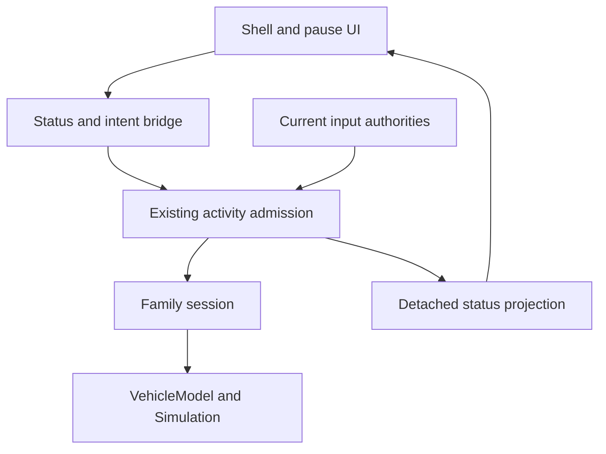

# Vehicle runtime consolidation — controls and incremental architecture plan

**Updated:** 2026-11-21 after [independent adversarial review](../research/vehicle-runtime-consolidation-2026-11-21/EXTERNAL-AUDIT.md) and a further [code/research organization refinement](../research/vehicle-runtime-consolidation-2026-11-21/IMPLEMENTATION-BLUEPRINT.md). **Status:** implementation blueprint; no runtime implementation or new runtime qualification. **Original reviewed proposal:** `542d92b304fc3b82678c4a90b848a88d82df0b22`; **refinement starts from:** `8d61ca900a30686bc00eaf5ce80bee664e592a46`. **Runtime baseline:** `57abea025f62b20233ca281d58d2acbee4ab8b8e`. **Review branch:** `audit/controls-plan-adversarial-2026-11-21`. **Steps:** VRC-00…VRC-11, all open.

**Priority:** preserve and improve the player's control of the vehicle before expanding shared abstractions. Fixed-wing is the first migration; helicopter, airship and multirotor follow one at a time. Ground vehicles are a separately qualified, optional consumer. Publishing this plan does not repair the five known controls defects or close device, pilot, package or CI gates.

## 1. Engineering decision

Retain the existing float64, 240 Hz `Simulation`, `VehicleModel`, aircraft v2 contract and `AircraftModules` registry. The opportunity is narrower coordination between the shell, activity and input owners. A second simulation engine, universal vehicle base class, capability registry or checkpoint format would increase risk.

The first implementation should characterize the existing **fixed-wing PauseMenu controller-status/recovery display and Continue chain**, while prioritizing confirmed controls repairs in their owners. A flat controller-attention projection is a concrete candidate extraction only if it removes a named duplicated decision or dependency; otherwise retain the current reads. The existing signal/Continue chain can be the minimal intent boundary when proven sufficient. An added origin-bound wrapper is conditional, and must preserve the full shell/activity/session gate: fixed-wing Continue includes AppRoot and screen-stack checks; airship and quad have activity checks. A session's `resume()` alone is not the full gate. A detached UI snapshot is information, never permission to fly.

At the pinned baseline `flight_session.gd` has 6,697 lines, `app_root.gd` 5,337 and `main.gd` 4,303. The [reproducible inventory](../research/vehicle-runtime-consolidation-2026-11-21/SOURCE-INVENTORY.md) treats these as inspection scope, not measured duplication, complexity or performance defects. Extract only a demonstrated seam; leaving a correct responsibility in place is an acceptable outcome.

Success requires:

1. Every configurable binding has a truthful path from assignment and Save/activation through live dispatch, accepted commands and visible feedback. Fixed controls retain their documented direct route.
2. Device loss, focus changes, failed saves and interrupted operations preserve the family's policy and give the player a reachable recovery path.
3. One authority decides each input role, profile, readiness and transition. Helpers do not create competing caches or safety state machines.
4. Structural changes preserve accepted commands, state, event order, replay identity rules and resource lifetime. Intentional behavior repairs are separate changes.
5. Response quality is measured at input and live-player boundaries. Post-conditioning replay and callback counts cannot certify those boundaries.

## 2. Existing owners and protected contracts

| Authority | Required treatment |
| --- | --- |
| [Simulation](../../app/sim/simulation.gd), [VehicleModel](../../app/sim/vehicle_model.gd), [STACK](../STACK.md#boundaries-and-data-flow) | Keep the installed-model boundary, float64, 240 Hz, atomic tick, accepted frame, events, checkpoint and rollback. No vehicle switch in the kernel. |
| [Aircraft contract](../AIRCRAFT_CONTRACT.md), [AS plan](aircraft-standardization.md), [AircraftModules](../../app/physics/aircraft_modules.gd) | Keep schema, capability admission, derivation and generated sources with AS and aircraft owners. Specialized vehicle schemas stay distinct. |
| [Controller plan](controller-support.md), [Controls UX](controls-setup-ux.md), [player guide](../FIRST-LAUNCH.md#controller-settings-current-source) | D6/F1/F3/F4/F6 and UI own input, role selection, persistence, actions, setup and qualification. Preserve accepted gamepad/radio differences. D6-UX-02 keyboard remapping remains separately pending. |
| Activity and family owners | The current activity **and** session together own readiness, admission, reset, crash, race, recorder and recovery. Trace the actual call chain before extraction. |
| [Native policy](../STACK.md#native-backend-policy), [flight logging](../FLIGHT-LOGGING.md) | Preserve actual backend/source identities, reference selection, numerical/fault/package gates and family replay contracts. Native orchestration is not an automatic migration goal. |
| [Optimization priorities](optimization-priorities.md), [verification scope](../tools/shared.md#verification-scope) | PT/VQ/NK retain measurement gates. Required CI and target-platform checks remain separate from focused local results. |
| [Track registry](../README.md#tracks-plans-and-step-ids) | VRC coordinates this plan; it does not acquire another track's implementation authority or duplicate its status. |

A pure restructure must not change accepted state bytes, inputs, event order, random state, clock, profile meaning/storage, UI control meaning or resource ownership. Preserve exactness where the existing contract guarantees it, with matching engine/backend configurations. Source moves can legitimately change solver fingerprints: retain identity rejection and use the documented candidate workflow, rather than falsifying identity to obtain exact replay.

## 3. Minimal target boundary

This is a dependency proposal, not an implemented common API. The [concrete first consumer](../research/vehicle-runtime-consolidation-2026-11-21/IMPLEMENTATION-BLUEPRINT.md#3-first-consumer-fixed-wing-pausemenu) has a retain-or-extract decision: keep current reads by default; create `app/ui/fixed_wing_pause_controller_status.gd` only if the flat controller-attention subprojection removes real duplication/coupling. Other status fields, helicopter/fake compatibility and current Continue dispatch stay in place. A new private AppRoot intent wrapper is optional; proof of the existing or changed full boundary is required. Do not count a passing subprojection as the entire VRC-01/04 scope.

### Status and request rules

- **Status is advisory:** derive it from current owners, detach mutable values and bind it to the activity identity. Show operation support separately from readiness, active holds and recovery actions. Unavailable backend/identity/status fields are explicitly unknown or unsupported. Recompute operational availability when relevant profile/model state changes.
- **Intent carries no authority:** captured context is diagnostic or an expected-identity guard. The current activity/input owners revalidate role, connection generation, relevant profile/mapping identity, focus/capture and family readiness when processing the request. Cached zero sticks or a prior `ready=true` cannot authorize resume.
- **Preserve ordering:** an owner that yields, awaits or defers revalidates after that boundary. Reject late work for a retired activity. No tick is granted before the existing gate completes, including shell hold release and held-key masking.
- **Honest results:** distinguish unsupported, refused, accepted, and accepted-with-postcommit-fault where the owning transaction supplies that distinction. Do not relabel a committed observer fault as rollback. Pending is valid only for a real asynchronous operation with defined completion/cancellation.
- **No universal readiness:** verified gamepads retain first-valid-poll readiness; radios retain applicable event/LOW and action-OFF rules, with the verified same-radio menu route adding its center/OFF gate. Helicopter collective, airship low throttle plus centered yaw, quad arming/rate recovery and ground neutral/armed rules stay separate.
- **Preserve explicit player intent:** Continue remains explicit for the applicable recovery route. Existing guarded Fly and restart actions may already provide the explicit intent; do not add an unnecessary second Continue or accidentally auto-resume after loss.
- **No new tick caller:** UI/bridge never call a generic `tick_once`, mutate simulation state, resample inside solver stages or infer authority from a rendered view.

The [control contract](../research/vehicle-runtime-consolidation-2026-11-21/CONTROL-CONTRACT.md) owns the proposed detailed invariants. The [acceptance matrix](../research/vehicle-runtime-consolidation-2026-11-21/CONTROL-ACCEPTANCE.md) defines expected outcomes and existing test starting points; all new case executions remain pending.

### Deferred operations

Reset, restore, prepare/reload, exit, recorder finalization and disposal stay on current family routes in phase one. Common names do not imply common transactions. Migrate one only after its complete prepare/refuse/commit/fault/cancel behavior is characterized; preserve family envelopes. Fixed-wing refusal can retain its old recording, but airship/quad reset can notify recorders before a later refusal. Cross-family equivalence requires evidence or a separate behavioral repair.

An idempotent disposal helper releases already-retired resources; it must not bypass unsaved recording/result decisions, abandon worker ownership, close a temporarily detached flight's recording, clear another activity's listeners or report a failed save as success. Preserve cancellation and retry. `close()` is not an unconditional public escape hatch.

## 4. Controls baseline and defect dependencies

The [prior controls audit](https://github.com/bultodepapas/OpenRCsimulator/blob/895dd4352c5191f1539a8b8f4df1996cd33eb86f/docs/research/game-controls-audit-2026-11-21/AUDIT.md) identifies five unfixed baseline defects. Its checked synthetic witnesses demonstrate the adverse behavior, not a repaired pass. Its existing regression batch was **22 passes out of 27, with five failed/incomplete**; it was not full CI, native display or physical controller certification.

| Finding | Existing repair owners | Blocks the affected migration until repair and proof |
| --- | --- | --- |
| GCA-01: admitted quad Pause binding not dispatched | DR-14/16, UI-15-GP-01, action owners | VRC-05 quad action routing, or VRC-03 changing that shared dispatch seam |
| GCA-02: airship native menu map retains stale UI ownership | BL-10/12, UI-12-GP-01, F3-GP-02 | VRC-05 airship menu/role bridge and shared role-map changes |
| GCA-03: airship Continue does not retry temporarily refused uncached profile | BL-10, F3-GP-02, D6-GP-02 | VRC-05 airship resume/profile path and shared resolution/recovery changes |
| GCA-04: concurrent legacy calibration updates can be lost | D6-GP-02, fixed-wing/HELI calibration and AUX owners | VRC-03 or VRC-02 moving the affected legacy writer, caller or storage transaction |
| GCA-05: tiny admitted external ranges give incorrect endpoints | D6-GP-02/03 | VRC-03 moving profile validation, normalization or readiness |

Further source inspection identifies **unexecuted scenarios and design gaps**, separate from those five confirmed defects: partial or unobserved save restoration, stale same-profile drafts and independently changing menu preferences, incomplete legacy gamepad-smoke migration, and old-origin deferred work. The [blueprint](../research/vehicle-runtime-consolidation-2026-11-21/IMPLEMENTATION-BLUEPRINT.md#5-one-persistence-authority-with-explicit-failure-outcomes) defines proposed discriminating checks and owner-scoped repairs. They are not new reproduced gameplay findings. Do not migrate an affected invariant under a stronger guarantee until its required witness and repair exist.

VRC-00 records all five with pinned witnesses and disposition. An unrelated status/lifecycle slice can proceed if it demonstrably leaves the affected seam untouched and its own checks pass. A vague “repair decision” cannot waive an invariant in the path being migrated. Fixes remain separate owning-track changes with repaired regression witnesses; expected baseline failures must not become the permanent contract.

Other open baseline gaps are first-post-gap tick safety, per-activity launch/menu support, quad held fallback policy and physical/platform/package qualification. GCA-G1 is an investigation, not a confirmed sleep defect: distinguish a processing gap from stationary sticks/sparse HID events, observe the real first post-gap tick and then decide the family's policy. Scheduling/recovery changes require this evidence; an unrelated status bridge need not redesign watchdogs. No RF-loss detector is assumed.

## 5. Family scope and player-facing policy

| Family | Preserve and qualify |
| --- | --- |
| Fixed wing, first | Capability-driven airplane differences; calibration, holds, start, crash, native and AUX gates. Select actual catalog fixtures covering the changed conventional electric/glow/turbine/flap/retractable/elevon capabilities; one model may cover several. Shared input changes also exercise affected consumers outside the first UI migration. |
| Helicopter | Activity/session ownership, collective, arm/hold/cut precedence, trainer/curve, native guard, rotor state and own recorder/checkpoint. |
| Airship | Activity live armed check before resume, **low throttle and centered yaw**, reversible stern motor, unresolved-profile retry, native menu role clearing, tapes/recorder. Radio Pause does not establish verified radio-menu support. |
| Multirotor | Activity source/generation/readiness gate, once-per-tick FC sample, arm/disarm, ordinary same-source frozen rate throttle versus recovery reset, race outbox/tape limits. Existing automatic fallback may select another connected controller while held; preserve invalidated arm continuity. Identifying that source before Continue remains an owner-qualified GCA-G3 acceptance item. A paused stored frame can stay armed until the first resumed tick disarms; changing this is separate behavior work. |
| Ground, optional later | Neutral/armed recovery, pause holds, damage/course identity, backend mismatch, interrupted export and unsaved recording decisions. No aircraft assumptions. |

Home, direct launch and Workshop trial are separate matrix entries where implemented. Record offered bindings, menu support, recovery route and first accepted tick. Preserve direct/standalone paths that do not use `ControllerService`, including their legacy profile resolution. Unsupported features must be explained before a misleading assignment or launch. Keyboard/mouse recovery stays available where provided; all keyboard flight keys are not yet remappable.

## 6. Step plan and independent changes

All implementation steps remain **open**. This table owns status; the evidence package defines gates, not a second progress tracker.

| Step | One reviewable deliverable | Dependencies and owners | Required proof |
| --- | --- | --- | --- |
| **VRC-00** | Freeze source, materialized assets/imports, catalog, test roster, input routes and all five GCA dispositions; establish comparable baseline. | SF/AS/UI/D6/families; first | [Q0](../research/vehicle-runtime-consolidation-2026-11-21/QUALITY-GATES.md#q0-baseline-and-test-admission). Classify prior unqualified suites and obtain decisive evidence for affected routes. Missing resources cannot become a pass. |
| **VRC-01** | Characterize the **different existing** status/admission surfaces, fixed-wing PauseMenu and its Continue chain; decide whether a controller subprojection removes a named decision/dependency. | After 00; UI/session/input | [Q1](../research/vehicle-runtime-consolidation-2026-11-21/QUALITY-GATES.md#q1-controls-and-transition-contract): advisory facts, unknown/unsupported, holds, live gate, stale origin and no writes. Characterize the required contract even if no extraction is justified. |
| **VRC-02** | Isolate one useful fixed-wing preparation/validation/lifecycle helper; retain candidate/commit/observer owners. | After 00/01; physics/FL/GP/EL; relevant GCA-04 dependency | [Q2](../research/vehicle-runtime-consolidation-2026-11-21/QUALITY-GATES.md#q2-state-replay-and-lifetime): refusal, accepted start, postcommit fault, recording/stats and exactness. If unsafe to separate, retain the owner and extract a smaller pure validator. |
| **VRC-03** | Extract one input coordination seam after affected baseline defects are repaired. | After 01/relevant GCA closure; D6/F3/UI/all affected consumers | Q1/Q2: event→poll→first accepted tick, radio/gamepad differences, finite ranges, shaping, capture, AUX, storage and recovery. No optimization mixed with extraction. |
| **VRC-04** | Prove the fixed-wing PauseMenu consumer and existing intent boundary; extract controller facts or add an origin wrapper only when justified. A retain decision is valid. | After 01; 02 only if this seam uses its helper; UI/session | Q1/Q2 plus [Q3](../research/vehicle-runtime-consolidation-2026-11-21/QUALITY-GATES.md#q3-player-flow-and-device-qualification): real UI, covered/trial-return/fallback behavior, guarded player intent and holds. A status-only pass does not qualify an unproven intent contract. |
| **VRC-05** | Migrate helicopter, airship, then quad in separate PRs only if beneficial. Ground requires later explicit scope. | After 04/affected GCA repair; HELI/BL/DR/UI/D6 | Family admission, recovery and recording. One family's pass cannot qualify another. Reset/restore/exit stay unchanged unless separately included/proven. |
| **VRC-06** | Share a pure field/environment builder after proving equivalence for two actual consumers. | After 00/specific characterization; LU/SC/GP | Q2: weather/terrain/obstacle identity, ordering, lake/contact rules and native selection. Optional; does not block a complete controls repair. |
| **VRC-07** | Isolate observer subscription/retirement discipline; keep recorder schemas and exit policy. | After the specific owner is characterized; FL/UI-FS/AUD/session | Q2: refusal vs committed fault, reentry, reset/relaunch, pending save, abandon and complete retirement. |
| **VRC-08** | Simplify one view coordinator with detached data and an owned HUD/camera component. | After corresponding seam, not all family moves; HUD/render/UI | Q1/Q3: immutable projection, truthful EN/ES prompts, focus/capture, actual display target and resource isolation. |
| **VRC-09** | Profile one complete workload and attempt one attributed optimization. | After 00/correctness of touched path; PT/VQ/NK/owner | [Q4](../research/vehicle-runtime-consolidation-2026-11-21/QUALITY-GATES.md#q4-response-and-performance): paired runs, input age/order, accepted commands, tail latency, memory and hardware scope. Fewer callbacks is insufficient. |
| **VRC-10** | Document/normalize only migrated seams; add a narrow dependency check if a demonstrated risk warrants it. | After specific moves; their owners | Imports, UIDs, scene/export dependencies and references. No mass rename, second registry or generic framework. |
| **VRC-11** | Qualify the selected migration cohort and publish supported/limited/unqualified scope. | Relevant required steps, not every optional extraction; QA/DT/UI/D6/PT | [Q5](../research/vehicle-runtime-consolidation-2026-11-21/QUALITY-GATES.md#q5-promotion-and-rollback): affected checks, required CI, source/package/device/pilot evidence and exact claims. No silent safety waiver. |

Order: **baseline → minimal contract → one fixed-wing consumer**, with separately owned defect repairs before their affected migration. Expand after that seam proves useful and qualified. VRC-06…09 are conditional improvements; controls quality must not wait for a broad rewrite.

## 7. Acceptance, stop and rollback

Each implementation PR identifies touched seams, required case IDs, owners, fixtures/routes and expected results **before execution**. The [case ledger](../research/vehicle-runtime-consolidation-2026-11-21/control-cases.json) starts unrun. Existing test names are starting points, not proof that all scenarios are already covered. Extend the smallest meaningful real-consumer test where needed. Use the [checked runner](../tools/shared.md#one-godot-script), declared terminal summaries and complete diagnostic receipts.

When trajectory, tick input, physics or recording identity may be affected, or its owning gate requires it, first exact-replay the fixed-wing baseline on its matching recorded source/backend. If a refactor changes the fingerprint, retain exact-mode refusal and use the compatible candidate same-tape comparison with truthful `solver_changed`/backend reporting. Current candidate mode selects reference; native qualification needs separate actual native parity/selection evidence. Family tapes retain their own contracts; a pure status projection does not automatically require a flight campaign.

Stop an affected migration for stale authority, silent assignment/no dispatch, unintended thrust/action, lost acknowledged save, ambiguous commit state, unexplained input latency, missing required evidence or numerical drift. Resolve the issue in its owner. Independent status work may continue without declaring the blocked path safe.

Keep a baseline executable/package and profile copy for compatibility checks. Structural PRs leave profile formats unchanged. A version-changing repair defines old/new load and rollback before applying it: reverting source is insufficient if player data becomes unreadable. Revert one isolated migration, or temporarily retain an old route with a removal condition; do not maintain competing authorities indefinitely.

Quality means correctness, recovery, truthful setup, response, accessibility and pilot usability. Use the [controller qualification matrix](controller-support.md#hardware-matrix) and [Controls UX plan](controls-setup-ux.md). Source review alone cannot establish robust gameplay, physical compatibility or measured speedup.

## 8. Organization and saved controls

The [implementation blueprint](../research/vehicle-runtime-consolidation-2026-11-21/IMPLEMENTATION-BLUEPRINT.md) supplies exact module responsibilities, proposed filenames, first-consumer callers, route/settings matrix, persistence outcomes and reviewable work packages. [Primary-source research](../research/vehicle-runtime-consolidation-2026-11-21/PRIMARY-SOURCES.md) records API/platform facts, applicability and unavailable version-specific proof.

Retain the existing `app/input` validation/action/registry/service/store owners. Build one coherent player Controls workspace around them. Use `ControllerProfileStore` as the eventual single saved-profile authority for migrated routes, with a small service-free direct adapter only after legacy compatibility is proved. Keep unrelated preferences, recordings and session state with their owners. HUD stick mode is not a keyboard flight remap; current Save does not persist an explicit flight-device handle or all dirty profile drafts.

For the robust-save repair, recommend expected persisted-content comparison under the existing lease. Full Controls Save reviews a changed durable menu-preference base as well as the target profile because it commits role intent; narrow calibration/smoke writes preserve the latest preference without implicitly adopting another process's role. Use actual stored bases, including association and legacy origin where relevant. A lease serializes writers but does not detect stale drafts, and different UUIDs can still affect the same association. Preserve conflicts for review. Keep original legacy data, account for gamepad-only smoke/import errors, and define old-reader/writer coexistence before cutover.

The [action-consumer inventory](../research/vehicle-runtime-consolidation-2026-11-21/action-consumers.json) records the 37 semantic action definitions, six AUX names and five bounded source examples. Other activity/route/form combinations remain uncharacterized. Require an actual consumer or an explicit current-activity refusal for every offered assignment; preserve valid other-family bindings. The quad throttle-cut offer is an unexecuted investigation scenario, separate from the confirmed GCA-01 Pause defect.

Managed Save attempts rollback; it does not guarantee that every restoration succeeds or is observed. Define publication, activation, role restoration and reconciliation outcomes, with real-caller feedback and no automatic resumption from an uncertain result. Preserve direct active-but-unsaved behavior until an intentional repair changes it. These are behavior changes in their owning tracks, separate from structural extraction.

## 9. Remaining evidence and implementation choices

- Do the real source/profile-change interleavings establish current authority before Continue and its first tick? Repair an unsafe owning gate before moving it.
- Which origin-bound callbacks actually need a guard? Reuse current object/generation evidence; a guarded projection alone does not retire all old callbacks.
- What does the real first post-gap tick do for each affected activity, and what policy follows from that evidence?
- Can each save/restore failure be observed and reconciled safely in both managed routes? Which legacy/version coexistence can be supported?
- Can a lifecycle extraction preserve actual transaction/recording behavior? If not, retain the owner and choose a smaller seam.
- Which physical routes, pilot evidence and packages qualify the release cohort? Missing evidence limits claims.

[Blueprint](../research/vehicle-runtime-consolidation-2026-11-21/IMPLEMENTATION-BLUEPRINT.md) · [Source map](../research/vehicle-runtime-consolidation-2026-11-21/organization-map.json) · [Inventory](../research/vehicle-runtime-consolidation-2026-11-21/SOURCE-INVENTORY.md) · [Migration decisions](../research/vehicle-runtime-consolidation-2026-11-21/MIGRATION-MATRIX.md) · [Quality gates](../research/vehicle-runtime-consolidation-2026-11-21/QUALITY-GATES.md)
