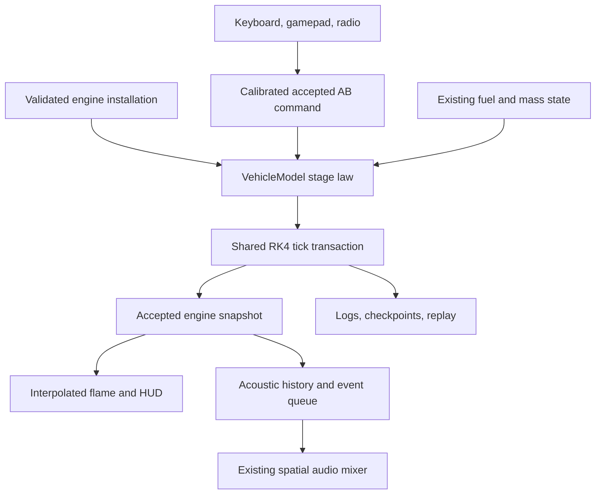
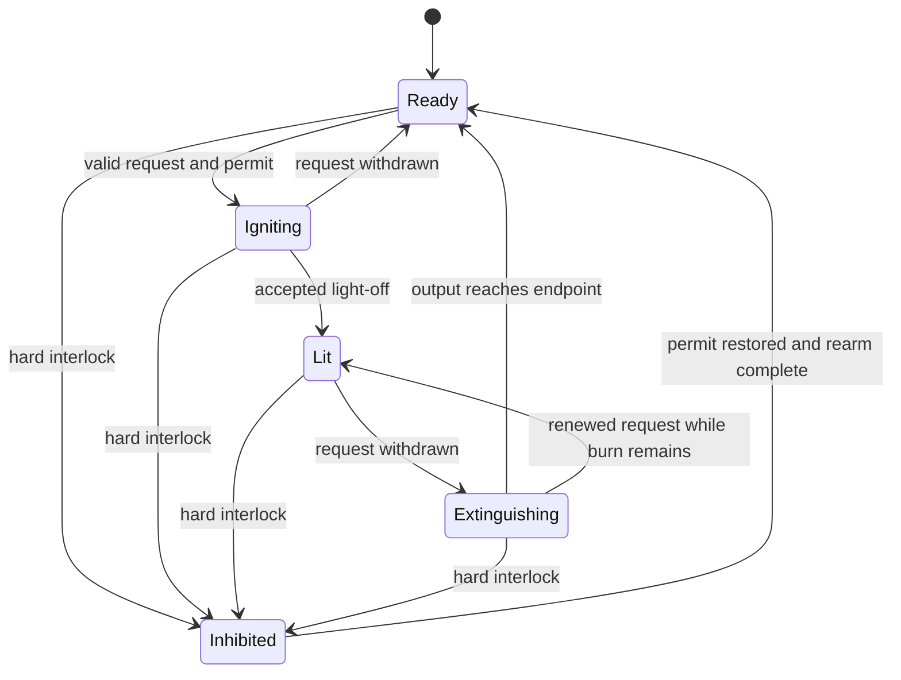

# OpenRC Simulator — Afterburner Research and Implementation Plan

> Dated engineering research handoff, 15 November 2026. The [proposed implementation plan](../../../plans/jet-afterburner.md) is the repository’s current planning entry point. This document preserves the complete source-grounded design and 52 investigation records; it is not an implemented-feature guide. Supporting paths have been adapted to this repository layout.

**Engineering handoff · Revision 3 · 15 November 2026 (America/Bogota)**
**Originally prepared:** 14 November 2026. Filenames retain the creation date.
**Repository:** [bultodepapas/OpenRCsimulator](https://github.com/bultodepapas/OpenRCsimulator)
**Current inspected commit:** [`ad21070798bfb9658785576a9c0b8bfc9a71fc7f`](https://github.com/bultodepapas/OpenRCsimulator/tree/ad21070798bfb9658785576a9c0b8bfc9a71fc7f)
**Original prototype/source baseline:** `f41d0fd2eb5483c609bcd858bcf22776eb311e14`; its historical test receipts remain unchanged.
**Engine pin:** `4.8.beta2.official.cafc17a19`
**Starting aircraft:** Vantage Jet, `sebart-avanti-s-a200-p100rx`, based on the Avanti S A200 and historical non-BL JetCat P100-RX.
**Scope:** reusable afterburner capability; visible flame, sound, additional thrust and fuel, controls, aircraft configuration, replay, graphics quality, and verification.

## Delivery decision

Implement an **optional experimental afterburner installation on a separate Vantage Jet configuration**, then reuse its engine and nozzle contracts for additional jets. The stock aircraft remains the dry-engine reference. The physical mode must deliver the requested increase in thrust together with additional fuel consumption. A separate cosmetic mode supports an illuminated exhaust/show-flame effect without changing flight dynamics.

Use the simulator's existing **float64, 240 Hz RK4 kernel**, turbine model, finite-fuel system, controller profiles, accepted-state recording, and positional soundscape. The recommended visual baseline is a **nozzle-attached mesh and shader with a bright core**. Particles, local illumination, and heat haze are optional refinements. No new physics tick owner, flight `RigidBody3D`, independent fuel counter, or replacement audio subsystem is needed. [C01][C02][C03][C04]

This document distinguishes **observed source behavior**, **proposed implementation**, and **verified standalone work**. The companion prototype is development preparation; it does not install an afterburner in the production simulator or establish real-engine performance. Its exact checks and limits are recorded in the [verification report](verification.md).

### Prior foundation: 28 completed engineering investigations

Revision 2 completed **28 deliberately scoped investigations** across propulsion, graphics, audio and integration. Section 17 includes every full record: question, method, evidence, amendment, proposed acceptance and limits. Section 18 records the independent review. The original prototype remains unchanged; the new work is research, analytical evidence and a stronger integration design.

| Area | Concrete change | Investigations |
|---|---|---|
| Physics | Gross/net metadata, nozzle/domain assumptions, stage atmosphere and separate force/flow evidence | I01–I07 |
| Graphics | Internal-pixel filtering, pose-aligned phase, swept particle births, bounded resources and qualified depth | I08–I14 |
| Audio | Preserve one installed dry loop; add causal wet sound, explicit missing-history behavior and reproducible variants | I15–I21 |
| Integration | Symmetric hold cancellation, complete fuel/layout callbacks, truthful replay identity, Workshop/native admission | I22–I28 |

**Evidence status:** 28 completed research findings, not 28 passed production tests. Numerical probes and a 39-path selected-source comparison are preserved. No new production run, GPU render, native qualification, audition, asset adoption or real-engine measurement is claimed.

### Revision 3: 24 new investigations focused on effects

The effects-specific follow-up adds **24 newly scoped investigations, FX01–FX24**, beyond the earlier 28. Each records a question, research method, inspected evidence, concrete design decision, proposed distinguishing check and limitations. Section 19 contains every full record; Section 20 records the independent review and the prepared development material. Sections 6, 9, 11–15 now incorporate the findings into the active implementation plan.

| New research area | Consequence for development | Investigations |
|---|---|---|
| Flame and turbine appearance | Separate gas, hot metal, LED and smoke; define core/mixing structure, optional stationary cells and air-relative response | FX01–FX06 |
| Geometry and shaders | Compare a one-shell candidate; account for compositing, reversed winding, deformation normals, derivative filtering and camera entry | FX07–FX12 |
| Godot tools and assets | Prepare shared noise during loading; respect custom particle data; evaluate atlas, flow-map and volume routes with explicit cost/provenance | FX13–FX18 |
| Authoring and simulator views | Prepare three art profiles, a capture register, lake/reflection policy, selected warmup and local image diagnostics | FX19–FX24 |

**Most consequential findings:** the unchanged starter's vertex mapping reverses winding; its deformed radius and transformed undeformed normal disagree; additive layer count changes apparent brightness; exact-pin noise source generates its first update synchronously; the existing particle random seed occupies the stock flipbook animation channel; and the lake's optional linear reflection needs a separate view/exposure check. These findings change the next implementation, but do not mean the retained starter has already been repaired or rendered.

**Prepared now:** complete research, reproducible shader/geometry and image-diagnostic calculations, texture-cost inputs, exact-pin engine-source metadata, three proposed art profiles and a planned native capture matrix. The production repository, original prototype and historical engine receipts remain unchanged. No new Godot/GPU, audio, flight or measured-engine result is claimed.

### Navigation

1. [What already exists](#1-inspected-baseline-and-current-project-decisions)
2. [Player experience and capability modes](#2-player-experience-and-capability-modes)
3. [Shared architecture and contracts](#3-one-physical-state-with-multiple-consumers)
4. [Thrust, fuel, and power](#4-physical-model)
5. [Ignition, state, and numerical integration](#5-state-machine-and-numerical-contract)
6. [Flame and Godot tools](#6-visible-flame-and-godot-tool-selection)
7. [Sound and asset candidates](#7-sound-design-and-existing-audio-integration)
8. [Controls and recovery](#8-controls-radio-profiles-and-player-feedback)
9. [Aircraft/Workshop authoring](#9-reusable-aircraft-and-workshop-contract)
10. [Replay, checkpoints, and other simulator systems](#10-replay-checkpoints-and-simulator-lifecycle)
11. [Concrete source changes](#11-file-and-function-integration-map)
12. [Performance](#12-performance-and-platform-plan)
13. [Verification](#13-acceptance-and-regression-plan)
14. [Implementation sequence](#14-small-reviewable-work-packages)
15. [Prepared starter and remaining work](#15-prepared-work-and-handoff)
16. [Source register](#16-primary-source-register)
17. [All 28 investigations](#17-research-round-2--28-completed-investigations)
18. [Prior independent review](#18-independent-review-and-remaining-evidence)
19. [All 24 new effects investigations](#19-effects-research--24-new-investigations)
20. [Effects review and prepared development material](#20-effects-review-and-development-handoff)

## 1. Inspected baseline and current project decisions

### 1.1 Source identity and evidence

The original 14 November review used a clean sparse checkout at `f41d0fd2...` and obtained the exact pinned Linux editor with official SHA-512 verification. Revisions 2 and 3 inspected `ad210707...` read-only; the head was independently rechecked for the effects round. Neither revision downloaded or ran Godot again. Among the original manifest's 39 selected paths, 34 are identical and five changed: `AGENTS.md`, RC input, main presentation/dispatch, FlightSession and the checked runner. This is not a whole-repository change count.

The revised review follows current controls/recovery, callback/layout, fuel, native, Workshop, replay, clock, smoke, audio and tooling source. Historical audits are context, not automatically current defects. The expanded source manifest and each investigation record identify coverage. Old standalone receipts remain historical.

The earlier Avanti review dated 10 November is useful context, but subsequent work matters: the current jet guide records **AV-17-R4 pitch-reference correction** and **AV-17-R5 flap-compensation ownership** as implemented. This afterburner plan does not reclassify those repairs as new defects. Broader physical identification and aircraft qualification remain their existing workstreams. [C02][C22]

Godot documentation under `/latest/` can move beyond the beta used by the simulator. Documentation establishes API intent; the pinned engine and actual renderer checks establish whether a particular implementation works here. Similarly, source presence does not prove a packaged release has the feature.

### 1.2 Existing foundations

| Area | Observed implementation | Consequence for afterburner work |
|---|---|---|
| Flight dynamics | Custom float64 6-DOF kernel, RK4, 240 Hz; body FRD and world NED | Extend the existing model; do not apply Godot rigid-body forces or write velocity from the effect |
| Engine | Continuous turbine RPM with throttle map, governor lag, acceleration/deceleration schedules | Keep core spool separate from downstream afterburner intensity |
| Thrust | Gross exit force and full-vector captured-air momentum, with separate application points | Add nozzle augmentation without multiplying intake drag and side force |
| Fuel and mass | Finite liquid fuel, stage mass/CG/inertia, source latch, exhaustion handling | Add AB fuel demand to the same derivative and event path |
| Rendering | Compatibility normally; Mobile/Metal on native Apple Silicon; optional Forward+ | Ship a mesh baseline that works across all three |
| Presentation | Detached state and custom interpolation | Effects consume accepted/interpolated state and the presentation clock |
| Audio | Installed sound banks, custom Doppler, propagation history, directional acoustics, path filtering | Extend the existing history and installed-bank consumer |
| Controls | Keyboard, gamepad, radio calibration, semantic actions and AUX bindings | Add a capability-aware action/channel with recovery semantics |
| Flight recording | Accepted commands, checkpoints, law/config identities, finite-fuel telemetry | Add versioned AB command/state fields and all corresponding readers |
| Aircraft authoring | Strict `openrc-aircraft v2`; generated aircraft data | Change authored inputs, schema, loader, and generator together |
| Workshop | Saved builds, resolved trials, presentation choices and physical configuration | Distinguish physical installation from cosmetic appearance and graphics quality |
| Native evaluator | Prepared dry-turbine snapshots and fixed continuous layouts | Explicitly refuse an AB-equipped configuration until its native path is qualified |

Sources: [C01]–[C15]. These are integration foundations, not a claim that an afterburner already exists.

### 1.3 Three traps found in the actual source

**The turbine comments are not the whole implementation.** Some comments still describe fixed mass or fuel burn as future work. `LiquidFuelFlight.evaluate()` already consumes fuel and computes changing mass properties. Use the current call chain when planning changes. [C03][C04]

**An extra state coordinate affects several contracts.** `FlightSession._turbine_rpm()` recognizes specific RPM/wheel/fuel lengths; `LiquidFuelFlight.valid()` expects `liquid_index + 2`; legacy trace validation also recognizes fuel in a particular tail layout. Appending an AB value without changing the corresponding validators, initializers, checkpoint identity, trace readers, and native layout is incomplete. [C04][C05][C12][C13]

**Audio history is a whitelist.** `Soundscape.DELAYED_CONTINUOUS` and `DELAYED_DISCRETE` select delayed fields. A new AB value added only to `FlightAudio` would remain undelayed while the rest of the engine arrives later. The installed powertrain route also differs from the older fallback sound route. [C07][C08][C09]

## 2. Player experience and capability modes

### 2.1 Intended first complete experience

The player selects an experimental afterburner-equipped Vantage variant, sees the assigned control in the normal aircraft help, and arms the aircraft using the existing procedure. At an eligible engine condition, requesting AB starts an accepted ignition transition. The nozzle brightens, a coherent flame develops, additional exhaust roar arrives at the listener after propagation delay, and the aircraft accelerates according to the added force and current aerodynamic loads. Fuel drains faster. Releasing AB returns to dry operation; an engine cut or fuel exhaustion removes combustion thrust through the existing source policy.

The effect should remain readable in a flight-line view, convincing from behind and to the side, and restrained enough that the pilot can still judge aircraft attitude. A large close-up plume cannot be the only successful view.

### 2.2 Explicit modes

| Mode | Visible/acoustic behavior | Physical behavior | Appropriate label |
|---|---|---|---|
| Off / unsupported | Existing aircraft presentation | Existing dry behavior | No afterburner installed |
| Cosmetic exhaust | Nozzle glow or optional stylized short flame; optional designed sound disclosed separately | Exactly zero additional force and zero additional fuel consumption | Visual effect |
| Experimental physical AB | Flame and wet sound follow actual AB state | Added gross nozzle thrust and added fuel demand | Experimental afterburner |

JetCat's own LED afterburner-ring page describes an appearance simulation. That is a useful RC reference, but it does not establish that the stock P100-RX has a fuel-burning augmenter. The physical mode here is an explicitly new simulated installation until an identified real configuration supplies its data. [P04]

The requested power increase belongs in the experimental physical mode. Cosmetic mode is an additional option, not a substitute for that work. Keep the feature disabled in legacy profiles and preserve the existing stock aircraft as a comparison baseline.

### 2.3 What to avoid in the product

- A graphics-quality slider that changes thrust or fuel use.
- A larger flame being treated as a calibrated thrust measurement.
- Automatically forcing AB off simply because gear or flaps are extended, unless a specific installation defines that interlock.
- A generic time-limited “nitro” charge unrelated to the aircraft's fuel system.
- A sonic-boom sound on ignition.
- Relabeling an EDF lighting effect as physical kerosene afterburning.

These are design boundaries. They keep the requested feature understandable without inventing engine hardware or aircraft operating limits.

## 3. One physical state with multiple consumers

### 3.1 Data flow



`VehicleModel` already owns the relevant boundary: pure stage evaluation, declared continuous/sampled/discrete state, accepted transitions, and versioned identity. `Simulation` keeps tick integration, validation, rollback, and publication. The AB module must not introduce a parallel scheduler or send presentation signals during a trial evaluation. [C06]

### 3.2 Proposed contract

The following names are proposals, not existing public API fields.

| Boundary | Proposed data | Rules |
|---|---|---|
| Installation | `engine_id`, capability/mode, law identity, dry/wet map identity, operating domain | Validated before flight; immutable for a running configuration |
| Accepted input | `afterburner_request` in 0–1, plus installation enablement | Device/rates/recovery resolved once by the owning input/session path |
| Continuous engine state | Actual AB fraction; any explicitly modeled timer/thermal state | Float64; stage-consistent; included in reset/restore/validation |
| Discrete state | Ready/igniting/lit/extinguishing/inhibited; rearm and event sequence | Changes through the accepted transaction; never inside `evaluate()` |
| Stage output | AB derivative, extra nozzle force/moment, extra fuel demand | No direct body, fuel inventory, audio, or UI mutation |
| Accepted telemetry | Actual fraction, state/reason, dry and wet force/flow, event identifiers | Detached and read-only for consumers |
| Visual binding | Engine ID, outlet ID, position, direction, radius, appearance profile | Number of visible outlets never determines total engine thrust |
| Audio binding | Engine ID, delayed AB fraction, event time/sequence, sound profile | Consume retarded history and the existing listener/path model |

Reuse `AircraftPropulsionRuntime`'s existing installation identity and accepted observation boundary. It identifies one physical installation; bind explicit outlet IDs to it. The first adapter supports one engine with one or more presentation outlets. Each engine has one force/fuel ledger regardless of mesh count. Multiple physical engines need a later adapter and shared/distinct tank policy. I27 defines the conservation and binding checks.

### 3.3 Command, physical output, and presentation are different

`afterburner_request = 1` means the pilot asks for AB. It does not mean combustion has started. `ab_actual` describes the modeled physical output after eligibility and response. A render-only brightness scalar can further adapt the appearance to distance or renderer quality without changing `ab_actual`.

Keep that distinction visible in diagnostics:

```text
request: 1.00
state: IGNITING
actual: 0.00
inhibit_reason: none
additional_gross_thrust_n: 0.00
additional_fuel_flow_kg_s: 0.00
```

When a simplified ignition model does not consume fuel until successful light-off, label that assumption. A later ignition-fuel/purge model must account for that fuel separately; it cannot silently consume fuel while reporting the above zeros.

## 4. Physical model

### 4.1 Physical basis and scope

An afterburner adds combustion energy downstream of the turbine. More exhaust energy can produce more thrust, while fuel efficiency generally worsens. Full installations also involve nozzle and engine matching. NASA's introductory treatment provides the mechanism; it does not provide a calibrated P100-RX wet map. [P01][P03]

For the first release, use an **identified or explicitly estimated incremental gross-thrust map** and **incremental fuel-flow map**. A CFD solver, complete compressor/turbine cycle, and full ECU emulation are unnecessary prerequisites. Conversely, a universal multiplier presented as physically measured would be unjustified.

### 4.2 Correct force decomposition

The scalar thrust relation is

$$
F=\dot m_e V_e-\dot m_0V_0+(p_e-p_0)A_e.
$$

The exhaust momentum and pressure contribution form the nozzle side of the force; captured-air momentum contributes inlet drag. NASA's general thrust equation supports this decomposition. [P02]

OpenRC already implements a vector version with different force locations. A compatible empirical extension is

$$
F_{g,wet}(N,\rho,u,a)=F_{g,dry}(N,\rho,u)+a\,\Delta F_{g,AB}(N,\rho,u),
$$

$$
\mathbf F=F_{g,wet}\,\hat{\mathbf e}_{nozzle}-\dot m_{capture}\,\mathbf v_{intake,air},
$$

$$
\mathbf M_O=\mathbf r_{nozzle/O}\times(F_{g,wet}\hat{\mathbf e}_{nozzle})
+\mathbf r_{intake/O}\times(-\dot m_{capture}\mathbf v_{intake,air}).
$$

Here `a` is actual AB intensity, `N` is the existing core RPM, and the positions/directions are expressed consistently in body FRD. The subscript `O` denotes the force-reference point used by the owning stage; the adapter must respect its existing subsequent transfer to the live center of mass. [C03][C04][C05]

**Implementation rule:** add the new nozzle contribution to the turbine loads before the existing live-CG transformation. Do not multiply all six values returned by `Turbine.loads()`. Do not apply the live-CG correction twice. Do not modify an imported visual transform to obtain the desired physical moment.

Every force map must identify gross/net force, static/moving conditions, installed control volume, pressure-force inclusion, captured-flow assumption and force reference. A wet-minus-dry net increment is a gross increment only with unchanged or corrected captured flow. At synthetic 0.23 kg/s and 40 m/s, gross 100/120 N gives net 90.8/110.8 N; scaling dry net by 1.2 gives the wrong 108.96 N. I02 preserves this and the double-subtraction case.

Keeping the existing captured-air map unchanged is a declared first-order model assumption. Real engine rematching could change intake flow; that requires a coherent calibrated wet model, not accidental scaling of ram drag. If the empirical wet map already includes exit-fuel mass and pressure effects, do not add another `fuel_flow × exhaust_velocity` correction.

### 4.3 Fuel and changing mass

Use

$$
\dot m_{f,total}=\dot m_{f,dry}(N)+a\,\Delta\dot m_{f,AB}(N,\rho,u).
$$

The production adapter returns the total flow through the existing finite-fuel derivative. Existing inventory calculations then update mass, CG, and inertia at the RK stages. There is one owner of the tank, its usable residue, and its exhaustion event. [C04][C16]

Distinguish **incremental AB flow** from **total wet flow** in every data key. For a table of total wet flow, calculate the increment once against the corresponding dry condition. Never add the entire wet flow to the dry flow a second time.

TSFC is fuel mass flow divided by thrust. A value expressed in `kg/(N·h)` must be divided by 3600 before multiplying by newtons to obtain `kg/s`. TSFC changes with operating condition; a single value is an approximation. Avoid using TSFC near zero thrust as the runtime law, where the ratio is poorly conditioned. [P03]

At source exhaustion or accepted engine cutoff, AB combustion force and fuel demand become zero under the existing source policy even if the shaft is still rotating. Audio can continue to receive sound emitted earlier, and an independently bounded glow can fade, but neither permits additional physical combustion.

### 4.4 What “more power” means

The main jet output is **thrust in newtons**. Shaft power, exhaust kinetic power, and useful translational propulsive power are different quantities. For a clearly stated reporting frame,

$$
P_{useful}=\mathbf F_{thrust}\cdot\mathbf V_{air}.
$$

A stationary aircraft can have substantial thrust while this useful translational power is zero. Do not implement `F = P / airspeed`; it is singular at rest and does not represent the existing turbine model.

The resulting acceleration and climb emerge from total forces, mass, and aerodynamics. No special afterburner velocity increment is needed. If a thrust line is offset, its additional pitch/yaw/roll moment follows the same cross product as other forces.

### 4.5 Transparent numerical illustration

The following values are **invented for reasoning and fixture tests**, not P100-RX specifications or an aircraft performance prediction. Assume 10 kg mass, 50 m/s airspeed, and 40 N drag at the instant compared.

| Quantity | Dry | Full illustrative AB |
|---|---:|---:|
| Net axial engine thrust at the comparison condition | 100 N | 130 N |
| Net forward aircraft force after the stated drag | 60 N | 90 N |
| Instantaneous acceleration | 6 m/s² | 9 m/s² |
| Useful thrust power at 50 m/s | 5.0 kW | 6.5 kW |
| Illustrative total fuel flow | 0.005 kg/s | 0.010 kg/s |

The extra ten-second steady consumption is 0.05 kg. The extra thrust is 30%, but the instantaneous acceleration here rises by 50% because drag was subtracted first. Under the separate idealized assumptions of constant thrust and unchanged quadratic drag, the equilibrium speed ratio would be `sqrt(1.3) ≈ 1.14`. None of those percentages is a promise about the real Vantage or a full simulated flight.

### 4.6 Operating domain and calibration

Store the admitted RPM, density/temperature, local speed, and any Mach range with the map. Use existing stage atmosphere and local intake velocity, including rigid-body rotational velocity. Do not evaluate environment once per rendered frame and reuse it as if it were the RK stage condition. [C03][C05]

An initial virtual map can be bounded and explicitly estimated. Before making a realism claim, obtain matched dry/wet static thrust, fuel flow, response timing, installation geometry, ambient conditions, and any nozzle schedule. Compare held-out data as well as fitted data. Full-size fighter measurements or visual plume photographs are not RC engine calibration.

The initial law is a bounded installed force/flow surrogate; it does not solve compressor rematching, backpressure or choking. Use stage-local pressure, temperature, density and air-relative velocity with a jointly admitted domain; do not infer a universal altitude correction from density alone. OpenRC already supplies an altitude-aware dry ISA `standard_column` alongside uniform reference/custom modes. Reuse the chosen provider and preserve its out-of-range refusal. A richer observed/moist sounding is a separate extension. I03–I04 document the evidence.

Identify force and fuel independently with paired dry/wet runs, matched conditions, timestamps, quantified drift/uncertainty and held-out runs/conditions. Thrust-only data cannot determine fuel demand and effective thrust-per-flow gain separately. I07 specifies this proposed campaign; no measurements were executed here.

No new afterburner parameter should imply that the existing airframe is calibrated for transonic flight, arbitrary overspeed, structural breakup, or a new thermal-failure model. Increased thrust may drive the aircraft outside its identified domain; the existing experimental status and domain diagnostics must remain meaningful.

## 5. State machine and numerical contract

### 5.1 Proposed state machine



Unsupported/disabled installations can bypass the new layout completely. Store inhibition separately from normal readiness so the HUD can explain “engine off,” “fuel exhausted,” “waiting for spool,” or “release control to rearm.” A renewed eligible request during a still-burning soft tail resumes `LIT` continuously from its current intensity; it does not insert a new cold-ignition gap or replay a cold-ignition sound. Once the tail reaches `READY`, a subsequent request goes through normal ignition. A failed ignition probability, EGT limit, cooling cycle, or purge sequence should be added only when its model and evidence are specified.

### 5.2 Response model

A useful first continuous model is

$$
\dot a=(a_{target}-a)/\tau,
$$

with distinct positive rise/fall time constants if required. These are explicit estimated parameters, separate from the existing RPM governor. Core RPM should not jump because AB lights.

Use the same stage `a` to compute force and extra fuel demand. A soft command-off tail that still delivers thrust also consumes fuel. A hard source-off event gates both outputs immediately. If the physical state decays after a hard cutoff, treat that residual coordinate as a response/thermal envelope with **zero combustion delivery**, not a hidden fuel source.

Finite time constants must be compatible with the fixed step and any declared substep policy. The starter uses illustrative rise/fall constants of `0.25 s` / `0.12 s`, well separated from `1/240 s`, but no particular number becomes a hardware measurement merely because the ODE integrates cleanly. These are fixture values; production values need quantity metadata and domain validation.

### 5.3 RK4 purity and accepted events

During each stage evaluation:

1. Read the supplied stage state, frozen command/permit, and validated configuration.
2. Calculate derivatives, loads, and fuel demand.
3. Return those values without mutating the supplied arrays or session.

Do not increment timers, toggle latches, play sound, publish telemetry, consume inventory, or call a random generator inside the derivative. RK4 and boundary location may query the same candidate repeatedly. A side effect would execute multiple times or survive a rejected tick. [C06]

Keep discrete mode/rearm memory in checkpointed state. Use the existing accepted transition/sampled protocol where appropriate; a pure helper that returns a proposed transition still needs the owning kernel transaction to commit it. Never treat a helper call from `_process()` as an accepted physical event.

The starter's transition records are local proposals with `time_offset_s`; they are not kernel events. An adapter must supply the kernel's nonempty `type` and absolute `time_s` within the accepted interval, or consume the proposal after a successful commit according to the owning protocol. Do not pass the starter's dictionary directly into `VehicleModel`. The existing fixed-wing adapter and mode layout must be updated deliberately when selecting the richer accepted-transition protocol. [C06]

Tick-boundary ignition is defensible if disclosed: 240 Hz gives about 4.17 ms granularity. Compare against a quantized-onset oracle. Existing finite fuel has one declared exhaustion locator; command-driven cuts are tick-sampled, and fixed-wing contact uses its separate post-step/swept policy. They are not an existing universal event arbiter.

Several within-tick located transitions require one deliberately composed policy with earliest supported boundary, deterministic ties and remainder integration. The kernel admits at most one declared locator event, forbids combining it with `step_policy`, and does not split a whole-tick policy into extra contact substeps. Preserve the minimal fuel-locator route until compatible composition is qualified. I05's naive last-tick clamp counterexample is not a reproduced current OpenRC defect. [C06][C17]

Close the whole layout transaction in I23: `AircraftPropulsionRuntime.prepare_callbacks()` independently computes the fuel-event prefix. If adopting `framed-sampled-v1`, extend its callback install/clear whitelist and use detached sampled context plus explicit counts. Update every strict turbine state/mode reader. Select one protocol; do not stack framed and legacy callback families.

### 5.4 Hysteresis and priorities

Illustrative entry/exit throttle thresholds of 0.92/0.88 prevent a noisy transmitter from repeatedly toggling eligibility. RPM thresholds need the same separation and a documented definition—`rpm/max_rpm` is not the same as `(rpm-idle)/(max-idle)`. These are proposed control settings, not published P100 limits.

Resolve simultaneous events in a documented order: accepted source/fault cutoff first, device recovery inhibit next, capability/engine eligibility next, then the pilot request. The existing physical-fuel event owns the exact source boundary. Preserve deterministic ordering on restart, pause, replay, and rejected candidate ticks.

## 6. Visible flame and Godot tool selection

### 6.1 Recommended composition

Build a nozzle-attached, coherent luminous plume with a readable center, a softer mixing region and a fading tip. **Start the next comparison with one tapered shell whose shader suggests a brighter core**, then add a separately masked core/root surface only if rear/inside views demonstrate a missing center. The retained starter uses two double-sided shells; the one-shell candidate is a new proposal, not an established performance winner. A filled core does not require an opaque disk across the nozzle. FX04 and FX07 define the comparison.

| Layer | Godot tool | Initial decision |
|---|---|---|
| Attached plume and apparent core | `MeshInstance3D` + `ShaderMaterial` | Required visual baseline; compare one shell first |
| Additional core/root coverage | Separately masked mesh or existing interior geometry | Add only for a documented rear/inside coverage failure |
| Fine breakup | Seeded shared 2D noise or bounded procedural modulation | Low-frequency baseline with explicit filtering |
| Shock-cell accents | Quasi-stationary axial mask | Optional art profile; off without suitable reference |
| Hot metal / nozzle surface | Existing material or separate bounded presentation channel | Optional and installation-specific; not inferred from gas color |
| Downstream wisps | Adapted existing custom GPU-particle scheduler/process shader | Later bounded quality layer; stock material is not a drop-in |
| Nearby illumination | Small shadowless light through existing lighting policy | Optional, separately profiled |
| Heat haze | Separate screen-reading spatial shader | Later High experiment |
| LED ring and show smoke | Explicit cosmetic light; existing independent smoke owner | Separate causes and controls |

Godot's built-in mesh, shader, noise, particles and lighting cover the baseline. No external VFX plugin is required. Material Maker, Blender and official demo techniques are authoring/comparison options, with the license and renderer limits in FX18. The complete effect must read with bloom, particles and local light off. [G01][G02][G03][G07][G08][G12]

### 6.2 Match the existing aircraft binding

The component's own plume axis can be local `+Z`, but its root must be oriented to the **validated outlet direction**. The actual Avanti model points its nose toward `-Z`; its authored `show_tailpipe` outlet is at model coordinates `[0, 0.07992, 1.28196]`, directed `[0, 0, 1]`, with a 0.025 m visual radius. Those are visual attachment estimates, not a physical nozzle-area measurement. [C18][C19]

There is an important convention mismatch: the existing smoke attachment resolver aligns local **−Z** with the exhaust direction, whereas the starter plume extends along local **+Z**. Reusing its transform unchanged would point the flame into the aircraft. Add an explicit local Y rotation of π beneath that resolved root, or construct a dedicated basis that aligns +Z to the validated exhaust direction. Verify the result on the actual aircraft, including parent transforms. [C19]

Reuse or derive a dedicated AB anchor from that authored installation through the same attachment/root transformation. Do not assume `exhausts[0]` is populated for every aircraft, use a world-space offset, or attach at the center of mass. The physical thrust application point comes from the propulsion generator; it need not coincide numerically with the visible outlet. A later movable nozzle must transform the visual emitter consistently while its physical force direction remains explicitly modeled.

### 6.3 Renderer-specific decisions

| Feature | Compatibility / Standard | Mobile / Apple Silicon | Forward+ / High |
|---|---|---|---|
| Mesh + spatial shader | Baseline | Baseline | Baseline |
| Visible unshaded color | Use bounded `ALBEDO`/`ALPHA` | Calibrate exposure/color | Calibrate exposure/color |
| Glow | Available in current docs, simpler implementation | Available, different dynamic range | Available, fuller controls |
| Basic GPU particles | Available; check exact used features | Available | Available |
| Trails / manual emission / sub-emitters | Not portable: exact-pin GLES3 source rejects these paths | Optional after qualification | Optional after qualification |
| Visibility-range fading | Use manual intensity/hysteresis | Use manual intensity/hysteresis | Native fade available |
| Heat haze | Off initially | Off initially | Optional experiment |
| Built-in volumetric fog | Unavailable | Unavailable | Optional, with temporal-ghosting checks |
| Custom ray-marched proxy | Separate experiment, not baseline | Separate experiment, not baseline | Separate experiment, not baseline |

Current official documentation does **not** support blanket statements that Compatibility has no glow or no GPU particles. Its color and post-processing path differs, however, so a bright baseline must not depend on HDR. The repository's own Compatibility shaders explicitly account for unshaded GLES3 not using `EMISSION` as expected; use visible color in the main shading output and verify on the exact engine. [G01][G02][G03][G04][G06][C20]

### 6.4 Shader and material rules

The starting shader should use additive or deliberately selected transparent blending, normal depth testing, no depth writing, and no shadow casting. Keep the aircraft and terrain able to occlude the flame. `shadows_disabled` is not a substitute for turning off the mesh's shadow-casting mode. [G02][G04]

Suggested inputs are actual AB amount, displayed simulation time or bounded deterministic phase, flame dimensions, core/outer colors, visual exposure calibration, optional cell contrast, stable per-engine phase, and presentation LOD fade. Length, brightness, and edge opacity can follow different smooth appearance curves. They are art parameters, not three independent physical thrust laws.

Use unique material resources or verified per-instance uniforms when changing per-engine values. A shared mutable material must not let engine A's state control engine B. Per-instance spatial uniforms do not imply equivalent behavior for particle-process shaders. [G02][G04]

Update the local AABB with maximum authored/shader deformation. Compare the double-sided two-layer starter with a one-layer/core-disc alternative; neither is already performance-qualified. Transparent object sorting cannot solve arbitrary intersecting triangle order. A momentarily unlit effect may retain a measured bounded warm cache. Global Effects Off constructs no AB-specific effect resources and releases/suspends owned resources and updates after a switch; identify shared caches separately. I08/I11 define occlusion, material, bounds and lifecycle checks.


**New geometry correction before optimization.** The retained vertex map `(x,y,z) → (r*x,r*z,L*(y+0.5))` has determinant `−r²L` for positive radius/length and reverses winding. Its double-sided setting hides that issue; do not switch culling until the winding is corrected or deliberately accounted for. Radius waves also change the true normal. Compute a parametric/Jacobian-derived normal, or a justified simpler facing mask, rather than treating the scaled undeformed normal as exact. At a collapsed tip use a finite fallback and fade. Keep angular noise periodic, inspect cap UVs separately, and admit only the chosen rigid/uniform-positive-scale attachment contract, applying scale once. FX09 includes a CPU counterexample, not an engine mesh test.

**New compositing contract.** Define intended contribution per view/layer before changing representation. Additive front/back hits accumulate; alpha and premultiplied layers depend on order for different colors. FX08's fixed-total optical-depth example `alpha_n = 1 − exp(−tau/n)` preserves a homogeneous same-color model, not an arbitrary two-shell flame. Confirm actual beta2 blend factors, color transforms and rear/side energy in captures. Keep depth testing; `depth_draw_never` suppresses depth writing, not occlusion.

### 6.5 Time, pause, interpolation, and long sessions

Do not use shader `TIME` as the flight clock: it ignores pause and has rollover behavior. Feed the presented simulation time, aligned to the aircraft's interpolated pose. Existing `ShaderClock` wraps its shared clock at 1024 seconds to control float32 precision; any modulation using it must be periodic across that wrap, or derive its own bounded phase in float64. [G02][C21]

Normal live flight gives smoke/aircraft lights `sim.time() - sim.dt() + interpolation_fraction * sim.dt()`, while the world update uses accepted time. Bind AB to the displayed aircraft's timestamp. Compute bounded phases from unwrapped float64 time after interpolation; never interpolate wrapped radians. I10's endpoints near 2π and 0 give a false naive midpoint π, although the correct midpoint phase is 0.

Test identical snapshot → identical shader inputs, pause → no animation advance, reset/seek → no stale effect, and continuity across the chosen period. A deterministic shader input does not make all GPU output bit-identical across drivers. Keep those claims separate.

### 6.6 Shock diamonds and color

NASA's X-59 maximum-afterburner ground-test imagery is a useful visual reference: exhaust shock cells can appear while the aircraft is stationary. The relevant conditions are in the nozzle/plume, not simply aircraft Mach number. [P05]

For the first shader, treat cell spacing and contrast as an optional visual approximation. Keep the principal axial pattern roughly stationary relative to the nozzle, move turbulent detail through it, and fade it downstream. Do not scroll the entire diamond chain like beads. Leave the feature off for a profile without a justified reference.

I09 quantifies the sampling risk: illustrative 0.05 m outlet diameter and 0.42 m plume at 20 m, 60° vertical FOV and native 1080p give 2.34 pixels across the outlet and 19.64 along a side-on plume. The starter cell's half-height width is only 0.63 pixel; lower internal resolution reduces samples further. This is geometry arithmetic, not measured visibility or a default-camera specification. Filter fine breakup/cells by internal projected footprint with hysteresis; retain a coherent core and low-frequency envelope. Do not enlarge physical dimensions just to show cells.

Choose color and brightness from a labeled reference and exposure test, not a universal “temperature → RGB” claim. Gas emission, soot, hot metal, LED imitation and camera processing are separate explanations; FX01–FX03 record their evidence limits. Keep hot-metal glow optional and independently enveloped rather than forcing it to follow instantaneous AB amount. A flame should retain shape in daylight and avoid blowing out the tail at night. Excessive sparks, thick black smoke, and a constantly huge orange fireball suggest an engine fire rather than stable augmentor operation.

FX10 supplies an explicit fragment-derivative experiment: calculate `fwidth` from continuous axial coordinates before seams/discard/divergence, soften individual band edges, and fade unresolved modulation toward its mean. Derivatives alone do not prevent temporal aliasing. Check camera/aircraft movement, 20/30/60 FPS and actual internal render size. Thresholds remain art heuristics until captured on each backend.

The core stays aligned to the nozzle. Optional downstream bending uses compatible pose, nozzle velocity and sampled air; straight axial flight is not automatically sideways deflection. FX05's bounded quadratic example is an art response, not a measured trajectory. FX06 separates accepted gas light-off/cutoff from optional residual metal appearance; neither shader time nor a pilot request can invent physical combustion.

### 6.7 Particles on a fast aircraft

Keep the short core attached as geometry. Local-space particles follow the emitter; a longer wake belongs in world space with carrier velocity added once. At 40 m/s and 30 displayed FPS, endpoint-only emission moves 1.33 m between frames. Adapt existing profile-smoke swept fractional births and previous/current nozzle transforms; include rotational source velocity and reset discontinuities. Do not enable a second inheritance path. I12 supplies motion cases. [G03][G05]

Keep gravity disabled for the near-nozzle detail unless a particular visual model justifies it. Use short lifetimes, bounded visibility AABBs, and reset history on teleport/restart/seek. Lowering `amount_ratio` changes emission but does not remove the allocated particle workload; choose smaller systems or disable them for a lower tier. Changing `amount` can restart the system. GPU turbulence uses costly 3D noise and is explicitly discouraged for mobile/web targets in the documentation. [G03][G05][G09]

The current scheduler is coupled to a custom process shader and explicit presentation stepping. Its defensive 32-record capacity applies per emitter per interval, with a latched overflow fault; the current public 24-tick interval visits 25 inclusive positions and can emit at most 25 records. A 32/33 capacity check needs an explicit consumer test seam. `CUSTOM.z` already stores a fixed random seed; Godot's pinned standard billboard shader floors that channel to select an atlas frame. A stock flipbook would therefore conflict with the current data contract. Define animation from an agreed age/channel mapping without overwriting existing state; particle interpolation does not blend image frames. Do not replace the existing scheduler settings with generic `ParticleProcessMaterial` tutorial values. FX14/FX16 establish these source-level constraints, not a working AB particle profile.

### 6.8 Heat haze limitations

Godot's 3D screen texture is captured after opaque geometry and before transparent geometry. A heat-haze shader therefore cannot correctly refract the transparent flame, smoke, glass, or another overlapping haze effect. It may sample foreground opaque geometry. Render ordering alone does not repair this. [G10]

A later High experiment needs bounded displacement, valid-UV/sky guards, and depth reconstructed at both original and displaced UVs. Reject displaced samples that pull foreground objects into the haze. Use renderer-specific NDC and inverse projection. Godot 4.7's postprocessing tutorial and renderer table conflict in general wording about Compatibility reverse Z; neither establishes exact beta2 behavior here. Require known near/far surfaces, sky and foreground-order probes per pinned renderer before enabling haze. I13 records this open qualification item. Test the tail, terrain, lake and screen edges; avoid a second scene viewport per jet. [G11]

Compose with the existing environment, exposure, and lighting owner. The AB component must not replace `WorldEnvironment` or camera exposure. It may request a bounded local light through the normal presentation policy. The standalone visual fixture has its own environment only because it is an isolated demonstration, not a scene to insert wholesale into OpenRC. [G06][C01]

### 6.9 Reuse and asset decisions

| Candidate | Evidence/fit | Decision |
|---|---|---|
| Godot mesh, shader, FastNoiseLite and NoiseTexture2D | Native APIs; first noise generation can be synchronous at the pin | Baseline, prepared once during selected-effect loading |
| Official Godot 3D-particles demo | MIT example; inspected listing targets Forward+ / 4.7 and marks the displayed build unstable | Review exact techniques/revision before copying; no whole-demo dependency |
| Material Maker 1.5p1 | MIT tool; animation image-sequence/atlas export and loop comparison | First optional offline noise/flow/atlas authoring tool |
| Blender 4.5 LTS | Gas/fire cache and transparent-frame workflow | Optional offline reference or atlas authoring if simpler techniques fail |
| Vefects Free Fire VFX | Earlier listing's source-redistribution limitations and Forward+ recommendation | Reference only; not bundled |
| OpenVDB / Texture3D / raymarch | Conversion and an explicit renderer are still required for the inspected built-in texture route | Later High experiment with a demonstrated visual need |

FX13–FX18 record exact inspected sources and limits. A free tool license does not clear every imported community graph, image or asset. Record author, URL, revision, license/notice, original hash, modifications, import settings and rebuild steps before adopting art. No third-party effect art or tool executable is included.

### 6.10 Noise, atlases and optional volumes

Start with one shared, seeded 2D scalar data texture; author actual colors separately with the correct `source_color` semantics. Masks and RG flow fields are linear data. Explicitly choose angular wrapping, filtering, mips, seamless skirt and normalization. Exact-pin NoiseTexture2D/3D source performs the first deferred generation synchronously, so create and validate it during loading. Connect completion before requesting generation, also handle already-ready resources, and stop safely on failure/cancellation. NoiseTexture3D's invalid-RID path returns an empty vector with an error; a null-only readiness test is insufficient.

Pinned NoiseTexture3D reports no mipmaps, although other imported/ImageTexture3D routes can supply them. For hypothetical uncompressed R8, 256² is 64 KiB and 64³ is 256 KiB before mips; actual format/residency requires inspection. Full 2D/cubic-3D mip overhead is approximately 33%/14%, respectively. These are arithmetic, not allocated GPU memory.

A flipbook is a later answer to observed procedural repetition. A 4×4 atlas needs alpha-edge handling, gutters, minification policy and a tested frame 15→0 seam; ordinary coarse mips can mix neighboring cells despite a finite gutter. The pinned stock shader selects discrete frames. Explicit two-frame blending costs another sample and may ghost. A recorded billboard cannot supply all viewpoints of a volume. Try a small two-phase flow warp before adopting a heavier simulation if it solves the actual visual failure.

Blender OpenVDB data is not a ready Godot effect. The inspected layered importer uses image slices; a documented conversion needs channel, bounds, axes, values and time metadata. A 300×180 proxy at 24 samples entails up to 1.296 million volume lookups/frame before other effects. No VDB converter, atlas or volume renderer is supplied in this revision.

### 6.11 Fog, camera entry and secondary views

The current atmosphere starts with fog enabled and glow disabled. The retained starter disables fog, so distant haze is a necessary comparison. Evaluate native fog versus a matched transmittance treatment without adding fog twice, changing the world environment or assuming HDR behavior is identical across renderers. Keep authored colors and linear data distinct, and validate the existing project's color-encoding/exposure path on beta2. Its prior 4.7.2 observations are useful precedent, not a beta2 rendering result. FX12 defines the comparison.

Ordinary opaque depth testing is the baseline. Add a scene-depth intersection fade only if a visible hard contact warrants it and the per-renderer reconstruction probes pass. For camera entry, use a conservative view-relative fade with known near plane/bounds; compare its early disappearance against the actual desired views. Camera-inside, rear, seam and cap views are mandatory before choosing one-sided geometry. FX11's formulas remain uncompiled proposals.

The static lake probe excludes the moving aircraft. High plus `OPENRC_LAKE_REFLECTIONS=planar` enables a separately gated linear reflection capture; it is not always active. Reuse that owner rather than adding a viewport per jet. One effect state is rendered in several views; no second animation/particle/physics/audio step is permitted. Check per-view detail/fade, layer eligibility and a main-camera-only culling mistake. Do not apply display exposure twice or treat main-camera display color as reflected linear radiance. FX22 supplies the exact current source boundaries and future captures.

## 7. Sound design and existing audio integration

### 7.1 Preserve the existing turbojet character

The current installed turbine bank uses `turbine_designed.wav`, sourced from a CC0 synthetic effect; its 80,000 RPM value is an audio mapping anchor, not tachometer telemetry. The manifest explicitly says it is not a measured RC turbine. Preserve the existing recognizable turbine sound while adding a distinct wet-exhaust layer, and maintain that provenance distinction. [C09][C10]

The installed bank is one mixed synthetic loop, not separately controllable whine and dry-exhaust stems. Its current directional gain affects the whole loop; separate whine/roar controls belong to the fallback route. Preserve this dry layer and add an independently controlled wet layer. I15 distinguishes conceptual ingredients from actual available assets.

Keep the user's intended pure turbojet character: clear spool/whine behavior and a much stronger, deeper exhaust impression from behind. AB should not turn the installation into a generic turbofan recording or cause an unexplained shaft-pitch jump.

### 7.2 Layers and drivers

| Layer | Driver | Treatment |
|---|---|---|
| Installed dry turbine loop | Existing RPM, engine and directional mapping | Preserve mixed whine/exhaust and pitch; separate stems are not installed |
| Wet broadband roar | Delayed actual AB fraction and an explicitly estimated acoustic profile | Add or crossfade appropriate spectral energy |
| Low-frequency body | Delayed AB output, bounded gain curve | Optional support, not overwhelming sub-bass |
| Light-off | Accepted event ID and emission time | One restrained transient, once at acoustic arrival |
| Extinction | Accepted cutoff/event plus acoustic envelope | Optional release; distinguish soft tail and hard source cutoff |
| Nozzle mechanism | Actual modeled nozzle motion | Omit on the fixed stock nozzle |

Afterburner acoustics vary by installation. A NACA study found strong low-frequency resonance in one configuration and lower, resonance-free noise in another at comparable thrust. It supports an installation-specific design rather than a universal bass frequency or loudness rule. [P06]

### 7.3 Use the existing route

1. Extend accepted turbine/AB telemetry at the session boundary.
2. Add the appropriate fields in `FlightAudio`'s detached snapshot.
3. Add continuous AB values with explicit prehistory validity and interpolation segmented at accepted transitions; merely extending the whitelist is insufficient.
4. Carry discrete ignition/extinction events in a bounded causal queue.
5. Add AB layers to `PowertrainAudio.update_sound()` or a narrowly owned companion bank within that route.
6. Preserve bus routing, loop guards, first-positioned playback, custom Doppler, distance gain, filters, and voice limits.

`FlightAudio` already derives source position, rotational source velocity, exhaust direction, listener position, and temperature-dependent sound speed. `Soundscape` already computes Doppler and deliberately disables Godot's native Doppler. Enabling it again would double the effect. Adding default distance/filter behavior on top of the custom path could similarly double attenuation. [C07][C08][C09]

### 7.4 Sight and sound are intentionally not simultaneous at distance

At a stationary source distance of 100 m and an illustrative sound speed of 340.3 m/s, travel time is about **0.294 s**. The flame is visible before the ignition reaches the pilot. The AB layer should share the existing retarded source trajectory, rather than being played immediately at the current aircraft transform.

Physical event identity uses flight, engine, accepted sequence and emission time/pose. Observer epoch belongs to the delivery cursor, not deterministic variant selection. Nearest discrete sampling can choose a future state; linear interpolation can leak wet sound before light-off. Segment interpolation at transitions and deliver events on their acoustic wavefront crossing.

The current helper may return an oldest sample with truncated history. Simply adding AB could make an already-lit first snapshot sound immediately at 100 m. Defer fresh AB until history covers emission time. On seek reconstruct history or disclose a bounded fade-in approximation; preserve fronts still in flight and consume those already arrived. I18/I21 specify these cases.

At an illustrative 343 m/s, 100 m travel is 291.545 ms; a listener approaching the fixed emission point at 10 m/s receives it at 283.286 ms. The earlier 340.3 m/s example uses a different medium. Device latency is separate. A future variable-delay waveform resampler creates Doppler itself and must replace, not multiply, the current pitch correction.

After physical cutoff, an observer can correctly hear previously emitted AB sound still arriving. This acoustic tail does not imply continued force or fuel flow.

### 7.5 Godot audio tool choices

| Tool | Useful role | Project-specific boundary |
|---|---|---|
| `AudioStreamPlayer3D` | Spatial playback of a small number of layers | Integrate into existing custom attenuation/Doppler path |
| `AudioListener3D` / current camera | Ground-pilot or moving-camera listening location | Reuse current listener selection |
| `AudioStreamWAV` | Short loops and transients with controlled loop endpoints | Preserve current PCM guards and gain staging |
| Ogg Vorbis | Potential memory/disk tradeoff for longer material | Benchmark decode and loop behavior before changing bank format |
| `AudioStreamSynchronized` | Optional coordinated starts of authored layers | Resource mutation must be isolated per engine |
| `AudioStreamInteractive` | Optional start/sustain/stop sequence | Not required for continuously changing engine output |
| `AudioStreamRandomizer` | Optional generic variation | Repeatable AB variants use a stable flight/engine/event hash; documented properties expose no instance seed |
| `AudioStreamGenerator` | Later dedicated synthesis | Avoid a new full-rate per-sample main-thread GDScript loop |
| Existing buses, EQ, compressor/limiter | Headroom and spectral shaping | Do not create another global mixer/limiter owner |

The standard spatial player already provides listener-relative positional effects; hiding it does not silence playback. Godot documents higher CPU costs for strongly compressed formats and recommends compiled code for demanding generator workloads. These API facts guide the design, while the existing OpenRC audio bench determines the final behavior. [S01][S02][S03][S04][S05][S06]

### 7.6 Free sound candidates inspected

These are a **research shortlist**, not imported, auditioned, calibrated, or approved production replacements. Retain the original creator's page and exact asset license before downloading/bundling a candidate. None of the entries below supplies a measured wet P100-RX installation.

| Candidate | Page evidence | Engineering use / decision |
|---|---|---|
| Existing `jet_engine.wav`, minian89 / Freesound 152509 | Current project manifest identifies a CC0 Pure Data design | Preserve as the comparison baseline; already a synthetic surrogate |
| Static jet test, m_cel / 534856 | CC0 page; 9.855 s, 48 kHz stereo Ogg; engine and wet state unspecified | First metadata-based stationary-texture audition candidate; not adopted or heard |
| `Afterburner`, TiesWijnen / 413312 | Creator labels it turbojet afterburner; CC0; 6.048 s stereo MP3 | Candidate for a designed wet layer after listening/loop inspection; brief and lossy, installation unspecified |
| `Afterburner (Close, Screamer, Quick Onset)`, JSK_Productions / 829068 | CC0; 15 s stereo WAV; author explicitly states Firefly generation and Audition editing | Possible stylized reference; not authentic engine evidence |
| `Afterburner sound.wav`, StoneyJ / 104883 | CC0 label; F-4 taxi/run-up/takeoff; uploader comments that source provenance is not remembered | Do not adopt as the first source-controlled asset; provenance and moving-source recording are poor fits |
| `Jet Turbine Noise.flac`, qubodup / 205581 | CC0 label; uploader attributes material to US-government video | Trace original recording before adoption; full-size jet and baked motion are not matched RC data |
| `Eurofighter afterburner woomph`, surrey_film / 162242 | CC0; creator identifies Farnborough recording and recorder | Useful light-off reference, not a replacement pure-RC turbine loop |

Sources: [A01]–[A04], [A06][A07], the [m_cel creator page](https://freesound.org/people/m_cel/sounds/534856/), and the project manifest [C10]. Candidate suitability is an engineering judgment from metadata; sound quality has not been established by listening in this work.

For the existing pure-RC sound objective, the strongest long-term source is a matched RC turbine recording with known RPM, distance, angle, ambient conditions, and rights. An experimental full-size-style AB layer may be designed for the virtual installation, but label it accordingly.

### 7.7 Asset preparation and audible validation

Use the repository's audio tooling, Audacity, and existing analysis scripts. Prefer a small selected bank of mono exterior loops and short transients. A proposed 48 kHz, 16-bit mono ten-second loop contains about 0.96 MB of PCM; three such loops contain about 2.88 MB before resource overhead. This is arithmetic, not a measured runtime-memory claim.

For each retained asset, record author, original URL/ID, exact license, original and processed hashes, original format, edits, loop boundaries, reference RPM or its absence, and its “recorded/design/surrogate” classification. Do not treat a public preview as an original lossless master. [C10][C23]

Crossfade loop boundaries and inspect waveform, spectrum, DC offset, peak/true-peak behavior, and repetition over the intended pitch/gain range. Audacity supports overlap crossfades for smooth transitions; use the existing Godot bench for the actual mixed result. Correlated variants of one sample do not automatically benefit from equal-power crossfading. [S07]

I17's ideal-correlation calculation gives a +3.010 dB midpoint rise for equal-power fades of identical signals. The current 64-frame PCM guard aids interpolation; it does not fix a bad loop. Select fades from actual material and measure oversampled true peak separately from the sample-peak limiter.

Start with one guarded mono PCM wet sustain and one bounded transient per engine. Cache guarded bytes by asset identity; the current guard assumes 8/16-bit PCM. The proposed 17-player figure is a Soundscape/installed-bank/wet/transient subtotal; ground/mechanical audio add players. I19 requires whole-scene counts, first-play, bounded voices and teardown checks.

Run matched front/side/aft listening at the same distance, then flyby and camera-switch cases. Keep UI/alerts audible. Check ignition/cutoff and wet-to-dry transitions under the existing limiter. A Dummy-driver test validates logic, not sound quality or device latency. No sonic-boom asset should be tied to AB activation.

## 8. Controls, radio profiles, and player feedback

### 8.1 Recommended default

Start with a **separate remappable AB action/AUX channel**. Preserve the current full 0–1 dry throttle range. Existing profiles and unsupported aircraft receive an AB request of zero.

| Input | Proposed mapping | Required behavior |
|---|---|---|
| Keyboard | Semantic `afterburner_toggle` or `afterburner_hold` | No repeat-key toggling; normal flight-context routing; binding appears in help |
| Gamepad | Explicit user-selected button | Conflict-aware; do not steal smoke, gear, flaps, or throttle cut |
| USB transmitter | Saved `aux.afterburner` switch/button/axis | Calibrated endpoints, polarity, OFF evidence, recovery arming |
| Optional throttle detent | Explicit profile setting | Dry-range remapping and clear calibration/help |
| Script/replay/external stepping | Accepted normalized AB command | Same physical meaning; no device-event inference |

Several apparently convenient defaults are already occupied: `B` is braking, `J` is in the existing flight key dispatcher, and `H` is smoke. The gamepad's right shoulder is also a smoke candidate. Keep the initial optional action unbound until conflict-aware assignment rather than silently overriding an established control. [C11][C14][C24]

### 8.2 Optional throttle detent

For a deliberately selected detent `d` with `0 < d < 1`, one possible mapping is

$$
u_{dry}=\min(u/d,1),\qquad q_{AB}=\max((u-d)/(1-d),0).
$$

This changes throttle semantics, so it must be opt-in and recorded in the profile/configuration. Add hysteresis around the detent and a clearly visible dry-maximum mark. A two-position AUX switch is often simpler for an RC transmitter without a physical detent; do not require all users to change their throttle travel.

Normalize `u` only after existing device calibration and endpoint inversion. Avoid a second throttle expo curve in the AB view. If a transmitter already provides a dedicated AB mix/channel, honor that explicit input instead of also deriving AB from throttle.

### 8.3 Recovery and held controls

Reuse the simulator's device-loss/focus/pause policy. On reconnect, stale high AUX or a held toggle must not unexpectedly light AB. Reuse the current device distinction: raw-radio recovery requires actual OFF events; trusted standardized gamepads can use confirmed live OFF polling. Uninitialized neutral is not release evidence. I22 traces profile/generation recovery. [C11][C14]

Add symmetric press/release/cancel routing. `AppRoot._release_controller_holds()` explicitly releases throttle cut; generic bookkeeping alone will not release a new physical AB hold. Cover focus/menu, disconnect, remap, generation and aircraft teardown. Select one command policy so bound AUX is not also a semantic action; keep input sampling out of VFX.

Do not reuse the smoke controller unchanged as physical state: `SmokeAux` explicitly describes presentation-only behavior. Reuse its calibration, validation, event-evidence, and recovery patterns through an appropriately owned physical command adapter. Accepted AB demand must enter the recorded physics command boundary.

On normal pause, freeze physical state. On a checkpoint restore, restore the physical state and remain paused under the existing contract; apply input recovery before live device control resumes. Exact replay uses recorded accepted commands, not current hardware arming events.

### 8.4 HUD and menus

Show a compact state such as **AB READY**, **AB IGNITING**, **AB ON**, or **AB INHIBITED**, with an optional short reason. An engineering overlay can add requested/actual fraction, gross/net thrust, added/total fuel flow, and the active experimental profile.

Use capability-aware controls: show the physical afterburner control/status only on an augmented installation. Cosmetic mode gets a separately labeled **Visual exhaust effect** control and status, with no implication of added thrust; unsupported aircraft expose neither unless they have the corresponding visual capability. Keep strings in the existing localization system, use symbols/text as well as color, and expose the selected binding through existing help/controller prompts.

Workshop should make the distinction visible: **installation changes performance**, **appearance changes the flame**, and **graphics quality changes rendering cost**. Physical profile edits should resolve into a new configuration/trial identity and require the normal new-flight/reset path.

## 9. Reusable aircraft and Workshop contract

### 9.1 Authoring responsibilities

Keep physical and visual information separate:

- The engine installation owns force/flow laws, supported domain, state identity, and physical force application point.
- A visual outlet owns its scene attachment, local position/direction, radius, and appearance.
- A sound profile owns sample provenance and acoustic presentation parameters.
- The aircraft owns which engine/outlet/profile combination is installed.

One engine can feed multiple visible outlets. Two emitters must not double force or fuel. A real twin-engine aircraft needs independent engine states and physical moments; that is a further adapter capability, not something achieved by duplicating the VFX scene.

### 9.2 Proposed configuration shape

This is a **design example, not JSON accepted by the current schema**. All values are illustrative. Do not paste it into generated stock aircraft data.

```json
{
  "afterburner": {
    "enabled": true,
    "mode": "experimental_physical",
    "law": "proposed-incremental-gross-thrust-v1",
    "engine_id": "main_turbine",
    "data_status": "estimated_virtual_installation",
    "rise_time": {"value": 0.25, "unit": "s", "kind": "estimated", "source": "AB development fixture; not measured"},
    "fall_time": {"value": 0.12, "unit": "s", "kind": "estimated", "source": "AB development fixture; not measured"},
    "maximum_added_gross_thrust": {"value": 30.0, "unit": "N", "kind": "estimated", "source": "synthetic fixture only"},
    "maximum_added_fuel_flow": {"value": 0.005, "unit": "kg/s", "kind": "estimated", "source": "synthetic fixture only"},
    "visual_profile": "proposed_rc_short_plume",
    "audio_profile": "proposed_turbojet_augmented"
  }
}
```

Production tables should replace scalar maximums when the operating domain warrants it. Use the existing quantity vocabulary and unit validation; confirm exact supported unit/kind tokens when extending the real schema. Declare interpolated/clamped/out-of-domain behavior, prohibit nonfinite values, and validate ordered knots, positive time constants, normalized axes, nonnegative flows, and physically meaningful map relationships. [C15]

### 9.3 Generator and build identity

For Vantage, edit `research/avanti-s/av06/inputs.json` and `derive_physics.py`, with any required catalog/Workshop source additions. Regenerate `app/data/aircraft/sebart_avanti_s_a200.json`; never hand-edit it. A separate experimental configuration must have a distinguishable identity, description, and provenance. [C02][C15]

Update strict schema, module classifier, normalized loader retention, generator and resolved builds together. The v3 descriptor checks exact base-aircraft SHA-256, modules and physical/presentation identity; regenerate it for the augmented variant. Existing Workshop `power_multiplier` supports only a validated prescribed-RPM propeller adapter, not jet AB. I25 covers migration, stale descriptors, trial/save/load and packaged data.

A physical AB build must resolve the supported installation or fail with an actionable diagnostic. Silently ignoring an unknown physical capability is unacceptable.

Missing audio or visual assets may fall back to the established dry sound or a minimal visible effect without changing physics. Missing/invalid physical data must not secretly select an invented thrust law.

### 9.4 Proposed effects profiles and editable data

The prepared `research/afterburner/development/visual_profiles.json` is a **draft authoring specification**, not data admitted by the current aircraft schema. It offers restrained experimental RC gas, full-scale reference-study gas, and cosmetic LED-ring directions. Dimensions are authored relative to a validated outlet; no entry supplies physical force, fuel or temperature calibration. Keep capability/state selection outside artistic palette editing.

Share immutable shader/texture assets. Isolate per-outlet state, amount, pose and phase; duplicate materials initially or qualify scalar/vector instance uniforms within their limits. Preserve a distinct optional metal/interior response channel. Validate values before loading, and keep Inspector preview separate from the flight owner. FX19/FX20 describe Resource sharing, change notification, scene-local duplication and safe editor scope.

## 10. Replay, checkpoints, and simulator lifecycle

### 10.1 Fields and identities

Record the accepted AB command for each interval, physical state/layout/law identity, selected mode/profile, actual continuous response, inhibition/rearm state where physical, and relevant transition sequence. Existing fuel/source state remains in the existing fuel contract. Clearly identify the physical engine and the presentation profile so a trace is interpretable.

Preserve legacy input shapes when AB is absent. `FlightSession.flap_input_index()` currently uses the final input position; adding a trailing AB value without revisiting that helper would misroute a command. Define explicit indices/roles and update all consumers. The four conventional stick values can remain their own fixed diagnostic vector; the extended physical input layout must be versioned separately. [C05][C12]

The flight logger records commands after input conditioning. It can test the physical AB law with a repeatable tape; it cannot by itself qualify radio calibration, detent mapping, switch recovery, or user input feel. Those require the real input path or controlled device fixtures. [C12][C17]

### 10.2 Replay identity and checkpoint precision

The source-tree solver digest hashes simulation/physics/failure scripts. Adding an AB law changes it even for an aircraft with AB disabled. Keep three proofs: old tape/original solver; candidate legacy dynamics on the same accepted tape with changed identity acknowledged; candidate augmented tape under its own identity. Do not falsify a hash to prove numerical no-op behavior. Packaged identity must describe the actual executable/native bundle. I24 defines these fixtures.

Reuse the existing lossless `CheckpointJSON` carrier: typed native snapshot, base64, SHA-256 and bounded payload. Extend explicit physical/layout fields rather than a second ordinary JSON-number serializer. Physical restore must not grant live hardware authorization.

### 10.3 Lifecycle behavior

| Event | Physical state | VFX/audio behavior |
|---|---|---|
| Pause | No timer, fuel, or AB state advance | Freeze plume clock; follow existing audio pause/fade policy |
| Ordinary restart | Rebuild selected start state; fresh request/rearm policy | Clear old particles, history, and event cursor |
| Aircraft/configuration change | Validate before accepting new session | Rebind engine/outlet/resources after accepted change |
| Rejected candidate tick | Retain previous accepted frame | No ignition event or audible/visible transition from rejected state |
| Engine cut / exhausted fuel | Existing source cutoff; zero AB delivery | Current flame ends; previously emitted sound can arrive later |
| Crash/terminal hold | Follow existing terminal session policy | Bounded presentation fade; do not invent a continuing physical afterrun |
| Checkpoint restore | Restore version-compatible physical state, normally paused | Reset/rebuild presentation history with a defined discontinuity policy |
| Replay seek | Reconstruct from identified state/tape | No repeated past one-shots; deterministic visual phase |
| Graphics quality change | Identical accepted physical state | Change only rendering workload |
| Audio mute | Identical accepted physical state | Mute/stop voices through existing mixer ownership |

A post-crash physical cooldown/afterrun is a separate existing turbine-plan question. Do not add a wall-clock AB engine afterrun inside audio while the flight kernel is frozen. [C02][C17]

### 10.4 Native admission

The native liquid snapshot copies a fixed list of dry turbine fields, and the C++ evaluator assumes a specific continuous layout. A newly enabled AB configuration must be rejected by native admission **before** installation until the implementation understands the new state, maps, commands, and identity. Select the GDScript reference path with a visible reason. Do not rely on an eventual array-length fault, or permit a command-only AB option to run silently dry. [C13]

Later native support should mirror the qualified reference law and repository parity policy. Its receipt must include the new ABI/law/configuration identity. A faster evaluator does not replace exact tick transactions, fuel-boundary behavior, or the selected physical model.

### 10.5 Adjacent systems

Retain normal brakes, flaps, retracts, smoke, lights, wind, launch/trim, debrief, statistics, and camera ownership. For a default dry airborne start, AB should start off unless an explicit scenario requests a settled wet condition. A wet trim scenario requires a trim solver that evaluates the wet law and its fuel/initial state consistently.

Performance comparisons must identify the augmented configuration; do not mix its top speed, climb, endurance, or challenge statistics with stock-aircraft results. Existing fuel warnings should use the same inventory. A remaining-time estimate, if added, must disclose its dependence on current flow rather than promising a fixed endurance under changing throttle.

Future multiplayer or external-control protocols should carry normalized commands and accepted state/event identities through the owning protocol. Neither is required for the first afterburner slice, and neither should be represented as an implemented capability solely because the proposed engine ID is reusable.

## 11. File and function integration map

The paths below were verified in the inspected checkout. New filenames are explicitly marked **proposed**; they are not claimed to exist in production.

| Existing seam | Proposed change | Critical companion checks |
|---|---|---|
| `app/physics/turbine.gd`: `gross_thrust`, `loads`, map helpers | Add or compose an incremental nozzle load using stage AB output | No scaled inlet force, no second datum shift, source-off zero |
| **Proposed** `app/physics/afterburner.gd` | Pure validated derivative/force/flow helpers | Float64, pure stages, finite domain, analytic limits |
| `app/sim/flight_session.gd`: `_turbine_evaluate`, `_turbine_rpm`, continuous callback setup, `turbine_state` | Install the enabled layout and publish accepted AB telemetry | All strict shape/mode validators, settled start/trim, rollback |
| `app/sim/aircraft_propulsion_runtime.gd`: `prepare_callbacks`, `CALLBACK_FIELDS`, observer | Update capability/layout, independently calculated fuel-event prefix, and selected callback install/clear fields | Correct fuel coordinate; one callback family; stable installation identity |
| `app/sim/liquid_fuel_flight.gd`: `valid`, `evaluate`, exhaustion projection | Compose AB flow with dry flow through the same tank and event path | Exact zero boundary, no negative accepted fuel, live mass/CG |
| `app/sim/vehicle_model.gd` contract | Reuse declared state/accepted transition mechanisms | Prefer adapter changes; no jet-specific kernel branches |
| `app/physics/aircraft_contract.gd`, `aircraft_data.gd`, `aircraft_modules.gd`, `app/data/schema/` | Admit and normalize the conditional capability/quantities | Reject malformed/unconsumed physical data |
| `research/avanti-s/av06/inputs.json`, `derive_physics.py` | Author a separate estimated installation and regenerate | Generator freshness, units, provenance, stock preservation |
| `app/sim/native/liquid_stage_adapter.gd`, `stage_config.gd`, `native_stage.gd`, NK-3 source | Explicit reference fallback first; parity-qualified port later | No ignored AB config/command, matching state/law identity |
| `app/input/controller_actions.gd` | Add semantic action, capability, AUX channel, conflict rules | Old profiles, recovery controls, smoke/gear/flap conflicts |
| `app/input/controller_profile.gd`, service/store, `rc_input.gd`, relevant UI | Persist calibrated mapping and deliver normalized command | Switch evidence, disconnect/focus/reset, no key injection |
| `app/app_root.gd` hold dispatch; `app/main.gd` flight/presentation | Symmetric press/release/cancel, session request and pose-aligned clock | Focus/menu/generation/remap cancellation; no VFX input polling |
| `app/sim/flight_log.gd`, `checkpoint_json.gd`, `trace.gd`, replay tools | Version roles, retain typed state and truthful solver identity | Original-identity, cross-build no-op and candidate-identity replay; strict lengths |
| `app/render/aircraft_customization.gd`, generated visual metadata | Resolve outlet position/direction from aircraft binding | Model-root/CG transform, rotated attachment, multiple outlets |
| **Proposed** `app/render/afterburner/` | Selected mesh/shader and optional particle presentation consuming accepted data | Winding/normals, blend budget, pause/time, bounds, isolated materials, depth and per-view LOD |
| `app/render/smoke/profile_smoke.gd`, scheduler and process shader | Adapt explicit event/seed/channel contract only if AB particles are selected | Do not overwrite `CUSTOM.z`, duplicate carrier velocity, change global smoke controls or use unsupported Compatibility emission |
| `app/render/lake/lake_reflection.gd`, `lake_planar_reflection.gd` | Respect existing probe/planar mode, masks and linear capture | Reflection visibility and exposure; no second simulation step or per-jet viewport |
| Existing debug bridge and **proposed** visual laboratory | Reuse discovery/capture/ablation with an explicit fixture adapter | 1080p/internal size, profiles/state hashes, actual command support and timing-validity labels |
| `app/audio/flight_audio.gd` | Add AB data to detached snapshots | Installed source position/velocity and listener preserved |
| `app/audio/soundscape.gd` | Extend delayed fields and causal events | Travel time, custom Doppler once, reset/seek, bounded history |
| `app/audio/powertrain_audio.gd` and powertrain manifest | Add wet layers to installed bank route | Loop guards, voice budget, directivity, selected loading |
| `tools/audio/` | Reuse source processing, bench, capture, analysis | Asset provenance and native listening evidence |
| `app/app_state/aircraft_catalog.gd`, Workshop compiler/descriptors, settings/HUD/help/i18n | Expose capability and distinguish physical/cosmetic/quality settings | Save/load/trials, unsupported aircraft, readable status |

Do not rename the existing airplane/hinge nodes or broadly rewrite shared files to implement the first slice. Keep changes attributable and coordinate the AV, FUEL, input, audio, rendering, Workshop, recording, and native boundaries through their existing owners. [C01][C02][C15][C22]

## 12. Performance and platform plan

### 12.1 Primary target and budgets

The product's primary resolution target is **1920×1080**. Higher resolutions follow; 720p is a fallback and does not establish 1080p qualification. The source architecture retains a 500 μs target-host physics budget and at most 12 catch-up ticks per rendered frame. Added transparent overdraw or sound work that stalls frames can therefore affect the overall experience even when the core derivative is cheap. [C01][C22]

Preserve the project's current accepted performance gates. As an afterburner investigation target, use an initial combined visual delta budget of **at most +0.5 ms frame p95 at 1080p**, subject to the owning graphics campaign and named hardware; it is a proposed allocation, not a measured result. Likewise, investigate repeatable whole-tick regressions beyond the current turbine plan's 5% screen. Do not promote software-rendered fixture timings as PC/Mac performance evidence. [C17]

### 12.2 Scale presentation independently

| Tier | Plume | Particles | Local light | Heat haze |
|---|---|---|---|---|
| Effects off | None | None | None | None |
| Low | Selected shell with readable core, filtered low-frequency detail | None | None | None |
| Medium | Main/core, optional cell detail | Small optional system after qualification | Optional unshadowed | None |
| High | Full qualified mesh detail | Bounded near-nozzle layer | Optional unshadowed | Optional qualified effect |

These tiers never alter physical AB response, fuel flow, or controls. Use projected size/distance hysteresis to avoid visible popping; retain enough rear-view core to identify AB at realistic RC flight distances. Avoid creating new draw/audio nodes every frame.

### 12.3 Measure the entire cost

Measure CPU stage, observer, input, audio-update, and rendering costs separately, then the complete flight. Test cold first use and warmed operation; large close-up transparent coverage; multiple outlets; night lighting; lake/auxiliary views; and long sessions. Record renderer, driver, resolution, scaler, engine/source identity, active voices, memory, and the physical tick/wall ratio.

I14 proposes seven alternating Off/On pairs after warmup, each at least 60 s of completed uncaptured flight on the same tape/configuration. Record output/internal resolution, caps/VSync, tick/wall ratio and actual activity. Report paired p95 differences and spread; call the result inconclusive if noise or caps obscure it. This and the +0.5 ms allocation are proposals, not results. Headless/software rendering cannot establish a native GPU budget.

Warm only the selected resources through the existing loading flow. Do not replace all aircraft assets to add a small effect. Reuse a material/shader where safe, keep mutable per-engine parameters independent, and avoid loading every sound profile at startup. Optional layers that are disabled should stop unnecessary updates and allocations.

### 12.4 Selected preparation and first-use behavior

Prepare selected enabled-effect resources during loading, including the first noise update. Godot 4.7 documents different pipeline warmup paths: instantiate actual variants for Forward+/Mobile; Compatibility needs a real in-frustum draw, which may be covered by the loading interface. Preloading a file or hiding the effect is not sufficient evidence of a warm Compatibility pipeline. Shader baking complements Forward+/Mobile precompilation and does not support Compatibility; exact beta2 behavior still needs native observation.

Initial Effects Off allocates no AB-specific resources. On→Off releases owned resources and suspends updates, while shared-cache ownership is separately identified; Off→On prepares only the selected effect again. Do not ignite the engine or play sound to prepare graphics. Keep structural variants few and ordinary artistic values as uniforms where suitable. Record cold first visibility, later activations and configuration changes separately, using monitor deltas and actual timing validity. Do not destroy a user's general cache to manufacture a cold run. FX13 and FX23 provide the source basis.

## 13. Acceptance and regression plan

### 13.1 Software and physics checks

| Test | Required evidence |
|---|---|
| Stock capability absent | Same accepted tape preserves legacy arrays/layout; solver digest truthfully changes when source changes |
| Cosmetic mode | Zero physical load/fuel delta and unchanged accepted physics trace |
| Gross-force decomposition | Analytic additional nozzle force; unchanged declared captured-air contribution |
| Offset geometry | Analytical `r × ΔF` agreement in FRD; exactly one live-CG transfer |
| Pure stage | Repeated queries identical; no mutation, event emission, RNG, or timer advance |
| First-order response | Compare against closed form and supported timestep refinement |
| Steady fuel | Integral equals dry + AB rates within numerical tolerance |
| Soft shutdown | Positive residual physical output has corresponding fuel demand |
| Hard cutoff | Zero AB force/flow immediately under source latch, even at high shaft RPM |
| Exhaustion | Located boundary before/at/after tick end; no negative accepted mass or repeated consumption |
| Contact/event composition | Verify the existing fuel locator and post-step/swept-contact behavior; qualify any proposed composed whole-tick policy and substep interaction |
| Rollback | Rejected tick leaves physical and event state unchanged |
| Checkpoint/replay | Lossless ignition/burn/tail/exhaustion restore; distinguish original-identity, cross-build no-op and candidate-identity fixtures |
| Native admission | AB falls back explicitly until supported; no silently ignored capability |
| Multiple outlets | Adding a visual outlet does not multiply force/fuel |
| Future independent engines | Independent states and expected asymmetric moment, once the adapter supports them |

Use existing turbine, fuel, recording, controller, audio and rendering tests as integration homes. Current policy routes compatible headless work through the distributed test queue; use its documented launch/status/source-freeze workflow and record the actual target. Historical standalone tests do not replace full-session verification. I28 separates probes, old receipts and future gates; no pool or new Godot run was performed here.

### 13.2 Input and lifecycle matrix

Exercise keyboard hold/toggle, assigned gamepad action, two-position radio switch, three-position switch where supported, and calibrated axis. Include inverted endpoints, small threshold noise, same-control conflicts, long held input, pause/resume, focus loss, disconnect/reconnect, profile activation, aircraft change, restart, checkpoint restore, and replay.

The physical request should be zero or explicitly inhibited until recovery is complete. Required pause/back recovery bindings must remain available. Verify that changing AB assignment does not change roll, pitch, yaw, throttle, brakes, gear, flaps, or smoke behavior.

### 13.3 Visual matrix

At actual 1080p, inspect day/dusk/night; dry/igniting/partial/full/cutoff; rear/side/front/ground-pilot/chase; static runway/fast pass/turn; aircraft partly occluded; lake and transparent scenery; camera cuts; pause; reset; and long-clock boundaries. Compare Standard, Apple Silicon Mobile, and High on the actual target platforms.

Required outcomes include correct attachment, no visible hollow tube, no flame through the fuselage, bounded bloom, preserved attitude readability, no lingering trail after reset, no material cross-talk, and no quality-induced physics differences. The optional shock-cell pattern is judged as art unless a nozzle model supplies stronger evidence.

### 13.4 Audio matrix

Use the native audio bench and actual listening. Check front/side/aft at equal distance, stationary and moving listeners, sound-arrival timing, RPM held constant while AB changes, repeated ignition/cutoff, failed/inhibited requests, fuel exhaustion, pause/reset/seek, and camera teleport.

Retain mixed waveform/spectrum/peak evidence, loop-seam behavior over pitch range, maximum concurrent voices, and subjective A/B notes. State whether a sound is recorded, synthetic, or a surrogate. No headless test establishes perceptual authenticity.

### 13.5 Physical qualification

Realism needs independent installation measurements with uncertainty and held-out comparisons. A mathematically consistent synthetic 30 N increment is not a tested real afterburner. Initially ship the physical mode as experimental, disclose its estimated parameters, and keep the stock dry reference available.

### 13.6 Effects-specific comparison register

The prepared `research/afterburner/development/capture_cases.json` turns FX01–FX24 into deliberately selected future cases. Every entry starts `not_run`; the file is neither a supported debug command nor an executable native runner. Record code/engine, renderer/driver/device, candidate/profile hash, accepted timeline/seed, camera, exposure, native/internal size, reconstruction, selected secondary views and cold/warm condition with every capture.

Use full frames plus a predetermined conservative nozzle/plume region. Review motion clips for temporal errors and retain paired occlusion/depth/color marker diagnostics. FX24's synthetic example gives 40.16 dB whole-frame PSNR and 9.54 dB local PSNR for the same 200 missing pixels; neither value is a quality threshold. Do not let whole-scene averaging hide an absent small effect. Do not treat delayed root/SubViewport timing samples as synchronized total GPU cost.

Advance the representation only for a named failure: separate core for rear coverage; atlas for conspicuous repetition; particles for justified downstream detail; a volume for an unmet volumetric view requirement with an acceptable native cost. FX07/FX21/FX24 define those decisions and evidence limits.

## 14. Small, reviewable work packages

The labels below belong to this handoff only. They do not allocate new repository AV/AUD/FUEL IDs.

| Package | Deliverable | Exit criterion |
|---|---|---|
| AB-P0 — Baseline and contracts | Pin source/engine; close schema/capability, state offsets, callbacks, replay identity and native admission; retain dry tape | No ambiguous ownership; truthful identity; fuel event index matches state |
| AB-P1 — Visible cosmetic slice | Proposed laboratory/profile adapter, corrected geometry, real outlet, isolated uniforms and selected loading | Zero physics delta; one/two-shell comparison, rear/inside/occlusion, fog and 1080p JET captures |
| AB-P2 — Reference physical law | Pure response, incremental gross loads and fuel, accepted transitions, schema/generator variant | Unit + full-session force/fuel/event evidence; stock reference preserved |
| AB-P3 — Controls and recording | Semantic/AUX mapping, rearm, HUD/help, explicit input indices, replay/checkpoint versioning | Device fixtures and same-tape restore/replay; existing equipment unaffected |
| AB-P4 — Integrated wet audio | Preserve one dry loop; admitted wet layer, segmented history, causal events and missing-history policy | Native bench/listening; no early/duplicate sound; loops/true peak/resources |
| AB-P5 — Complete Vantage trial | Workshop/catalog, trim/start, aircraft switching, failure/fuel, debrief and packaged assets | End-to-end player flow and complete flight evidence |
| AB-P6 — Optional visual refinement | Select noise/flow/atlas/particles/light/haze only for demonstrated visual needs; respect lake multi-view policy | Paired captures, compatible particle channels, bounded resources and named native cost |
| AB-P7 — Native and reuse | Native port only after reference behavior; second jet with different outlet geometry | Backend policy satisfied; second-aircraft binding proves reuse |

AB-P1 is a fast integration slice, not the end of the feature. AB-P2 through AB-P5 deliver the user's requested flame, sound, and physical power increase together. Optional heat haze should not block a convincing first complete version.

Do not make the whole existing turbine ECU/thermal roadmap a prerequisite. Conversely, do not bypass unresolved shared state/fuel/event contracts just to display a flame. Advance one behavior at a time with its smallest discriminating checks, then qualify the combined candidate.

## 15. Prepared work and handoff

The companion package contains the detailed plan, a source-identity manifest, an isolated Godot project, pure-core development helpers/tests, and a mesh/shader visual fixture. Read the research index and verification report for exact files, commands, executed results, and limitations.

The core fixture provides reusable mathematical and transition logic without owning production fuel inventory or the flight scheduler. The visual fixture demonstrates the shader/binding interface on simple test geometry. Its slider/clock are demonstration controls, not a replacement for accepted flight inputs. The actual simulator's integration must deliver state through the seams in Section 11.

### 15.1 Historical standalone verification — 14 November 2026

These runs belong to the original prototype/source baseline `f41d0fd2...`. They were preserved, not rerun in Revisions 2 or 3. The engine version remains the current source pin.

| Original check on `4.8.beta2.official.cafc17a19` | Historical result | What it establishes |
|---|---|---|
| Standalone core suite | **97 checks, 0 failed**, no engine/script diagnostics | The tested response, interlocks, purity, loads, fuel-demand, finite-output and transition contracts |
| Independent core review | **97 checks, 0 failed** on a disposable copy | A separate recheck, including formerly failing overflow and rapid-reengagement counterexamples |
| Test sensitivity | Deliberately incorrect analytical expectation failed as expected | The numerical checks actually reject an incorrect result |
| Visual import, state checks and fixture boot | **14 state checks, 0 failed**; import and headless runtime clean | Resource/script parsing, bounded phase/state handling and fixture lifecycle in headless mode |
| Repository reference check | All **33** commit-pinned paths exist | The source map points to real files in the inspected snapshot |

These checks do **not** establish a rendered flame, GPU shader compilation, perceptual sound quality, target-hardware performance, integrated flight behavior, or exact stock-versus-cosmetic replay. The original graphical-launch attempt could not open a display in that execution environment. No new sound bank or production aircraft change is bundled. The package includes the clean final engine receipts and a verification guide so the next developer can reproduce the completed checks and run the remaining ones.

The disabled/cosmetic core returns zero physical increments, but the production adapter should **bypass physical accumulation entirely** in those modes. Adding positive zero to an existing negative zero can change its bit representation. An exact stock replay is therefore a separate integrated acceptance test, not a conclusion from the standalone zero-output checks.

### 15.2 New evidence in Revision 2

Added: 28 complete investigation records; question/method register; executed Python physics/audio arithmetic and output; graphics numerical inputs/results; selected 39-file source comparison; expanded current-source manifest; and independent adversarial review. Corrections include existing atmosphere capability, event-composition wording, renderer-depth ambiguity, the audio subtotal, rotational path length and prior-plan attribution.

The analytical programs do not run OpenRC. No current-source Godot/GPU/audio/native/full-flight result is asserted. The original prototype and engine receipts remain byte-identical.

### 15.3 New work in Revision 3

Added 24 complete effects records, their question/method register, a separate independent review, CPU-only compositing/winding/normal calculations and a local-versus-full-frame image-metric example with a labeled figure. Texture/volume memory arithmetic and exact-pin Godot source metadata are retained. Three proposed visual profiles and a native capture register advance authoring without claiming production schema support.

The research strengthens the active plan with the geometry correction, explicit blend/filter contract, conditional gas/metal/LED appearance, selected noise preparation, custom particle/atlas channel mapping, optional offline authoring, lake views and renderer-specific warmup. No new visual asset, shader implementation, Godot run or native capture was produced. The standalone prototype is intentionally byte-identical; its winding/normal/material findings are unresolved implementation work, not silently fixed artifacts.

### 15.4 Remaining production work

Production changes still required include schema/generator admission, complete continuous/input layout changes, finite-fuel event composition, checkpoint/trace compatibility, native fallback admission, actual Vantage attachment and graphics settings, existing audio-history/bank integration, controller UI/recovery, and full-flight/platform qualification. New final audio assets, a physically measured wet map, and pilot evaluation remain separate evidence needs.

**Recommended sequence:** close AB-P0's data/state/event/replay boundaries first. Build AB-P1 against the real outlet and pose-aligned clock while preparing AB-P2/P3, then complete the single-engine force/fuel/control/causal-audio experience through AB-P4/P5. Add optional haze, extra particles and native/multi-engine expansion after the complete baseline is qualified.

## 16. Primary source register

Active repository links below use the commit inspected in Revisions 2 and 3; original prototype identity is recorded separately. This register was established on 14 November; Sections 17 and 19 add source inspection and external research from 15 November. `/latest/` pages roll forward and several new graphics references use 4.7 explicitly; neither replaces exact beta2 verification. Creator sound pages establish their own description/license metadata, not calibrated engine behavior.

### Repository and implementation

- **[C01]** [Architecture and boundaries](https://github.com/bultodepapas/OpenRCsimulator/blob/ad21070798bfb9658785576a9c0b8bfc9a71fc7f/docs/STACK.md).
- **[C02]** [Current Vantage/Avanti implementation and ownership](https://github.com/bultodepapas/OpenRCsimulator/blob/ad21070798bfb9658785576a9c0b8bfc9a71fc7f/docs/AVANTI-S-PLAN.md).
- **[C03]** [Turbine force, flow, and RPM law](https://github.com/bultodepapas/OpenRCsimulator/blob/ad21070798bfb9658785576a9c0b8bfc9a71fc7f/app/physics/turbine.gd).
- **[C04]** [Finite-liquid flight adapter](https://github.com/bultodepapas/OpenRCsimulator/blob/ad21070798bfb9658785576a9c0b8bfc9a71fc7f/app/sim/liquid_fuel_flight.gd).
- **[C05]** [FlightSession integration and state layouts](https://github.com/bultodepapas/OpenRCsimulator/blob/ad21070798bfb9658785576a9c0b8bfc9a71fc7f/app/sim/flight_session.gd).
- **[C06]** [VehicleModel pure-callback and transaction contract](https://github.com/bultodepapas/OpenRCsimulator/blob/ad21070798bfb9658785576a9c0b8bfc9a71fc7f/app/sim/vehicle_model.gd).
- **[C07]** [Flight audio snapshot/pose/listener](https://github.com/bultodepapas/OpenRCsimulator/blob/ad21070798bfb9658785576a9c0b8bfc9a71fc7f/app/audio/flight_audio.gd).
- **[C08]** [Soundscape propagation, Doppler, history and mixing](https://github.com/bultodepapas/OpenRCsimulator/blob/ad21070798bfb9658785576a9c0b8bfc9a71fc7f/app/audio/soundscape.gd).
- **[C09]** [Installed powertrain audio banks](https://github.com/bultodepapas/OpenRCsimulator/blob/ad21070798bfb9658785576a9c0b8bfc9a71fc7f/app/audio/powertrain_audio.gd).
- **[C10]** [Audio asset manifest and provenance](https://github.com/bultodepapas/OpenRCsimulator/blob/ad21070798bfb9658785576a9c0b8bfc9a71fc7f/app/assets/audio/powertrains/manifest.json).
- **[C11]** [Controller actions/capabilities](https://github.com/bultodepapas/OpenRCsimulator/blob/ad21070798bfb9658785576a9c0b8bfc9a71fc7f/app/input/controller_actions.gd) and [AUX evidence/recovery implementation](https://github.com/bultodepapas/OpenRCsimulator/blob/ad21070798bfb9658785576a9c0b8bfc9a71fc7f/app/input/smoke_aux.gd).
- **[C12]** [Flight logger](https://github.com/bultodepapas/OpenRCsimulator/blob/ad21070798bfb9658785576a9c0b8bfc9a71fc7f/app/sim/flight_log.gd) and [trace layouts/validation](https://github.com/bultodepapas/OpenRCsimulator/blob/ad21070798bfb9658785576a9c0b8bfc9a71fc7f/app/sim/trace.gd).
- **[C13]** [Native liquid preparation](https://github.com/bultodepapas/OpenRCsimulator/blob/ad21070798bfb9658785576a9c0b8bfc9a71fc7f/app/sim/native/liquid_stage_adapter.gd) and [NK-3 implementation](https://github.com/bultodepapas/OpenRCsimulator/blob/ad21070798bfb9658785576a9c0b8bfc9a71fc7f/research/native-kernel/src/nk_kernel.cpp).
- **[C14]** [RC input](https://github.com/bultodepapas/OpenRCsimulator/blob/ad21070798bfb9658785576a9c0b8bfc9a71fc7f/app/input/rc_input.gd).
- **[C15]** [Aircraft contract](https://github.com/bultodepapas/OpenRCsimulator/blob/ad21070798bfb9658785576a9c0b8bfc9a71fc7f/docs/AIRCRAFT_CONTRACT.md) and [Avanti generator](https://github.com/bultodepapas/OpenRCsimulator/blob/ad21070798bfb9658785576a9c0b8bfc9a71fc7f/research/avanti-s/av06/derive_physics.py).
- **[C16]** [Fuel standard](https://github.com/bultodepapas/OpenRCsimulator/blob/ad21070798bfb9658785576a9c0b8bfc9a71fc7f/docs/FUEL-SYSTEM.md).
- **[C17]** [Turbine realism plan and separate-scope boundaries](https://github.com/bultodepapas/OpenRCsimulator/blob/ad21070798bfb9658785576a9c0b8bfc9a71fc7f/docs/plans/turbine-realism.md) and [flight-log workflow](https://github.com/bultodepapas/OpenRCsimulator/blob/ad21070798bfb9658785576a9c0b8bfc9a71fc7f/docs/FLIGHT-LOGGING.md).
- **[C18]** [Aircraft outlet customization data](https://github.com/bultodepapas/OpenRCsimulator/blob/ad21070798bfb9658785576a9c0b8bfc9a71fc7f/app/data/aircraft_customization.json).
- **[C19]** [Attachment resolution](https://github.com/bultodepapas/OpenRCsimulator/blob/ad21070798bfb9658785576a9c0b8bfc9a71fc7f/app/render/aircraft_customization.gd) and [render frame conversion](https://github.com/bultodepapas/OpenRCsimulator/blob/ad21070798bfb9658785576a9c0b8bfc9a71fc7f/app/render/frames.gd).
- **[C20]** [Existing Compatibility shader precedent](https://github.com/bultodepapas/OpenRCsimulator/blob/ad21070798bfb9658785576a9c0b8bfc9a71fc7f/app/render/weather/lightning_bolt.gdshader).
- **[C21]** [Shader clock](https://github.com/bultodepapas/OpenRCsimulator/blob/ad21070798bfb9658785576a9c0b8bfc9a71fc7f/app/render/shader_clock.gd).
- **[C22]** [Repository instructions](https://github.com/bultodepapas/OpenRCsimulator/blob/ad21070798bfb9658785576a9c0b8bfc9a71fc7f/AGENTS.md) and [consolidated external audits](https://github.com/bultodepapas/OpenRCsimulator/blob/ad21070798bfb9658785576a9c0b8bfc9a71fc7f/external%20Audits/CONSOLIDATED-AUDITS.md).
- **[C23]** [Current audio guide](https://github.com/bultodepapas/OpenRCsimulator/blob/ad21070798bfb9658785576a9c0b8bfc9a71fc7f/docs/AUDIO-PLAN.md) and [audio tooling](https://github.com/bultodepapas/OpenRCsimulator/blob/ad21070798bfb9658785576a9c0b8bfc9a71fc7f/tools/audio/README.md).
- **[C24]** [Main flight dispatcher and presentation update](https://github.com/bultodepapas/OpenRCsimulator/blob/ad21070798bfb9658785576a9c0b8bfc9a71fc7f/app/main.gd) and [engine/project settings](https://github.com/bultodepapas/OpenRCsimulator/blob/ad21070798bfb9658785576a9c0b8bfc9a71fc7f/app/project.godot).

### Propulsion and acoustic fundamentals

- **[P01]** NASA Glenn, [Afterburning Jet Thrust](https://www.grc.nasa.gov/www/k-12/airplane/turbab.html).
- **[P02]** NASA Glenn, [General Thrust Equation](https://www1.grc.nasa.gov/beginners-guide-to-aeronautics/thrust-force/).
- **[P03]** NASA Glenn, [Specific Fuel Consumption](https://www.grc.nasa.gov/www/k-12/airplane/sfc.html).
- **[P04]** JetCat, [LED afterburner rings](https://www.jetcat.de/en/productdetails/produkte/jetcat/produkte/zubehoer/Elektronik/Nachbrennerring%20D-80mm).
- **[P05]** NASA, [Diamonds from NASA's X-59](https://www.nasa.gov/image-article/diamonds-from-nasas-x-59/).
- **[P06]** NACA, [Investigation of Noise Field and Velocity Profiles of an Afterburning Engine](https://ntrs.nasa.gov/citations/19730065439), NTRS record/abstract; useful for installation-dependence, not RC calibration.

### Godot graphics

- **[G01]** [Renderer feature matrix](https://docs.godotengine.org/en/latest/tutorials/rendering/renderers.html).
- **[G02]** [Spatial shader modes, outputs and time](https://docs.godotengine.org/en/latest/tutorials/shaders/shader_reference/spatial_shader.html).
- **[G03]** [GPUParticles3D](https://docs.godotengine.org/en/latest/classes/class_gpuparticles3d.html).
- **[G04]** [GeometryInstance3D](https://docs.godotengine.org/en/latest/classes/class_geometryinstance3d.html).
- **[G05]** [ParticleProcessMaterial](https://docs.godotengine.org/en/latest/classes/class_particleprocessmaterial.html).
- **[G06]** [Environment and post-processing](https://docs.godotengine.org/en/latest/tutorials/3d/environment_and_post_processing.html).
- **[G07]** [NoiseTexture2D](https://docs.godotengine.org/en/latest/classes/class_noisetexture2d.html).
- **[G08]** [FastNoiseLite](https://docs.godotengine.org/en/latest/classes/class_fastnoiselite.html).
- **[G09]** [Particle turbulence and cost](https://docs.godotengine.org/en/latest/tutorials/3d/particles/turbulence.html).
- **[G10]** [Screen-reading shader limitations](https://docs.godotengine.org/en/stable/tutorials/shaders/screen-reading_shaders.html).
- **[G11]** [Depth reconstruction and post-processing](https://docs.godotengine.org/en/latest/tutorials/shaders/advanced_postprocessing.html).
- **[G12]** [Official Godot 3D-particles demo](https://github.com/godotengine/godot-demo-projects/tree/master/3d/particles) and [repository license](https://github.com/godotengine/godot-demo-projects/blob/master/LICENSE.md).

### Godot and authoring audio tools

- **[S01]** [AudioStreamPlayer3D](https://docs.godotengine.org/en/latest/classes/class_audiostreamplayer3d.html).
- **[S02]** [AudioListener3D](https://docs.godotengine.org/en/latest/classes/class_audiolistener3d.html).
- **[S03]** [Importing audio samples](https://docs.godotengine.org/en/latest/tutorials/assets_pipeline/importing_audio_samples.html).
- **[S04]** [AudioStreamGenerator](https://docs.godotengine.org/en/latest/classes/class_audiostreamgenerator.html).
- **[S05]** [AudioStreamSynchronized](https://docs.godotengine.org/en/latest/classes/class_audiostreamsynchronized.html) and [AudioStreamInteractive](https://docs.godotengine.org/en/latest/classes/class_audiostreaminteractive.html).
- **[S06]** [AudioStreamRandomizer](https://docs.godotengine.org/en/latest/classes/class_audiostreamrandomizer.html).
- **[S07]** Audacity, [Creating a Crossfade](https://manual.audacityteam.org/man/creating_a_crossfade.html).

### Sound/effect candidate metadata

- **[A01]** TiesWijnen, [Afterburner, Freesound 413312](https://freesound.org/people/TiesWijnen/sounds/413312/).
- **[A02]** JSK_Productions, [Afterburner, Freesound 829068](https://freesound.org/people/JSK_Productions/sounds/829068/).
- **[A03]** StoneyJ, [Afterburner sound.wav, Freesound 104883](https://freesound.org/people/StoneyJ/sounds/104883/).
- **[A04]** qubodup, [Jet Turbine Noise.flac, Freesound 205581](https://freesound.org/people/qubodup/sounds/205581/).
- **[A05]** Vefects, [Free Fire VFX, Godot Asset Store](https://store.godotengine.org/asset/vefects/free-fire-vfx/), including publisher redistribution terms.
- **[A06]** surrey_film, [Eurofighter afterburner woomph, Freesound 162242](https://freesound.org/people/surrey_film/sounds/162242/).
- **[A07]** minian89, [jet_engine.wav, Freesound 152509](https://freesound.org/people/minian89/sounds/152509/); current OpenRC processing and provenance are in [C10].


[C01]: https://github.com/bultodepapas/OpenRCsimulator/blob/ad21070798bfb9658785576a9c0b8bfc9a71fc7f/docs/STACK.md
[C02]: https://github.com/bultodepapas/OpenRCsimulator/blob/ad21070798bfb9658785576a9c0b8bfc9a71fc7f/docs/AVANTI-S-PLAN.md
[C03]: https://github.com/bultodepapas/OpenRCsimulator/blob/ad21070798bfb9658785576a9c0b8bfc9a71fc7f/app/physics/turbine.gd
[C04]: https://github.com/bultodepapas/OpenRCsimulator/blob/ad21070798bfb9658785576a9c0b8bfc9a71fc7f/app/sim/liquid_fuel_flight.gd
[C05]: https://github.com/bultodepapas/OpenRCsimulator/blob/ad21070798bfb9658785576a9c0b8bfc9a71fc7f/app/sim/flight_session.gd
[C06]: https://github.com/bultodepapas/OpenRCsimulator/blob/ad21070798bfb9658785576a9c0b8bfc9a71fc7f/app/sim/vehicle_model.gd
[C07]: https://github.com/bultodepapas/OpenRCsimulator/blob/ad21070798bfb9658785576a9c0b8bfc9a71fc7f/app/audio/flight_audio.gd
[C08]: https://github.com/bultodepapas/OpenRCsimulator/blob/ad21070798bfb9658785576a9c0b8bfc9a71fc7f/app/audio/soundscape.gd
[C09]: https://github.com/bultodepapas/OpenRCsimulator/blob/ad21070798bfb9658785576a9c0b8bfc9a71fc7f/app/audio/powertrain_audio.gd
[C10]: https://github.com/bultodepapas/OpenRCsimulator/blob/ad21070798bfb9658785576a9c0b8bfc9a71fc7f/app/assets/audio/powertrains/manifest.json
[C11]: https://github.com/bultodepapas/OpenRCsimulator/blob/ad21070798bfb9658785576a9c0b8bfc9a71fc7f/app/input/controller_actions.gd
[C12]: https://github.com/bultodepapas/OpenRCsimulator/blob/ad21070798bfb9658785576a9c0b8bfc9a71fc7f/app/sim/flight_log.gd
[C13]: https://github.com/bultodepapas/OpenRCsimulator/blob/ad21070798bfb9658785576a9c0b8bfc9a71fc7f/app/sim/native/liquid_stage_adapter.gd
[C14]: https://github.com/bultodepapas/OpenRCsimulator/blob/ad21070798bfb9658785576a9c0b8bfc9a71fc7f/app/input/rc_input.gd
[C15]: https://github.com/bultodepapas/OpenRCsimulator/blob/ad21070798bfb9658785576a9c0b8bfc9a71fc7f/docs/AIRCRAFT_CONTRACT.md
[C16]: https://github.com/bultodepapas/OpenRCsimulator/blob/ad21070798bfb9658785576a9c0b8bfc9a71fc7f/docs/FUEL-SYSTEM.md
[C17]: https://github.com/bultodepapas/OpenRCsimulator/blob/ad21070798bfb9658785576a9c0b8bfc9a71fc7f/docs/plans/turbine-realism.md
[C18]: https://github.com/bultodepapas/OpenRCsimulator/blob/ad21070798bfb9658785576a9c0b8bfc9a71fc7f/app/data/aircraft_customization.json
[C19]: https://github.com/bultodepapas/OpenRCsimulator/blob/ad21070798bfb9658785576a9c0b8bfc9a71fc7f/app/render/aircraft_customization.gd
[C20]: https://github.com/bultodepapas/OpenRCsimulator/blob/ad21070798bfb9658785576a9c0b8bfc9a71fc7f/app/render/weather/lightning_bolt.gdshader
[C21]: https://github.com/bultodepapas/OpenRCsimulator/blob/ad21070798bfb9658785576a9c0b8bfc9a71fc7f/app/render/shader_clock.gd
[C22]: https://github.com/bultodepapas/OpenRCsimulator/blob/ad21070798bfb9658785576a9c0b8bfc9a71fc7f/AGENTS.md
[C23]: https://github.com/bultodepapas/OpenRCsimulator/blob/ad21070798bfb9658785576a9c0b8bfc9a71fc7f/docs/AUDIO-PLAN.md
[C24]: https://github.com/bultodepapas/OpenRCsimulator/blob/ad21070798bfb9658785576a9c0b8bfc9a71fc7f/app/main.gd
[P01]: https://www.grc.nasa.gov/www/k-12/airplane/turbab.html
[P02]: https://www1.grc.nasa.gov/beginners-guide-to-aeronautics/thrust-force/
[P03]: https://www.grc.nasa.gov/www/k-12/airplane/sfc.html
[P04]: https://www.jetcat.de/en/productdetails/produkte/jetcat/produkte/zubehoer/Elektronik/Nachbrennerring%20D-80mm
[P05]: https://www.nasa.gov/image-article/diamonds-from-nasas-x-59/
[P06]: https://ntrs.nasa.gov/citations/19730065439
[G01]: https://docs.godotengine.org/en/latest/tutorials/rendering/renderers.html
[G02]: https://docs.godotengine.org/en/latest/tutorials/shaders/shader_reference/spatial_shader.html
[G03]: https://docs.godotengine.org/en/latest/classes/class_gpuparticles3d.html
[G04]: https://docs.godotengine.org/en/latest/classes/class_geometryinstance3d.html
[G05]: https://docs.godotengine.org/en/latest/classes/class_particleprocessmaterial.html
[G06]: https://docs.godotengine.org/en/latest/tutorials/3d/environment_and_post_processing.html
[G07]: https://docs.godotengine.org/en/latest/classes/class_noisetexture2d.html
[G08]: https://docs.godotengine.org/en/latest/classes/class_fastnoiselite.html
[G09]: https://docs.godotengine.org/en/latest/tutorials/3d/particles/turbulence.html
[G10]: https://docs.godotengine.org/en/stable/tutorials/shaders/screen-reading_shaders.html
[G11]: https://docs.godotengine.org/en/latest/tutorials/shaders/advanced_postprocessing.html
[G12]: https://github.com/godotengine/godot-demo-projects/tree/master/3d/particles
[S01]: https://docs.godotengine.org/en/latest/classes/class_audiostreamplayer3d.html
[S02]: https://docs.godotengine.org/en/latest/classes/class_audiolistener3d.html
[S03]: https://docs.godotengine.org/en/latest/tutorials/assets_pipeline/importing_audio_samples.html
[S04]: https://docs.godotengine.org/en/latest/classes/class_audiostreamgenerator.html
[S05]: https://docs.godotengine.org/en/latest/classes/class_audiostreamsynchronized.html
[S06]: https://docs.godotengine.org/en/latest/classes/class_audiostreamrandomizer.html
[S07]: https://manual.audacityteam.org/man/creating_a_crossfade.html
[A01]: https://freesound.org/people/TiesWijnen/sounds/413312/
[A02]: https://freesound.org/people/JSK_Productions/sounds/829068/
[A03]: https://freesound.org/people/StoneyJ/sounds/104883/
[A04]: https://freesound.org/people/qubodup/sounds/205581/
[A05]: https://store.godotengine.org/asset/vefects/free-fire-vfx/
[A06]: https://freesound.org/people/surrey_film/sounds/162242/
[A07]: https://freesound.org/people/minian89/sounds/152509/


## 17. Research round 2 — 28 completed investigations

**Date:** 15 November 2026 (America/Bogota). Research complete; implementation and qualification remain pending where stated. Acceptance thresholds are proposals unless explicitly described as executed arithmetic. Each workstream identifies source coverage. Relative evidence links refer to the companion package.

### 17.1 Planned questions and completed decisions

| ID | Question | Method | Resulting decision | Priority |
|---|---|---|---|---|
| I01 | Which actual P100 variant and accessories support a physical AB claim? | JetCat catalog/manual/product cross-check | Keep physical AB experimental; separate LED/smoke | P0 |
| I02 | Where do gross thrust, inlet momentum and fuel mass enter? | NASA equation and numerical bookkeeping counterexample | Add only the nozzle increment; prevent double counting | P0 |
| I03 | What nozzle matching limits a simple augmentation map? | Ideal choking/continuity calculation and primary nozzle references | Declare map domain and area/matching assumptions | P0 |
| I04 | Which atmosphere and operating variables must the map consume? | Current weather code and NACA test comparison | Reuse stage-local standard column; no universal density exponent | P0 |
| I05 | How do ignition timing and exhaustion conserve fuel/impulse? | Exact synthetic event case versus quantized stepping | Disclose tick ignition; compose located events deliberately | P0 |
| I06 | How do augmentation and live CG change moments? | FRD cross products and source transform audit | One physical thrust line and one live-CG transfer | P0 |
| I07 | What measurements identify wet force and flow independently? | Identifiability counterexample and uncertainty propagation | Paired data, uncertainty and held-out validation | P1 |
| I08 | Which material/renderer details can break the core plume? | Shader/material APIs and actual project profiles | Depth-tested mesh baseline with per-renderer qualification | P0 |
| I09 | Is shock detail resolvable at RC viewing distances? | Projected internal-pixel and cell-width calculations | Filter fine terms and simplify by footprint | P0 |
| I10 | Can phase stay aligned through interpolation and long runs? | Actual clocks, wrap counterexample, float spacing | Compute bounded phase from pose-aligned float64 time | P0 |
| I11 | What do mesh layers, sorting and Effects Off actually cost? | Mesh/resource ownership and Godot transparency contracts | Bounds/LOD/cold-Off lifecycle and comparative profiling | P1 |
| I12 | How should particles inherit moving-nozzle motion? | Existing swept smoke births and translation/rotation examples | Swept births; one carrier-velocity owner; reset discontinuities | P1 |
| I13 | Can optional heat haze avoid foreground contamination? | Depth/screen-copy documentation and conflict check | Displaced-depth rejection; pinned-renderer depth probe | P2 |
| I14 | What establishes native visual/performance success? | Current capture tools and timing methodology | Paired same-tape 1080p measurements with complete provenance | P1 |
| I15 | What sound changes independently of shaft RPM? | Installed-bank inspection and primary jet-noise studies | Keep one dry loop; add independently controlled wet layer | P0 |
| I16 | Which audio candidates have actionable provenance? | Creator metadata and installed manifest audit | Rank for later audition; avoid unsupported recording claims | P1 |
| I17 | Do loop fades preserve level and headroom? | Correlation arithmetic and existing guard/limiter inspection | Choose fade from material; measure true peak and seams | P1 |
| I18 | When does an ignition reach a moving listener? | Retarded-time equation and startup/interpolation counterexamples | Causal queue, prehistory policy, one Doppler owner | P0 |
| I19 | Which stream format and bounded resources fit Godot? | PCM/import/voice-path source and API review | Guarded mono sustain plus bounded transient; whole-scene count | P1 |
| I20 | How can listening quality and alerts be evaluated? | Project native-capture tools and controlled listening design | Repeatable captures and separate perceptual acceptance | P1 |
| I21 | How does variation survive seek, reset and multiple sources? | Event identity, RNG API and observer lifecycle analysis | Stable variants plus independent delivery cursor | P0 |
| I22 | How do controls recover without accidental AB demand? | Actions/AUX/hold release and generation trace | Symmetric cancel routing and existing OFF-evidence policy | P0 |
| I23 | Which state/layout/callback owners must change together? | Runtime, fuel locator, VehicleModel and session trace | Closed layout manifest and one callback protocol | P0 |
| I24 | How can dry no-op behavior coexist with a new solver hash? | Replay hashing and typed checkpoint carrier inspection | Three replay fixtures; truthful identity and exact state | P0 |
| I25 | How does installation survive schema/generator/Workshop? | Strict schema, normalization, classification and descriptor trace | Dedicated AB capability; regenerate variant/descriptor | P0 |
| I26 | Can native preparation silently omit AB behavior? | Native whitelist, admission and backend identity audit | Explicit reference fallback until native qualification | P0 |
| I27 | Can several outlets share one physical engine? | Existing installation identity and conservation example | One physical ledger; explicit visual outlet bindings | P1 |
| I28 | Which old evidence remains valid on the changed source? | 39-path hash comparison, test policy and receipt audit | Current pin, historical receipts and staged qualification | P0 |

P0: close before physical integration. P1: qualify before release-quality or realism claims. P2: optional refinement. These are distinct investigations, not a count of searches or production tests.


### 17.2 Propulsion and physical evidence


**Research date:** 2026-11-15. **Baseline:** prior plan the original 14 November handoff at its stated `f41d0fd2...` pin and detached core prototype; current source inspected at `ad21070798bfb9658785576a9c0b8bfc9a71fc7f`. Read repository `AGENTS.md` and `docs/SUBAGENTS.md`. This is research, not an implementation, engine test, or physical-validation claim. The selected stock engine remains the historical **non-BL P100-RX**. A fuel-burning afterburner is a separate, estimated virtual installation.

The prior plan already identifies an incremental gross-nozzle force, a shared fuel store, tick-boundary ignition, one live-CG shift, and experimental maps. The investigations below add discriminating cases and domain decisions. All numerical examples marked **synthetic** are deliberately chosen independent fixtures, not specifications. The executed calculations and output are [`research/afterburner/round2/physics_evidence/analytic_cases.py`](../../../../research/afterburner/round2/physics_evidence/analytic_cases.py) and [`research/afterburner/round2/physics_evidence/analytic_cases_output.txt`](../../../../research/afterburner/round2/physics_evidence/analytic_cases_output.txt); they do not run the prototype or OpenRC.

#### I01 — What real P100-RX evidence supports

**Question and method.** Does a visible exhaust effect, a JetCat accessory, or the selected P100-RX imply a fuel-burning augmenter? Read the 2017 manufacturer catalog's indexed text, the dated RX/RXi manual, the manufacturer's LED page, and the current BL page; compare exact product identities before adopting any numbers.

**Source evidence.** The [2017 JetCat catalog](https://www.jetcat.de/jetcat/Kataloge/JetCat%20Lieferprogramm%202017_web.pdf), printed p. 16, identifies P100-RX as a 100 N engine; its performance table on printed pp. 28–29 gives the engine-column figures including 0.23 kg/s mass flow, 80/390 ml/min idle/full fuel and 44,000/154,000 rpm under the catalog's 15 °C, 1013 mbar conditions. Its indexed text mistranscribes the column heading as `P100-BX`; the project’s earlier AV-18 record reports a direct visual check of the actual PDF. **This investigation read the indexed text, not a fresh rendered page**, because the browser’s full-PDF fetch exceeded its limit. The [March 2015 RX/RXi manual](https://www.jetcat.de/jetcat/Bedienungsanleitung/Strahlturbinen_DE_JetCat_RX_RXi_120218.pdf), PDF pp. 50, 54 and 57, explicitly describes an optional smoke pump or valve as injecting smoke oil/diesel for smoke; it also specifies the smoke-oil outlet relative to a thrust tube. [JetCat's LED-ring page](https://www.jetcat.de/en/productdetails/produkte/jetcat/produkte/zubehoer/Elektronik/Nachbrennerring%20D-80mm) says its ring simulates an afterburner. The [current P100-RX-BL page](https://www.jetcat.de/en/productdetails/produkte/jetcat/produkte/RC%20ENGINES/Engines/p100_rx-bl) describes a different brushless-pump product and mixes ECU V10 and V12 references.

**Inference and change to plan.** These sources establish dry-engine, smoke and appearance capabilities; they do not establish a stock P100-RX augmentor, wet map, reheat flame, or zero measurable drag from every physical accessory. Strengthen §2's separation to include hardware/ECU/pump revision and wet installation identity in provenance. Reuse 2017 figures only as historical dry anchors, not wet calibration; BL is a comparison. Cosmetic simulation means no *additional simulated* fuel/force, not a universal physical assertion about every smoke or light assembly.

**Proposed acceptance.** With the same initial state and accepted command tape, absent and cosmetic capabilities take the legacy dry numerical path exactly; physical AB requires an independently named, versioned, estimated installation. Cosmetic image or smoke telemetry cannot activate its force law. No claimed wet hardware identification passes without evidence of the actual installation.

**Confidence / limits.** High for what these sources actually describe; absence of an augmentor claim is not proof that no owner has ever constructed one. No physical source or test for the proposed wet installation was found.

#### I02 — A wet map and inlet momentum can be counted twice in different ways

**Question and method.** When a measured or authored wet thrust is attached to the existing inlet/nozzle vector loads, what conditions make it an increment of gross thrust? Compare the two control volumes algebraically and use nonzero forward speed as an independent counterexample.

**Source evidence.** [NASA Glenn's thrust equation](https://www1.grc.nasa.gov/beginners-guide-to-aeronautics/thrust-force/) distinguishes gross nozzle contribution and inlet momentum; [Many et al.](https://www.dglr.de/publikationen/2022/550281.pdf), 2021, pp. 3–4, writes the P100-RX example with gas mass flow `m_air + m_fuel`, inlet momentum and exit-pressure force. At current pin, `Turbine.loads()` forms a gross axial nozzle load and a separate full-vector intake momentum load at separate arms; `gross_thrust()` uses its own installed dry surrogate.

**Finding and executed check.** For matched intake velocity, `ΔF_net = ΔF_gross − (m_air,wet − m_air,dry) * V_in`; hence a *net wet difference* is a gross increment only if capture flow is unchanged, or if the difference has been corrected. At static speed that error is invisible. In the executed synthetic case, `m_air = 0.23 kg/s`, `V = 40 m/s`, dry gross = 100 N and wet gross = 120 N give dry/wet **net** 90.8/110.8 N. Subtracting inlet momentum again gives 101.6 N; multiplying all of dry net by 1.2 gives 108.96 N. The chosen figures are fixtures, not an in-flight JetCat map. A nozzle incremental force fitted to *total* wet nozzle momentum/pressure already includes the augmented fuel's exit momentum: adding a separate `m_f,AB * V_exit` term duplicates it. Likewise, use total wet fuel **or** dry plus wet increment, never both.

**Change to plan and proposed acceptance.** Extend §4.2–4.3 with mandatory measurand metadata: gross/net, static or moving, control-volume/installation boundaries, captured-flow assumption, fuel-flow convention, force reference, and pressure-thrust inclusion. Add matched static and 40 m/s fixtures above, then a nonzero crossflow/rotation fixture: with unchanged captured flow, the wet–dry six-component delta equals the nozzle increment and its moment, with no change to inlet side load. Test a deliberately changed capture flow separately through a coherent wet law. For total-flow inputs, require `q_total − q_dry = q_AB` at each matching condition and reject negative/nonfinite increments unless a separately justified model supports them.

**Confidence / limits.** High for the accounting and fixture arithmetic. The static catalog flow is not an independently validated installed-flow map; real wet capture and pressure effects are unidentified.

#### I03 — Hot-flow nozzle matching and the limits of a virtual law

**Question and method.** Could an arbitrary wet gain and a cosmetic nozzle silently imply an impossible constant-area engine? Compare ideal choking and a variable-area afterburning reference, then determine what an empirical model can honestly promise.

**Source evidence.** NASA's [mass-flow derivation](https://www1.grc.nasa.gov/beginners-guide-to-aeronautics/mass-flow-rate-equations/) and [isentropic nozzle relations](https://www.grc.nasa.gov/WWW/k-12/airplane/rktthsum.html) give maximum throat mass flow and exit pressure; NASA's [nozzle/afterbody description](https://www.grc.nasa.gov/www/k-12/airplane/tunmodnoz.html) explains larger afterburning throat area for hot flow. The [NACA 1950 variable-area tailpipe investigation](https://ntrs.nasa.gov/citations/19930086180) reports actual altitude/Mach tests on a full-scale engine. These establish a mechanism, not the P100 nozzle pressure or wet hardware.

**Finding and executed check.** For an ideal convergent nozzle with constant `γ=1.4`, choking begins at backpressure/total-pressure `≤ (2/(γ+1))^(γ/(γ−1)) = 0.528281788`; the appropriate pressure is **nozzle-inlet total pressure**, not the catalog compressor pressure ratio. Below critical backpressure, exit pressure can exceed ambient, so its pressure thrust need not vanish. At fixed nozzle-inlet total pressure and gas properties, `m_dot* ∝ A* / sqrt(Tt)`. For synthetic wet/dry ratios `m_dot=1.02`, `Tt=1.5`, `pt=0.95`, the ideal throat-area ratio needed to pass the target flow is `1.314989`; the fixture is an algebraic illustration, not a design prescription. Real gas properties, losses, heat addition, and core rematching all matter.

**Change to plan.** Upgrade §4.1/4.6: the first empirical wet model is a **bounded installed force/flow surrogate**, with unknown nozzle matching and unmodeled compressor/backpressure coupling; it must not claim to solve choking, unchanged core behavior, or a real fixed-nozzle modification. A moving visual nozzle is presentation unless a separately evidenced physical nozzle law consumes geometry. Store nominal wet/dry assumptions, provenance and joint operating envelope; do not infer exit pressure, temperature or area from a fitted thrust increment alone.

**Proposed acceptance.** Schema rejects NaN, invalid bounds and impossible negative flow. Within its declared domain force/flow are finite, bounded and continuous at table joins; saturation/out-of-domain behavior and diagnostic are deterministic. An optional future explicit nozzle solver must separately pass subcritical/critical/supercritical tests, pressure-force accounting and mass-flow continuity using its own `pt`, `Tt`, `γ` and area. Do not let an ideal-nozzle check certify an empirical map as hardware-validated.

**Confidence / limits.** High for ideal relations; deliberately limited applicability to real unmeasured installations. No compressor map, actual nozzle area, wet `pt`/`Tt`, or RC afterburner pressure data were obtained.

#### I04 — Ambient and speed: why one density exponent is not a wet map

**Question and method.** Do altitude and flight speed determine a universal augmentation multiplier? Compare two primary tailpipe studies, inlet recovery, and the historical ECU manual; identify which variables a bounded map and its tests must retain.

**Source evidence.** [NACA RM E50E29](https://ntrs.nasa.gov/citations/19930086180), August 1950, abstract: at fixed Mach and fixed exhaust-gas and turbine-outlet temperatures, increasing altitude reduced combustion efficiency and raised SFC while augmented thrust ratio stayed approximately constant; at fixed altitude, increased Mach raised that ratio. [NACA RM E50F28](https://ntrs.nasa.gov/citations/19930086282), December 1950, abstract: with its selected fuel system/flameholder, increasing altitude reduced augmented thrust ratio as well as combustion efficiency. The different results and controls are an evidence warning, not a contradiction to average into one law. [NASA inlet performance](https://www.grc.nasa.gov/www/k-12/VirtualAero/BottleRocket/airplane/inleth508.html) makes pressure recovery installation, flow, speed and maneuver dependent; the [2015 JetCat manual](https://www.jetcat.de/jetcat/Bedienungsanleitung/Strahlturbinen_DE_JetCat_RX_RXi_120218.pdf), pp. 13–14, distinguishes automatic tuning and response settings for high/hot operation. The two NACA abstracts describe large engines, not RC calibrations.

**Finding and plan change.** Preserve stage-local static `p`, `T`, air-relative speed and Mach, spool and intake geometry; define domain jointly rather than assume each marginal range creates a validated Cartesian box. Use corrected speed/flow coordinates only as map coordinates, with documented inlet total-temperature and total-pressure assumptions; inlet recovery is not automatically one. Equal density does not imply equal `p`, `T`, corrected speed, pressure recovery or combustion behavior. Current source already provides a dry-ISA `standard_column` atmosphere: it samples at geometric altitude `field_elevation_m − NED_down`, at the body datum for each stage, over −500 to 11,000 m without extrapolation. Reference and custom field-weather modes are uniform with height. Reuse the selected provider's stage-local pressure, temperature and density; do not add a duplicate altitude model. A richer moist or observed vertical sounding would require a separate atmosphere-track extension; the dry standard column is not evidence of the actual field conditions.

**Proposed acceptance.** An estimated initial map declares actual knot/extreme ranges and its reference atmosphere/flow conventions, plus a supported joint-domain mask or explicit limitations. Outside the wet map, use a defined bounded extrapolation/fallback and emit a domain flag; do not silently present results as validated or invent a flameout. Preserve the atmosphere provider's own out-of-range refusal independently of wet-map fallback. Test equal density with different temperature/pressure, static vs moving flow, near-zero/reverse axial flow, hot/high, table edges and a uniform-wind/Galilean transform at matched air-relative state. Check `standard_column` at two different stage altitudes against the provider while reference/custom remain uniform, and exercise its −500/11,000 m endpoints and out-of-range handling. All supported stage outputs remain finite and within configured limits; unsupported flags are serialized with the configuration/telemetry.

**Confidence / limits.** High that evidence does not justify a universal correction; low on any numerical RC wet-map trend until measured. Even the historical dry ECU's exact fitted aircraft settings remain unknown.

#### I05 — Quantized light-off, event precedence and finite fuel

**Question and method.** What errors can remain if ignition is deliberately tick-boundary quantized while fuel exhaustion is event-located? Compare the prototype's documented timer policy, mathematical event handling, and a source-depletion counterexample.

**Source evidence.** [NACA's altitude ignition study](https://ntrs.nasa.gov/citations/19930087619), 1953, abstract reports ignition delay changes with inlet pressure and substantially different behavior by ignition approach. [NASA TM X-3105](https://ntrs.nasa.gov/citations/19750010167), 1975, abstract reports detector/nozzle-control consequences from timing and long update intervals. Neither gives P100-RX reheat timings. [SciPy `solve_ivp` documentation](https://docs.scipy.org/doc/scipy/reference/generated/scipy.integrate.solve_ivp.html), “events,” explains that sign-change searches can miss multiple crossings in one solver step. The prior detached prototype explicitly quantizes ignition to an accepted boundary and does not implement production exhaustion composition.

**Executed synthetic check.** Consider one available fuel store of 0.0072 kg, zero dry demand for this isolated fixture, wet demand 0.020 kg/s and wet increment 20 N. A step light-off at `0.3702 s` gives exact exhaustion at `0.7302 s` and wet impulse `7.200 N·s`. A deliberately naive 240 Hz scheme that rounds light-off up, applies an entire last burn tick and only clamps inventory afterward gives `7.250 N·s`; integrated demand exceeds actual depleted mass by `0.000050 kg`. At 480 and 960 Hz this selected example gives `7.208333 N·s`, illustrating that halving the tick need not monotonically halve event error. This is an invented comparison, not a claim about the existing production fuel event.

**Current source boundary.** The finite-liquid adapter declares one `fuel_exhausted` event. In the absence of a model-owned `step_policy`, `VehicleModel` and `Simulation` run the kernel locator for exactly one declared event; they do not automatically jointly locate arbitrary fuel, AB and contact events. Pilot requests, release and command-driven hard cuts are sampled at tick boundaries, rather than carrying an assumed within-tick timestamp. Fixed-wing contact currently has a separate post-step/swept-contact filter: its finite-fuel path samples inventory linearly at the contact fraction while continuous state completes the tick. A whole-tick `step_policy` cannot be combined by the kernel with a request for more than one contact substep. These are current implementation facts, not evidence that an AB adapter already exists.

**Change and proposed acceptance.** Keep §5's boundary-quantized light-off if disclosed: after the specified threshold, completion is delayed by at most one tick under a held command and no intervening inhibit. Give sampled release/hard cut precedence at the accepted tick boundary, and keep their timing distinct from the located fuel-exhaustion crossing. Preserve the existing single fuel locator for that minimal design; no post-clamp fuel or wet impulse is allowed. If a future design introduces multiple *within-tick locatable* transitions, a deliberately composed model-owned `step_policy` must locate the earliest supported boundary, define tie order, integrate to it, transition once and integrate the remainder. Contact interaction then requires an explicit compatible design and qualification; the current swept filter does not itself provide a common earliest-event integrator. Exercise fuel exhaustion immediately before/at/after a quantized ignition boundary, simultaneous sampled cut and source exhaustion, contact-filter interaction, rollback and repeated queries. For the constant-flow fixture require integrated demand = tank depletion within `1e-10 kg`, no wet output after the applicable cut, and impulse agreement to `1e-8 N·s` with the selected analytic oracle; for quantized light-off compare against the **quantized-onset** solution. Test 240/480/960 Hz against smooth-response closed forms and document intentional event-grid error separately.

**Confidence / limits.** High in the mathematical counterexample and proposed conservation policy. No runtime integration, actual engine ignition experiment, or claim of fourth-order convergence through nonsmooth events was made.

#### I06 — Thrust-line, trim and changing fuel CG

**Question and method.** How can the correct instantaneous augmentation moment still mispredict pitch as fuel burns, and what does a point force leave out? Compare stage reference translations with NASA's measured aircraft force-interaction evidence.

**Source evidence.** [NASA Glenn](https://www1.grc.nasa.gov/beginners-guide-to-aeronautics/aircraft-center-of-gravity/) gives the mass-weighted component CG. The [NASA flight study of thrust and pitching moment](https://ntrs.nasa.gov/citations/19770025187), 1977, abstract reports moments somewhat higher than simple `net thrust × arm` for its transport, attributing the difference to nacelle force, jet downwash and flow interaction. At current pin `Turbine.loads()` returns loads about its declared reference and `LiquidFuelFlight` translates moments using stage live CG; no actual AB path exists.

**Finding and executed check.** In FRD coordinates (`+x` forward, `+y` right, `+z` down), a forward force at nozzle vertical offset `z` contributes `M_y = z F_x`. Synthetic nozzle `z=0.05 m`, initial CG `z=0`, dry thrust 100 N gives `+5 N·m`; wet thrust 120 N with the *same* CG gives `+6 N·m`. If subsequent fuel depletion has moved CG down to `z=0.01 m`, the wet moment is `+4.8 N·m`: a changed live arm can exceed the direct +1 N·m wet increment. These are hypothetical states, not the aircraft's dimensions. Moment translation between points must obey `M_B = M_A − (r_B−r_A) × F_total`, with the same reference/frame for nozzle and inlet. A single line-force term omits aerodynamic interaction unless a separately justified measured model supplies it.

**Change and proposed acceptance.** Extend §4.2/§4.4 to distinguish (a) matched-CG wet–dry direct increment, (b) actual time-evolving fuel/CG effect, and (c) separate, presently unmodeled jet/airframe interaction. Use actual stage CG, map authored geometry to FRD once, add both forces before the existing single reference translation, and keep hardware fixed during the depletion experiment. First compare wet/dry from identical mass, CG, RPM and command history; separately compare fixed-build full/half/reserve states. A synthetic unit test reproduces `5`, `6`, `4.8 N·m` to `1e-9 N·m`; translating the complete force/moment system between two arbitrary references and back must reproduce original loads. Fly matched traces for pitch rate, elevator/trim, acceleration and altitude, without describing open-loop replay as re-trim or validation.

**Confidence / limits.** High for rigid-body bookkeeping. Actual tank distribution, coupled aerodynamic interaction and pilot correction are not identified for this virtual installation.

#### I07 — Identify the measurable combinations, not an imagined wet engine

**Question and method.** What data can distinguish added nozzle force, added fuel and the physical parameters behind them? Examine independent metrology sources and derive a minimal identifiability counterexample before specifying a campaign.

**Source evidence.** [NASA TM X-2398](https://ntrs.nasa.gov/citations/19720004246), 1971, abstract reports approximately 0.6% probable error **at full-scale load-cell reading** for its gross-thrust facility; that figure is neither an RC-stand accuracy nor automatically a percentage of a small increment. [NASA's F404 thrust-uncertainty study](https://ntrs.nasa.gov/citations/19900002425), 1989, abstract uses measurement uncertainty and influence coefficients. [NIST TN 1297 Appendix A](https://www.nist.gov/pml/nist-technical-note-1297/nist-tn-1297-appendix-law-propagation-uncertainty) specifies sensitivity and covariance terms. [Many et al.](https://www.dglr.de/publikationen/2022/550281.pdf), 2021, pp. 7–8, report that locally identified linear response models had narrow operating ranges and use parameter uncertainty/correlation; this is dry P100 evidence, not an AB identification. [JetCat telemetry adapter](https://www.jetcat.de/en/productdetails/produkte/jetcat/produkte/zubehoer/Elektronik/Telemetrie%20Adapter) lists both fuel flow and thrust among transmissible values but does not establish that either is an independent calibrated force/flow measurement.

**Executed counterexample and inference.** In a toy law `ΔF = k*q_AB`, a 20 N increment can arise from `(k=1000 m/s, q_AB=0.020 kg/s)` or `(k=500 m/s, q_AB=0.040 kg/s)`. Both fit the same thrust, but burn fuel at twice-different rates. Even an independently measured `q_AB` identifies only the effective gain, not its decomposition into combustion efficiency, pressure loss and nozzle efficiency. Thus tuning thrust-only flight acceleration cannot calibrate fuel or validate a nozzle cycle.

**Change and proposed acceptance.** Add a paired, time-synchronized measurement design to §4.6: same engine/ECU, fixed installation, ambient and core condition; randomize or alternate dry/wet runs; measure thrust on a calibrated stand, independent fuel mass/time (and density only for volume conversion), RPM, ambient, command, inlet/outlet geometry and time alignment. Measure dry before/after to quantify drift; reserve whole runs and at least one operating condition/day for validation. Use separately qualified instrumentation and qualified operators. Track correlated tare, hose forces, drift, alignment and repeatability. For a difference `Δ = F_wet−F_dry`, use `u²(Δ)=u²(wet)+u²(dry)−2cov(wet,dry)` with documented common-system assumptions; a **proposed**, nonuniversal detection criterion is `Δ > 3u(Δ)` with enough independent repeats. Report the uncertainty model and intervals; do not equate it to a guaranteed confidence level without distribution/coverage justification. Held-out force, fuel and transition tolerances must be fixed before fitting and scaled to the measurement uncertainty and intended use; failure to discriminate leaves an estimated, not validated, profile.

**Confidence / limits.** High for the identifiability counterexample and need for separate observations. No new thrust-stand measurements, raw AB dataset or instrument calibration were performed; no false precision is inferred from NASA's facility.

#### Source and evidence index

All external links are primary manufacturer pages, original research, government technical records, or the official numerical-library documentation. Accessed 2026-11-15. NTRS records described above were read as **abstracts**, not as full reports; page/section coverage is identified per row.

| Investigation | Source actually read | Supported use / principal limit |
|---|---|---|
| I01 | [2017 JetCat catalog](https://www.jetcat.de/jetcat/Kataloge/JetCat%20Lieferprogramm%202017_web.pdf), indexed text pp. 16, 28–29; [2015 RX/RXi manual](https://www.jetcat.de/jetcat/Bedienungsanleitung/Strahlturbinen_DE_JetCat_RX_RXi_120218.pdf), pp. 50, 54, 57; [LED ring](https://www.jetcat.de/en/productdetails/produkte/jetcat/produkte/zubehoer/Elektronik/Nachbrennerring%20D-80mm); [current BL page](https://www.jetcat.de/en/productdetails/produkte/jetcat/produkte/RC%20ENGINES/Engines/p100_rx-bl) | Historical stock identity, smoke and visual examples; catalog indexed heading has the OCR ambiguity noted above; BL is not selected stock hardware. |
| I02 | [NASA thrust equation](https://www1.grc.nasa.gov/beginners-guide-to-aeronautics/thrust-force/); [Many et al. original P100 paper](https://www.dglr.de/publikationen/2022/550281.pdf), pp. 3–4; source `app/physics/turbine.gd` at the above pin | Momentum/pressure decomposition; no measured virtual AB map. |
| I03 | [NASA mass flow](https://www1.grc.nasa.gov/beginners-guide-to-aeronautics/mass-flow-rate-equations/); [NASA isentropic nozzle](https://www.grc.nasa.gov/WWW/k-12/airplane/rktthsum.html), updated 2021-05-13; [NASA nozzle/afterbody](https://www.grc.nasa.gov/www/k-12/airplane/tunmodnoz.html); [NACA RM E50E29](https://ntrs.nasa.gov/citations/19930086180), abstract | Ideal choking/pressure/temperature relationships and an actual larger-engine installation, not RC matching data. |
| I04 | [NACA E50E29](https://ntrs.nasa.gov/citations/19930086180), [NACA E50F28](https://ntrs.nasa.gov/citations/19930086282), 1950 abstracts; [NASA inlet recovery](https://www.grc.nasa.gov/www/k-12/VirtualAero/BottleRocket/airplane/inleth508.html); JetCat 2015 manual pp. 13–14; current `app/physics/atmosphere.gd`, `app/physics/wind_field.gd` and `app/sim/flight_session.gd` | Effects depend on installation and controlled state; no portable wet density exponent. Current dry-ISA column is already altitude-aware. |
| I05 | [NACA ignition](https://ntrs.nasa.gov/citations/19930087619), 1953 abstract; [NASA TM X-3105](https://ntrs.nasa.gov/citations/19750010167), 1975 abstract; [SciPy `solve_ivp`](https://docs.scipy.org/doc/scipy/reference/generated/scipy.integrate.solve_ivp.html), events section; current `app/sim/vehicle_model.gd`, `app/sim/simulation.gd`, `app/sim/aircraft_propulsion_runtime.gd`, `app/sim/liquid_fuel_flight.gd`, and `app/sim/flight_session.gd` | Physical ignition and detector behavior depend on conditions; numerical event crossings need explicit policy. The current locator handles one declared event unless the model provides a composed policy; contact is handled separately. These sources do not supply P100 wet timing constants. |
| I06 | [NASA CG](https://www1.grc.nasa.gov/beginners-guide-to-aeronautics/aircraft-center-of-gravity/); [NASA pitching moment study](https://ntrs.nasa.gov/citations/19770025187), 1977 abstract; current `app/sim/liquid_fuel_flight.gd` and `app/physics/turbine.gd` | CG/moment transfer and possible omitted airframe interactions, with no RC interaction coefficients. |
| I07 | [NASA TM X-2398](https://ntrs.nasa.gov/citations/19720004246), 1971 abstract; [NASA F404 uncertainty](https://ntrs.nasa.gov/citations/19900002425), 1989 abstract; [NIST TN 1297 A](https://www.nist.gov/pml/nist-technical-note-1297/nist-tn-1297-appendix-law-propagation-uncertainty); [Many et al.](https://www.dglr.de/publikationen/2022/550281.pdf), pp. 7–8; [JetCat telemetry](https://www.jetcat.de/en/productdetails/produkte/jetcat/produkte/zubehoer/Elektronik/Telemetrie%20Adapter) | Measurement uncertainty and identifiable combinations; no real wet calibration dataset. |

**Executed evidence:** `python3 research/afterburner/round2/physics_evidence/analytic_cases.py` completed successfully. The saved output records the chosen algebraic fixtures. No Godot tests, full-session traces, measured hardware, or prototype/production modifications were performed for I01–I07.

### 17.3 Flame, renderers and performance


**Scope and evidence.** This is a research supplement to the 14 November afterburner plan, not an implementation or a graphics qualification. It examines OpenRC commit `ad21070798bfb9658785576a9c0b8bfc9a71fc7f`, the existing standalone plume, the current rendering and smoke sources, and the primary sources registered below. The current project downloader still pins Godot `4.8.beta2.official.cafc17a19`; Godot identifies that build as a prerelease [R2G01]. The linked Godot 4.7 manuals establish documented behavior close to the pin, but they are not a substitute for checking that beta's actual GPU behavior. Exact engine renderer source at `cafc17a19` was not retrieved in this investigation. No render, shader-on-GPU, visual acceptance, or target-hardware performance test was run. The only new execution was the preserved arithmetic in `research/afterburner/round2/graphics_evidence/projected_size_phase.json`.

#### I08 — Renderer, alpha, depth, shadow and color contract

**Question and method.** Which apparently small material choices could make the proposed plume disappear, cover the aircraft, or change color across the three actual OpenRC renderer paths? I compared the standalone shader and current `app/project.godot` and `app/get-godot.sh` with Godot's spatial shader, color-hint, and material descriptions [R2G01–R2G04]. The project defaults to Compatibility, selects Mobile for native Apple Silicon, and has a separate High/Forward+ path [R2O01, R2O02].

**Evidence and finding.** The prototype writes `ALPHA`, uses `blend_add`, `depth_draw_never`, `cull_disabled`, `unshaded`, `fog_disabled`, and explicitly disables instance shadow casting [R2O03]. Godot documents that even *reading* or writing `ALPHA` selects the transparent pipeline; `depth_draw_never` controls writing, not the normal occlusion depth test. `shadows_disabled` alone does not disable casting. Forward+ is documented to reject fragments at exactly equal depth in its default depth test, while the other renderers differ [R2G02]. Coplanar nozzle and plume geometry is consequently a concrete cross-renderer seam risk. Alpha blending also lacks ordinary opaque reflection/shadow behavior, and adding a depth prepass is a different material policy, not a free sorting fix [R2G03].

The 4.7 reference reports `OUTPUT_IS_SRGB` true for Compatibility and false for Mobile/Forward+; authored sRGB color textures need `source_color` conversion hints where required [R2G02, R2G04]. Compatibility glow uses a different implementation, so matching numerical colors or >1 intensity does not guarantee matching display colors [R2G05]. The starter already tags color uniforms `source_color`; blindly adding a second sRGB-to-linear conversion could be wrong.

**Change to plan.** Keep the starter's depth-tested, no-depth-write, unshaded baseline and explicit cast-shadow Off. Avoid exactly coplanar nozzle contacts; choose a small, model-scale local offset and check the root from each direction. Give each renderer a calibrated profile only if matched captures show that it needs one. Do not make visibility depend on glow or on HDR `EMISSION`.

**Acceptance and limits.** On the pinned beta, compile and capture the real aircraft at 1080p in each target renderer: foreground fuselage/terrain must occlude every plume pixel; no root seam, cast shadow, or vanished core; daylight and night colors remain recognizable with glow both on and off. Record engine, backend, output/internal dimensions, exposure and color settings. These are proposed checks, not passed results; confidence in the documented 4.7 distinctions is high, exact beta2 behavior remains unverified.

#### I09 — Projected plume, cells and color at RC scale

**Question and method.** Are the prototype's narrow shock accents and breakup resolvable during flight-line use, rather than only in a close-up? I inspected its axial functions [R2O03], OpenRC's authored Vantage tailpipe radius [R2O04], the repository's reconstruction scales [R2O05], and NASA's X-59 ground-test photograph [R2G06]. I calculated projected sizes using a pinhole camera; the full assumptions and results are preserved in the JSON companion.

**Evidence and finding.** For illustrative side-on geometry, use the authored **0.025 m visual radius**, the starter's **0.42 m maximum plume length**, a **60° vertical FOV**, 1080 output pixels and full-resolution 3D rendering. These are not calibrated real exhaust dimensions or a claim about OpenRC's default camera. Projected size is `1080 × size_m / (2 × distance_m × tan(30°))`:

| Distance | Outlet diameter | Plume length | 5.2-cell period | Starter cell's half-maximum width |
| --- | ---: | ---: | ---: | ---: |
| 10 m | 4.68 px | 39.28 px | 7.55 px | 1.26 px |
| 20 m | 2.34 px | 19.64 px | 3.78 px | 0.63 px |
| 40 m | 1.17 px | 9.82 px | 1.89 px | 0.31 px |

The `pow(..., 10.0)` cell profile has a half-maximum width only 16.7% of its period before downstream attenuation. At 20 m the starter's separate 61-radian axial breakup has a 2.02 px period; at 40 m it is 1.01 px. OpenRC's optional two-thirds-per-axis reconstruction means the 20 m outlet is nominally 1.56 **input** pixels wide, not 2.34 [R2O05]. Foreshortening, movement, exposure, antialiasing and reconstruction change the actual result. NASA's image supports a possible stationary-aircraft shock pattern, not a universal RC-cell spacing or color.

**Change to plan.** Start with a coherent nozzle core and a low-frequency silhouette. Filter or smoothly attenuate the sharp cell and fine breakup terms by projected *internal* pixel footprint, with hysteresis; trial a wider/lower-contrast band before deleting it. As initial design thresholds, fade sharp cells when their half-height width drops below one input pixel or their spacing falls below four; tune from captures. Do not enlarge the plume or imply a measured jet model solely to make cells visible.

**Acceptance and limits.** Capture a measured camera sweep at 10/20/40 m, rear and side views, native 1080p and each supported reconstruction scale, day and dusk. Review moving video frame-by-frame for shimmer and verify a recognizable AB state without cell detail while preserving aircraft attitude. This is a sampling calculation, not proof of visibility or realism; visual and physical-reference confidence is limited.

#### I10 — Pose-aligned time, wrapped phases and temporal sampling

**Question and method.** Can a smooth and repeatable flame remain synchronized with the displayed jet over pause, interpolation, long runs and a 1024-second wrap? I compared the prototype's four integer oscillators [R2O03] with the project shader clock and current flight presentation code [R2O06, R2O07], then evaluated a wrap counterexample and floating-point spacing [R2E01].

**Evidence and finding.** `ShaderClock` wraps the accepted world clock in CPU float64 at 1024 s. In normal live flight, current `main.gd` derives the smoke/aircraft-light clock from the interpolated pose: `sim.time() - sim.dt() + interpolation_fraction * sim.dt()`; its world update uses the accepted time [R2O06, R2O07]. Thus the global world clock and displayed-aircraft clock are not automatically interchangeable. The starter correctly computes bounded phases from time before sending its `Vector4` to the shader, whose scalar floats are 32-bit [R2G04]. Its frequencies are 2119, 1141, 3097 and 5052 cycles per 1024 s: approximately 2.069, 1.114, 3.024 and 4.934 Hz. The last has only 6.08 samples/cycle at 30 FPS and 4.05 at 20 FPS, before spatial motion or interacting terms.

A concrete interpolation trap survives a seamless periodic function: for the 5052-cycle oscillator at 1023.999 and 1024.001 s, the wrapped phases are approximately 6.252 and 0.031 rad. Their naive midpoint is π, giving cosine −1, while the phase computed from the actual midpoint time is 0, giving cosine +1 [R2E01]. Sending unbounded float32 seconds is also unsafe for long sessions: adjacent representable times are 7.8125 ms apart at one day and 62.5 ms at seven days.

**Change to plan.** Sample `ab_actual`, nozzle pose, and a single unwrapped float64 presentation timestamp at the same accepted/interpolated presentation boundary. Recompute each bounded periodic phase from that timestamp; never linearly interpolate the wrapped radians. Keep the high-frequency terms optional and attenuate them at distant projected sizes or low frame rates. Trial a dominant envelope no faster than about 2 Hz; that is an art starting point, not a physical exhaust-frequency claim.

**Acceptance and limits.** Check the two wrap endpoints and interpolated midpoint against the CPU oracle, plus pause/resume, rollback, replay seek and 24-hour-equivalent timestamps. On target hardware inspect matched 20/30/60 FPS motion captures for phase reversal or objectionable strobing. Numerical continuity does not establish matching images across GPUs; temporal behavior has not been rendered.

#### I11 — Mesh layers, sorting, bounds, LOD and Off cost

**Question and method.** What concrete workload and failure modes follow from the proposed two-layer cone, and how should Off differ from a dark but resident effect? I inspected the starter's geometry/material setup and bounds [R2O03], the actual project resource policy [R2O08], and Godot's transparency and particle allocation descriptions [R2G03, R2G07, R2G08].

**Evidence and finding.** The scaffold creates **two** separate 24-radial-segment, 12-ring `CylinderMesh` instances per outlet, each with a separate mutable material; the inner layer has a root cap. Both are double-sided, additive and transparent, with a custom local AABB. This is a practical viewing baseline, but front/back sides and overlapping inner/outer layers can shade the same pixels repeatedly. A dense full-screen close-up may cost more in fragment work than the triangle count suggests. Godot sorts transparent *objects* from node positions, not their individual triangles, so material priority can fix a known whole-object order but cannot correctly sort intersecting surfaces at every camera angle [R2G07]. It also documents that alpha-blended objects do not benefit from its automatic instancing path [R2G08].

The AABB must reflect the maximum shader-deformed length and radius, not just the undeformed unit cylinder. If authorable dimensions change after initial construction, update both shader parameters and the AABB together. `visible=false` can avoid drawing yet still leave allocated geometry, materials or particle pools resident. Godot explicitly says `amount_ratio` does not reduce the full allocated/processed particle amount [R2G09].

**Change to plan.** Profile two layers against a one-layer/core-disc alternative on identical viewpoints; do not assume either is faster or visually adequate. Keep double-sidedness only where aft/side captures need it. Drive detail LOD from the internal projected dimensions in I09, and use entry/exit hysteresis to stop oscillating at a threshold. For the global Effects Off choice, construct no effect-specific particle, haze, light or plume resources; on switching Off, release/suspend owned resources and their updates through the existing lifecycle. For a momentarily unlit AB with effects enabled, a bounded warm cache may be reasonable if measured.

**Acceptance and limits.** Capture a full orbit and partly off-screen pass with minimum/maximum authored dimensions, while checking no clipping, hollow cap, opaque-looking overlap or flickering order. Compare effect-owned node/resource counts and render work at warm baseline, lit, cutoff and Effects Off over repeated toggles; Off must return to its agreed baseline after deferred cleanup, allowing separately identified shared engine caches. Verify both visual independence between engines and unchanged physical traces. No GPU cost or memory release has yet been measured.

#### I12 — Particle motion in translation, rotation and discontinuities

**Question and method.** When should a particle belong to the jet, and how can a world-space detail trail avoid gaps, duplicated carrier velocity and stale history? I inspected the current `profile_smoke.gd` and `profile_process.gdshader` [R2O09], the existing smoke tools [R2O10], and Godot's particle contracts [R2G09, R2G10].

**Evidence and finding.** Godot says `local_coords=true` makes existing particles move and rotate with the emitter; `false` leaves already emitted particles in world space. The built-in `ParticleProcessMaterial.inherit_velocity_ratio` is applied at spawn [R2G09, R2G10]. At an illustrative 40 m/s and 30 displayed frames/s, an emitter travels 1.33 m between frame endpoints, over **26 nozzle diameters** of a 0.05 m visual outlet and more than three times the starter's 0.42 m illustrative length. Emitting only from the final pose can therefore leave a large spatial gap, even with an otherwise correct per-particle velocity.

The existing profile smoke path is a more precise project reference than assuming ordinary `ParticleProcessMaterial` behavior: it passes previous/current outlet positions and directions, computes carrier velocity from their difference over presented time, schedules fractional births, and uses its own `ShaderMaterial` to add carrier velocity once. Its direction interpolation has an explicit antipodal case; its reset recreates pools to address a retained-frame issue in Compatibility [R2O09]. This is a source observation, not a new claim that the smoke path has passed AB visual qualification. A rotational contribution matters as well: in a simple example a nozzle 1 m from the rotation center at 3 rad/s has 3 m/s tangential speed, or 0.6 m of path length over 0.2 s at that speed.

**Change to plan.** Keep the attached short core as geometry. If world-space wisps justify their cost, adapt the existing swept-birth/presented-time pattern to a distinct AB profile: interpolate the nozzle pose at each birth and form `v_birth = v_nozzle + v_relative_exhaust`, with one owner for the carrier term. Do not also enable a separate inheritance path for the same term. Limit interval gaps and reset/prime on teleport, restart, seek or invalid transforms; do not bridge discontinuities.

**Acceptance and limits.** Use the existing smoke harness as an integration starting point for a fixed 40 m/s, 30 FPS pass and a hard yaw/pitch turn; inspect birthplace spacing, rearward direction and rotation. Include 180° direction changes, pause, cutoff and seek. Confirm the surviving particles expire and no pre-reset frame leaks through. Native backend, GPU scheduling, interpolation fidelity and visual correctness remain to be tested.

#### I13 — Optional heat haze: depth reconstruction and occlusion

**Question and method.** Can a bounded distortion mesh safely refract the scene without pulling foreground silhouettes across the aircraft? I compared Godot's 4.7 depth reconstruction, renderer table and screen-copy descriptions [R2G11, R2G12, R2G15] with the project's Compatibility/Mobile/Forward+ configurations [R2O01].

**Evidence and finding.** Godot 4.7's post-processing tutorial describes nonlinear reverse-Z depth with the near plane at 1 and far plane at 0, but its renderer overview says Compatibility uses 24-bit depth without reverse-Z [R2G11, R2G15]. These official descriptions conflict; they do not establish Compatibility's actual beta2 depth direction. The tutorial uses `INV_PROJECTION_MATRIX` and documents different NDC conversions: Compatibility maps sampled depth to `2d − 1`, whereas Mobile/Forward+ use the sampled 0–1 value [R2G11]. Test that reconstruction on the pinned engine instead of assuming either description resolves the conflict. Linearization and comparisons must use one view-space convention. Separately, the 3D screen copy is made after opaque geometry and before transparent geometry [R2G12]; a single-pass haze cannot accurately refract the transparent flame, smoke, glass or another haze layer. Even if the unshifted pixel is behind the haze, the *displaced sample* can cross a foreground tailplane edge and fetch a nearer object, creating a halo.

**Change to plan.** Retain haze as an optional High experiment after the flame baseline. At each fragment, reconstruct the positive view-space depths of both the original and displaced samples using the active renderer's documented NDC conversion and each sample's own UV. Compare the displaced depth to the haze surface depth in that same space: reject or fade displacement that samples a foreground surface, with a small camera-scale-aware transition. Handle clear-depth/sky and near-zero homogeneous `w` without infinities, clamp valid UVs or fade before the edge, and never treat raw depth as linear distance or assume its direction. These guards cannot restore missing transparent objects. The mesh can be small, but requesting a screen copy can still impose viewport-level work; measure it in the real scene.

**Acceptance and limits.** Before enabling it, on each pinned-beta2 renderer/backend capture sampled depth for near and far planes and known-distance opaque surfaces, including clear sky; verify the depth direction, inverse-projected distances and foreground ordering against those known positions. Then perform 1080p camera sweeps past the wing/tail, runway, sky, lake, screen boundary and two intersecting plumes. Require no foreground color pulled outside silhouettes, no NaN/edge streaks, and no disruption when the source depth is unavailable. Compare explicitly with haze Off and record the visual limitation with transparent scenery; if the failure is objectionable, ship it Off. The 4.7 documentation conflict remains unresolved here; beta2 GPU and Metal verification is required. No haze shader was run here.

#### I14 — Reproducible visual and native performance qualification

**Question and method.** What evidence would establish that the plume works on the project's main 1080p target and fits its proposed +0.5 ms frame-p95 allocation? I read the current project graphics index, frame-diagnosis and smoke-harness guidance [R2O10–R2O12], plus Godot's Visual Profiler and GPU timing API descriptions [R2G13, R2G14].

**Evidence and finding.** OpenRC explicitly prioritizes 1920×1080, and its graphics guide says headless draws nothing while Xvfb/llvmpipe verifies image contracts rather than target-GPU performance [R2O08, R2O11]. `project.godot`'s 1280×720 viewport default and the old smoke README's beta1 command examples do not override the current beta2 pin or the product priority [R2O01, R2O02, R2O10]. The High profile can render internally below output resolution [R2O05]. Godot's Visual Profiler separates rendering CPU/GPU categories but does not include all script/physics CPU cost; documented viewport GPU timing requires measurement to be enabled and multiple rendered viewports must be accounted for [R2G13, R2G14]. VSync/caps and readbacks can hide a small effect or perturb timing. Godot documents that its Visual Profiler is unavailable on macOS Compatibility; use the project's applicable native diagnostics there instead of assuming profiler coverage [R2G13].

**Change to plan.** Reuse OpenRC's debug bridge/capture workflow for visual evidence and its `--frametimes=<fresh.json> --frame-diagnostics` plus `research/performance/frame_diagnose.py` path for timing. On each named native GPU/backend, compare the **same AB-equipped physical session and accepted input tape** with presentation Off versus the selected visual tier, then add optional particles/light/haze individually and combined. This avoids attributing physical or scene changes to the renderer. Use actual 1080p output at native internal scale first; separately record upscalers, 1440p/4K and each qualified renderer. Retain the engine, commit, GPU/driver, display mode, VSync/cap, viewport sizes, quality, time of day and emitter activity.

**Acceptance and limits.** After a 10 s warmup, collect seven alternating Off/On pairs of at least 60 s of uncaptured wall time per representative flight/close-up stress workload. Require completed, nonpaused runs, 0.99–1.01 simulated/wall time and at least 95% intended On activity; predeclare exceptions and reject incomplete pairs. Report each pair's `p95(On) − p95(Off)`, median/range and GPU/CPU context. The proposed combined visual budget passes only if the paired evidence supports **≤ +0.5 ms frame p95** on the named target without violating existing gates; if timing noise or caps are comparable to the delta, call it inconclusive. Test cold first use and repeated enable/disable separately; do not mix screenshots/readbacks with the timing sample. This is a proposed protocol, not a measured result or a universal hardware guarantee.

#### Source register

All URLs below are primary sources or the identified OpenRC source snapshot. The dated plan and prototype are previously prepared artifacts, not evidence of installed production behavior.

| ID | Source actually examined | Use and limit |
| --- | --- | --- |
| R2G01 | [Godot 4.8 beta 2 release, 29 October 2026](https://godotengine.org/article/dev-snapshot-godot-4-8-beta-2/) | Confirms build commit `cafc17a19` and prerelease status. |
| R2G02 | [Godot 4.7 spatial shader reference](https://docs.godotengine.org/en/4.7/tutorials/shaders/shader_reference/spatial_shader.html) | Render modes, `ALPHA`, output color space and shader built-ins; not a beta2 runtime test. |
| R2G03 | [Godot 4.7 StandardMaterial3D](https://docs.godotengine.org/en/4.7/tutorials/3d/standard_material_3d.html) | Alpha, depth prepass, sorting and shadows. |
| R2G04 | [Godot 4.7 shading language](https://docs.godotengine.org/en/4.7/tutorials/shaders/shader_reference/shading_language.html) | Float representation and `source_color` semantics. |
| R2G05 | [Godot 4.7 environment and post-processing](https://docs.godotengine.org/en/4.7/tutorials/3d/environment_and_post_processing.html) | Exposure, tone mapping and Compatibility glow differences. |
| R2G06 | [NASA: X-59 maximum-afterburner ground test](https://www.nasa.gov/image-article/nasa-runs-x-59-engine-with-maximum-afterburner-for-first-time/) | Full-size ground-test visual reference, not a small-turbine specification. |
| R2G07 | [Godot 4.7 3D rendering limitations](https://docs.godotengine.org/en/4.7/tutorials/3d/3d_rendering_limitations.html) | Transparent sorting by object position and limitations. |
| R2G08 | [Godot 4.7 optimizing 3D performance](https://docs.godotengine.org/en/4.7/tutorials/performance/optimizing_3d_performance.html) | Documented alpha-blended auto-instancing limitation; recheck on pinned beta. |
| R2G09 | [Godot 4.7 GPUParticles3D](https://docs.godotengine.org/en/4.7/classes/class_gpuparticles3d.html) | Local/world coordinates, lifetime, bounds and allocation. |
| R2G10 | [Godot 4.7 ParticleProcessMaterial](https://docs.godotengine.org/en/4.7/classes/class_particleprocessmaterial.html) | Emitter-velocity inheritance at spawn; does not describe OpenRC's custom shader. |
| R2G11 | [Godot 4.7 advanced post-processing](https://docs.godotengine.org/en/4.7/tutorials/shaders/advanced_postprocessing.html) | Reverse-Z, renderer-dependent NDC and inverse projection. |
| R2G12 | [Godot 4.7 screen-reading shaders](https://docs.godotengine.org/en/4.7/tutorials/shaders/screen-reading_shaders.html) | 3D screen-copy order and transparent-object limitations. |
| R2G13 | [Godot 4.7 debugger panel](https://docs.godotengine.org/en/4.7/tutorials/scripting/debug/debugger_panel.html) | Visual Profiler measurement scope and resolution dependence. |
| R2G14 | [Godot 4.7 RenderingServer](https://docs.godotengine.org/en/4.7/classes/class_renderingserver.html) | Viewport GPU time measurement prerequisites and limitations. |
| R2G15 | [Godot 4.7 renderer overview](https://docs.godotengine.org/en/4.7/tutorials/rendering/renderers.html) | Lists Compatibility depth without reverse-Z, conflicting with the general wording in R2G11; verify beta2 directly. |
| R2O01 | [OpenRC project settings at ad210707](https://github.com/bultodepapas/OpenRCsimulator/blob/ad21070798bfb9658785576a9c0b8bfc9a71fc7f/app/project.godot) | Actual configured renderer paths and historical viewport default. |
| R2O02 | [OpenRC engine downloader at ad210707](https://github.com/bultodepapas/OpenRCsimulator/blob/ad21070798bfb9658785576a9c0b8bfc9a71fc7f/app/get-godot.sh) | Exact current engine version and hashes; not re-executed here. |
| R2O03 | `OpenRC_Afterburner_Development_Package_2026-11-14/prototype/visual/{afterburner_plume.gdshader,afterburner_visual.gd}` | Prior standalone starter, read from the supplied package. |
| R2O04 | [OpenRC Vantage visual customization at ad210707](https://github.com/bultodepapas/OpenRCsimulator/blob/ad21070798bfb9658785576a9c0b8bfc9a71fc7f/app/data/aircraft_customization.json) | Authored `show_tailpipe` estimate, not measured physical nozzle area. |
| R2O05 | [OpenRC graphics modes at ad210707](https://github.com/bultodepapas/OpenRCsimulator/blob/ad21070798bfb9658785576a9c0b8bfc9a71fc7f/tools/graphics/README.md) | Actual renderer/reconstruction options and internal-size examples. |
| R2O06 | [OpenRC shader clock at ad210707](https://github.com/bultodepapas/OpenRCsimulator/blob/ad21070798bfb9658785576a9c0b8bfc9a71fc7f/app/render/shader_clock.gd) | CPU float64 wrap and global world clock contract. |
| R2O07 | [OpenRC main presentation path at ad210707](https://github.com/bultodepapas/OpenRCsimulator/blob/ad21070798bfb9658785576a9c0b8bfc9a71fc7f/app/main.gd) | Pose-aligned smoke/RGB clock versus accepted world update. |
| R2O08 | [OpenRC repository instructions at ad210707](https://github.com/bultodepapas/OpenRCsimulator/blob/ad21070798bfb9658785576a9c0b8bfc9a71fc7f/AGENTS.md) | Resolution priority, disabled-resource policy and production verification constraints. |
| R2O09 | [OpenRC profile smoke source](https://github.com/bultodepapas/OpenRCsimulator/blob/ad21070798bfb9658785576a9c0b8bfc9a71fc7f/app/render/smoke/profile_smoke.gd) and [particle shader](https://github.com/bultodepapas/OpenRCsimulator/blob/ad21070798bfb9658785576a9c0b8bfc9a71fc7f/app/render/smoke/profile_process.gdshader) | Swept births, velocity ownership, direction interpolation and lifecycle source behavior. |
| R2O10 | [OpenRC smoke tools at ad210707](https://github.com/bultodepapas/OpenRCsimulator/blob/ad21070798bfb9658785576a9c0b8bfc9a71fc7f/tools/smoke/README.md) | Existing motion, lifecycle and native comparison tools; beta1 examples are historical. |
| R2O11 | [OpenRC graphics tools at ad210707](https://github.com/bultodepapas/OpenRCsimulator/blob/ad21070798bfb9658785576a9c0b8bfc9a71fc7f/docs/tools/graphics.md) | Capture, frame diagnostics and software/native evidence limits. |
| R2O12 | [OpenRC tool index at ad210707](https://github.com/bultodepapas/OpenRCsimulator/blob/ad21070798bfb9658785576a9c0b8bfc9a71fc7f/docs/tools/README.md) | Existing debug, capture and performance entry points. |
| R2E01 | `research/afterburner/round2/graphics_evidence/projected_size_phase.json` | This investigation's numerical inputs, formulas, sample results and explicitly stated non-rendering scope. |


[R2G01]: https://godotengine.org/article/dev-snapshot-godot-4-8-beta-2/
[R2G02]: https://docs.godotengine.org/en/4.7/tutorials/shaders/shader_reference/spatial_shader.html
[R2G03]: https://docs.godotengine.org/en/4.7/tutorials/3d/standard_material_3d.html
[R2G04]: https://docs.godotengine.org/en/4.7/tutorials/shaders/shader_reference/shading_language.html
[R2G05]: https://docs.godotengine.org/en/4.7/tutorials/3d/environment_and_post_processing.html
[R2G06]: https://www.nasa.gov/image-article/nasa-runs-x-59-engine-with-maximum-afterburner-for-first-time/
[R2G07]: https://docs.godotengine.org/en/4.7/tutorials/3d/3d_rendering_limitations.html
[R2G08]: https://docs.godotengine.org/en/4.7/tutorials/performance/optimizing_3d_performance.html
[R2G09]: https://docs.godotengine.org/en/4.7/classes/class_gpuparticles3d.html
[R2G10]: https://docs.godotengine.org/en/4.7/classes/class_particleprocessmaterial.html
[R2G11]: https://docs.godotengine.org/en/4.7/tutorials/shaders/advanced_postprocessing.html
[R2G12]: https://docs.godotengine.org/en/4.7/tutorials/shaders/screen-reading_shaders.html
[R2G13]: https://docs.godotengine.org/en/4.7/tutorials/scripting/debug/debugger_panel.html
[R2G14]: https://docs.godotengine.org/en/4.7/classes/class_renderingserver.html
[R2G15]: https://docs.godotengine.org/en/4.7/tutorials/rendering/renderers.html
[R2O01]: https://github.com/bultodepapas/OpenRCsimulator/blob/ad21070798bfb9658785576a9c0b8bfc9a71fc7f/app/project.godot
[R2O02]: https://github.com/bultodepapas/OpenRCsimulator/blob/ad21070798bfb9658785576a9c0b8bfc9a71fc7f/app/get-godot.sh
[R2O04]: https://github.com/bultodepapas/OpenRCsimulator/blob/ad21070798bfb9658785576a9c0b8bfc9a71fc7f/app/data/aircraft_customization.json
[R2O05]: https://github.com/bultodepapas/OpenRCsimulator/blob/ad21070798bfb9658785576a9c0b8bfc9a71fc7f/tools/graphics/README.md
[R2O06]: https://github.com/bultodepapas/OpenRCsimulator/blob/ad21070798bfb9658785576a9c0b8bfc9a71fc7f/app/render/shader_clock.gd
[R2O07]: https://github.com/bultodepapas/OpenRCsimulator/blob/ad21070798bfb9658785576a9c0b8bfc9a71fc7f/app/main.gd
[R2O08]: https://github.com/bultodepapas/OpenRCsimulator/blob/ad21070798bfb9658785576a9c0b8bfc9a71fc7f/AGENTS.md
[R2O09]: https://github.com/bultodepapas/OpenRCsimulator/blob/ad21070798bfb9658785576a9c0b8bfc9a71fc7f/app/render/smoke/profile_smoke.gd
[R2O10]: https://github.com/bultodepapas/OpenRCsimulator/blob/ad21070798bfb9658785576a9c0b8bfc9a71fc7f/tools/smoke/README.md
[R2O11]: https://github.com/bultodepapas/OpenRCsimulator/blob/ad21070798bfb9658785576a9c0b8bfc9a71fc7f/docs/tools/graphics.md
[R2O12]: https://github.com/bultodepapas/OpenRCsimulator/blob/ad21070798bfb9658785576a9c0b8bfc9a71fc7f/docs/tools/README.md

### 17.4 Audio, propagation and playback


**Evidence scope.** Inspected the 14 November plan and source at OpenRC commit `ad21070798bfb9658785576a9c0b8bfc9a71fc7f`; the engine is pinned to `4.8.beta2.official.cafc17a19`. The documentation below provides API evidence, not proof on that beta. External candidate pages were read as metadata: no audio file was downloaded, auditioned, adopted, or represented as an RC calibration. The small arithmetic probe and its actual output are `research/afterburner/round2/audio_evidence/probe.py` and `research/afterburner/round2/audio_evidence/probe-results.txt`.

#### I15 — What sound should change with afterburning?

**Question and method planned.** Separate actual shaft-speed cues from augmented exhaust, and check whether measured noise supports any universal mapping from RPM or thrust to loudness. Inspect the current installed and fallback routes and compare them with primary jet-noise measurements.

**Evidence inspected and finding.** [NASA's jet-noise survey](https://ntrs.nasa.gov/citations/19730003289) describes different velocity exponents in different subsonic regimes; its eighth-power trend is not a universal thrust or RPM law. The [F-111 study](https://ntrs.nasa.gov/citations/19730020257) reports directivity and an approximately similar acoustic spectrum for its single afterburning and coaxial dry streams under those test conditions. The [NACA afterburner study](https://ntrs.nasa.gov/api/citations/19730065439/downloads/19730065439.pdf) found strong approximately 80 Hz resonance in one experimental installation but a resonance-free spectrum in another: do not universalize that bass tone. These are full-size tests, not P100-RX calibration.

The pinned [installed bank](https://github.com/bultodepapas/OpenRCsimulator/blob/ad21070798bfb9658785576a9c0b8bfc9a71fc7f/app/assets/audio/powertrains/BANKS.json) contains **one** synthetic turbine loop, not independent recorded whine and dry-exhaust stems. [PowertrainAudio](https://github.com/bultodepapas/OpenRCsimulator/blob/ad21070798bfb9658785576a9c0b8bfc9a71fc7f/app/audio/powertrain_audio.gd) applies the existing directional table at 0.45 strength to the whole installed loop; separately controlled whine and roar belong to the fallback route. Its source comments explicitly call the fallback acoustic laws authored estimates.

**Amendment.** Preserve that installed dry sound and its RPM-dependent pitch unchanged for identical RPM. Add one separately controlled broadband wet layer driven by delayed actual AB fraction, with its own smooth exhaust-angle gain and existing path attenuation. An *illustrative, tunable*, not measured, wet directivity table is 0°: −2 dB, 30°: 0 dB, 90°: −4 dB, 180°: −10 dB, with 0° along the aft exhaust axis; interpolate in dB. Do not apply a second Godot distance law or force a shaft-pitch step when AB engages.

**Acceptance.** At fixed RPM and equal distance, the isolated wet layer measures the authored 30°/90°/180° ratios within 1 dB after settling; the dry loop's gain and pitch match AB-off at that same angle within numerical tolerance. As AB rises from zero, wet gain rises continuously and the aft mix becomes more forceful. Confirm audibly with I20, rather than asserting a magic broadband frequency or sound-pressure level.

**Confidence/limits.** High for current code and the need for separate controls; low for the suggested table as real-engine acoustics. Real RC wet/dry recordings and geometry are still required for physical calibration.

#### I16 — Which source material is fit and traceable?

**Question and method planned.** Make an actionable candidate decision while distinguishing an author's description, rights evidence, source format, recorded motion, and actual audition. Inspect source pages and the existing bank manifest; retain no new audio in this research.

**Evidence inspected and finding.** The existing [OpenRC manifest](https://github.com/bultodepapas/OpenRCsimulator/blob/ad21070798bfb9658785576a9c0b8bfc9a71fc7f/app/assets/audio/powertrains/manifest.json) identifies minian89's Pure Data design, its lossy public MP3 preview, a one-channel decoded intermediate, processing and hashes; 80,000 RPM is a mapping anchor, not telemetry. [m_cel 534856](https://freesound.org/people/m_cel/sounds/534856/) describes a 9.855 s, 48 kHz stereo Ogg static jet test and labels it CC0; source identity, stationarity within the clip, afterburner state and RC fit are unspecified. [TiesWijnen 413312](https://freesound.org/people/TiesWijnen/sounds/413312/) labels a 6.048 s stereo MP3 “afterburner,” CC0, without explaining its source. [JSK 829068](https://freesound.org/people/JSK_Productions/sounds/829068/) is CC0 but explicitly Firefly-generated and edited: a design, not a field measurement. [surrey_film 162242](https://freesound.org/people/surrey_film/sounds/162242/) describes a stereo recording of a climbing Eurofighter at an airshow, so trajectory and crowd may be baked in. [StoneyJ 104883](https://freesound.org/people/StoneyJ/sounds/104883/) describes an F-4 takeoff but the uploader does not remember its origin.

**Amendment.** Keep the installed dry baseline; shortlist m_cel first for *possible* stationary texture audition, TiesWijnen second only if source rights and loopability can be established, and surrey_film for transient reference rather than an exterior loop. Hold JSK as explicitly synthetic comparison; reject StoneyJ for first source-controlled adoption unless provenance is resolved. A full-size candidate is never an RC calibration.

Before any adoption, retain author, rights/license at acquisition, page, original bytes/hash, original versus preview identity, edits, mono/stereo format, and uncertainty. Audition original and isolated windows; inspect spectrogram, stationary tones, background, and left/right correlation. Compare each channel and an `(L+R)/2` downmix; use a suitable channel or reject if anti-phase cancellation changes the source materially. Downmix cannot remove embedded Doppler, changing distance or crowd noise.

**Acceptance.** A candidate passes only after a human audition, license/provenance check, mono compatibility, loop and movement review, and I17/I20 gates; otherwise no new asset is adopted. **Confidence/limits:** medium for metadata-based ranking, none for subjective sound quality; owner claims still need verification.

#### I17 — How should loops, crossfades and headroom be made robust?

**Question and method planned.** Test the assumption that equal-power fades maintain level for every source and establish practical loop/mix checks. Inspect Audacity's fade documentation and the actual OpenRC guard and gain path; calculate a reproducible correlation counterexample.

**Evidence inspected and finding.** [Audacity](https://manual.audacityteam.org/man/crossfade_tracks.html) distinguishes constant gain from constant power and warns that the latter can raise peaks. For equal-power inputs with correlation ρ, crossfade power is `g1² + g2² + 2ρg1g2`. At the midpoint, our executed probe gives equal-power fades 0 dB for ρ=0 but **+3.010 dB** for ρ=+1; linear fades give 0 dB at ρ=+1 but −3.010 dB at ρ=0. Both cancel for ideal ρ=−1. Thus neither curve guarantees a seamless result. The current [guarded_loop](https://github.com/bultodepapas/OpenRCsimulator/blob/ad21070798bfb9658785576a9c0b8bfc9a71fc7f/app/audio/powertrain_audio.gd) appends 64 frames for interpolation; it does not fix an audible seam or correlation.

**Amendment.** Select near-stationary candidate windows; inspect DC offset, time-varying RMS, spectrum and correlations in overlapping windows. Choose overlap and fade law by the measured material and listening, preserving the dry loop's character. Level-match adjacent assets before making a bank; smooth wet gain, preserve independent transient headroom, and test loop wrapping at the allowed effective playback-rate extremes. Use the existing [audio bench](https://github.com/bultodepapas/OpenRCsimulator/blob/ad21070798bfb9658785576a9c0b8bfc9a71fc7f/tools/audio/README.md): the existing Master hard limiter has a −1 dBFS ceiling and 2 s release. Sample-peak limiting alone does not establish a −1 dBTP ceiling; oversample the capture. EBU's [R 128](https://tech.ebu.ch/files/live/sites/tech/files/shared/r/r128.pdf) is a useful true-peak measurement reference, not a mandatory game loudness target.

**Acceptance.** Propose wrap first/second-difference no greater than twice the respective interior 99th percentile, with a documented near-silence floor; compare 100 ms RMS around wraps against equivalent interior variation. Capture dry/wet/transition and multi-engine worst cases: no clipped samples, post-master true peak ≤ −1 dBTP, and limiter gain reduction ≤1 dB for at least 99% of settled 1 s windows, using time-aligned pre/post-limiter captures or a validated reduction meter. Investigate any seam or pumping heard at normal level even if metrics pass.

**Confidence/limits.** High for the arithmetic and current guard; numerical thresholds are proposed engineering gates, not psychoacoustic laws. No actual asset or native audio output was tested.

#### I18 — When does an ignition reach a moving listener?

**Question and method planned.** Check the existing retarded-time assumptions against a moving-source/moving-listener wavefront, and define delivery of discrete events without early playback or duplicate Doppler.

**Evidence inspected and finding.** [NASA's retarded-time treatment](https://ntrs.nasa.gov/api/citations/20040085745/downloads/20040085745.pdf) evaluates source history at emission and uses the listener's position at each observation time. For subsonic straight-line propagation, solve `t_r − t_e = |x_listener(t_r) − x_source(t_e)| / c`. With source-to-listener unit vector `n` at that path, `dt_e/dt_r = (c − n·v_listener)/(c − n·v_source)`; this is also the instantaneous Doppler frequency ratio. [NASA's Doppler explanation](https://www.grc.nasa.gov/www/k-12/airplane/doppler.html) supports the moving-source special case. At 100 m and 343 m/s, our probe gives 291.545 ms at rest and 283.286 ms for a listener moving toward the fixed emission point at 10 m/s; an approaching source at 40 m/s gives a 1.1320 ratio, or 1.1650 if the listener also approaches at 10 m/s.

The current [Soundscape.heard_snapshot()](https://github.com/bultodepapas/OpenRCsimulator/blob/ad21070798bfb9658785576a9c0b8bfc9a71fc7f/app/audio/soundscape.gd) delays whitelisted continuous fields, picks nearest discrete samples, and uses [Model.retarded_emission()](https://github.com/bultodepapas/OpenRCsimulator/blob/ad21070798bfb9658785576a9c0b8bfc9a71fc7f/app/audio/soundscape_model.gd), which returns the oldest sample with `truncated=true` when history is insufficient. The consumer does not expose that flag as a gate. If ignition occurs at the first 100 m snapshot and AB is simply added to the whitelist, the lit sample can sound immediately, about 292 ms before its front arrives. Linear interpolation from zero to a later onset can also leak a nonzero value before the accepted transition; the probe shows 0.5 at the halfway point for a step that has not occurred.

**Amendment.** Queue accepted events with engine identity, emission time, source pose and sequence; deliver on the causal wavefront crossing, not current aircraft distance or nearest discrete sample. Preserve pre-event zero and segment interpolation at each accepted boundary. At fresh startup, unknown prehistory must not be treated as proof of a lit source: defer AB until history covers the required emission time; on seek, reconstruct it or disclose a bounded fade-in approximation. Continue the existing one custom Doppler calculation, with Godot Doppler off. Full variable-delay waveform resampling would itself create Doppler and must replace, not multiply, that pitch calculation.

**Acceptance.** For stationary and moving-listener fixtures, no transient or wet increase before computed arrival; trigger once at the first update after crossing, with measured output latency reported separately and tolerance of one presentation frame plus one mix block. Verify the numerical cases above, post-cutoff audible tails, pause, camera cuts and a sample-straddling ignition. **Confidence/limits:** high for the wavefront equation and source inspection; current frame-rate smoothing is an approximation, not sample-accurate propagation. No production playback was run.

#### I19 — Which Godot streams and budgets fit the existing mixer?

**Question and method planned.** Inspect stream formats, resource sharing, voice ceilings and first-play behavior, then propose the least disruptive implementation and real-device verification.

**Evidence inspected and finding.** [Godot's audio-import documentation](https://docs.godotengine.org/en/4.4/tutorials/assets_pipeline/importing_audio_samples.html) describes WAV loop begin/end points and low playback CPU, while compressed streams trade playback processing for size; Ogg/MP3 expose only loop begin. Actual project source pins 4.8-beta2, so validate those semantics on that binary. OpenRC's [PowertrainAudio](https://github.com/bultodepapas/OpenRCsimulator/blob/ad21070798bfb9658785576a9c0b8bfc9a71fc7f/app/audio/powertrain_audio.gd) builds players on configuration, limits the bank to three layers, duplicates WAV bytes to construct the guard, disables built-in distance processing, and starts only after positioning. Its byte-stride guard assumes uncompressed 8- or 16-bit PCM, not arbitrary QOA/ADPCM bytes. [Soundscape](https://github.com/bultodepapas/OpenRCsimulator/blob/ad21070798bfb9658785576a9c0b8bfc9a71fc7f/app/audio/soundscape.gd) allocates 14 base player nodes; the installed dry bank is additional.

**Amendment.** Start with one guarded mono PCM wet sustain plus one bounded transient player per installed engine, routed through the existing aircraft bus, custom path and delayed source. For the current single engine, the Soundscape plus installed-bank and proposed wet-layer subtotal is 17 player nodes: 14 base, one installed dry, one wet and one transient. This is not the complete flight scene: FlightAudio also configures [GroundAudio](https://github.com/bultodepapas/OpenRCsimulator/blob/ad21070798bfb9658785576a9c0b8bfc9a71fc7f/app/audio/ground_audio.gd) and [MechanicalAudio](https://github.com/bultodepapas/OpenRCsimulator/blob/ad21070798bfb9658785576a9c0b8bfc9a71fc7f/app/audio/mechanical_audio.gd), which can allocate additional players. Distinguish allocated nodes from audible voices and measure the whole scene. Cache immutable guarded PCM by asset identity per session; never rebuild/copy it every frame. A 48 kHz 16-bit mono 10 s PCM payload is 960,000 bytes before headers, guards and possible runtime copies. Position and set the silent initial gain before first play; prepare resources before entering the flight scene. Hiding a player does not silence it.

If using [polyphonic playback](https://docs.godotengine.org/en/4.4/classes/class_audiostreamplaybackpolyphonic.html), handle `INVALID_ID`, expiry and deterministic overflow; its common 3D emitter does not supply an independent trajectory per nested stream. Avoid a per-sample main-thread generator; Godot explicitly [recommends compiled languages](https://docs.godotengine.org/en/latest/classes/class_audiostreamgenerator.html) for demanding generation. Preserve bus release/rebind, pause, reset and existing limiter ownership.

**Acceptance.** On the pinned binary, verify resource/import format, bounded node/stream counts for the subtotal and complete flight scene, no missing voices, first-block pop, allocation growth, stale buses or native capture underruns across repeated enter/exit and a 10-minute soak. Report warm-up, p50/p95/p99 adapter work, actual mixer driver, memory and source hash against dry baseline on the same quiet target hardware. **Confidence/limits:** high for inspected source, medium for format choice; no beta execution or performance claim is made here.

#### I20 — How can sound quality and alerts be assessed repeatably?

**Question and method planned.** Use existing project capture tools to separate digital correctness, real-device behavior, and perception; choose explicit comparison conditions and avoid equating normalization with safe playback.

**Evidence inspected and finding.** The [OpenRC audio-tool guide](https://github.com/bultodepapas/OpenRCsimulator/blob/ad21070798bfb9658785576a9c0b8bfc9a71fc7f/tools/audio/README.md) describes native captures, bus and pre/post-limiter analysis, source-level sweeps, and true-peak oversampling. It explicitly says Dummy-driver and detached snapshots cannot establish audible fidelity, full flight or hardware latency. [Godot's synchronization guide](https://docs.godotengine.org/en/stable/tutorials/audio/sync_with_audio.html) notes chunked mixing and output latency; these must be recorded, not confused with acoustic travel time. [W3C sensory-characteristics guidance](https://www.w3.org/WAI/WCAG22/Understanding/sensory-characteristics) provides a transferable accessibility principle: do not depend on sound alone for meaningful information; it is not a claim of automatic game compliance.

**Amendment.** Build a fixed-seed tape with identical aircraft, RPM, dry loop phase, throttle, weather and device settings: AB off/on at 3 m and 100 m from 30°, 90° and 180°, then a flyby, repeated ignition/release, pause, camera switch, and overlapping important alerts. Save the engine, wet-only and final mix; report frame/mix timing, dropped capture frames, limiter behavior, frequency bands, and true peak. First compare at the same comfortable fixed playback gain to judge the desired aft increase; separately use level-matched blind comparisons to judge timbre and undesired whine/pitch changes. Record transducer, playback gain, listener and environment; do not infer physical SPL without a calibrated measurement chain.

**Acceptance.** Require all digital I17/I18 gates and correct visible/text equivalents for each meaningful alert with engine sound muted. In an initial listening panel of at least six volunteers, randomized comparisons should have at least five report a stronger aft exhaust when wet, with no participant reporting a missing critical alert or repeatable click; each reports whether the established turbine identity remains recognizable. Any failure gets investigated with its recording; this small, proposed panel is product feedback, not statistical proof of realism. Permit independent engine/effects level controls and test their range.

**Confidence/limits.** High for the distinction between capture, audibility and accessibility; all perceptual criteria remain untested until native playback and volunteers are available. No source here establishes RC SPL or a required broadcast LUFS setting for this simulator.

#### I21 — How can presentation variation survive replay, reset and multiple engines?

**Question and method planned.** Define deterministic presentation identity around already accepted physical events, without redesigning the physical recorder. Inspect Godot random stream behavior and OpenRC observer lifecycle.

**Evidence inspected and finding.** [AudioStreamRandomizer](https://docs.godotengine.org/en/latest/classes/class_audiostreamrandomizer.html) selects streams and randomizes pitch/volume; its documented properties do not expose an instance seed. Depending on global/random playback order would make a sound choice change when another engine is added or a render polls twice. [Soundscape's current reset](https://github.com/bultodepapas/OpenRCsimulator/blob/ad21070798bfb9658785576a9c0b8bfc9a71fc7f/app/audio/soundscape.gd) clears observer history, and `FlightAudio` resets it on a tick rewind. These operations need an explicit acoustic cursor, not a duplicate physical state machine.

**Amendment.** Derive a restrained variant and any gain/loop-phase offset from a specified versioned stable hash of `(flight identity, presentation seed, engine ID, accepted event sequence, event kind)`. Never use observer epoch, render frame or shared RNG call order in that selection. Preserve the existing dry RPM/pitch rule; variation must not counterfeit spool changes. A separate `(observer epoch, engine ID, event sequence)` cursor prevents repeated polls from replaying a sound. Bound event storage from maximum admitted delay, event rate and transient duration; count and report overflow rather than silently emitting a different event. Keep emitted events long enough for their acoustic fronts even if the source has subsequently shut down.

For a seek, reconstruct sufficient accepted source/event history where available. At the target, mark fronts already arrived as consumed; retain emitted events whose fronts are still in flight and deliver them when crossed. If the required prehistory is unavailable, mark the acoustic state unknown and use a documented fade-in rather than replaying all old ignitions. Pause freezes the simulation-time cursor. Camera cuts and new flights create observer epochs; another flight must not collide with an old event ID. A sustained lit state after seeking initializes its delayed envelope without inventing another ignition.

**Acceptance.** With identical source/event history, compare 30/60/144 Hz presentation updates: same event IDs, variants, bounded gains and one delivery per front. Add two engines with equal local sequence numbers, reverse enumeration order, pause/repeat snapshots, seek before/after arrival, cut cameras, reset, destroy a source and trigger queue overflow. Verify independent IDs, deterministic output decisions and no stale/duplicate sounds. PCM bit identity across devices is not required.

**Confidence/limits.** High for identity and ordering requirements; actual recorder availability, arbitrary seek prehistory and cross-platform Godot playback determinism require implementation and tests. The flight/replay owner remains responsible for physical event persistence.

#### Primary source list

- OpenRC source pinned at `ad21070798bfb9658785576a9c0b8bfc9a71fc7f`: [soundscape.gd](https://github.com/bultodepapas/OpenRCsimulator/blob/ad21070798bfb9658785576a9c0b8bfc9a71fc7f/app/audio/soundscape.gd), [soundscape_model.gd](https://github.com/bultodepapas/OpenRCsimulator/blob/ad21070798bfb9658785576a9c0b8bfc9a71fc7f/app/audio/soundscape_model.gd), [flight_audio.gd](https://github.com/bultodepapas/OpenRCsimulator/blob/ad21070798bfb9658785576a9c0b8bfc9a71fc7f/app/audio/flight_audio.gd), [powertrain_audio.gd](https://github.com/bultodepapas/OpenRCsimulator/blob/ad21070798bfb9658785576a9c0b8bfc9a71fc7f/app/audio/powertrain_audio.gd), [BANKS.json](https://github.com/bultodepapas/OpenRCsimulator/blob/ad21070798bfb9658785576a9c0b8bfc9a71fc7f/app/assets/audio/powertrains/BANKS.json), [manifest](https://github.com/bultodepapas/OpenRCsimulator/blob/ad21070798bfb9658785576a9c0b8bfc9a71fc7f/app/assets/audio/powertrains/manifest.json), [audio bench](https://github.com/bultodepapas/OpenRCsimulator/blob/ad21070798bfb9658785576a9c0b8bfc9a71fc7f/tools/audio/README.md), [engine pin](https://github.com/bultodepapas/OpenRCsimulator/blob/ad21070798bfb9658785576a9c0b8bfc9a71fc7f/app/get-godot.sh).
- NASA/NACA: [jet-noise survey](https://ntrs.nasa.gov/citations/19730003289), [F-111 engine measurement](https://ntrs.nasa.gov/citations/19730020257), [afterburner noise report](https://ntrs.nasa.gov/api/citations/19730065439/downloads/19730065439.pdf), [retarded-time algorithms](https://ntrs.nasa.gov/api/citations/20040085745/downloads/20040085745.pdf), [Doppler effect](https://www.grc.nasa.gov/www/k-12/airplane/doppler.html).
- Creator pages: [m_cel 534856](https://freesound.org/people/m_cel/sounds/534856/), [TiesWijnen 413312](https://freesound.org/people/TiesWijnen/sounds/413312/), [JSK 829068](https://freesound.org/people/JSK_Productions/sounds/829068/), [surrey_film 162242](https://freesound.org/people/surrey_film/sounds/162242/), [StoneyJ 104883](https://freesound.org/people/StoneyJ/sounds/104883/), [qubodup 205581](https://freesound.org/people/qubodup/sounds/205581/).
- Audio technology and accessibility: [Audacity crossfades](https://manual.audacityteam.org/man/crossfade_tracks.html), [EBU R 128](https://tech.ebu.ch/files/live/sites/tech/files/shared/r/r128.pdf), [W3C sensory guidance](https://www.w3.org/WAI/WCAG22/Understanding/sensory-characteristics).
- Godot documentation, version caveat above: [audio imports](https://docs.godotengine.org/en/4.4/tutorials/assets_pipeline/importing_audio_samples.html), [3D player](https://docs.godotengine.org/en/4.4/classes/class_audiostreamplayer3d.html), [polyphonic playback](https://docs.godotengine.org/en/4.4/classes/class_audiostreamplaybackpolyphonic.html), [generator](https://docs.godotengine.org/en/latest/classes/class_audiostreamgenerator.html), [randomizer](https://docs.godotengine.org/en/latest/classes/class_audiostreamrandomizer.html), [audio timing](https://docs.godotengine.org/en/stable/tutorials/audio/sync_with_audio.html).

### 17.5 Controls, state, configuration and delivery


**Evidence scope.** Read-only review of OpenRC commit `ad21070798bfb9658785576a9c0b8bfc9a71fc7f` on 15 November 2026 (America/Bogota). This extends the 14 November handoff; it does not install the feature. Each investigation below states a question, inspection method, finding, concrete amendment, and proposed acceptance. No production Godot, hardware-input, replay, native-kernel, or Workshop execution was performed in this research round.

#### I22 — Input semantics, release ownership, and evidence after reconnect

**Question and method.** How can one AB command work with a keyboard hold, gamepad button, and maintained radio switch without accidental engagement after focus loss or reconnection? Trace central action definitions, AUX calibration, generation tracking, dispatch, and release paths in [ControllerActions](https://github.com/bultodepapas/OpenRCsimulator/blob/ad21070798bfb9658785576a9c0b8bfc9a71fc7f/app/input/controller_actions.gd), [RCInput](https://github.com/bultodepapas/OpenRCsimulator/blob/ad21070798bfb9658785576a9c0b8bfc9a71fc7f/app/input/rc_input.gd), [AppRoot](https://github.com/bultodepapas/OpenRCsimulator/blob/ad21070798bfb9658785576a9c0b8bfc9a71fc7f/app/app_root.gd), and [FlightSession](https://github.com/bultodepapas/OpenRCsimulator/blob/ad21070798bfb9658785576a9c0b8bfc9a71fc7f/app/sim/flight_session.gd); compare Godot's [Input](https://docs.godotengine.org/en/latest/classes/class_input.html) and [InputEventKey](https://docs.godotengine.org/en/latest/classes/class_inputeventkey.html) contracts.

**Finding.** The existing optional action and AUX enumerations contain no AB action. Adding one string is insufficient: the controller help, capability map, defaults, validation, reserved AUX bindings, and session consumer must agree. Explicitly unbound radio profiles matter because an empty map can inherit defaults. The generic dispatcher identifies a hold by device, connection generation and binding, and requires fresh OFF evidence after changes. Its trusted standardized-gamepad path can accept confirmed live OFF polling; raw-radio recovery requires actual OFF events. A blanket prohibition on every polled OFF would misstate current policy.

A second integration trap is that generic hold bookkeeping is broader than physical release dispatch: `_release_controller_holds()` explicitly releases controller throttle cut. A newly added AB hold also needs symmetric release/cancel delivery to its session owner. Godot's global Input state is unaffected by UI event consumption, so polling a key in the flame script can bypass menu capture. Repeated key events are OS-dependent; a toggle must ignore echo.

**Amendment.** Resolve one selected input policy per installation: hold, toggle, or calibrated maintained AUX; an optional throttle detent is a separate explicit policy. Feed a normalized request into the accepted-input path. Make unsupported/default profiles unbound. Centralize press, release, cancel, focus loss, device generation change, remap, pause/menu and aircraft replacement. Reuse the existing trusted-gamepad/raw-radio evidence distinction. Clear pending AB demand on a canceled input lease; do not restore live hardware permission from a physical checkpoint.

**Acceptance and limits.** Propose a matrix covering hold/release, echo, focus loss while held, menu capture, unplug/replug while ON, remapping while held, rejected signed-channel profiles, and stale-generation events. Each case must produce zero unauthorized AB demand and require the existing valid OFF-to-ON recovery. Bound radio AUX must not also trigger a semantic button mapping. These are proposed checks, not newly reproduced defects in unrelated existing controls.

#### I23 — Close the entire state-layout and callback transaction

**Question and method.** Where can adding one continuous AB coordinate break fuel exhaustion or create competing callback owners? Trace construction, callback installation, continuous layouts, mode validation, fuel indexing, and the accepted-event contract in [FlightSession](https://github.com/bultodepapas/OpenRCsimulator/blob/ad21070798bfb9658785576a9c0b8bfc9a71fc7f/app/sim/flight_session.gd), [AircraftPropulsionRuntime](https://github.com/bultodepapas/OpenRCsimulator/blob/ad21070798bfb9658785576a9c0b8bfc9a71fc7f/app/sim/aircraft_propulsion_runtime.gd), [LiquidFuelFlight](https://github.com/bultodepapas/OpenRCsimulator/blob/ad21070798bfb9658785576a9c0b8bfc9a71fc7f/app/sim/liquid_fuel_flight.gd), and [VehicleModel](https://github.com/bultodepapas/OpenRCsimulator/blob/ad21070798bfb9658785576a9c0b8bfc9a71fc7f/app/sim/vehicle_model.gd).

**Finding.** The initial change list already named the central runtime adapter, but did not spell out two important responsibilities. Its liquid-fuel branch independently declares the exhaustion event at `RB.SIZE + prefix`, where the prefix includes RPM, wheels and applicable wash state. Updating only `_liquid_index()` would leave this declared event attached to the wrong coordinate. Its callback whitelist currently covers legacy stage/block/step callbacks, not the framed sampled protocol. Existing turbine accessors and mode-count checks also recognize specific lengths.

VehicleModel already offers explicit layout identities, a pure endpoint transition, and the alternative `framed-sampled-v1` protocol. The latter samples detached accepted input/state once, supplies the frozen sampled context to all stages, and replaces the legacy callback family; it is not an extra hook to stack on top. The kernel accepts at most one declared locator event. A model with several located boundaries must supply a composed step policy; that policy owns the whole interval and is incompatible with arbitrary extra substeps. Current contact handling remains its existing session policy.

**Amendment.** Before force integration, publish a layout table covering input, continuous, auxiliary and integer modes, plus every initializer, validator, offset, checkpoint and telemetry reader. An augmented-only layout may keep the fuel pair at the tail, but this does not eliminate prefix updates. Select and qualify one callback protocol for the augmented variant; extend the runtime install/clear whitelist if selecting framed sampling. Store AB response in float64 continuous state, accepted timer data in checkpointed float64 state, and phase/rearm/event sequence in explicit modes. Convert local prototype event proposals into absolute accepted events. Keep stock layouts on their existing route.

**Acceptance and limits.** Test malformed dimensions, rejection/rollback purity, restored ignition, exhaustion inside a tick, request withdrawal, and repeated stage evaluation. Trace the declared fuel-event index against the actual fuel coordinate. For first release, disclosed tick-boundary ignition is acceptable; any later sub-tick composition needs a documented interaction with fuel and existing contact semantics. No production adapter or event locator was changed here.

#### I24 — Separate numerical no-op compatibility from solver identity

**Question and method.** Can AB-disabled behavior remain unchanged while the replay system truthfully reports a different solver build? Inspect [FlightLog](https://github.com/bultodepapas/OpenRCsimulator/blob/ad21070798bfb9658785576a9c0b8bfc9a71fc7f/app/sim/flight_log.gd), [CheckpointJSON](https://github.com/bultodepapas/OpenRCsimulator/blob/ad21070798bfb9658785576a9c0b8bfc9a71fc7f/app/sim/checkpoint_json.gd), and the session checkpoint/restore path.

**Finding.** In source-tree mode, `_solver_identity_uncached()` recursively hashes script paths and bytes in physics, simulation and failures. Adding an afterburner law in those directories changes the solver digest even when the aircraft has no AB. Therefore a cross-build regression must not require `solver_changed=false`; that would encourage falsifying identity to obtain a green test. Conversely, a changed digest does not prove that the accepted dry trajectory changed. Packaged replay identity depends on the verified executable/native package, rather than assuming loose source files identify the installed binary. The logger also rejects a backend identity change during a recording.

CheckpointJSON already wraps the native typed snapshot with `var_to_bytes`, base64 and SHA-256, bounded to 16 MiB and without object deserialization. Replacing it with ordinary JSON numbers would unnecessarily risk losing float64/integer state fidelity. AB timer, modes, sampled state and sequence must join the typed snapshot and its explicit layout identity.

**Amendment.** Define three distinct fixtures: (1) old recording replayed with its original solver identity; (2) a candidate build consuming the same accepted legacy command tape, with AB unsupported/disabled and unchanged legacy layouts, comparing physical arrays while explicitly recording the changed solver identity; (3) a new augmented recording replayed with the candidate's own identity. Use exact comparisons where the existing deterministic contract promises them; declare any platform/backend tolerance separately. Never hide an identity mismatch or silently reinterpret a layout. Record accepted AB request and physical state, not raw device chatter.

Restore physical state and live-input authorization through different owners. Rewind/replay may restore a modeled lit state from the recording; it must not grant a newly reconnected physical controller permission to command AB. Acoustic history reconstruction is separately governed by I18/I21.

**Acceptance and limits.** Cover mid-ignition, lit, soft-tail and fuel-exhaustion checkpoints, lossless round trips, malformed payloads, unsupported layout/law versions, rollback and cross-build identities. Identical accepted tapes are essential; pilot re-trim or an independently recorded flight is not the same experiment. No new replay or checkpoint execution was performed in this round.

#### I25 — Schema, generated aircraft, and Workshop admission

**Question and method.** Can a new afterburner survive authoring, normalization, Workshop trial/save/load and packaged data validation without being discarded or mislabeled as a generic power slider? Inspect the [aircraft contract](https://github.com/bultodepapas/OpenRCsimulator/blob/ad21070798bfb9658785576a9c0b8bfc9a71fc7f/app/data/schema/aircraft-contract-v2.json), [contract validator](https://github.com/bultodepapas/OpenRCsimulator/blob/ad21070798bfb9658785576a9c0b8bfc9a71fc7f/app/physics/aircraft_contract.gd), [module classifier](https://github.com/bultodepapas/OpenRCsimulator/blob/ad21070798bfb9658785576a9c0b8bfc9a71fc7f/app/physics/aircraft_modules.gd), [loader](https://github.com/bultodepapas/OpenRCsimulator/blob/ad21070798bfb9658785576a9c0b8bfc9a71fc7f/app/physics/aircraft_data.gd), [Workshop compiler](https://github.com/bultodepapas/OpenRCsimulator/blob/ad21070798bfb9658785576a9c0b8bfc9a71fc7f/app/workshop/compiler.gd), and [descriptor validator](https://github.com/bultodepapas/OpenRCsimulator/blob/ad21070798bfb9658785576a9c0b8bfc9a71fc7f/app/workshop/descriptor.gd).

**Finding.** The physical contract and module classifier reject unsupported structure; the turbine normalization path constructs a specific output dictionary. A new raw field does not automatically survive into physics. Quantity evidence already distinguishes manual, measured, borrowed, estimated and derived data. Workshop's existing `power_multiplier` is admitted only by its validated prescribed-RPM propeller adapter. It is not an existing jet-thrust or AB installation control.

The v3 Workshop descriptor is generated and checks exact base-aircraft bytes by SHA-256 as well as module classification, inventory bindings and presentation identity. Creating an augmented aircraft changes its physical identity and base bytes; reusing a dry descriptor without regeneration will fail or misrepresent the configuration. Saved builds and resolved trials are separate consumers of those identities.

**Amendment.** Add one explicit optional physical installation with a versioned law, incremental gross-thrust/fuel maps, units, uncertainty, operating domain and source provenance. Extend contract, classifier, loader retention and generator together. Generate a separate experimental Vantage variant and its descriptors from authored inputs. Keep appearance/outlets and quality settings in the presentation contract; a physical installation is not a graphics preference. Do not route AB through the existing Workshop power multiplier.

Legacy absence means no AB and preserves the existing layout. Unknown physical law versions, missing required flow data, malformed maps or an unsupported physical installation fail validation with an actionable diagnostic; do not quietly render a flame while flying the dry law. A cosmetic-only installation remains explicitly nonphysical.

**Acceptance and limits.** Propose fixture coverage for old aircraft unchanged, generated variant round trip, invalid quantities/domain, normalized field retention, stale descriptor digest, trial/save/load/reset, and immutable active-flight configuration. Verify generator reproducibility and the packaged resource identity. Data authoring and validation changes are planned, not implemented.

#### I26 — Native backend capability and honest fallback

**Question and method.** Could a new physical AB configuration be accepted by a dry-only native evaluator and silently lose its force/fuel contribution? Inspect [native LiquidStageAdapter](https://github.com/bultodepapas/OpenRCsimulator/blob/ad21070798bfb9658785576a9c0b8bfc9a71fc7f/app/sim/native/liquid_stage_adapter.gd), the session's backend preparation/identity logic, [FlightLog](https://github.com/bultodepapas/OpenRCsimulator/blob/ad21070798bfb9658785576a9c0b8bfc9a71fc7f/app/sim/flight_log.gd), and the [native-kernel qualification guide](https://github.com/bultodepapas/OpenRCsimulator/blob/ad21070798bfb9658785576a9c0b8bfc9a71fc7f/research/native-kernel/README.md).

**Finding.** The prepared native turbine snapshot uses a fixed whitelist of dry turbine fields and a fixed layout supplied by the session. An extra field in the normalized aircraft is not evidence that native code consumes it. The session already distinguishes the requested and actual backend, validates preparation, and records fallback reasons. Backend changes alter replay identity; the logger does not allow a silent midflight transition. The native guide explicitly requires actual native execution for a native qualification claim.

**Amendment.** Put AB capability admission before native snapshot construction. Initially route an augmented physical variant to the reference evaluator with an explicit unsupported-AB reason and stable law/layout/backend identity. A dry or strictly cosmetic variant may retain the existing qualified native route when its physical data and layout remain the same. Never infer support from a successful parse or a visually lit plume.

A later native implementation must serialize and evaluate the same AB state, gross-force increment, total fuel derivative, accepted transition rules and source gates. Its manifest/configuration identity must include the new law and layout. Keep backend selection fixed for the flight; apply capability changes through the normal reset/configuration boundary.

**Acceptance and limits.** Require a small admission matrix covering dry/reference, dry/native, cosmetic/native, physical-AB/reference, and physical-AB requested-native. The last must identify the actual reference fallback until native support is implemented. A future parity fixture must prove that the native callback actually ran, compare stage derivatives and accepted fuel/force traces, and include restored ignition and exhaustion. A passing reference fallback must never be counted as native parity. No backend executable or native run was performed here; this investigation closes an admission risk in the plan rather than reporting a present AB defect.

#### I27 — One engine can feed several visible outlets

**Question and method.** How can the feature be reused across jets without multiplying thrust, fuel or sound when an artist adds a second tailpipe? Inspect the existing propulsion observation identity, source-layout limits, and attachment consumers.

**Finding.** [AircraftPropulsionRuntime](https://github.com/bultodepapas/OpenRCsimulator/blob/ad21070798bfb9658785576a9c0b8bfc9a71fc7f/app/sim/aircraft_propulsion_runtime.gd) already reports a stable `installation_id` derived from aircraft and propulsion identity, together with `installation_scope="current_single_installation"`. It observes the current physical installation; it does not instantiate arbitrary engines. The [aircraft schema](https://github.com/bultodepapas/OpenRCsimulator/blob/ad21070798bfb9658785576a9c0b8bfc9a71fc7f/app/data/schema/aircraft-contract-v2.json) recognizes current single-installation layouts. The first adapter can therefore be reusable without pretending that production already has a general multi-engine model.

A visual outlet is not a fuel-burning engine. In an illustrative ledger, one physical augmenter delivering 30 N and 0.005 kg/s still delivers exactly those totals when displayed through two outlets. Summing one identical physical engine contribution per visible outlet would incorrectly yield 60 N and 0.010 kg/s. Likewise, duplicating a coherent audio loop at coincident positions can change level even when physical output is unchanged.

**Amendment.** Reuse the existing installation identity, adding an explicit outlet ID and binding from every visual outlet to one installation. Validate finite pose, nonzero normalized axis, positive radius, unique outlet IDs and a valid installation reference. The physical owner alone returns force, moment and fuel demand. Appearance profiles may distribute brightness between outlets; audio uses an intentional engine/outlet radiation policy with conserved authored level, not a player automatically created per mesh.

The initial production capability remains one installed engine with one or more presentation outlets. A later real twin-engine model needs independent commands/states/events and force application points, with shared-tank fuel demands summed once or distinct tanks modeled separately. One-engine failure then changes yaw/trim through actual forces, not a VFX rule.

**Acceptance and limits.** Add/delete/reorder presentation outlets and require identical physical arrays and fuel totals for the same tape. Check missing/duplicate binding rejection, independent materials and deterministic sound/event identity. A future twin-engine fixture must isolate one engine's inhibition and verify its moment about the current CG. These are design and arithmetic invariants, not new multi-engine simulation support.

#### I28 — Source drift, test provenance, and implementation order

**Question and method.** Which first-round assumptions remain valid on the changed repository, and what evidence should precede stronger claims? Compare every path in the original 39-entry source manifest against the current detached checkout, inspect the new project instructions and test-tool index, and review the original package receipts.

**Finding.** The preserved [source-drift report](round2/source_drift.json) records **34 identical and five changed paths among those 39 selected baseline files**. The changed paths are `AGENTS.md`, `app/input/rc_input.gd`, `app/main.gd`, `app/sim/flight_session.gd`, and `tools/godot/run_checked.py`. This is not a count of every changed repository file. Current input changes include rejected-profile recovery and calibration-generation handling; the presentation path also has an opt-in MetalFX owner. Historical control findings cannot simply be carried forward as current bugs.

The source engine pin remains 4.8-beta2. The original **97 core checks** and **14 visual-state checks** are preserved receipts from 14 November on the original standalone prototype; they were not rerun in this round and do not qualify production integration. The current [test-tool guide](https://github.com/bultodepapas/OpenRCsimulator/blob/ad21070798bfb9658785576a9c0b8bfc9a71fc7f/docs/tools/README.md), [queue guide](https://github.com/bultodepapas/OpenRCsimulator/blob/ad21070798bfb9658785576a9c0b8bfc9a71fc7f/tools/testqueue/README.md), and [AGENTS](https://github.com/bultodepapas/OpenRCsimulator/blob/ad21070798bfb9658785576a9c0b8bfc9a71fc7f/AGENTS.md) route compatible headless work through the distributed test queue. No compatible test-pool MCP capability was exposed in this session, and no remote pool or hardware qualification was attempted.

**Amendment.** Keep an evidence ledger with inspected source, executed analytical probe, historical standalone test, proposed acceptance, and pending native/visual/audio/flight qualification as separate states. First close schema, capability, state layout and transaction ownership; next build a complete single-engine slice with fuel, controls and causal audio; then qualify the readable baseline flame; only afterward add optional haze/particles and broader engine support. Use the project's current queue protocol and immutable source identity for future headless gates; use actual named native targets for rendering/listening/performance.

**Acceptance and limits.** Every future receipt must state command or tool job, actual engine, source identity, actual backend/OS, inputs, output and limitations. A screenshot is not a performance result; a Dummy audio driver is not an audition; arithmetic is not a physics flight; a reference fallback is not native parity. The present deliverable completes 28 investigations and updates the plan. It does not complete those future implementation gates.


## 18. Independent review and remaining evidence

The independent reviewer checked all four streams against current source and the original handoff. The detailed record is [independent_review.md](round2/independent_review.md). Source and arithmetic review is separate from production qualification.

### Corrections incorporated

- Reuse the existing altitude-aware dry ISA provider; an observed/moist sounding is a separate future capability.
- Distinguish the existing single fuel locator and contact policy from proposed multi-event composition.
- Retain the renderer-depth documentation conflict as a pinned-runtime verification item.
- Call 17 audio players a subsystem subtotal and measure the full flight scene separately.
- Label rotational arc path length correctly.
- Attribute the runtime adapter accurately: the prior plan named it; new research details its separate event offset and callback whitelist.

### Remaining product evidence

Production state/fuel/control integration, same-tape regression, native admission/parity, actual rendered flame/occlusion/readability, native audio audition/capture/latency, named-hardware performance and real wet-engine calibration remain future gates. The revised research handoff is complete; those implementations are not represented as completed work.

[R2O03]: ../../../../research/afterburner/prototype/visual/afterburner_visual.gd
[R2E01]: ../../../../research/afterburner/round2/graphics_evidence/projected_size_phase.json


## 19. Effects research — 24 new investigations

This round was planned as 24 specific questions before detailed execution. It extends the prior I01–I28 research; repeated baseline context is labeled and is not counted as another passed test. The full records below include what was actually inspected, how it affects development and which checks remain proposed. References to the earlier standalone shader describe an unchanged development fixture.

Godot documentation is versioned 4.7 where available. Exact `cafc17a19` source was additionally inspected for noise resources, standard material atlas indexing, the layered importer and Compatibility particle storage; this does not qualify uninspected renderer paths or runtime behavior. Engine-source blob identities are retained in `research/afterburner/tools_evidence/pin_source_metadata.json`.

### 19.1 Flame and turbine appearance

**Scope and provenance.** Research-only supplement, 15 November 2026. OpenRC source inspected at clean commit `ad21070798bfb9658785576a9c0b8bfc9a71fc7f`; the separately supplied 14 November plan, standalone starter, and round-two graphics investigations I08–I14 were read as prior work. The six cards below add reference interpretation and appearance hypotheses; they do not reclassify I08–I14 or their proposed checks as new results. Each proposed check requires future execution. No Godot run, native capture, flight, physical measurement, performance test, or asset download was performed. Colors and dimensions below are art experiments, not measured properties of an RC afterburner. Source coverage and access dates are recorded at the end.

#### FX01 — Classify what the camera is actually showing

**Question and method.** How can a reference board separate a genuinely augmented plume from a dry hot exhaust, an LED imitation, show smoke, or a start/fault flame? Build a labeled comparison sheet before art tuning. For each future reference record engine and installation, dry/augmented/start/shutdown state, view angle, daylight, shutter or exposure if known, and whether the source is ordinary color footage, infrared, or a flow diagnostic. A bright tailpipe alone cannot establish augmentation.

**Inspected evidence and finding.** NASA identifies its X-59 F414-GE-100 ground run as maximum afterburner [FXR-F1]. I directly viewed the linked 22 January 2025 close-up photograph and the wider dusk image: they show luminous exhaust issuing from the nozzle, with repeated bright structures against a dark background. That is evidence of that full-scale stationary installation in that photographed exposure, not a model jet or a time sequence. At RC scale JetCat lists the P100-RX-BL as a turbine with an exhaust-gas-temperature range, while Hyperdyne's RC kit explicitly uses a programmable RGB LED ring for turbine or electric ducted fan models [FXR-F2, FXR-F3]. JetCat separately sells a smoke-oil pump [FXR-F4]. KingTech's 2016 manual describes brief yellow-to-blue flame flashes during particular start phases and distinguishes a concerning slow orange-red flame [FXR-F5]. Those cases can look superficially related while representing different causes. A dry engine may have visible heat distortion or hot metal without a luminous external flame; the source material does not establish that it must look perfectly invisible.

**OpenRC decision.** Keep four authoring categories separate: dry exhaust/metal; actual augmentation; explicitly cosmetic LED; and optional smoke or fault/start effects owned by their own states. Select the experimental physical-AB flame only from accepted AB state; do not infer it merely from throttle, smoke, hot exhaust, or a glowing ring. For a known LED-equipped model, preserve a confined luminous ring as an explicitly cosmetic alternative, not evidence of a gas plume. Future footage should include a reference scale and both side and rear views where possible.

**Distinguishing check and limits.** At matched exposure and 1080p, propose a blind side/rear review of dry, augmented, LED-only, and smoke-only states, including smoke with AB off and AB with smoke off. A reviewer should distinguish the four intended causes without seeing labels. Then compare automatic-exposure shots separately. Strong confidence in the sources' stated configurations; low confidence in universal appearances or the particular unmeasured RC installation. This classification is not a production result.

#### FX02 — Separate flame emission, hot metal, and camera color

**Question and method.** What palette conveys combustion without treating a single EGT reading as a color thermometer? Compare a controlled combustor experiment, a photographed augmented exhaust, and a camera-method description; then create several clearly labeled artist palettes and compare them under controlled and normal exposure. Keep metal, gas emission, and any smoke contribution independently adjustable.

**Inspected evidence and finding.** NASA's 2013 nine-point lean-direct-injection flame-tube study [FXR-F6] reports CH* emission around 432 nm and C2* bands in blue, green, and yellow; soot adds much stronger orange/yellow luminosity in some cases. At identical stated inlet settings, its JP-8, FT-2 and blended fuels produced different visible results; the study notes image saturation in bright sooty cases. These are *internal combustor* observations, not a spectral measurement of an RC exhaust plume. Sandia's Engine Combustion Network [FXR-F7] explains that chemiluminescence and soot luminosity can need very different exposure settings and that strong soot can obscure weaker emission. A camera integrates along a sightline and introduces sensor response, white balance, exposure, clipping, and display transforms. Metal has its own emissivity and temperature; gas composition and excited species matter. Consequently, JetCat's published 480–720 °C EGT range [FXR-F2] cannot select a unique plume RGB or prove whether a flame is visible.

**OpenRC decision.** Evaluate three *authored sRGB starting swatches*, not sampled source colors or physical temperatures: an X-59-inspired violet/pink family (`#7658A5`, `#D3A6D8`, `#F3DEEE`); a restrained blue/cyan family (`#426DA8`, `#6DA8B8`, `#D1DEE2`) inspired by the combustor's cleaner appearance; and a limited amber accent (`#D37B3B`, `#EAB475`) for an explicitly sootier or transient look. The latter is a design option, not a necessary layer in every flame. Assign local tint and brightness independently to core, outer mixed region, and metal. Preserve the starter's tagged `source_color` inputs and do not add an assumed second conversion; renderer-specific behavior remains subject to I08.

**Distinguishing check and limits.** Compare swatches with exposure, tone mapping, lighting and camera held constant, first with glow off, then on; repeat in day and dusk without forcing identical background brightness. Ask whether the flame remains readable without washing the plane in orange. Compare the results with the source image and note clipping. No calibrated spectra, camera metadata, or RC-scale flame footage was obtained, so none of these palettes establishes physical truth.

#### FX03 — Draw pressure-cell structure without animating the shock downstream

**Question and method.** Which visible bands may be interpreted as a nozzle-relative mean shock pattern, and how should their motion differ from turbulent flame breakup? Compare the observed X-59 photo [FXR-F1] with NASA's imperfectly expanded jet discussion and under-/over-expansion schematics [FXR-F8, FXR-F9]. Plan a direct comparison of stationary band positions versus moving irregular light on the same plume.

**Inspected evidence and finding.** In FXR-F1, repeated luminous diamonds appear in a full-scale maximum-AB ground photograph; a still cannot establish their time variation or their pressure ratio. FXR-F8 describes a quasi-periodic structure formed as compressions and expansions propagate and reflect through an imperfectly expanded jet. In FXR-F9's supersonic free-jet discussion, exit pressure above ambient is underexpanded and begins with expansion at the lip; below ambient is overexpanded and begins with compression. The phase and structure depend on the operating condition. Perfect expansion removes the mismatch in that ideal description. Turbulent mixing can weaken the pattern downstream. None of this says every dry or augmented RC exhaust must have visible diamonds: the gas may lack suitable emission, the flow regime may differ, and camera integration may suppress detail. Schlieren is a density/composition-gradient diagnostic, not a direct photograph of visible flame [FXR-F7].

**OpenRC decision.** Make optional cell contrast, spacing, phase, and decay artistic profile parameters with a documented unknown/default-off or low-contrast choice when an installation lacks evidence. Use a broad, smoothly attenuating quasi-stationary axial modulation in nozzle space, while a separate low-contrast breakup term moves across it. The prior starter already keeps its 5.2-cell pattern stationary; the new investigation concerns why that separation is meaningful and why the number is not an RC specification. Do not send shock rings marching away with the noise or assert that every bright band represents an isolated physical shock surface. Integrate the brightness pattern through an approximate 3D shell/core view rather than stamping an opaque 2D striped decal; keep it subordinate to a readable flame silhouette.

**Distinguishing check and limits.** At a fixed nozzle pose and held output, capture a moving sequence: mark peak locations in nozzle coordinates while the breakup changes; peaks should remain approximately fixed without perfect frozen texture. Compare a no-cell profile, weak decaying cells, and exaggerated cells from side, quarter, and rear angles. Reuse I09's projected-footprint fade and sampling checks instead of claiming new qualification. These are proposals; FXR-F1 is one still and FXR-F8–FXR-F9 are flow studies in other regimes, so neither validates actual RC cell spacing, hue, or temporal behavior.

#### FX04 — Core, mixing region, and disappearing emission

**Question and method.** How can a low-cost effect suggest an attached energetic core transitioning to a mixed, less coherent region without presenting a transparent cone as a measured density field? Compare heated-jet and mixing-layer evidence with the prior standalone shader; then author profiles for radius, emission, and breakup independently along the axis.

**Inspected evidence and finding.** A NASA combustion-heated supersonic-jet measurement [FXR-F10] reports decreasing mean temperature downstream as ambient air mixes into the jet and increased turbulence in the shear layer. NASA's coaxial experiment [FXR-F11] describes a compressible mixing layer near the nozzle exit and a developing downstream plume. A separate jet study finds that exit turbulence and initial scales influence potential-core length and spreading rate [FXR-F12]. These concern gas flow and temperature, not necessarily the visible flame edge: combustion, soot, species, optical depth, geometry, and camera exposure also govern where light is emitted. A single side photograph gives a line-of-sight projection, not the local radius, opacity, or a unique three-dimensional distribution. A potential *velocity* core must not be equated automatically with a luminous core.

**OpenRC decision.** Trial a compact `s = x/L` profile: keep the root radius near the authored outlet; gently broaden the outer envelope into a mixing region; taper its emission and increasingly irregular boundary before a soft, finite tip. Within that envelope, give the inner luminous core its own shorter axial fade and separately controlled brightness. Illustrative bounded smoothstep/Hermite curves can describe radius `R(s)`, axial emission `E(s)`, and outer modulation; they are art controls, not inferred fluid variables. Reuse the prototype's existing two layers as a comparison candidate, or approximate both on one surface if an actual visual/cost comparison supports it. Avoid making every ring equally opaque or requiring a dense orange shell. Keep normal nozzle occlusion and the I08/I11 material, bounds and resource constraints.

**Distinguishing check and limits.** With length, integrated apparent brightness and camera held fixed, compare three candidates: constant cone, independently shaped core plus shell, and a single-surface approximation. Inspect lateral silhouette and tip against both sky and ground, then orbit aft to check that the root is not a hollow disc or a solid cylinder. Review a short motion clip to see whether a coherent near-field survives while the downstream boundary varies. A future native-GPU comparison must decide which candidate is affordable. The available sources justify qualitative separation and parameter sensitivity, not specific radius, alpha, visible length, or a claimed physical mixing law.

#### FX05 — Anchor the near field; let downstream motion respond to air

**Question and method.** How should a short visible plume respond to crossflow and aircraft turns without simply tilting the whole flame by ground speed? Compare NASA's inclined jet-in-crossflow measurements [FXR-F13] and heated-jet mixing observations [FXR-F10] with the existing OpenRC wind/presentation path [FXR-F14]. Plan a nozzle-local near field and a downstream response driven by relative air, allowing an optional historical trail if it is ever warranted.

**Inspected evidence and finding.** The 2003 crossflow experiment varied pitch, yaw, and jet-to-crossflow momentum-flux ratio; it found different penetration and spreading across configurations [FXR-F13]. Its flat-plate, low-speed, inclined air jet is not an afterburner calibration. OpenRC exposes a wind sampling path and converts NED wind to render coordinates; the current one-argument session query defaults to the accepted aircraft endpoint, and smoke presentation has its own clock [FXR-F14]. A spatial wind at the actual nozzle is therefore a proposed query, not an existing verified plume input. Any new effect must sample compatible nozzle pose, velocity, wind position, and presentation time together, including local rotational velocity where available. Relative air motion is air velocity minus nozzle velocity in the same frame; project it perpendicular to the exhaust axis. A fast aircraft moving straight through still air has mostly axial relative flow and does not automatically need a sideways flame. A crosswind or sideslip can produce a lateral component even when ground speed is unchanged.

**OpenRC decision and arithmetic illustration.** Keep the root position and tangent aligned to the nozzle; bias only the outer downstream centerline by relative crossflow, with a finite art-controlled limit. One deliberately synthetic curve is `d(x) = w_perp*x*x/(U_eff*L)`, where `L` is the authored length and `U_eff` is a positive *art response speed*, not measured exhaust speed. For `L = 0.50 m`, `U_eff = 100 m/s`, `w_perp = 5 m/s` and a `0.05 m` outlet, the lateral offset is `0.00625 m` at `x = 0.25 m` and `0.025 m` at `x = 0.50 m`, or 0.125 and 0.5 outlet diameters. This choice has zero displacement and slope at the root. It is a visualization experiment, not a jet-trajectory prediction. Avoid treating `w_perp` as a world-space wind vector without subtracting outlet motion.

**Distinguishing check and limits.** Compare a stationary crosswind, wind reversal, straight translation parallel to the axis, and a yawing turn at matched AB output; check anchored root, correct relative direction, bounded offsets, pause, and discontinuity reset. Check a longer-lived world-space detail separately using I12's birth and carrier-velocity ownership; do not bolt historical particles to the aircraft. No measured RC plume response, actual shader, or native motion capture exists here.

#### FX06 — Choreograph flame, hot surfaces, light-off, and cutoff

**Question and method.** What changes together at actual AB light-off and cutoff, and what may remain visible independently at the nozzle? Compare the source for an augmented test, a documented test-engine tailpipe view, a small turbine manual, and ignition experiments; propose separate observable channels rather than a single synchronized orange pulse.

**Inspected evidence and finding.** Spath Engineering describes its J85 internal tailpipe recording [FXR-F15]: the page says an igniter flashes before light-off and the turbine begins glowing at military power just before it. I inspected the operator's text and still photo; I did not play the embedded video, so its frame timing or color is not independently observed. KingTech's 2016 small-turbine manual describes normal start-phase flashes and a subsequent cooling process [FXR-F5]; that is engine start/shutdown, not an AB transition. A NACA altitude study reports ignition and stabilization times that vary with ignition method and inlet conditions [FXR-F16]. NASA's 1977 TF30 experiment reports a pressure disturbance on ignition, not a measured visible flame duration [FXR-F17]. None is a time constant for this RC installation. JetCat describes a P900 turbojet with a fixed exhaust nozzle [FXR-F18], while other engines can use different hardware; neither a moving nozzle nor a particular actuator schedule follows from a flame effect.

**OpenRC decision.** Drive a fast luminous-gas envelope from accepted augmentation state and its accepted ignition/cutoff events. Before confirmed light-off, keep the external sustained plume absent; an optional, bounded igniter cue requires an explicitly authored installation. During rise, increase the attached core before downstream extent and fine structure; on cutoff collapse visible gas promptly according to the modeled response. Separately expose a restrained metal/interior glow that can lag or persist as a *presentation-only* envelope if the chosen engine profile justifies it. Such residual is an artistic approximation, not a simulated metal temperature; it may also reflect dry running. No full-screen flash, mandatory fireball, glowing external nozzle lip, or nozzle-petal animation is implied. Any real actuator animation needs independently authored geometry and state.

**Distinguishing check and limits.** Propose matched side/rear sequences for dry hold, successful light-off, steady AB, rejected/withdrawn request, cutoff, and rapid re-ignition. Assert that external flame follows accepted state, while metal can remain dimly visible after flame removal without causing a new ignition or physical effect. Include pause, replay seek, and reset; reconstruct any presentation envelope from accepted history or reset explicitly so stale glow is not carried through discontinuities. The sequence is a design hypothesis, not a documented timing curve or proof of engine behavior.

#### Compact source register

All external links below are original research, operators, manufacturers, or official documentation. Accessed 15 November 2026; undated product/organization pages may change. No images were saved or imported into the repository.

| ID | Source actually inspected and coverage | Applicability limit |
| --- | --- | --- |
| FXR-F1 | [NASA X-59 gallery](https://www.nasa.gov/gallery/x-59-afterburner-testing-gallery/) and [photo detail, P25-007-07](https://www.nasa.gov/image-detail/p25-007-07/), 22 January 2025; viewed the [close image](https://www.nasa.gov/wp-content/uploads/2025/01/p25-007-07.jpg?w=1024) and [wider dusk image](https://www.nasa.gov/wp-content/uploads/2025/01/p25-007-04.jpg?w=1024). Credit Lockheed Martin/Gary Tice; NASA captions identify maximum afterburner and shock diamonds. | Full-scale ground test, not a calibrated RC capture or animation; exposure and camera settings not supplied on the inspected pages. |
| FXR-F2 | [JetCat P100-RX-BL product page](https://www.jetcat.de/en/productdetails/produkte/jetcat/produkte/RC%2520ENGINES/Engines/p100_rx-bl); listed EGT and engine dimensions. | Manufacturer figures for the named engine, not a wet-engine spectral measurement or plume geometry. |
| FXR-F3 | [Hyperdyne Labs RGB R/C Afterburner Light Kit manual](https://www.hyperdynelabs.com/docs/RC_aftburner_RGB.pdf), ©2009–10, features and kit description. | LED imitation designed for turbine/EDF aircraft, not evidence of combustion. |
| FXR-F4 | [JetCat Smokerpumpe PRO](https://www.jetcat.de/en/productdetails/produkte/jetcat/produkte/zubehoer/Smokerpumpe%20PRO), operating modes and smoke-oil specification. | Separate smoke equipment; no claim that all smoke has this origin. |
| FXR-F5 | [KingTech Turbines Engine Manual, Series 2](https://kingtechturbine.lu/media/manual/Manual_KingTech20161111.pdf), 2016, startup stages and cooling. | Small turbine start/shutdown, not an augmented exhaust experiment. |
| FXR-F6 | [Hicks and Tacina, NASA/TM-2013-217884](https://ntrs.nasa.gov/api/citations/20140000730/downloads/20140000730.pdf?attachment=true), July 2013, methods, standard video results and successive high-speed frames. | Optical internal combustor; chemical-color and saturation examples, not an RC external-plume palette. |
| FXR-F7 | [Sandia Engine Combustion Network, high-speed imaging methods](https://ecn.sandia.gov/data/hsmovie/), explanatory methods text. | Diesel spray diagnostics in a vessel; shows what imaging modes measure and why exposure differs. |
| FXR-F8 | [NASA-hosted “Shock Cell Structure of Imperfectly Expanded Jets”](https://ntrs.nasa.gov/api/citations/19940028963/downloads/19940028963.pdf?attachment=true), source text and schematic. | Supersonic shock structure; not a measured RC afterburner. |
| FXR-F9 | [NASA-hosted underexpanded supersonic plume-surface interactions](https://ntrs.nasa.gov/api/citations/20110014613/downloads/20110014613.pdf?attachment=true), section on free-jet regimes and Figure 1. | Rocket-plume research and idealized regime descriptions, not a model-turbine fit. |
| FXR-F10 | [Tedder et al., CARS temperature measurements](https://ntrs.nasa.gov/citations/20090007602), 2009, abstract. | Combustion-heated supersonic test jet; temperature/turbulence are not visible-flame brightness. |
| FXR-F11 | [Fundamental Mixing and Combustion Experiments for Propelled Hypersonic Flight](https://ntrs.nasa.gov/archive/nasa/casi.ntrs.nasa.gov/20060020224.pdf), NASA record and abstract. | Coaxial Mach 1.8 light-gas/air experiment; not an RC exhaust. |
| FXR-F12 | [Kim, Chung and Cho, initial conditions in a turbulent jet](https://ntrs.nasa.gov/citations/19930018245), 1992, abstract. | Potential-core and shear-layer sensitivity, not emissive flame geometry. |
| FXR-F13 | [Milanovic and Zaman, Highly Inclined Jets in Cross-Flow](https://ntrs.nasa.gov/api/citations/20150012330/downloads/20150012330.pdf), AIAA 2003-0183, abstract, definitions and experimental setup. | Low-speed inclined jet from a flat plate, not an RC exhaust trajectory. |
| FXR-F14 | [OpenRC `main.gd` at ad210707](https://github.com/bultodepapas/OpenRCsimulator/blob/ad21070798bfb9658785576a9c0b8bfc9a71fc7f/app/main.gd), `_render_wind`, presentation clock and smoke update; [FlightSession `wind_at`](https://github.com/bultodepapas/OpenRCsimulator/blob/ad21070798bfb9658785576a9c0b8bfc9a71fc7f/app/sim/flight_session.gd), position/time query and accepted-endpoint default; prior `docs/research/afterburner/2026-11-15/round2/graphics.md` I08–I14 and supplied standalone `research/afterburner/prototype/visual/afterburner_plume.gdshader`. | Source inspection only; does not imply a production AB integration or verified flow response. |
| FXR-F15 | [Spath Engineering turbine test page](https://spathengineering.com/turbines.html), F100 still and description of J85 internal footage. | First-party project description; embedded J85 video was not played and its timing was not measured. |
| FXR-F16 | [Renas, Jansen and Harvey, NACA-RM-E53B02](https://ntrs.nasa.gov/citations/19930087619), 1953, abstract and operating conditions. | Full-scale historical altitude tests; not a timing prescription. |
| FXR-F17 | [Johnsen and Cullom, NASA TP-1068](https://ntrs.nasa.gov/api/citations/19780003163/downloads/19780003163.pdf), November 1977, instrumentation and ignition section. | TF30 pressure transients under specified altitude-test conditions, not visual flame timing. |
| FXR-F18 | [JetCat P900-PRO-S-O-R product description](https://www.jetcat.de/en/productdetails/produkte/jetcat/produkte/Professionell/P900-PRO-S-O-R), functional description. | One explicitly fixed-nozzle turbine; it does not define all engines or an AB-equipped P100. |

### 19.2 Geometry, materials and shaders

**Scope and provenance.** Read-only investigation of OpenRC commit `ad21070798bfb9658785576a9c0b8bfc9a71fc7f`, the supplied standalone prototype [FXS-P1–FXS-P2], and the previous graphics investigation. The project's downloader names `4.8.beta2.official.cafc17a19`; Godot's release announcement confirms the commit [FXS-G1]. The exact beta2 engine source URLs could not be retrieved in this investigation. The Godot 4.7 manual and the explicitly identified 4.7.2 project research below are **adjacent-version references, not beta2 proof**. No Godot, renderer, target GPU or physical exhaust was tested. Proposed thresholds are starting points, not achieved acceptance results.

#### FX07 — Choose a geometric representation that survives an orbit

**Question and method.** What is the lowest-complexity plume candidate that still reads from the rear, side and inside? Compare a tapered shell with an integrated brighter facing/core region; the existing separate outer/inner shells; two or three axial crossed cards; camera-facing axial ribbons or stacked slices; and a bounded analytic ray/volume proxy. Hold the nozzle, length, intensity, timeline and projected size constant. Inspect [FXS-P1–FXS-P2], Godot's cone/cap API [FXS-G2], and its culling and transparency descriptions [FXS-G3, FXS-G4].

**New finding.** The existing candidate is two separate, double-sided tapered `CylinderMesh` objects: the outer is open and the inner has a root cap. A side view can shade both sides of both cones, while a rear view exposes a different combination; a tip whose radius reaches zero and a small root cap do not by themselves guarantee a filled, readable rear silhouette. Two crossed axial cards are inexpensive geometry but can appear as spokes looking along the nozzle and as alternating sheets during an orbit. A camera-facing axial ribbon becomes ill-conditioned when view and axis align; view-aligned slice stacks avoid the pure edge-on case but add layers, sorting and camera-specific work. A ray-cone proxy could give continuous interior coverage, but evaluating an intersection and an integral or fixed-step march per covered pixel, including scene-depth clipping, is a materially different workload. None is universally cheapest without a target measurement.

**Proposed implementation.** Start with **one** capped-as-needed, double-sided tapered shell, using a fragment-facing mask to suggest a central hot region and a soft root/tip. Remove a cap only after rear/inside checks; add a separately masked, slightly inset rear disc or second core only if the one-shell view fails. Do not put a hard opaque disk across the tailpipe. Keep the optional ring/card and analytic proxy as comparison candidates, not required dependencies. As the supplied vertex mapping reverses winding, fix the mesh orientation before considering culling; FX09 covers this. A no-deformation comparison can reduce axial subdivisions, but preserve enough geometry if silhouette motion stays in the vertex stage.

**Acceptance and limits.** At 1080p, capture a continuous 360° orbit, rear-on, broadside, oblique, root-close and camera-inside positions against sky and aircraft, including a seam-facing angle. Require no missing center, hard root edge, abrupt card flip, protruding cap or unacceptable self-overlap; compare the same active footprint and scene while measuring actual draws, shaded coverage and native GPU time. A single shell is the **first candidate**, not an established performance winner or evidence of physical flame volume.

#### FX08 — Compositing, view-angle brightness and layer count

**Question and method.** Compare additive, straight alpha and premultiplied alpha with controlled background colors, viewing angle and number of intersected surfaces. Inspect the supplied `unshaded, blend_add, depth_draw_never, cull_disabled` shader [FXS-P1] and the Godot blend, transparency and material references [FXS-G3–FXS-G5]. Use [FXS-E1] as an idealized one-pixel arithmetic counterexample, not as an engine test.

**New finding.** For ideal linear arithmetic with background `B=0.2`, source `C=0.8`, and 0.2 contribution per layer, additive `B + n*C*0.2` is **0.36, 0.52, 0.84, 1.48** for 1, 2, 4, 8 layers before clipping/tonemapping. Straight mix gives 0.32, 0.416, 0.55424, 0.69934 instead. Thus changing shell count or seeing both sides changes apparent brightness even if every material value is unchanged. Alpha mix and premultiplied composition are mathematically equivalent when the premultiplied color is `P=alpha*C`, but a hybrid premultiplied contribution can also add light without masking the background. Differently colored translucent layers remain order-dependent: FXS-E1's orange/blue layers change from `(0.338, 0.281, 0.4085)` to `(0.419, 0.272, 0.323)` when reversed. An additive source cannot obscure a bright background, so blue flame can wash out against the sky.

**Proposed implementation.** Use `blend_add` first for the small, emission-like baseline; compare `blend_mix` and `blend_premul_alpha` when background contrast requires it. Actual Godot outputs are `ALBEDO`, `ALPHA`, and optionally `EMISSION`; for premultiplied unshaded output supply already-associated color, and use `PREMUL_ALPHA_FACTOR` only as documented for shaded lighting. Confirm factors on beta2 rather than assuming a conventional framebuffer equation. For a homogeneous conceptual volume with total optical depth `tau`, split across `n` equal samples using `alpha_n = 1 - exp(-tau/n)` and `P_n = C*alpha_n`; same-color composite then has total alpha `1-exp(-tau)`. For pure additive tests divide intended total contribution by `n`. These are controlled approximations: a hollow shell's front/back hits, variable path lengths and two different colors do not automatically meet those assumptions, and inverse-cosine compensation must be capped at grazing angles.

**Acceptance and limits.** Compare one/two/four layers, black/gray/sky backgrounds, front/side views and opaque-airframe overlaps; record pixel values before and after output transforms where instrumentation permits. Require comparable intended color and no abrupt brightness jump when a side, cap or LOD appears. Sorting, nonlinear output, background clipping and unequal path lengths prevent a universal layer-normalization guarantee.

#### FX09 — Nozzle-local coordinates, seams, normals and transforms

**Question and method.** How can the plume's coordinates and normals remain stable across imported mounts and authored deformation? Trace the prototype's vertex/UV equations [FXS-P1], OpenRC's existing smoke endpoint admission [FXS-O1–FXS-O2], and Godot's coordinate and normal contracts [FXS-G3, FXS-G6]. Analytically compare a smooth cone with the prototype-style normal using [FXS-E1].

**New finding.** The prototype maps native `(x,y,z)` to `(r*x,r*z,L*(y+0.5))`; for positive `r,L` its linear part has determinant `-r²L`, reversing triangle winding. Double-sided rendering masks this, but simply switching to `cull_back` can remove the intended side. Its `NORMAL` rescales an undeformed cone normal while its radius also varies with axial and angular wave; that omits wave derivatives. In FXS-E1's idealized continuous cone using the prototype's frequencies and amplitudes, the difference is **3.95°** at `t=0.5` and reaches **10.15°** on the sampled grid near the tip. This is not a measurement of Godot's discrete mesh. The integer-frequency `sin(TAU*k*UV.x)` waves are periodic at 0/1, but arbitrary nonperiodic texture noise would introduce a seam. A cap's UV layout should be inspected, not assumed to use the side's polar parameterization.

**Proposed implementation.** Preserve the established axle convention adapter: existing smoke reads rearward `-basis.z`, whereas this prototype uses `+Z` [FXS-O1–FXS-O2, FXS-P2]. For example, postmultiply the smoke basis by a 180° local-Y rotation so its +Z maps onto the smoke rearward axis; the rotation preserves handedness. Parameterize normalized axial `t` and angle `theta` before deformation; make noise periodic by sampling a continuous `(cos(theta), sin(theta), t)` field or a texture explicitly tiled in angle. For a smooth surface `P=(R*cos(theta), R*sin(theta), L*t)`, use `normalize(cross(dP/dtheta,dP/dt))` or an equivalent Jacobian-derived normal, with a stable fading/normal fallback where `R` approaches zero. Treat the root disk with its own axial normal and radial mask. Compute derivatives before divergent branches. Inspect beta2 `get_mesh_arrays()` for side seam duplicates, cap UVs, normals, and winding.

Existing smoke binding permits finite rigid **uniform positive** scale and rejects reflected, sheared and nonuniform transforms. Adopt an equally explicit afterburner admission policy instead of silently normalizing invalid imports. Apply the admitted scale **once**: either inherit it and keep dimensions in local units, or use a rigid basis and scale the authored dimensions, not both. Verify axes, scale 0.5/1/2, rejected reflection/shear/nonuniform cases, seam-aligned view and finite tip normals. No imported mesh or beta2 renderer was run.

#### FX10 — Filter narrow bands and animated detail in screen and time

**Question and method.** How can shock-like art bands and breakup survive changing projected size without flashing, crawling or disappearing? Examine the prototype's high-frequency sinusoidal pattern [FXS-P1], the existing OpenRC RGB strip's derivative-aware pattern path [FXS-O3], and Godot's shader functions [FXS-G7]. Extend the earlier pixel-size arithmetic with an explicit filtering experiment.

**New finding.** `fwidth(x)` estimates `abs(dFdx(x))+abs(dFdy(x))` in fragment space. Godot 4.7 documents ordinary derivatives in fragment shaders and restricts the coarse/fine variants on Compatibility [FXS-G7]; those details still require beta2/backend compilation. The prototype's `pow(0.5+0.5*cos(TAU*5.2*along),10)` creates peaks much narrower than one full cycle, so knowing only that a plume spans several pixels does not establish that each peak is sampled. Derivatives can become unreliable across discontinuous `fract`, seam branches, discarded neighbors or highly foreshortened triangles; they cannot restore energy that has already alias-folded.

**Proposed implementation.** As pseudocode, start with continuous `t=along`, `cycles=N*t`, and calculate `q=fwidth(cycles)` **before** `fract`, `discard` or divergent control. For an individual band use `v=cos(TAU*cycles)-cos(PI*duty)` and `w=max(0.5*fwidth(v),epsilon)`; a softened candidate is `band=smoothstep(-w,w,v)`. Blend that towards its duty-cycle mean as cycles per pixel approach the sampling limit: `detail_weight=1-smoothstep(0.25,0.5,q)` and `filtered=mix(duty,band,detail_weight)`. The thresholds and implicit-edge width are art heuristics, not an exact integral; use a mipmapped periodic texture or analytic box integration if the sweep still fails. Limit the amplitude and frequency of procedural noise. Derive continuous bounded phases from the accepted presentation clock; fade fast modulation towards its mean as its temporal frequency approaches half the measured display sampling rate. Include apparent phase speed from camera and aircraft motion, not just oscillator speed; a wrapped phase delta can undercount complete turns. Never choose independent random values every frame. The temporal filter needs a conservative, stable FPS estimate and reset handling; it is not a replay authority.

**Acceptance and limits.** Capture a slow zoom and subpixel translation in both directions, seam crossing, rotation, and moving background at actual 1080p internal resolution plus reconstruction modes. Quantify normalized temporal luminance variance and band duty/mean in a fixed plume mask against a higher-resolution reference, and review 20/30/60 FPS, pause and seek. Predeclare tolerance for camera exposure and coverage changes. Verify material compilation and visual stability on each beta2 renderer; no such shader was rendered here.

#### FX11 — Soft intersections and camera-inside behavior

**Question and method.** Can the flame meet the nozzle and foreground without a hard intersection or camera-inside flash? Compare a direct depth-tested shell, an optional depth fade and an explicit near-camera fallback using [FXS-P1], the 4.7 inverse-projection documentation [FXS-G8], and Godot's material proximity-fade contract [FXS-G5]. This is **flame intersection handling**, separate from the earlier optional screen-refraction haze investigation.

**New finding.** `depth_draw_never` prevents the plume from writing depth; it does **not** disable depth testing [FXS-G3]. Keeping that test is essential for an opaque wing or tail in front of the flame. A depth fade only softens intersections against information present in the depth texture; it cannot make transparent smoke/glass sort correctly, and two visible shell sides can still blend twice. A double-sided shell helps when a camera enters it but does not prevent the near plane from cutting it into a sudden screen-filling shape. Existing `BaseMaterial3D` proximity fade shows the feature's intent [FXS-G5], not proof that the supplied custom shader receives it automatically.

**Proposed implementation.** Only if the visible baseline needs it, request `uniform sampler2D scene_depth : hint_depth_texture, repeat_disable, filter_nearest`. Reconstruct the sampled surface with `INV_PROJECTION_MATRIX`: under the 4.7 docs, NDC is `(2*uv-1, 2*d-1)` for Compatibility and `(2*uv-1, d)` for Mobile/Forward+ [FXS-G8]. After homogeneous division set `scene_z=-view.z` and `fragment_z=-VERTEX.z` in default fragment view space; apply `smoothstep(0, fade_width, scene_z-fragment_z)` to the visible contribution when the depth is valid. This is a **view-axis** gap, not a fixed ray distance. For a fixed along-ray width use a projection-appropriate normalized ray, divide the gap by `max(-ray.z,epsilon)`, and cap grazing values; perspective rays vary with pixel while orthographic rays are parallel. Handle clear sky, tiny `w`, missing depth and viewport edges explicitly, preserving ordinary depth testing.

For camera entry, fade against the nearest view-depth of a conservative bounding sphere: if its view-space center is `c`, radius is `R` and near distance is `near`, use `smoothstep(near, near+margin, -c.z-R)`. The fade reaches zero before the sphere intersects the near plane, including when the camera is inside it; restore only after exiting the margin. This can fade early because the sphere is conservative. Keep face behavior, cap and AABB tests coupled to the chosen representation.

**Acceptance and limits.** On every supported beta2 backend first validate near/far/clear depths and both camera projections with known surfaces; the older depth-direction documentation conflict remains open. Test nozzle contact, wing occlusion, sky, ground, near-clip approach and inside/outside transitions. Require finite values, no bright foreground leakage or hard screen-filling flash. Depth-based cost and actual renderer behavior remain unmeasured.

#### FX12 — Color, fog, exposure, glow and local light

**Question and method.** How should the luminous core remain readable across OpenRC's day/night scene, fog and renderer paths without changing global atmosphere? Inspect the scaffold [FXS-P1], `Atmosphere.environment()` [FXS-O4], OpenRC's emitter and exposure contracts [FXS-O5–FXS-O7], and Godot's color, environment and material documentation [FXS-G3, FXS-G9–FXS-G10].

**New finding.** The supplied shader uses `source_color` uniforms, unshaded additive `ALBEDO`, and `fog_disabled`. The current world creates fog enabled with **glow disabled**, then applies profile settings [FXS-O4]; therefore the plume must look finished without bloom, and a fog-disabled emitter may look implausibly crisp through haze. Simply enabling engine fog on additive materials also needs testing because fog adds a color contribution, not merely attenuation. OpenRC's established night-light path uses bounded exposure-aware radiance and an `encode_for_engine()` helper [FXS-O5–FXS-O7]. Its FW-84 research specifically reports that **4.7.2** GLES3's unshaded branch used `ALBEDO`, ignored `EMISSION`, and still applied exposure to transparent additive material. Do not extrapolate that as verified 4.8-beta2 behavior. Godot 4.7 describes distinct Compatibility output/color/glow behavior, so one HDR-tuned image cannot qualify all renderers [FXS-G3, FXS-G9–FXS-G10].

**Proposed implementation.** Choose a saturated, readable core and falloff before any optional halo; retain `source_color` for authored sRGB colors, treat masks/noise as linear data, and perform color conversion exactly once along the project's validated renderer path. Review [FXS-O6]'s helper from the pinned git object: the sparse checkout does not materialize its `.gdshaderinc` file. Trial scene-linear gain bounded by an exposure-aware display cap, including accepted exposure rather than changing the world; verify that oscillations are applied after any chosen cap so they remain visible. Compare native fog with `fog_disabled` plus `T=exp(-beta*d)` only after matching the atmosphere owner’s coefficient and distance convention; avoid double fog and colored haze sheets. Do not add a new `WorldEnvironment` or turn bloom on globally. Optional shadowless local light is a separate opt-in experiment with small radius and bounded energy; emission alone does not guarantee nearby illumination and shadowless light can leak through aircraft parts.

**Acceptance and limits.** Compare fixed day, dusk, moonlit and moonless exposures with fog low/high, bloom Off/on where already available, and flame Off/on over sky, fuselage, runway and a foreground occluder. Include neutral and saturated swatches; record actual renderer, exposure and tone mapper. Require recognizable color/core and opaque foreground silhouette without white clipping, fog glow slabs or doubled light; measure incremental material, optional light and existing glow costs separately on native 1080p. This is a comparison plan, not visual calibration or photometric validation.

#### Sources and evidence

Primary sources actually inspected; Godot references explicitly identify their version. OpenRC source links are pinned to the examined project commit.

- **FXS-P1–FXS-P2.** Supplied standalone [plume shader](../../../../research/afterburner/prototype/visual/afterburner_plume.gdshader) and [visual scaffold](../../../../research/afterburner/prototype/visual/afterburner_visual.gd); prior prototype, not installed production behavior.
- **FXS-O1.** [Aircraft customization endpoint validation and transform builder](https://github.com/bultodepapas/OpenRCsimulator/blob/ad21070798bfb9658785576a9c0b8bfc9a71fc7f/app/render/aircraft_customization.gd); **FXS-O2.** [profile smoke consumer](https://github.com/bultodepapas/OpenRCsimulator/blob/ad21070798bfb9658785576a9c0b8bfc9a71fc7f/app/render/smoke/profile_smoke.gd).
- **FXS-O3.** [Derivative-aware RGB strip](https://github.com/bultodepapas/OpenRCsimulator/blob/ad21070798bfb9658785576a9c0b8bfc9a71fc7f/app/render/lighting/rgb_strip.gdshader); **FXS-O4.** [Atmosphere owner](https://github.com/bultodepapas/OpenRCsimulator/blob/ad21070798bfb9658785576a9c0b8bfc9a71fc7f/app/render/atmosphere.gd).
- **FXS-O5.** [Night lighting plan, color and spill contract](https://github.com/bultodepapas/OpenRCsimulator/blob/ad21070798bfb9658785576a9c0b8bfc9a71fc7f/docs/plans/night-flight-lighting.md); **FXS-O6.** [Engine color helper](https://github.com/bultodepapas/OpenRCsimulator/blob/ad21070798bfb9658785576a9c0b8bfc9a71fc7f/app/render/world/engine_srgb.gdshaderinc), inspected from `git show HEAD:path`; **FXS-O7.** [FW-84 prior 4.7.2 exposure investigation](https://github.com/bultodepapas/OpenRCsimulator/blob/ad21070798bfb9658785576a9c0b8bfc9a71fc7f/docs/research/field-world/FW-84/README.md).
- **FXS-G1.** [Godot 4.8 beta2 announcement and build commit](https://godotengine.org/article/dev-snapshot-godot-4-8-beta-2/); **FXS-G2.** [Godot 4.7 CylinderMesh](https://docs.godotengine.org/en/4.7/classes/class_cylindermesh.html).
- **FXS-G3.** [Godot 4.7 spatial shader reference](https://docs.godotengine.org/en/4.7/tutorials/shaders/shader_reference/spatial_shader.html); **FXS-G4.** [Godot 4.7 transparency limitations](https://docs.godotengine.org/en/4.7/tutorials/3d/3d_rendering_limitations.html); **FXS-G5.** [Godot 4.7 BaseMaterial3D](https://docs.godotengine.org/en/4.7/classes/class_basematerial3d.html) and [material blend tutorial](https://docs.godotengine.org/en/4.7/tutorials/3d/standard_material_3d.html).
- **FXS-G6.** [Godot 4.7 Basis](https://docs.godotengine.org/en/4.7/classes/class_basis.html); **FXS-G7.** [Godot 4.7 built-in shader functions](https://docs.godotengine.org/en/4.7/tutorials/shaders/shader_reference/shader_functions.html); **FXS-G8.** [Godot 4.7 depth reconstruction](https://docs.godotengine.org/en/4.7/tutorials/shaders/advanced_postprocessing.html).
- **FXS-G9.** [Godot 4.7 shader uniform/color hints](https://docs.godotengine.org/en/4.7/tutorials/shaders/shader_reference/shading_language.html); **FXS-G10.** [Godot 4.7 environment, fog, tone mapping and glow](https://docs.godotengine.org/en/4.7/tutorials/3d/environment_and_post_processing.html).
- **FXS-E1.** [Reproducible CPU-only analytical probe](../../../../research/afterburner/shader_evidence/analytic_probe.py) and [output](../../../../research/afterburner/shader_evidence/analytic_probe.json): modeled equations, input values, samples, assertions and explicit non-GPU limitations.

### 19.3 Godot tools, texture routes and assets

**Evidence scope:** Read-only investigation on 15 November 2026 of clean OpenRC commit `ad21070798bfb9658785576a9c0b8bfc9a71fc7f`. `app/get-godot.sh` pins `4.8.beta2.official.cafc17a19`. The Godot API documentation cited below is for **4.7**. The beta2 noise, material and layered-importer source files were also inspected at the exact engine commit `cafc17a19`; they establish code paths, not a runtime test. Renderer compatibility, performance, and output quality require later checks. No engine or Blender was launched, and no third-party texture, scene, source package, or VDB was downloaded. A store listing and documentation were inspected; no candidate asset was visually inspected or auditioned. Numeric examples below are explicitly analytical, with inputs and per-level sums in [texture_costs.json](../../../../research/afterburner/tools_evidence/texture_costs.json); they are not allocated-memory or profiling results.

#### FX13 — Which noise resource is reusable, seamless and affordable?

**Question and planned method.** Choose native noise dimensions, lifecycle, and color handling for a reusable flame-detail resource, not a separate piece of art for every jet. Inspect Godot's [FastNoiseLite](https://docs.godotengine.org/en/4.7/classes/class_fastnoiselite.html), [NoiseTexture2D](https://docs.godotengine.org/en/4.7/classes/class_noisetexture2d.html), [NoiseTexture3D](https://docs.godotengine.org/en/4.7/classes/class_noisetexture3d.html), and [layered texture](https://docs.godotengine.org/en/4.7/classes/class_resourceimporterlayeredtexture.html) APIs against the current mesh baseline.

**Findings.** FastNoiseLite provides seeded noise and domain warping; some cellular outputs exceed one. A 2D texture is a good first choice for nozzle-local angular/axial detail. A 3D volume varies through a third coordinate, but is not a fluid solver. The 4.7 docs say readback can return null before completion. Pinned [2D](https://github.com/godotengine/godot/blob/cafc17a19/modules/noise/noise_texture_2d.cpp) and [3D](https://github.com/godotengine/godot/blob/cafc17a19/modules/noise/noise_texture_3d.cpp) source instead shows that each first deferred update generates synchronously; later updates can use workers. The 3D `get_data()` invalid-RID path logs an error and returns an empty vector, so a null-only check is unsafe. Connect `changed` before triggering generation, track completion and verify nonempty slices; handle already-ready resources, failure and teardown without waiting forever. Prepare one shared resource during loading.

The default seamless path blends larger generated data; small sizes may need a wider skirt, reducing detail. Test edge values and derivatives after filtering. The 4.7 2D class has `generate_mipmaps`, and the material must also use mip filtering. Pinned `NoiseTexture3D` creates without mipmaps and reports `has_mipmaps() = false`; imported `Texture3D` and `ImageTexture3D.create(..., true, ...)` offer mipmaps. A complete power-of-two 2D mip chain costs about 33% more texels, a cubic 3D chain about 14%. For hypothetical uncompressed R8, 256² is 64 KiB, or 85.33 KiB with full mips; 64³ is 256 KiB, or 292.57 KiB. Actual engine format and residency may differ.

**Plan amendment.** Start with one parameterized, seeded shared 2D noise resource and version its seed, frequency, octaves, dimensions, skirt, normalization, and coordinate mapping. Share immutable texture/shader resources but keep per-outlet uniforms independent. Treat scalar noise and RG flow vectors as linear data, with no `source_color` hint; use `source_color` for actual sRGB color. Select mip and repeat filtering explicitly; PNG compression does not imply compressed GPU memory.

**Proposed check and limits.** On the pin, compare wrapped edges at several mip levels and angles, inspect a known mid-gray data value and a color reference in each renderer, and record cold readiness, actual format/residency, and sharing across two jets. Repeat with two seeds and verify normal pause/seek behavior. No generated texture has been inspected here.

#### FX14 — When is an animated atlas worth its memory and viewing limits?

**Question and planned method.** Compare a shared procedural texture with a flipbook for short animated flame wisps. Inspect Godot's [particle animation guidance](https://docs.godotengine.org/en/4.7/tutorials/3d/particles/process_material_properties.html), [image importer](https://docs.godotengine.org/en/4.7/tutorials/assets_pipeline/importing_images.html), [Material Maker animation export](https://rodzill4.github.io/material-maker/doc/user_interface_2d_preview_panel.html), and Blender's [fluid cache](https://docs.blender.org/manual/en/4.5/physics/fluid/type/domain/cache.html) and [transparent-film](https://docs.blender.org/manual/en/4.5/render/eevee/render_settings/film.html) documentation.

**Findings.** Godot's built-in particle billboard supports horizontal/vertical frame counts and looping. For `ParticleProcessMaterial`, a speed of one traverses the sequence over the particle lifetime; 16 frames over 0.8 s means nominally 20 frames/s. Godot's tutorial recommends `fixed_fps=0` or matching the animation rate for that stock setup. OpenRC's smoke instead uses custom manual stepping and keeps a seed in `CUSTOM.z`. The pinned [material source](https://github.com/godotengine/godot/blob/cafc17a19/scene/resources/material.cpp) selects one discrete frame by flooring that channel times the frame count. Merely changing atlas counts will not animate the existing shader as intended; particle *position* interpolation also does not blend image frames.

An illustrative 4×4 RGBA8 atlas at 512² consumes 1 MiB uncompressed base, about 1.33 MiB with all 2D mips; 1024² costs 4 MiB and 5.33 MiB. In the 512² version each 128² cell with a four-pixel gutter retains 120² interior. A finite gutter cannot prevent mixing at every coarse mip: test frame-aware mips, limit minification, or compare a `Texture2DArray` and explicit shader on the pin. Two-frame crossfading needs two samples per fragment and may ghost morphing features; it does not create missing viewpoints. Correct alpha edges and color space still matter.

**Plan amendment.** Keep the attached core. Only if captures show objectionable repetition, compare a shared 16-frame atlas with seeded per-particle starting phases and an explicit custom animation channel; use one-shot age progression for discrete wisps or a deliberately seamless loop for continuous detail. Material Maker can export a spritesheet or image sequence and offers a start/end difference preview. Blender 4.5 LTS can bake smoke/fire and render a transparent image sequence; retain editable source and settings. Prefer an already suitable, rights-cleared asset if one is found before commissioning new art.

**Proposed check and limits.** Inspect frame 15→0, interpolation, nearest/linear/mip samples and adjacent-frame bleed over dark and bright backgrounds; capture aft, side, oblique, close, distant and fast-flight views. A billboard records a chosen projection, apparent motion and illumination; it cannot become a true volume or respond physically to turns. No atlas has been selected, seen or benchmarked.

#### FX15 — Can directional flow add turbulence without a scrolling wallpaper?

**Question and planned method.** Identify a small, portable detail technique that varies along the exhaust while respecting nozzle anchoring and the existing presentation clock. Compare [Valve's flow-map presentation](https://cdn.akamai.steamstatic.com/apps/valve/2010/siggraph2010_vlachos_waterflow.pdf), the authors' [curl-noise paper](https://www.cs.ubc.ca/~rbridson/docs/bridson-siggraph2007-curlnoise.pdf), and OpenRC's actual [particle shader](https://github.com/bultodepapas/OpenRCsimulator/blob/ad21070798bfb9658785576a9c0b8bfc9a71fc7f/app/render/smoke/profile_process.gdshader).

**Findings.** Valve encodes a 2D direction and speed, distorts a texture twice at phases half a cycle apart, and crossfades the reset of one layer behind the other. That is a useful visual technique, not measured jet dynamics. A naive single scrolling noise field visibly repeats; two phases hide jumps but can still pulse or repeat. Map two linear-data channels to signed flow, choose a stable nozzle-local angular/axial UV basis, and use the existing accepted, pose-aligned CPU clock to compute bounded phases. Use different modest scales/phase offsets only after checking that they do not create temporal aliasing at actual display rates.

Curl noise is different: the curl of a smooth potential is divergence-free in the ideal continuous construction. The paper discusses modulating the potential near boundaries before taking its curl; multiplying the finished velocity by an arbitrary mask does **not** generally preserve that property. OpenRC's v2 smoke already sums three analytic sinusoidal curls, normalized by their mode magnitudes; it is a useful reusable starting point for a particle velocity field, not an already qualified afterburner result. A texture-warp field alone is neither the same thing as advecting particles nor a Navier–Stokes simulation.

**Plan amendment.** First try one native noise field plus a small longitudinal flow vector in the existing flame material. If the pattern is conspicuous, compare a two-phase blend against the current one-field effect; keep amplitude near zero at the nozzle rim and fade at the plume tip. Periodically wrap the angular axis, handle the axial/tip boundary deliberately, and limit warps so they do not cross into another atlas cell. Optional world-space wisps may reuse an adapted coherent curl, with envelope/boundaries designed explicitly; do not claim incompressibility after arbitrary modulation or discretization. Material Maker 1.5p1 can author/export data maps, while Godot's existing APIs avoid an extra runtime dependency.

**Proposed check and limits.** Capture long, loop-spanning sweeps at 20/30/60 FPS and across the angular seam. Verify no reversal/pop at phase wrap, excessive stationary pumping, aliased streaks or tip discontinuity; inspect 1080p and projected small plumes. Compare the same scene with detail off/on and measure the added sampling cost on native hardware. No flow map, continuity test or GPU measurement was produced.

#### FX16 — How should the particle scheduler, seed and animation fit OpenRC?

**Question and planned method.** Determine a practical short-lived AB detail profile without copying a generic autonomous GPU emitter. Inspect [profile_smoke.gd](https://github.com/bultodepapas/OpenRCsimulator/blob/ad21070798bfb9658785576a9c0b8bfc9a71fc7f/app/render/smoke/profile_smoke.gd), its [scheduler](https://github.com/bultodepapas/OpenRCsimulator/blob/ad21070798bfb9658785576a9c0b8bfc9a71fc7f/app/render/smoke/profile_smoke_schedule.gd) and shader, and Godot's [GPUParticles3D](https://docs.godotengine.org/en/4.7/classes/class_gpuparticles3d.html) and [sub-emitter](https://docs.godotengine.org/en/4.7/tutorials/3d/particles/subemitters.html) documentation.

**Findings.** Current smoke uses a presentation-aligned 240 Hz event scheduler, a defensive 32-record capacity per emitter/interval with a latched overflow fault, deterministic per-slot fixed seeds, bounded pools and swept birth poses. Its public path accepts at most 24 ticks and visits 25 inclusive positions, so it can produce at most 25 records per emitter; a 32/33 capacity check needs an explicit consumer test seam. Its emitters use `local_coords=false`, `speed_scale=0`, `fixed_fps=1`, `interpolate=false`, fractional delta, a custom process shader, and explicit active/residual processing requests. At stop, residual processing ages existing particles; pause freezes the clock. Discontinuities clear and prime history; reset recreates GPU pools because the source documents a Compatibility retained-frame issue. These choices form a coupled design: Godot's general advice to set fixed FPS to zero for ordinary flipbooks cannot simply be applied to it.

The pinned [Compatibility renderer source](https://github.com/godotengine/godot/blob/cafc17a19/drivers/gles3/storage/particles_storage.cpp) explicitly rejects manual particle emission and sub-emitters. A sub-emitter is another bounded pool that stops autonomous emission when assigned; recursion fails, and built-in modes belong to `ParticleProcessMaterial`, not the custom smoke shader. One-shot retrigger and `finished` have GPU timing caveats. Fixed seed makes inputs reproducible, but does not promise bit-identical images or GPU scheduling across devices. Current `CUSTOM` stores angle, age, random seed and opacity; any animation packing change needs an explicit contract with its draw shader.

**Plan amendment.** Keep AB particles optional and define a **separate** validated appearance profile driven by accepted `ab_actual`, outlet ID, visual seed, presented time, bounded rate, lifetime, velocity and fade; do not reinterpret smoke as physical exhaust. Trial, for illustration only, 48 births/s × 0.25 s = 12 nominal live slots, rounded to a 16-slot fixed pool per active outlet, with a separately agreed total effects budget. Derive variation from stable engine/outlet/event identity, not shared global call order. Stop new births on cutoff, age old particles, and reset/prime on discontinuity; keep one owner of carrier velocity. Do not add sub-emitters until the simple layer has earned their separate cost.

**Proposed check and limits.** Verify identical accepted event inputs and seed under replay, cutoff, pause, seek, overlapping outlets and saturation; observe bounded resources, coherent birth positions and tail expiry on Compatibility, Mobile and Forward+. Compare images with tolerances, never assert cross-GPU bit identity. No AB profile or renderer test exists yet.

#### FX17 — Is an actual volume or OpenVDB pipeline a good baseline?

**Question and planned method.** Separate Blender cache formats, Godot-supported textures, scene fog and custom volume rendering. Inspect Blender's [4.5 LTS fluid-cache contract](https://docs.blender.org/manual/en/4.5/physics/fluid/type/domain/cache.html), Godot's [image import options](https://docs.godotengine.org/en/4.7/tutorials/assets_pipeline/importing_images.html), [ImageTexture3D](https://docs.godotengine.org/en/4.7/classes/class_imagetexture3d.html), [fog documentation](https://docs.godotengine.org/en/4.7/tutorials/3d/volumetric_fog.html), and the pinned Godot [layered importer source](https://github.com/godotengine/godot/blob/cafc17a19/editor/import/resource_importer_layered_texture.cpp).

**Findings.** Blender supports smoke/fire simulation caches and documents one OpenVDB file per frame; that file is simulation data, not a ready-made Godot flame. Godot 4.7 documents `Texture3D` for custom shaders and fog, plus `ImageTexture3D.create()` from image slices. Its image formats list does not include VDB; the pinned layered importer accepts `ImageLoader` formats and extracts image-grid slices. This supports **conversion first** for the documented built-in texture route; unrelated importers or third-party VDB extensions were not exhaustively inspected and actual beta2 importing was not run. A converter must record grid/channel, bounds, coordinate axes, resolution, normalization and temporal alignment. A 128-slice volume could be arranged as a 16×8 grid of 128² slices for importer evaluation, or supplied as image slices. A `Texture3D` interpolates between layers; it is not automatically a renderer.

Godot's built-in volumetric fog is Forward+ only; moving fog volumes and lights can ghost with temporal reprojection. It also changes scene-environment rendering, unlike the plan's renderer-portable attached mesh. A custom proxy mesh can raymarch `sampler3D`, integrate emitted color/density over bounded steps, and depth-test against opaque scenery, but needs camera-inside handling, occlusion rules, transparent sorting, a capped step count and measured fill cost. An illustrative 300×180 pixel proxy with 24 samples performs up to 1.296 million volume lookups per frame, or 77.76 million/s at 60 FPS, before early exits, filtering, other passes and overdraw. This is arithmetic, not a hardware measurement.

**Plan amendment.** Retain mesh baseline and treat fog/volume as a later, individually switchable High experiment. Thirty-two 128³ R8 frames would use 64 MiB of uncompressed base data; keeping two frames resident is 4 MiB, while replacing one at 30 FPS transfers 60 MiB/s before mips and overhead. Actual GPU storage, sparse compression and traffic differ. Prefer a compact 2D atlas if it delivers the needed appearance.

**Proposed check and limits.** Validate slice order, axes, values and bounds with a synthetic marker; compare renderers and camera-inside/foreground/transparent overlap; measure native frame time, upload hitches and peak residency at 1080p. No VDB, converter, volume shader, or measurement was produced.

#### FX18 — Which free tools and reusable examples should the team retain?

**Question and planned method.** Select specific maintained sources that solve a problem without adding an unnecessary runtime dependency; inspect official listings, version information, capabilities and license statements, distinguishing metadata from actual reviewed assets.

**Findings.** The [Godot Foundation 3D Particles demo listing](https://store.godotengine.org/asset/godot-foundation/particles-3d-demo/) identifies build `4.7-6ad6167`, minimum Godot 4.7, an MIT license, Forward+ renderer, and examples of GPU/CPU particles, collisions, trails, attractors and sub-emitters. The listing marks the displayed version unstable. It is a feature reference and potential source of specifically reviewed MIT material, not evidence that its complete scene works on beta2 Compatibility. Godot's [demo repository](https://github.com/godotengine/godot-demo-projects) states MIT and says master tracks development; retain an exact reviewed revision and any required copyright/license notices when copying.

[Material Maker 1.5p1](https://github.com/RodZill4/material-maker/releases/tag/1.5p1), release commit shown as `b57f878`, is a Godot-based MIT procedural authoring tool. Its 2D preview can export animation as individual files or an atlas and compare start/end images; the release lists a transparency-export fix. Its tool license does not clear every community graph, imported image, font or generated derivative. Inspect the particular inputs and output terms. It need not be shipped with the game. [Blender 4.5 LTS](https://docs.blender.org/manual/en/4.5/physics/fluid/type/domain/cache.html) provides gas/fire simulation, cached grids, transparent film and image-sequence output; [Blender](https://www.blender.org/support/faq/) describes its software GPL separately from independently created art. Heavy simulation is offline and only justified by a visible benefit.

**Plan amendment.** Adopt the engine's built-in noise/material/particle features and the project's existing smoke scheduler and graphical tools as the first reusable stack. Shortlist the official demo for specific techniques, Material Maker for tunable looping data/atlas export, and Blender for an optional offline volumetric reference. Prefer an existing suitable, redistributable effect before generating bespoke art. Avoid installing demo scenes, editor add-ons, paid/restricted packs, or animated VDB playback into the runtime solely because they are free or visually impressive. Each imported asset requires author, precise revision, source URL, license/notice, original-byte digest, modifications, import settings and reproducible build/export steps.

**Proposed check and limits.** From a clean checkout, resolve one chosen sample and its notices, rebuild its import and exported game package, confirm the asset is present and only the selected tier loads it, and compare it on the pinned renderer at 1080p. These are planned checks: this investigation inspected project files, documentation and listing metadata only; it downloaded no assets, ran no tool, and establishes no redistribution right for an unexamined asset.

### 19.4 Authoring, views and visual decisions

**Evidence scope.** Research completed 15 November 2026. OpenRC was inspected read-only at `ad21070798bfb9658785576a9c0b8bfc9a71fc7f`; its engine pin is `4.8.beta2.official.cafc17a19`. Godot 4.7 documentation below establishes the adjacent API contract, not successful execution on that beta. The proposed JSON files are development specifications, not an installed aircraft schema, editor plugin, or executed visual laboratory. No new Godot process, GPU capture, flight, asset audition or performance qualification was run. The numerical image example is synthetic CPU arithmetic.

#### FX19 — Separate reusable art assets from per-engine presentation state

**Question and method.** How can artists tune one reusable effect without accidentally making every jet share its brightness, loading expensive assets while inspecting a field, or allowing visual edits to change thrust? Compare Godot's [custom Resource workflow](https://docs.godotengine.org/en/4.7/tutorials/scripting/resources.html), [Resource sharing](https://docs.godotengine.org/en/4.7/classes/class_resource.html), [ShaderMaterial](https://docs.godotengine.org/en/4.7/classes/class_shadermaterial.html), [instance uniforms](https://docs.godotengine.org/en/4.7/tutorials/shaders/shader_reference/shading_language.html), and [editor execution](https://docs.godotengine.org/en/4.7/tutorials/plugins/running_code_in_the_editor.html). Compare them with the existing standalone unique-material approach and the current aircraft customization boundary.

**Finding.** Resources loaded by the same path can be shared, and changing a ShaderMaterial parameter affects every instance using that material. `resource_local_to_scene` duplicates at scene instantiation; setting it later does not retroactively isolate existing users. Custom Resource setters must emit `changed` when their consumers need that notification. Spatial per-instance uniforms can avoid material duplication for scalar/vector values, but they do not accept textures or arrays and have a practical documented limit of 16 slots. This is not a free replacement for particle-process uniforms. An `@tool` script runs in the editor and can manipulate the real edited tree; an inspector preview must not create flight ticks, audio listeners or uncontrolled scene deletion.

**Decision.** Propose one versioned visual profile containing authored dimensions relative to a validated nozzle, core/shell palette, curve IDs, noise/atlas provenance and capability requirements. Share immutable textures and shader programs. Keep accepted AB amount, presentation phase, pose, outlet ID and per-view fading outside that profile. Begin with the prototype's isolated material per outlet; qualify instance uniforms later. Validate finite values, allowed transforms, positive dimensions, bounds, enum values and asset readiness before allocation. Use the normal Inspector and a separate preview scene first; an editor plugin is optional. An LED-ring profile cannot select a physical engine mode, and changing a flame length cannot modify a thrust map.

**Check and limit.** The prepared `research/afterburner/development/visual_profiles.json` contains three explicitly proposed art profiles and their constraints. A future native test should edit engine A, verify engine B stays independent, reinstantiate both, reload the resource, and switch Effects Off while inspecting ownership. Exercise invalid data and a preloaded/already-ready texture. JSON validation checks the handoff's internal consistency only; it does not prove Godot Resource import, Workshop admission or production compatibility.

#### FX20 — Give the artist three visual hypotheses and a controlled choice

**Question and method.** Which recognizable visual directions can be compared without turning one impressive photograph into a universal jet template? Use the classifications and image observations in FX01–FX06, [NASA's maximum-AB X-59 images](https://www.nasa.gov/image-article/nasa-runs-x-59-engine-with-maximum-afterburner-for-first-time/), [Sandia's imaging-method explanation](https://ecn.sandia.gov/data/hsmovie/), and the [Hyperdyne LED-kit description](https://www.hyperdynelabs.com/docs/RC_aftburner_RGB.pdf). Define a matched comparison at one outlet, camera, accepted AB history and exposure; vary only the artistic hypothesis.

**Finding.** The NASA photographs show a particular full-scale augmented exhaust with visible bright cells; the ground test itself demonstrates that aircraft translation is not required for that photographed structure. They do not identify RC-scale dimensions, neutral white balance, a spectral color, or a turbulent animation loop. The LED kit describes a different mechanism. Sandia shows why chemiluminescence, soot luminosity and diagnostic imaging can convey different information and require different exposure. Therefore a useful reference board needs explicit state and imaging labels. A bright rear aperture, a side plume and nearby illumination are three separate visual observations, not interchangeable evidence of an operating afterburner.

**Decision.** Prepare three hypotheses: **restrained experimental RC AB**, with a compact coherent core, softer blue/cyan edge, quiet irregularity and cells initially off; **full-scale reference study**, with violet/pink light, optional weak stationary cells and more axial structure, clearly labeled as an art study rather than a P100 calibration; and **cosmetic LED ring**, confined to the outlet with no sustained gas plume. Keep hot-metal/interior glow separate and disabled until that installation warrants it. Evaluate both physical-AB visual candidates against the same physics output; neither changes its force or fuel. The LED option uses a separately identified cosmetic presentation input, never masquerading as accepted physical augmentation. The files use authored sRGB swatches, not colors sampled or spectrally reconstructed from the sources.

**Check and limit.** Compare side, oblique and rear views against bright sky and dark terrain with bloom off; then review dusk and the player's usual exposure. Ask whether the cause is recognizable, the center is filled without a hard disk, and the silhouette survives ordinary flight distance. Record reviewers' choices and disagreements before adjusting multiple variables. An appealing screenshot is not proof of appropriate scale or behavior. No rendered variants, user preference decision, RC reference capture or physical calibration has been produced in this round.

#### FX21 — Build a small effects laboratory around existing project tools

**Question and method.** What preparation lets a developer answer visual questions quickly without creating another simulator, inventing unsupported debug commands, or mistaking a screenshot for a performance result? Inspect OpenRC's pinned [debug-tool contract](https://github.com/bultodepapas/OpenRCsimulator/blob/ad21070798bfb9658785576a9c0b8bfc9a71fc7f/tools/debug/README.md) and compare Godot's [Viewport](https://docs.godotengine.org/en/4.7/classes/class_viewport.html) and [ViewportTexture](https://docs.godotengine.org/en/4.7/classes/class_viewporttexture.html) facilities with a simple staged comparison scene.

**Finding.** OpenRC already documents `catalog`, `setup`, `look`, `choose`, `screenshot`, `render`, `layers`, `ablate` and renderer view modes. Setup has its own Home-state precondition; UI references can become stale. A screenshot needs a renderer; the documented small-preview examples are not native 1080p evidence. The render bridge reports delayed last GPU observations with unverified freshness. Root readings exclude separate SubViewport readings, and summing those readings does not yield a synchronized frame cost. A new AB command or registered layer does not already exist merely because the bridge is extensible.

**Decision.** Specify an isolated visual fixture with a scale marker, representative tail/nozzle occluder, neutral/sky/runway backgrounds, deterministic accepted-state playback, fixed camera poses and one selected candidate at a time. This is a presentation fixture; flight integration is verified afterward in the actual aircraft. Reuse the existing bridge for discovery, capture and observation once the component exists. Add a named effect root for bounded ablation using actual discovered paths. Keep candidate selection and synthetic playback in the future fixture's own small adapter rather than pretending that `debug afterburner` is supported. Use one active laboratory camera first; a comparison contact sheet can come from sequential captures instead of several constantly rendered SubViewports. Preserve screenshots without resizing and record both display and internal resolution.

**Check and limit.** The prepared capture-case register names inputs, views, expected evidence and unresolved status; it is not a batch runner. Every execution should record the exact code/engine build, renderer/driver/device, profile hash, timestamp, accepted state, seed, camera, exposure, internal size, reconstruction, and cold/warm condition. Save short clips for motion failures. A headless run may check state, but cannot qualify appearance or GPU cost. No existing bridge was connected and none of these captures was executed; all case statuses remain `not_run`.

#### FX22 — Make the flame coexist with the lake and secondary views

**Question and method.** Can a moving luminous plume appear coherently in the current lake reflection without another viewport per jet, duplicated animation, or exposure applied twice? Read the pinned [static lake reflection owner](https://github.com/bultodepapas/OpenRCsimulator/blob/ad21070798bfb9658785576a9c0b8bfc9a71fc7f/app/render/lake/lake_reflection.gd), [optional planar capture](https://github.com/bultodepapas/OpenRCsimulator/blob/ad21070798bfb9658785576a9c0b8bfc9a71fc7f/app/render/lake/lake_planar_reflection.gd), its vendor camera, and Godot's [ReflectionProbe](https://docs.godotengine.org/en/4.7/classes/class_reflectionprobe.html) and [ViewportTexture](https://docs.godotengine.org/en/4.7/classes/class_viewporttexture.html) contracts.

**Finding.** The static probe explicitly excludes the moving flight aircraft. The optional planar mode requires High graphics plus `OPENRC_LAKE_REFLECTIONS=planar`, then passes camera/water visibility, depth and perspective gates. Its capture is normally half resolution, capped at 1280×720, with 2× MSAA. It uses a linear environment with exposure 1, glow and other display effects disabled, and null camera attributes; the final main image owns exposure. It also filters specific scene layers. These are inspected source decisions, not evidence that a new transparent flame is already reflected correctly. A historical/static probe cannot be expected to mirror a newly lit moving plume.

**Decision.** Make the AB geometry eligible for the existing aircraft/reflection policy when that optional capture is active. Share one accepted presentation timestamp and one effect instance across views; rendering another view must not advance physics, event delivery, particles or audio again. Use the currently rendering view for view-dependent shader detail and near-plane behavior. A CPU visibility decision based only on the main camera may incorrectly hide an object visible in reflection; respect the union of eligible active views or document intentional exclusion. Do not bake main-camera display output into a linear reflection texture or apply exposure again in the plume. Any exposure-aware radiance cap must be checked against both paths. Do not add a dynamic probe or private reflected scene to every engine.

**Check and limit.** Capture matched probe-only and requested/active/inactive planar cases, lake visible/hidden, day/dusk, flame behind an occluder, and a nozzle visible primarily through reflection. Record the actual capture mode, size, cull masks and environment alongside the image. Verify reflection alpha/depth and multi-view fades on the pin; compatibility with a render path is not established by sharing a material. Separate root and secondary-view observations and retain their timing-validity labels. No lake capture, AB reflection or GPU measurement was performed.

#### FX23 — Prepare only the selected effect before first light-off

**Question and method.** How can the first AB activation avoid an avoidable shader/noise hitch while retaining the Effects Off resource contract? Compare Godot 4.7's [pipeline-compilation guidance](https://docs.godotengine.org/en/4.7/tutorials/performance/pipeline_compilations.html), [jitter/stutter guidance](https://docs.godotengine.org/en/4.7/tutorials/rendering/jitter_stutter.html), and [rendering architecture](https://docs.godotengine.org/en/4.7/engine_details/architecture/internal_rendering_architecture.html), plus FX13's exact-pin noise-source inspection. Distinguish asset preparation, shader compilation, pipeline preparation and first draw.

**Finding.** FX13 establishes that the first noise-resource update can generate synchronously on the pin, even though later updates can use workers. Godot's documented Forward+/Mobile precompilation can benefit from instantiating an effect, including an invisible instance; Compatibility instead needs an actual draw in the camera frustum during loading. `preload` alone is not a demonstrated warmup. The shader baker supports Forward+/Mobile, not Compatibility, and stores intermediate shader formats rather than hardware-final pipelines. It complements precompilation and does not generally resolve existing draw-time stutters. Driver caches can change with device or driver. The documented precompiler tracks one MSAA configuration at a time, so the lake's separate 2× capture deserves explicit observation.

**Decision.** During enabled-effect loading, resolve the chosen profile, validate and share its immutable texture, await readiness safely, instantiate only its selected materials/mesh variants, and perform the renderer-appropriate preparation behind a loading interface. For Compatibility, an opaque UI cover may hide a real in-frustum draw; setting the effect itself invisible does not serve that purpose. Do not run physical ignition or play a wet transient to warm graphics. Initial Effects Off allocates no AB-specific resources. An On→Off transition releases owned resources and suspends effect updates, with shared-cache ownership identified separately; Off→On prepares the selected effect again before presenting it. Teardown also releases owned resources. Use a few structural variants, with scalar/color changes as uniforms where practical. Four independent compile-time booleans allow 16 combinations before backend/render features; that arithmetic is not a count of actual compiled pipelines. Avoid preparing every hypothetical High experiment.

**Check and limit.** Compare first use after a clean documented cache state, second activation, profile switch, renderer change and Effects Off→on on native targets. Record loading time and first-visible frame separately; count compilation-monitor deltas rather than cumulative totals. Do not delete a user's general shader cache merely to manufacture a cold case. Keep the current source's delayed GPU-timing qualification. This is a loading recipe; exact beta2 cache, compiler, MSAA and stall behavior remain unmeasured.

#### FX24 — Diagnose the flame locally and decide when extra complexity earns its cost

**Question and method.** Which evidence catches a disappearing small plume, an unstable rear view or clipped color when the rest of a 1080p image looks unchanged? Inspect Godot's [Image metrics](https://docs.godotengine.org/en/4.7/classes/class_image.html), current capture tools and the shader probes. Construct a normalized synthetic image comparison, then define a compact visual decision record rather than a single global quality score.

**Finding.** Godot 4.7 exposes `compute_image_metrics()` with maximum, mean, mean-squared, root-mean-squared and peak-SNR results; that API does not itself identify the plume, align moving cameras or perform a perceptual acceptance review. In the prepared CPU illustration, exactly 200 unit-valued grayscale errors in an otherwise identical 1920×1080 frame give about **40.16 dB** PSNR. The same errors inside a 30×60 region give about **9.54 dB**. A small effect can be entirely absent while a whole-frame score remains deceptively high. These are synthetic normalized values with peak 1, not Godot output or a recommended threshold. HDR, tonemapping, mask choice and compression change the meaning of a real comparison.

**Decision.** Save both full frames and a reproducibly defined nozzle/plume region, and record absolute and relative measures: nonzero/visible coverage, root/tip extent, mean and clipped contribution, cell/band contrast, edge continuity, and frame-to-frame variation after camera/exposure alignment. For subpixel effects, follow a conservative projected region rather than thresholding only the candidate image, which could hide disappearance. Review clips and paired difference images alongside numbers. Use known synthetic shape/color markers to diagnose importer, winding, depth and color transforms before tuning flame art. Evaluate each candidate against the same geometry, timing, exposure and viewport; separate an intentional artistic change from a regression.

**Check and limit.** Keep the one-shell procedural candidate if it survives rear/inside views and ordinary flight distance; add a separate core only for a documented coverage failure. Add an atlas if the procedural loop remains visibly repetitive; add particles for demonstrated downstream detail; consider a volume only if those cheaper representations fail a stated view requirement and its native cost is acceptable. Preserve comparison settings and failed images. No PSNR cutoff, perceptual result, GPU budget or winning representation is claimed. The diagnostic program and figure demonstrate only the denominator problem; all native capture cases remain pending.

## 20. Effects review and development handoff

### 20.1 Prepared material

| File in the companion package | What is ready | What remains unproved |
|---|---|---|
| `docs/research/afterburner/2026-11-15/effects/investigation_plan.md` | 24 questions and planned methods, allocated before execution | Native checks are separate |
| Four effects reports and this Section 19 | 24 completed research findings and implementation decisions | No GPU appearance, perceptual or performance result |
| `research/afterburner/development/visual_profiles.json` | Three proposed art directions and sharing/data contracts | Not an accepted aircraft schema or Godot Resource |
| `research/afterburner/development/capture_cases.json` | Deliberate future comparison cases, all `not_run` | Not a native capture runner |
| `research/afterburner/development/README.md` | Fixture integration, resource ownership and capture instructions | Component/adapter still to implement |
| `research/afterburner/shader_evidence/analytic_probe.py` and `.json` | Ideal blend/layer examples, winding and smooth-cone normal calculation | No beta2 GPU or actual CylinderMesh array test |
| `research/afterburner/tools_evidence/texture_costs.json` | Inputs, format assumptions and mip/volume arithmetic | No measured GPU residency or transfer cost |
| `research/afterburner/tools_evidence/pin_source_metadata.json` | Exact engine file/blob inspection provenance | Source evidence, not execution |
| `research/afterburner/workflow_evidence/diagnostic_examples.py`, `.json` (optional local plot) | Synthetic local-error illustration and reproducible results | No flame capture or quality threshold |

The synthetic comparison is reproducible from the [diagnostic script](../../../../research/afterburner/workflow_evidence/diagnostic_examples.py) and [numerical data](../../../../research/afterburner/workflow_evidence/diagnostic_examples.json). Its optional plot is generated locally and is not committed visual evidence.

### 20.2 Independent review

**Scope.** Source and arithmetic review of the effects questions against OpenRC commit `ad21070798bfb9658785576a9c0b8bfc9a71fc7f`, the supplied standalone prototype and round-two graphics investigations I08–I14. The engine is pinned to `4.8.beta2.official.cafc17a19`. This is not a renderer, GPU, physical exhaust, simulator-flight, audio, asset-adoption, or hardware test. Review findings are not a substitute for those checks. A bounded cross-document pass covered the assembled Revision 3 and its 24 new records, alongside the 28 retained round-two records. Delivery changes discussed below were reported to the author.

**Novelty and applicability.** FX01–FX06 extend earlier flame readability work with reference classification, distinct gas/soot/hot-metal interpretations, optional stationary shock-pattern art, separate core/mixing profiles, air-relative crossflow, and independent gas/metal response. The sources are correctly limited: NASA's X-59 is a full-scale ground reference, NASA's combustor color study concerns internal flames, the JetCat BL product is not the historical stock non-BL engine, and artistic palettes are not RC measurements. I independently inspected the relevant primary source pages, including the NASA flame and supersonic-plume discussions and the Sandia diagnostic description; they support those bounded uses.

**Shader reasoning.** FX07–FX12 add concrete alternative representations, ideal compositing and layer-order examples, a negative-determinant winding counterexample, parametric normals, screen-space band filtering, a near-camera fallback, and scene/fog/exposure checks. The simple additive and alpha arithmetic, optical-depth layer formula, coordinate determinant `-r²L` and stated analytical cone-normal scope are internally coherent. These are computational models and proposals; they do not establish beta2 shader compilation, rendered appearance or performance. The Godot 4.7 documentation remains adjacent-version evidence for shader behavior, whereas the separate tools investigation also inspected specific source files at the exact pin.

**Tool contracts and dispositions.** Exact-pin source inspection independently confirmed that both noise textures perform the first deferred generation synchronously, that `NoiseTexture3D` creates without mipmaps, and that the stock animated particle material indexes a frame from `INSTANCE_CUSTOM.z`. OpenRC's `profile_process.gdshader` already stores its fixed random seed in `CUSTOM.z`; blindly enabling the stock flipbook would select a seeded static cell, not animate it. The documented null-readback language is insufficient as a beta2 implementation guard: the exact `NoiseTexture3D::get_data()` invalid-RID path logs an error and returns an empty vector. **Resolved:** FX13 now distinguishes the documentation from that pinned source path and calls for a signal/completion-aware nonempty-data check, still subject to runtime validation. **Resolved:** FX16 specifies that `MAX_EVENTS_PER_EMITTER = 32` applies per emitter/slot per interval and faults on overflow.

**Portable evidence paths.** The working shader research referred to the analytical evidence at workspace-level `shader_evidence/` and to the old prototype under `../r2_package/`. Final package assembly must place or rebase those paths and check links from their delivered locations. The exact-pin source metadata and numeric examples are not Godot runtime receipts.

**Synthetic image diagnostic.** The generated example removes 200 unit-valued pixels from a 1920×1080 reference, all within the 60×30 region of interest. With peak 1.0, its reported whole-frame and local PSNR values (40.15695 and 9.54243 dB) follow from the stated denominators. The labeled figure correctly identifies synthetic linear-grayscale arithmetic and does not present a screenshot, quality threshold or GPU result.

**Workflow and integration review.** FX19–FX24 add profile ownership, controlled art directions, a practical visual laboratory, lake/secondary-view policy, renderer-specific loading, and local diagnostics to I08–I14. The Custom Resource and ShaderMaterial sharing statements, Godot 4.7 pipeline/baker limitations, debug-tool names, and separate root/SubViewport timing limits are supported by their cited official or pinned sources. The lake source distinguishes a static probe that excludes the aircraft from a separately gated High planar capture; the latter uses a linear capture environment and different camera attributes. The plan correctly treats reflection visibility, exposure and native results as future checks.

**Effects Off disposition — resolved.** FX23 now states the transition explicitly: initial Off allocates no AB-specific resources; switching Off releases effect-owned resources and suspends updates with shared-cache ownership identified; Off→On prepares the selected effect again. This avoids implying that unused effect resources survive until the entire flight ends.

**Scheduler capacity versus reachability — resolved.** The smoke scheduler limits a public interval to 24 ticks and appends at most one event per tick in its inclusive loop, so at most 25 records per emitter are reachable through that path. The separately declared GPU/per-emitter buffer holds 32, with defensive overflow faults. FX16, active guidance and LAB-026 now distinguish public interval/input-bound checks from a deliberately injected 32/33-record consumer or future-adapter test; the latter is not a naturally reachable current-scheduler case.

**Profile interpretation — resolved.** The initial illustrative profiles had an ambiguous `nozzle_glow` name that could imply a live hot-metal channel despite FX20's default-off decision. The author renamed the aperture feature as gas emission, explicitly disclaimed heated-metal meaning, added a separate default-off metal/interior channel, and allowed the core to be one shell, a disc or an additional layer. The data remain unexecuted art specifications.

**Development data.** The three proposed profiles have distinct IDs, and the 34 capture-case IDs are unique, reference the listed profiles and are all marked `not_run`. Their starting dimensions and color values are explicitly art settings; the LED has an independent cosmetic control and no gas-plume or thrust/fuel mapping. LAB-001 treats uniform-positive transforms as admitted and reflected/sheared/nonuniform transforms as rejection cases. LAB-026 now distinguishes the normal scheduler limits from an injected buffer test, and LAB-033 covers initial Off and subsequent resource cleanup separately. The development README now describes the NASA still as a single instant rather than proof of temporal stationarity. Parsing and reading these files did not run a Godot profile, simulation, or capture.

**Assembly details — resolved in the reviewed plan.** The NASA photo ID is restored to `P25-007-07`, FX19 identifies its development file relative to the assembled plan, and individual FXR/FXS references now have Markdown link definitions. The delivered package still needs its planned relative-link scan; this review does not claim that later scan has passed.

**Remaining product evidence.** No new production implementation, visual capture, GPU execution, physical calibration, simulator flight or native performance qualification was performed. All proposed capture and implementation gates remain future work.

**Author’s final assembly check — completed after the independent review.** The delivered package rebases the research/prototype/development links to their packaged locations. The integrity scan checked 62 local Markdown/reference links with no broken target, parsed 16 JSON files, confirmed all 24 new FX records and 28 retained I records, verified three profile IDs and 34 unique `not_run` cases, and preserved all 16 original prototype files plus eight original engine receipt/log files byte-for-byte. The separate main Markdown matches its packaged copy. ZIP CRC and every packaged SHA-256 passed. These are artifact-integrity checks; they do not change the pending native capture and production status. That integrity result described the original ZIP handoff before repository relocation; it does not certify this layout.


### 20.3 Next concrete development step

Implement the small presentation laboratory and its accepted-state adapter, load one proposed profile, correct and compare the geometry candidates, then capture the real JET using the existing debug workflow. Resolve rear/inside coverage, basic color/fog, depth, native Compatibility warmup and per-outlet isolation before selecting richer art. In parallel, continue AB-P0/P2/P3's previously specified physics/control contracts; the visual follow-up does not replace the requested thrust, fuel and sound integration.


[FXR-F1]: https://www.nasa.gov/gallery/x-59-afterburner-testing-gallery/
[FXR-F2]: https://www.jetcat.de/en/productdetails/produkte/jetcat/produkte/RC%2520ENGINES/Engines/p100_rx-bl
[FXR-F3]: https://www.hyperdynelabs.com/docs/RC_aftburner_RGB.pdf
[FXR-F4]: https://www.jetcat.de/en/productdetails/produkte/jetcat/produkte/zubehoer/Smokerpumpe%20PRO
[FXR-F5]: https://kingtechturbine.lu/media/manual/Manual_KingTech20161111.pdf
[FXR-F6]: https://ntrs.nasa.gov/api/citations/20140000730/downloads/20140000730.pdf?attachment=true
[FXR-F7]: https://ecn.sandia.gov/data/hsmovie/
[FXR-F8]: https://ntrs.nasa.gov/api/citations/19940028963/downloads/19940028963.pdf?attachment=true
[FXR-F9]: https://ntrs.nasa.gov/api/citations/20110014613/downloads/20110014613.pdf?attachment=true
[FXR-F10]: https://ntrs.nasa.gov/citations/20090007602
[FXR-F11]: https://ntrs.nasa.gov/archive/nasa/casi.ntrs.nasa.gov/20060020224.pdf
[FXR-F12]: https://ntrs.nasa.gov/citations/19930018245
[FXR-F13]: https://ntrs.nasa.gov/api/citations/20150012330/downloads/20150012330.pdf
[FXR-F14]: https://github.com/bultodepapas/OpenRCsimulator/blob/ad21070798bfb9658785576a9c0b8bfc9a71fc7f/app/main.gd
[FXR-F15]: https://spathengineering.com/turbines.html
[FXR-F16]: https://ntrs.nasa.gov/citations/19930087619
[FXR-F17]: https://ntrs.nasa.gov/api/citations/19780003163/downloads/19780003163.pdf
[FXR-F18]: https://www.jetcat.de/en/productdetails/produkte/jetcat/produkte/Professionell/P900-PRO-S-O-R
[FXS-O1]: https://github.com/bultodepapas/OpenRCsimulator/blob/ad21070798bfb9658785576a9c0b8bfc9a71fc7f/app/render/aircraft_customization.gd
[FXS-O2]: https://github.com/bultodepapas/OpenRCsimulator/blob/ad21070798bfb9658785576a9c0b8bfc9a71fc7f/app/render/smoke/profile_smoke.gd
[FXS-O3]: https://github.com/bultodepapas/OpenRCsimulator/blob/ad21070798bfb9658785576a9c0b8bfc9a71fc7f/app/render/lighting/rgb_strip.gdshader
[FXS-O4]: https://github.com/bultodepapas/OpenRCsimulator/blob/ad21070798bfb9658785576a9c0b8bfc9a71fc7f/app/render/atmosphere.gd
[FXS-O5]: https://github.com/bultodepapas/OpenRCsimulator/blob/ad21070798bfb9658785576a9c0b8bfc9a71fc7f/docs/plans/night-flight-lighting.md
[FXS-O6]: https://github.com/bultodepapas/OpenRCsimulator/blob/ad21070798bfb9658785576a9c0b8bfc9a71fc7f/app/render/world/engine_srgb.gdshaderinc
[FXS-O7]: https://github.com/bultodepapas/OpenRCsimulator/blob/ad21070798bfb9658785576a9c0b8bfc9a71fc7f/docs/research/field-world/FW-84/README.md
[FXS-G1]: https://godotengine.org/article/dev-snapshot-godot-4-8-beta-2/
[FXS-G2]: https://docs.godotengine.org/en/4.7/classes/class_cylindermesh.html
[FXS-G3]: https://docs.godotengine.org/en/4.7/tutorials/shaders/shader_reference/spatial_shader.html
[FXS-G4]: https://docs.godotengine.org/en/4.7/tutorials/3d/3d_rendering_limitations.html
[FXS-G5]: https://docs.godotengine.org/en/4.7/classes/class_basematerial3d.html
[FXS-G6]: https://docs.godotengine.org/en/4.7/classes/class_basis.html
[FXS-G7]: https://docs.godotengine.org/en/4.7/tutorials/shaders/shader_reference/shader_functions.html
[FXS-G8]: https://docs.godotengine.org/en/4.7/tutorials/shaders/advanced_postprocessing.html
[FXS-G9]: https://docs.godotengine.org/en/4.7/tutorials/shaders/shader_reference/shading_language.html
[FXS-G10]: https://docs.godotengine.org/en/4.7/tutorials/3d/environment_and_post_processing.html
[FXS-P1]: ../../../../research/afterburner/prototype/visual/afterburner_plume.gdshader
[FXS-P2]: ../../../../research/afterburner/prototype/visual/afterburner_visual.gd
[FXS-E1]: ../../../../research/afterburner/shader_evidence/analytic_probe.py
