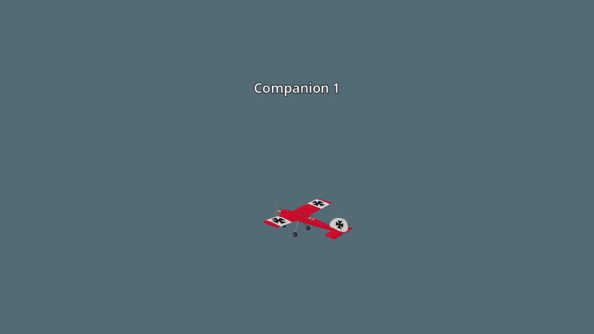
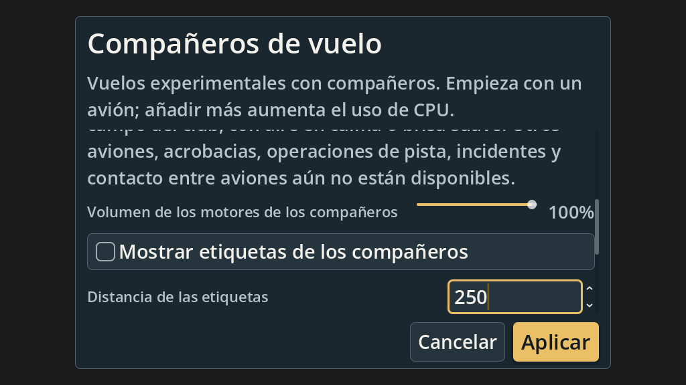
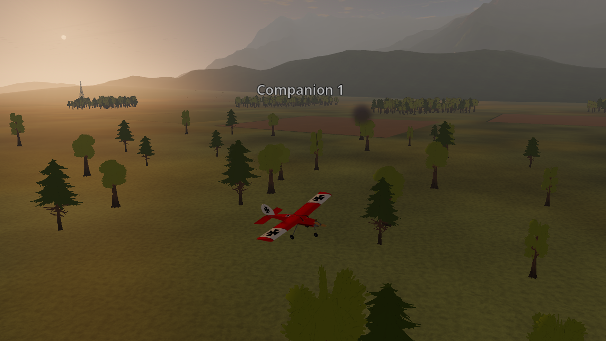

# AFC-05-R1 — Companion presentation and accessible controls

2026-10-20. Implemented live companion engine volume/mute and optional labels.
The manager validates cosmetic edits atomically; flight settings still wait for
Restart. Labels use scene depth, a 50–1000 m camera-distance limit, and disappear
after a fault/crash. Audio silence does not stop the aircraft. Camera ownership,
held pilot commands and simulation state are unchanged by presentation edits.

Preferences now use the configuration's canonical defaults, including additive
presentation fields. Existing preferences normalize the new fields; future schema
protection is preserved. Cancel discards the draft, and a failed Save as default
rolls back live presentation as well as the staged flight configuration. Current
companion controls include Spanish translations.

The initial large-text layout failed 29 checks: fixed traffic status and secondary
actions could leave no readable settings viewport. Those controls now scroll with
the settings; Apply and Cancel remain outside the scroll area. The accepted layout
checks follow actual keyboard focus through every control, using the application's
display scaling and English/Spanish translations.

## Verification

See [verification.json](verification.json) for source hashes, retained check paths,
artifact hashes, and the exact scope of each run.

| Check | Result |
| --- | --- |
| Configuration validation | 41 checks passed, including invalid/nonfinite cosmetic values |
| Dialog keyboard/controller actions | 19 checks passed; emitted values, Cancel, focus, and removal |
| Full Home/Pause shell journey | 49 checks passed on the current application; live Apply, failure rollback, restart, capture and removal |
| Presentation component | 13 checks passed headless and with the native renderer; physics/command bytes unchanged, distance/depth/camera/audio contracts |
| English/Spanish layout | 276 checks passed at 1024×576, 1280×720 and 3840×2160, with text scales 1.0 and 1.3 |
| Native layout/capture | 284 checks passed, including eight saved captures |
| Full-airfield native capture | Five captures completed; zero engine errors, one existing maple-tree wind-material warning |

The component/native layout runs have zero engine errors or warnings. The full
shell run has one existing maple-tree wind-material warning. These are functional
checks, not frame-time or aircraft-count qualifications. Native component evidence
uses the real aircraft builder, agent and camera with a plain inspection background;
it does not claim a scenery or moving-flight qualification.





Earlier full-world capture attempts are retained as rejected runs: changing
scenery first had missing assets/invalid pit placements, the stable checkout had
stale generated hill placements, and a later current-tree native run completed
captures but emitted null-texture errors from `scenery/parked_aircraft.gd:24`.
The checked runner correctly rejects these despite their completion marker.
After the scenery owner regenerated the parked-aircraft assets, the current-tree
capture completed cleanly at 23:31 UTC. Its [runner receipt](checks/afc05-native-refreshed-dbvgch5t/report.json)
and [full-world images](native/full-world/pilot-view.png) establish the functional
rendering check on this Windows host. Visual inspection covered the real companion,
its label, the pilot view and presentation controls. This is not a frame-time,
moving-flight or population qualification. No scenery source or asset was modified
for this work. Earlier rejected receipts remain unchanged.



## Repeat

Use the pinned Windows Godot and the checked runner from the repository root:

```powershell
python tools/godot/run_checked.py --warnings-as-errors --require-text 'companion presentation: 13 checks, 0 failed' -- .tools/Godot_v4.7.2-stable_win64_console.exe --headless --path app --script res://tests/test_companions_presentation.gd
python tools/godot/run_checked.py --warnings-as-errors --require-text 'companion layout: 276 checks, 0 failed' -- .tools/Godot_v4.7.2-stable_win64_console.exe --headless --path app --script res://tests/test_companions_layout.gd
```

For native component capture omit `--headless` and append
`-- --capture=<new absolute PNG path>` to the presentation check. For the layout
check, append `-- --capture=<new absolute directory>` and require the 284-check
marker. Large flight recordings use D: on this host because C: has little space.

The user selected Windows first: Windows 11 Pro build 26100, Ryzen 9 5900X,
64 GiB RAM, GeForce RTX 3090, NVIDIA 617.42, Godot 4.7.2 Compatibility renderer.
Linux/macOS native checks and independent RC pilot review remain external release
gates. The feature remains experimental; this increment does not close AFC-05,
AFC-06 or AFC-28's full later-phase scope.
