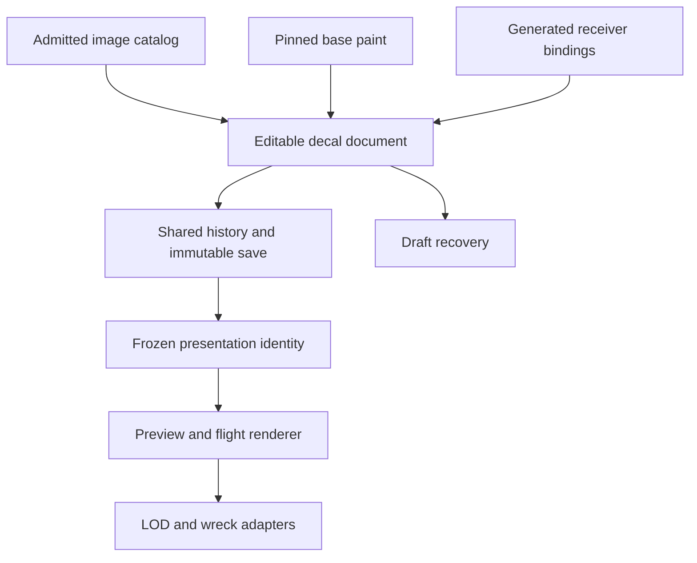

# Decal architecture and senior-developer integration map

**Proposed design, AE-24e; updated 2026-11-19 after [60 sequential investigations](../AE-24e-00-R1/README.md).** Source audit pinned at `0d251cb` (runtime baseline unchanged from the earlier handoff). No class or format below is
implemented in the production application by this branch. The
[source audit](README.md#current-implementation-verified-in-source) separates
existing behavior from these proposals.

## Rendering choice

Recommend **non-destructive projected overlay geometry on qualified rigid, opaque
receivers**, with cached geometry/textures and deterministic layer order. Use the
first two-family spike to establish visual correctness and cost before building
the entire editor. Ordered document data does not establish ordered pixels: this
candidate remains conditional until the pinned Compatibility and Mobile paths pass. Keep the stored document independent of the renderer so a
later compositor can replace the initial path without losing designs.

| Option | Useful properties | Concrete limitation / decision |
| --- | --- | --- |
| Native `Decal` per instance | Existing Godot primitive, curved projection, PBR channels, supported by OpenRC's pinned 4.8 Compatibility build | Bounded receiving-instance/surface count, shared view budget, projected-volume bleed and camera/AABB ordering. Suitable for a bounded ghost or measured alternative; fails the dense same-panel requirement as an unlimited backend |
| Project and clip to source triangles | Independent of stock UV overlap; exact rigid part attachment; works with ordinary mesh materials across target renderers | Requires clipping, stable alpha order, bias, receiver/LOD identity, cache and wreck mapping. Recommended spike and default candidate |
| Bake into the current stock UV atlas | Few flight draw calls and natural part movement | Shared/mirrored/repeated UVs copy or reverse marks. Changes to base atlas/material channels can break existing skins. Only a qualified unique-UV receiver can use this optimization |
| Generate unique decal-only charts and composite | Can merge dense overlap to fewer draws without changing original UVs | Additional charts, texel density, seam/mip padding, LOD mapping, memory and material integration. Later optimization if the simple overlay fails a measured budget |
| Flat `Sprite3D` or quad | Cheap prototype for a flat panel | Floats or cuts through curved bodies, can bridge hinges and fail back-side occlusion. Not the universal aircraft solution |
| One shader scanning every layer each pixel | Flexible compositing with explicit order | Per-pixel layer loops, sampler/uniform limits and material duplication conflict with modest hardware and existing materials. Do not introduce before comparing the simpler candidates |

The official 4.8 dev 4 report describes a hard eight-decals-per-surface limit and
default 64 per frame, constrained by hardware. Latest tutorial language uses
mesh/view. Exact `cafc17a19` source pairs a capped array to geometry instances and
bounds the global UBO allocation. Do not infer a separate budget for every material
slot. Native visibility depends on intersecting receiver bounds, not only the
painted part of an image. The existing crash ground-mark pool already uses native
decals. Raising a global setting neither removes the per-receiver cap nor proves
performance. [Engine evidence](sources.md#engine-version-and-rendering).

## Render-only data flow

The existing physics recipe/compiler/session remains authoritative and separate.
No render result writes back to mass, inertia, aerodynamic coefficients, contact
geometry or solver state. Geometry queries in a preview are cosmetic selection
queries, not additions to the flight physics model.

## 1. Image catalog and intake

Keep the human-authored organization/source/scope record separate from the shipped
runtime catalog. The research `catalog.json` is deliberately not a runtime loader
input. A future generator promotes only entries with confirmed intended usage,
approved variants and transformations, attribution and redistribution fields.
Store original bytes with their hashes; generate runtime textures reproducibly
without tracing/reinventing a logo. Offline originals may be larger or in a format
that is never admitted directly at runtime.

Proposed shipped entry: stable `asset_id`, source revision, decoded image content
hash, dimensions/aspect, color-space/alpha declaration, runtime image handle,
permitted operations, attribution record and withdrawal/version status. Runtime
profiles contain catalog IDs and content hashes; paths and URLs do not come from
player JSON. Revoking a catalog entry blocks new selection and creates an explicit
compatibility state for old work; do not rewrite immutable player revisions or
promise recall of copies already distributed.

For future personal imports, accept a bounded static PNG first. Reuse or extract
the reviewed admission foundations in `app/aircraft/custom_skin.gd`: archive and
entry limits, pre-decode signature/IHDR/chunk bounds, aggregate pixels, UTF-8 and
duplicate-field checks, decoded dimension verification and staged publication.
Workshop JSON already has `app/workshop/strict_json.gd`; do not create a parallel
permissive parser. Preserve current .orskin regression behavior when sharing code.
Add a deliberate still-image policy (the current PNG scan does not explicitly
reject APNG control chunks), aggregate temporary/resident budgets and bounded
decode concurrency. Decode to bounded RGBA8. Normalize transparent edge colors
through the approved source pipeline before generating mipmaps; straight and
premultiplied alpha must match the material/blend path. SVG is permitted only for this trusted offline research pack; do not load
arbitrary player SVG, script, URL or filesystem path at runtime. The Hitec original
proves why file extensions cannot decide an input's type.

Initial *candidate* limits: 64 instances, 16 distinct images, 1 MiB encoded PNG
per image and a maximum 1024-pixel edge after approved normalization. Use 512 as
the standard working edge, 256 for a low texture tier and 1024 only with an admitted
budget. These values need target-hardware measurements. File compression is not
GPU compression: enforce encoded-byte, decoded-pixel, resident-image and peak-job
budgets separately. Admit the whole active visual state before allocation,
including custom-base costs introduced by the workflow, retained frozen outputs
and in-flight generations. If a smaller tier is necessary, present that choice
before accepting it; do not silently change source identity or saved dimensions. Never make sponsor images
sharper by fabricating details or upscaling a small header logo and calling it HD.

## 2. Explicit base appearance

Current Workshop preview and trials omit the Home livery selection. Capture an
explicit visual base when entering decal editing: factory, stock paint ID plus
its visual content identity, or installed custom-skin ID plus exact source bytes
identity. Validate the corresponding family/model/paint identity and freeze it
with the visual profile. A temporary dropdown change in Home must not change a
saved or active trial's base behind its back.

Resolve that base through the existing `AirplaneBuilder` / `VehiclePaint` /
`CustomSkin` paths, then apply supported per-slot appearance and the decal stack
in one declared order. A recommended order is: validated source visual → chosen
stock/custom base → accepted per-slot paint → fixed markings → editable decals →
lighting/other consumers that copy final materials. Reconcile the exact order with
current lighting, damage and custom-skin consumers; do not assume the last setter
automatically composes every channel correctly. No source material or original
`.orskin` archive is changed.

If a legacy Workshop record had no base selection, retain its historical factory
appearance. A new copy can explicitly select a different base. Missing custom
bytes or an incompatible paint identity must produce a recoverable unavailable
state, not an automatic factory substitution. Route the same frozen identity to
preview, flight, saved-build thumbnails, trial restart and return.

## 3. Receiver contract and exact picking

Generate a separate, versioned decal-receiver companion through each aircraft's
owning source pipeline. Preserve the legacy companion/proof contract described
in section 6; adding receiver fields to an existing closed companion changes its
identity. Keep existing aircraft/hinge/node names and original geometry/UVs.
Each receiver has a stable semantic ID, validated source mesh/node binding,
material surface and topology identity, rigid part/hinge owner, opaque paintable
region, canonical local frame, allowed size/depth/normal limits, paired receiver
when authored, and mappings to accepted LOD and crash-section representations.
Expose a capability only when its data and renderer are qualified. Paintable
region membership is authoritative and precedes adjacency, facing and depth
filters. A UV seam may be valid to cross; a coincident vertex across a hinge may
not be. Generate semantic face/triangle mappings after final export, and validate
seam correspondence within that region instead of globally welding vertices.

Use the actual visible paintable geometry for ray selection. Cache a bounded
triangle acceleration structure per visual source rather than re-reading every
mesh on each pointer move. A separate exact preview selection mesh is acceptable
if it is generated and identity-pinned; a coarse flight collision proxy is not
accurate enough for sticker placement. Convert pointer coordinates through the
preview container's actual content rectangle into the SubViewport's pixels,
including stretch, letterboxing and display scale. Use both the camera's ray
origin and direction so perspective and orthographic views work. Compare hits
from differently transformed receivers using a common world-distance metric. Restrict queries to the selected aircraft
and authored receivers, excluding canopy, cockpit interior, propeller/blur,
lighting effects, scenery and other aircraft.

Maintain the anchor in the receiver's **bind/rest-pose local meters**, not
aircraft-root coordinates. Let `M` be the receiver's current full local-to-world
transform, including its rigid animated owner and visual root. Convert a world
hit point with `M⁻¹`; that local point is the serialized rest-geometry coordinate.
For the linear part `A` of `M`, a local normal maps to world by `A⁻ᵀ`, while a
**world hit normal maps back to local by `Aᵀ`**. Normalize after each conversion.
A world tangent maps back as a direction by `A⁻¹`; re-orthogonalize it against the
recovered local normal. These directions matter under nonuniform scale. Rotation
and texture flips must not come from a negative-scale node. Test imported mirrored
nodes explicitly. A source triangle index is useful for a transient hit, but is
not a persistent identity across new exports, LODs or crash repartitioning.

## 4. Transform and projection contract

Persist center `c`, outward unit normal `n`, rightward unit tangent `t`, positive
width/height, angle, explicit U/V flip booleans and ordered layer identity. Let
`b = n × t`. The unrotated local point at coordinates `(u, v)` in meters is
`c + u*t + v*b`; rotation acts in the `(t,b)` plane around `c`. For a point in that
rotated frame, image UV is `(u/width + 0.5, 0.5 - v/height)`. Apply U/V flips to
the sampled UV, independently of normal, geometry winding or aircraft scaling.
Store canonical rotation in `[-180,180)` and preserve positive dimensions.
Initialize orientation from the receiver's authored tangent; during movement,
project the prior tangent into the new tangent plane, normalize and use a
specified fallback near degeneracy. Test pole crossings, camera reversal and
closed movement paths so normal alignment does not introduce surprise roll.
Authored opposite-side transforms map receiver frames; UV flips are a separate
operation and never a guessed global-X mirror.

The application’s virtual aircraft scale multiplies this receiver-local placement
exactly once through the existing visual root. UI displayed centimeters can show
the scaled width, but the serialized unit remains receiver bind-local meters. Test
the accepted 10%, 100% and 500% sizes for double scaling, z-fighting and clipping.
No pixel coordinate or normalized screen position belongs in the production save.

Project a short bounded prism along `-n`, restrict candidates to the authored
region and rigid owner, clip against all six planes, reject invalid facing/depth,
and interpolate positions, normals and generated sticker UVs at clipped edges.
Specify scale-aware numerical tolerances, repeated-vertex handling, winding under
negative determinants and singular-frame refusal. Check projected UV area as well
as 3D area: the offline exercise demonstrates a positive-area triangle whose
projection collapses to a line. Reject unsafe grazing/wrapping rather than stretch
a sponsor logo across a corner. A depth limit alone is not a
receiver selector. Curvature and normal rejection thresholds are receiver data.
Crossing a hinge initially clips visibly to the selected rigid part. Future split
placement yields separate linked local fragments, not one mesh spanning a hinge.

The receiver fixture includes identity, translated/rotated and hinged receivers.
Its `bind_to_model` gives explicit rest transforms; known-point checks exercise
rest mapping, a 90° hinge deflection and 10%/500% root scale. Separate nonuniform
scale checks recover a non-axis-aligned normal and tangent and would fail if the
normal used the wrong transform direction. They are reference arithmetic, not
runtime model or animation proof.

The [proposal schema and examples](../../../../research/aircraft-editor/sponsor-decals/schemas/decal-stack.schema.json)
exercise the finite/closed data shape against a named synthetic receiver. The
offline validator checks structure, IDs/hashes, frame orthogonality, aspect and
anchor bounds. It does **not** prove full footprint clipping or runtime binding.

## 5. Layers, appearance and cache

Start with one overlay per decal fragment and preserve one deterministic
bottom-to-top order. Use lit, alpha-blended material instances, preserve the full
source color/alpha and avoid casting shadows or introducing emission by default.
Opaque source geometry must still occlude the overlay from the back. Keep depth testing enabled and qualify depth writing disabled for the transparent
overlay path. The pinned material source bounds `render_priority` to [-128,127];
reserve a block for the accepted layer count and use owned material wrappers per
order. `next_pass` is not an immediate ordered draw guarantee, and priority alone
does not solve queue boundaries, intersections or bad depth bias. Exercise 2, 8,
9, 32, 33 and 64 partially transparent overlaps under camera reversal.

Use a small scale-aware offset from the receiver, common to a layer group, not a
stack of ever-larger physical offsets. Test grazing views, nearly coplanar surfaces,
tiny aircraft and mip boundaries. A vinyl finish can have its own explicit
roughness; changing unrelated base normals, roughness or metallic channels is not
an acceptable shortcut. Glass/transparent receivers are out of the first slice.

Declare RGB as source sRGB decoded to linear light and alpha as linear coverage.
The independent source-over oracle uses linear RGB, straight inputs and explicit
premultiplied intermediate math; an sRGB screenshot or tone-mapped result needs
its own final encoding comparison. Verify both custom-shader and standard-material
paths on the exact engine. Transparent padding, filtering and mip-edge policy are
part of the derivative recipe, not arbitrary runtime recoloring.

Sharing an atlas does **not** guarantee blend order and does not automatically
reduce draw calls. Merge only consecutive nonconflicting fragments when ordering
is retained, or composite overlapping layers into a qualified decal-only chart.
Do not use `MultiMesh` as a claimed universal solution for differently clipped,
ordered transparent geometry. For example, regrouping an A–B–A layer stack into
A–A–B changes alpha composition. Bake only on verified unique-UV receivers, with
source correspondence, texel density and gutters valid for the accepted mip range.
One-pixel padding is not a universal gutter policy.

During a gesture, rebuild only the selected preview fragment at a bounded rate;
on commit rebuild only affected receiver/order groups. Accepted flight geometry
is prepared before flight, reused unchanged per frame and attached to its rigid
visual owner. Cache keys include source model and receiver mapping, base-paint
identity, ordered layer content hashes/transforms, render implementation version,
texture tier and LOD representation. Derivable render caches are not authoritative
save data and may be discarded safely.

Each generation receives immutable inputs and owns its mutable CPU/GPU output.
A revision token can reject late publication but cannot undo a stale write to a
shared target. Publish completed generations on the owning thread; retain old
outputs while a frozen trial or thumbnail still references them. Reorder, atlas
repack and receiver changes invalidate all affected references, not just the
currently selected layer. A ViewportTexture remains live; freezing requires an
owned completed output and a defined producer lifetime, not merely another handle
to the editor's mutable target. Avoid per-frame readback.

Asset content changes produce new cache keys and immutable paths. ResourceLoader
replacement modes can refresh retained instances in place and are not a safe
universal reload shortcut. Retention roots include accepted saves, draft,
Undo/Redo, recovery, frozen trial and pending imports/jobs. Generated residency may
be evicted independently; collect original bytes only after these roots release
them at a coordinated boundary.

## 6. Persistence, migration and portability

### Preserve the admitted legacy path

Presentation v4 and its companions have closed keys. More subtly, the current
source-proof sets include **presentation.gd itself**, the customization renderer
and other effects. Editing those files and regenerating companions can invalidate
baseline customized profiles despite unchanged model geometry. Keeping old JSON
bytes alone does not preserve their usability.

Preferred first implementation experiment: add a separate
`presentation_facade.gd`, a v5 envelope, new receiver catalog and new decal
renderer/source-proof set. Keep baseline legacy proof-covered sources and
companions unchanged. Proposed envelope content is an original legacy profile
snapshot plus explicit `visual_base`, ordered `decals`, admitted asset/receiver
pins and a separately versioned composite visual identity. Final field names
and format require schema review; the existing standalone proposal is not this
envelope and is not a production loader input.

Admission resolves the trusted family/model registry and verifies actual installed
source or exported proof bytes before validating the legacy profile. The legacy
profile validator's syntactic companion checks alone are insufficient. Retain
three distinct values: original source profile, its canonical projection under
the admitted companion/version, and the composite visual identity. Existing
normalization of defaults and sorted selections must not be mistaken for exact
original-byte preservation.

All consumers need an intentional route through the facade: store, draft/recovery,
shared history, trial, bundle, transfer, preview, thumbnail, main flight,
restart/return and trace sidecars. Supply a detached validated legacy projection
to legacy paint/markings, smoke, lighting and mechanical-audio consumers; supply
the new base/stack to the decal path. Passing a nested envelope to a consumer
that reads root `smoke` or `lighting` can silently drop existing appearance.
Keep the legacy identity independently observable; do not relabel the composite
hash as the old identity.

The existing exporter emits one legacy presentation marker and rejects mixed
source-proof versions. New proofs need their **own marker and export path**,
coexisting with the unchanged legacy package. Test source-tree and exported PCK
admission independently. Existing proof validation identifies normalized source/
exporter-input bytes and a numeric 4.8.0 engine version; native qualification also
records the full beta commit and executable receipt.

Compatibility means records **already admitted at the audited baseline** remain
usable with the same canonical legacy identity and effects. It does not restore
arbitrary historical companions that are already unavailable. Existing rebind is
an explicit save-as-copy proposal with restrictions, including nonempty smoke;
it is not a universal migration. If the facade cannot preserve current legacy
proofs, stop that integration step and qualify a deliberate versioned source/
package loader. Never silently rehash a saved revision or replace unavailable
appearance with factory paint.

### Bounds, history and identity

Keep **65,536 bytes as the initial whole-v5-profile candidate cap**, including the
embedded legacy profile, all stack metadata and other domains. The standalone
stack's 64 KiB bound does not imply that it fits beside a maximal legacy profile.
Compute actual worst-case sizes before promising all count combinations. Images
and custom-base archives stay outside profile JSON. Any cap increase requires a
version-specific review of store, recovery, bundle, recursion and node bounds.
Old builds are not promised to import or launch v5; their forward behavior is
separate from the new app preserving v1–v4.

Reuse the existing 32-entry shared Workshop history. One gesture is one accepted
snapshot; invalid pending numeric text stays recovery/editor state. Stage and
validate image bytes before publishing references. Failures preserve the previous
revision/index and current draft. Preserve original source profiles and .orskin
bytes when creating a new decorated copy.

Trial's physical ID currently excludes presentation identity. Verify unchanged
compiled raw bytes, physical trial ID, model hash, solver inputs and physical
dependency set for every cosmetic-only change. New visual assets and proofs stay
out of physical dependencies. Also compare scene-derived crash grouping, bounds
and collision shapes; unchanged compilation hashes alone do not establish that.

### Portable visual dependency closure

Bundle v1 is a closed 24 MiB strict-JSON envelope with no image collection. Its
embedded `base_bytes` are the physical aircraft snapshot, **not the selected
custom .orskin archive**. A future v2 must account for the exact custom-base archive,
admitted sticker images, metadata, physical snapshot and encoding overhead.

A self-contained export includes all required bytes permitted for redistribution.
Versioned built-in references are acceptable only when the receiving installation
can resolve their exact identity. A dependency-requiring reference package is a
different, clearly labeled contract; do not describe it as portable reconstruction
on a fresh install. Missing, modified, unapproved or oversized base/image content
must produce a specific recoverable result, preserving local work.

Reuse `StrictJSON` and the reviewed image/archive admission foundations. Validate
names, duplicates, hashes, types, total encoded/expanded/decoded bytes and pixels
before atomic publication. For Base64, sum `4*ceil(n/3)` **per embedded file**.
Sixteen separate 1 MiB inputs need 22,369,664 encoded bytes, leaving 2,796,160 bytes
under 24 MiB before JSON, physical snapshot or custom base. Locally admitted .orskin
archives can be larger than that remainder; local validity does not imply bundle
eligibility. Do not silently raise v1's cap or omit a required base.

These choices follow [investigations 24–29](../AE-24e-00-R1/investigations-11-30.md)
and [40–49](../AE-24e-00-R1/investigations-31-60.md). The v5 route remains a proposal
until the call-site, source-proof and package gates in [validation](validation.md)
pass.

## 7. LOD, damage and lifecycle

Register mappings or independently generated overlay representations for every
accepted visual LOD. An LOD switch must preserve the same layer identity and
appearance while avoiding floating geometry. Automatic LOD depends on per-instance
bounds and per-viewport screen metrics: matching LOD names or bias does not make
a separate overlay switch with its receiver. Qualify a real shared selection owner,
or prove the overlay is geometrically valid for every accepted receiver LOD.
Cross thresholds in both directions with changing FOV/resolution/quality and
secondary viewports. Do not assume a selected-LOD API exists without checking the
pinned engine. Editing can use a fixed qualified
receiver LOD, but flight Low and other LODs still need matching proof. Procedural
and Timber pipelines can rebuild/reindex buffers; never persist their transient
triangle indices as durable anchors.

`wreck.gd` duplicates the airplane and `section_splitter.gd` then replaces mesh
nodes with section siblings. Own the overlay outside the disappearing source mesh. Rebind/reclip into the
matching copied section at a defined transition hook with source data retained.
A layer spanning sections may create multiple fragments with one document-layer
identity. Attach resulting fragments to the actual
detached part, not the flying aircraft root. Repair/reset tears down old resources
and restores the accepted design once, without double copies.

Cosmetic meshes must be explicitly excluded from wreck bounds and geometry-driven
grouping/contact construction. Existing `crash_no_bounds` metadata handles one
bounds traversal; separately audit grouping. Compare part groups, bounds and
collision shapes with decals disabled/enabled. A “render-only” folder name does
not establish this invariant.

Feature disabled or an empty stack means no picking acceleration structures,
overlay nodes, image decodes, worker jobs or per-tick callbacks. Release per-instance
meshes/materials, textures, preview jobs and cache references on aircraft switch,
trial failure, return, wreck destruction and application exit. Shared image-cache
ownership is explicit and bounded.

## 8. Cost model and next decision

At RGBA8 with a full mip chain, an uncompressed square texture needs approximately
`edge² × 4 × 4/3` bytes. Sixteen 256/512/1024 textures therefore require about
5.33/21.33/85.33 MiB respectively before atlases, staging, readback and geometry.
The exact offline payloads are 5,592,384 / 22,369,600 / 89,478,464 bytes respectively.
These are allocation estimates, not measured VRAM or compressed texture sizes.
Reusing one logo 32 times should reuse its image while retaining distinct instances.

Proposed normal-tier acceptance target: at most 64 MiB added steady CPU memory,
32 MiB aggregate added GPU peak, and a 1 ms added 95th-percentile frame cost on each declared
reference host at its required output resolution. Measure transient peaks, CPU/GPU
separately, p50/p95/p99 and hitches during placement/save/load. These are engineering
targets to accept or revise with evidence; they are not existing performance.
Include the complete incremental resident set, GPU-side staging and retained outputs
in that GPU peak; record CPU staging/temporary copies separately. the 16-image
count is not an automatic admission even at 512. Pixel coverage is a separate
workload axis: compare tiny separated, large separated and large overlapping
logos at the same instance count. Repeat matched empty/decorated runs, separate
cold work from warmed frames and keep unavailable GPU timing explicitly unknown.
High texture tiers need a separate admitted budget. The full
[qualification matrix](validation.md) owns acceptance.

If the simple overlay fails deterministic overlap, LOD/crash mapping or the measured
budget, compare generated decal-only charts before changing the renderer or source
aircraft UVs. Retain the same document and all player controls. The spike report
must explain the chosen backend with captures and resource/timing deltas.

## Research and executable references

The [R1 index](../AE-24e-00-R1/README.md) records the 10 → 20 → 30 sequence, three
syntheses and why the design changed. The [offline exercises](../../../../research/aircraft-editor/sponsor-decals/projection_exercises.py)
provide 37 closed-form geometry, normal, linear-alpha, byte-budget and ownership
cases. They are independent arithmetic/abstract models, not a Godot renderer,
threading proof or measured performance result. Their counterexamples become
native acceptance cases rather than substitutes for native tests.
