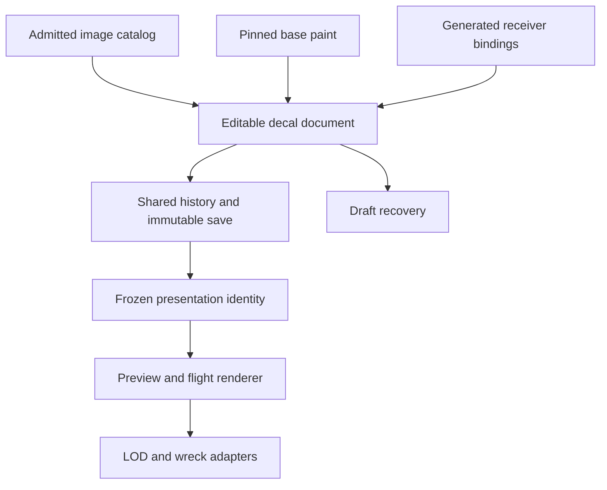

# Decal architecture and senior-developer integration map

**Proposed design, AE-24e; baseline `cf03e401`.** No class or format below is
implemented in the production application by this branch. The
[source audit](README.md#current-implementation-verified-in-source) separates
existing behavior from these proposals.

## Rendering choice

Recommend **non-destructive projected overlay geometry on qualified rigid, opaque
receivers**, with cached geometry/textures and deterministic layer order. Use the
first two-family spike to establish visual correctness and cost before building
the entire editor. Keep the stored document independent of the renderer so a
later compositor can replace the initial path without losing designs.

| Option | Useful properties | Concrete limitation / decision |
| --- | --- | --- |
| Native `Decal` per instance | Existing Godot primitive, curved projection, PBR channels, supported by OpenRC's pinned 4.8 Compatibility build | Bounded receiving-instance/surface count, shared view budget, projected-volume bleed and camera/AABB ordering. Suitable for a bounded ghost or measured alternative; fails the dense same-panel requirement as an unlimited backend |
| Project and clip to source triangles | Independent of stock UV overlap; exact rigid part attachment; works with ordinary mesh materials across target renderers | Requires clipping, stable alpha order, bias, receiver/LOD identity, cache and wreck mapping. Recommended spike and default candidate |
| Bake into the current stock UV atlas | Few flight draw calls and natural part movement | Shared/mirrored/repeated UVs copy or reverse marks. Changes to base atlas/material channels can break existing skins. Only a qualified unique-UV receiver can use this optimization |
| Generate unique decal-only charts and composite | Can merge dense overlap to fewer draws without changing original UVs | Additional charts, texel density, seam/mip padding, LOD mapping, memory and material integration. Later optimization if the simple overlay fails a measured budget |
| Flat `Sprite3D` or quad | Cheap prototype for a flat panel | Floats or cuts through curved bodies, can bridge hinges and fail back-side occlusion. Not the universal aircraft solution |
| One shader scanning every layer each pixel | Flexible compositing with explicit order | Per-pixel layer loops, sampler/uniform limits and material duplication conflict with modest hardware and existing materials. Do not introduce before comparing the simpler candidates |

The official 4.8 dev 4 report describes a hard eight-decals-per-surface limit and
default 64 per frame, constrained by hardware. Latest tutorial language uses
mesh/view. Exact `cafc17a19` source pairs a capped array to geometry instances and
bounds the global UBO allocation. Do not infer a separate budget for every material
slot. Native visibility depends on intersecting receiver bounds, not only the
painted part of an image. The existing crash ground-mark pool already uses native
decals. Raising a global setting neither removes the per-receiver cap nor proves
performance. [Engine evidence](sources.md#engine-version-and-rendering).

## Render-only data flow

The existing physics recipe/compiler/session remains authoritative and separate.
No render result writes back to mass, inertia, aerodynamic coefficients, contact
geometry or solver state. Geometry queries in a preview are cosmetic selection
queries, not additions to the flight physics model.

## 1. Image catalog and intake

Keep the human-authored organization/source/scope record separate from the shipped
runtime catalog. The research `catalog.json` is deliberately not a runtime loader
input. A future generator promotes only entries with confirmed intended usage,
approved variants and transformations, attribution and redistribution fields.
Store original bytes with their hashes; generate runtime textures reproducibly
without tracing/reinventing a logo. Offline originals may be larger or in a format
that is never admitted directly at runtime.

Proposed shipped entry: stable `asset_id`, source revision, decoded image content
hash, dimensions/aspect, color-space/alpha declaration, runtime image handle,
permitted operations, attribution record and withdrawal/version status. Runtime
profiles contain catalog IDs and content hashes; paths and URLs do not come from
player JSON. Revoking a catalog entry blocks new selection and creates an explicit
compatibility state for old work; do not rewrite immutable player revisions or
promise recall of copies already distributed.

For future personal imports, accept a bounded static PNG first. Verify signature,
dimensions, decoded byte budget, count and content hash before publishing anything.
Decode to bounded RGBA8, reject animated/multipage input, check decompression and
normalize transparent edge colors through the source pipeline before generating
mipmaps. SVG is permitted only for this trusted offline research pack; do not load
arbitrary player SVG, script, URL or filesystem path at runtime. The Hitec original
proves why file extensions cannot decide an input's type.

Initial *candidate* limits: 64 instances, 16 distinct images, 1 MiB encoded PNG
per image and a maximum 1024-pixel edge after approved normalization. Use 512 as
the standard working edge, 256 for a low texture tier and 1024 only with an admitted
budget. These values need target-hardware measurements. Never make sponsor images
sharper by fabricating details or upscaling a small header logo and calling it HD.

## 2. Explicit base appearance

Current Workshop preview and trials omit the Home livery selection. Capture an
explicit visual base when entering decal editing: factory, stock paint ID plus
its visual content identity, or installed custom-skin ID plus exact source bytes
identity. Validate the corresponding family/model/paint identity and freeze it
with the visual profile. A temporary dropdown change in Home must not change a
saved or active trial's base behind its back.

Resolve that base through the existing `AirplaneBuilder` / `VehiclePaint` /
`CustomSkin` paths, then apply supported per-slot appearance and the decal stack
in one declared order. A recommended order is: validated source visual → chosen
stock/custom base → accepted per-slot paint → fixed markings → editable decals →
lighting/other consumers that copy final materials. Reconcile the exact order with
current lighting, damage and custom-skin consumers; do not assume the last setter
automatically composes every channel correctly. No source material or original
`.orskin` archive is changed.

If a legacy Workshop record had no base selection, retain its historical factory
appearance. A new copy can explicitly select a different base. Missing custom
bytes or an incompatible paint identity must produce a recoverable unavailable
state, not an automatic factory substitution. Route the same frozen identity to
preview, flight, saved-build thumbnails, trial restart and return.

## 3. Receiver contract and exact picking

Extend the generated cosmetic companion through each aircraft's owning source
pipeline. Keep existing aircraft/hinge/node names and original geometry/UVs.
Each receiver has a stable semantic ID, validated source mesh/node binding,
material surface and topology identity, rigid part/hinge owner, opaque paintable
region, canonical local frame, allowed size/depth/normal limits, paired receiver
when authored, and mappings to accepted LOD and crash-section representations.
Expose a capability only when its data and renderer are qualified.

Use the actual visible paintable geometry for ray selection. Cache a bounded
triangle acceleration structure per visual source rather than re-reading every
mesh on each pointer move. A separate exact preview selection mesh is acceptable
if it is generated and identity-pinned; a coarse flight collision proxy is not
accurate enough for sticker placement. Restrict queries to the selected aircraft
and authored receivers, excluding canopy, cockpit interior, propeller/blur,
lighting effects, scenery and other aircraft.

Maintain the anchor in the receiver's **bind/rest-pose local meters**, not
aircraft-root coordinates. Let `M` be the receiver's current full local-to-world
transform, including its rigid animated owner and visual root. Convert a world
hit point with `M⁻¹`; that local point is the serialized rest-geometry coordinate.
For the linear part `A` of `M`, a local normal maps to world by `A⁻ᵀ`, while a
**world hit normal maps back to local by `Aᵀ`**. Normalize after each conversion.
A world tangent maps back as a direction by `A⁻¹`; re-orthogonalize it against the
recovered local normal. These directions matter under nonuniform scale. Rotation
and texture flips must not come from a negative-scale node. Test imported mirrored
nodes explicitly. A source triangle index is useful for a transient hit, but is
not a persistent identity across new exports, LODs or crash repartitioning.

## 4. Transform and projection contract

Persist center `c`, outward unit normal `n`, rightward unit tangent `t`, positive
width/height, angle, explicit U/V flip booleans and ordered layer identity. Let
`b = n × t`. The unrotated local point at coordinates `(u, v)` in meters is
`c + u*t + v*b`; rotation acts in the `(t,b)` plane around `c`. For a point in that
rotated frame, image UV is `(u/width + 0.5, 0.5 - v/height)`. Apply U/V flips to
the sampled UV, independently of normal, geometry winding or aircraft scaling.
Store canonical rotation in `[-180,180)` and preserve positive dimensions.

The application’s virtual aircraft scale multiplies this receiver-local placement
exactly once through the existing visual root. UI displayed centimeters can show
the scaled width, but the serialized unit remains receiver bind-local meters. Test
the accepted 10%, 100% and 500% sizes for double scaling, z-fighting and clipping.
No pixel coordinate or normalized screen position belongs in the production save.

Project a short bounded prism along `-n`, clip candidate triangles to its sides and
depth, reject back-facing/unrelated/disconnected surfaces, and interpolate positions,
normals and generated sticker UVs at clipped edges. A depth limit alone is not a
receiver selector. Curvature and normal rejection thresholds are receiver data.
Crossing a hinge initially clips visibly to the selected rigid part. Future split
placement yields separate linked local fragments, not one mesh spanning a hinge.

The receiver fixture includes identity, translated/rotated and hinged receivers.
Its `bind_to_model` gives explicit rest transforms; known-point checks exercise
rest mapping, a 90° hinge deflection and 10%/500% root scale. Separate nonuniform
scale checks recover a non-axis-aligned normal and tangent and would fail if the
normal used the wrong transform direction. They are reference arithmetic, not
runtime model or animation proof.

The [proposal schema and examples](../../../../research/aircraft-editor/sponsor-decals/schemas/decal-stack.schema.json)
exercise the finite/closed data shape against a named synthetic receiver. The
offline validator checks structure, IDs/hashes, frame orthogonality, aspect and
anchor bounds. It does **not** prove full footprint clipping or runtime binding.

## 5. Layers, appearance and cache

Start with one overlay per decal fragment and preserve one deterministic
bottom-to-top order. Use lit, alpha-blended material instances, preserve the full
source color/alpha and avoid casting shadows or introducing emission by default.
Opaque source geometry must still occlude the overlay from the back. Qualify
transparent depth-write policy and bounded `render_priority` values in the spike;
material priority does not solve geometric intersections or bad depth bias.

Use a small scale-aware offset from the receiver, common to a layer group, not a
stack of ever-larger physical offsets. Test grazing views, nearly coplanar surfaces,
tiny aircraft and mip boundaries. A vinyl finish can have its own explicit
roughness; changing unrelated base normals, roughness or metallic channels is not
an acceptable shortcut. Glass/transparent receivers are out of the first slice.

Sharing an atlas does **not** guarantee blend order and does not automatically
reduce draw calls. Merge only consecutive nonconflicting fragments when ordering
is retained, or composite overlapping layers into a qualified decal-only chart.
Do not use `MultiMesh` as a claimed universal solution for differently clipped,
ordered transparent geometry. Bake only on verified unique-UV receivers.

During a gesture, rebuild only the selected preview fragment at a bounded rate;
on commit rebuild only affected receiver/order groups. Accepted flight geometry
is prepared before flight, reused unchanged per frame and attached to its rigid
visual owner. Cache keys include source model and receiver mapping, base-paint
identity, ordered layer content hashes/transforms, render implementation version,
texture tier and LOD representation. Derivable render caches are not authoritative
save data and may be discarded safely.

## 6. Persistence, migration and portability

Presentation v4 rejects unknown fields. Propose v5 with explicit `visual_base` and
`decals` domains, closed per-version keys and canonical ordering. Do not silently
append fields to v4 or ignore them in old loaders. Preserve old read paths and
old identity bytes; an explicit new-copy migration can add an empty decal stack
and historical factory base. Version numbers are design candidates until AE
reviews all current consumers.

`presentation.gd` includes presentation-source hashes in companion identity.
Editing an existing pinned renderer and regenerating companions can stale every
old customized profile even when its source geometry is unchanged. The migration
must retain versioned source/companion compatibility or a reviewed old-to-new map;
an “empty new stack” alone does not resolve changed pins. Test actual v1–v4 fixtures,
customized profiles, current source companions and unavailable old dependencies.

Extend `Trial.freeze`, presentation sidecars and thumbnail identity with visual
content only. Assert unchanged physical trial ID, compiled aircraft bytes, model
hash and solver inputs when only decal state changes. Reuse the current shared
32-entry Workshop history; one gesture creates one snapshot. Include image content
references in undo/redo, detached recovery and immutable revisions so cleanup never
deletes bytes still reachable from any of them. Pending numeric text is editor
recovery state, not valid flight data.

The standalone stack proposal is capped at 64 KiB; evaluate a version-specific
128 KiB whole-profile cap for v5, retaining existing v1–v4 caps. Account for other
appearance domains in every store, recovery, bundle and recursion bound. Images
stay outside profile JSON. Admission first stages and validates bytes, then commits
references; failed writes preserve the previous revision/index and draft.

The existing variant bundle v1 contains no image payload list. A future v2 package
needs a bounded manifest plus content-addressed image bytes, strict relative
entries, duplicate/path/size/decode checks and an atomic import. Core shipped assets
may reference a versioned built-in catalog only if a fresh install can resolve the
exact permitted version. Personal or otherwise portable images need their admitted
bytes. A hash pointing to another computer's `user://` cache is not an export.
Use a maximum package budget derived from the 16-image candidate and base snapshot,
including encoding overhead; do not silently expand the existing 24 MiB reader.
Until this route is implemented, block unsupported exports with a specific message
and keep local saved work intact.

## 7. LOD, damage and lifecycle

Register mappings or independently generated overlay representations for every
accepted visual LOD. An LOD switch must preserve the same layer identity and
appearance while avoiding floating geometry. Editing can use a fixed qualified
receiver LOD, but flight Low and other LODs still need matching proof. Procedural
and Timber pipelines can rebuild/reindex buffers; never persist their transient
triangle indices as durable anchors.

`wreck.gd` duplicates the airplane and `section_splitter.gd` then replaces mesh
nodes with section siblings. Rebind/reclip each overlay into the matching copied
section before deleting its old target. Attach resulting fragments to the actual
detached part, not the flying aircraft root. Repair/reset tears down old resources
and restores the accepted design once, without double copies.

Cosmetic meshes must be explicitly excluded from wreck bounds and geometry-driven
grouping/contact construction. Existing `crash_no_bounds` metadata handles one
bounds traversal; separately audit grouping. Compare part groups, bounds and
collision shapes with decals disabled/enabled. A “render-only” folder name does
not establish this invariant.

Feature disabled or an empty stack means no picking acceleration structures,
overlay nodes, image decodes, worker jobs or per-tick callbacks. Release per-instance
meshes/materials, textures, preview jobs and cache references on aircraft switch,
trial failure, return, wreck destruction and application exit. Shared image-cache
ownership is explicit and bounded.

## 8. Cost model and next decision

At RGBA8 with a full mip chain, an uncompressed square texture needs approximately
`edge² × 4 × 4/3` bytes. Sixteen 256/512/1024 textures therefore require about
5.33/21.33/85.33 MiB respectively before atlases, staging, readback and geometry.
These are allocation estimates, not measured VRAM or compressed texture sizes.
Reusing one logo 32 times should reuse its image while retaining distinct instances.

Proposed normal-tier acceptance target: at most 64 MiB added steady CPU memory,
32 MiB added GPU memory, and a 1 ms added 95th-percentile frame cost on each declared
reference host at its required output resolution. Measure transient peaks, CPU/GPU
separately, p50/p95/p99 and hitches during placement/save/load. These are engineering
targets to accept or revise with evidence; they are not existing performance.
High texture tiers need a separate admitted budget. The full
[qualification matrix](validation.md) owns acceptance.

If the simple overlay fails deterministic overlap, LOD/crash mapping or the measured
budget, compare generated decal-only charts before changing the renderer or source
aircraft UVs. Retain the same document and all player controls. The spike report
must explain the chosen backend with captures and resource/timing deltas.
