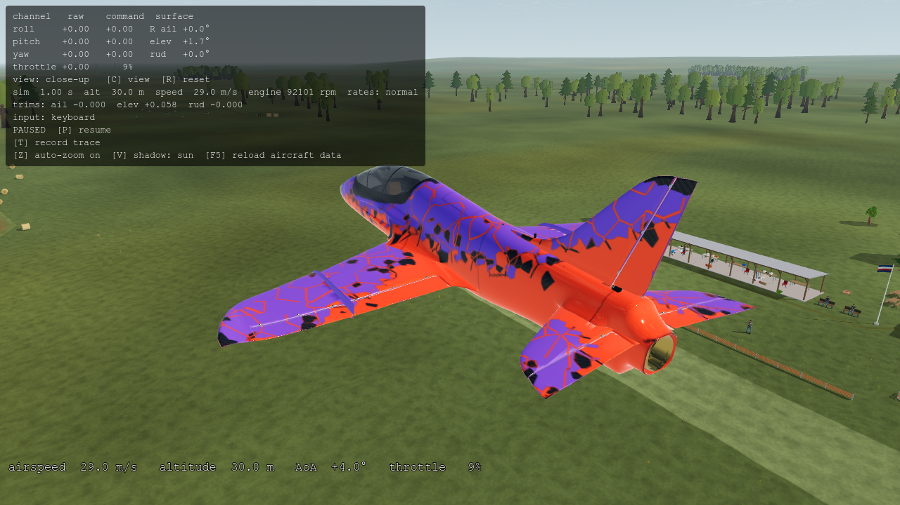
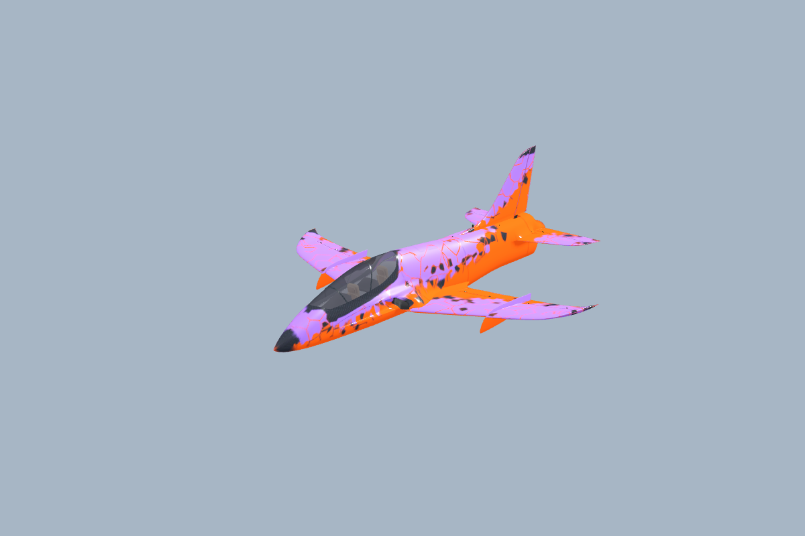
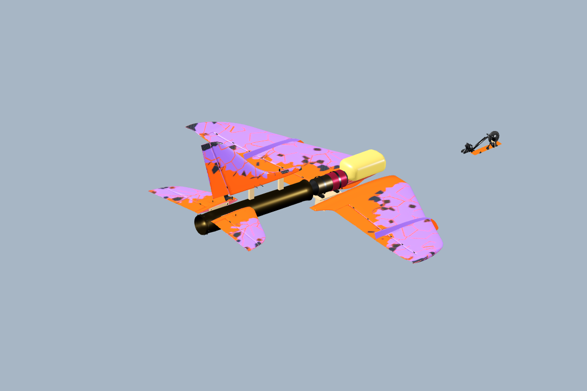

# AV-31: Blender Ventage Jet integration

2026-10-14. The supplied Avanti S A200 model replaces the procedural visual blockout for catalog ID `sebart-avanti-s-a200-p100rx`. It uses the common version-2 imported-model contract, with the existing P100-RX physics and turbine sound route. The source model's turbine, exhaust pipe, tank, cockpit, finish and moving controls are present. Native source-tree and standalone Windows rendering pass. The aircraft remains experimental.

The [asset guide](../../../../assets/aircraft/avanti-s-a200/README.md) owns current authoring and regeneration instructions. The [aircraft plan](../../../AVANTI-S-PLAN.md) owns remaining aircraft work; [AV-18…20](../../turbine-realism/AV-20/README.md) owns the existing continuous turbine response and its evidence. This entry records this integration, not a new full-suite, release or physical-validation claim.



## Delivery audit and source choice

The user delivery was inspected without modifying its master files or the unrelated live Blender scene. Canonical source copies are byte-identical to `assets/source-deliveries/ventage-jet/avanti_s.blend` and its geometry sidecar. The detailed source was necessary: the lighter supplied GLB omitted turbine parts. Existing geometry and textures were reused.

| Input or observation | Finding and consequence |
| --- | --- |
| Full supplied GLB | 985,491 triangles, 455 nodes, 420 meshes, 60 materials and 22 images; no section extras. Too expensive and not directly compliant with the runtime contract. |
| Lighter GLB | 343,937 triangles, 317 nodes, 282 meshes and 36 materials; turbine parts absent. Not chosen as the master. |
| Detailed Blender scene | 986,147 triangles including the ground; 424 mesh objects and 463 objects. Includes gear and control demonstration actions, internal wiring/equipment, engine, pipe and tank. |
| Authoring frame | Native −X right, +Y aft, +Z up. Godot mapping `(-x, z, y)` is a proper rotation. No mirrored coordinate system, scale correction or nonuniform fit. |
| Flight configuration | `GearRetract`, frame 211, supplies stowed gear; the seven aerodynamic controls have neutral rest transforms. Demo actions are excluded from the exported GLB. |
| Source sidecar | A visual study with estimated installation and planform; not measured airframe data. It cannot replace AV-06's physical inputs without re-identification. |

The fixed source/master hashes, export options and bounds are in the [source manifest](../../../../assets/aircraft/avanti-s-a200/source-manifest.json). Original master SHA-256: `4649d5527da8cc584770279d2ff4bc1494a29445c71f52a2103c33c7b0f05512`.

## Prepared asset and common contract

The isolated Blender 5.2.2 LTS export evaluates the source geometry, removes concealed wiring/electronics, merges compatible fixed parts, preserves independently moving control surfaces and reduces mesh detail within an explicit budget. The [prepared editable Blender file](../../../../assets/aircraft/avanti-s-a200/game/avanti_s_game.blend) retains packed textures. The runtime GLB is self-contained.

| Final property | Observed result |
| --- | --- |
| Runtime asset | 9,390,660 bytes; 130,710 triangles, below the 150,000 export gate |
| Scene cost | 19 mesh nodes, 75 material surfaces, 26 materials, 22 embedded images; maximum image dimension 2048 px |
| Source-to-game bounding-coordinate delta | Maximum approximately 0.00000065 m; acceptance limit 0.002 m. This proves retained extrema, not every local surface error. |
| Visible span / length | 1.996400 / 2.235400 m; nominal manufacturer dimensions 2.00 / 2.22 m |
| Stable runtime names | `airplane`, empty `propeller` marker, seven `*_hinge` nodes |
| Articulations | Left/right aileron, left/right elevator, rudder, left/right flap; local +X axes, measured rigid rest bases and neutral positions |
| Travel | Physical commands: aileron 30° up / 25° down, elevator and rudder ±30°. Visual inspector flaps clamp to 0–50°. |
| Crash presentation | Valid `openrc_section` extras on every mesh/control pivot; independent wing, tail, canopy, gear and engine/pipe sections |
| Runtime route | Common `imported_model.gd` and generated model manifests; `avanti_s_model.gd` remains a small compatibility facade for existing research/inspection callers |
| Godot import | Animation disabled, mesh compression disabled, embedded Basis Universal textures; no extracted PNG files required |

Final GLB SHA-256: `ad9c0c4daf1dd1882b59c8a1344f3cc7a1f51507e998349653d399d52a880d6e`. Two independent Blender processes produced the same GLB and manifest. Six-decimal UV rounding removes observed one-ULP differences from Blender's mesh averaging. This is an observed repeatability result on the pinned build, not a promise across Blender versions.

All five visual-family manifests and eight Workshop descriptors were regenerated after the shared registry changed. Model-source identity continues to invalidate stale frozen trials. The old estimated geometry remains available to its physical generator; it no longer constructs the visible jet.



## Turbine and physical boundary

The installed physical engine remains the **2017 JetCat P100-RX, non-BL reference**. The existing continuous model supplies spool response, RPM-dependent thrust, ram effects and rotor gyroscopy; sound already uses turbine whine/roar driven by telemetry. The imported engine and pipe are visual parts and do not add another force, mass inventory item or audio engine.

The source mesh is not a measured P100 installation. The sidecar's approximate engine center is 0.0728 m up / 0.4625 m aft, versus the physical surrogate's −0.005 m up / 0.540 m aft. Its approximate outlet is `[0, 0.07992, 1.28196]` in model coordinates. That observation is presentation metadata, not a validated thrust point. No new thrust arm or calibrated nozzle flow is inferred from it.

The sidecar's estimated wing area is 0.787673 m² versus the existing 0.7023 m² reference, and estimated geometric MAC 0.430934 m versus 0.3625 m. Importing those values would change trim, stability and performance without measured justification. The original physical geometry generator also assumes eleven fuselage intervals; the delivered sidecar has a different representation. It is therefore not fed wholesale into that generator.

Independent JSON comparison to pre-contact-update commit `5f7f4ad5` found only `description` and `crash_hull` changed. **499 other numeric leaves are identical**, including all 39 inventory records, aerodynamic coefficients, turbine schedules, inertia and thrust-line values. Flight mass remains 11.705089 kg with 1.28 kg prescribed fuel. The aircraft still starts airborne at 29 m/s, gear `locked_up`, flaps `not_simulated`.

Contact geometry is intentionally updated. Thirteen stable probe IDs now refer to actual vertices of the prepared, gear-up model: wing extrema, nose, tail cone/pipe, three belly stations, stabilizer tips, fin and canopy. The source compiler validates the IDs, finite coordinates and metadata hash, converts `[x_right,y_up,z_aft]` to physical LE coordinates `[x_aft,y_right,z_up]`, and preserves the existing wing-forward-shift rule. Component labels and probe order remain unchanged. These points are the existing terminal-contact approximation, not a continuous mesh collision solver.



## Software qualification

[Machine-readable evidence](verification.json) binds the asset, source, generator, importer settings and capture identities. [Focused results](focused-checks.json) record eleven completed suites.

| Proof | Result |
| --- | --- |
| Blender source/compiler and AV-06 generator `--check` | Pass; original source copies match, generated physical/contact output current |
| Model manifests / Workshop descriptors `--check` | Pass, five visual families / eight aircraft |
| Python model tests | 14 pass, including isolated LF and CRLF Git checkout fixtures |
| Common runtime contracts | 75 manifest, 68 imported-model and 330 render-contract checks pass |
| `verify_avanti.gd` | 340 checks, 0 failures; actual imported meshes, 7 hinges, vertex motion/sign/travel, clamping, neutral restoration, independent builds, bounds and crash sections |
| Turbine / continuous turbine / handling | 27 / 46 / 47 checks, 0 failures |
| Checkpoint / integrity | 92 / 149 checks, 0 failures |
| Crash pose / integration | 170 / 152 checks, 0 failures |
| Sound / catalog / Workshop integration | 124 / 98 / Workshop checks pass; catalog test still reports its ObjectDB-at-exit warning |
| Native captures | Eight model views plus source-tree and standalone application closeups; Compatibility renderer, RTX 3090, driver 610.88 |
| Standalone exported flight | Exactly 720 ticks / 3 seconds, all state samples finite, altitude 30.000→30.000 m, speed 29.0000 m/s; exact aircraft-input hash verified |

The visual inspection covers [front](front.png), [side](side.png), [top](top.png), [rear quarter](rear-quarter.png), [underside](underside.png), [full controls and inspector flaps](full-controls-inspector.png) and the turbine cutaway. [Capture metadata](captures.json) records the asset and model identities. Software correctness and visual agreement do not establish physical validation or low-end performance acceptance.

### Package qualification

The [initial common conformance report](conformance-initial.json) is preserved with `ok: false`: all source checks and eight catalog entries passed, but the bare Windows PCK runner lacked the project's external ground-vehicle DLL. Its global extension-loading errors correctly failed both package checks. The aircraft itself had no missing model or texture dependency.

A full Windows release export produced `OpenRC.exe` and `openrc_ground_vehicle.dll`. Running that executable directly, without `--path app`, produced the valid three-second trace and [rendered flight above](package-flight.png). Its [native capture log](package-capture.log) contains no load or script errors. A separate Godot editor/console pair placed beside the **exported** DLL then ran the original PCK: [all eight aircraft passed](package-preflight.json), with a [clean preflight log](package-preflight-with-dll.log) and [8/8 rotorcraft smoke checks](package-rotorcraft-with-dll.log). No DLL or extension path was changed in production.

To reproduce the isolation, retain both files from a normal Windows release export. For the PCK harness, place the matching DLL beside the Godot executable used for `conformance.py --package`; the Windows console wrapper also needs its corresponding editor executable. Do not supply `--path app` when inspecting the package. Run the standalone flight and validate it with:

```powershell
# Run the exported application from its own directory; choose a fresh output path.
./OpenRC.exe --headless --audio-driver Dummy -- --aircraft=sebart-avanti-s-a200-p100rx --trace=C:/temp/av31-flight.csv --t=3
# From the repository after that application exits:
python app/tests/check_trimmed_flight.py C:/temp/av31-flight.csv --duration 3 --aircraft-input app/data/aircraft/sebart_avanti_s_a200.json
```

### Scope remaining outside this integration

Gear animation/retraction controls, wheel contacts/taxi/landing, flap aerodynamics, finite fuel and moving mass properties, ECU start/stop/thermal lifecycle and calibrated physical installation remain in their owning plans. The source Blender demonstration does not enable those systems. No new golden flight was recorded. The whole `app/test.sh` suite, Linux/macOS exports, pilot evaluation and low-end target performance were not rerun by AV-31.

## Primary references and interpretation

| Reference | Use and limits |
| --- | --- |
| [SebArt original Avanti S Jet 2.2 m manual](https://www.sebart.it/download/AVANTI%20S%20JET%202.2m-Manual%20Intro.pdf) | A200 nominal dimensions, recommended engine, CG and control throws. The local source research retains its findings; the remote PDF timed out during this integration's recheck. It does not measure the supplied Blender surfaces. |
| [JetCat 2017 catalog](https://www.jetcat.de/jetcat/Kataloge/JetCat%20Lieferprogramm%202017_web.pdf) | Identity and values for the non-BL engine retained by the physical preset; detailed source review in [AV-18](../../turbine-realism/AV-18/README.md). |
| [JetCat P100-RX dimensional drawing](https://www.jetcat.de/jetcat/produkte/hobby/p100_rx/JetCat%20P100%20RX%20Size.PDF) | Official engine envelope checked against the installation interpretation. It does not establish the airframe's installed engine center or exhaust-tube alignment. |
| [Current JetCat P100-RX-BL page](https://www.jetcat.de/de/productdetails/produkte/jetcat/produkte/RC%20ENGINES/Engines/p100_rx-bl) | Variant cross-check: current BL specifications must not silently replace the 2017 non-BL reference. |
| [Blender glTF documentation](https://docs.blender.org/manual/en/5.1/addons/import_export/scene_gltf2.html) | glTF axes, mesh/material export and extras. Export options were also checked against the actual pinned Blender 5.2.2 API. |
| [Godot GLTFState documentation](https://docs.godotengine.org/en/4.5/classes/class_gltfstate.html) and [official import configuration](https://github.com/godotengine/godot-docs/blob/master/tutorials/assets_pipeline/importing_3d_scenes/import_configuration.rst) | Embedded-image handling and scene-import settings. The actual `.glb.import`, loaded mesh arrays and release captures are the evidence for the project's Godot 4.7.2 behavior. |

The author-provided visual sidecar and model are evidence of intended appearance. Manufacturer publications identify the aircraft and engine. Neither substitutes for matched-build metrology, bench response measurements or flight telemetry.
