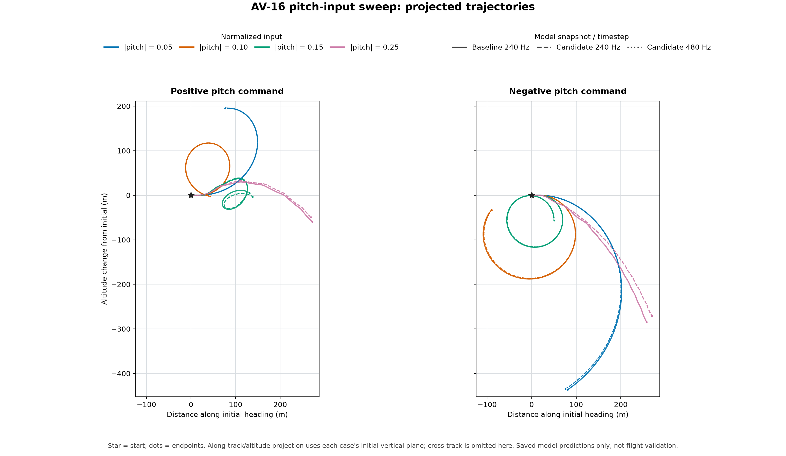

# AV-16 pitch-input follow-up

2026-10-12 · Status: descriptive model investigation complete; physical aerobatic validation remains open.

This report compares the saved baseline 240 Hz sweep with the corrected candidate at 240 and 480 Hz. Each case starts trimmed at 50 m/s and 500 m, holds a normalized pitch input from 0.2 s through 8 s, and ramps throttle toward full. These are open-loop model responses, not pilot-flown maneuvers or physical validation. The baseline and candidate use different generated Avanti data snapshots; only the candidate 240/480 pair is a timestep-refinement comparison.

The table gives `body-q integral / unwrapped world-velocity path turn / maximum cross-track / 3D endpoint distance`, in degrees, degrees, metres, and metres. The path turn is the velocity direction projected into the initial vertical plane. Cross-track and endpoint distance help show when that projection omits substantial three-dimensional motion.

| Pitch input | Baseline 240 Hz | Candidate 240 Hz | Candidate 480 Hz |
| ---: | ---: | ---: | ---: |
| −0.25 | −1655.02 / −69.53 / 82.43 / 392.54 | −1959.34 / −64.97 / 25.45 / 383.17 | −1958.71 / −64.93 / 25.46 / 383.15 |
| −0.15 | −455.30 / −448.05 / 6.24 / 74.15 | −457.46 / −450.18 / 6.22 / 75.82 | −457.34 / −450.12 / 6.22 / 75.81 |
| −0.10 | −309.72 / −304.97 / 8.49 / 99.65 | −311.53 / −306.78 / 8.43 / 96.05 | −311.46 / −306.74 / 8.43 / 96.05 |
| −0.05 | −148.49 / −145.59 / 4.91 / 443.90 | −149.86 / −146.95 / 4.98 / 441.25 | −149.82 / −146.93 / 4.98 / 441.23 |
| +0.05 | +186.28 / +185.14 / 7.67 / 210.03 | +186.11 / +184.98 / 7.67 / 210.11 | +186.05 / +184.95 / 7.67 / 210.13 |
| +0.10 | +354.16 / +349.70 / 5.92 / 43.30 | +354.53 / +350.07 / 5.91 / 43.24 | +354.42 / +350.02 / 5.91 / 43.22 |
| +0.15 | +542.19 / −400.33 / 56.97 / 131.16 | +544.00 / −405.68 / 57.49 / 138.02 | +543.84 / −405.57 / 57.48 / 138.05 |
| +0.25 | +437.60 / −40.28 / 15.30 / 278.25 | +425.66 / −45.87 / 10.40 / 272.97 | +425.56 / −45.88 / 10.39 / 272.98 |

The positive +0.25 result is not a loop: its body-q integral exceeds 360°, but its projected path turn is only −40° and the endpoint remains 278 m from the start. The negative −0.25 case similarly accumulates −1655° of body q while its projected path turn is −70°, with 82 m of cross-track departure. These directly contradict the old AV-14 log's “pattern loop” label for the +0.25 test, which was based on integrating body q alone.

The full sweep is more nuanced than a blanket “no loop” result. At +0.10, the projected velocity direction turns +350° and ends 43 m from the start; at −0.15 it turns −448° with only 6 m of cross-track departure, reaches about 117 m below its starting altitude and ends 74 m away. At +0.15, the projected turn reverses to −400° while cross-track reaches 57 m. The response is nonlinear and not monotone with stick magnitude. A projected turn over 360° is useful trajectory evidence, but these runs still do not establish a completed, energy-consistent, pilot-flown aerobatic loop.

There is no simple sign defect demonstrated by these results. Positive pitch input commands trailing-edge-up elevator; the input layer converts that into the aerodynamic model's trailing-edge-down coefficient convention, and the Avanti's negative `Cmde` then produces a nose-up pitching moment. At small magnitudes, positive input gives positive q/path turns and negative input gives negative turns. The divergence at larger positive inputs occurs alongside high-angle-of-attack response and large cross-track motion, so it calls for diagnosing the nonlinear model rather than reversing an input sign. Body `q` is an angular-rate component in the rotating body axes; its integral is not inertial pitch angle or flight-path rotation. The runtime integrates the full angular-rate vector and rotor momentum, while this report separately measures the rotated velocity path.

The 0.25 command is nominally 7.5° of the manual ±30° elevator throw, held for nearly the full eight seconds, while throttle ramps from the trimmed setting to full. That coupled, sustained input is an aggressive sensitivity case. In the baseline +0.25 case, angle of attack reaches 33.8° and speed falls to 32.1 m/s. The baseline aircraft data marks `CL_max = 0.85` and a 4° stall blend width as estimates; horizontal-tail local stall limits of 12° and 24° are also estimated. The wing and tail post-stall laws blend static lift and drag toward flat-plate curves; they do not model dynamic-stall hysteresis. This is a model-validation gap, not evidence that a particular coefficient or equation is wrong.

Candidate 240-to-480 Hz changes are small for this sweep: maximum absolute changes are 0.63° in body-q integral, 0.11° in projected path turn, 0.006 m in cross-track, and 0.029 m in endpoint distance. This indicates timestep insensitivity for these candidate runs; it does not establish physical accuracy. The baseline and candidate aircraft JSON hashes differ in their identity records, so their differences should not be interpreted as timestep error.

The figure projects each saved trajectory onto its initial vertical plane using the JSON `trajectory_samples` columns `time_s`, `north_m`, `east_m`, and `altitude_m`. It uses equal metre scales on both axes; cross-track motion is omitted from the projection and remains in the table. Recreate it from the saved JSON without running the simulator with `python research/avanti-s/av14/plot_pitch_sweep.py`.

Evidence: [baseline sweep](pitch-sweep-baseline-240.json), [candidate 240 Hz](pitch-sweep-240.json), [candidate 480 Hz](pitch-sweep-480.json); their [baseline identity](pitch-sweep-baseline-240.identity.json), [candidate 240 identity](pitch-sweep-240.identity.json), and [candidate 480 identity](pitch-sweep-480.identity.json). The input pulse is defined in [`pitch_sweep_probe.gd`](../../../../research/avanti-s/av14/pitch_sweep_probe.gd#L21-L40); path and q metrics are defined in [`envelope_probe.gd`](../../../../research/avanti-s/av14/envelope_probe.gd#L477-L542). Input/aero signs and post-stall treatment are in [`commands.gd`](../../../../app/input/commands.gd#L49-L59), [`aero.gd`](../../../../app/physics/aero.gd#L95-L180), and [`rigid_body.gd`](../../../../app/physics/rigid_body.gd#L77-L137). The estimated stall inputs are in the [Avanti data](../../../../app/data/aircraft/sebart_avanti_s_a200.json); the previous q-based “loop” wording appears in [`baseline-handling.log`](../AV-14/baseline-handling.log#L25-L26), while the current test labels q integration descriptive in [`test_avanti_handling.gd`](../../../../app/tests/test_avanti_handling.gd#L129-L141).
