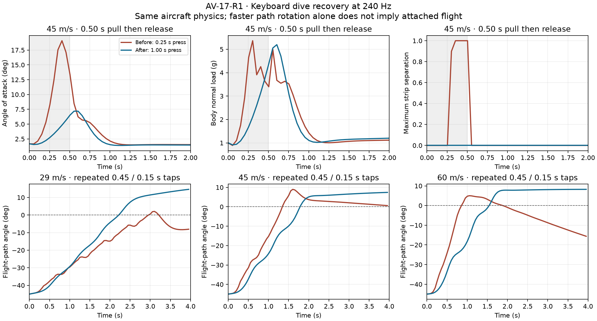

# AV-17-R1: keyboard pitch and dive recovery

2026-10-14 · Implemented and software-verified in Godot 4.7.2 (`ed1daf0bf`). Ventage Jet, sourced from the original SebArt Avanti S A200 / P100-RX. The aircraft remains experimental; no matched-build flight measurements validate its envelope.

## Finding and implemented response

The reported stall when pulling out of a dive was reproduced through the live keyboard sampler. Its generic ramp reached full virtual pitch stick in 0.25 s. The Avanti's normal profile correctly applies 50% elevator travel and 40% expo, but a held key still reaches ±15° before trim. From a 45 m/s, −45° dive, a 0.35 s press reached 18.85° angle of attack and full separation on at least one wing strip. The input made it easy to demand an accelerated stall even with substantial airspeed.

The aircraft now declares a **1.0 s neutral-to-full keyboard pitch response**, with **0.25 s full-to-neutral release**. Partial release is proportional: half-stick returns in 0.125 s. Reversing first recenters at the release rate, then uses the remaining tick to build the opposite demand. These are estimated input-policy settings, not measured aircraft or servo timings. They apply to keyboard normal mode, before the existing expo, dual rates, trim and physical actuator. Full rates, gamepad/radio input, scripted physical commands and aircraft without this optional policy retain their existing paths. Full normal elevator travel remains available; a sustained over-pull still stalls.

The policy uses no airspeed, AoA or load feedback. It is not a flight assist or stall limiter. All physical quantities and their provenance in the generated aircraft JSON are exactly equal to the saved baseline after excluding the new `controls.keyboard` object; the [verification manifest](verification.json) records hashes and that comparison. Mass, CG, inertia, lift/drag/stall coefficients, surface throws, physical servo response and turbine data were not retuned.

## Parameter and source audit

The [manufacturer audit](manufacturer-audit.md) identifies source pages, variant differences and missing measurements. The [aerodynamic audit](aerodynamic-audit.md) traces pitch authority, CG stability, wing-strip onset and tail downwash. Primary evidence includes SebArt's [A200 assembly manual](https://www.sebart.it/download/AVANTI%20S%20JET%202.2m-Manual%20Intro.pdf), pp. 1–5, and the FAA [Airplane Flying Handbook, Chapter 5](https://www.faa.gov/sites/faa.gov/files/regulations_policies/handbooks_manuals/aviation/airplane_handbook/06_afh_ch5.pdf), pp. 5-9–10 and 5-19–20. The FAA explicitly describes accelerated stalls during steep-dive pullouts. NASA wing-tail and NACA spanwise-stall references inform the model audit; none supplies an A200 polar.

| Area | Current model / evidence | Audit conclusion |
| --- | --- | --- |
| Variant and dimensions | Original A200; manual 2.00 m span, 2.22 m length, 10.5 kg dry with P100 | Keep separate from Mini/EDF/XS/Krill and later 2.3 m listings. |
| Mass and wing loading | 11.705089 kg half-tank model; estimated area 0.702275 m²; 166.7 g/dm² | Internally consistent; area, inventory and fuel loading still need measurement. |
| CG and static stability | 240 mm aft of root LE; estimated static margin 8.52% MAC; Cma about CG ≈ −0.407/rad | Manual beginner CG; no sign error or aft-CG instability found. Neutral point remains estimated. |
| Elevator authority | Manual ±30° maximum; normal D/R 50%, expo 40%; physical actuator unchanged | Normal scaling already correct. Expo softens intermediate input, not the endpoint. |
| Keyboard timing | Previous 4 command units/s; new press 1 unit/s and release 4 units/s | Confirmed handling issue; corrected only in normal keyboard pitch. |
| Lift and accelerated stall | Estimated CLmax 0.85; calculated clean 1-g Vs ≈17.72 m/s | High speed does not exclude stall. Scalar lift capacity at initial 45 m/s is ≈6.45 g, at 60 m/s ≈11.46 g; these are not structural ratings. |
| Spanwise onset | Estimated ±0.02 rad station incidence; global 10.34°–14.34° blend, tip onset near 9.2° body AoA | Tip-first loss is model-dependent. No measured twist or section polar justifies retuning it. |
| Induced flow | Attached lift uses induced section AoA; stall blend uses geometric strip AoA | Changing that closure requires recalibrating local onset against integrated CLmax, not substituting angles alone. |
| Tail response | Corrected free-tail slope/effectiveness; downwash lag ≈0.020 s at 45 m/s | No sign, release or initialization defect found. Tail separation and dynamic-stall behavior remain provisional. |
| Speed and energy | Continuous turbine dynamics retained; no speed clamp | Manual 250 km/h tested-speed guidance is not a measured structural/g envelope. No flutter/failure calibration is claimed. |

## Reproduced result

Conditions: 500 m AGL, calm air, −45° initial flight-path angle, wings level, gear/flaps up, existing half-tank model. Each case starts at the solved level-flight trim AoA and turbine demand for its initial speed, then runs four seconds through the real session input callback and float64 integration. Throttle remains at that trim demand; the dive is not a steady equilibrium. Initial speeds are 29, 45 and 60 m/s (104, 162 and 216 km/h).

| Initial TAS | 0.50 s pull: previous peak AoA | Revised peak AoA | Previous / revised peak body-normal load | Previous / revised maximum strip separation |
| --- | ---: | ---: | ---: | ---: |
| 29 m/s | 19.89° | 8.10° | 2.85 / 2.66 g | 1.00 / 0.00 |
| 45 m/s | 19.10° | 7.28° | 5.91 / 5.21 g | 1.00 / 0.00 |
| 60 m/s | 18.58° | 7.18° | 10.22 / 8.66 g | 1.00 / 0.00 |

A separate scripted pilot repeats 0.45 s press / 0.15 s release until the flight path first reaches level, then releases. This is a test input sequence, not runtime automation. The revised response reaches level in **2.221 / 1.787 / 1.546 s** at 29 / 45 / 60 m/s, with maximum AoA **7.83 / 6.60 / 6.32°**, peak load **3.10 / 5.10 / 7.92 g**, and zero wing-strip separation throughout the four-second record. The previous timing reaches full strip separation at all three speeds. At the two faster speeds it crosses level earlier while stalled; earlier path rotation alone is not better recovery. Level-path crossing is not a claim of subsequently trimmed or altitude-holding flight.

A two-second sustained pull at 45 m/s still reaches **24.83°** and full strip separation. A single half-second pull improves AoA response but is not sufficient by itself to level the flight path in the observation window. Keyboard operation therefore remains progressive pilot control, not automatic recovery.



Peak metrics are sampled every physics tick; plotted traces are recorded at 20 Hz and may omit narrow peaks. `body_normal_g` is accepted nongravitational body-Z force divided by model weight, not wing-only lift or a manufacturer structural limit. Separation is the maximum blend weight of any wing strip, not the fraction of total wing area stalled. The diagnostic stall event is first weight ≥0.5; partial separation can begin earlier.

The retained [comparison](comparison.json) covers **63 complete runs**: 18 original baseline holds, three legacy-timing pulse cases, and 21 revised cases each at 240 and 480 Hz. Hold durations are 0.20, 0.35, 0.50, 0.75, 1.0 and 2.0 s. All runs complete without crash or simulation fault. Across revised step rates, maximum peak-AoA difference is **0.0367°**, load difference **0.0289 g**, and level-crossing difference **0.002084 s**. Event presence and maximum separation agree. These are observed numerical differences, not physical-validation tolerances.

Raw records: [baseline 240 Hz](baseline-240.json), [revised 240 Hz](candidate-240.json), [revised 480 Hz](candidate-480.json), [legacy-timing pulse control](legacy-pulses-240.json). The original baseline was saved before the input change at working-tree HEAD `86a9911ef4b0683c9b24fa8073ba17bb9554ad95`; independent hashes identify its aircraft and input files. The later legacy-pulse run overrides only virtual-stick timing on the current physical model.

## Integration and verification

Source of the two policy quantities: [AV-06 inputs](../../../../research/avanti-s/av06/inputs.json), through [derive_physics.py](../../../../research/avanti-s/av06/derive_physics.py). The optional closed `controls.keyboard` object requires both seconds-valued quantities in [0.05, 5.0], and a declared normal-rate profile. It is covered by the runtime loader, v2 contract, generated JSON Schema, parameter register and regenerated Workshop descriptor. Existing v1 historical migration is unchanged. See [AIRCRAFT_CONTRACT](../../../../AIRCRAFT_CONTRACT.md) and [keyboard usage](../../../FIRST-LAUNCH.md).

Implementation: [commands.gd](../../../../app/input/commands.gd), [flight_session.gd](../../../../app/sim/flight_session.gd), [aircraft_data.gd](../../../../app/physics/aircraft_data.gd). Virtual-stick position remains in the existing session command state, preserving reset/checkpoint representation. No additional simulation state or golden-flight rerecording is introduced.

| Verification | Result |
| --- | --- |
| [Keyboard and pullout regression](verification/test_avanti_keyboard.log) | 38 checks; time/refinement/reversal/endpoint properties, malformed data, actual Down-key events, normal/full profile and reset, attached pulse recovery and retained over-pull stall |
| [Avanti handling](verification/test_avanti_handling.log), [continuous turbine](verification/test_turbine_continuous.log) | 47 and 46 checks |
| [Aircraft contract](verification/test_aircraft_contract.log) | 2,890 checks |
| [Rates](verification/test-rates.log), [controls](verification/test_controls.log) | 28 and 17 checks |
| [Gear](verification/test_retractable_gear.log), [controller flight actions](verification/test_controller_flight_actions.log) | 68 and 27 checks |
| [Checkpoints](verification/test_checkpoint.log), [replay integrity](verification/test_replay_integrity.log) | 92 and 153 checks |
| [End-to-end input](verification/test_e2e_input.log) | Actual application/default-aircraft and Timber keyboard checks pass |
| [Model/schema conformance](verification/conformance/verification.json) | All 17 commands pass, including eight aircraft preflights, generation freshness, import/render/model contracts and migration |

The controller-action fixture needed its production input/physics admission gates enabled and a sample/accept tick before inspecting gear or brake state. It now checks a real held brake before testing release during pause, and checks that a paused gear action cannot queue a command. No runtime gear behavior was changed. One interim run intersected concurrent scenery edits and emitted dependency parse errors despite completing assertions; it was rejected and rerun cleanly. The retained final log is clean. Expected malformed-data NaN and reference-inertia warnings are preserved in the relevant regression logs.

This is focused regression and conformance evidence, **not a claim that the full `app/test.sh` suite ran**. Software checks do not calibrate the aircraft. Matched planform/section/twist measurements, installed control travel, fuel-state CG, and measured trim/stall/pullout traces remain the physical acceptance gates. Flap aerodynamics, finite fuel and other aircraft-track work remain in the [owning plan](../../../AVANTI-S-PLAN.md).

## Reproduce

Run from the repository root using the pinned Godot executable; replace the output path with an absolute scratch path. The probe uses the same [scenario helper](../../../../app/tests/avanti_pullup_base.gd) as the regression test.

```powershell
& .tools/Godot_v4.7.2-stable_win64_console.exe --headless --path app --audio-driver Dummy --script res://tests/test_avanti_keyboard.gd
$pullupProbe = (Resolve-Path research/avanti-s/av17-r1/pullup_probe.gd).Path
& .tools/Godot_v4.7.2-stable_win64_console.exe --headless --path app --audio-driver Dummy --script $pullupProbe -- --hz=240 --out=C:/absolute/scratch/pullup-240.json
```

Use `--hz=480` for refinement; add `--legacy-keyboard --recovery-only` to reproduce the legacy pulse control. Resolve [spanwise_probe.gd](../../../../research/avanti-s/av17-r1/spanwise_probe.gd) in the same way and pass its absolute path to `--script` for the static strip audit. `python research/avanti-s/av17-r1/compare_pullup.py` regenerates the comparison JSON and figure from the retained records (figure recorded with Matplotlib 3.11.1). The [manifest](verification.json) identifies the relevant source, data, evidence and final logs rather than treating a concurrently changing repository HEAD as a frozen candidate.
