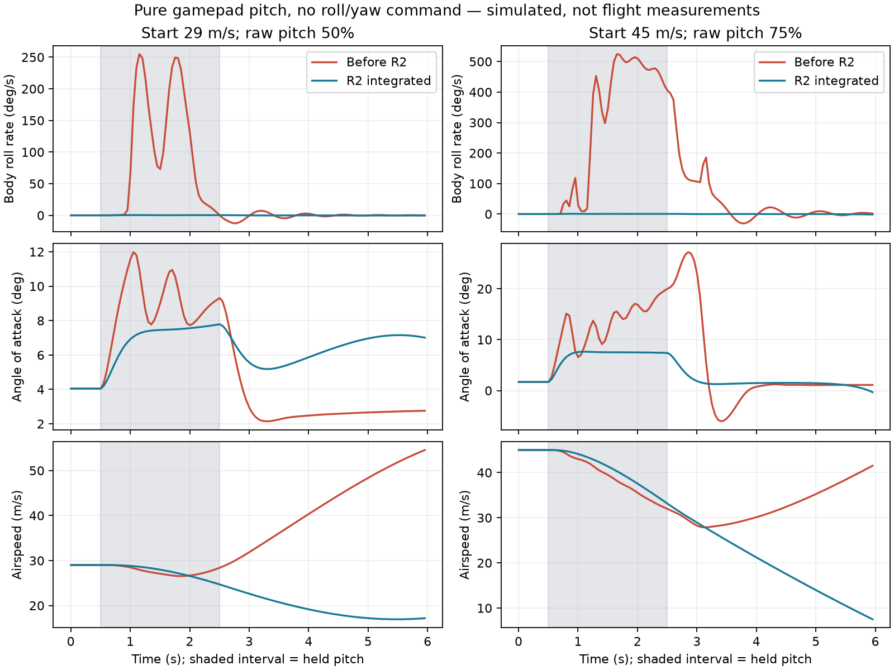

# AV-17-R2: gamepad pull-up departure and progressive stall

2026-10-14 · Integrated experimental model · SebArt Avanti S A200 / JetCat P100-RX

The pilot reported rolling and stalling when pulling up with a gamepad. The previous keyboard-only correction did not address this route. A pure elevator command through the actual `RcInput` and `FlightSession` sampler reproduced the departure: at 29 m/s, half raw pitch held for two seconds produced 255.36°/s body roll with zero commanded roll/yaw. The integrated correction reduces that case to 0.37°/s. This establishes a reproducible software improvement; it does not identify the real A200's flight dynamics or close pilot acceptance.

## Cause and implemented changes

The [controller audit](controller-audit.md) found separate pitch/roll/yaw mappings in the saved Mode 2 profile and no direct software cross-axis mixing. The source aircraft has large control surfaces. The old normal gamepad path allowed ±15° elevator before trim, with the device's own 0.30 expo; the short stick made over-pulling easy. Its estimated wing stall closure simultaneously transitioned to a flat plate over only four degrees. Combined with the estimated tip incidence, this amplified small aerodynamic asymmetries into very high roll rates.

The paired static probe also isolates this mechanism: at a trimmed 18.5 m/s, the original roll derivative is destabilizing (`Clp = +0.588`); the revised polar gives damping (`Clp = −0.197`). At 29 m/s both give `−0.606`. The lowest successful trim on the 0.05 m/s grid changes from 18.5 to 17.9 m/s; a slight destabilizing derivative remains at the revised trim floor. See the [dynamics audit](dynamics-audit.md) and [paired measurements](dynamics-trim-comparison.json). Trim existence is not a stability guarantee or a physical stall-speed measurement.

Two explicit changes are integrated:

1. **Normal-gamepad pitch travel:** `controls.gamepad.pitch_scale = 0.4`, giving ±6° before trim. Apply the fixed scale after device expo and aircraft normal travel, then add trim. Full mode retains ±30°, physical RC radios retain transmitter travel, and keyboard progression remains as implemented in R1. No state-dependent AoA/load limiter or roll cancellation is added. The [contract](../../../AIRCRAFT_CONTRACT.md) defines validation and fallback.
2. **Aircraft-specific progressive wing polar:** use the existing `tabulated-wing-v1` interface, generated by [build_polar.py](../../../../research/avanti-s/av17-r2/build_polar.py) through AV-06. Preserve the attached finite-wing calibration and CD0; replace the abrupt local post-stall curve with an explicitly estimated proxy. Both signs retain exact attached anchors and the existing high-angle flat-plate endpoint. Other aircraft retain their accepted polar.

The generated aircraft equals the [saved baseline](baseline-aircraft.json) after excluding only `/controls/gamepad` and `/aero/wing_polar`. Mass, CG, inertia, turbine, physical throws, servo timing, nominal lift coefficients, wing twist and landing gear inputs are identical. No golden flight was re-recorded.

## Sources and applicability

The [manufacturer/source audit](source-audit.md) distinguishes the original A200 from Mini/EDF, XS and Krill versions. SebArt's [2.2 m manual](https://www.sebart.it/download/AVANTI%20S%20JET%202.2m-Manual%20Intro.pdf) supports the control throws and describes a light aerobatic jet; it does not publish the section, polar, stall speed or measured dynamic derivatives. Its 250 km/h test statement is a structural caution, not an identified maximum level speed. The P100 ratings remain those of the [2017 JetCat catalogue](https://www.jetcat.de/jetcat/Kataloge/JetCat%20Lieferprogramm%202017_web.pdf).

The new proxy uses [Sandia SAND80-2114](https://www.osti.gov/servlets/purl/6548367), Sheldahl and Klimas, Table 3, printed pp. 35–36 / PDF pp. 38–39: NACA 0015 at Re 1,000,000. These are **hybrid calculated and experimentally extended data**, not an all-measured A200 polar. The [transcription and policy](../../../../research/avanti-s/av17-r2/sandia_naca0015_transcription.json) retain exact selected source rows, PDF SHA-256 and transformations. The section is a thickness-class surrogate; actual Avanti section and Reynolds dependence remain unknown.

The lift scale allocates the existing nominal CLmax using the finite-wing slope share; angle scaling preserves that slope. The signed 8° anchors include the calibrated strip offset. Profile drag adds the source increment above its 8° value to accepted CD0. The attached fraction is a monotone inverse Kirchhoff-style estimate motivated by [NASA TM-103855, equation 2.58](https://ntrs.nasa.gov/api/citations/19950008005/downloads/19950008005.pdf); using lift in this surrogate and applying it to finite-wing strips are modeling assumptions, not measured separation. Rows at 45/60/75/90° retain the existing CD90 continuation. This static model does not add dynamic-stall hysteresis.

## Reproduced behavior

Each case starts trimmed, level, at 500 m altitude in the constant-density test environment. Hold only raw gamepad pitch from 0.5 to 2.5 s, then release until 6 s. Throttle stays at the initial trim value; there is no scripted power increase. These are sensitivity maneuvers, not an automatic climb technique. Both negative and positive pitch are included.

| Initial speed | Raw positive pitch | Before: peak body roll rate | Integrated: peak body roll rate |
| --- | --- | --- | --- |
| 29 m/s (104 km/h) | 50% | 255.36°/s | 0.37°/s |
| 29 m/s | 75% | 357.43°/s | 1.11°/s |
| 45 m/s (162 km/h) | 75% | 525.85°/s | 1.53°/s |
| 60 m/s (216 km/h) | 75% | 707.50°/s | 0.99°/s |
| 60 m/s | 100% | 567.96°/s | 1.83°/s |



The polar also improves the result independently of the new gamepad travel: with the original normal travel, half raw pitch at 45 m/s drops from 25.14 to 1.31°/s peak body roll. This isolation is a regression in `test_avanti_gamepad_flight.gd`.

Full normal pitch from 29 m/s still runs out of energy at trim power. Its maximum strip separation passes 0.5 at 4.4 s, after the command was released at 2.5 s; peak roll reaches 58.44°/s and minimum speed reaches 9.34 m/s. During the held pull its peak roll is 3.85°/s. Sustained full-rate over-pulls and commanded spin entry/recovery also remain possible. The model has no stall immunity.

Use body roll rate `p` to evaluate this symptom. Euler bank can jump by 180° when a pure pitch maneuver crosses vertical. The reported separation is a model strip weight, not a measured percentage of stalled wing area. Low airspeed alone is not a stall criterion in unloaded or ballistic flight.

## Performance and verification limits

Accepted handling regressions retain a 29 m/s hands-off trim, approximately 73.3 m/s (264 km/h) predicted maximum level speed and a 9.40 modeled idle-glide L/D. The 17.7 m/s scalar 1-g estimate comes from nominal CLmax; it is not the loaded trimmed aircraft's measured minimum speed. The [dynamics audit](dynamics-audit.md) separates whole-aircraft trim, strip separation and roll stability. The prediction above 250 km/h does not override SebArt's caution and has not been calibrated to an instrumented speed run.

[Comparison data](comparison.json) cover **54 complete finite flights**: 18 old-policy cases at 240 Hz and 18 integrated cases at each of 240 and 480 Hz. Maximum differences between integrated resolutions are 0.0021° peak alpha, 0.0027°/s peak roll rate, 0.0056 m/s minimum speed and 0.0079 peak body-normal g. These figures show numerical consistency under the stated inputs, not physical validation.

The [focused verification](verification/verification.json) passes 19 commands covering gamepad contract/input shaping (29 assertions), flight departures (22), existing keyboard recovery (38), handling (47), polar implementation, aircraft contracts, turbine, gear, checkpoint/replay, controller actions and generator/schema freshness. [Model conformance](verification/conformance/verification.json) also passes. Logs were checked for engine script errors as well as exit codes. This is a focused Windows source verification, not a full `app/test.sh`, packaged release, physical controller transport certification or pilot acceptance.

## Reproduction

Use pinned Godot 4.7.2 after the normal project import. Run from the repository root; substitute an existing output directory and absolute script path when required by the engine.

```powershell
python research/avanti-s/av06/derive_physics.py --check
python research/avanti-s/av17-r2/verify.py --godot .tools/Godot_v4.7.2-stable_win64_console.exe --out .tools/avanti-r2-checks
& .tools/Godot_v4.7.2-stable_win64_console.exe --headless --path app --script "$PWD/research/avanti-s/av17-r2/gamepad_probe.gd" -- --out="$PWD/.tools/candidate-240.json"
```

Repeat the probe with `--baseline` for old-polar/old-gamepad behavior, with `--hz=480` for the resolution comparison, and optionally with `--physics-only` to retain old gamepad travel. `compare.py <evidence-directory>` checks completeness and draws the plot from `baseline-240.json`, `candidate-240.json` and `candidate-480.json`. Plot generation uses Matplotlib (3.11.1 in this run). The normal application was relaunched with the revised aircraft, explicit `--rates=normal`, chase camera and the detected XInput gamepad for pilot feedback.
