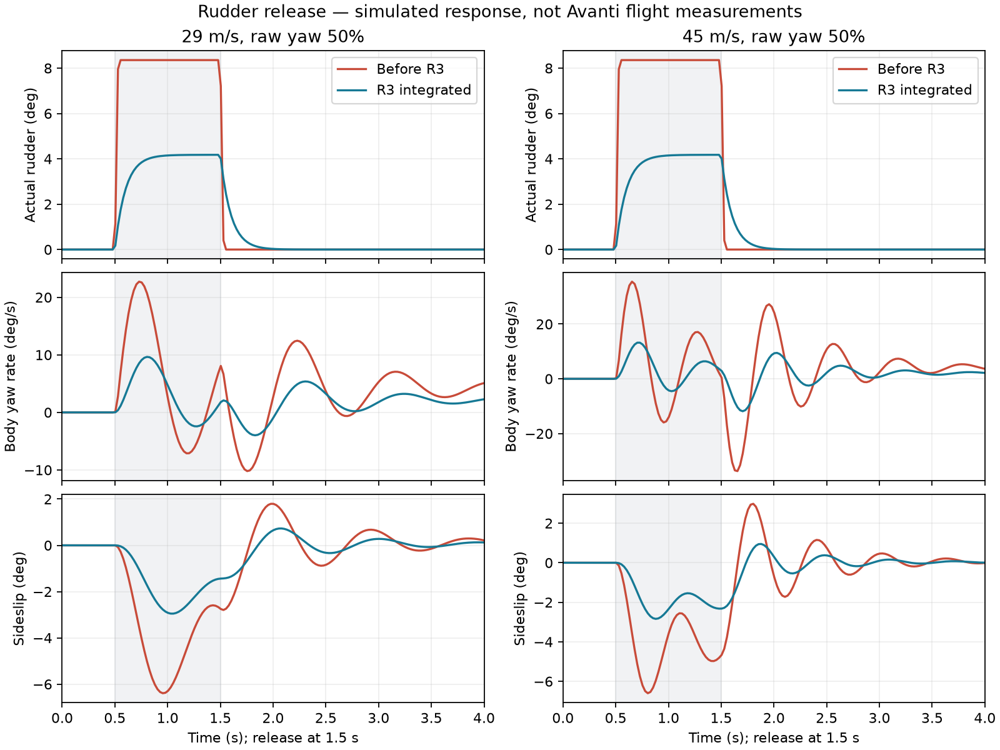

# AV-17-R3: gamepad rudder release

2026-10-14 · Integrated experimental model · SebArt Avanti S A200 / P100-RX

The pilot reported the nose swinging the other way when releasing the rudder stick. A pulse through the actual gamepad sampler reproduced the return without any opposite input or servo movement. At 45 m/s, half raw stick produced a peak opposite body yaw rate of 33.90°/s after release. The integrated change reduces it to 11.84°/s. A natural decaying return remains; these are simulated results, not measured A200 dynamics.

## Audit and changes

The [source review](yaw-sources.md) distinguishes manufacturer radio settings from a gamepad policy. SebArt specifies ±30° high-rate rudder and 80% Normal/pattern dual rate, which implies ±24° before trim. Its [manual](https://www.sebart.it/download/AVANTI%20S%20JET%202.2m-Manual%20Intro.pdf) supplies no yaw derivatives or release traces. The [physics audit](yaw-audit.md) found consistent fin/control signs. The modeled fin's nonlinear limits remain provisional, so they were not retuned to hide the symptom.

Two changes are integrated:

1. **Fixed Normal-gamepad input policy.** `yaw_scale = 0.5` reduces the previous ±24° endpoint to ±12° before trim. A first-order response with `yaw_response_time = 0.10 s` approaches the conditioned target continuously: 63.2% of a step in 100 ms and 95% in approximately 300 ms. This is a time constant, not a 100 ms dead time. Device expo is applied once; aircraft travel and the scale follow, then trim and the existing physical servo. These values are explicit short-stick tuning estimates, not manufacturer specifications.
2. **Correct yaw-rate moment references.** The generator derived `Cnp` and `Cnr` about CG, but runtime expects moments about the aerodynamic reference point (ARP) before applying `r×F`. Serialize `Cnp_ARP = Cnp_CG − CYp·(x_CG−x_ARP)/b`, and likewise for `Cnr/CYr`. The previous effective CG `Cnr` was −0.129276 instead of the intended −0.135714. The corrected ARP value is −0.142153. This restores the existing geometric build-up; it is not an arbitrary increase in damping.

The response reads no airspeed or body motion and applies no feedback rudder. Full mode, keyboard, physical RC radios and recorded physics inputs bypass the gamepad policy. RC transmitters continue to own their rates/expo. Missing optional quantities preserve the previous immediate/unity behavior. The resulting yaw command also feeds the declared nosewheel mix, reducing steering travel in Normal-gamepad operation.

Existing `commands.yaw` holds the transient input state. Reset centers it, holds freeze it, and disarming clears demand immediately. Physics checkpoints store downstream accepted inputs and restore paused replay; they do not restore a live controller/filter session. See the [aircraft contract](../../../../AIRCRAFT_CONTRACT.md).

The generated aircraft equals the saved [R2 baseline](baseline-aircraft.json) except for the two new gamepad quantities and `Cnp/Cnr`. The accepted R2 pitch policy/polar, mass, inertia, fin geometry, static derivatives, physical throws, servo timing, turbine and landing gear data are unchanged. No golden flight was re-recorded.

## Measurements

Each seven-second case starts trimmed at 500 m with fixed initial trim throttle and reference density. Apply only raw yaw from 0.5 to 1.5 seconds, then release. Test 29, 45 and 60 m/s and both signs of 25%, 50% and 100% raw stick. Record observations at 40 Hz; calculate extrema every physics tick. The `conditioned_yaw` column is the device-conditioned target, while each case's `yaw` is the injected raw axis value. Earlier captures' column label was corrected without altering any samples.

The metric below is the maximum opposite **body yaw rate** after release, projected against the commanded direction. It is not the nose's total angle of return, nor a claim that oscillation disappears.

| Initial speed | Raw stick | Before R3 | Integrated R3 |
| --- | --- | --- | --- |
| 29 m/s (104 km/h) | +50% | 10.21°/s | 3.98°/s |
| 45 m/s (162 km/h) | +50% | 33.90°/s | 11.84°/s |
| 60 m/s (216 km/h) | +50% | 36.95°/s | 11.43°/s |
| 45 m/s | +100% | 91.10°/s | 33.73°/s |



The [comparison](comparison.json) covers **54 complete finite cases**: 18 baseline cases at 240 Hz, and 18 integrated cases each at 240 and 480 Hz. Opposite peak yaw rate falls **61.0–69.5%** across the matrix. All runs retain neutral commanded roll/pitch and no opposite yaw command/servo. The largest 240/480 Hz difference is 0.00354°/s in the return metric and 0.00030° in peak sideslip. The improvement is for the combined input/reference correction; it does not attribute the reduction to a measured change in physical damping.

## Verification and limits

- [Input regression](../../../../app/tests/test_avanti_rudder.gd): **33 assertions**, including timestep-independent response, optional-data bounds, live sampler, trim order, Full/radio/keyboard bypass, hold/reset, disarming and downstream checkpoint restore. [Log](verification/avanti_rudder.log).
- [Flight regression](../../../../app/tests/test_avanti_yaw_flight.gd): **28 assertions**, including finite-difference CG yaw-rate moment closure and five complete pulse/release flights with bounded return and decaying sideslip. [Log](verification/avanti_yaw_flight.log).
- [Existing focused suite](verification/verification.json): **19 passing commands**, including the R2 pull-up tests, keyboard, handling, aircraft contracts, turbine, gear, checkpoint/replay and generated-data freshness.
- [Model conformance](verification/conformance/verification.json): **17 passing commands**. Logs checked for engine script errors as well as command results. [Hashes and verification record](manifest.json).

These checks qualify this software change, not real-aircraft dynamics, a full packaged release or every controller transport. Manufacturer yaw traces, measured fin polar and flight-identified damping remain unavailable. Pilot acceptance of the release feel is still required; full rudder can continue to excite coupled yaw/roll motion.

## Reproduction

Run from the repository root after normal project import, using pinned Godot 4.7.2. Create the chosen output directory first.

```powershell
python research/avanti-s/av17-r2/verify.py --godot .tools/Godot_v4.7.2-stable_win64_console.exe --out .tools/avanti-r3-checks
& .tools/Godot_v4.7.2-stable_win64_console.exe --headless --path app --script res://tests/test_avanti_rudder.gd
& .tools/Godot_v4.7.2-stable_win64_console.exe --headless --path app --script res://tests/test_avanti_yaw_flight.gd
& .tools/Godot_v4.7.2-stable_win64_console.exe --headless --path app --script "$PWD/research/avanti-s/av17-r3/yaw_probe.gd" -- --out="$PWD/.tools/candidate-240.json"
```

Repeat the probe with `--hz=480` for resolution comparison. For baseline behavior, pass `--aircraft="$PWD/docs/research/avanti-realism/AV-17-R3/baseline-aircraft.json"`. Place the three captures and baseline aircraft in an evidence directory, then run `python research/avanti-s/av17-r3/compare.py <directory>`. It checks completeness, input neutrality, data identity, numerical agreement and reduction, and renders the plot with Matplotlib (3.11.1 in this run).
