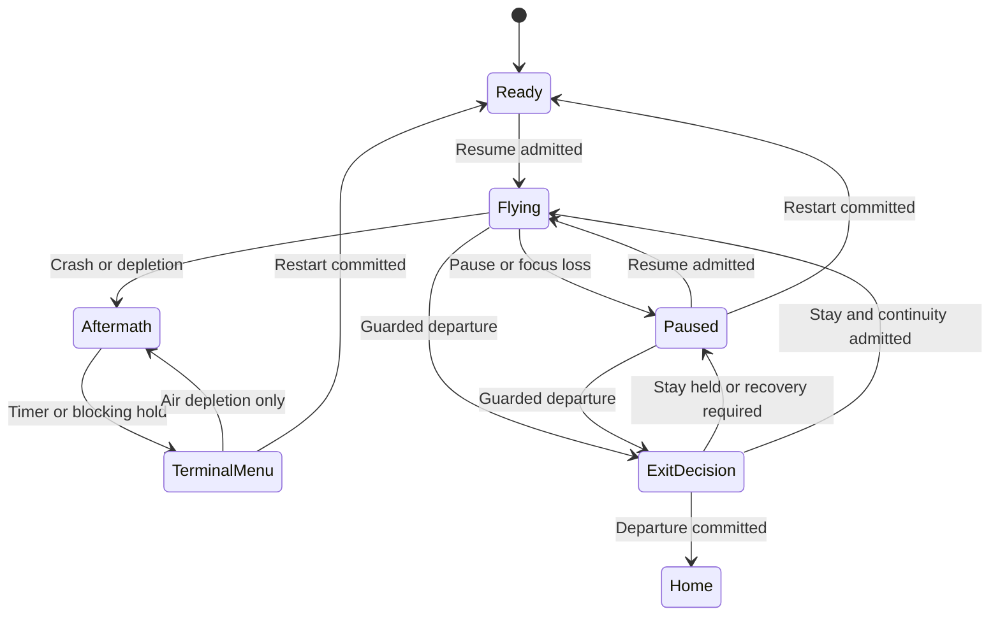

# FPV menus, crashes and flight lifecycle audit — 2026-11-17

## Outcome and scope

**Seven additional defects were reproduced, and existing finding A05 gained normal-route and semantic-input witnesses.** Three of the new defects concern failure handling: a rejected reconfiguration changes the old flight, automatic recording failures are not disclosed, and a quad continues simulating behind a guarded quit decision. Two further gaps need a product decision or clearer disclosure rather than an immediate bug verdict.

This is an **audit and implementation plan**, on `fix/fpv-battery-power-2026-11-16`, against production commit `7f6719137115a6da5a3b355cf6232a2f1de0661f`. Production code and the preceding battery/power implementation are unchanged. The diagnostic scripts deliberately assert observed baseline failures; passing them does **not** mean the defects are fixed. The authoritative remaining-work plan is [drone-racing §16](../../../plans/drone-racing.md#16-audit-remediation-programme-2026-11-16).

The investigation follows Home → FPV launch → flight → Pause/OSD → Resume, the crash/depletion aftermath, menu and shortcut restart, course changes, race cancellation, recording stop, Home and guarded quit. It combines source inspection, an application debug-bridge cycle, and controlled probes of the real activity and shell. It does not repeat the entire physics audit or change battery tuning.

The [previous audit](../audit-2026-11-16/README.md) and [follow-up](../audit-2026-11-16/follow-up.md) retain their original A identifiers. In particular, controller authority A01–A05/A19, pending-result recovery A11, filename ownership A12, replacement safety A13, reset metadata A14, malformed books A16 and OSD-save feedback A17 remain separate existing work. This report does not count them again.

## Evidence and severity

- **Executed:** real production scene/session/HUD or AppRoot, with a bounded diagnostic fixture. Keyboard and gamepad events use the root viewport. Sampled keyboard states use the existing input-reader seam.
- **Executed with injected fault:** candidate validation or storage failure is deliberately induced. This proves the failure path, not its frequency during ordinary use.
- **Source only:** the relevant control path is inspected, but a complete device/platform scenario has not been executed.
- **Policy/disclosure gap:** observed behavior lacks a sufficiently explicit product contract to call it an unconditional defect.

P2 means a functional, continuity or recovery defect worth addressing before expanding racing features. P3 means a narrower menu-state or presentation defect. These are engineering triage priorities, not measurements of occurrence rates.

| ID | Priority | Finding | Evidence |
| --- | --- | --- | --- |
| L01 | P2 | Held keyboard flight controls cross Pause → Resume immediately | Executed activity/input seam and viewport Escape |
| L02 | P2, existing A05 | Semantic Back is not consumed; menu-device routing remains incomplete | Executed normal Home route and synthetic selected gamepad; radio path source only |
| L03 | P3 | Ground-depletion Resume is hidden in the menu but accepted by Escape | Executed admitted empty-pack start |
| L04 | P3 | Restart/course-change menu shows the previous race outcome in IDLE | Executed countdown → GO → cancel → reset/course change |
| L05 | P2 | Failed reconfiguration changes the old flight before returning false | Executed injected candidate refusal in IDLE, COUNTDOWN and RACING |
| L06 | P2 | Automatic recording-write failures are not surfaced across reset/Home/F10 | Executed injected final-buffer write failures |
| L07 | P2 | Quad advances behind a statistics-save quit decision | Executed real AppRoot/statistics with injected store failure |
| L08 | P3 | Focus loss during crash aftermath replaces the main menu's crash reason | Executed real free-fall crash and focus notification |
| G01 | Decision | Home during an active race emits no terminal attempt record | Executed healthy departure; abandonment policy unspecified |
| G02 | Disclosure | Home shows saved wind while the quad starts with calm wind | Source only; existing tooltip narrows the claim |

## Lifecycle contract to preserve

The shared [menu contract](../../../MENU-PLAN.md#implemented-behavior) says blocking screens freeze flight, held flight keys require release, and Resume cannot bypass a menu, invalid start or crash. The quad HUD separately distinguishes grounded depletion from an airborne unpowered fall. The quad has its own menu implementation and uses AppRoot's exclusive ground-activity slot. Several shell adapters skip that slot or expect optional hooks the quad does not implement. That mismatch explains several findings, but does not require a wholesale rewrite of every menu.

The intended transition model should have one owner for eligibility and commit decisions:



This is a **proposed contract**, not a diagram claiming the current implementation already has those states. Quick R/G paths may immediately resume after a successful pad reset. A normal menu restart remains paused. A rejected candidate must retain the previous accepted attempt and recording. Exit decisions must retain the previous hold/continuity context, rather than universally resuming or universally zeroing throttle.

### L01 — Held keyboard commands act on the first resumed tick

**Reproduction.** Supply synthetic held/released keyboard values through the real input adapter's `read_keys` seam, arm, raise rate throttle to `0.2`, release throttle, and pause. With sampled keys released, viewport Escape resumes at exactly `0.2`: the positive continuity control passes. Pause again, keep throttle-increase and pitch sampled as held while the menu is open, then send viewport Escape. The first accepted tick advances `71 → 72`, raises virtual throttle to `0.203333333333333`, and accepts pitch `0.0166666666666667`. No release boundary intervenes. Physical held-key delivery itself is not qualified by this fixture.

**Cause.** [Activity Resume](../../../../app/vehicles/multirotor/multirotor_scene.gd#L592-L614) checks crash, throttle-policy compatibility and source readiness. It does not establish a keyboard release mask. The [input sampler](../../../../app/input/multirotor_input.gd#L283-L386) tracks arm/mode edges during a hold, but resumes stick integration and reads held throttle directly on the next accepted tick.

**Impact.** A flight command held while navigating a menu becomes flight input as soon as Resume succeeds. This violates the shared held-key contract. It does not establish an unsolicited arm edge: the arm/mode edge tracking is a separate mechanism.

**Repair direction.** Mask held keyboard flight controls across the menu boundary until released, then accept a fresh press. Preserve the already accepted virtual throttle for an ordinary same-source pause; zeroing it would break the successful continuity control and could drop a hovering quad. Define radio positional controls separately from keyboard release behavior. Own this in DR-14/16, coordinated with UI-21.

### L02 — Back and menu-device authority have no complete quad owner

**Reproduction.** The live application was entered through Home → Vehicles → ION R5 → FLY. Open OSD settings and emit semantic `ui_cancel`: settings remain open. Physical Escape closes settings and returns focus to its opener without resuming. Semantic Back at the outer menu also leaves it open; Escape resumes. The standalone real-activity probe installs native `UiInput.set_gamepad(42)` bindings and reproduces both missing Back actions with button B. Start from this mapped UI-only device does not open Pause; Start from an unselected device is correctly ignored.

**Cause.** The [quad shortcut handler](../../../../app/vehicles/multirotor/multirotor_scene.gd#L503-L543) consumes physical P/Escape and Start from the active **flight** gamepad. The [HUD settings handler](../../../../app/vehicles/multirotor/multirotor_hud.gd#L651-L661) consumes physical Escape. Neither consumes semantic `ui_cancel`. [AppRoot controller routing](../../../../app/app_root.gd#L2645-L2647) returns immediately for the ground slot; its [radio menu state](../../../../app/app_root.gd#L2330-L2344) also excludes that slot. The quad's UI-refresh hook remains a no-op.

**Limits.** This strengthens **A05**. It does not mean all gamepad navigation is broken on the Home route: native navigation mappings can remain installed. `UiInput.set_gamepad` installs Accept/Back/navigation, not Pause/Start. Thus the UI-only Start observation is not proof that a configured registry-role Pause binding was ignored; that full role-selection path remains unexecuted, alongside verified-radio delivery and live UI-role changes. The shared-router early return is the source-level evidence for those gaps. Logical-only Escape is also absent from these physical-key handlers, but no platform-wide keyboard failure is claimed.

**Repair direction.** Give selected UI actions one owner for Pause, navigation, Accept and Back. Back from OSD settings must return to the pause menu and opener; Back from the outer menu must obey the same eligibility guard as its Resume button. Keep flight and UI roles distinct and reject foreign devices. Reuse the shared semantic router through an adapter where practical, preserving radio center/OFF evidence. Own in DR-16/14 and A05, after binding-authority packet 1.

### L03 — A hidden Resume is still reachable after ground depletion

**Reproduction.** Prepare the admitted `initial_soc = 0` pad start, resume and run the real aftermath timer. At tick `482`, the quad is `depleted_ground`, the menu is visible, and Resume is hidden and disabled. The aftermath timer has completed. Viewport Escape hides the menu and advances to tick `483`.

**Cause.** [HUD eligibility](../../../../app/vehicles/multirotor/multirotor_hud.gd#L731-L750) excludes grounded depletion. The scene's Resume path checks crash but not that terminal category, and [Session.resume](../../../../app/sim/multirotor/session.gd#L496-L506) permits it. The shortcut calls the action directly and bypasses the hidden widget.

**Limits and controls.** Charge stays zero and motor mode stays `MOTOR_DEPLETED`. This is a menu/transition defect, **not restored power**. An admitted empty-pack airborne start correctly offers Resume to watch the unpowered fall; that behavior must remain. Ordinary crash Resume is also correctly refused.

**Repair direction.** Centralize resume eligibility and reason. The button, P/Escape, selected-device Start and semantic Back must consult the same decision. Grounded depletion stays in the restart menu; airborne depletion may resume the unpowered aftermath. Own in DR-16/20/31/37.

### L04 — An old race outcome survives reset and course change

**Reproduction.** Reach RACING through the real countdown, then cancel with G. The previous outcome is `ATTEMPT OVER`. Restart on the pad: the new race phase is IDLE, but the menu says both “Ready…” and “ATTEMPT OVER.” Cycle to the other stock course: IDLE still displays the old outcome. The centered in-flight result card is correctly hidden. A fresh countdown clears the cached result; cancelling before GO returns to IDLE without creating a new result card.

**Cause.** [HUD.show_menu](../../../../app/vehicles/multirotor/multirotor_hud.gd#L734-L743) appends any cached result title without checking whether it belongs to the current phase/attempt. [HUD.update](../../../../app/vehicles/multirotor/multirotor_hud.gd#L945-L953) clears that cache for COUNTDOWN/RACING, but not a reset to IDLE. The activity opens its new Ready menu before that update.

**Repair direction.** Tie presentation to accepted attempt/course identity and phase; clear or replace the result on a **committed** reset/reconfiguration. Keep a current terminal result readable during its aftermath and menu. Do not clear old state on a refused reset. Own in DR-31/37, coordinated with transaction packet 9.

### L05 — Reconfiguration refusal is not a transaction at the scene boundary

**Fault seam.** A small activity subclass merges `initial_soc = 2.0` into the next `_session_options()` call. This value is deliberately invalid and is rejected by the production validator. A pending throttle-limit change selects the real reconfiguration branch. No course file or filesystem is corrupted. This proves the refused-candidate path; it does **not** prove a normal stock course change routinely fails.

**Observed cases.** Direct `Session.prepare` refusal leaves the existing session tick, tape length and active-recording flag unchanged in all three phases. This control does not compare every frame/tape byte, identity or recorder cursor. Through `restart_on_pad`, however:

| Previous phase | Old tick → returned tick | Result of the refused scene restart |
| --- | --- | --- |
| IDLE | `15 → 15` | Tape length remains unchanged, but recording closes and armed-time counters reset |
| COUNTDOWN | `25 → 0` | Attempt was already reset; tape is cleared and recording closed |
| RACING | `755 → 0` | Attempt was already reset; tape is cleared and recording closed |

Each call returns false with “Restart refused.” The IDLE case exposes contradictory layers: an unchanged accepted tick/tape length with newly reset scene counters and a Ready menu. The active cases irreversibly retire the old attempt before discovering the new configuration is invalid. Removing the injected invalid option then allows a normal reconfiguration to apply the pending limit at a paused pad.

**Cause.** [restart_on_pad](../../../../app/vehicles/multirotor/multirotor_scene.gd#L641-L684) resets an active race before preparing its replacement. On failed preparation it calls `_after_pad_reset` even when no session reset occurred. That cleanup closes the recorder, resets input/timers/aftermath and opens Ready. This breaks the stronger transactional contract documented on [Session.prepare](../../../../app/sim/multirotor/session.gd#L114-L128).

**Repair direction.** Stage candidate preparation and the old-attempt transition before retiring the old flight. Validate result capacity, frame/identity and target configuration; commit once. On refusal preserve frame, clock, tape, course, counters, recorder and pending result ownership, with an honest held recovery reason. Design reentrant reset observers and commit-time failure explicitly. Do not attempt a cosmetic rollback after closing the old stream. Coordinate DR-16/17/20/25/26, A11 and A14; A14 still separately requires the original terminal tick/reason.

### L06 — Automatic recording failure has no durable visible status

**Fault seam and controls.** A subclass of the real multirotor recorder injects failure in `_write_packet`, calling production `_failed`. A healthy two-tick recording first finalizes and reads successfully. For the reset case, 240 ticks are flushed successfully and three further accepted ticks are buffered. Failure is injected when reset automatically flushes that final block. The reset succeeds, while the file remains readable but incomplete with its 240-tick prefix. The HUD keeps the previous message rather than disclosing the failure.

The next F10 action replaces the failed recorder with a fresh one and shows the new REC notice. That replacement recording finalizes successfully at zero recorded ticks; the separate healthy control contains two accepted ticks. A separate automatic Home stop with injected final-buffer failure emits the managed Home signal and pauses, again without flashing the failure.

**Cause.** [FlightLog._failed](../../../../app/sim/multirotor/flight_log.gd#L212-L250) stores the failure/note, disconnects and closes the file. Explicit F10 stop displays the note; [automatic `_stop_recording`](../../../../app/vehicles/multirotor/multirotor_scene.gd#L926-L941) ignores the stop result. A subsequent F10 replaces the in-memory error owner. The quad does not expose a departure recorder through the shell's expected hook.

**Limits.** The test proves an incomplete readable prefix, not total recording loss. It injects final buffered-block failures, not a real full disk, an in-flight chunk failure or a footer-only failure. The recording probe observes the activity's Home signal, not AppRoot's entire departure transaction. The shell probe covers AppRoot separately.

**Repair direction.** Keep a visible recording status/error owner across restart, Home and the next recording. Retain the incomplete path and verified prefix status until acknowledged. Do not silently label the file complete. A streamed `.orfl` writer that has already closed is not interchangeable with the generic manually saved trace's Retry contract: unwritten bytes may no longer be recoverable. Offer retry only for evidence that still exists. Own in DR-17 with UI-31 and publication packet 4.

### L07 — A guarded quit dialog does not hold the quad

**Reproduction.** Start the real AppRoot, Home, quad and statistics service. Confirm that the statistics store is writable, then point its store root at an isolated regular file, inducing a real write refusal. Send the window-close notification while the quad is running. The exclusive statistics-save decision opens and the exit request remains active. The quad advances from tick `23` to `26` while that dialog remains visible; its session is not paused and its flight menu is hidden. Cancel retains the same activity and clears the exit request; the previously running flight continues.

**Cause.** [AppRoot._hold_exit_sessions](../../../../app/app_root.gd#L4455-L4480) calls the optional ground activity `begin_exit_guard` hook; the quad has no implementation. [Input holding](../../../../app/app_root.gd#L4481-L4501) covers fixed-wing/workshop owners and the shared top screen, not this quad node. The quad's unhandled-input processing remains enabled.

**Important boundary.** A synthetic C shortcut reaches the activity before the dialog but **does not change the view while this exclusive dialog is open**. Do not turn the missing input-disable hook into a claim that every shortcut passes through the modal. Native focus loss may independently pause on some window systems. The reproduced failure is accepted simulation advancement behind a real guarded decision in the headless application, not a claim about all OS window delivery. The ordinary Home action already pauses before requesting departure.

**Repair direction.** Implement an explicit, idempotent quad exit-hold adapter with ownership for the entire decision, including deferred gaps between dialogs. Freeze accepted ticks and suppress activity shortcuts. Repeated quit must retain the existing decision. Stay/Cancel must restore the prior paused/running intent only under the chosen continuity policy, never bypassing a new crash or input-recovery condition. Own in DR-16/17 with UI-31; verify both initially running and initially paused flights.

### L08 — Early focus loss displaces the main crash explanation

**Reproduction.** Prepare the supported eight-metre airborne start and allow a disarmed free fall. A real `Hard impact` crash occurs at tick `355`. Send focus loss during the two-second aftermath before the crash menu opens. The main menu shows “Paused: the window lost focus.” Simulation is now paused, so the remaining aftermath timer cannot replace that reason. The crash cause is still present in the lower OSD hint and Resume correctly refuses. R correctly resets and resumes. If focus loss happens after the normal aftermath menu has opened, the crash reason is preserved.

**Cause.** [_hold](../../../../app/vehicles/multirotor/multirotor_scene.gd#L491-L499) preserves terminal text only when the menu was already visible. The crash callback stores terminal text/timer, while [_physics_process](../../../../app/vehicles/multirotor/multirotor_scene.gd#L766-L801) advances the aftermath only while unpaused.

**Repair direction.** Derive menu reason from the terminal state regardless of whether the menu was open before the external hold. Present focus loss as secondary context if useful. Keep the cause and the available recovery action together. This is a main-menu inconsistency, not evidence that the crash cause disappears from all UI. Own in DR-20/31/37.

## Decisions and disclosure gaps

### G01 — Define what committed Home/quit means for an active attempt

The shell probe reaches RACING with accepted scene ticks. G cancellation produces one terminal signal and one result file in healthy isolated storage. A second attempt reaches RACING; viewport P opens its menu, then Enter activates Home. Home returns successfully, but there is no additional terminal signal or result file. The activity exits still in RACING with an empty outbox.

This is different from **A11**, where already-produced pending results can be lost. Here no terminal projection is created. No explicit contract requiring Home/quit to count as abandonment was found, so this remains a policy gap. The existing G/pad-reset code preserves completed valid laps while excluding those departures from completed-attempt accounting; the present probe did not fly a completed lap and does not claim a reproduced best-lap loss.

**Proposed decision:** a committed departure abandons the active attempt at the last accepted tick, preserves valid completed laps and publishes once. Cancellation of the departure preserves the attempt. Settle how an already-published abandonment behaves if a later departure guard refuses. A filesystem write and a physics transition are not automatically one atomic transaction. Resolve this within DR-26/26a/17 and existing A11/A12/A14 work.

### G02 — Make launch conditions visibly accurate for the quad

Home keeps its compact saved wind/conditions summary when the quad is selected. The [Home tooltip](../../../../app/ui/home.gd#L2085-L2087) already says the saved atmosphere applies to airplanes and helicopters, so this is not wholly undisclosed. [Quad launch](../../../../app/app_root.gd#L993-L1002) does not pass those weather settings; [session defaults](../../../../app/sim/multirotor/session.gd#L108-L111) use zero wind. The FPV menu has no corresponding wind control.

Choose a visible “calm” disclosure for the current behavior, or implement a future properly validated wind configuration. Do not make the compact Home value appear authoritative while silently dropping unsupported atmosphere components. This is source-level product work, separate from the battery model and the confirmed lifecycle defects.

## Reproduction and validation

[verification.json](verification.json) retains portable observations and checked-runner verdicts. [The probe directory](repros/) contains the executable diagnostic sources. Logs, generated recordings, personal profiles and machine-specific paths are not part of this packet.

| Final verification | Checks | Result |
| --- | ---: | --- |
| Menu/crash/reset diagnostic | 50 | All observed witnesses and controls passed |
| Recording-failure diagnostic | 11 | All observed witnesses and controls passed |
| AppRoot quit/Home diagnostic | 23 | All observed witnesses and controls passed |
| Existing activity suite | 96 | Passed |
| Existing activity-race suite | 19 | Passed |
| Existing ground-exit transaction suite | 22 | Passed |
| Existing UI-input suite | 17 | Passed |
| Existing shared-screen-stack suite | 38 | Passed |
| Live debug-bridge route | 8 assertions | Passed; clean stop, no reported leaked objects |

The final checked runs completed with **zero engine errors and warnings**. The five existing suites contribute 192 checks; the new diagnostic probes contribute 84. Their simultaneous success demonstrates a coverage gap, not repaired behavior. The final bridge run also has a clean engine log. Earlier setup trials are recorded separately: the cold import needed a resumed run; an initial sparse checkout lacked airplane authoring metadata; and the first menu probe had an incorrect expected focus-loss string. The metadata was hydrated and the expectation corrected before the final runs. These are not counted as product findings.

**Review provenance.** Bounded helpers supplied menu/lifecycle mapping, recording and shell probe drafts, and independent challenge review. The lead inspected the accepted source and claims, integrated the final packet and owned runtime verification. Helpers were requested through the native route as `gpt-6.1-terra` with `max` reasoning; effective provider model/hidden effort was not independently exposed and remains unverified. Review agreement is not a substitute for the executed evidence.

Run from the repository root after importing with the repository-pinned engine. Use the configured test pool when available; this environment had no test-pool configuration, so execution used `tools/godot/run_checked.py` with bounded timeouts and isolated profiles. For example:

```bash
XDG_DATA_HOME="$PWD/tmp/lifecycle-profile" python3 tools/godot/run_checked.py \
  --label lifecycle-menu --timeout 150 --require-text 'LIFECYCLE MENU:' \
  --require-text '0 failures' -- \
  .tools/Godot_v4.8-beta2_linux.x86_64 --headless --path app --audio-driver Dummy \
  --script "$PWD/docs/research/drone-racing/lifecycle-2026-11-17/repros/menu_cycles.gd"
```

Use `recording_cycles.gd` and `shell_cycles.gd` with their respective completion markers for the other probes. The [debug-bridge scenario](repros/bridge-menu-cycle.txt) exercises the normal route and real UI actions; its documented starting point is the initial FPV menu reached from Home. All three GDScript probes are outside `app/tests` because they assert the current defect behavior. A repair must replace those expectations with desired-behavior regressions in the owning test suite.

**Controls that passed:** ordinary released-key pause preserves throttle; crash Resume is refused; R deliberately resets and resumes; menu Restart stays paused; an empty airborne pack offers Resume and unpauses while remaining unpowered (post-Resume descent was not measured); the centered stale card is hidden in IDLE; a new countdown clears cached results; cancelling before GO creates no result card; direct failed `Session.prepare` preserves tick, tape length and the active-recording flag; valid reconfiguration succeeds; a healthy recording finalizes; G cancellation writes its terminal record; Home retires the activity; a foreign pad does not gain Start authority.

**Qualification still open:** native EN/ES 1920×1080 readability/focus, real selected gamepads/radios, role changes/hotplug, OS modal-window delivery, previously paused quit/Stay continuity, in-flight chunk and footer-only I/O faults, real storage exhaustion and cross-platform recovery, completed-lap Home/quit policy tests, required CI and performance/latency. Headless layout coordinates are not native display evidence. This packet makes no new hardware, aerodynamic or power-calibration claim.

## Implementation order and closure

1. **Controller and lifecycle ownership:** retain existing packet 1 authority fixes, then extend packets 2–3 with L01/L02/L07 and L03's eligibility core. Use a small quad adapter to the shared shell, with one Resume decision and explicit exit holds. Ground-depletion eligibility must be correct before semantic Back adds another Resume entry point.
2. **Transactional restart and recovery:** extend packet 9 with L05, packet 4 with G01, and packet 11 with L06. Settle candidate validation, old-attempt capture, publication ownership and incomplete-log status before touching scene cleanup.
3. **Terminal presentation:** extend packet 10 with L03's presentation/exhaustive terminal matrix and L04/L08 once reset and departure commit boundaries are explicit.
4. **Qualification:** convert each diagnostic into a desired-behavior regression, run affected consumers, then perform native/controller acceptance. Keep source-only claims and product decisions visibly open.

The detailed owners, dependencies, acceptance matrix and alternatives are in [the canonical plan](../../../plans/drone-racing.md#166-menu-and-lifecycle-audit-checkpoint-2026-11-17). No item becomes closed merely because its observation probe passes.
