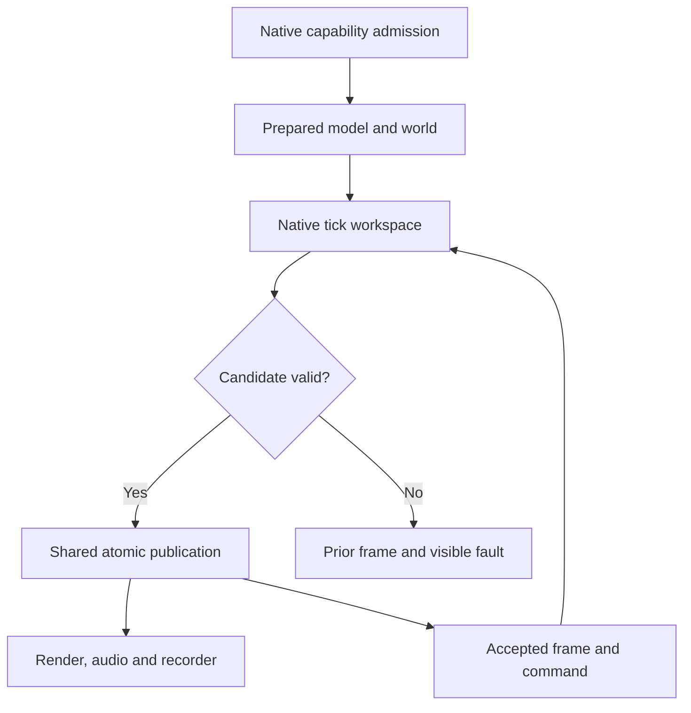

# EDF native runtime and experiment design

**Status:** proposed implementation contract, 2026-11-21; no runtime code delivered.
**Source baseline:** `9d17c29ed2463cdb3a67d3bd573c0137587edb9d`.
**Scientific revision:** EDF-00-R3 reviews `e4b42d064874dd56432b2b83744ad2e4ee0fb881`;
[fourteen studies](scientific-literature-2026-11-21.md) refine evidence and metrics.
**Owner:** EDF with SF/NK, BAT/M5, GP/CR, FL, AUD/SM and UI/DT.

The owner requests native execution throughout the EDF experiment. This document
makes that requirement testable. The [implementation plan](../../plans/edf-propulsion.md)
owns sequencing; the [twenty-investigation round](native-research-2026-11-21.md)
owns sources, alternatives and dispositions. Existing runtime guides describe
what is implemented, not this proposed extension.

## 1. Native requirement and current gap

All newly introduced EDF runtime behavior is C++/Godot-native. In an admitted
EDF flight, the numerical path includes controls and actuator state, airflow,
fan/motor/pack laws, body/rotor derivatives, RK stages and substeps, event
localization, contact/collision policies, endpoint supervision and validation.
An EDF thrust evaluator alone does not meet this requirement.

The existing [native stage bridge](../../../app/sim/native_stage.gd) installs
NK-3 evaluation callbacks. [Simulation](../../../app/sim/simulation.gd) still
integrates and publishes the tick, and [FlightSession](../../../app/sim/flight_session.gd)
has state-affecting sampled actuation and ground/collision policies. This is a
real shared-kernel implementation dependency. Preserve the single Simulation
transaction and general VehicleModel boundary; do not create an EDF-only solver
loop or call a GDScript law/event callback from inside a purported native tick.

Propose a **generic native numerical-tick capability**, admitted by immutable
layout/policy identities. The existing Godot shell can route commands, request
one step and display an accepted frame. It must not calculate EDF state updates.
New EDF view/diagnostic/audio behavior uses C++ components or existing native
Godot facilities. Research generators, measurement reducers and independent
oracles remain offline tools; their language does not determine flight execution.

For the EDF product entry, missing, mismatched or unsupported native capabilities
make the experiment unavailable with a useful reason. No automatic reference
flight is substituted. The GDScript reference remains an explicitly invoked
verification oracle, with its identity in test artifacts, and existing non-EDF
routes retain their current behavior. This is an **EDF-scoped proposed exception**
to current catalog fallback policy, authorized by the owner's native requirement;
implement its admission/UX and qualify it before changing the shipped behavior.

## 2. Capability closure before flight

| Capability | Native requirement and decisive check |
| --- | --- |
| Preparation and initialization | Validate map/source integrity, geometry, axes, units, layout and law IDs; perform EDF trim and initialization in native code. Distinguish stopped, windmilling, instantaneous and conditioned pack starts. |
| Inputs and controls | Capture device events outside the core, but perform stateful conditioning, arming, rates/expo, keyboard-command integration, yaw response and failure-dependent control logic natively. Consume the declared sample once; advance controller/servo state at its specified phase. |
| Stage physics | Reuse native aircraft loads and WindFlow semantics; add prepared EDF wrench/load and electrical laws. Every RK/event trial uses its own detached state and stage time. |
| Integration and events | Native float64 RK4, complete coupled substeps, rotor-stop/charge/LVC policies, deterministic simultaneous-event ordering and bounded trial work. Locator-only continuations remain separate from accepted physical states. |
| Ground and world | Immutable world geometry plus native mutable damage/failure/contact/crash state, pending effects and impulses. Include native pre-step/terminal policies; preserve runway takeoff and landing. An unsupported world/policy refuses launch. |
| Endpoint and transaction | Native filters, transitions, state/event checks and candidate construction. The shared publication boundary validates the complete candidate before changing accepted state, clock or recorder-visible events. |
| Checkpoint and replay | Include every numerical/controller mode, sampled-weather RNG, mutable world/session effects, event policy and source/backend identity. Restore the checkpoint's exact world version: pre-break restores intact proxies; post-break restores broken state. No execution-path switch or dependence on speculative caches. |
| Observation | Publish one detached accepted snapshot for HUD, audio, render and recorder. Observation cannot advance physics or alter its numerical result. |

A capability record must name the exact implementation of every required policy.
An umbrella `native=true` flag or native-stage call count is insufficient. Test
with deliberate traps in state-affecting reference callbacks and a distinguishable
native mutant, alongside source/call-path inspection. Run those controls on
disposable verification copies. Native coverage must survive runway contact,
cutoff, stop/restart, pause/reset, collision and restored replay.

The raw-device/event-to-command boundary is part of EDF-01. Specify which native
conditioning state and queued sample are committed at input acceptance, how a
refused physics tick retains that sample without consuming it twice, and pause,
re-arm and reset semantics. Preserve the existing observable contract or version
an intentional change. Existing `.orfl` post-conditioned command replay cannot
test this boundary: use a separate raw-event fixture plus live input checks.
Port sampled turbulence/RNG advancement as well as native weather evaluation.
Render-cadence determinism uses identical timestamped event/tick assignments or
identical accepted tick samples. Live device/OS delivery may move a transition
between sampling ticks; report that latency/arming behavior separately rather
than claiming hardware sampling is invariant to frame cadence.

## 3. One transaction with a prepared native core

The final C++ names and ABI are frozen in EDF-01; these are responsibilities,
not an instruction to add these exact classes:

| Responsibility | Lifetime / contents |
| --- | --- |
| Prepared model and installation | Immutable decoded coefficients, axes, dimensions, map support, output evidence, policy/layout IDs and frozen environment/world data. Validate once; retain required live identity guards. |
| Accepted frame | Body and continuous float64 arrays, modes, controller/actuator state, sampled-weather RNG, mutable session/world effects, tick, epoch and identities. One authoritative publication owner. |
| Tick workspace | Private pre-sized k1–k4 arrays, coupled derivatives, event brackets, scratch loads and bounded receipt storage. No retained pointer into temporary Godot Variant memory. |
| Native tick operation | Read accepted frame + one command sample; compute a detached candidate or structured refusal. No scene-tree access, I/O, UI signal, data-file hashing or script callback in numerical evaluation. |
| Publication adapter | Check identity/generation, shape, finiteness, event order and purity; publish the physical frame and session effects before EDF event/step observers. Precommit refusal retains the prior frame; the proposed native publication guard retains the new accepted frame and pauses on a detected postcommit observer violation. |
| Accepted snapshot | Detached previous/current state and observer fields. Presentation smooths its own signals; never feeds interpolated values into physics. |

The diagram shows ownership and data flow, not a second clock. Keep fixed 240 Hz
and the existing catch-up policy. Freeze and qualify before-step input semantics,
checkpoint reads, pause/reset and the native publication policy. A native result
cannot bypass those contracts merely because its inner computation is pure.

Current `Simulation.step` emits `events_located` before `stepped`;
`FlightSession._on_sim_stepped` commits pending incidents/damage before later
step subscribers, not before every event observer. Broken IDs change the next
active collision world. The session's
`_session_after_input` also makes terminal crash/gear decisions before the child
Simulation tick. The native capability must cover both boundaries. Save a
pre-break checkpoint, accept a hit, save a post-break checkpoint and test a second
pass. Restoring each checkpoint must recover its own intact/broken proxy and
damage state. A rejected hit leaks no damage. Freeze geometry separately from
these evolving states.

The current `_publish_committed_boundary` guard covers prepared reset/restore;
ordinary steps do not have that general guard. Legacy tests also permit a
restore request inside a stepped observer. The proposed EDF capability therefore
adds an explicit publication contract: commit the complete native physical and
session/world candidate, then publish `events_located`, then `stepped`, with a
detached receipt identifying that same commit. Test what each observer sees.
This intentionally strengthens the opt-in boundary; do not silently change the
legacy event/step ordering, reentry or fallback behavior of other routes.

For EDF, detect protected-state/model mutation, forbidden synchronous numerical
transition reentry and explicit observer failure reports. Preserve the committed
frame and pause/fault on those detected violations, without claiming a physical
rollback. Read-only access and allowed pause requests remain valid. EDF-01 must
freeze notification continuation and recorder-completeness behavior on a fault,
and how legitimate later reset/restore requests are dispatched outside publication.
Arbitrary engine/script exceptions or process failure are not automatically
covered by this detectable-fault contract. T13/T31 test ordinary observers,
event-versus-step visibility, mutation, reentry and reported failures separately.

Prototype the generic boundary with an analytic model before EDF. Prove that
existing models outside the new capability keep their behavior. Then qualify
the complete EDF policy set. A partially ported native stand is useful evidence,
but does not qualify the native-only playable aircraft.

## 4. Efficient execution without numerical shortcuts

### Prepared data and bounded memory

Start with small scalar/fixed-layout double structures for one fan and one pack.
Decode units, dimensions, map metadata and structural invariants during prepare.
Precompute only transformations whose rounding and source identity are specified.
Count allocations rather than describing the current NK-3 path as allocation-free:
its stage result currently builds Godot dictionaries/arrays and native vectors.

Keep per-stage computation inside the C++ core and cross the Godot boundary once
per complete candidate tick where the qualified contract permits it. Pre-size
continuous-state and event storage from validated bounds. Refuse dimension
overflow and exhausted event budgets without publishing a partial result. Retain
bounded diagnostics. Measure preparation, steady state, event-heavy ticks and
refusal separately; one detached output copy can be preferable to fragile aliasing.

Map lookup may use a previous cell as a checked hint. Rejected RK/event probes
can arrive out of time order: cache state must not change numerical results,
domain decisions or replay. Test cache enabled/disabled and adversarial query order.
Start scalar. SIMD, task parallelism, GPU evaluation, compression, mixed precision
and altered transcendental routines require a measured bottleneck and separate
qualification; they are not prerequisites for one EDF.

### Map consistency and electrical model order

Specify interpolation, knot behavior, joint support and extrapolation refusal.
Scalar monotonicity/positive vertices do not establish joint force/shaft-power
consistency inside a cell. The physics study and R2-09 distinguish blending
complete model outputs at the same input from interpolation across different
inputs. Qualify interior energy behavior and conservative support.

Use a compact averaged one-quadrant drive initially, with explicit source-off
circuit assumptions and declared measurement bandwidth. A synthetic algebraic
current limiter may solve admissible duty consistently with the pack and motor;
it cannot clip only the displayed current. Adding winding inductance is separate
scope: demonstrate coupled accuracy, magnetic energy and a physical decay path,
not just an isolated exact electrical update or an unstable 240 Hz RK step.

### Evidence metadata and accepted consumption metrics

Resolve scientific-data conventions during offline acquisition and native
preparation: corrected file/version, experiment family, rotor/hub/duct geometry,
clearance denominator, force datum, power port, coefficient definition and
output-specific evidence. Prepare a compact immutable description with the map;
do not parse papers, convert units or hash files inside RK stages. Source claims
with unresolved dimensional contradictions cannot masquerade as identified
coefficients. An explicitly assumed, internally consistent synthetic geometry
remains admissible for the estimated software track.

The [metric contract](physics-and-sources.md#performance-and-consumption-metrics)
distinguishes static electrical N/kW, axial useful efficiency and terminal Wh/Ah.
Add bounded native candidate accumulators for accepted energy/charge, elapsed
simulation time and limiting duration, with declared quadrature and event error
budgets. Rejected trials and paused wall time contribute nothing. Freeze whether
an accumulator is a session total or a selected comparison window; checkpoint,
reset, restore and recorder semantics must prevent duplicate increments.

These diagnostics do not add a physical feedback state or another integration
clock. Compute them from the qualified accepted path and publish them with the
matching frame. HUD/audio reads never advance counters or recompute a different
electrical operating point. Keep port/force-boundary and availability metadata in
the snapshot; unknown thermal quantities, zero-denominator ratios and finite-pack
endurance in ideal-bus mode must not acquire plausible-looking numeric values.
Compare source data at its declared measurement bandwidth, not at the render rate.

### Floating point and ABI

Preserve scalar/PackedFloat64Array physics and the qualified strict operation
order. Keep the engine/binding `real_t` ABI at its pinned precision; the existing
single-precision Godot ABI does not require single-precision simulation arithmetic.
Do not enable `precision=double` for bindings against the current official engine.
Keep effective contraction/fast-math settings, libm behavior, source/API/compiler
receipts and reference-parity requirements. No cross-platform bit identity is
inferred from matching-host comparisons.

## 5. What the experiment should look like

Build this within the existing Godot application. No web dashboard or separate
runtime is required. The initial native controls can be modest: fixed presets,
short scripted stand commands, and a read-only detail panel.

| View | User action and visible result | Contract |
| --- | --- | --- |
| Home aircraft entry | Select **Vantage Jet · EDF 128 (Experimental)**, pack/ideal-lab mode and an admitted start. | Native availability is checked before launch; show a short actionable reason if unsupported. Preserve saved supported choices. |
| EDF stand | Select a declared preset, run a throttle step/ramp or source-off case, pause/reset and inspect thrust, RPM, pack/motor current, voltage and current-limit status. | Same native law/data as flight; the stand is a separate physical boundary, with its own identity. Do not label isolated-stand force as installed-aircraft force. |
| Installation preview | Inspect duct/fan/pack position and mass/CG changes on the existing jet; toggle simplified inlet/nozzle and force-axis overlays. | Draw authored geometry and declared estimates; no inferred physical fit or automatic resizing of the A200. Overlays are observers. |
| Flight | Fly the same airframe with gear/flaps; show a compact RPM/pack/current panel and clear limiting/source-loss states. | Flight uses installed loads, admitted contact/world policies and the complete native tick. Changes requiring preparation return through the normal session boundary. |
| Debrief | Compare a retained turbine run and a separately trimmed EDF run, with EDF electrical consumption, supported turbine fuel measures and estimated-domain use. | Preserve each recording's model/law/backend identity and energy boundary. A comparison plot is not exact cross-model replay or a qualified common energy-efficiency metric. |

The stand can show net thrust, electrical input and N/kW for its declared
boundary. EDF flight/debrief shows terminal Wh/Ah, accepted elapsed time, minimum
voltage, limiting duration and reserve/termination reason. Offer Wh/km only for
a positive, named distance measure. Ordinary flight does not need a generic
efficiency gauge; the diagnostic view can expose qualified metric definitions.
Changing battery capacity requires the corresponding source and mass model,
not just a longer timer. T38 verifies accounting independently of rendering.

Make estimate/unknown state readable with text and symbols, not color alone.
Keep ABI hashes, solver names and developer timings in a details view; ordinary
flight needs meaningful source/limit/recovery information. Do not show an
unmodeled motor temperature as zero or a positive verdict. Review 1080p and the
applicable Apple Retina target, normal controls, focus, pause/reset and recovery.

Optional cutaways/streamlines are labeled illustrations unless supplied by a
qualified flow solution. Rotor blur and visual rotation are presentation only;
sampling a fast rotor at render cadence does not measure physical RPM. Use the
accepted simulation clock for effects and preserve physics with overlays off/on.

### Audio and observer timing

Publish epoch/tick, pause/source state, accepted RPM, physical load, current-limit
reason and evidence flags. Keep the existing audio observer interface where it
fits, with native EDF additions. Blade-pass frequency `blade_count * RPM / 60`
is a frequency anchor, not an identified spectrum or loudness. A labeled
recorded/procedural surrogate can combine tone bands and broadband flow sound.
Use the actual device sample rate; band-limit/fade harmonics near Nyquist.

At 14 blades and 45,000 RPM, the anchor is 10.5 kHz; its third harmonic is 31.5 kHz,
above the 24 kHz Nyquist limit of 48 kHz output. This is a synthetic signal example,
not the chosen fan's measured sound. Test mute, pause/reset, fast RPM/load changes,
listener motion, clipping and sample-rate changes. Capture real-driver PCM and
listen where available; Dummy validates lifecycle/routing only. Never compute
audio or HUD signals from rejected solver trials.

## 6. Measurement and release gates

Measure four scopes separately: pure law, bridge/marshaling, complete accepted
numerical tick including events, and complete session callback including
observers. Existing `step_usec` is smoothed and sampled before final observers;
it is not a substitute for a raw full-callback distribution. Report p50/p95/p99,
defined maxima/tail cases, allocations, substep/event counts and native coverage.

The project 500 microsecond physics gate retains its owning regime/statistic
definition. A 240 Hz period is about 4,166.7 microseconds; a 500-microsecond tick
uses 12% of that period, but does not establish frame pacing or OS scheduling
headroom. Fix host, build, renderer, pixels, workload, thermal state, warm-up and
observer settings. Serialize performance runs; run independent offline sweeps in
parallel only where the existing pool admits them. Profile instrumented builds
for attribution and remeasure the qualifying release binary for the budget.

Each advertised target needs its own pinned engine/API/bindings/compiler/ABI,
library and package receipts. Test the actual extracted release, Home/direct
entry, load/trim, native coverage, record/restore, restart and normal shutdown.
Missing/stale/wrong-architecture libraries or unsupported policies make EDF
unavailable without killing the app or launching a reference EDF. Preserve
`reloadable=false` for qualified artifacts; replacing a loaded library requires
a fresh process and new matching evidence.

Use the existing [native tools](../../../research/native-kernel/README.md),
[tool index](../../tools/README.md), [audio tools](../../../tools/audio/README.md)
and [flight logging](../../FLIGHT-LOGGING.md). Native sanitizers, fuzzing and
metamorphic controls supplement analytic, exact parity, fault/rollback, physical,
pilot, package and hardware checks; none substitutes for the others. T30–T40 in
the [validation matrix](validation-matrix.md) specify the new discriminators.

No speedup, allocation count, all-native flight, visual quality or package pass
has been measured by this research. The implementation must supply that evidence.
