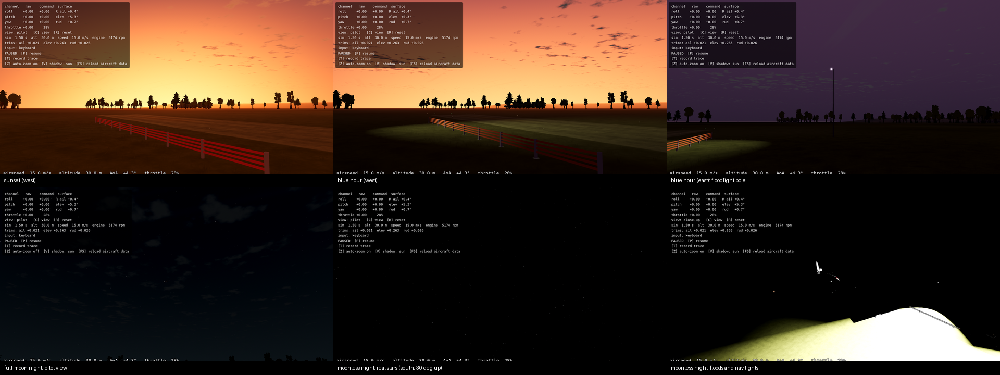

# FW-21/22/23/26 — Time of day: sky table, haze lobe, light, adaptation and night tonemapping

**Status:** engineering-verified 2026-10-10; owner's look and target GPU pending (Gate FW-N). Code: [sky_table.py](../../../../tools/world/sky_table.py) → [sky_table.json](../../../../app/data/sky/sky_table.json), [sky_state.gd](../../../../app/render/world/sky_state.gd), [conditions.gd](../../../../app/render/world/conditions.gd), time-of-day branches in [atmosphere.gd](../../../../app/render/atmosphere.gd), lobe term in the sky, ground and near-grass shaders. Tests: [test_world_sky.gd](../../../../app/tests/test_world_sky.gd) (38 checks), adaptation checks in [test_world_field_lights.gd](../../../../app/tests/test_world_field_lights.gd).

## What was done

- **Sky table (FW-21, changed from a 2-D LUT):** single scattering through a spherical atmosphere (Rayleigh, Mie, ozone; Bruneton 2017 / Hillaire 2020 constants at 680/550/440 nm) plus Hillaire's isotropic multiple scattering, tabulated by altitude and local sun elevation (without it the twilight horizon was black). Per 0.5° of sun elevation from −20° to 90°: zenith, anti-sun horizon haze, sunward horizon lobe and its exponent, ground-to-sun and cloud-deck-to-sun transmittance. 27 s, stdlib only, `--check` in `app/test.sh`.
- **Anchoring:** every quantity is scaled per channel so that a 45° sun reproduces `Spec.ATMOSPHERE` exactly (zenith, haze, sun colour/energy, exposure: tested). The model supplies only the change with the hour, so the calibrated day look (L1–L3) is kept.
- **Haze lobe (FW-22):** the twilight arch toward the sun is one term, `lobe · max(dot(d, lobe_dir), 0)^k`, drawn identically by the sky and the ground's and grass's own fog, so the L2 seam rule holds. The engine's fog keeps the uniform haze (its sun scatter is off in this mode).
- **Light and adaptation (FW-23):** one directional light, the brighter of sun and moon (moonlight 2.5·10⁻⁶ of the sun at full, Allen's phase law, drawn cooler by convention). Scripted adaptation (auto-exposure is Forward+ only): gain = (Y₄₅ / Y)^0.84, capped at 1.5·10⁵, where Y includes the sky, half the lobe and direct light. At dusk and night the eye adapts to the view: Y adds the floods' light on the view target (the airplane) and 0.5 × the lit runway's light × the picture's share below the horizon (from the camera's pitch and field of view). The exposure follows that goal in log space at 2 /s toward light and 0.35 /s toward dark, on simulation time (pause holds it; captures snap). The light sprites read it as the global `world_exposure`.
- **Night tonemapping (FW-26):** below a −1° sun the tonemapper is AgX. Godot's ACES fit has a black point (linear values under ~0.002 render black) and clips floodlights; its AgX (allenwp curve) has a sigmoid toe and a soft shoulder. Day and sunset keep ACES, chosen for readability in L1b. Sources: [web research](../web-research-2026-10-10.md). Ambient is a colour anchored to the calibrated look (the cubemap path applies the exposure twice: [FW-24](../FW-24/README.md)). The planar pilot-aid shadow follows the light, held at ≥ 12° elevation.
- **Conditions (FW-03 slice):** `--time_of_day=<preset>` or `--time=HH:MM` with `--date`, `--lat`, `--lon`, `--utc_offset` (environment twins `OPENRC_*`). Presets are sun events solved on their date at the reference place (40° N, 3.7° W, UTC+2, D-5): moon dates checked by the test (2026-06-29 full, 2026-06-15 new).

## Results (reference place, 1280×720 llvmpipe captures)

| Preset | Local time | Sun | Moon | Light | Exposure | Field lights / stars |
| --- | --- | --- | --- | --- | --- | --- |
| noon | 14:16 | 73.4° | 3.2° | sun | 0.60 | no |
| morning | 09:11 | 25° | −45° | sun | 0.64 | no |
| golden_hour | 21:07 | 6° | 45° | sun, #ffb56a | 0.64 | no |
| sunset | 21:42 | 0.5° | 42° | sun, #ff6105 | 1.84 | yes |
| blue_hour | 22:07 | −4° | 39° | moon | 36.9 | yes |
| night | 02:18 (+1 d) | −26.8° | 22°, full | moon | 41,327 looking up at a dark airplane; lower toward the lit field (adaptive) | yes |
| night_dark | 02:16 (+1 d) | −26.7° | −22°, new | — | 90,000 looking up; lower toward the lit field (adaptive) | yes |

Captures: golden hour and sunset back-light the treeline under an orange sky; blue hour shows the purple anti-twilight and dark silhouettes; the moonlit night keeps the field readable with moonlit clouds; without floods a moonless night is black with a real star field.

## Defects found and fixed on the way

- Night surfaces rendered white: the sky radiance carries the exposure twice (engine). Fixed with the anchored ambient colour.
- Moonlight first came out warm (physical transmittance at 22°): the moon light now takes a fixed cool colour with the physical luminance.
- Floodlit ground blew out under the moonless exposure. A fixed 8 % weight of the runway light first traded it for a dark pilot sky and a white airplane on Home; the view-based adaptation, club-class floods (12,000 cd) and AgX at night fixed all three in captures: lit ground keeps its texture, the Home airplane reads in its true colours, the pilot's moonlit sky keeps moon, clouds and stars.
- Still open for Gate FW-N: an airplane flying above the lights is a dark shape with its kit lights, which is realistic but needs the owner's verdict; belly strips wait for model anchors (D-8).

## What it does not prove

Llvmpipe pixels, not the owner's monitor or eye. The anchor keeps today's day look by construction, so the model is not validated at 45°; its twilight colours are physical in trend, without ground reflection. The legacy default (no time) is unchanged: [FW-02](../FW-02/README.md).

## Reproduce

`python3 tools/world/sky_table.py --check`; `$(app/get-godot.sh) --headless --path app --script res://tests/test_world_sky.gd -- --verbose`; `tools/world/capture_times.sh <out>`.
