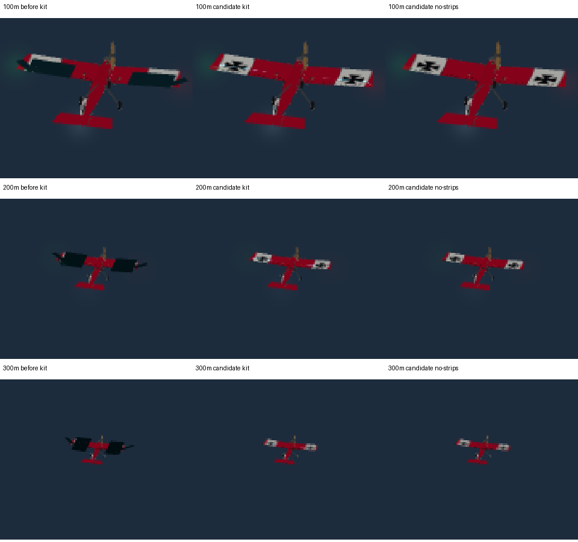

# FW-31…35 — Field lights and the aircraft night kit (first slice)

**Status:** engineering-verified 2026-10-10; owner's night flight pending (Gate FW-N). Code: [field_lights.gd](../../../../app/render/world/field_lights.gd), [lights.json](../../../../app/data/fields/lights.json), [aircraft_lights.gd](../../../../app/render/world/aircraft_lights.gd), [light_sprite.gdshader](../../../../app/render/world/light_sprite.gdshader). Test: [test_world_field_lights.gd](../../../../app/tests/test_world_field_lights.gd) (25 checks).

## What was done

- **Data (FW-31):** `openrc-field-lights v1`, every value `{value, unit, kind, source}`. Two 8 m club LED floods (12,000 cd, 60°, 5,000 K; first 30,000 cd, a stadium-class value that clipped the lit ground) behind the pilot line aimed at the runway, a floodlit windsock (after FAA L-807), solar stakes along both runway edges every 20 m, green stakes across both ends (artistic borrowing), and a red lamp on the pilot station (red keeps dark adaptation). The loader refuses 11 kinds of malformed files, including more than four floods.
- **Floods (FW-34):** shadowless `SpotLight3D`s (energy = cd / 10⁵ lux), poles and glowing heads. Compatibility lights at most 8 spots per mesh and the ground is one mesh: floods (3) plus the landing light stay inside it, so the analytic light pools (FW-32) were not needed yet.
- **Points (FW-33):** one sprite shader for every lamp: physical core size and radiance, a minimum on-screen size with flux conservation (a light vanishes by day and blazes at night, as real ones do), a display cap that keeps saturated hues from clipping to white, flashing on `sim_clock`, and output encoded for the engine's ALBEDO linearisation.
- **Night kit (FW-35):** fitted from dusk to any catalog aircraft from its own bounds (no model file or node touched): red left / green right tip lights, white tail light, white tip strobes double-flashing each second, and a forward landing light. Belly strips were tried and dropped: the bounds include wheels and propeller, so a strip floated below the gear. They need per-model anchors (D-8).
- **When:** field lights and stars from a sun below 3° and 2°, the kit below 6°, only in time-of-day mode.

## Results

- Captures: floods light the runway and windsock; with the view-based adaptation and AgX at night ([FW-23](../FW-23/README.md)) the lit ground keeps its texture in the close-up, the Home airplane under the lights reads in its colours, and the pilot's sky keeps the moon and stars.
- The kit's tip lights read as red and green points from the pilot's eye at 30 m once held at 4 px; before the display cap and encoding fix they were white or invisible.
- `World.build` builds none of this in the legacy mode or at noon (tested).

## What it does not prove

Light counts and per-pixel cost on the owner's GPU (FW-30 still open). Whether the kit is enough to judge attitude at 150 m at night: that is Gate FW-N's question, and the belly strips are expected to matter.

## Reproduce

`$(app/get-godot.sh) --headless --path app --script res://tests/test_world_field_lights.gd`; `tools/world/capture_times.sh <out> night night_dark` (pilot and close-up views).

## 2026-10-13 · FW-62-R1: distant wing blocks

The owner supplied three Windows screenshots of the Ugly Stik during Evening flight. Native RTX 3090 captures reproduced the dark rectangles: hiding only `NightKit/strip_left` and `strip_right` restored the wing paint. The previous depth-range investigation addressed a different artifact; the camera near/far settings remain unchanged.

The strip shader expanded an **opaque** ribbon using the fixed 50°/720p reference even when pilot zoom narrowed the camera to 6° or 1°. At dusk its flux-compensated radiance was darker than the wing. The ribbon covered the paint, extended beyond the wing, and could leak through its upper surface. Point-light sprites shared the wrong projection scale, producing oversized halos.

The shaders now derive metres per pixel from the live projection matrix, viewport height and view-space depth, including the orthographic projection branch. Physical emitter sizes remain the lower bound and radiance retains width/area compensation. Strips use additive emission, soft transverse edges and a root-frame underside visibility gate; normal depth testing still hides them behind foreground geometry. Model geometry, flight physics and camera clipping are unchanged.



### Rendered evidence

Godot **4.7.2.stable.official.ed1daf0bf**, Compatibility/OpenGL, NVIDIA RTX 3090, driver **610.88**, 4× MSAA. [Native result](night-strip-summary.json), [old-shader rejection control](night-strip-old-control.json), [Linux llvmpipe result](night-strip-linux-summary.json). The control injects copies of the original shaders into test materials; it does not mutate production files.

| Probe | Original | Corrected |
| --- | ---: | ---: |
| Stik, 200 m, 6°, exposure 0.6, underside: darkened subject pixels | 287 | 0 |
| Isolated unresolved strip, 720p, FOV 50° / 6° / 1°: lit rows | 2 / 18 / 100 | 2 / 2 / 2 |
| Isolated unresolved sprite, 720p, FOV 50° / 6° / 1°: lit rows | 4 / 34 / ≥128 (ROI clipped) | 4 / 4 / 4 |
| GPU checks rejected | 79 of 123 | 0 of 123 |

The fleet checks use all five aircraft, 30/200/600 m, FOV 50°/6°/1°, exposures 0.6 and 30, and views above/below. They reject darkening, require the underside light to remain visible, and require byte-identical upper views with strips hidden. Isolated emitters test both 720p and 1080p, plus orthographic projection with both aspect modes. Opaque blocker controls reject lights showing through foreground objects. A production blue-hour capture at 200 m also confirmed removal of oversized halos.

All 123 GPU checks passed on Windows/NVIDIA and in a fresh Linux source snapshot under Xvfb with llvmpipe. The capture regression runs in `app/capture.sh` and its summary hash is included in the capture-set manifest. The native parse sweep passed all **516** scripts in its starting inventory. Focused headless checks passed: field lights **49**, camera views **39**, world flow **26**, camera route **19**. These captures establish the defect and software correction; Gate FW-N still needs the owner's flight review.

```powershell
& ./.tools/Godot_v4.7.2-stable_win64_console.exe --path app --audio-driver Dummy --rendering-driver opengl3 --script res://tests/capture_aircraft_lights.gd -- --out=C:/Temp/openrc-aircraft-lights
```

On Linux, use the pinned engine under `xvfb-run -a -s "-screen 0 1920x1080x24"`. Optional `--strip-shader=<absolute path>` and `--sprite-shader=<absolute path>` reproduce shader rejection controls. Use a fresh output folder and inspect both the exit status and engine log.
